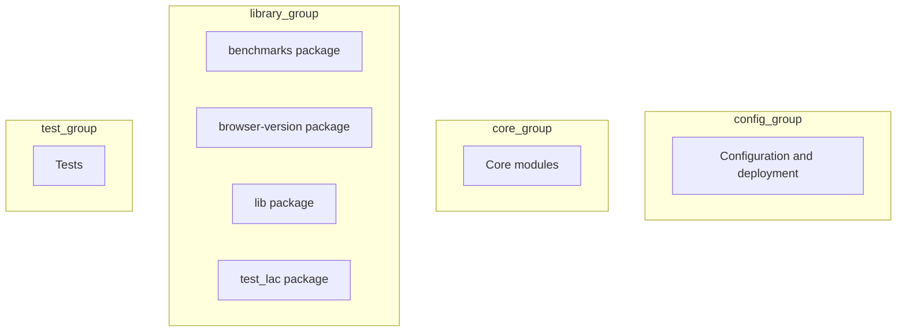

# Architecture report: louischatriot/nedb

> Automated static analysis. **Observed** = directly seen in files/imports/AST; **Inferred** = interpretation from that evidence. Repository code was not executed.

## 1. Repository at a glance

| Item | Value |
| --- | --- |
| Repository | louischatriot/nedb |
| Description | The JavaScript Database, for Node.js, nw.js, electron and the browser |
| Language | JavaScript |
| Stars | 13525 |
| Licence | MIT |
| Analysed commit / branch | 35be491ca67dbd4c6f75335f5f486307b192f2dc / master |
| Framework(s) | None detected |
| Files analysed | 54 |
| Components | 7 |

## 2. Architecture in one minute

louischatriot/nedb - The JavaScript Database, for Node.js, nw.js, electron and the browser. This repository was analysed statically from 54 file(s) (0 Python). Detected technologies (observed from imports/manifests): no known frameworks/libraries. Files are grouped into 7 component(s): benchmarks package, browser-version package, Configuration and deployment, Core modules, lib package, test_lac package, Tests. Findings below distinguish observed facts from inferred interpretation.

## 3. High-level block diagram

## 4. Main components

### benchmarks package (`benchmarks`)

- **Kind:** library
- **Status:** Observed
- **Confidence:** 0.85
- **Responsibility:** Groups 9 file(s) under benchmarks package (observed from repository paths and static analysis).
- **Paths:** `benchmarks/commonUtilities.js`, `benchmarks/ensureIndex.js`, `benchmarks/find.js`, `benchmarks/findOne.js`, `benchmarks/findWithIn.js`, `benchmarks/insert.js`, `benchmarks/loadDatabase.js`, `benchmarks/remove.js`, `benchmarks/update.js`
- **Evidence:** [benchmarks/commonUtilities.js](https://github.com/louischatriot/nedb/blob/35be491ca67dbd4c6f75335f5f486307b192f2dc/benchmarks/commonUtilities.js); [benchmarks/ensureIndex.js](https://github.com/louischatriot/nedb/blob/35be491ca67dbd4c6f75335f5f486307b192f2dc/benchmarks/ensureIndex.js); [benchmarks/find.js](https://github.com/louischatriot/nedb/blob/35be491ca67dbd4c6f75335f5f486307b192f2dc/benchmarks/find.js); [benchmarks/findOne.js](https://github.com/louischatriot/nedb/blob/35be491ca67dbd4c6f75335f5f486307b192f2dc/benchmarks/findOne.js); [benchmarks/findWithIn.js](https://github.com/louischatriot/nedb/blob/35be491ca67dbd4c6f75335f5f486307b192f2dc/benchmarks/findWithIn.js); [benchmarks/insert.js](https://github.com/louischatriot/nedb/blob/35be491ca67dbd4c6f75335f5f486307b192f2dc/benchmarks/insert.js); [benchmarks/loadDatabase.js](https://github.com/louischatriot/nedb/blob/35be491ca67dbd4c6f75335f5f486307b192f2dc/benchmarks/loadDatabase.js); [benchmarks/remove.js](https://github.com/louischatriot/nedb/blob/35be491ca67dbd4c6f75335f5f486307b192f2dc/benchmarks/remove.js)

### browser-version package (`browser_version`)

- **Kind:** library
- **Status:** Observed
- **Confidence:** 0.85
- **Responsibility:** Groups 3 file(s) under browser-version package (observed from repository paths and static analysis).
- **Paths:** `browser-version/browser-specific/lib/customUtils.js`, `browser-version/browser-specific/lib/storage.js`, `browser-version/build.js`
- **Evidence:** [browser-version/browser-specific/lib/customUtils.js](https://github.com/louischatriot/nedb/blob/35be491ca67dbd4c6f75335f5f486307b192f2dc/browser-version/browser-specific/lib/customUtils.js); [browser-version/browser-specific/lib/storage.js](https://github.com/louischatriot/nedb/blob/35be491ca67dbd4c6f75335f5f486307b192f2dc/browser-version/browser-specific/lib/storage.js); [browser-version/build.js](https://github.com/louischatriot/nedb/blob/35be491ca67dbd4c6f75335f5f486307b192f2dc/browser-version/build.js)

### Configuration and deployment (`config`)

- **Kind:** config
- **Status:** Observed
- **Confidence:** 0.85
- **Responsibility:** Groups 3 file(s) under configuration and deployment (observed from repository paths and static analysis).
- **Paths:** `bower.json`, `browser-version/package.json`, `package.json`
- **Evidence:** [bower.json](https://github.com/louischatriot/nedb/blob/35be491ca67dbd4c6f75335f5f486307b192f2dc/bower.json); [browser-version/package.json](https://github.com/louischatriot/nedb/blob/35be491ca67dbd4c6f75335f5f486307b192f2dc/browser-version/package.json); [package.json](https://github.com/louischatriot/nedb/blob/35be491ca67dbd4c6f75335f5f486307b192f2dc/package.json)

### Core modules (`core`)

- **Kind:** core
- **Status:** Observed
- **Confidence:** 0.85
- **Responsibility:** Groups 1 file(s) under core modules (observed from repository paths and static analysis).
- **Paths:** `index.js`
- **Evidence:** [index.js](https://github.com/louischatriot/nedb/blob/35be491ca67dbd4c6f75335f5f486307b192f2dc/index.js)

### lib package (`lib`)

- **Kind:** library
- **Status:** Observed
- **Confidence:** 0.85
- **Responsibility:** Groups 8 file(s) under lib package (observed from repository paths and static analysis).
- **Paths:** `lib/cursor.js`, `lib/customUtils.js`, `lib/datastore.js`, `lib/executor.js`, `lib/indexes.js`, `lib/model.js`, `lib/persistence.js`, `lib/storage.js`
- **Evidence:** [lib/cursor.js](https://github.com/louischatriot/nedb/blob/35be491ca67dbd4c6f75335f5f486307b192f2dc/lib/cursor.js); [lib/customUtils.js](https://github.com/louischatriot/nedb/blob/35be491ca67dbd4c6f75335f5f486307b192f2dc/lib/customUtils.js); [lib/datastore.js](https://github.com/louischatriot/nedb/blob/35be491ca67dbd4c6f75335f5f486307b192f2dc/lib/datastore.js); [lib/executor.js](https://github.com/louischatriot/nedb/blob/35be491ca67dbd4c6f75335f5f486307b192f2dc/lib/executor.js); [lib/indexes.js](https://github.com/louischatriot/nedb/blob/35be491ca67dbd4c6f75335f5f486307b192f2dc/lib/indexes.js); [lib/model.js](https://github.com/louischatriot/nedb/blob/35be491ca67dbd4c6f75335f5f486307b192f2dc/lib/model.js); [lib/persistence.js](https://github.com/louischatriot/nedb/blob/35be491ca67dbd4c6f75335f5f486307b192f2dc/lib/persistence.js); [lib/storage.js](https://github.com/louischatriot/nedb/blob/35be491ca67dbd4c6f75335f5f486307b192f2dc/lib/storage.js)

### test_lac package (`test_lac`)

- **Kind:** library
- **Status:** Observed
- **Confidence:** 0.85
- **Responsibility:** Groups 3 file(s) under test_lac package (observed from repository paths and static analysis).
- **Paths:** `test_lac/loadAndCrash.test.js`, `test_lac/openFds.test.js`, `test_lac/openFdsLaunch.sh`
- **Evidence:** [test_lac/loadAndCrash.test.js](https://github.com/louischatriot/nedb/blob/35be491ca67dbd4c6f75335f5f486307b192f2dc/test_lac/loadAndCrash.test.js); [test_lac/openFds.test.js](https://github.com/louischatriot/nedb/blob/35be491ca67dbd4c6f75335f5f486307b192f2dc/test_lac/openFds.test.js); [test_lac/openFdsLaunch.sh](https://github.com/louischatriot/nedb/blob/35be491ca67dbd4c6f75335f5f486307b192f2dc/test_lac/openFdsLaunch.sh)

### Tests (`tests`)

- **Kind:** test
- **Status:** Observed
- **Confidence:** 0.85
- **Responsibility:** Groups 22 file(s) under tests (observed from repository paths and static analysis).
- **Paths:** `browser-version/test/async.js`, `browser-version/test/chai.js`, `browser-version/test/index.html`, `browser-version/test/localforage.js`, `browser-version/test/mocha.css`, `browser-version/test/mocha.js`, `browser-version/test/nedb-browser.js`, `browser-version/test/playground.html`, `browser-version/test/testLoad.html`, `browser-version/test/testLoad.js`, `browser-version/test/testPersistence.html`, `browser-version/test/testPersistence.js`, `browser-version/test/testPersistence2.html`, `browser-version/test/testPersistence2.js`, `test/cursor.test.js`, `test/customUtil.test.js`, `test/db.test.js`, `test/executor.test.js`, `test/indexes.test.js`, `test/mocha.opts`, `test/model.test.js`, `test/persistence.test.js`
- **Evidence:** [browser-version/test/async.js](https://github.com/louischatriot/nedb/blob/35be491ca67dbd4c6f75335f5f486307b192f2dc/browser-version/test/async.js); [browser-version/test/chai.js](https://github.com/louischatriot/nedb/blob/35be491ca67dbd4c6f75335f5f486307b192f2dc/browser-version/test/chai.js); [browser-version/test/index.html](https://github.com/louischatriot/nedb/blob/35be491ca67dbd4c6f75335f5f486307b192f2dc/browser-version/test/index.html); [browser-version/test/localforage.js](https://github.com/louischatriot/nedb/blob/35be491ca67dbd4c6f75335f5f486307b192f2dc/browser-version/test/localforage.js); [browser-version/test/mocha.css](https://github.com/louischatriot/nedb/blob/35be491ca67dbd4c6f75335f5f486307b192f2dc/browser-version/test/mocha.css); [browser-version/test/mocha.js](https://github.com/louischatriot/nedb/blob/35be491ca67dbd4c6f75335f5f486307b192f2dc/browser-version/test/mocha.js); [browser-version/test/nedb-browser.js](https://github.com/louischatriot/nedb/blob/35be491ca67dbd4c6f75335f5f486307b192f2dc/browser-version/test/nedb-browser.js); [browser-version/test/playground.html](https://github.com/louischatriot/nedb/blob/35be491ca67dbd4c6f75335f5f486307b192f2dc/browser-version/test/playground.html)

## 5. Execution flow

**Observed** entry point(s):

- [index.js](https://github.com/louischatriot/nedb/blob/35be491ca67dbd4c6f75335f5f486307b192f2dc/index.js)

Representative flow (derived from observed entry points and the import graph; steps beyond the entry point are **Inferred**):

1. Execution starts at an observed entry point listed above, if present.
2. No internal import relationships between components were observed.

## 6. Project structure

### `(root)`

- `.gitignore` - other (177 bytes)
- `LICENSE` - docs (1109 bytes)
- `README.md` - docs (41326 bytes)
- `bower.json` - config (223 bytes)
- `index.js` - source, JavaScript (73 bytes)
- `package.json` - manifest (1121 bytes)

### `benchmarks`

- `benchmarks/commonUtilities.js` - source, JavaScript (8262 bytes)
- `benchmarks/ensureIndex.js` - source, JavaScript (1480 bytes)
- `benchmarks/find.js` - source, JavaScript (958 bytes)
- `benchmarks/findOne.js` - source, JavaScript (1025 bytes)
- `benchmarks/findWithIn.js` - source, JavaScript (964 bytes)
- `benchmarks/insert.js` - source, JavaScript (1159 bytes)
- `benchmarks/loadDatabase.js` - source, JavaScript (1203 bytes)
- `benchmarks/remove.js` - source, JavaScript (1394 bytes)
- `benchmarks/update.js` - source, JavaScript (1398 bytes)

### `browser-version`

- `browser-version/browser-specific/lib/customUtils.js` - source, JavaScript (2415 bytes)
- `browser-version/browser-specific/lib/storage.js` - source, JavaScript (2841 bytes)
- `browser-version/build.js` - source, JavaScript (2973 bytes)
- `browser-version/package.json` - manifest (132 bytes)
- `browser-version/test/async.js` - test, JavaScript (12340 bytes)
- `browser-version/test/chai.js` - test, JavaScript (135717 bytes)
- `browser-version/test/index.html` - test (606 bytes)
- `browser-version/test/localforage.js` - test, JavaScript (96550 bytes)
- `browser-version/test/mocha.css` - test (2964 bytes)
- `browser-version/test/mocha.js` - test, JavaScript (96200 bytes)
- `browser-version/test/nedb-browser.js` - test, JavaScript (10112 bytes)
- `browser-version/test/playground.html` - test (169 bytes)
- `browser-version/test/testLoad.html` - test (377 bytes)
- `browser-version/test/testLoad.js` - test, JavaScript (4352 bytes)
- `browser-version/test/testPersistence.html` - test (298 bytes)
- `browser-version/test/testPersistence.js` - test, JavaScript (589 bytes)
- `browser-version/test/testPersistence2.html` - test (349 bytes)
- `browser-version/test/testPersistence2.js` - test, JavaScript (1116 bytes)

### `lib`

- `lib/cursor.js` - source, JavaScript (5390 bytes)
- `lib/customUtils.js` - source, JavaScript (667 bytes)
- `lib/datastore.js` - source, JavaScript (23807 bytes)
- `lib/executor.js` - source, JavaScript (2472 bytes)
- `lib/indexes.js` - source, JavaScript (6986 bytes)
- `lib/model.js` - source, JavaScript (25738 bytes)
- `lib/persistence.js` - source, JavaScript (10847 bytes)
- `lib/storage.js` - source, JavaScript (4209 bytes)

### `test`

- `test/cursor.test.js` - test, JavaScript (29071 bytes)
- `test/customUtil.test.js` - test, JavaScript (693 bytes)
- `test/db.test.js` - test, JavaScript (112880 bytes)
- `test/executor.test.js` - test, JavaScript (6501 bytes)
- `test/indexes.test.js` - test, JavaScript (27974 bytes)
- `test/mocha.opts` - test (31 bytes)
- `test/model.test.js` - test, JavaScript (66929 bytes)
- `test/persistence.test.js` - test, JavaScript (35557 bytes)

### `test_lac`

- `test_lac/loadAndCrash.test.js` - source, JavaScript (3346 bytes)
- `test_lac/openFds.test.js` - source, JavaScript (2144 bytes)
- `test_lac/openFdsLaunch.sh` - source, Shell (46 bytes)
- `test_lac/openFdsTestFile` - other (13 bytes)
- `test_lac/openFdsTestFile2` - other (24 bytes)

## 7. Key dependencies and integrations

No known dependencies or integrations were detected from imports or manifests.

## 8. Data and state

No database, cache, queue, or persistent-state usage was observed in the analysed files. State handling, if any, may be in-memory or in files that were not analysed.

## 9. Configuration and deployment clues

- `bower.json` (config)
- `browser-version/package.json` (manifest)
- `package.json` (manifest)

## 10. Design observations

- Tests are present alongside source code (Observed from test file paths).

These observations are interpretations (**Inferred**) of the observed structure, not guarantees about runtime design.

## 11. Limitations and unknowns

- Static analysis only: repository code was not executed, installed, or imported at runtime.
- Components and relationships are inferred from file paths, imports, and AST structure; runtime behaviour, dynamic imports, and reflection may not be visible.
- No clear application entry point was observed in the analysed files.
- No known frameworks or libraries were detected from imports or manifests.
- Repository text was treated as untrusted data; no instructions found in repository files were followed, and likely secret values were redacted/excluded.
- JavaScript and TypeScript files were inventoried from paths and package manifests. They were not parsed with a full language AST, and repository code was not executed.

## 12. Source references

- [benchmarks/commonUtilities.js](https://github.com/louischatriot/nedb/blob/35be491ca67dbd4c6f75335f5f486307b192f2dc/benchmarks/commonUtilities.js)
- [benchmarks/ensureIndex.js](https://github.com/louischatriot/nedb/blob/35be491ca67dbd4c6f75335f5f486307b192f2dc/benchmarks/ensureIndex.js)
- [benchmarks/find.js](https://github.com/louischatriot/nedb/blob/35be491ca67dbd4c6f75335f5f486307b192f2dc/benchmarks/find.js)
- [benchmarks/findOne.js](https://github.com/louischatriot/nedb/blob/35be491ca67dbd4c6f75335f5f486307b192f2dc/benchmarks/findOne.js)
- [benchmarks/findWithIn.js](https://github.com/louischatriot/nedb/blob/35be491ca67dbd4c6f75335f5f486307b192f2dc/benchmarks/findWithIn.js)
- [benchmarks/insert.js](https://github.com/louischatriot/nedb/blob/35be491ca67dbd4c6f75335f5f486307b192f2dc/benchmarks/insert.js)
- [benchmarks/loadDatabase.js](https://github.com/louischatriot/nedb/blob/35be491ca67dbd4c6f75335f5f486307b192f2dc/benchmarks/loadDatabase.js)
- [benchmarks/remove.js](https://github.com/louischatriot/nedb/blob/35be491ca67dbd4c6f75335f5f486307b192f2dc/benchmarks/remove.js)
- [bower.json](https://github.com/louischatriot/nedb/blob/35be491ca67dbd4c6f75335f5f486307b192f2dc/bower.json)
- [browser-version/browser-specific/lib/customUtils.js](https://github.com/louischatriot/nedb/blob/35be491ca67dbd4c6f75335f5f486307b192f2dc/browser-version/browser-specific/lib/customUtils.js)
- [browser-version/browser-specific/lib/storage.js](https://github.com/louischatriot/nedb/blob/35be491ca67dbd4c6f75335f5f486307b192f2dc/browser-version/browser-specific/lib/storage.js)
- [browser-version/build.js](https://github.com/louischatriot/nedb/blob/35be491ca67dbd4c6f75335f5f486307b192f2dc/browser-version/build.js)
- [browser-version/package.json](https://github.com/louischatriot/nedb/blob/35be491ca67dbd4c6f75335f5f486307b192f2dc/browser-version/package.json)
- [browser-version/test/async.js](https://github.com/louischatriot/nedb/blob/35be491ca67dbd4c6f75335f5f486307b192f2dc/browser-version/test/async.js)
- [browser-version/test/chai.js](https://github.com/louischatriot/nedb/blob/35be491ca67dbd4c6f75335f5f486307b192f2dc/browser-version/test/chai.js)
- [browser-version/test/index.html](https://github.com/louischatriot/nedb/blob/35be491ca67dbd4c6f75335f5f486307b192f2dc/browser-version/test/index.html)
- [browser-version/test/localforage.js](https://github.com/louischatriot/nedb/blob/35be491ca67dbd4c6f75335f5f486307b192f2dc/browser-version/test/localforage.js)
- [browser-version/test/mocha.css](https://github.com/louischatriot/nedb/blob/35be491ca67dbd4c6f75335f5f486307b192f2dc/browser-version/test/mocha.css)
- [browser-version/test/mocha.js](https://github.com/louischatriot/nedb/blob/35be491ca67dbd4c6f75335f5f486307b192f2dc/browser-version/test/mocha.js)
- [browser-version/test/nedb-browser.js](https://github.com/louischatriot/nedb/blob/35be491ca67dbd4c6f75335f5f486307b192f2dc/browser-version/test/nedb-browser.js)
- [browser-version/test/playground.html](https://github.com/louischatriot/nedb/blob/35be491ca67dbd4c6f75335f5f486307b192f2dc/browser-version/test/playground.html)
- [index.js](https://github.com/louischatriot/nedb/blob/35be491ca67dbd4c6f75335f5f486307b192f2dc/index.js)
- [lib/cursor.js](https://github.com/louischatriot/nedb/blob/35be491ca67dbd4c6f75335f5f486307b192f2dc/lib/cursor.js)
- [lib/customUtils.js](https://github.com/louischatriot/nedb/blob/35be491ca67dbd4c6f75335f5f486307b192f2dc/lib/customUtils.js)
- [lib/datastore.js](https://github.com/louischatriot/nedb/blob/35be491ca67dbd4c6f75335f5f486307b192f2dc/lib/datastore.js)
- [lib/executor.js](https://github.com/louischatriot/nedb/blob/35be491ca67dbd4c6f75335f5f486307b192f2dc/lib/executor.js)
- [lib/indexes.js](https://github.com/louischatriot/nedb/blob/35be491ca67dbd4c6f75335f5f486307b192f2dc/lib/indexes.js)
- [lib/model.js](https://github.com/louischatriot/nedb/blob/35be491ca67dbd4c6f75335f5f486307b192f2dc/lib/model.js)
- [lib/persistence.js](https://github.com/louischatriot/nedb/blob/35be491ca67dbd4c6f75335f5f486307b192f2dc/lib/persistence.js)
- [lib/storage.js](https://github.com/louischatriot/nedb/blob/35be491ca67dbd4c6f75335f5f486307b192f2dc/lib/storage.js)
- [package.json](https://github.com/louischatriot/nedb/blob/35be491ca67dbd4c6f75335f5f486307b192f2dc/package.json)
- [test_lac/loadAndCrash.test.js](https://github.com/louischatriot/nedb/blob/35be491ca67dbd4c6f75335f5f486307b192f2dc/test_lac/loadAndCrash.test.js)
- [test_lac/openFds.test.js](https://github.com/louischatriot/nedb/blob/35be491ca67dbd4c6f75335f5f486307b192f2dc/test_lac/openFds.test.js)
- [test_lac/openFdsLaunch.sh](https://github.com/louischatriot/nedb/blob/35be491ca67dbd4c6f75335f5f486307b192f2dc/test_lac/openFdsLaunch.sh)
