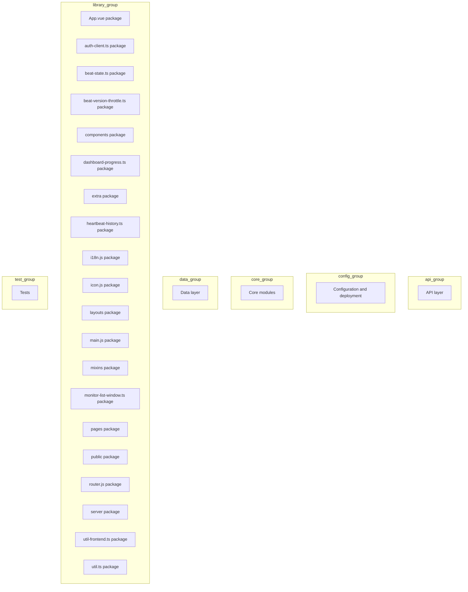

# Architecture report: louislam/uptime-kuma

> Automated static analysis. **Observed** = directly seen in files/imports/AST; **Inferred** = interpretation from that evidence. Repository code was not executed.

## 1. Repository at a glance

| Item | Value |
| --- | --- |
| Repository | louislam/uptime-kuma |
| Description | A fancy self-hosted monitoring tool |
| Language | JavaScript |
| Stars | 94164 |
| Licence | MIT |
| Analysed commit / branch | 7e5075d12c85f7282f9c7b7d6821d56aa3acc688 / master |
| Framework(s) | Express, Vue |
| Files analysed | 799 |
| Components | 25 |

## 2. Architecture in one minute

louislam/uptime-kuma - A fancy self-hosted monitoring tool. This repository was analysed statically from 799 file(s) (1 Python). Detected technologies (observed from imports/manifests): GitHub Actions, Redis, Express, Vue, axios, Docker. Files are grouped into 25 component(s): API layer, App.vue package, auth-client.ts package, beat-state.ts package, beat-version-throttle.ts package, components package, Configuration and deployment, Core modules. Findings below distinguish observed facts from inferred interpretation.

## 3. High-level block diagram

## 4. Main components

### API layer (`api_layer`)

- **Kind:** api
- **Status:** Observed
- **Confidence:** 0.85
- **Responsibility:** Groups 4 file(s) under api layer (observed from repository paths and static analysis).
- **Paths:** `server/routers/api-router.js`, `server/routers/better-auth-router.ts`, `server/routers/mcp-router.ts`, `server/routers/status-page-router.js`
- **Evidence:** [server/routers/api-router.js](https://github.com/louislam/uptime-kuma/blob/7e5075d12c85f7282f9c7b7d6821d56aa3acc688/server/routers/api-router.js); [server/routers/better-auth-router.ts](https://github.com/louislam/uptime-kuma/blob/7e5075d12c85f7282f9c7b7d6821d56aa3acc688/server/routers/better-auth-router.ts); [server/routers/mcp-router.ts](https://github.com/louislam/uptime-kuma/blob/7e5075d12c85f7282f9c7b7d6821d56aa3acc688/server/routers/mcp-router.ts); [server/routers/status-page-router.js](https://github.com/louislam/uptime-kuma/blob/7e5075d12c85f7282f9c7b7d6821d56aa3acc688/server/routers/status-page-router.js)

### App.vue package (`app_vue`)

- **Kind:** library
- **Status:** Observed
- **Confidence:** 0.85
- **Responsibility:** Groups 1 file(s) under app.vue package (observed from repository paths and static analysis).
- **Paths:** `src/App.vue`
- **Evidence:** [src/App.vue](https://github.com/louislam/uptime-kuma/blob/7e5075d12c85f7282f9c7b7d6821d56aa3acc688/src/App.vue)

### auth-client.ts package (`auth_client_ts`)

- **Kind:** library
- **Status:** Observed
- **Confidence:** 0.85
- **Responsibility:** Groups 1 file(s) under auth-client.ts package (observed from repository paths and static analysis).
- **Paths:** `src/auth-client.ts`
- **Evidence:** [src/auth-client.ts](https://github.com/louislam/uptime-kuma/blob/7e5075d12c85f7282f9c7b7d6821d56aa3acc688/src/auth-client.ts)

### beat-state.ts package (`beat_state_ts`)

- **Kind:** library
- **Status:** Observed
- **Confidence:** 0.85
- **Responsibility:** Groups 1 file(s) under beat-state.ts package (observed from repository paths and static analysis).
- **Paths:** `src/beat-state.ts`
- **Evidence:** [src/beat-state.ts](https://github.com/louislam/uptime-kuma/blob/7e5075d12c85f7282f9c7b7d6821d56aa3acc688/src/beat-state.ts)

### beat-version-throttle.ts package (`beat_version_throttle_ts`)

- **Kind:** library
- **Status:** Observed
- **Confidence:** 0.85
- **Responsibility:** Groups 1 file(s) under beat-version-throttle.ts package (observed from repository paths and static analysis).
- **Paths:** `src/beat-version-throttle.ts`
- **Evidence:** [src/beat-version-throttle.ts](https://github.com/louislam/uptime-kuma/blob/7e5075d12c85f7282f9c7b7d6821d56aa3acc688/src/beat-version-throttle.ts)

### components package (`components`)

- **Kind:** library
- **Status:** Observed
- **Confidence:** 0.85
- **Responsibility:** Groups 155 file(s) under components package (observed from repository paths and static analysis).
- **Paths:** `src/components/APIKeyDialog.vue`, `src/components/ActionInput.vue`, `src/components/ActionSelect.vue`, `src/components/BadgeLinkGeneratorDialog.vue`, `src/components/CertificateInfo.vue`, `src/components/CertificateInfoRow.vue`, `src/components/Confirm.vue`, `src/components/CopyableInput.vue`, `src/components/CountUp.vue`, `src/components/CreateGroupDialog.vue`, `src/components/Datetime.vue`, `src/components/DockerHostDialog.vue`, `src/components/EditMonitorCondition.vue`, `src/components/EditMonitorConditionGroup.vue`, `src/components/EditMonitorConditions.vue`, `src/components/HeartbeatBar.vue`, `src/components/HiddenInput.vue`, `src/components/IncidentEditForm.vue`, `src/components/IncidentHistory.vue`, `src/components/IncidentManageModal.vue`, `src/components/Login.vue`, `src/components/MaintenanceTime.vue`, `src/components/MonitorList.vue`, `src/components/MonitorListFilter.vue`, `src/components/MonitorListFilterDropdown.vue`, `src/components/MonitorListItem.vue`, `src/components/MonitorSettingDialog.vue`, `src/components/NotificationDialog.vue`, `src/components/PingChart.vue`, `src/components/ProxyDialog.vue`, `src/components/PublicGroupList.vue`, `src/components/RemoteBrowserDialog.vue`, `src/components/ScreenshotDialog.vue`, `src/components/Status.vue`, `src/components/Tag.vue`, `src/components/TagEditDialog.vue`, `src/components/TagsManager.vue`, `src/components/TemplatedInput.vue`, `src/components/TemplatedTextarea.vue`, `src/components/ToggleSection.vue`, `src/components/Tooltip.vue`, `src/components/TwoFADialog.vue`, `src/components/Uptime.vue`, `src/components/notifications/360messenger.vue`, `src/components/notifications/46elks.vue`, `src/components/notifications/AlertNow.vue`, `src/components/notifications/Alerta.vue`, `src/components/notifications/AliyunSms.vue`, `src/components/notifications/AmootSMS.vue`, `src/components/notifications/Apprise.vue`, `src/components/notifications/Bale.vue`, `src/components/notifications/Bark.vue`, `src/components/notifications/BearSMS.vue`, `src/components/notifications/Bitrix24.vue`, `src/components/notifications/Brevo.vue`, `src/components/notifications/CallMeBot.vue`, `src/components/notifications/Cellsynt.vue`, `src/components/notifications/ClickSendSMS.vue`, `src/components/notifications/ClickUp.vue`, `src/components/notifications/DingDing.vue`, `src/components/notifications/Discord.vue`, `src/components/notifications/EgoSMS.vue`, `src/components/notifications/Evolution.vue`, `src/components/notifications/Feishu.vue`, `src/components/notifications/FlashDuty.vue`, `src/components/notifications/Flowtriq.vue`, `src/components/notifications/Fluxer.vue`, `src/components/notifications/FreeMobile.vue`, `src/components/notifications/GoAlert.vue`, `src/components/notifications/GoogleChat.vue`, `src/components/notifications/GoogleSheets.vue`, `src/components/notifications/Gorush.vue`, `src/components/notifications/Gotify.vue`, `src/components/notifications/GrafanaOncall.vue`, `src/components/notifications/GtxMessaging.vue`, `src/components/notifications/HaloPSA.vue`, `src/components/notifications/HeiiOnCall.vue`, `src/components/notifications/HomeAssistant.vue`, `src/components/notifications/Indigo.vue`, `src/components/notifications/JiraServiceManagement.vue`, `src/components/notifications/Keep.vue`, `src/components/notifications/Kook.vue`, `src/components/notifications/Line.vue`, `src/components/notifications/LunaSea.vue`, `src/components/notifications/Matrix.vue`, `src/components/notifications/Mattermost.vue`, `src/components/notifications/Max.vue`, `src/components/notifications/MicrosoftGraph.vue`, `src/components/notifications/Milky.vue`, `src/components/notifications/NextcloudTalk.vue`, `src/components/notifications/Nostr.vue`, `src/components/notifications/Notifery.vue`, `src/components/notifications/NotifyApp.vue`, `src/components/notifications/Ntfy.vue`, `src/components/notifications/Octopush.vue`, `src/components/notifications/OneBot.vue`, `src/components/notifications/OneChat.vue`, `src/components/notifications/Onesender.vue`, `src/components/notifications/Ooredoo.vue`, `src/components/notifications/OpenWa.vue`, `src/components/notifications/Opsgenie.vue`, `src/components/notifications/OpsiMate.vue`, `src/components/notifications/PagerDuty.vue`, `src/components/notifications/PagerTree.vue`, `src/components/notifications/Pinglet.vue`, `src/components/notifications/Plivo.vue`, `src/components/notifications/PromoSMS.vue`, `src/components/notifications/Pumble.vue`, `src/components/notifications/PushDeer.vue`, `src/components/notifications/PushPlus.vue`, `src/components/notifications/Pushbullet.vue`, `src/components/notifications/Pushover.vue`, `src/components/notifications/Pushy.vue`, `src/components/notifications/Resend.vue`, `src/components/notifications/RocketChat.vue`, `src/components/notifications/SIGNL4.vue`, `src/components/notifications/SMSC.vue`, `src/components/notifications/SMSEagle.vue`, `src/components/notifications/SMSGateway.vue`, `src/components/notifications/SMSIR.vue`, `src/components/notifications/SMSManager.vue`, `src/components/notifications/SMSPartner.vue`, `src/components/notifications/SMSPlanet.vue`, `src/components/notifications/SMTP.vue`, `src/components/notifications/SendGrid.vue`, `src/components/notifications/ServerChan.vue`, `src/components/notifications/SerwerSMS.vue`, `src/components/notifications/SevenIO.vue`, `src/components/notifications/Signal.vue`, `src/components/notifications/Signalgrid.vue`, `src/components/notifications/Slack.vue`, `src/components/notifications/Splunk.vue`, `src/components/notifications/SpugPush.vue`, `src/components/notifications/Squadcast.vue`, `src/components/notifications/Stackfield.vue`, `src/components/notifications/Teams.vue`, `src/components/notifications/TechulusPush.vue`, `src/components/notifications/Telegram.vue`, `src/components/notifications/Telnyx.vue`, `src/components/notifications/Teltonika.vue`, `src/components/notifications/Threema.vue`, `src/components/notifications/TurboSMTP.vue`, `src/components/notifications/Twilio.vue`, `src/components/notifications/VK.vue`, `src/components/notifications/VKTeams.vue`, `src/components/notifications/WAHA.vue`, `src/components/notifications/WPush.vue`, `src/components/notifications/WeCom.vue`, `src/components/notifications/Webhook.vue`, `src/components/notifications/Webpush.vue`, `src/components/notifications/Whapi.vue`, `src/components/notifications/WxPusher.vue`, `src/components/notifications/YZJ.vue`, `src/components/notifications/ZohoCliq.vue`, `src/components/notifications/index.js`
- **Evidence:** [src/components/APIKeyDialog.vue](https://github.com/louislam/uptime-kuma/blob/7e5075d12c85f7282f9c7b7d6821d56aa3acc688/src/components/APIKeyDialog.vue); [src/components/ActionInput.vue](https://github.com/louislam/uptime-kuma/blob/7e5075d12c85f7282f9c7b7d6821d56aa3acc688/src/components/ActionInput.vue); [src/components/ActionSelect.vue](https://github.com/louislam/uptime-kuma/blob/7e5075d12c85f7282f9c7b7d6821d56aa3acc688/src/components/ActionSelect.vue); [src/components/BadgeLinkGeneratorDialog.vue](https://github.com/louislam/uptime-kuma/blob/7e5075d12c85f7282f9c7b7d6821d56aa3acc688/src/components/BadgeLinkGeneratorDialog.vue); [src/components/CertificateInfo.vue](https://github.com/louislam/uptime-kuma/blob/7e5075d12c85f7282f9c7b7d6821d56aa3acc688/src/components/CertificateInfo.vue); [src/components/CertificateInfoRow.vue](https://github.com/louislam/uptime-kuma/blob/7e5075d12c85f7282f9c7b7d6821d56aa3acc688/src/components/CertificateInfoRow.vue); [src/components/Confirm.vue](https://github.com/louislam/uptime-kuma/blob/7e5075d12c85f7282f9c7b7d6821d56aa3acc688/src/components/Confirm.vue); [src/components/CopyableInput.vue](https://github.com/louislam/uptime-kuma/blob/7e5075d12c85f7282f9c7b7d6821d56aa3acc688/src/components/CopyableInput.vue)

### Configuration and deployment (`config`)

- **Kind:** config
- **Status:** Observed
- **Confidence:** 0.85
- **Responsibility:** Groups 105 file(s) under configuration and deployment (observed from repository paths and static analysis).
- **Paths:** `compose.yaml`, `docker/docker-compose-dev.yml`, `docker/dockerfile`, `extra/docker-latest-warning/Dockerfile.latest-warning`, `extra/docker-latest-warning/package.json`, `extra/kuma-pr/package.json`, `extra/push-examples/javascript-fetch/package.json`, `extra/push-examples/typescript-fetch/package.json`, `extra/rdap-dns.json`, `extra/uptime-kuma-push/Dockerfile`, `extra/uptime-kuma-push/package.json`, `package.json`, `public/manifest.json`, `src/components/settings/APIKeys.vue`, `src/components/settings/About.vue`, `src/components/settings/Appearance.vue`, `src/components/settings/Docker.vue`, `src/components/settings/General.vue`, `src/components/settings/MonitorHistory.vue`, `src/components/settings/Notifications.vue`, `src/components/settings/Proxies.vue`, `src/components/settings/RemoteBrowsers.vue`, `src/components/settings/ReverseProxy.vue`, `src/components/settings/Security.vue`, `src/components/settings/Tags.vue`, `src/lang/ab.json`, `src/lang/af.json`, `src/lang/ang.json`, `src/lang/ar-SY.json`, `src/lang/ar.json`, `src/lang/az.json`, `src/lang/bar.json`, `src/lang/be.json`, `src/lang/bg-BG.json`, `src/lang/bn.json`, `src/lang/ca.json`, `src/lang/ca@valencia.json`, `src/lang/ckb.json`, `src/lang/cs-CZ.json`, `src/lang/da-DK.json`, `src/lang/de-CH.json`, `src/lang/de-DE.json`, `src/lang/el-GR.json`, `src/lang/en.json`, `src/lang/en_GB.json`, `src/lang/enm.json`, `src/lang/es-ES.json`, `src/lang/et-EE.json`, `src/lang/eu.json`, `src/lang/fa.json`, `src/lang/fi.json`, `src/lang/fr-FR.json`, `src/lang/ga.json`, `src/lang/gl.json`, `src/lang/he-IL.json`, `src/lang/he.json`, `src/lang/hi.json`, `src/lang/hr-HR.json`, `src/lang/hu.json`, `src/lang/id-ID.json`, `src/lang/it-IT.json`, `src/lang/ja.json`, `src/lang/ka.json`, `src/lang/ko-KR.json`, `src/lang/lb.json`, `src/lang/lt.json`, `src/lang/lv.json`, `src/lang/lzh.json`, `src/lang/mk.json`, `src/lang/ml.json`, `src/lang/mr.json`, `src/lang/ms.json`, `src/lang/my.json`, `src/lang/nb-NO.json`, `src/lang/ne.json`, `src/lang/nl-NL.json`, `src/lang/pa.json`, `src/lang/pa_PK.json`, `src/lang/pl.json`, `src/lang/pt-BR.json`, `src/lang/pt-PT.json`, `src/lang/pt.json`, `src/lang/ro.json`, `src/lang/ru-RU.json`, `src/lang/sk.json`, `src/lang/sl-SI.json`, `src/lang/sq.json`, `src/lang/sr-latn.json`, `src/lang/sr.json`, `src/lang/sv-SE.json`, `src/lang/te.json`, `src/lang/th-TH.json`, `src/lang/tr-TR.json`, `src/lang/ug.json`, `src/lang/uk-UA.json`, `src/lang/ur.json`, `src/lang/uz.json`, `src/lang/vi-VN.json`, `src/lang/vls.json`, `src/lang/xh.json`, `src/lang/yue.json`, `src/lang/zh-CN.json`, `src/lang/zh-HK.json`, `src/lang/zh-TW.json`, `src/lang/zu.json`
- **Evidence:** [compose.yaml](https://github.com/louislam/uptime-kuma/blob/7e5075d12c85f7282f9c7b7d6821d56aa3acc688/compose.yaml); [docker/docker-compose-dev.yml](https://github.com/louislam/uptime-kuma/blob/7e5075d12c85f7282f9c7b7d6821d56aa3acc688/docker/docker-compose-dev.yml); [docker/dockerfile](https://github.com/louislam/uptime-kuma/blob/7e5075d12c85f7282f9c7b7d6821d56aa3acc688/docker/dockerfile); [extra/docker-latest-warning/Dockerfile.latest-warning](https://github.com/louislam/uptime-kuma/blob/7e5075d12c85f7282f9c7b7d6821d56aa3acc688/extra/docker-latest-warning/Dockerfile.latest-warning); [extra/docker-latest-warning/package.json](https://github.com/louislam/uptime-kuma/blob/7e5075d12c85f7282f9c7b7d6821d56aa3acc688/extra/docker-latest-warning/package.json); [extra/kuma-pr/package.json](https://github.com/louislam/uptime-kuma/blob/7e5075d12c85f7282f9c7b7d6821d56aa3acc688/extra/kuma-pr/package.json); [extra/push-examples/javascript-fetch/package.json](https://github.com/louislam/uptime-kuma/blob/7e5075d12c85f7282f9c7b7d6821d56aa3acc688/extra/push-examples/javascript-fetch/package.json); [extra/push-examples/typescript-fetch/package.json](https://github.com/louislam/uptime-kuma/blob/7e5075d12c85f7282f9c7b7d6821d56aa3acc688/extra/push-examples/typescript-fetch/package.json)

### Core modules (`core`)

- **Kind:** core
- **Status:** Observed
- **Confidence:** 0.85
- **Responsibility:** Groups 2 file(s) under core modules (observed from repository paths and static analysis).
- **Paths:** `ecosystem.config.js`, `playwright.config.js`
- **Evidence:** [ecosystem.config.js](https://github.com/louislam/uptime-kuma/blob/7e5075d12c85f7282f9c7b7d6821d56aa3acc688/ecosystem.config.js); [playwright.config.js](https://github.com/louislam/uptime-kuma/blob/7e5075d12c85f7282f9c7b7d6821d56aa3acc688/playwright.config.js)

### dashboard-progress.ts package (`dashboard_progress_ts`)

- **Kind:** library
- **Status:** Observed
- **Confidence:** 0.85
- **Responsibility:** Groups 1 file(s) under dashboard-progress.ts package (observed from repository paths and static analysis).
- **Paths:** `src/dashboard-progress.ts`
- **Evidence:** [src/dashboard-progress.ts](https://github.com/louislam/uptime-kuma/blob/7e5075d12c85f7282f9c7b7d6821d56aa3acc688/src/dashboard-progress.ts)

### Data layer (`data_layer`)

- **Kind:** data
- **Status:** Observed
- **Confidence:** 0.85
- **Responsibility:** Groups 66 file(s) under data layer (observed from repository paths and static analysis).
- **Paths:** `db/knex_init_db.js`, `db/knex_migrations/2023-08-16-0000-create-uptime.js`, `db/knex_migrations/2023-08-18-0301-heartbeat.js`, `db/knex_migrations/2023-09-29-0000-heartbeat-retires.js`, `db/knex_migrations/2023-10-08-0000-mqtt-query.js`, `db/knex_migrations/2023-10-11-1915-push-token-to-32.js`, `db/knex_migrations/2023-10-16-0000-create-remote-browsers.js`, `db/knex_migrations/2023-12-20-0000-alter-status-page.js`, `db/knex_migrations/2023-12-21-0000-stat-ping-min-max.js`, `db/knex_migrations/2023-12-22-0000-hourly-uptime.js`, `db/knex_migrations/2024-01-22-0000-stats-extras.js`, `db/knex_migrations/2024-04-26-0000-snmp-monitor.js`, `db/knex_migrations/2024-08-24-000-add-cache-bust.js`, `db/knex_migrations/2024-08-24-0000-conditions.js`, `db/knex_migrations/2024-10-1315-rabbitmq-monitor.js`, `db/knex_migrations/2024-10-31-0000-fix-snmp-monitor.js`, `db/knex_migrations/2024-11-27-1927-fix-info-json-data-type.js`, `db/knex_migrations/2025-01-01-0000-add-smtp.js`, `db/knex_migrations/2025-02-15-2312-add-wstest.js`, `db/knex_migrations/2025-02-17-2142-generalize-analytics.js`, `db/knex_migrations/2025-03-04-0000-ping-advanced-options.js`, `db/knex_migrations/2025-03-25-0127-fix-5721.js`, `db/knex_migrations/2025-05-09-0000-add-custom-url.js`, `db/knex_migrations/2025-06-03-0000-add-ip-family.js`, `db/knex_migrations/2025-06-11-0000-add-manual-monitor.js`, `db/knex_migrations/2025-06-13-0000-maintenance-add-last-start.js`, `db/knex_migrations/2025-06-15-0001-manual-monitor-fix.js`, `db/knex_migrations/2025-06-24-0000-add-audience-to-oauth.js`, `db/knex_migrations/2025-07-17-0000-mqtt-websocket-path.js`, `db/knex_migrations/2025-09-02-0000-add-domain-expiry.js`, `db/knex_migrations/2025-10-14-0000-add-ip-family-fix.js`, `db/knex_migrations/2025-10-15-0000-stat-table-fix.js`, `db/knex_migrations/2025-10-15-0001-add-monitor-response-config.js`, `db/knex_migrations/2025-10-15-0002-add-response-to-heartbeat.js`, `db/knex_migrations/2025-10-24-0000-show-only-last-heartbeat.js`, `db/knex_migrations/2025-10-29-0000-better-auth.js`, `db/knex_migrations/2025-12-09-0000-add-system-service-monitor.js`, `db/knex_migrations/2025-12-17-0000-add-globalping-monitor.js`, `db/knex_migrations/2025-12-22-0121-optimize-important-indexes.js`, `db/knex_migrations/2025-12-29-0000-remove-line-notify.js`, `db/knex_migrations/2025-12-31-2143-add-snmp-v3-username.js`, `db/knex_migrations/2026-01-02-0551-dns-last-result-to-text.js`, `db/knex_migrations/2026-01-02-0713-gamedig-v4-to-v5.js`, `db/knex_migrations/2026-01-05-0000-add-rss-title.js`, `db/knex_migrations/2026-01-05-0000-add-tls-monitor.js`, `db/knex_migrations/2026-01-06-0000-fix-domain-expiry-column-type.js`, `db/knex_migrations/2026-01-10-0000-convert-float-precision.js`, `db/knex_migrations/2026-01-15-0000-add-json-query-retry-only-status-code.js`, `db/knex_migrations/2026-01-16-0000-add-screenshot-delay.js`, `db/knex_migrations/2026-02-07-0000-disable-domain-expiry-unsupported-tlds.js`, `db/knex_migrations/2026-03-27-0000-add-ntp-monitor.js`, `db/knex_migrations/2026-05-20-0000-add-bearer-token.js`, `db/knex_migrations/2026-05-25-0000-add-gamedig-token.js`, `db/knex_migrations/2026-05-26-0000-better-auth-username.js`, `db/knex_migrations/2026-05-26-0010-better-auth-admin.js`, `db/knex_migrations/2026-05-28-0010-better-auth-foreign-key.js`, `db/knex_migrations/2026-06-08-0000-better-auth-2fa.js`, `db/knex_migrations/2026-06-19-1411-add-rybbit-analytics-type.js`, `db/knex_migrations/2026-06-19-1412-analytics-type-to-string.js`, `db/knex_migrations/2026-06-29-0000-better-auth-api-key.js`, `db/knex_migrations/2026-07-22-0000-fix-stat-daily-overflow.js`, `db/knex_migrations/2026-08-07-0000-add-sftp-monitor.js`, `db/knex_migrations/2026-08-18-0000-sqlite-only-drop-analytics-type-check.js`, `db/knex_migrations/2026-10-27-0000-add-monitor-config.js`, `db/knex_migrations/2026-10-27-0001-migrate-system-service-to-config.js`, `db/knex_migrations/2026-11-08-0000-better-auth-2fa-lockout.js`
- **Evidence:** [db/knex_init_db.js](https://github.com/louislam/uptime-kuma/blob/7e5075d12c85f7282f9c7b7d6821d56aa3acc688/db/knex_init_db.js); [db/knex_migrations/2023-08-16-0000-create-uptime.js](https://github.com/louislam/uptime-kuma/blob/7e5075d12c85f7282f9c7b7d6821d56aa3acc688/db/knex_migrations/2023-08-16-0000-create-uptime.js); [db/knex_migrations/2023-08-18-0301-heartbeat.js](https://github.com/louislam/uptime-kuma/blob/7e5075d12c85f7282f9c7b7d6821d56aa3acc688/db/knex_migrations/2023-08-18-0301-heartbeat.js); [db/knex_migrations/2023-09-29-0000-heartbeat-retires.js](https://github.com/louislam/uptime-kuma/blob/7e5075d12c85f7282f9c7b7d6821d56aa3acc688/db/knex_migrations/2023-09-29-0000-heartbeat-retires.js); [db/knex_migrations/2023-10-08-0000-mqtt-query.js](https://github.com/louislam/uptime-kuma/blob/7e5075d12c85f7282f9c7b7d6821d56aa3acc688/db/knex_migrations/2023-10-08-0000-mqtt-query.js); [db/knex_migrations/2023-10-11-1915-push-token-to-32.js](https://github.com/louislam/uptime-kuma/blob/7e5075d12c85f7282f9c7b7d6821d56aa3acc688/db/knex_migrations/2023-10-11-1915-push-token-to-32.js); [db/knex_migrations/2023-10-16-0000-create-remote-browsers.js](https://github.com/louislam/uptime-kuma/blob/7e5075d12c85f7282f9c7b7d6821d56aa3acc688/db/knex_migrations/2023-10-16-0000-create-remote-browsers.js); [db/knex_migrations/2023-12-20-0000-alter-status-page.js](https://github.com/louislam/uptime-kuma/blob/7e5075d12c85f7282f9c7b7d6821d56aa3acc688/db/knex_migrations/2023-12-20-0000-alter-status-page.js)

### extra package (`extra`)

- **Kind:** library
- **Status:** Observed
- **Confidence:** 0.85
- **Responsibility:** Groups 52 file(s) under extra package (observed from repository paths and static analysis).
- **Paths:** `extra/build-healthcheck.js`, `extra/check-knex-filenames.mjs`, `extra/check-lang-json.js`, `extra/check-package-json.mjs`, `extra/checkout-pr.mjs`, `extra/close-incorrect-issue.mjs`, `extra/coverage-report.mjs`, `extra/deploy-demo-server.js`, `extra/docker-latest-warning/docker-latest-warning.js`, `extra/download-dist.js`, `extra/healthcheck.go`, `extra/kuma-pr/index.mjs`, `extra/kuma-pr/pr-lib.mjs`, `extra/mark-as-nightly.js`, `extra/precompile-server.js`, `extra/prepare-v1-test-db.mjs`, `extra/prepare-v2-test-db.mjs`, `extra/push-examples/bash-curl/index.sh`, `extra/push-examples/csharp/index.cs`, `extra/push-examples/docker/index.sh`, `extra/push-examples/go/index.go`, `extra/push-examples/java/index.java`, `extra/push-examples/javascript-fetch/index.js`, `extra/push-examples/php/index.php`, `extra/push-examples/python/index.py`, `extra/push-examples/typescript-fetch/index.ts`, `extra/rebase-pr.js`, `extra/release/build-and-upload-assets.mjs`, `extra/release/build-images.mjs`, `extra/release/create-draft-release.mjs`, `extra/release/create-release.mjs`, `extra/release/generate-changelog.mjs`, `extra/release/install-deps.mjs`, `extra/release/lib.mjs`, `extra/release/merge-pr.mjs`, `extra/release/nightly.mjs`, `extra/release/prepare-release.mjs`, `extra/release/release.mjs`, `extra/release/update-version.mjs`, `extra/release/update-wiki.mjs`, `extra/release/upload-artifacts-beta.mjs`, `extra/release/upload-artifacts.mjs`, `extra/remove-2fa.js`, `extra/remove-empty-lang-keys.js`, `extra/remove-playwright-test-data.js`, `extra/reset-migrate-aggregate-table-state.js`, `extra/run-backend-tests.mjs`, `extra/simple-dns-server.js`, `extra/simple-mqtt-server.js`, `extra/start-clear-server.mjs`, `extra/uptime-kuma-push/build.js`, `extra/uptime-kuma-push/uptime-kuma-push.go`
- **Evidence:** [extra/build-healthcheck.js](https://github.com/louislam/uptime-kuma/blob/7e5075d12c85f7282f9c7b7d6821d56aa3acc688/extra/build-healthcheck.js); [extra/check-knex-filenames.mjs](https://github.com/louislam/uptime-kuma/blob/7e5075d12c85f7282f9c7b7d6821d56aa3acc688/extra/check-knex-filenames.mjs); [extra/check-lang-json.js](https://github.com/louislam/uptime-kuma/blob/7e5075d12c85f7282f9c7b7d6821d56aa3acc688/extra/check-lang-json.js); [extra/check-package-json.mjs](https://github.com/louislam/uptime-kuma/blob/7e5075d12c85f7282f9c7b7d6821d56aa3acc688/extra/check-package-json.mjs); [extra/checkout-pr.mjs](https://github.com/louislam/uptime-kuma/blob/7e5075d12c85f7282f9c7b7d6821d56aa3acc688/extra/checkout-pr.mjs); [extra/close-incorrect-issue.mjs](https://github.com/louislam/uptime-kuma/blob/7e5075d12c85f7282f9c7b7d6821d56aa3acc688/extra/close-incorrect-issue.mjs); [extra/coverage-report.mjs](https://github.com/louislam/uptime-kuma/blob/7e5075d12c85f7282f9c7b7d6821d56aa3acc688/extra/coverage-report.mjs); [extra/deploy-demo-server.js](https://github.com/louislam/uptime-kuma/blob/7e5075d12c85f7282f9c7b7d6821d56aa3acc688/extra/deploy-demo-server.js)

### heartbeat-history.ts package (`heartbeat_history_ts`)

- **Kind:** library
- **Status:** Observed
- **Confidence:** 0.85
- **Responsibility:** Groups 1 file(s) under heartbeat-history.ts package (observed from repository paths and static analysis).
- **Paths:** `src/heartbeat-history.ts`
- **Evidence:** [src/heartbeat-history.ts](https://github.com/louislam/uptime-kuma/blob/7e5075d12c85f7282f9c7b7d6821d56aa3acc688/src/heartbeat-history.ts)

### i18n.js package (`i18n_js`)

- **Kind:** library
- **Status:** Observed
- **Confidence:** 0.85
- **Responsibility:** Groups 1 file(s) under i18n.js package (observed from repository paths and static analysis).
- **Paths:** `src/i18n.js`
- **Evidence:** [src/i18n.js](https://github.com/louislam/uptime-kuma/blob/7e5075d12c85f7282f9c7b7d6821d56aa3acc688/src/i18n.js)

### icon.js package (`icon_js`)

- **Kind:** library
- **Status:** Observed
- **Confidence:** 0.85
- **Responsibility:** Groups 1 file(s) under icon.js package (observed from repository paths and static analysis).
- **Paths:** `src/icon.js`
- **Evidence:** [src/icon.js](https://github.com/louislam/uptime-kuma/blob/7e5075d12c85f7282f9c7b7d6821d56aa3acc688/src/icon.js)

### layouts package (`layouts`)

- **Kind:** library
- **Status:** Observed
- **Confidence:** 0.85
- **Responsibility:** Groups 2 file(s) under layouts package (observed from repository paths and static analysis).
- **Paths:** `src/layouts/EmptyLayout.vue`, `src/layouts/Layout.vue`
- **Evidence:** [src/layouts/EmptyLayout.vue](https://github.com/louislam/uptime-kuma/blob/7e5075d12c85f7282f9c7b7d6821d56aa3acc688/src/layouts/EmptyLayout.vue); [src/layouts/Layout.vue](https://github.com/louislam/uptime-kuma/blob/7e5075d12c85f7282f9c7b7d6821d56aa3acc688/src/layouts/Layout.vue)

### main.js package (`main_js`)

- **Kind:** library
- **Status:** Observed
- **Confidence:** 0.85
- **Responsibility:** Groups 1 file(s) under main.js package (observed from repository paths and static analysis).
- **Paths:** `src/main.js`
- **Evidence:** [src/main.js](https://github.com/louislam/uptime-kuma/blob/7e5075d12c85f7282f9c7b7d6821d56aa3acc688/src/main.js)

### mixins package (`mixins`)

- **Kind:** library
- **Status:** Observed
- **Confidence:** 0.85
- **Responsibility:** Groups 6 file(s) under mixins package (observed from repository paths and static analysis).
- **Paths:** `src/mixins/datetime.js`, `src/mixins/lang.js`, `src/mixins/mobile.js`, `src/mixins/public.js`, `src/mixins/socket.js`, `src/mixins/theme.js`
- **Evidence:** [src/mixins/datetime.js](https://github.com/louislam/uptime-kuma/blob/7e5075d12c85f7282f9c7b7d6821d56aa3acc688/src/mixins/datetime.js); [src/mixins/lang.js](https://github.com/louislam/uptime-kuma/blob/7e5075d12c85f7282f9c7b7d6821d56aa3acc688/src/mixins/lang.js); [src/mixins/mobile.js](https://github.com/louislam/uptime-kuma/blob/7e5075d12c85f7282f9c7b7d6821d56aa3acc688/src/mixins/mobile.js); [src/mixins/public.js](https://github.com/louislam/uptime-kuma/blob/7e5075d12c85f7282f9c7b7d6821d56aa3acc688/src/mixins/public.js); [src/mixins/socket.js](https://github.com/louislam/uptime-kuma/blob/7e5075d12c85f7282f9c7b7d6821d56aa3acc688/src/mixins/socket.js); [src/mixins/theme.js](https://github.com/louislam/uptime-kuma/blob/7e5075d12c85f7282f9c7b7d6821d56aa3acc688/src/mixins/theme.js)

### monitor-list-window.ts package (`monitor_list_window_ts`)

- **Kind:** library
- **Status:** Observed
- **Confidence:** 0.85
- **Responsibility:** Groups 1 file(s) under monitor-list-window.ts package (observed from repository paths and static analysis).
- **Paths:** `src/monitor-list-window.ts`
- **Evidence:** [src/monitor-list-window.ts](https://github.com/louislam/uptime-kuma/blob/7e5075d12c85f7282f9c7b7d6821d56aa3acc688/src/monitor-list-window.ts)

### pages package (`pages`)

- **Kind:** library
- **Status:** Observed
- **Confidence:** 0.85
- **Responsibility:** Groups 14 file(s) under pages package (observed from repository paths and static analysis).
- **Paths:** `src/pages/AddStatusPage.vue`, `src/pages/Dashboard.vue`, `src/pages/DashboardHome.vue`, `src/pages/Details.vue`, `src/pages/EditMaintenance.vue`, `src/pages/Entry.vue`, `src/pages/List.vue`, `src/pages/ManageMaintenance.vue`, `src/pages/ManageStatusPage.vue`, `src/pages/NotFound.vue`, `src/pages/Settings.vue`, `src/pages/Setup.vue`, `src/pages/SetupDatabase.vue`, `src/pages/StatusPage.vue`
- **Evidence:** [src/pages/AddStatusPage.vue](https://github.com/louislam/uptime-kuma/blob/7e5075d12c85f7282f9c7b7d6821d56aa3acc688/src/pages/AddStatusPage.vue); [src/pages/Dashboard.vue](https://github.com/louislam/uptime-kuma/blob/7e5075d12c85f7282f9c7b7d6821d56aa3acc688/src/pages/Dashboard.vue); [src/pages/DashboardHome.vue](https://github.com/louislam/uptime-kuma/blob/7e5075d12c85f7282f9c7b7d6821d56aa3acc688/src/pages/DashboardHome.vue); [src/pages/Details.vue](https://github.com/louislam/uptime-kuma/blob/7e5075d12c85f7282f9c7b7d6821d56aa3acc688/src/pages/Details.vue); [src/pages/EditMaintenance.vue](https://github.com/louislam/uptime-kuma/blob/7e5075d12c85f7282f9c7b7d6821d56aa3acc688/src/pages/EditMaintenance.vue); [src/pages/Entry.vue](https://github.com/louislam/uptime-kuma/blob/7e5075d12c85f7282f9c7b7d6821d56aa3acc688/src/pages/Entry.vue); [src/pages/List.vue](https://github.com/louislam/uptime-kuma/blob/7e5075d12c85f7282f9c7b7d6821d56aa3acc688/src/pages/List.vue); [src/pages/ManageMaintenance.vue](https://github.com/louislam/uptime-kuma/blob/7e5075d12c85f7282f9c7b7d6821d56aa3acc688/src/pages/ManageMaintenance.vue)

### public package (`public`)

- **Kind:** library
- **Status:** Observed
- **Confidence:** 0.85
- **Responsibility:** Groups 1 file(s) under public package (observed from repository paths and static analysis).
- **Paths:** `public/serviceWorker.js`
- **Evidence:** [public/serviceWorker.js](https://github.com/louislam/uptime-kuma/blob/7e5075d12c85f7282f9c7b7d6821d56aa3acc688/public/serviceWorker.js)

### router.js package (`router_js`)

- **Kind:** library
- **Status:** Observed
- **Confidence:** 0.85
- **Responsibility:** Groups 1 file(s) under router.js package (observed from repository paths and static analysis).
- **Paths:** `src/router.js`
- **Evidence:** [src/router.js](https://github.com/louislam/uptime-kuma/blob/7e5075d12c85f7282f9c7b7d6821d56aa3acc688/src/router.js)

### server package (`server`)

- **Kind:** library
- **Status:** Observed
- **Confidence:** 0.85
- **Responsibility:** Groups 239 file(s) under server package (observed from repository paths and static analysis).
- **Paths:** `server/analytics/analytics.js`, `server/analytics/google-analytics.js`, `server/analytics/matomo-analytics.js`, `server/analytics/plausible-analytics.js`, `server/analytics/rybbit-analytics.js`, `server/analytics/umami-analytics.js`, `server/auth.ts`, `server/better-auth.ts`, `server/check-version.js`, `server/client.js`, `server/compact-monitor.ts`, `server/config.js`, `server/database.js`, `server/docker.js`, `server/embedded-mariadb.js`, `server/heartbeat-emit.ts`, `server/image-data-uri.js`, `server/initial-admin.ts`, `server/jobs.js`, `server/jobs/clear-old-data.js`, `server/jobs/incremental-vacuum.js`, `server/login-lists.ts`, `server/model/api_key.js`, `server/model/docker_host.js`, `server/model/domain_expiry.js`, `server/model/group.js`, `server/model/heartbeat.js`, `server/model/incident.js`, `server/model/maintenance.js`, `server/model/monitor.js`, `server/model/proxy.js`, `server/model/remote_browser.js`, `server/model/status_page.js`, `server/model/tag.js`, `server/model/user.js`, `server/modules/axios-ntlm/lib/flags.js`, `server/modules/axios-ntlm/lib/hash.js`, `server/modules/axios-ntlm/lib/ntlm.js`, `server/modules/axios-ntlm/lib/ntlmClient.js`, `server/modules/ping/index.js`, `server/modules/ping/lib/builder/factory.js`, `server/modules/ping/lib/builder/linux.js`, `server/modules/ping/lib/builder/mac.js`, `server/modules/ping/lib/builder/openbsd.js`, `server/modules/ping/lib/builder/win.js`, `server/modules/ping/lib/encoding.js`, `server/modules/ping/lib/parser/base.js`, `server/modules/ping/lib/parser/factory.js`, `server/modules/ping/lib/parser/linux.js`, `server/modules/ping/lib/parser/mac.js`, `server/modules/ping/lib/parser/openbsd.js`, `server/modules/ping/lib/parser/win.js`, `server/modules/ping/lib/ping-promise.js`, `server/modules/ping/lib/ping-sys.js`, `server/modules/prometheus-api-metrics/default-metrics.js`, `server/modules/prometheus-api-metrics/express-middleware.js`, `server/modules/prometheus-api-metrics/index.js`, `server/modules/prometheus-api-metrics/metrics-middleware.js`, `server/modules/prometheus-api-metrics/utils.js`, `server/monitor-conditions/evaluator.js`, `server/monitor-conditions/expression.js`, `server/monitor-conditions/operators.js`, `server/monitor-conditions/variables.js`, `server/monitor-stats.ts`, `server/monitor-tls.ts`, `server/monitor-types/dns.js`, `server/monitor-types/gamedig.js`, `server/monitor-types/globalping.js`, `server/monitor-types/group.js`, `server/monitor-types/grpc.js`, `server/monitor-types/manual.js`, `server/monitor-types/mongodb.js`, `server/monitor-types/monitor-type.js`, `server/monitor-types/mqtt.js`, `server/monitor-types/mssql.js`, `server/monitor-types/mysql.js`, `server/monitor-types/ntp.js`, `server/monitor-types/oracledb.js`, `server/monitor-types/ping.js`, `server/monitor-types/pm2.js`, `server/monitor-types/postgres.js`, `server/monitor-types/rabbitmq.js`, `server/monitor-types/real-browser-monitor-type.js`, `server/monitor-types/redis.js`, `server/monitor-types/sftp.js`, `server/monitor-types/sip-options.js`, `server/monitor-types/smtp.js`, `server/monitor-types/snmp.js`, `server/monitor-types/steam.js`, `server/monitor-types/system-service.js`, `server/monitor-types/tailscale-ping.js`, `server/monitor-types/tcp.js`, `server/monitor-types/websocket-upgrade.js`, `server/notification-providers/360messenger.js`, `server/notification-providers/46elks.js`, `server/notification-providers/HaloPSA.js`, `server/notification-providers/Webpush.js`, `server/notification-providers/alerta.js`, `server/notification-providers/alertnow.js`, `server/notification-providers/aliyun-sms.js`, `server/notification-providers/amootsms.js`, `server/notification-providers/apprise.js`, `server/notification-providers/bale.js`, `server/notification-providers/bark.js`, `server/notification-providers/bearsms.js`, `server/notification-providers/bitrix24.js`, `server/notification-providers/brevo.js`, `server/notification-providers/call-me-bot.js`, `server/notification-providers/cellsynt.js`, `server/notification-providers/clicksendsms.js`, `server/notification-providers/clickup.js`, `server/notification-providers/dingding.js`, `server/notification-providers/discord.js`, `server/notification-providers/egosms.js`, `server/notification-providers/evolution.js`, `server/notification-providers/feishu.js`, `server/notification-providers/flashduty.js`, `server/notification-providers/flowtriq.js`, `server/notification-providers/fluxer.js`, `server/notification-providers/freemobile.js`, `server/notification-providers/goalert.js`, `server/notification-providers/google-chat.js`, `server/notification-providers/google-sheets.js`, `server/notification-providers/gorush.js`, `server/notification-providers/gotify.js`, `server/notification-providers/grafana-oncall.js`, `server/notification-providers/gtx-messaging.js`, `server/notification-providers/heii-oncall.js`, `server/notification-providers/home-assistant.js`, `server/notification-providers/indigo.js`, `server/notification-providers/jira-service-management.js`, `server/notification-providers/keep.js`, `server/notification-providers/kook.js`, `server/notification-providers/line.js`, `server/notification-providers/lunasea.js`, `server/notification-providers/matrix.js`, `server/notification-providers/mattermost.js`, `server/notification-providers/max.js`, `server/notification-providers/microsoft-graph.js`, `server/notification-providers/milky.js`, `server/notification-providers/nextcloudtalk.js`, `server/notification-providers/nostr.js`, `server/notification-providers/notifery.js`, `server/notification-providers/notification-provider.js`, `server/notification-providers/notifyapp.js`, `server/notification-providers/ntfy.js`, `server/notification-providers/octopush.js`, `server/notification-providers/onebot.js`, `server/notification-providers/onechat.js`, `server/notification-providers/onesender.js`, `server/notification-providers/ooredoo.js`, `server/notification-providers/openwa.js`, `server/notification-providers/opsgenie.js`, `server/notification-providers/opsimate.js`, `server/notification-providers/pagerduty.js`, `server/notification-providers/pagertree.js`, `server/notification-providers/pinglet.js`, `server/notification-providers/plivo.js`, `server/notification-providers/promosms.js`, `server/notification-providers/pumble.js`, `server/notification-providers/pushbullet.js`, `server/notification-providers/pushdeer.js`, `server/notification-providers/pushover.js`, `server/notification-providers/pushplus.js`, `server/notification-providers/pushy.js`, `server/notification-providers/resend.js`, `server/notification-providers/rocket-chat.js`, `server/notification-providers/send-grid.js`, `server/notification-providers/serverchan.js`, `server/notification-providers/serwersms.js`, `server/notification-providers/sevenio.js`, `server/notification-providers/signal.js`, `server/notification-providers/signalgrid.js`, `server/notification-providers/signl4.js`, `server/notification-providers/slack.js`, `server/notification-providers/sms-gateway.js`, `server/notification-providers/sms-planet.js`, `server/notification-providers/smsc.js`, `server/notification-providers/smseagle.js`, `server/notification-providers/smsir.js`, `server/notification-providers/smsmanager.js`, `server/notification-providers/smspartner.js`, `server/notification-providers/smtp.js`, `server/notification-providers/splunk.js`, `server/notification-providers/spugpush.js`, `server/notification-providers/squadcast.js`, `server/notification-providers/stackfield.js`, `server/notification-providers/teams.js`, `server/notification-providers/techulus-push.js`, `server/notification-providers/telegram.js`, `server/notification-providers/telnyx.js`, `server/notification-providers/teltonika.js`, `server/notification-providers/threema.js`, `server/notification-providers/turbosmtp.js`, `server/notification-providers/twilio.js`, `server/notification-providers/vk.js`, `server/notification-providers/vkteams.js`, `server/notification-providers/waha.js`, `server/notification-providers/webhook.js`, `server/notification-providers/wecom.js`, `server/notification-providers/whapi.js`, `server/notification-providers/wpush.js`, `server/notification-providers/wxpusher.js`, `server/notification-providers/yzj.js`, `server/notification-providers/zoho-cliq.js`, `server/notification.js`, `server/password-hash.js`, `server/prometheus-monitor.ts`, `server/prometheus.js`, `server/proxy.js`, `server/radius-client.js`, `server/rate-limiter.js`, `server/remote-browser.js`, `server/server.js`, `server/settings.js`, `server/setup-database.js`, `server/socket-handlers/api-key-socket-handler.js`, `server/socket-handlers/better-auth-socket-handler.ts`, `server/socket-handlers/chart-socket-handler.js`, `server/socket-handlers/cloudflared-socket-handler.js`, `server/socket-handlers/database-socket-handler.js`, `server/socket-handlers/docker-socket-handler.js`, `server/socket-handlers/general-socket-handler.js`, `server/socket-handlers/maintenance-socket-handler.js`, `server/socket-handlers/proxy-socket-handler.js`, `server/socket-handlers/remote-browser-socket-handler.js`, `server/socket-handlers/status-page-socket-handler.js`, `server/stats-refresh.ts`, `server/translatable-error.js`, `server/types.ts`, `server/uptime-calculator.js`, `server/uptime-kuma-server.ts`, `server/util.ts`, `server/util/pm2.js`, `server/utils/array-with-key.js`, `server/utils/knex/lib/dialects/mysql2/schema/mysql2-columncompiler.js`, `server/utils/limit-queue.js`, `server/utils/response-cache.js`, `server/utils/simple-migration-server.js`
- **Evidence:** [server/analytics/analytics.js](https://github.com/louislam/uptime-kuma/blob/7e5075d12c85f7282f9c7b7d6821d56aa3acc688/server/analytics/analytics.js); [server/analytics/google-analytics.js](https://github.com/louislam/uptime-kuma/blob/7e5075d12c85f7282f9c7b7d6821d56aa3acc688/server/analytics/google-analytics.js); [server/analytics/matomo-analytics.js](https://github.com/louislam/uptime-kuma/blob/7e5075d12c85f7282f9c7b7d6821d56aa3acc688/server/analytics/matomo-analytics.js); [server/analytics/plausible-analytics.js](https://github.com/louislam/uptime-kuma/blob/7e5075d12c85f7282f9c7b7d6821d56aa3acc688/server/analytics/plausible-analytics.js); [server/analytics/rybbit-analytics.js](https://github.com/louislam/uptime-kuma/blob/7e5075d12c85f7282f9c7b7d6821d56aa3acc688/server/analytics/rybbit-analytics.js); [server/analytics/umami-analytics.js](https://github.com/louislam/uptime-kuma/blob/7e5075d12c85f7282f9c7b7d6821d56aa3acc688/server/analytics/umami-analytics.js); [server/auth.ts](https://github.com/louislam/uptime-kuma/blob/7e5075d12c85f7282f9c7b7d6821d56aa3acc688/server/auth.ts); [server/better-auth.ts](https://github.com/louislam/uptime-kuma/blob/7e5075d12c85f7282f9c7b7d6821d56aa3acc688/server/better-auth.ts)

### Tests (`tests`)

- **Kind:** test
- **Status:** Observed
- **Confidence:** 0.85
- **Responsibility:** Groups 14 file(s) under tests (observed from repository paths and static analysis).
- **Paths:** `test/backend-test/README.md`, `test/backend-test/check-translations.test.js`, `test/backend-test/monitor-conditions/test-evaluator.js`, `test/backend-test/monitor-conditions/test-expressions.js`, `test/backend-test/monitor-conditions/test-operators.js`, `test/backend-test/monitors/test-gamedig.js`, `test/backend-test/monitors/test-grpc.js`, `test/backend-test/monitors/test-kafka-producer.js`, `test/backend-test/monitors/test-mqtt.js`, `test/backend-test/monitors/test-mssql.js`, `test/backend-test/monitors/test-mysql.js`, `test/backend-test/monitors/test-oracledb.js`, `test/backend-test/monitors/test-postgres.js`, `test/backend-test/monitors/test-rabbitmq.js`
- **Evidence:** [test/backend-test/README.md](https://github.com/louislam/uptime-kuma/blob/7e5075d12c85f7282f9c7b7d6821d56aa3acc688/test/backend-test/README.md); [test/backend-test/check-translations.test.js](https://github.com/louislam/uptime-kuma/blob/7e5075d12c85f7282f9c7b7d6821d56aa3acc688/test/backend-test/check-translations.test.js); [test/backend-test/monitor-conditions/test-evaluator.js](https://github.com/louislam/uptime-kuma/blob/7e5075d12c85f7282f9c7b7d6821d56aa3acc688/test/backend-test/monitor-conditions/test-evaluator.js); [test/backend-test/monitor-conditions/test-expressions.js](https://github.com/louislam/uptime-kuma/blob/7e5075d12c85f7282f9c7b7d6821d56aa3acc688/test/backend-test/monitor-conditions/test-expressions.js); [test/backend-test/monitor-conditions/test-operators.js](https://github.com/louislam/uptime-kuma/blob/7e5075d12c85f7282f9c7b7d6821d56aa3acc688/test/backend-test/monitor-conditions/test-operators.js); [test/backend-test/monitors/test-gamedig.js](https://github.com/louislam/uptime-kuma/blob/7e5075d12c85f7282f9c7b7d6821d56aa3acc688/test/backend-test/monitors/test-gamedig.js); [test/backend-test/monitors/test-grpc.js](https://github.com/louislam/uptime-kuma/blob/7e5075d12c85f7282f9c7b7d6821d56aa3acc688/test/backend-test/monitors/test-grpc.js); [test/backend-test/monitors/test-kafka-producer.js](https://github.com/louislam/uptime-kuma/blob/7e5075d12c85f7282f9c7b7d6821d56aa3acc688/test/backend-test/monitors/test-kafka-producer.js)

### util-frontend.ts package (`util_frontend_ts`)

- **Kind:** library
- **Status:** Observed
- **Confidence:** 0.85
- **Responsibility:** Groups 1 file(s) under util-frontend.ts package (observed from repository paths and static analysis).
- **Paths:** `src/util-frontend.ts`
- **Evidence:** [src/util-frontend.ts](https://github.com/louislam/uptime-kuma/blob/7e5075d12c85f7282f9c7b7d6821d56aa3acc688/src/util-frontend.ts)

### util.ts package (`util_ts`)

- **Kind:** library
- **Status:** Observed
- **Confidence:** 0.85
- **Responsibility:** Groups 1 file(s) under util.ts package (observed from repository paths and static analysis).
- **Paths:** `src/util.ts`
- **Evidence:** [src/util.ts](https://github.com/louislam/uptime-kuma/blob/7e5075d12c85f7282f9c7b7d6821d56aa3acc688/src/util.ts)

## 5. Execution flow

**Observed** entry point(s):

- [extra/kuma-pr/index.mjs](https://github.com/louislam/uptime-kuma/blob/7e5075d12c85f7282f9c7b7d6821d56aa3acc688/extra/kuma-pr/index.mjs)
- [extra/push-examples/javascript-fetch/index.js](https://github.com/louislam/uptime-kuma/blob/7e5075d12c85f7282f9c7b7d6821d56aa3acc688/extra/push-examples/javascript-fetch/index.js)
- [extra/push-examples/typescript-fetch/index.ts](https://github.com/louislam/uptime-kuma/blob/7e5075d12c85f7282f9c7b7d6821d56aa3acc688/extra/push-examples/typescript-fetch/index.ts)
- [server/modules/ping/index.js](https://github.com/louislam/uptime-kuma/blob/7e5075d12c85f7282f9c7b7d6821d56aa3acc688/server/modules/ping/index.js)
- [server/modules/prometheus-api-metrics/index.js](https://github.com/louislam/uptime-kuma/blob/7e5075d12c85f7282f9c7b7d6821d56aa3acc688/server/modules/prometheus-api-metrics/index.js)
- [server/server.js](https://github.com/louislam/uptime-kuma/blob/7e5075d12c85f7282f9c7b7d6821d56aa3acc688/server/server.js)
- [src/components/notifications/index.js](https://github.com/louislam/uptime-kuma/blob/7e5075d12c85f7282f9c7b7d6821d56aa3acc688/src/components/notifications/index.js)
- [src/main.js](https://github.com/louislam/uptime-kuma/blob/7e5075d12c85f7282f9c7b7d6821d56aa3acc688/src/main.js)

Representative flow (derived from observed entry points and the import graph; steps beyond the entry point are **Inferred**):

1. Execution starts at an observed entry point listed above, if present.
2. No internal import relationships between components were observed.

## 6. Project structure

### `(root)`

- `.dockerignore` - container (947 bytes)
- `.editorconfig` - config (308 bytes)
- `.eslintrc.js` - source, JavaScript (4155 bytes)
- `.gitignore` - other (254 bytes)
- `.prettierignore` - other (84 bytes)
- `.prettierrc.js` - source, JavaScript (1641 bytes)
- `.stylelintrc` - other (528 bytes)
- `.ws-context` - other (78 bytes)
- `AGENTS.md` - docs (3044 bytes)
- `CLAUDE.md` - docs (11 bytes)
- `CODE_OF_CONDUCT.md` - docs (5481 bytes)
- `CONTRIBUTING.md` - docs (22073 bytes)
- `LICENSE` - docs (1066 bytes)
- `README.md` - docs (8266 bytes)
- `SECURITY.md` - docs (1998 bytes)
- `compose.yaml` - container (193 bytes)
- `ecosystem.config.js` - source, JavaScript (224 bytes)
- `index.html` - other (1102 bytes)
- `package.json` - manifest (12084 bytes)
- `playwright.config.js` - source, JavaScript (2362 bytes)

### `.github`

- `.github/FUNDING.yml` - config (740 bytes)
- `.github/ISSUE_TEMPLATE/ask_for_help.yml` - config (4447 bytes)
- `.github/ISSUE_TEMPLATE/bug_report.yml` - config (5020 bytes)
- `.github/ISSUE_TEMPLATE/config.yml` - config (32 bytes)
- `.github/ISSUE_TEMPLATE/feature_request.yml` - config (2215 bytes)
- `.github/PULL_REQUEST_TEMPLATE.md` - docs (2734 bytes)
- `.github/REVIEW_GUIDELINES.md` - docs (7061 bytes)
- `.github/actions/setup-atlascloud/action.yml` - config (1041 bytes)
- `.github/config/exclude.txt` - docs (86 bytes)
- `.github/copilot-instructions.md` - docs (14205 bytes)
- `.github/dependabot.yml` - config (621 bytes)
- `.github/opencode-models.json` - config (117 bytes)
- `.github/workflows/ai-slop.yml` - ci, YAML (2735 bytes)
- `.github/workflows/auto-test.yml` - ci, YAML (7625 bytes)
- `.github/workflows/autofix.yml` - ci, YAML (1436 bytes)
- `.github/workflows/build-docker-base.yml` - ci, YAML (1453 bytes)
- `.github/workflows/build-docker-pr-test.yml` - ci, YAML (1273 bytes)
- `.github/workflows/build-docker-push.yml` - ci, YAML (1526 bytes)
- `.github/workflows/close-incorrect-issue.yml` - ci, YAML (895 bytes)
- `.github/workflows/codeql-analysis.yml` - ci, YAML (1872 bytes)
- `.github/workflows/conflict-labeler.yml` - ci, YAML (926 bytes)
- `.github/workflows/deleted-pr.yml` - ci, YAML (1245 bytes)
- `.github/workflows/duplicate-issues.yml` - ci, YAML (4673 bytes)
- `.github/workflows/mark-as-draft-on-requesting-changes.yml` - ci, YAML (2264 bytes)
- `.github/workflows/new-contributor-pr.yml` - ci, YAML (1789 bytes)
- `.github/workflows/npm-update.yml` - ci, YAML (3134 bytes)
- `.github/workflows/pr-description-check.yml` - ci, YAML (3452 bytes)
- `.github/workflows/pr-title.yml` - ci, YAML (1862 bytes)
- `.github/workflows/prevent-file-change.yml` - ci, YAML (693 bytes)
- `.github/workflows/release-nightly.yml` - ci, YAML (2013 bytes)
- `.github/workflows/release.yml` - ci, YAML (10409 bytes)
- `.github/workflows/stale-bot.yml` - ci, YAML (2105 bytes)
- `.github/workflows/validate.yml` - ci, YAML (1471 bytes)

### `db`

- `db/knex_init_db.js` - source, JavaScript (21945 bytes)
- `db/knex_migrations/2023-08-16-0000-create-uptime.js` - source, JavaScript (1805 bytes)
- `db/knex_migrations/2023-08-18-0301-heartbeat.js` - source, JavaScript (414 bytes)
- `db/knex_migrations/2023-09-29-0000-heartbeat-retires.js` - source, JavaScript (357 bytes)
- `db/knex_migrations/2023-10-08-0000-mqtt-query.js` - source, JavaScript (430 bytes)
- `db/knex_migrations/2023-10-11-1915-push-token-to-32.js` - source, JavaScript (357 bytes)
- `db/knex_migrations/2023-10-16-0000-create-remote-browsers.js` - source, JavaScript (865 bytes)
- `db/knex_migrations/2023-12-20-0000-alter-status-page.js` - source, JavaScript (348 bytes)
- `db/knex_migrations/2023-12-21-0000-stat-ping-min-max.js` - source, JavaScript (1313 bytes)
- `db/knex_migrations/2023-12-22-0000-hourly-uptime.js` - source, JavaScript (1125 bytes)
- `db/knex_migrations/2024-01-22-0000-stats-extras.js` - source, JavaScript (937 bytes)
- `db/knex_migrations/2024-04-26-0000-snmp-monitor.js` - source, JavaScript (523 bytes)
- `db/knex_migrations/2024-08-24-000-add-cache-bust.js` - source, JavaScript (323 bytes)
- `db/knex_migrations/2024-08-24-0000-conditions.js` - source, JavaScript (319 bytes)
- `db/knex_migrations/2024-10-1315-rabbitmq-monitor.js` - source, JavaScript (477 bytes)
- `db/knex_migrations/2024-10-31-0000-fix-snmp-monitor.js` - source, JavaScript (371 bytes)
- `db/knex_migrations/2024-11-27-1927-fix-info-json-data-type.js` - source, JavaScript (393 bytes)
- `db/knex_migrations/2025-01-01-0000-add-smtp.js` - source, JavaScript (313 bytes)
- `db/knex_migrations/2025-02-15-2312-add-wstest.js` - source, JavaScript (552 bytes)
- `db/knex_migrations/2025-02-17-2142-generalize-analytics.js` - source, JavaScript (933 bytes)
- `db/knex_migrations/2025-03-04-0000-ping-advanced-options.js` - source, JavaScript (821 bytes)
- `db/knex_migrations/2025-03-25-0127-fix-5721.js` - source, JavaScript (376 bytes)
- `db/knex_migrations/2025-05-09-0000-add-custom-url.js` - source, JavaScript (357 bytes)
- `db/knex_migrations/2025-06-03-0000-add-ip-family.js` - source, JavaScript (306 bytes)
- `db/knex_migrations/2025-06-11-0000-add-manual-monitor.js` - source, JavaScript (313 bytes)
- `db/knex_migrations/2025-06-13-0000-maintenance-add-last-start.js` - source, JavaScript (1122 bytes)
- `db/knex_migrations/2025-06-15-0001-manual-monitor-fix.js` - source, JavaScript (364 bytes)
- `db/knex_migrations/2025-06-24-0000-add-audience-to-oauth.js` - source, JavaScript (330 bytes)
- `db/knex_migrations/2025-07-17-0000-mqtt-websocket-path.js` - source, JavaScript (422 bytes)
- `db/knex_migrations/2025-09-02-0000-add-domain-expiry.js` - source, JavaScript (902 bytes)
- `db/knex_migrations/2025-10-14-0000-add-ip-family-fix.js` - source, JavaScript (480 bytes)
- `db/knex_migrations/2025-10-15-0000-stat-table-fix.js` - source, JavaScript (917 bytes)
- `db/knex_migrations/2025-10-15-0001-add-monitor-response-config.js` - source, JavaScript (594 bytes)
- `db/knex_migrations/2025-10-15-0002-add-response-to-heartbeat.js` - source, JavaScript (316 bytes)
- `db/knex_migrations/2025-10-24-0000-show-only-last-heartbeat.js` - source, JavaScript (474 bytes)
- `db/knex_migrations/2025-10-29-0000-better-auth.js` - source, JavaScript (2278 bytes)
- `db/knex_migrations/2025-12-09-0000-add-system-service-monitor.js` - source, JavaScript (535 bytes)
- `db/knex_migrations/2025-12-17-0000-add-globalping-monitor.js` - source, JavaScript (518 bytes)
- `db/knex_migrations/2025-12-22-0121-optimize-important-indexes.js` - source, JavaScript (1459 bytes)
- `db/knex_migrations/2025-12-29-0000-remove-line-notify.js` - source, JavaScript (997 bytes)
- `db/knex_migrations/2025-12-31-2143-add-snmp-v3-username.js` - source, JavaScript (306 bytes)
- `db/knex_migrations/2026-01-02-0551-dns-last-result-to-text.js` - source, JavaScript (408 bytes)
- `db/knex_migrations/2026-01-02-0713-gamedig-v4-to-v5.js` - source, JavaScript (5161 bytes)
- `db/knex_migrations/2026-01-05-0000-add-rss-title.js` - source, JavaScript (307 bytes)
- `db/knex_migrations/2026-01-05-0000-add-tls-monitor.js` - source, JavaScript (327 bytes)
- `db/knex_migrations/2026-01-06-0000-fix-domain-expiry-column-type.js` - source, JavaScript (674 bytes)
- `db/knex_migrations/2026-01-10-0000-convert-float-precision.js` - source, JavaScript (1983 bytes)
- `db/knex_migrations/2026-01-15-0000-add-json-query-retry-only-status-code.js` - source, JavaScript (438 bytes)
- `db/knex_migrations/2026-01-16-0000-add-screenshot-delay.js` - source, JavaScript (342 bytes)
- `db/knex_migrations/2026-02-07-0000-disable-domain-expiry-unsupported-tlds.js` - source, JavaScript (2828 bytes)
- `db/knex_migrations/2026-03-27-0000-add-ntp-monitor.js` - source, JavaScript (580 bytes)
- `db/knex_migrations/2026-05-20-0000-add-bearer-token.js` - source, JavaScript (309 bytes)
- `db/knex_migrations/2026-05-25-0000-add-gamedig-token.js` - source, JavaScript (311 bytes)
- `db/knex_migrations/2026-05-26-0000-better-auth-username.js` - source, JavaScript (434 bytes)
- `db/knex_migrations/2026-05-26-0010-better-auth-admin.js` - source, JavaScript (866 bytes)
- `db/knex_migrations/2026-05-28-0010-better-auth-foreign-key.js` - source, JavaScript (2018 bytes)
- `db/knex_migrations/2026-06-08-0000-better-auth-2fa.js` - source, JavaScript (885 bytes)
- `db/knex_migrations/2026-06-19-1411-add-rybbit-analytics-type.js` - source, JavaScript (231 bytes)
- `db/knex_migrations/2026-06-19-1412-analytics-type-to-string.js` - source, JavaScript (623 bytes)
- `db/knex_migrations/2026-06-29-0000-better-auth-api-key.js` - source, JavaScript (1422 bytes)
- `db/knex_migrations/2026-07-22-0000-fix-stat-daily-overflow.js` - source, JavaScript (453 bytes)
- `db/knex_migrations/2026-08-07-0000-add-sftp-monitor.js` - source, JavaScript (711 bytes)
- `db/knex_migrations/2026-08-18-0000-sqlite-only-drop-analytics-type-check.js` - source, JavaScript (1666 bytes)
- `db/knex_migrations/2026-10-27-0000-add-monitor-config.js` - source, JavaScript (323 bytes)
- `db/knex_migrations/2026-10-27-0001-migrate-system-service-to-config.js` - source, JavaScript (1831 bytes)
- `db/knex_migrations/2026-11-08-0000-better-auth-2fa-lockout.js` - source, JavaScript (470 bytes)
- `db/knex_migrations/README.md` - docs (1231 bytes)
- `db/old_migrations/README.md` - docs (86 bytes)
- `db/old_migrations/patch-2fa-invalidate-used-token.sql` - data, SQL (181 bytes)
- `db/old_migrations/patch-2fa.sql` - data, SQL (245 bytes)
- `db/old_migrations/patch-add-certificate-expiry-status-page.sql` - data, SQL (211 bytes)
- `db/old_migrations/patch-add-clickable-status-page-link.sql` - data, SQL (198 bytes)
- `db/old_migrations/patch-add-description-monitor.sql` - data, SQL (186 bytes)
- `db/old_migrations/patch-add-docker-columns.sql` - data, SQL (434 bytes)
- `db/old_migrations/patch-add-gamedig-given-port.sql` - data, SQL (207 bytes)
- `db/old_migrations/patch-add-gamedig-monitor.sql` - data, SQL (176 bytes)
- `db/old_migrations/patch-add-google-analytics-status-page-tag.sql` - data, SQL (192 bytes)
- `db/old_migrations/patch-add-invert-keyword.sql` - data, SQL (198 bytes)
- `db/old_migrations/patch-add-other-auth.sql` - data, SQL (316 bytes)
- `db/old_migrations/patch-add-parent-monitor.sql` - data, SQL (236 bytes)
- `db/old_migrations/patch-add-radius-monitor.sql` - data, SQL (436 bytes)
- `db/old_migrations/patch-add-retry-interval-monitor.sql` - data, SQL (197 bytes)
- `db/old_migrations/patch-add-sqlserver-monitor.sql` - data, SQL (154 bytes)
- `db/old_migrations/patch-add-timeout-monitor.sql` - data, SQL (190 bytes)
- `db/old_migrations/patch-added-json-query.sql` - data, SQL (223 bytes)
- `db/old_migrations/patch-added-kafka-producer.sql` - data, SQL (492 bytes)
- `db/old_migrations/patch-added-mqtt-monitor.sql` - data, SQL (338 bytes)
- `db/old_migrations/patch-api-key-table.sql` - data, SQL (556 bytes)
- `db/old_migrations/patch-fix-kafka-producer-booleans.sql` - data, SQL (1249 bytes)
- `db/old_migrations/patch-group-table.sql` - data, SQL (1049 bytes)
- `db/old_migrations/patch-grpc-monitor.sql` - data, SQL (588 bytes)
- `db/old_migrations/patch-http-body-encoding.sql` - data, SQL (334 bytes)
- `db/old_migrations/patch-http-monitor-method-body-and-headers.sql` - data, SQL (300 bytes)
- `db/old_migrations/patch-improve-performance.sql` - data, SQL (337 bytes)
- `db/old_migrations/patch-incident-table.sql` - data, SQL (526 bytes)
- `db/old_migrations/patch-maintenance-cron.sql` - data, SQL (389 bytes)
- `db/old_migrations/patch-maintenance-table2.sql` - data, SQL (2974 bytes)
- `db/old_migrations/patch-monitor-add-resend-interval.sql` - data, SQL (269 bytes)
- `db/old_migrations/patch-monitor-basic-auth.sql` - data, SQL (254 bytes)
- `db/old_migrations/patch-monitor-expiry-notification.sql` - data, SQL (194 bytes)
- `db/old_migrations/patch-monitor-oauth-cc.sql` - data, SQL (449 bytes)
- `db/old_migrations/patch-monitor-push_token.sql` - data, SQL (192 bytes)
- `db/old_migrations/patch-monitor-tls-info-add-fk.sql` - data, SQL (323 bytes)
- `db/old_migrations/patch-monitor-tls.sql` - data, SQL (294 bytes)
- `db/old_migrations/patch-notification-config.sql` - data, SQL (407 bytes)
- `db/old_migrations/patch-notification_sent_history.sql` - data, SQL (468 bytes)
- `db/old_migrations/patch-ping-packet-size.sql` - data, SQL (196 bytes)
- `db/old_migrations/patch-proxy.sql` - data, SQL (720 bytes)
- `db/old_migrations/patch-setting-value-type.sql` - data, SQL (483 bytes)
- `db/old_migrations/patch-status-page-footer-css.sql` - data, SQL (302 bytes)
- `db/old_migrations/patch-status-page.sql` - data, SQL (1060 bytes)
- `db/old_migrations/patch-timeout.sql` - data, SQL (212 bytes)
- `db/old_migrations/patch1.sql` - data, SQL (1087 bytes)
- `db/old_migrations/patch10.sql` - data, SQL (774 bytes)
- `db/old_migrations/patch2.sql` - data, SQL (256 bytes)
- `db/old_migrations/patch3.sql` - data, SQL (1070 bytes)
- `db/old_migrations/patch4.sql` - data, SQL (1277 bytes)
- `db/old_migrations/patch5.sql` - data, SQL (1188 bytes)
- `db/old_migrations/patch6.sql` - data, SQL (1349 bytes)
- `db/old_migrations/patch7.sql` - data, SQL (240 bytes)
- `db/old_migrations/patch8.sql` - data, SQL (185 bytes)
- `db/old_migrations/patch9.sql` - data, SQL (199 bytes)

### `docker`

- `docker/builder-go.dockerfile` - other (494 bytes)
- `docker/debian-base.dockerfile` - other (3617 bytes)
- `docker/docker-compose-dev.yml` - config (291 bytes)
- `docker/dockerfile` - container (4112 bytes)
- `docker/etc/nscd.conf` - other (3951 bytes)
- `docker/etc/sudoers` - other (843 bytes)

### `extra`

- `extra/build-healthcheck.js` - source, JavaScript (296 bytes)
- `extra/check-knex-filenames.mjs` - source, JavaScript (2012 bytes)
- `extra/check-lang-json.js` - source, JavaScript (688 bytes)
- `extra/check-package-json.mjs` - source, JavaScript (449 bytes)
- `extra/checkout-pr.mjs` - source, JavaScript (899 bytes)
- `extra/close-incorrect-issue.mjs` - source, JavaScript (1919 bytes)
- `extra/compile-install-script.ps1` - other (159 bytes)
- `extra/coverage-report.mjs` - source, JavaScript (2680 bytes)
- `extra/deploy-demo-server.js` - source, JavaScript (1833 bytes)
- `extra/docker-latest-warning/Dockerfile.latest-warning` - container (533 bytes)
- `extra/docker-latest-warning/docker-latest-warning.js` - source, JavaScript (2694 bytes)
- `extra/docker-latest-warning/package.json` - manifest (390 bytes)
- `extra/download-dist.js` - source, JavaScript (1934 bytes)
- `extra/healthcheck.go` - source, Go (1719 bytes)
- `extra/kuma-pr/index.mjs` - source, JavaScript (587 bytes)
- `extra/kuma-pr/package.json` - manifest (125 bytes)
- `extra/kuma-pr/pr-lib.mjs` - source, JavaScript (997 bytes)
- `extra/mark-as-nightly.js` - source, JavaScript (712 bytes)
- `extra/precompile-server.js` - source, JavaScript (2227 bytes)
- `extra/prepare-v1-test-db.mjs` - source, JavaScript (5765 bytes)
- `extra/prepare-v2-test-db.mjs` - source, JavaScript (5630 bytes)
- `extra/push-examples/.gitignore` - other (60 bytes)
- `extra/push-examples/bash-curl/index.sh` - source, Shell (207 bytes)
- `extra/push-examples/csharp/index.cs` - source, C# (557 bytes)
- `extra/push-examples/docker/index.sh` - source, Shell (142 bytes)
- `extra/push-examples/go/index.go` - source, Go (291 bytes)
- `extra/push-examples/java/index.java` - source, Java (908 bytes)
- `extra/push-examples/javascript-fetch/index.js` - source, JavaScript (264 bytes)
- `extra/push-examples/javascript-fetch/package.json` - manifest (60 bytes)
- `extra/push-examples/php/index.php` - source, PHP (322 bytes)
- `extra/push-examples/powershell/index.ps1` - other (228 bytes)
- `extra/push-examples/python/index.py` - source, Python (216 bytes)
- `extra/push-examples/typescript-fetch/README.md` - docs (145 bytes)
- `extra/push-examples/typescript-fetch/index.ts` - source, TypeScript (290 bytes)
- `extra/push-examples/typescript-fetch/package.json` - manifest (299 bytes)
- `extra/rdap-dns.json` - config (48922 bytes)
- `extra/rebase-pr.js` - source, JavaScript (1503 bytes)
- `extra/release/build-and-upload-assets.mjs` - source, JavaScript (1679 bytes)
- `extra/release/build-images.mjs` - source, JavaScript (1699 bytes)
- `extra/release/create-draft-release.mjs` - source, JavaScript (1702 bytes)
- `extra/release/create-release.mjs` - source, JavaScript (591 bytes)
- `extra/release/generate-changelog.mjs` - source, JavaScript (12420 bytes)
- `extra/release/install-deps.mjs` - source, JavaScript (1657 bytes)
- `extra/release/lib.mjs` - source, JavaScript (20474 bytes)
- `extra/release/merge-pr.mjs` - source, JavaScript (2898 bytes)
- `extra/release/nightly.mjs` - source, JavaScript (489 bytes)
- `extra/release/prepare-release.mjs` - source, JavaScript (3375 bytes)
- `extra/release/release.mjs` - source, JavaScript (2094 bytes)
- `extra/release/update-version.mjs` - source, JavaScript (3030 bytes)
- `extra/release/update-wiki.mjs` - source, JavaScript (4236 bytes)
- `extra/release/upload-artifacts-beta.mjs` - source, JavaScript (190 bytes)
- `extra/release/upload-artifacts.mjs` - source, JavaScript (185 bytes)
- `extra/remove-2fa.js` - source, JavaScript (117 bytes)
- `extra/remove-empty-lang-keys.js` - source, JavaScript (557 bytes)
- `extra/remove-playwright-test-data.js` - source, JavaScript (107 bytes)
- `extra/reset-migrate-aggregate-table-state.js` - source, JavaScript (720 bytes)
- `extra/reset-password.mts` - other (2447 bytes)
- `extra/run-backend-tests.mjs` - source, JavaScript (1630 bytes)
- `extra/simple-dns-server.js` - source, JavaScript (4777 bytes)
- `extra/simple-mqtt-server.js` - source, JavaScript (1454 bytes)
- `extra/start-clear-server.mjs` - source, JavaScript (525 bytes)
- `extra/uptime-kuma-push/.gitignore` - other (8 bytes)
- `extra/uptime-kuma-push/Dockerfile` - container (439 bytes)
- `extra/uptime-kuma-push/build.js` - source, JavaScript (1044 bytes)
- `extra/uptime-kuma-push/package.json` - manifest (1355 bytes)
- `extra/uptime-kuma-push/uptime-kuma-push.go` - source, Go (689 bytes)

### `public`

- `public/icon.svg` - other (1168 bytes)
- `public/manifest.json` - config (2413 bytes)
- `public/serviceWorker.js` - source, JavaScript (1000 bytes)

### `server`

- `server/analytics/analytics.js` - source, JavaScript (2164 bytes)
- `server/analytics/google-analytics.js` - source, JavaScript (1022 bytes)
- `server/analytics/matomo-analytics.js` - source, JavaScript (1786 bytes)
- `server/analytics/plausible-analytics.js` - source, JavaScript (1305 bytes)
- `server/analytics/rybbit-analytics.js` - source, JavaScript (1218 bytes)
- `server/analytics/umami-analytics.js` - source, JavaScript (1252 bytes)
- `server/auth.ts` - source, TypeScript (8359 bytes)
- `server/better-auth.ts` - source, TypeScript (14832 bytes)
- `server/check-version.js` - source, JavaScript (1863 bytes)
- `server/client.js` - source, JavaScript (7627 bytes)
- `server/compact-monitor.ts` - source, TypeScript (1529 bytes)
- `server/config.js` - source, JavaScript (1650 bytes)
- `server/database.js` - source, JavaScript (39209 bytes)
- `server/docker.js` - source, JavaScript (6219 bytes)
- `server/embedded-mariadb.js` - source, JavaScript (6687 bytes)
- `server/heartbeat-emit.ts` - source, TypeScript (783 bytes)
- `server/image-data-uri.js` - source, JavaScript (2706 bytes)
- `server/initial-admin.ts` - source, TypeScript (1176 bytes)
- `server/jobs.js` - source, JavaScript (1270 bytes)
- `server/jobs/clear-old-data.js` - source, JavaScript (2085 bytes)
- `server/jobs/incremental-vacuum.js` - source, JavaScript (841 bytes)
- `server/login-lists.ts` - source, TypeScript (1550 bytes)
- `server/model/api_key.js` - source, JavaScript (1938 bytes)
- `server/model/docker_host.js` - source, JavaScript (474 bytes)
- `server/model/domain_expiry.js` - source, JavaScript (12590 bytes)
- `server/model/group.js` - source, JavaScript (1458 bytes)
- `server/model/heartbeat.js` - source, JavaScript (2424 bytes)
- `server/model/incident.js` - source, JavaScript (987 bytes)
- `server/model/maintenance.js` - source, JavaScript (17703 bytes)
- `server/model/monitor.js` - source, JavaScript (88881 bytes)
- `server/model/proxy.js` - source, JavaScript (673 bytes)
- `server/model/remote_browser.js` - source, JavaScript (385 bytes)
- `server/model/status_page.js` - source, JavaScript (19447 bytes)
- `server/model/tag.js` - source, JavaScript (371 bytes)
- `server/model/user.js` - source, JavaScript (120 bytes)
- `server/modules/axios-ntlm/LICENSE` - docs (1066 bytes)
- `server/modules/axios-ntlm/lib/flags.js` - source, JavaScript (4070 bytes)
- `server/modules/axios-ntlm/lib/hash.js` - source, JavaScript (5490 bytes)
- `server/modules/axios-ntlm/lib/ntlm.js` - source, JavaScript (8832 bytes)
- `server/modules/axios-ntlm/lib/ntlmClient.js` - source, JavaScript (10773 bytes)
- `server/modules/ping/LICENSE` - docs (1070 bytes)
- `server/modules/ping/README.md` - docs (389 bytes)
- `server/modules/ping/index.js` - source, JavaScript (328 bytes)
- `server/modules/ping/lib/builder/factory.js` - source, JavaScript (3491 bytes)
- `server/modules/ping/lib/builder/linux.js` - source, JavaScript (3494 bytes)
- `server/modules/ping/lib/builder/mac.js` - source, JavaScript (3749 bytes)
- `server/modules/ping/lib/builder/openbsd.js` - source, JavaScript (3457 bytes)
- `server/modules/ping/lib/builder/win.js` - source, JavaScript (3188 bytes)
- `server/modules/ping/lib/encoding.js` - source, JavaScript (2524 bytes)
- `server/modules/ping/lib/parser/base.js` - source, JavaScript (5220 bytes)
- `server/modules/ping/lib/parser/factory.js` - source, JavaScript (1362 bytes)
- `server/modules/ping/lib/parser/linux.js` - source, JavaScript (1602 bytes)
- `server/modules/ping/lib/parser/mac.js` - source, JavaScript (2226 bytes)
- `server/modules/ping/lib/parser/openbsd.js` - source, JavaScript (2251 bytes)
- `server/modules/ping/lib/parser/win.js` - source, JavaScript (5505 bytes)
- `server/modules/ping/lib/ping-promise.js` - source, JavaScript (2996 bytes)
- `server/modules/ping/lib/ping-sys.js` - source, JavaScript (1025 bytes)
- `server/modules/prometheus-api-metrics/LICENSE` - docs (11357 bytes)
- `server/modules/prometheus-api-metrics/default-metrics.js` - source, JavaScript (7912 bytes)
- `server/modules/prometheus-api-metrics/express-middleware.js` - source, JavaScript (4410 bytes)
- `server/modules/prometheus-api-metrics/index.js` - source, JavaScript (1064 bytes)
- `server/modules/prometheus-api-metrics/metrics-middleware.js` - source, JavaScript (4946 bytes)
- `server/modules/prometheus-api-metrics/utils.js` - source, JavaScript (1191 bytes)
- `server/monitor-conditions/evaluator.js` - source, JavaScript (2862 bytes)
- `server/monitor-conditions/expression.js` - source, JavaScript (3340 bytes)
- `server/monitor-conditions/operators.js` - source, JavaScript (6560 bytes)
- `server/monitor-conditions/variables.js` - source, JavaScript (925 bytes)
- `server/monitor-stats.ts` - source, TypeScript (16156 bytes)
- `server/monitor-tls.ts` - source, TypeScript (1366 bytes)
- `server/monitor-types/dns.js` - source, JavaScript (7842 bytes)
- `server/monitor-types/gamedig.js` - source, JavaScript (871 bytes)
- `server/monitor-types/globalping.js` - source, JavaScript (22502 bytes)
- `server/monitor-types/group.js` - source, JavaScript (2282 bytes)
- `server/monitor-types/grpc.js` - source, JavaScript (4047 bytes)
- `server/monitor-types/manual.js` - source, JavaScript (1044 bytes)
- `server/monitor-types/mongodb.js` - source, JavaScript (2217 bytes)
- `server/monitor-types/monitor-type.js` - source, JavaScript (1254 bytes)
- `server/monitor-types/mqtt.js` - source, JavaScript (7945 bytes)
- `server/monitor-types/mssql.js` - source, JavaScript (5274 bytes)
- `server/monitor-types/mysql.js` - source, JavaScript (6049 bytes)
- `server/monitor-types/ntp.js` - source, JavaScript (7148 bytes)
- `server/monitor-types/oracledb.js` - source, JavaScript (5750 bytes)
- `server/monitor-types/ping.js` - source, JavaScript (4247 bytes)
- `server/monitor-types/pm2.js` - source, JavaScript (1214 bytes)
- `server/monitor-types/postgres.js` - source, JavaScript (2677 bytes)
- `server/monitor-types/rabbitmq.js` - source, JavaScript (4194 bytes)
- `server/monitor-types/real-browser-monitor-type.js` - source, JavaScript (10325 bytes)
- `server/monitor-types/redis.js` - source, JavaScript (1841 bytes)
- `server/monitor-types/sftp.js` - source, JavaScript (4160 bytes)
- `server/monitor-types/sip-options.js` - source, JavaScript (2243 bytes)
- `server/monitor-types/smtp.js` - source, JavaScript (1094 bytes)
- `server/monitor-types/snmp.js` - source, JavaScript (3456 bytes)
- `server/monitor-types/steam.js` - source, JavaScript (4805 bytes)
- `server/monitor-types/system-service.js` - source, JavaScript (4378 bytes)
- `server/monitor-types/tailscale-ping.js` - source, JavaScript (2988 bytes)
- `server/monitor-types/tcp.js` - source, JavaScript (1387 bytes)
- `server/monitor-types/websocket-upgrade.js` - source, JavaScript (6401 bytes)
- `server/notification-providers/360messenger.js` - source, JavaScript (6196 bytes)
- `server/notification-providers/46elks.js` - source, JavaScript (1122 bytes)
- `server/notification-providers/HaloPSA.js` - source, JavaScript (2805 bytes)
- `server/notification-providers/Webpush.js` - source, JavaScript (997 bytes)
- `server/notification-providers/alerta.js` - source, JavaScript (2689 bytes)
- `server/notification-providers/alertnow.js` - source, JavaScript (1809 bytes)
- `server/notification-providers/aliyun-sms.js` - source, JavaScript (6067 bytes)
- `server/notification-providers/amootsms.js` - source, JavaScript (10519 bytes)
- `server/notification-providers/apprise.js` - source, JavaScript (1040 bytes)
- `server/notification-providers/bale.js` - source, JavaScript (905 bytes)
- `server/notification-providers/bark.js` - source, JavaScript (4624 bytes)
- `server/notification-providers/bearsms.js` - source, JavaScript (2038 bytes)
- `server/notification-providers/bitrix24.js` - source, JavaScript (990 bytes)
- `server/notification-providers/brevo.js` - source, JavaScript (1880 bytes)
- `server/notification-providers/call-me-bot.js` - source, JavaScript (712 bytes)
- `server/notification-providers/cellsynt.js` - source, JavaScript (1513 bytes)
- `server/notification-providers/clicksendsms.js` - source, JavaScript (1734 bytes)
- `server/notification-providers/clickup.js` - source, JavaScript (1455 bytes)
- `server/notification-providers/dingding.js` - source, JavaScript (4031 bytes)
- `server/notification-providers/discord.js` - source, JavaScript (13429 bytes)
- `server/notification-providers/egosms.js` - source, JavaScript (1056 bytes)
- `server/notification-providers/evolution.js` - source, JavaScript (1545 bytes)
- `server/notification-providers/feishu.js` - source, JavaScript (3692 bytes)
- `server/notification-providers/flashduty.js` - source, JavaScript (4217 bytes)
- `server/notification-providers/flowtriq.js` - source, JavaScript (2374 bytes)
- `server/notification-providers/fluxer.js` - source, JavaScript (11280 bytes)
- `server/notification-providers/freemobile.js` - source, JavaScript (881 bytes)
- `server/notification-providers/goalert.js` - source, JavaScript (1236 bytes)
- `server/notification-providers/google-chat.js` - source, JavaScript (4986 bytes)
- `server/notification-providers/google-sheets.js` - source, JavaScript (1841 bytes)
- `server/notification-providers/gorush.js` - source, JavaScript (1344 bytes)
- `server/notification-providers/gotify.js` - source, JavaScript (1087 bytes)
- `server/notification-providers/grafana-oncall.js` - source, JavaScript (1823 bytes)
- `server/notification-providers/gtx-messaging.js` - source, JavaScript (1095 bytes)
- `server/notification-providers/heii-oncall.js` - source, JavaScript (1851 bytes)
- `server/notification-providers/home-assistant.js` - source, JavaScript (1682 bytes)
- `server/notification-providers/indigo.js` - source, JavaScript (2407 bytes)
- `server/notification-providers/jira-service-management.js` - source, JavaScript (3709 bytes)
- `server/notification-providers/keep.js` - source, JavaScript (1141 bytes)
- `server/notification-providers/kook.js` - source, JavaScript (948 bytes)
- `server/notification-providers/line.js` - source, JavaScript (2836 bytes)
- `server/notification-providers/lunasea.js` - source, JavaScript (2402 bytes)
- `server/notification-providers/matrix.js` - source, JavaScript (1613 bytes)
- `server/notification-providers/mattermost.js` - source, JavaScript (4017 bytes)
- `server/notification-providers/max.js` - source, JavaScript (1496 bytes)
- `server/notification-providers/microsoft-graph.js` - source, JavaScript (4614 bytes)
- `server/notification-providers/milky.js` - source, JavaScript (1739 bytes)
- `server/notification-providers/nextcloudtalk.js` - source, JavaScript (2025 bytes)
- `server/notification-providers/nostr.js` - source, JavaScript (4166 bytes)
- `server/notification-providers/notifery.js` - source, JavaScript (1591 bytes)
- `server/notification-providers/notification-provider.js` - source, JavaScript (7099 bytes)
- `server/notification-providers/notifyapp.js` - source, JavaScript (1505 bytes)
- `server/notification-providers/ntfy.js` - source, JavaScript (5387 bytes)
- `server/notification-providers/octopush.js` - source, JavaScript (3076 bytes)
- `server/notification-providers/onebot.js` - source, JavaScript (1526 bytes)
- `server/notification-providers/onechat.js` - source, JavaScript (2518 bytes)
- `server/notification-providers/onesender.js` - source, JavaScript (1422 bytes)
- `server/notification-providers/ooredoo.js` - source, JavaScript (3554 bytes)
- `server/notification-providers/openwa.js` - source, JavaScript (1934 bytes)
- `server/notification-providers/opsgenie.js` - source, JavaScript (3303 bytes)
- `server/notification-providers/opsimate.js` - source, JavaScript (1167 bytes)
- `server/notification-providers/pagerduty.js` - source, JavaScript (4213 bytes)
- `server/notification-providers/pagertree.js` - source, JavaScript (3488 bytes)
- `server/notification-providers/pinglet.js` - source, JavaScript (1422 bytes)
- `server/notification-providers/plivo.js` - source, JavaScript (1804 bytes)
- `server/notification-providers/promosms.js` - source, JavaScript (2151 bytes)
- `server/notification-providers/pumble.js` - source, JavaScript (1520 bytes)
- `server/notification-providers/pushbullet.js` - source, JavaScript (2110 bytes)
- `server/notification-providers/pushdeer.js` - source, JavaScript (2001 bytes)
- `server/notification-providers/pushover.js` - source, JavaScript (2121 bytes)
- `server/notification-providers/pushplus.js` - source, JavaScript (1996 bytes)
- `server/notification-providers/pushy.js` - source, JavaScript (1042 bytes)
- `server/notification-providers/resend.js` - source, JavaScript (1466 bytes)
- `server/notification-providers/rocket-chat.js` - source, JavaScript (2264 bytes)
- `server/notification-providers/send-grid.js` - source, JavaScript (1903 bytes)
- `server/notification-providers/serverchan.js` - source, JavaScript (1889 bytes)
- `server/notification-providers/serwersms.js` - source, JavaScript (1821 bytes)
- `server/notification-providers/sevenio.js` - source, JavaScript (2036 bytes)
- `server/notification-providers/signal.js` - source, JavaScript (1053 bytes)
- `server/notification-providers/signalgrid.js` - source, JavaScript (1624 bytes)
- `server/notification-providers/signl4.js` - source, JavaScript (1749 bytes)
- `server/notification-providers/slack.js` - source, JavaScript (7404 bytes)
- `server/notification-providers/sms-gateway.js` - source, JavaScript (1706 bytes)
- `server/notification-providers/sms-planet.js` - source, JavaScript (1275 bytes)
- `server/notification-providers/smsc.js` - source, JavaScript (1578 bytes)
- `server/notification-providers/smseagle.js` - source, JavaScript (6315 bytes)
- `server/notification-providers/smsir.js` - source, JavaScript (2496 bytes)
- `server/notification-providers/smsmanager.js` - source, JavaScript (1050 bytes)
- `server/notification-providers/smspartner.js` - source, JavaScript (1498 bytes)
- `server/notification-providers/smtp.js` - source, JavaScript (4109 bytes)
- `server/notification-providers/splunk.js` - source, JavaScript (4096 bytes)
- `server/notification-providers/spugpush.js` - source, JavaScript (1359 bytes)
- `server/notification-providers/squadcast.js` - source, JavaScript (1823 bytes)
- `server/notification-providers/stackfield.js` - source, JavaScript (1373 bytes)
- `server/notification-providers/teams.js` - source, JavaScript (9457 bytes)
- `server/notification-providers/techulus-push.js` - source, JavaScript (1091 bytes)
- `server/notification-providers/telegram.js` - source, JavaScript (4010 bytes)
- `server/notification-providers/telnyx.js` - source, JavaScript (1167 bytes)
- `server/notification-providers/teltonika.js` - source, JavaScript (3649 bytes)
- `server/notification-providers/threema.js` - source, JavaScript (2475 bytes)
- `server/notification-providers/turbosmtp.js` - source, JavaScript (1838 bytes)
- `server/notification-providers/twilio.js` - source, JavaScript (1544 bytes)
- `server/notification-providers/vk.js` - source, JavaScript (1416 bytes)
- `server/notification-providers/vkteams.js` - source, JavaScript (1678 bytes)
- `server/notification-providers/waha.js` - source, JavaScript (1096 bytes)
- `server/notification-providers/webhook.js` - source, JavaScript (2357 bytes)
- `server/notification-providers/wecom.js` - source, JavaScript (2272 bytes)
- `server/notification-providers/whapi.js` - source, JavaScript (1133 bytes)
- `server/notification-providers/wpush.js` - source, JavaScript (1693 bytes)
- `server/notification-providers/wxpusher.js` - source, JavaScript (2536 bytes)
- `server/notification-providers/yzj.js` - source, JavaScript (1807 bytes)
- `server/notification-providers/zoho-cliq.js` - source, JavaScript (3170 bytes)
- `server/notification.js` - source, JavaScript (14164 bytes)
- `server/password-hash.js` - source, JavaScript (1079 bytes)
- `server/prometheus-monitor.ts` - source, TypeScript (1142 bytes)
- `server/prometheus.js` - source, JavaScript (10834 bytes)
- `server/proxy.js` - source, JavaScript (6459 bytes)
- `server/radius-client.js` - source, JavaScript (6069 bytes)
- `server/rate-limiter.js` - source, JavaScript (2244 bytes)
- `server/remote-browser.js` - source, JavaScript (1946 bytes)
- `server/routers/api-router.js` - source, JavaScript (35418 bytes)
- `server/routers/better-auth-router.ts` - source, TypeScript (4946 bytes)
- `server/routers/mcp-router.ts` - source, TypeScript (2787 bytes)
- `server/routers/status-page-router.js` - source, JavaScript (8502 bytes)
- `server/server.js` - source, JavaScript (60197 bytes)
- `server/settings.js` - source, JavaScript (4238 bytes)
- `server/setup-database.js` - source, JavaScript (12376 bytes)
- `server/socket-handlers/api-key-socket-handler.js` - source, JavaScript (3810 bytes)
- `server/socket-handlers/better-auth-socket-handler.ts` - source, TypeScript (320 bytes)
- `server/socket-handlers/chart-socket-handler.js` - source, JavaScript (1254 bytes)
- `server/socket-handlers/cloudflared-socket-handler.js` - source, JavaScript (3975 bytes)
- `server/socket-handlers/database-socket-handler.js` - source, JavaScript (976 bytes)
- `server/socket-handlers/docker-socket-handler.js` - source, JavaScript (2096 bytes)
- `server/socket-handlers/general-socket-handler.js` - source, JavaScript (4560 bytes)
- `server/socket-handlers/maintenance-socket-handler.js` - source, JavaScript (8973 bytes)
- `server/socket-handlers/proxy-socket-handler.js` - source, JavaScript (1573 bytes)
- `server/socket-handlers/remote-browser-socket-handler.js` - source, JavaScript (2186 bytes)
- `server/socket-handlers/status-page-socket-handler.js` - source, JavaScript (17361 bytes)
- `server/stats-refresh.ts` - source, TypeScript (1286 bytes)
- `server/translatable-error.js` - source, JavaScript (563 bytes)
- `server/types.ts` - source, TypeScript (634 bytes)
- `server/uptime-calculator.js` - source, JavaScript (28951 bytes)
- `server/uptime-kuma-server.ts` - source, TypeScript (23395 bytes)
- `server/util.ts` - source, TypeScript (32314 bytes)
- `server/util/pm2.js` - source, JavaScript (2495 bytes)
- `server/utils/array-with-key.js` - source, JavaScript (1885 bytes)
- `server/utils/knex/lib/dialects/mysql2/schema/mysql2-columncompiler.js` - source, JavaScript (1126 bytes)
- `server/utils/limit-queue.js` - source, JavaScript (1034 bytes)
- `server/utils/response-cache.js` - source, JavaScript (4985 bytes)
- `server/utils/simple-migration-server.js` - source, JavaScript (2580 bytes)

### `src`

- `src/App.vue` - source, Vue (3044 bytes)
- `src/assets/app.scss` - other (11976 bytes)
- `src/assets/localization.scss` - other (606 bytes)
- `src/assets/multiselect.scss` - other (1637 bytes)
- `src/assets/vars.scss` - other (533 bytes)
- `src/assets/vue-datepicker.scss` - other (1228 bytes)
- `src/auth-client.ts` - source, TypeScript (1663 bytes)
- `src/beat-state.ts` - source, TypeScript (3031 bytes)
- `src/beat-version-throttle.ts` - source, TypeScript (997 bytes)
- `src/components/APIKeyDialog.vue` - source, Vue (7047 bytes)
- `src/components/ActionInput.vue` - source, Vue (2253 bytes)
- `src/components/ActionSelect.vue` - source, Vue (2780 bytes)
- `src/components/BadgeLinkGeneratorDialog.vue` - source, Vue (15270 bytes)
- `src/components/CertificateInfo.vue` - source, Vue (1083 bytes)
- `src/components/CertificateInfoRow.vue` - source, Vue (3450 bytes)
- `src/components/Confirm.vue` - source, Vue (2339 bytes)
- `src/components/CopyableInput.vue` - source, Vue (3591 bytes)
- `src/components/CountUp.vue` - source, Vue (1778 bytes)
- `src/components/CreateGroupDialog.vue` - source, Vue (2548 bytes)
- `src/components/Datetime.vue` - source, Vue (604 bytes)
- `src/components/DockerHostDialog.vue` - source, Vue (7255 bytes)
- `src/components/EditMonitorCondition.vue` - source, Vue (3403 bytes)
- `src/components/EditMonitorConditionGroup.vue` - source, Vue (5412 bytes)
- `src/components/EditMonitorConditions.vue` - source, Vue (4325 bytes)
- `src/components/HeartbeatBar.vue` - source, Vue (30607 bytes)
- `src/components/HiddenInput.vue` - source, Vue (2210 bytes)
- `src/components/IncidentEditForm.vue` - source, Vue (3905 bytes)
- `src/components/IncidentHistory.vue` - source, Vue (5009 bytes)
- `src/components/IncidentManageModal.vue` - source, Vue (7171 bytes)
- `src/components/Login.vue` - source, Vue (4667 bytes)
- `src/components/MaintenanceTime.vue` - source, Vue (1670 bytes)
- `src/components/MonitorList.vue` - source, Vue (30854 bytes)
- `src/components/MonitorListFilter.vue` - source, Vue (13973 bytes)
- `src/components/MonitorListFilterDropdown.vue` - source, Vue (3123 bytes)
- `src/components/MonitorListItem.vue` - source, Vue (13516 bytes)
- `src/components/MonitorSettingDialog.vue` - source, Vue (6399 bytes)
- `src/components/NotificationDialog.vue` - source, Vue (21119 bytes)
- `src/components/PingChart.vue` - source, Vue (25336 bytes)
- `src/components/ProxyDialog.vue` - source, Vue (11850 bytes)
- `src/components/PublicGroupList.vue` - source, Vue (15328 bytes)
- `src/components/RemoteBrowserDialog.vue` - source, Vue (6710 bytes)
- `src/components/ScreenshotDialog.vue` - source, Vue (1248 bytes)
- `src/components/Status.vue` - source, Vue (1218 bytes)
- `src/components/Tag.vue` - source, Vue (2693 bytes)
- `src/components/TagEditDialog.vue` - source, Vue (18820 bytes)
- `src/components/TagsManager.vue` - source, Vue (28807 bytes)
- `src/components/TemplatedInput.vue` - source, Vue (2220 bytes)
- `src/components/TemplatedTextarea.vue` - source, Vue (2301 bytes)
- `src/components/ToggleSection.vue` - source, Vue (1244 bytes)
- `src/components/Tooltip.vue` - source, Vue (6963 bytes)
- `src/components/TwoFADialog.vue` - source, Vue (8899 bytes)
- `src/components/Uptime.vue` - source, Vue (2542 bytes)
- `src/components/notifications/360messenger.vue` - source, Vue (10609 bytes)
- `src/components/notifications/46elks.vue` - source, Vue (2488 bytes)
- `src/components/notifications/AlertNow.vue` - source, Vue (909 bytes)
- `src/components/notifications/Alerta.vue` - source, Vue (1604 bytes)
- `src/components/notifications/AliyunSms.vue` - source, Vue (3146 bytes)
- `src/components/notifications/AmootSMS.vue` - source, Vue (3122 bytes)
- `src/components/notifications/Apprise.vue` - source, Vue (1527 bytes)
- `src/components/notifications/Bale.vue` - source, Vue (3512 bytes)
- `src/components/notifications/Bark.vue` - source, Vue (3157 bytes)
- `src/components/notifications/BearSMS.vue` - source, Vue (1835 bytes)
- `src/components/notifications/Bitrix24.vue` - source, Vue (1151 bytes)
- `src/components/notifications/Brevo.vue` - source, Vue (3262 bytes)
- `src/components/notifications/CallMeBot.vue` - source, Vue (953 bytes)
- `src/components/notifications/Cellsynt.vue` - source, Vue (4004 bytes)
- `src/components/notifications/ClickSendSMS.vue` - source, Vue (2444 bytes)
- `src/components/notifications/ClickUp.vue` - source, Vue (2236 bytes)
- `src/components/notifications/DingDing.vue` - source, Vue (6511 bytes)
- `src/components/notifications/Discord.vue` - source, Vue (6712 bytes)
- `src/components/notifications/EgoSMS.vue` - source, Vue (1848 bytes)
- `src/components/notifications/Evolution.vue` - source, Vue (3252 bytes)
- `src/components/notifications/Feishu.vue` - source, Vue (811 bytes)
- `src/components/notifications/FlashDuty.vue` - source, Vue (1519 bytes)
- `src/components/notifications/Flowtriq.vue` - source, Vue (1138 bytes)
- `src/components/notifications/Fluxer.vue` - source, Vue (3286 bytes)
- `src/components/notifications/FreeMobile.vue` - source, Vue (836 bytes)
- `src/components/notifications/GoAlert.vue` - source, Vue (1051 bytes)
- `src/components/notifications/GoogleChat.vue` - source, Vue (3310 bytes)
- `src/components/notifications/GoogleSheets.vue` - source, Vue (3156 bytes)
- `src/components/notifications/Gorush.vue` - source, Vue (2402 bytes)
- `src/components/notifications/Gotify.vue` - source, Vue (1385 bytes)
- `src/components/notifications/GrafanaOncall.vue` - source, Vue (428 bytes)
- `src/components/notifications/GtxMessaging.vue` - source, Vue (2214 bytes)
- `src/components/notifications/HaloPSA.vue` - source, Vue (3508 bytes)
- `src/components/notifications/HeiiOnCall.vue` - source, Vue (1221 bytes)
- `src/components/notifications/HomeAssistant.vue` - source, Vue (2421 bytes)
- `src/components/notifications/Indigo.vue` - source, Vue (2477 bytes)
- `src/components/notifications/JiraServiceManagement.vue` - source, Vue (1906 bytes)
- `src/components/notifications/Keep.vue` - source, Vue (1142 bytes)
- `src/components/notifications/Kook.vue` - source, Vue (1319 bytes)
- `src/components/notifications/Line.vue` - source, Vue (1270 bytes)
- `src/components/notifications/LunaSea.vue` - source, Vue (1730 bytes)
- `src/components/notifications/Matrix.vue` - source, Vue (3112 bytes)
- `src/components/notifications/Mattermost.vue` - source, Vue (2558 bytes)
- `src/components/notifications/Max.vue` - source, Vue (2960 bytes)
- `src/components/notifications/MicrosoftGraph.vue` - source, Vue (7241 bytes)
- `src/components/notifications/Milky.vue` - source, Vue (1937 bytes)
- `src/components/notifications/NextcloudTalk.vue` - source, Vue (2905 bytes)
- `src/components/notifications/Nostr.vue` - source, Vue (1586 bytes)
- `src/components/notifications/Notifery.vue` - source, Vue (1339 bytes)
- `src/components/notifications/NotifyApp.vue` - source, Vue (1470 bytes)
- `src/components/notifications/Ntfy.vue` - source, Vue (7727 bytes)
- `src/components/notifications/Octopush.vue` - source, Vue (2950 bytes)
- `src/components/notifications/OneBot.vue` - source, Vue (1918 bytes)
- `src/components/notifications/OneChat.vue` - source, Vue (1888 bytes)
- `src/components/notifications/Onesender.vue` - source, Vue (2735 bytes)
- `src/components/notifications/Ooredoo.vue` - source, Vue (2252 bytes)
- `src/components/notifications/OpenWa.vue` - source, Vue (3049 bytes)
- `src/components/notifications/Opsgenie.vue` - source, Vue (1700 bytes)
- `src/components/notifications/OpsiMate.vue` - source, Vue (1437 bytes)
- `src/components/notifications/PagerDuty.vue` - source, Vue (2337 bytes)
- `src/components/notifications/PagerTree.vue` - source, Vue (1838 bytes)
- `src/components/notifications/Pinglet.vue` - source, Vue (1174 bytes)
- `src/components/notifications/Plivo.vue` - source, Vue (3449 bytes)
- `src/components/notifications/PromoSMS.vue` - source, Vue (2634 bytes)
- `src/components/notifications/Pumble.vue` - source, Vue (625 bytes)
- `src/components/notifications/PushDeer.vue` - source, Vue (1137 bytes)
- `src/components/notifications/PushPlus.vue` - source, Vue (658 bytes)
- `src/components/notifications/Pushbullet.vue` - source, Vue (685 bytes)
- `src/components/notifications/Pushover.vue` - source, Vue (4038 bytes)
- `src/components/notifications/Pushy.vue` - source, Vue (1034 bytes)
- `src/components/notifications/Resend.vue` - source, Vue (2584 bytes)
- `src/components/notifications/RocketChat.vue` - source, Vue (2007 bytes)
- `src/components/notifications/SIGNL4.vue` - source, Vue (586 bytes)
- `src/components/notifications/SMSC.vue` - source, Vue (2455 bytes)
- `src/components/notifications/SMSEagle.vue` - source, Vue (10306 bytes)
- `src/components/notifications/SMSGateway.vue` - source, Vue (1573 bytes)
- `src/components/notifications/SMSIR.vue` - source, Vue (1560 bytes)
- `src/components/notifications/SMSManager.vue` - source, Vue (1818 bytes)
- `src/components/notifications/SMSPartner.vue` - source, Vue (1980 bytes)
- `src/components/notifications/SMSPlanet.vue` - source, Vue (1766 bytes)
- `src/components/notifications/SMTP.vue` - source, Vue (11987 bytes)
- `src/components/notifications/SendGrid.vue` - source, Vue (2683 bytes)
- `src/components/notifications/ServerChan.vue` - source, Vue (488 bytes)
- `src/components/notifications/SerwerSMS.vue` - source, Vue (2519 bytes)
- `src/components/notifications/SevenIO.vue` - source, Vue (1431 bytes)
- `src/components/notifications/Signal.vue` - source, Vue (2855 bytes)
- `src/components/notifications/Signalgrid.vue` - source, Vue (822 bytes)
- `src/components/notifications/Slack.vue` - source, Vue (5207 bytes)
- `src/components/notifications/Splunk.vue` - source, Vue (1429 bytes)
- `src/components/notifications/SpugPush.vue` - source, Vue (730 bytes)
- `src/components/notifications/Squadcast.vue` - source, Vue (367 bytes)
- `src/components/notifications/Stackfield.vue` - source, Vue (864 bytes)
- `src/components/notifications/Teams.vue` - source, Vue (1055 bytes)
- `src/components/notifications/TechulusPush.vue` - source, Vue (3788 bytes)
- `src/components/notifications/Telegram.vue` - source, Vue (7598 bytes)
- `src/components/notifications/Telnyx.vue` - source, Vue (2169 bytes)
- `src/components/notifications/Teltonika.vue` - source, Vue (3425 bytes)
- `src/components/notifications/Threema.vue` - source, Vue (3598 bytes)
- `src/components/notifications/TurboSMTP.vue` - source, Vue (3776 bytes)
- `src/components/notifications/Twilio.vue` - source, Vue (2593 bytes)
- `src/components/notifications/VK.vue` - source, Vue (1744 bytes)
- `src/components/notifications/VKTeams.vue` - source, Vue (3285 bytes)
- `src/components/notifications/WAHA.vue` - source, Vue (2050 bytes)
- `src/components/notifications/WPush.vue` - source, Vue (1223 bytes)
- `src/components/notifications/WeCom.vue` - source, Vue (1321 bytes)
- `src/components/notifications/Webhook.vue` - source, Vue (4109 bytes)
- `src/components/notifications/Webpush.vue` - source, Vue (3179 bytes)
- `src/components/notifications/Whapi.vue` - source, Vue (1848 bytes)
- `src/components/notifications/WxPusher.vue` - source, Vue (1672 bytes)
- `src/components/notifications/YZJ.vue` - source, Vue (1487 bytes)
- `src/components/notifications/ZohoCliq.vue` - source, Vue (550 bytes)
- `src/components/notifications/index.js` - source, JavaScript (6983 bytes)
- `src/components/settings/APIKeys.vue` - source, Vue (6160 bytes)
- `src/components/settings/About.vue` - source, Vue (2621 bytes)
- `src/components/settings/Appearance.vue` - source, Vue (6336 bytes)
- `src/components/settings/Docker.vue` - source, Vue (1368 bytes)
- `src/components/settings/General.vue` - source, Vue (11962 bytes)
- `src/components/settings/MonitorHistory.vue` - source, Vue (4372 bytes)
- `src/components/settings/Notifications.vue` - source, Vue (11015 bytes)
- `src/components/settings/Proxies.vue` - source, Vue (1510 bytes)
- `src/components/settings/RemoteBrowsers.vue` - source, Vue (1797 bytes)
- `src/components/settings/ReverseProxy.vue` - source, Vue (7633 bytes)
- `src/components/settings/Security.vue` - source, Vue (8435 bytes)
- `src/components/settings/Tags.vue` - source, Vue (5447 bytes)
- `src/dashboard-progress.ts` - source, TypeScript (4344 bytes)
- `src/heartbeat-history.ts` - source, TypeScript (1240 bytes)
- `src/i18n.js` - source, JavaScript (3192 bytes)
- `src/icon.js` - source, JavaScript (1946 bytes)
- `src/lang/README.md` - docs (953 bytes)
- `src/lang/ab.json` - config (3 bytes)
- `src/lang/af.json` - config (2609 bytes)
- `src/lang/ang.json` - config (27 bytes)
- `src/lang/ar-SY.json` - config (46898 bytes)
- `src/lang/ar.json` - config (60501 bytes)
- `src/lang/az.json` - config (115407 bytes)
- `src/lang/bar.json` - config (98537 bytes)
- `src/lang/be.json` - config (83545 bytes)
- `src/lang/bg-BG.json` - config (175256 bytes)
- `src/lang/bn.json` - config (130761 bytes)
- `src/lang/ca.json` - config (121037 bytes)
- `src/lang/ca@valencia.json` - config (803 bytes)
- `src/lang/ckb.json` - config (1847 bytes)
- `src/lang/cs-CZ.json` - config (122881 bytes)
- `src/lang/da-DK.json` - config (45511 bytes)
- `src/lang/de-CH.json` - config (82992 bytes)
- `src/lang/de-DE.json` - config (107858 bytes)
- `src/lang/el-GR.json` - config (68874 bytes)
- `src/lang/en.json` - config (106352 bytes)
- `src/lang/en_GB.json` - config (105278 bytes)
- `src/lang/enm.json` - config (3 bytes)
- `src/lang/es-ES.json` - config (99064 bytes)
- `src/lang/et-EE.json` - config (13709 bytes)
- `src/lang/eu.json` - config (36787 bytes)
- `src/lang/fa.json` - config (109432 bytes)
- `src/lang/fi.json` - config (75824 bytes)
- `src/lang/fr-FR.json` - config (132849 bytes)
- `src/lang/ga.json` - config (127423 bytes)
- `src/lang/gl.json` - config (114080 bytes)
- `src/lang/he-IL.json` - config (49426 bytes)
- `src/lang/he.json` - config (160 bytes)
- `src/lang/hi.json` - config (11110 bytes)
- `src/lang/hr-HR.json` - config (118207 bytes)
- `src/lang/hu.json` - config (74381 bytes)
- `src/lang/id-ID.json` - config (90553 bytes)
- `src/lang/it-IT.json` - config (123507 bytes)
- `src/lang/ja.json` - config (95034 bytes)
- `src/lang/ka.json` - config (38327 bytes)
- `src/lang/ko-KR.json` - config (59397 bytes)
- `src/lang/lb.json` - config (42 bytes)
- `src/lang/lt.json` - config (119666 bytes)
- `src/lang/lv.json` - config (5473 bytes)
- `src/lang/lzh.json` - config (265 bytes)
- `src/lang/mk.json` - config (6313 bytes)
- `src/lang/ml.json` - config (4196 bytes)
- `src/lang/mr.json` - config (10661 bytes)
- `src/lang/ms.json` - config (3109 bytes)
- `src/lang/my.json` - config (8074 bytes)
- `src/lang/nb-NO.json` - config (97046 bytes)
- `src/lang/ne.json` - config (3 bytes)
- `src/lang/nl-NL.json` - config (105810 bytes)
- `src/lang/pa.json` - config (1375 bytes)
- `src/lang/pa_PK.json` - config (1612 bytes)
- `src/lang/pl.json` - config (103158 bytes)
- `src/lang/pt-BR.json` - config (125558 bytes)
- `src/lang/pt-PT.json` - config (27331 bytes)
- `src/lang/pt.json` - config (11879 bytes)
- `src/lang/ro.json` - config (67944 bytes)
- `src/lang/ru-RU.json` - config (170428 bytes)
- `src/lang/sk.json` - config (125892 bytes)
- `src/lang/sl-SI.json` - config (32102 bytes)
- `src/lang/sq.json` - config (18841 bytes)
- `src/lang/sr-latn.json` - config (8208 bytes)
- `src/lang/sr.json` - config (86471 bytes)
- `src/lang/sv-SE.json` - config (115911 bytes)
- `src/lang/te.json` - config (24756 bytes)
- `src/lang/th-TH.json` - config (111431 bytes)
- `src/lang/tr-TR.json` - config (103549 bytes)
- `src/lang/ug.json` - config (3 bytes)
- `src/lang/uk-UA.json` - config (173971 bytes)
- `src/lang/ur.json` - config (40207 bytes)
- `src/lang/uz.json` - config (4546 bytes)
- `src/lang/vi-VN.json` - config (40240 bytes)
- `src/lang/vls.json` - config (94169 bytes)
- `src/lang/xh.json` - config (714 bytes)
- `src/lang/yue.json` - config (4089 bytes)
- `src/lang/zh-CN.json` - config (114283 bytes)
- `src/lang/zh-HK.json` - config (60672 bytes)
- `src/lang/zh-TW.json` - config (71384 bytes)
- `src/lang/zu.json` - config (1277 bytes)
- `src/layouts/EmptyLayout.vue` - source, Vue (82 bytes)
- `src/layouts/Layout.vue` - source, Vue (12872 bytes)
- `src/main.js` - source, JavaScript (1576 bytes)
- `src/mixins/datetime.js` - source, JavaScript (4361 bytes)
- `src/mixins/lang.js` - source, JavaScript (1042 bytes)
- `src/mixins/mobile.js` - source, JavaScript (862 bytes)
- `src/mixins/public.js` - source, JavaScript (1316 bytes)
- `src/mixins/socket.js` - source, JavaScript (29512 bytes)
- `src/mixins/theme.js` - source, JavaScript (3042 bytes)
- `src/monitor-list-window.ts` - source, TypeScript (2437 bytes)
- `src/pages/AddStatusPage.vue` - source, Vue (3913 bytes)
- `src/pages/Dashboard.vue` - source, Vue (1150 bytes)
- `src/pages/DashboardHome.vue` - source, Vue (11783 bytes)
- `src/pages/Details.vue` - source, Vue (38524 bytes)
- `src/pages/EditMaintenance.vue` - source, Vue (42443 bytes)
- `src/pages/Entry.vue` - source, Vue (1685 bytes)
- `src/pages/List.vue` - source, Vue (728 bytes)
- `src/pages/ManageMaintenance.vue` - source, Vue (9713 bytes)
- `src/pages/ManageStatusPage.vue` - source, Vue (5282 bytes)
- `src/pages/NotFound.vue` - source, Vue (2836 bytes)
- `src/pages/Settings.vue` - source, Vue (9161 bytes)
- `src/pages/Setup.vue` - source, Vue (5604 bytes)
- `src/pages/SetupDatabase.vue` - source, Vue (11457 bytes)
- `src/pages/StatusPage.vue` - source, Vue (59521 bytes)
- `src/router.js` - source, JavaScript (7205 bytes)
- `src/util-frontend.ts` - source, TypeScript (9036 bytes)
- `src/util.ts` - source, TypeScript (23564 bytes)

### `test`

- `test/backend-test/README.md` - test (765 bytes)
- `test/backend-test/check-translations.test.js` - test, JavaScript (7264 bytes)
- `test/backend-test/monitor-conditions/test-evaluator.js` - test, JavaScript (3000 bytes)
- `test/backend-test/monitor-conditions/test-expressions.js` - test, JavaScript (2383 bytes)
- `test/backend-test/monitor-conditions/test-operators.js` - test, JavaScript (5516 bytes)
- `test/backend-test/monitors/test-gamedig.js` - test, JavaScript (6614 bytes)
- `test/backend-test/monitors/test-grpc.js` - test, JavaScript (9923 bytes)
- `test/backend-test/monitors/test-kafka-producer.js` - test, JavaScript (501 bytes)
- `test/backend-test/monitors/test-mqtt.js` - test, JavaScript (10510 bytes)
- `test/backend-test/monitors/test-mssql.js` - test, JavaScript (9813 bytes)
- `test/backend-test/monitors/test-mysql.js` - test, JavaScript (5136 bytes)
- `test/backend-test/monitors/test-oracledb.js` - test, JavaScript (9193 bytes)
- `test/backend-test/monitors/test-postgres.js` - test, JavaScript (1934 bytes)
- `test/backend-test/monitors/test-rabbitmq.js` - test, JavaScript (8952 bytes)

## 7. Key dependencies and integrations

| Name | Category | Status | Confidence | Evidence |
| --- | --- | --- | --- | --- |
| GitHub Actions | ci | Observed | 0.90 | [.github/workflows/ai-slop.yml](https://github.com/louislam/uptime-kuma/blob/7e5075d12c85f7282f9c7b7d6821d56aa3acc688/.github/workflows/ai-slop.yml); [.github/workflows/auto-test.yml](https://github.com/louislam/uptime-kuma/blob/7e5075d12c85f7282f9c7b7d6821d56aa3acc688/.github/workflows/auto-test.yml); [.github/workflows/autofix.yml](https://github.com/louislam/uptime-kuma/blob/7e5075d12c85f7282f9c7b7d6821d56aa3acc688/.github/workflows/autofix.yml); [.github/workflows/build-docker-base.yml](https://github.com/louislam/uptime-kuma/blob/7e5075d12c85f7282f9c7b7d6821d56aa3acc688/.github/workflows/build-docker-base.yml) |
| Redis | database | Observed | 0.85 | [package.json:145](https://github.com/louislam/uptime-kuma/blob/7e5075d12c85f7282f9c7b7d6821d56aa3acc688/package.json#L145) |
| Express | framework | Observed | 0.85 | [package.json:81](https://github.com/louislam/uptime-kuma/blob/7e5075d12c85f7282f9c7b7d6821d56aa3acc688/package.json#L81) |
| Vue | framework | Observed | 0.85 | [package.json:13](https://github.com/louislam/uptime-kuma/blob/7e5075d12c85f7282f9c7b7d6821d56aa3acc688/package.json#L13) |
| axios | library | Observed | 0.85 | [package.json:84](https://github.com/louislam/uptime-kuma/blob/7e5075d12c85f7282f9c7b7d6821d56aa3acc688/package.json#L84) |
| Docker | tooling | Observed | 0.90 | [.github/workflows/auto-test.yml:76](https://github.com/louislam/uptime-kuma/blob/7e5075d12c85f7282f9c7b7d6821d56aa3acc688/.github/workflows/auto-test.yml#L76); [.github/workflows/build-docker-base.yml:1](https://github.com/louislam/uptime-kuma/blob/7e5075d12c85f7282f9c7b7d6821d56aa3acc688/.github/workflows/build-docker-base.yml#L1); [.github/workflows/build-docker-pr-test.yml:1](https://github.com/louislam/uptime-kuma/blob/7e5075d12c85f7282f9c7b7d6821d56aa3acc688/.github/workflows/build-docker-pr-test.yml#L1); [.github/workflows/build-docker-push.yml:1](https://github.com/louislam/uptime-kuma/blob/7e5075d12c85f7282f9c7b7d6821d56aa3acc688/.github/workflows/build-docker-push.yml#L1) |
| Docker Compose | tooling | Observed | 0.85 | [compose.yaml](https://github.com/louislam/uptime-kuma/blob/7e5075d12c85f7282f9c7b7d6821d56aa3acc688/compose.yaml) |
| TypeScript | tooling | Observed | 0.90 | [extra/push-examples/typescript-fetch/package.json:11](https://github.com/louislam/uptime-kuma/blob/7e5075d12c85f7282f9c7b7d6821d56aa3acc688/extra/push-examples/typescript-fetch/package.json#L11); [package.json:183](https://github.com/louislam/uptime-kuma/blob/7e5075d12c85f7282f9c7b7d6821d56aa3acc688/package.json#L183) |
| Vite | tooling | Observed | 0.85 | [package.json:22](https://github.com/louislam/uptime-kuma/blob/7e5075d12c85f7282f9c7b7d6821d56aa3acc688/package.json#L22) |

## 8. Data and state

- **Redis** (Observed, confidence 0.85) - evidence: [package.json:145](https://github.com/louislam/uptime-kuma/blob/7e5075d12c85f7282f9c7b7d6821d56aa3acc688/package.json#L145)
- Data component `data_layer` (Observed): Groups 66 file(s) under data layer (observed from repository paths and static analysis).

## 9. Configuration and deployment clues

- `.dockerignore` (container)
- `.editorconfig` (config)
- `.github/FUNDING.yml` (config)
- `.github/ISSUE_TEMPLATE/ask_for_help.yml` (config)
- `.github/ISSUE_TEMPLATE/bug_report.yml` (config)
- `.github/ISSUE_TEMPLATE/config.yml` (config)
- `.github/ISSUE_TEMPLATE/feature_request.yml` (config)
- `.github/actions/setup-atlascloud/action.yml` (config)
- `.github/dependabot.yml` (config)
- `.github/opencode-models.json` (config)
- `.github/workflows/ai-slop.yml` (ci)
- `.github/workflows/auto-test.yml` (ci)
- `.github/workflows/autofix.yml` (ci)
- `.github/workflows/build-docker-base.yml` (ci)
- `.github/workflows/build-docker-pr-test.yml` (ci)
- `.github/workflows/build-docker-push.yml` (ci)
- `.github/workflows/close-incorrect-issue.yml` (ci)
- `.github/workflows/codeql-analysis.yml` (ci)
- `.github/workflows/conflict-labeler.yml` (ci)
- `.github/workflows/deleted-pr.yml` (ci)
- `.github/workflows/duplicate-issues.yml` (ci)
- `.github/workflows/mark-as-draft-on-requesting-changes.yml` (ci)
- `.github/workflows/new-contributor-pr.yml` (ci)
- `.github/workflows/npm-update.yml` (ci)
- `.github/workflows/pr-description-check.yml` (ci)
- `.github/workflows/pr-title.yml` (ci)
- `.github/workflows/prevent-file-change.yml` (ci)
- `.github/workflows/release-nightly.yml` (ci)
- `.github/workflows/release.yml` (ci)
- `.github/workflows/stale-bot.yml` (ci)
- `.github/workflows/validate.yml` (ci)
- `compose.yaml` (container)
- `docker/docker-compose-dev.yml` (config)
- `docker/dockerfile` (container)
- `extra/docker-latest-warning/Dockerfile.latest-warning` (container)
- `extra/docker-latest-warning/package.json` (manifest)
- `extra/kuma-pr/package.json` (manifest)
- `extra/push-examples/javascript-fetch/package.json` (manifest)
- `extra/push-examples/typescript-fetch/package.json` (manifest)
- `extra/rdap-dns.json` (config)
- `extra/uptime-kuma-push/Dockerfile` (container)
- `extra/uptime-kuma-push/package.json` (manifest)
- `package.json` (manifest)
- `public/manifest.json` (config)
- `src/lang/ab.json` (config)
- `src/lang/af.json` (config)
- `src/lang/ang.json` (config)
- `src/lang/ar-SY.json` (config)
- `src/lang/ar.json` (config)
- `src/lang/az.json` (config)
- `src/lang/bar.json` (config)
- `src/lang/be.json` (config)
- `src/lang/bg-BG.json` (config)
- `src/lang/bn.json` (config)
- `src/lang/ca.json` (config)
- `src/lang/ca@valencia.json` (config)
- `src/lang/ckb.json` (config)
- `src/lang/cs-CZ.json` (config)
- `src/lang/da-DK.json` (config)
- `src/lang/de-CH.json` (config)
- `src/lang/de-DE.json` (config)
- `src/lang/el-GR.json` (config)
- `src/lang/en.json` (config)
- `src/lang/en_GB.json` (config)
- `src/lang/enm.json` (config)
- `src/lang/es-ES.json` (config)
- `src/lang/et-EE.json` (config)
- `src/lang/eu.json` (config)
- `src/lang/fa.json` (config)
- `src/lang/fi.json` (config)
- `src/lang/fr-FR.json` (config)
- `src/lang/ga.json` (config)
- `src/lang/gl.json` (config)
- `src/lang/he-IL.json` (config)
- `src/lang/he.json` (config)
- `src/lang/hi.json` (config)
- `src/lang/hr-HR.json` (config)
- `src/lang/hu.json` (config)
- `src/lang/id-ID.json` (config)
- `src/lang/it-IT.json` (config)
- `src/lang/ja.json` (config)
- `src/lang/ka.json` (config)
- `src/lang/ko-KR.json` (config)
- `src/lang/lb.json` (config)
- `src/lang/lt.json` (config)
- `src/lang/lv.json` (config)
- `src/lang/lzh.json` (config)
- `src/lang/mk.json` (config)
- `src/lang/ml.json` (config)
- `src/lang/mr.json` (config)
- `src/lang/ms.json` (config)
- `src/lang/my.json` (config)
- `src/lang/nb-NO.json` (config)
- `src/lang/ne.json` (config)
- `src/lang/nl-NL.json` (config)
- `src/lang/pa.json` (config)
- `src/lang/pa_PK.json` (config)
- `src/lang/pl.json` (config)
- `src/lang/pt-BR.json` (config)
- `src/lang/pt-PT.json` (config)
- `src/lang/pt.json` (config)
- `src/lang/ro.json` (config)
- `src/lang/ru-RU.json` (config)
- `src/lang/sk.json` (config)
- `src/lang/sl-SI.json` (config)
- `src/lang/sq.json` (config)
- `src/lang/sr-latn.json` (config)
- `src/lang/sr.json` (config)
- `src/lang/sv-SE.json` (config)
- `src/lang/te.json` (config)
- `src/lang/th-TH.json` (config)
- `src/lang/tr-TR.json` (config)
- `src/lang/ug.json` (config)
- `src/lang/uk-UA.json` (config)
- `src/lang/ur.json` (config)
- `src/lang/uz.json` (config)
- `src/lang/vi-VN.json` (config)
- `src/lang/vls.json` (config)
- `src/lang/xh.json` (config)
- `src/lang/yue.json` (config)
- `src/lang/zh-CN.json` (config)
- `src/lang/zh-HK.json` (config)
- `src/lang/zh-TW.json` (config)
- `src/lang/zu.json` (config)

## 10. Design observations

- An entry/API layer is separated from other code (Inferred from paths and decorators).
- Data-related code is grouped separately, suggesting a data-layer boundary (Inferred).
- Tests are present alongside source code (Observed from test file paths).

These observations are interpretations (**Inferred**) of the observed structure, not guarantees about runtime design.

## 11. Limitations and unknowns

- Static analysis only: repository code was not executed, installed, or imported at runtime.
- Components and relationships are inferred from file paths, imports, and AST structure; runtime behaviour, dynamic imports, and reflection may not be visible.
- 1 file(s) were skipped during inventory (1 x likely secret file excluded).
- No clear application entry point was observed in the analysed files.
- Repository text was treated as untrusted data; no instructions found in repository files were followed, and likely secret values were redacted/excluded.

## 12. Source references

- [.github/workflows/ai-slop.yml](https://github.com/louislam/uptime-kuma/blob/7e5075d12c85f7282f9c7b7d6821d56aa3acc688/.github/workflows/ai-slop.yml)
- [.github/workflows/auto-test.yml](https://github.com/louislam/uptime-kuma/blob/7e5075d12c85f7282f9c7b7d6821d56aa3acc688/.github/workflows/auto-test.yml)
- [.github/workflows/auto-test.yml:76](https://github.com/louislam/uptime-kuma/blob/7e5075d12c85f7282f9c7b7d6821d56aa3acc688/.github/workflows/auto-test.yml#L76)
- [.github/workflows/autofix.yml](https://github.com/louislam/uptime-kuma/blob/7e5075d12c85f7282f9c7b7d6821d56aa3acc688/.github/workflows/autofix.yml)
- [.github/workflows/build-docker-base.yml](https://github.com/louislam/uptime-kuma/blob/7e5075d12c85f7282f9c7b7d6821d56aa3acc688/.github/workflows/build-docker-base.yml)
- [.github/workflows/build-docker-base.yml:1](https://github.com/louislam/uptime-kuma/blob/7e5075d12c85f7282f9c7b7d6821d56aa3acc688/.github/workflows/build-docker-base.yml#L1)
- [.github/workflows/build-docker-pr-test.yml](https://github.com/louislam/uptime-kuma/blob/7e5075d12c85f7282f9c7b7d6821d56aa3acc688/.github/workflows/build-docker-pr-test.yml)
- [.github/workflows/build-docker-pr-test.yml:1](https://github.com/louislam/uptime-kuma/blob/7e5075d12c85f7282f9c7b7d6821d56aa3acc688/.github/workflows/build-docker-pr-test.yml#L1)
- [.github/workflows/build-docker-push.yml](https://github.com/louislam/uptime-kuma/blob/7e5075d12c85f7282f9c7b7d6821d56aa3acc688/.github/workflows/build-docker-push.yml)
- [.github/workflows/build-docker-push.yml:1](https://github.com/louislam/uptime-kuma/blob/7e5075d12c85f7282f9c7b7d6821d56aa3acc688/.github/workflows/build-docker-push.yml#L1)
- [.github/workflows/close-incorrect-issue.yml](https://github.com/louislam/uptime-kuma/blob/7e5075d12c85f7282f9c7b7d6821d56aa3acc688/.github/workflows/close-incorrect-issue.yml)
- [.github/workflows/codeql-analysis.yml](https://github.com/louislam/uptime-kuma/blob/7e5075d12c85f7282f9c7b7d6821d56aa3acc688/.github/workflows/codeql-analysis.yml)
- [.github/workflows/new-contributor-pr.yml:40](https://github.com/louislam/uptime-kuma/blob/7e5075d12c85f7282f9c7b7d6821d56aa3acc688/.github/workflows/new-contributor-pr.yml#L40)
- [.github/workflows/pr-description-check.yml:79](https://github.com/louislam/uptime-kuma/blob/7e5075d12c85f7282f9c7b7d6821d56aa3acc688/.github/workflows/pr-description-check.yml#L79)
- [.github/workflows/release-nightly.yml:26](https://github.com/louislam/uptime-kuma/blob/7e5075d12c85f7282f9c7b7d6821d56aa3acc688/.github/workflows/release-nightly.yml#L26)
- [.github/workflows/release.yml:20](https://github.com/louislam/uptime-kuma/blob/7e5075d12c85f7282f9c7b7d6821d56aa3acc688/.github/workflows/release.yml#L20)
- [compose.yaml](https://github.com/louislam/uptime-kuma/blob/7e5075d12c85f7282f9c7b7d6821d56aa3acc688/compose.yaml)
- [db/knex_init_db.js](https://github.com/louislam/uptime-kuma/blob/7e5075d12c85f7282f9c7b7d6821d56aa3acc688/db/knex_init_db.js)
- [db/knex_migrations/2023-08-16-0000-create-uptime.js](https://github.com/louislam/uptime-kuma/blob/7e5075d12c85f7282f9c7b7d6821d56aa3acc688/db/knex_migrations/2023-08-16-0000-create-uptime.js)
- [db/knex_migrations/2023-08-18-0301-heartbeat.js](https://github.com/louislam/uptime-kuma/blob/7e5075d12c85f7282f9c7b7d6821d56aa3acc688/db/knex_migrations/2023-08-18-0301-heartbeat.js)
- [db/knex_migrations/2023-09-29-0000-heartbeat-retires.js](https://github.com/louislam/uptime-kuma/blob/7e5075d12c85f7282f9c7b7d6821d56aa3acc688/db/knex_migrations/2023-09-29-0000-heartbeat-retires.js)
- [db/knex_migrations/2023-10-08-0000-mqtt-query.js](https://github.com/louislam/uptime-kuma/blob/7e5075d12c85f7282f9c7b7d6821d56aa3acc688/db/knex_migrations/2023-10-08-0000-mqtt-query.js)
- [db/knex_migrations/2023-10-11-1915-push-token-to-32.js](https://github.com/louislam/uptime-kuma/blob/7e5075d12c85f7282f9c7b7d6821d56aa3acc688/db/knex_migrations/2023-10-11-1915-push-token-to-32.js)
- [db/knex_migrations/2023-10-16-0000-create-remote-browsers.js](https://github.com/louislam/uptime-kuma/blob/7e5075d12c85f7282f9c7b7d6821d56aa3acc688/db/knex_migrations/2023-10-16-0000-create-remote-browsers.js)
- [db/knex_migrations/2023-12-20-0000-alter-status-page.js](https://github.com/louislam/uptime-kuma/blob/7e5075d12c85f7282f9c7b7d6821d56aa3acc688/db/knex_migrations/2023-12-20-0000-alter-status-page.js)
- [docker/docker-compose-dev.yml](https://github.com/louislam/uptime-kuma/blob/7e5075d12c85f7282f9c7b7d6821d56aa3acc688/docker/docker-compose-dev.yml)
- [docker/dockerfile](https://github.com/louislam/uptime-kuma/blob/7e5075d12c85f7282f9c7b7d6821d56aa3acc688/docker/dockerfile)
- [ecosystem.config.js](https://github.com/louislam/uptime-kuma/blob/7e5075d12c85f7282f9c7b7d6821d56aa3acc688/ecosystem.config.js)
- [extra/build-healthcheck.js](https://github.com/louislam/uptime-kuma/blob/7e5075d12c85f7282f9c7b7d6821d56aa3acc688/extra/build-healthcheck.js)
- [extra/check-knex-filenames.mjs](https://github.com/louislam/uptime-kuma/blob/7e5075d12c85f7282f9c7b7d6821d56aa3acc688/extra/check-knex-filenames.mjs)
- [extra/check-lang-json.js](https://github.com/louislam/uptime-kuma/blob/7e5075d12c85f7282f9c7b7d6821d56aa3acc688/extra/check-lang-json.js)
- [extra/check-package-json.mjs](https://github.com/louislam/uptime-kuma/blob/7e5075d12c85f7282f9c7b7d6821d56aa3acc688/extra/check-package-json.mjs)
- [extra/checkout-pr.mjs](https://github.com/louislam/uptime-kuma/blob/7e5075d12c85f7282f9c7b7d6821d56aa3acc688/extra/checkout-pr.mjs)
- [extra/close-incorrect-issue.mjs](https://github.com/louislam/uptime-kuma/blob/7e5075d12c85f7282f9c7b7d6821d56aa3acc688/extra/close-incorrect-issue.mjs)
- [extra/coverage-report.mjs](https://github.com/louislam/uptime-kuma/blob/7e5075d12c85f7282f9c7b7d6821d56aa3acc688/extra/coverage-report.mjs)
- [extra/deploy-demo-server.js](https://github.com/louislam/uptime-kuma/blob/7e5075d12c85f7282f9c7b7d6821d56aa3acc688/extra/deploy-demo-server.js)
- [extra/docker-latest-warning/Dockerfile.latest-warning](https://github.com/louislam/uptime-kuma/blob/7e5075d12c85f7282f9c7b7d6821d56aa3acc688/extra/docker-latest-warning/Dockerfile.latest-warning)
- [extra/docker-latest-warning/package.json](https://github.com/louislam/uptime-kuma/blob/7e5075d12c85f7282f9c7b7d6821d56aa3acc688/extra/docker-latest-warning/package.json)
- [extra/kuma-pr/index.mjs](https://github.com/louislam/uptime-kuma/blob/7e5075d12c85f7282f9c7b7d6821d56aa3acc688/extra/kuma-pr/index.mjs)
- [extra/kuma-pr/package.json](https://github.com/louislam/uptime-kuma/blob/7e5075d12c85f7282f9c7b7d6821d56aa3acc688/extra/kuma-pr/package.json)
- [extra/push-examples/javascript-fetch/index.js](https://github.com/louislam/uptime-kuma/blob/7e5075d12c85f7282f9c7b7d6821d56aa3acc688/extra/push-examples/javascript-fetch/index.js)
- [extra/push-examples/javascript-fetch/package.json](https://github.com/louislam/uptime-kuma/blob/7e5075d12c85f7282f9c7b7d6821d56aa3acc688/extra/push-examples/javascript-fetch/package.json)
- [extra/push-examples/typescript-fetch/index.ts](https://github.com/louislam/uptime-kuma/blob/7e5075d12c85f7282f9c7b7d6821d56aa3acc688/extra/push-examples/typescript-fetch/index.ts)
- [extra/push-examples/typescript-fetch/package.json](https://github.com/louislam/uptime-kuma/blob/7e5075d12c85f7282f9c7b7d6821d56aa3acc688/extra/push-examples/typescript-fetch/package.json)
- [extra/push-examples/typescript-fetch/package.json:11](https://github.com/louislam/uptime-kuma/blob/7e5075d12c85f7282f9c7b7d6821d56aa3acc688/extra/push-examples/typescript-fetch/package.json#L11)
- [package.json:13](https://github.com/louislam/uptime-kuma/blob/7e5075d12c85f7282f9c7b7d6821d56aa3acc688/package.json#L13)
- [package.json:22](https://github.com/louislam/uptime-kuma/blob/7e5075d12c85f7282f9c7b7d6821d56aa3acc688/package.json#L22)
- [package.json:81](https://github.com/louislam/uptime-kuma/blob/7e5075d12c85f7282f9c7b7d6821d56aa3acc688/package.json#L81)
- [package.json:84](https://github.com/louislam/uptime-kuma/blob/7e5075d12c85f7282f9c7b7d6821d56aa3acc688/package.json#L84)
- [package.json:145](https://github.com/louislam/uptime-kuma/blob/7e5075d12c85f7282f9c7b7d6821d56aa3acc688/package.json#L145)
- [package.json:183](https://github.com/louislam/uptime-kuma/blob/7e5075d12c85f7282f9c7b7d6821d56aa3acc688/package.json#L183)
- [playwright.config.js](https://github.com/louislam/uptime-kuma/blob/7e5075d12c85f7282f9c7b7d6821d56aa3acc688/playwright.config.js)
- [public/serviceWorker.js](https://github.com/louislam/uptime-kuma/blob/7e5075d12c85f7282f9c7b7d6821d56aa3acc688/public/serviceWorker.js)
- [server/analytics/analytics.js](https://github.com/louislam/uptime-kuma/blob/7e5075d12c85f7282f9c7b7d6821d56aa3acc688/server/analytics/analytics.js)
- [server/analytics/google-analytics.js](https://github.com/louislam/uptime-kuma/blob/7e5075d12c85f7282f9c7b7d6821d56aa3acc688/server/analytics/google-analytics.js)
- [server/analytics/matomo-analytics.js](https://github.com/louislam/uptime-kuma/blob/7e5075d12c85f7282f9c7b7d6821d56aa3acc688/server/analytics/matomo-analytics.js)
- [server/analytics/plausible-analytics.js](https://github.com/louislam/uptime-kuma/blob/7e5075d12c85f7282f9c7b7d6821d56aa3acc688/server/analytics/plausible-analytics.js)
- [server/analytics/rybbit-analytics.js](https://github.com/louislam/uptime-kuma/blob/7e5075d12c85f7282f9c7b7d6821d56aa3acc688/server/analytics/rybbit-analytics.js)
- [server/analytics/umami-analytics.js](https://github.com/louislam/uptime-kuma/blob/7e5075d12c85f7282f9c7b7d6821d56aa3acc688/server/analytics/umami-analytics.js)
- [server/auth.ts](https://github.com/louislam/uptime-kuma/blob/7e5075d12c85f7282f9c7b7d6821d56aa3acc688/server/auth.ts)
- [server/better-auth.ts](https://github.com/louislam/uptime-kuma/blob/7e5075d12c85f7282f9c7b7d6821d56aa3acc688/server/better-auth.ts)
- [server/modules/ping/index.js](https://github.com/louislam/uptime-kuma/blob/7e5075d12c85f7282f9c7b7d6821d56aa3acc688/server/modules/ping/index.js)
- [server/modules/prometheus-api-metrics/index.js](https://github.com/louislam/uptime-kuma/blob/7e5075d12c85f7282f9c7b7d6821d56aa3acc688/server/modules/prometheus-api-metrics/index.js)
- [server/routers/api-router.js](https://github.com/louislam/uptime-kuma/blob/7e5075d12c85f7282f9c7b7d6821d56aa3acc688/server/routers/api-router.js)
- [server/routers/better-auth-router.ts](https://github.com/louislam/uptime-kuma/blob/7e5075d12c85f7282f9c7b7d6821d56aa3acc688/server/routers/better-auth-router.ts)
- [server/routers/mcp-router.ts](https://github.com/louislam/uptime-kuma/blob/7e5075d12c85f7282f9c7b7d6821d56aa3acc688/server/routers/mcp-router.ts)
- [server/routers/status-page-router.js](https://github.com/louislam/uptime-kuma/blob/7e5075d12c85f7282f9c7b7d6821d56aa3acc688/server/routers/status-page-router.js)
- [server/server.js](https://github.com/louislam/uptime-kuma/blob/7e5075d12c85f7282f9c7b7d6821d56aa3acc688/server/server.js)
- [src/App.vue](https://github.com/louislam/uptime-kuma/blob/7e5075d12c85f7282f9c7b7d6821d56aa3acc688/src/App.vue)
- [src/auth-client.ts](https://github.com/louislam/uptime-kuma/blob/7e5075d12c85f7282f9c7b7d6821d56aa3acc688/src/auth-client.ts)
- [src/beat-state.ts](https://github.com/louislam/uptime-kuma/blob/7e5075d12c85f7282f9c7b7d6821d56aa3acc688/src/beat-state.ts)
- [src/beat-version-throttle.ts](https://github.com/louislam/uptime-kuma/blob/7e5075d12c85f7282f9c7b7d6821d56aa3acc688/src/beat-version-throttle.ts)
- [src/components/APIKeyDialog.vue](https://github.com/louislam/uptime-kuma/blob/7e5075d12c85f7282f9c7b7d6821d56aa3acc688/src/components/APIKeyDialog.vue)
- [src/components/ActionInput.vue](https://github.com/louislam/uptime-kuma/blob/7e5075d12c85f7282f9c7b7d6821d56aa3acc688/src/components/ActionInput.vue)
- [src/components/ActionSelect.vue](https://github.com/louislam/uptime-kuma/blob/7e5075d12c85f7282f9c7b7d6821d56aa3acc688/src/components/ActionSelect.vue)
- [src/components/BadgeLinkGeneratorDialog.vue](https://github.com/louislam/uptime-kuma/blob/7e5075d12c85f7282f9c7b7d6821d56aa3acc688/src/components/BadgeLinkGeneratorDialog.vue)
- [src/components/CertificateInfo.vue](https://github.com/louislam/uptime-kuma/blob/7e5075d12c85f7282f9c7b7d6821d56aa3acc688/src/components/CertificateInfo.vue)
- [src/components/CertificateInfoRow.vue](https://github.com/louislam/uptime-kuma/blob/7e5075d12c85f7282f9c7b7d6821d56aa3acc688/src/components/CertificateInfoRow.vue)
- [src/components/Confirm.vue](https://github.com/louislam/uptime-kuma/blob/7e5075d12c85f7282f9c7b7d6821d56aa3acc688/src/components/Confirm.vue)
- [src/components/CopyableInput.vue](https://github.com/louislam/uptime-kuma/blob/7e5075d12c85f7282f9c7b7d6821d56aa3acc688/src/components/CopyableInput.vue)
- [src/components/notifications/index.js](https://github.com/louislam/uptime-kuma/blob/7e5075d12c85f7282f9c7b7d6821d56aa3acc688/src/components/notifications/index.js)
- [src/dashboard-progress.ts](https://github.com/louislam/uptime-kuma/blob/7e5075d12c85f7282f9c7b7d6821d56aa3acc688/src/dashboard-progress.ts)
- [src/heartbeat-history.ts](https://github.com/louislam/uptime-kuma/blob/7e5075d12c85f7282f9c7b7d6821d56aa3acc688/src/heartbeat-history.ts)
- [src/i18n.js](https://github.com/louislam/uptime-kuma/blob/7e5075d12c85f7282f9c7b7d6821d56aa3acc688/src/i18n.js)
- [src/icon.js](https://github.com/louislam/uptime-kuma/blob/7e5075d12c85f7282f9c7b7d6821d56aa3acc688/src/icon.js)
- [src/layouts/EmptyLayout.vue](https://github.com/louislam/uptime-kuma/blob/7e5075d12c85f7282f9c7b7d6821d56aa3acc688/src/layouts/EmptyLayout.vue)
- [src/layouts/Layout.vue](https://github.com/louislam/uptime-kuma/blob/7e5075d12c85f7282f9c7b7d6821d56aa3acc688/src/layouts/Layout.vue)
- [src/main.js](https://github.com/louislam/uptime-kuma/blob/7e5075d12c85f7282f9c7b7d6821d56aa3acc688/src/main.js)
- [src/mixins/datetime.js](https://github.com/louislam/uptime-kuma/blob/7e5075d12c85f7282f9c7b7d6821d56aa3acc688/src/mixins/datetime.js)
- [src/mixins/lang.js](https://github.com/louislam/uptime-kuma/blob/7e5075d12c85f7282f9c7b7d6821d56aa3acc688/src/mixins/lang.js)
- [src/mixins/mobile.js](https://github.com/louislam/uptime-kuma/blob/7e5075d12c85f7282f9c7b7d6821d56aa3acc688/src/mixins/mobile.js)
- [src/mixins/public.js](https://github.com/louislam/uptime-kuma/blob/7e5075d12c85f7282f9c7b7d6821d56aa3acc688/src/mixins/public.js)
- [src/mixins/socket.js](https://github.com/louislam/uptime-kuma/blob/7e5075d12c85f7282f9c7b7d6821d56aa3acc688/src/mixins/socket.js)
- [src/mixins/theme.js](https://github.com/louislam/uptime-kuma/blob/7e5075d12c85f7282f9c7b7d6821d56aa3acc688/src/mixins/theme.js)
- [src/monitor-list-window.ts](https://github.com/louislam/uptime-kuma/blob/7e5075d12c85f7282f9c7b7d6821d56aa3acc688/src/monitor-list-window.ts)
- [src/pages/AddStatusPage.vue](https://github.com/louislam/uptime-kuma/blob/7e5075d12c85f7282f9c7b7d6821d56aa3acc688/src/pages/AddStatusPage.vue)
- [src/pages/Dashboard.vue](https://github.com/louislam/uptime-kuma/blob/7e5075d12c85f7282f9c7b7d6821d56aa3acc688/src/pages/Dashboard.vue)
- [src/pages/DashboardHome.vue](https://github.com/louislam/uptime-kuma/blob/7e5075d12c85f7282f9c7b7d6821d56aa3acc688/src/pages/DashboardHome.vue)
- [src/pages/Details.vue](https://github.com/louislam/uptime-kuma/blob/7e5075d12c85f7282f9c7b7d6821d56aa3acc688/src/pages/Details.vue)
- [src/pages/EditMaintenance.vue](https://github.com/louislam/uptime-kuma/blob/7e5075d12c85f7282f9c7b7d6821d56aa3acc688/src/pages/EditMaintenance.vue)
- [src/pages/Entry.vue](https://github.com/louislam/uptime-kuma/blob/7e5075d12c85f7282f9c7b7d6821d56aa3acc688/src/pages/Entry.vue)
- [src/pages/List.vue](https://github.com/louislam/uptime-kuma/blob/7e5075d12c85f7282f9c7b7d6821d56aa3acc688/src/pages/List.vue)
- [src/pages/ManageMaintenance.vue](https://github.com/louislam/uptime-kuma/blob/7e5075d12c85f7282f9c7b7d6821d56aa3acc688/src/pages/ManageMaintenance.vue)
- [src/router.js](https://github.com/louislam/uptime-kuma/blob/7e5075d12c85f7282f9c7b7d6821d56aa3acc688/src/router.js)
- [src/util-frontend.ts](https://github.com/louislam/uptime-kuma/blob/7e5075d12c85f7282f9c7b7d6821d56aa3acc688/src/util-frontend.ts)
- [src/util.ts](https://github.com/louislam/uptime-kuma/blob/7e5075d12c85f7282f9c7b7d6821d56aa3acc688/src/util.ts)
- [test/backend-test/README.md](https://github.com/louislam/uptime-kuma/blob/7e5075d12c85f7282f9c7b7d6821d56aa3acc688/test/backend-test/README.md)
- [test/backend-test/check-translations.test.js](https://github.com/louislam/uptime-kuma/blob/7e5075d12c85f7282f9c7b7d6821d56aa3acc688/test/backend-test/check-translations.test.js)
- [test/backend-test/monitor-conditions/test-evaluator.js](https://github.com/louislam/uptime-kuma/blob/7e5075d12c85f7282f9c7b7d6821d56aa3acc688/test/backend-test/monitor-conditions/test-evaluator.js)
- [test/backend-test/monitor-conditions/test-expressions.js](https://github.com/louislam/uptime-kuma/blob/7e5075d12c85f7282f9c7b7d6821d56aa3acc688/test/backend-test/monitor-conditions/test-expressions.js)
- [test/backend-test/monitor-conditions/test-operators.js](https://github.com/louislam/uptime-kuma/blob/7e5075d12c85f7282f9c7b7d6821d56aa3acc688/test/backend-test/monitor-conditions/test-operators.js)
- [test/backend-test/monitors/test-gamedig.js](https://github.com/louislam/uptime-kuma/blob/7e5075d12c85f7282f9c7b7d6821d56aa3acc688/test/backend-test/monitors/test-gamedig.js)
- [test/backend-test/monitors/test-grpc.js](https://github.com/louislam/uptime-kuma/blob/7e5075d12c85f7282f9c7b7d6821d56aa3acc688/test/backend-test/monitors/test-grpc.js)
- [test/backend-test/monitors/test-kafka-producer.js](https://github.com/louislam/uptime-kuma/blob/7e5075d12c85f7282f9c7b7d6821d56aa3acc688/test/backend-test/monitors/test-kafka-producer.js)
