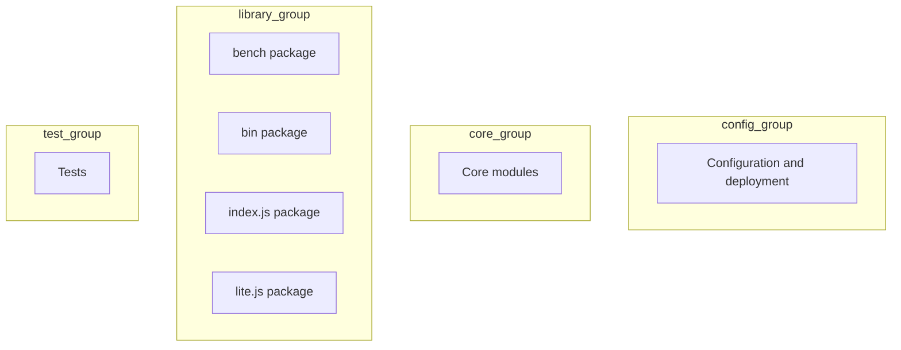

# Architecture report: lukeed/clsx

> Automated static analysis. **Observed** = directly seen in files/imports/AST; **Inferred** = interpretation from that evidence. Repository code was not executed.

## 1. Repository at a glance

| Item | Value |
| --- | --- |
| Repository | lukeed/clsx |
| Description | A tiny (239B) utility for constructing `className` strings conditionally. |
| Language | JavaScript |
| Stars | 9848 |
| Licence | MIT |
| Analysed commit / branch | 925494cf31bcd97d3337aacd34e659e80cae7fe2 / master |
| Framework(s) | None detected |
| Files analysed | 18 |
| Components | 7 |

## 2. Architecture in one minute

lukeed/clsx - A tiny (239B) utility for constructing `className` strings conditionally.. This repository was analysed statically from 18 file(s) (0 Python). Detected technologies (observed from imports/manifests): GitHub Actions. Files are grouped into 7 component(s): bench package, bin package, Configuration and deployment, Core modules, index.js package, lite.js package, Tests. Findings below distinguish observed facts from inferred interpretation.

## 3. High-level block diagram

## 4. Main components

### bench package (`bench`)

- **Kind:** library
- **Status:** Observed
- **Confidence:** 0.85
- **Responsibility:** Groups 1 file(s) under bench package (observed from repository paths and static analysis).
- **Paths:** `bench/index.js`
- **Evidence:** [bench/index.js](https://github.com/lukeed/clsx/blob/925494cf31bcd97d3337aacd34e659e80cae7fe2/bench/index.js)

### bin package (`bin`)

- **Kind:** library
- **Status:** Observed
- **Confidence:** 0.85
- **Responsibility:** Groups 1 file(s) under bin package (observed from repository paths and static analysis).
- **Paths:** `bin/index.js`
- **Evidence:** [bin/index.js](https://github.com/lukeed/clsx/blob/925494cf31bcd97d3337aacd34e659e80cae7fe2/bin/index.js)

### Configuration and deployment (`config`)

- **Kind:** config
- **Status:** Observed
- **Confidence:** 0.85
- **Responsibility:** Groups 2 file(s) under configuration and deployment (observed from repository paths and static analysis).
- **Paths:** `bench/package.json`, `package.json`
- **Evidence:** [bench/package.json](https://github.com/lukeed/clsx/blob/925494cf31bcd97d3337aacd34e659e80cae7fe2/bench/package.json); [package.json](https://github.com/lukeed/clsx/blob/925494cf31bcd97d3337aacd34e659e80cae7fe2/package.json)

### Core modules (`core`)

- **Kind:** core
- **Status:** Observed
- **Confidence:** 0.85
- **Responsibility:** Groups 1 file(s) under core modules (observed from repository paths and static analysis).
- **Paths:** `clsx.d.ts`
- **Evidence:** [clsx.d.ts](https://github.com/lukeed/clsx/blob/925494cf31bcd97d3337aacd34e659e80cae7fe2/clsx.d.ts)

### index.js package (`index_js`)

- **Kind:** library
- **Status:** Observed
- **Confidence:** 0.85
- **Responsibility:** Groups 1 file(s) under index.js package (observed from repository paths and static analysis).
- **Paths:** `src/index.js`
- **Evidence:** [src/index.js](https://github.com/lukeed/clsx/blob/925494cf31bcd97d3337aacd34e659e80cae7fe2/src/index.js)

### lite.js package (`lite_js`)

- **Kind:** library
- **Status:** Observed
- **Confidence:** 0.85
- **Responsibility:** Groups 1 file(s) under lite.js package (observed from repository paths and static analysis).
- **Paths:** `src/lite.js`
- **Evidence:** [src/lite.js](https://github.com/lukeed/clsx/blob/925494cf31bcd97d3337aacd34e659e80cae7fe2/src/lite.js)

### Tests (`tests`)

- **Kind:** test
- **Status:** Observed
- **Confidence:** 0.85
- **Responsibility:** Groups 3 file(s) under tests (observed from repository paths and static analysis).
- **Paths:** `test/classnames.js`, `test/index.js`, `test/lite.js`
- **Evidence:** [test/classnames.js](https://github.com/lukeed/clsx/blob/925494cf31bcd97d3337aacd34e659e80cae7fe2/test/classnames.js); [test/index.js](https://github.com/lukeed/clsx/blob/925494cf31bcd97d3337aacd34e659e80cae7fe2/test/index.js); [test/lite.js](https://github.com/lukeed/clsx/blob/925494cf31bcd97d3337aacd34e659e80cae7fe2/test/lite.js)

## 5. Execution flow

**Observed** entry point(s):

- [bench/index.js](https://github.com/lukeed/clsx/blob/925494cf31bcd97d3337aacd34e659e80cae7fe2/bench/index.js)
- [bin/index.js](https://github.com/lukeed/clsx/blob/925494cf31bcd97d3337aacd34e659e80cae7fe2/bin/index.js)
- [src/index.js](https://github.com/lukeed/clsx/blob/925494cf31bcd97d3337aacd34e659e80cae7fe2/src/index.js)

Representative flow (derived from observed entry points and the import graph; steps beyond the entry point are **Inferred**):

1. Execution starts at an observed entry point listed above, if present.
2. No internal import relationships between components were observed.

## 6. Project structure

### `(root)`

- `.editorconfig` - config (211 bytes)
- `.gitignore` - other (50 bytes)
- `clsx.d.mts` - other (278 bytes)
- `clsx.d.ts` - source, TypeScript (337 bytes)
- `license` - docs (1104 bytes)
- `package.json` - manifest (1192 bytes)
- `readme.md` - docs (4003 bytes)

### `.github`

- `.github/FUNDING.yml` - config (15 bytes)
- `.github/workflows/ci.yml` - ci, YAML (1066 bytes)

### `bench`

- `bench/index.js` - source, JavaScript (1332 bytes)
- `bench/package.json` - manifest (151 bytes)
- `bench/readme.md` - docs (2350 bytes)

### `bin`

- `bin/index.js` - source, JavaScript (1794 bytes)

### `src`

- `src/index.js` - source, JavaScript (705 bytes)
- `src/lite.js` - source, JavaScript (236 bytes)

### `test`

- `test/classnames.js` - test, JavaScript (2496 bytes)
- `test/index.js` - test, JavaScript (2741 bytes)
- `test/lite.js` - test, JavaScript (1520 bytes)

## 7. Key dependencies and integrations

| Name | Category | Status | Confidence | Evidence |
| --- | --- | --- | --- | --- |
| GitHub Actions | ci | Observed | 0.85 | [.github/workflows/ci.yml](https://github.com/lukeed/clsx/blob/925494cf31bcd97d3337aacd34e659e80cae7fe2/.github/workflows/ci.yml) |

## 8. Data and state

No database, cache, queue, or persistent-state usage was observed in the analysed files. State handling, if any, may be in-memory or in files that were not analysed.

## 9. Configuration and deployment clues

- `.editorconfig` (config)
- `.github/FUNDING.yml` (config)
- `.github/workflows/ci.yml` (ci)
- `bench/package.json` (manifest)
- `package.json` (manifest)

## 10. Design observations

- Tests are present alongside source code (Observed from test file paths).

These observations are interpretations (**Inferred**) of the observed structure, not guarantees about runtime design.

## 11. Limitations and unknowns

- Static analysis only: repository code was not executed, installed, or imported at runtime.
- Components and relationships are inferred from file paths, imports, and AST structure; runtime behaviour, dynamic imports, and reflection may not be visible.
- No clear application entry point was observed in the analysed files.
- Repository text was treated as untrusted data; no instructions found in repository files were followed, and likely secret values were redacted/excluded.
- JavaScript and TypeScript files were inventoried from paths and package manifests. They were not parsed with a full language AST, and repository code was not executed.

## 12. Source references

- [.github/workflows/ci.yml](https://github.com/lukeed/clsx/blob/925494cf31bcd97d3337aacd34e659e80cae7fe2/.github/workflows/ci.yml)
- [bench/index.js](https://github.com/lukeed/clsx/blob/925494cf31bcd97d3337aacd34e659e80cae7fe2/bench/index.js)
- [bench/package.json](https://github.com/lukeed/clsx/blob/925494cf31bcd97d3337aacd34e659e80cae7fe2/bench/package.json)
- [bin/index.js](https://github.com/lukeed/clsx/blob/925494cf31bcd97d3337aacd34e659e80cae7fe2/bin/index.js)
- [clsx.d.ts](https://github.com/lukeed/clsx/blob/925494cf31bcd97d3337aacd34e659e80cae7fe2/clsx.d.ts)
- [package.json](https://github.com/lukeed/clsx/blob/925494cf31bcd97d3337aacd34e659e80cae7fe2/package.json)
- [src/index.js](https://github.com/lukeed/clsx/blob/925494cf31bcd97d3337aacd34e659e80cae7fe2/src/index.js)
- [src/lite.js](https://github.com/lukeed/clsx/blob/925494cf31bcd97d3337aacd34e659e80cae7fe2/src/lite.js)
- [test/classnames.js](https://github.com/lukeed/clsx/blob/925494cf31bcd97d3337aacd34e659e80cae7fe2/test/classnames.js)
- [test/index.js](https://github.com/lukeed/clsx/blob/925494cf31bcd97d3337aacd34e659e80cae7fe2/test/index.js)
- [test/lite.js](https://github.com/lukeed/clsx/blob/925494cf31bcd97d3337aacd34e659e80cae7fe2/test/lite.js)
