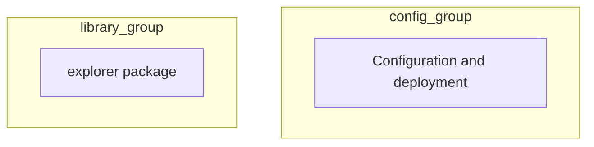

# Architecture report: m3y54m/Embedded-Engineering-Roadmap

> Automated static analysis. **Observed** = directly seen in files/imports/AST; **Inferred** = interpretation from that evidence. Repository code was not executed.

## 1. Repository at a glance

| Item | Value |
| --- | --- |
| Repository | m3y54m/Embedded-Engineering-Roadmap |
| Description | Comprehensive roadmap for aspiring Embedded Systems Engineers, featuring a curated list of learning resources |
| Language | JavaScript |
| Stars | 13899 |
| Licence | CC-BY-SA-4.0 |
| Analysed commit / branch | 792e6cdf6cd4233c6fbd99c65c1236e5637da363 / master |
| Framework(s) | None detected |
| Files analysed | 35 |
| Components | 2 |

## 2. Architecture in one minute

m3y54m/Embedded-Engineering-Roadmap - Comprehensive roadmap for aspiring Embedded Systems Engineers, featuring a curated list of learning resources. This repository was analysed statically from 35 file(s) (1 Python). Detected technologies (observed from imports/manifests): GitHub Actions. Files are grouped into 2 component(s): Configuration and deployment, explorer package. Observed entry point(s): .github/scripts/check_readme.py. Findings below distinguish observed facts from inferred interpretation.

## 3. High-level block diagram

## 4. Main components

### Configuration and deployment (`config`)

- **Kind:** config
- **Status:** Observed
- **Confidence:** 0.85
- **Responsibility:** Groups 1 file(s) under configuration and deployment (observed from repository paths and static analysis).
- **Paths:** `explorer/map.json`
- **Evidence:** [explorer/map.json](https://github.com/m3y54m/Embedded-Engineering-Roadmap/blob/792e6cdf6cd4233c6fbd99c65c1236e5637da363/explorer/map.json)

### explorer package (`explorer`)

- **Kind:** library
- **Status:** Observed
- **Confidence:** 0.85
- **Responsibility:** Groups 9 file(s) under explorer package (observed from repository paths and static analysis).
- **Paths:** `explorer/app.js`, `explorer/diagram.js`, `explorer/dom.js`, `explorer/layout.js`, `explorer/mapview.js`, `explorer/parser.js`, `explorer/parser.test.mjs`, `explorer/tools/coverage.mjs`, `explorer/tools/render.mjs`
- **Evidence:** [explorer/app.js](https://github.com/m3y54m/Embedded-Engineering-Roadmap/blob/792e6cdf6cd4233c6fbd99c65c1236e5637da363/explorer/app.js); [explorer/diagram.js](https://github.com/m3y54m/Embedded-Engineering-Roadmap/blob/792e6cdf6cd4233c6fbd99c65c1236e5637da363/explorer/diagram.js); [explorer/dom.js](https://github.com/m3y54m/Embedded-Engineering-Roadmap/blob/792e6cdf6cd4233c6fbd99c65c1236e5637da363/explorer/dom.js); [explorer/layout.js](https://github.com/m3y54m/Embedded-Engineering-Roadmap/blob/792e6cdf6cd4233c6fbd99c65c1236e5637da363/explorer/layout.js); [explorer/mapview.js](https://github.com/m3y54m/Embedded-Engineering-Roadmap/blob/792e6cdf6cd4233c6fbd99c65c1236e5637da363/explorer/mapview.js); [explorer/parser.js](https://github.com/m3y54m/Embedded-Engineering-Roadmap/blob/792e6cdf6cd4233c6fbd99c65c1236e5637da363/explorer/parser.js); [explorer/parser.test.mjs](https://github.com/m3y54m/Embedded-Engineering-Roadmap/blob/792e6cdf6cd4233c6fbd99c65c1236e5637da363/explorer/parser.test.mjs); [explorer/tools/coverage.mjs](https://github.com/m3y54m/Embedded-Engineering-Roadmap/blob/792e6cdf6cd4233c6fbd99c65c1236e5637da363/explorer/tools/coverage.mjs)

## 5. Execution flow

**Observed** entry point(s):

- [.github/scripts/check_readme.py:46](https://github.com/m3y54m/Embedded-Engineering-Roadmap/blob/792e6cdf6cd4233c6fbd99c65c1236e5637da363/.github/scripts/check_readme.py#L46)
- [explorer/app.js](https://github.com/m3y54m/Embedded-Engineering-Roadmap/blob/792e6cdf6cd4233c6fbd99c65c1236e5637da363/explorer/app.js)

Representative flow (derived from observed entry points and the import graph; steps beyond the entry point are **Inferred**):

1. Execution starts at an observed entry point listed above, if present.
2. No internal import relationships between components were observed.

## 6. Project structure

### `(root)`

- `.gitignore` - other (118 bytes)
- `.markdownlint.json` - config (63 bytes)
- `CODE_OF_CONDUCT.md` - docs (2425 bytes)
- `CONTRIBUTING.md` - docs (4677 bytes)
- `LICENSE` - docs (20130 bytes)
- `README.md` - docs (139614 bytes)

### `.github`

- `.github/FUNDING.yml` - config (48 bytes)
- `.github/ISSUE_TEMPLATE/config.yml` - config (246 bytes)
- `.github/ISSUE_TEMPLATE/report-link-problem.yml` - config (545 bytes)
- `.github/ISSUE_TEMPLATE/suggest-resource.yml` - config (655 bytes)
- `.github/PULL_REQUEST_TEMPLATE.md` - docs (298 bytes)
- `.github/dependabot.yml` - config (113 bytes)
- `.github/lychee.toml` - config (1186 bytes)
- `.github/scripts/check_readme.py` - source, Python (1631 bytes)
- `.github/scripts/next-version.sh` - source, Shell (1918 bytes)
- `.github/workflows/link-check.yml` - ci, YAML (1142 bytes)
- `.github/workflows/markdown-lint.yml` - ci, YAML (633 bytes)
- `.github/workflows/pages.yml` - ci, YAML (5094 bytes)

### `explorer`

- `explorer/app.js` - source, JavaScript (28992 bytes)
- `explorer/assets/cc-by-sa.svg` - other (16462 bytes)
- `explorer/assets/logo.svg` - other (879 bytes)
- `explorer/diagram.js` - source, JavaScript (6270 bytes)
- `explorer/dom.js` - source, JavaScript (2574 bytes)
- `explorer/fonts/OFL.txt` - docs (4393 bytes)
- `explorer/index.html` - other (7805 bytes)
- `explorer/layout.js` - source, JavaScript (7540 bytes)
- `explorer/map.css` - other (11819 bytes)
- `explorer/map.json` - config (26703 bytes)
- `explorer/mapview.js` - source, JavaScript (29296 bytes)
- `explorer/parser.js` - source, JavaScript (11655 bytes)
- `explorer/parser.test.mjs` - source, JavaScript (6784 bytes)
- `explorer/sitemap.xml` - other (197 bytes)
- `explorer/styles.css` - other (20843 bytes)
- `explorer/tools/coverage.mjs` - source, JavaScript (1209 bytes)
- `explorer/tools/render.mjs` - source, JavaScript (6350 bytes)

## 7. Key dependencies and integrations

| Name | Category | Status | Confidence | Evidence |
| --- | --- | --- | --- | --- |
| GitHub Actions | ci | Observed | 0.90 | [.github/workflows/link-check.yml](https://github.com/m3y54m/Embedded-Engineering-Roadmap/blob/792e6cdf6cd4233c6fbd99c65c1236e5637da363/.github/workflows/link-check.yml); [.github/workflows/markdown-lint.yml](https://github.com/m3y54m/Embedded-Engineering-Roadmap/blob/792e6cdf6cd4233c6fbd99c65c1236e5637da363/.github/workflows/markdown-lint.yml); [.github/workflows/pages.yml](https://github.com/m3y54m/Embedded-Engineering-Roadmap/blob/792e6cdf6cd4233c6fbd99c65c1236e5637da363/.github/workflows/pages.yml) |

## 8. Data and state

No database, cache, queue, or persistent-state usage was observed in the analysed files. State handling, if any, may be in-memory or in files that were not analysed.

## 9. Configuration and deployment clues

- `.github/FUNDING.yml` (config)
- `.github/ISSUE_TEMPLATE/config.yml` (config)
- `.github/ISSUE_TEMPLATE/report-link-problem.yml` (config)
- `.github/ISSUE_TEMPLATE/suggest-resource.yml` (config)
- `.github/dependabot.yml` (config)
- `.github/lychee.toml` (config)
- `.github/workflows/link-check.yml` (ci)
- `.github/workflows/markdown-lint.yml` (ci)
- `.github/workflows/pages.yml` (ci)
- `.markdownlint.json` (config)
- `explorer/map.json` (config)

## 10. Design observations

- No strong design patterns could be established from the available evidence.

These observations are interpretations (**Inferred**) of the observed structure, not guarantees about runtime design.

## 11. Limitations and unknowns

- Static analysis only: repository code was not executed, installed, or imported at runtime.
- Components and relationships are inferred from file paths, imports, and AST structure; runtime behaviour, dynamic imports, and reflection may not be visible.
- Repository text was treated as untrusted data; no instructions found in repository files were followed, and likely secret values were redacted/excluded.

## 12. Source references

- [.github/scripts/check_readme.py:46](https://github.com/m3y54m/Embedded-Engineering-Roadmap/blob/792e6cdf6cd4233c6fbd99c65c1236e5637da363/.github/scripts/check_readme.py#L46)
- [.github/workflows/link-check.yml](https://github.com/m3y54m/Embedded-Engineering-Roadmap/blob/792e6cdf6cd4233c6fbd99c65c1236e5637da363/.github/workflows/link-check.yml)
- [.github/workflows/markdown-lint.yml](https://github.com/m3y54m/Embedded-Engineering-Roadmap/blob/792e6cdf6cd4233c6fbd99c65c1236e5637da363/.github/workflows/markdown-lint.yml)
- [.github/workflows/pages.yml](https://github.com/m3y54m/Embedded-Engineering-Roadmap/blob/792e6cdf6cd4233c6fbd99c65c1236e5637da363/.github/workflows/pages.yml)
- [explorer/app.js](https://github.com/m3y54m/Embedded-Engineering-Roadmap/blob/792e6cdf6cd4233c6fbd99c65c1236e5637da363/explorer/app.js)
- [explorer/diagram.js](https://github.com/m3y54m/Embedded-Engineering-Roadmap/blob/792e6cdf6cd4233c6fbd99c65c1236e5637da363/explorer/diagram.js)
- [explorer/dom.js](https://github.com/m3y54m/Embedded-Engineering-Roadmap/blob/792e6cdf6cd4233c6fbd99c65c1236e5637da363/explorer/dom.js)
- [explorer/layout.js](https://github.com/m3y54m/Embedded-Engineering-Roadmap/blob/792e6cdf6cd4233c6fbd99c65c1236e5637da363/explorer/layout.js)
- [explorer/map.json](https://github.com/m3y54m/Embedded-Engineering-Roadmap/blob/792e6cdf6cd4233c6fbd99c65c1236e5637da363/explorer/map.json)
- [explorer/mapview.js](https://github.com/m3y54m/Embedded-Engineering-Roadmap/blob/792e6cdf6cd4233c6fbd99c65c1236e5637da363/explorer/mapview.js)
- [explorer/parser.js](https://github.com/m3y54m/Embedded-Engineering-Roadmap/blob/792e6cdf6cd4233c6fbd99c65c1236e5637da363/explorer/parser.js)
- [explorer/parser.test.mjs](https://github.com/m3y54m/Embedded-Engineering-Roadmap/blob/792e6cdf6cd4233c6fbd99c65c1236e5637da363/explorer/parser.test.mjs)
- [explorer/tools/coverage.mjs](https://github.com/m3y54m/Embedded-Engineering-Roadmap/blob/792e6cdf6cd4233c6fbd99c65c1236e5637da363/explorer/tools/coverage.mjs)
