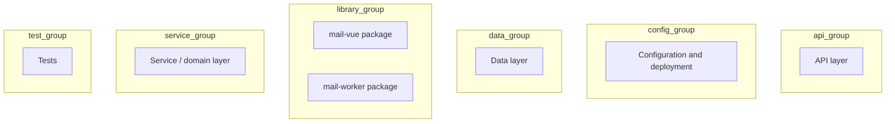

# Architecture report: maillab/cloud-mail

> Automated static analysis. **Observed** = directly seen in files/imports/AST; **Inferred** = interpretation from that evidence. Repository code was not executed.

## 1. Repository at a glance

| Item | Value |
| --- | --- |
| Repository | maillab/cloud-mail |
| Description | An all-in-one email service platform powered by Cloudflare  | 基于 Cloudflare 的一站式邮箱服务平台  | Cloudflare Email 邮箱 Mail |
| Language | JavaScript |
| Stars | 15882 |
| Licence | MIT |
| Analysed commit / branch | a792cdcd5c3291ac718b97489b1be19367121969 / main |
| Framework(s) | Vue |
| Files analysed | 256 |
| Components | 7 |

## 2. Architecture in one minute

maillab/cloud-mail - An all-in-one email service platform powered by Cloudflare  | 基于 Cloudflare 的一站式邮箱服务平台  | Cloudflare Email 邮箱 Mail. This repository was analysed statically from 256 file(s) (0 Python). Detected technologies (observed from imports/manifests): GitHub Actions, Vue, axios, Vite, Vitest. Files are grouped into 7 component(s): API layer, Configuration and deployment, Data layer, mail-vue package, mail-worker package, Service / domain layer, Tests. Findings below distinguish observed facts from inferred interpretation.

## 3. High-level block diagram

## 4. Main components

### API layer (`api_layer`)

- **Kind:** api
- **Status:** Observed
- **Confidence:** 0.85
- **Responsibility:** Groups 32 file(s) under api layer (observed from repository paths and static analysis).
- **Paths:** `mail-vue/src/views/404/index.vue`, `mail-vue/src/views/all-email/index.vue`, `mail-vue/src/views/analysis/index.vue`, `mail-vue/src/views/content/index.vue`, `mail-vue/src/views/draft/index.vue`, `mail-vue/src/views/email/index.vue`, `mail-vue/src/views/login/index.vue`, `mail-vue/src/views/reg-key/index.vue`, `mail-vue/src/views/role/index.vue`, `mail-vue/src/views/send/index.vue`, `mail-vue/src/views/setting/index.vue`, `mail-vue/src/views/star/index.vue`, `mail-vue/src/views/sys-setting/index.vue`, `mail-vue/src/views/user/index.vue`, `mail-worker/src/api/account-api.js`, `mail-worker/src/api/all-email-api.js`, `mail-worker/src/api/analysis-api.js`, `mail-worker/src/api/email-api.js`, `mail-worker/src/api/init-api.js`, `mail-worker/src/api/login-api.js`, `mail-worker/src/api/my-api.js`, `mail-worker/src/api/oauth-api.js`, `mail-worker/src/api/public-api.js`, `mail-worker/src/api/r2-api.js`, `mail-worker/src/api/reg-key-api.js`, `mail-worker/src/api/resend-api.js`, `mail-worker/src/api/role-api.js`, `mail-worker/src/api/setting-api.js`, `mail-worker/src/api/star-api.js`, `mail-worker/src/api/telegram-api.js`, `mail-worker/src/api/test-api.js`, `mail-worker/src/api/user-api.js`
- **Evidence:** [mail-vue/src/views/404/index.vue](https://github.com/maillab/cloud-mail/blob/a792cdcd5c3291ac718b97489b1be19367121969/mail-vue/src/views/404/index.vue); [mail-vue/src/views/all-email/index.vue](https://github.com/maillab/cloud-mail/blob/a792cdcd5c3291ac718b97489b1be19367121969/mail-vue/src/views/all-email/index.vue); [mail-vue/src/views/analysis/index.vue](https://github.com/maillab/cloud-mail/blob/a792cdcd5c3291ac718b97489b1be19367121969/mail-vue/src/views/analysis/index.vue); [mail-vue/src/views/content/index.vue](https://github.com/maillab/cloud-mail/blob/a792cdcd5c3291ac718b97489b1be19367121969/mail-vue/src/views/content/index.vue); [mail-vue/src/views/draft/index.vue](https://github.com/maillab/cloud-mail/blob/a792cdcd5c3291ac718b97489b1be19367121969/mail-vue/src/views/draft/index.vue); [mail-vue/src/views/email/index.vue](https://github.com/maillab/cloud-mail/blob/a792cdcd5c3291ac718b97489b1be19367121969/mail-vue/src/views/email/index.vue); [mail-vue/src/views/login/index.vue](https://github.com/maillab/cloud-mail/blob/a792cdcd5c3291ac718b97489b1be19367121969/mail-vue/src/views/login/index.vue); [mail-vue/src/views/reg-key/index.vue](https://github.com/maillab/cloud-mail/blob/a792cdcd5c3291ac718b97489b1be19367121969/mail-vue/src/views/reg-key/index.vue)

### Configuration and deployment (`config`)

- **Kind:** config
- **Status:** Observed
- **Confidence:** 0.85
- **Responsibility:** Groups 10 file(s) under configuration and deployment (observed from repository paths and static analysis).
- **Paths:** `mail-vue/jsconfig.json`, `mail-vue/package.json`, `mail-vue/pnpm-workspace.yaml`, `mail-worker/.editorconfig`, `mail-worker/package.json`, `mail-worker/pnpm-workspace.yaml`, `mail-worker/wrangler-action.toml`, `mail-worker/wrangler-dev.toml`, `mail-worker/wrangler-test.toml`, `mail-worker/wrangler.toml`
- **Evidence:** [mail-vue/jsconfig.json](https://github.com/maillab/cloud-mail/blob/a792cdcd5c3291ac718b97489b1be19367121969/mail-vue/jsconfig.json); [mail-vue/package.json](https://github.com/maillab/cloud-mail/blob/a792cdcd5c3291ac718b97489b1be19367121969/mail-vue/package.json); [mail-vue/pnpm-workspace.yaml](https://github.com/maillab/cloud-mail/blob/a792cdcd5c3291ac718b97489b1be19367121969/mail-vue/pnpm-workspace.yaml); [mail-worker/.editorconfig](https://github.com/maillab/cloud-mail/blob/a792cdcd5c3291ac718b97489b1be19367121969/mail-worker/.editorconfig); [mail-worker/package.json](https://github.com/maillab/cloud-mail/blob/a792cdcd5c3291ac718b97489b1be19367121969/mail-worker/package.json); [mail-worker/pnpm-workspace.yaml](https://github.com/maillab/cloud-mail/blob/a792cdcd5c3291ac718b97489b1be19367121969/mail-worker/pnpm-workspace.yaml); [mail-worker/wrangler-action.toml](https://github.com/maillab/cloud-mail/blob/a792cdcd5c3291ac718b97489b1be19367121969/mail-worker/wrangler-action.toml); [mail-worker/wrangler-dev.toml](https://github.com/maillab/cloud-mail/blob/a792cdcd5c3291ac718b97489b1be19367121969/mail-worker/wrangler-dev.toml)

### Data layer (`data_layer`)

- **Kind:** data
- **Status:** Observed
- **Confidence:** 0.85
- **Responsibility:** Groups 1 file(s) under data layer (observed from repository paths and static analysis).
- **Paths:** `mail-vue/src/db/db.js`
- **Evidence:** [mail-vue/src/db/db.js](https://github.com/maillab/cloud-mail/blob/a792cdcd5c3291ac718b97489b1be19367121969/mail-vue/src/db/db.js)

### mail-vue package (`mail_vue`)

- **Kind:** library
- **Status:** Observed
- **Confidence:** 0.85
- **Responsibility:** Groups 127 file(s) under mail-vue package (observed from repository paths and static analysis).
- **Paths:** `mail-vue/public/tinymce/langs/zh_CN.js`, `mail-vue/public/tinymce/langs/zh_TW.js`, `mail-vue/public/tinymce/plugins/emoticons/js/emojis.js`, `mail-vue/public/tinymce/plugins/help/js/i18n/keynav/ar.js`, `mail-vue/public/tinymce/plugins/help/js/i18n/keynav/bg_BG.js`, `mail-vue/public/tinymce/plugins/help/js/i18n/keynav/ca.js`, `mail-vue/public/tinymce/plugins/help/js/i18n/keynav/cs.js`, `mail-vue/public/tinymce/plugins/help/js/i18n/keynav/da.js`, `mail-vue/public/tinymce/plugins/help/js/i18n/keynav/de.js`, `mail-vue/public/tinymce/plugins/help/js/i18n/keynav/el.js`, `mail-vue/public/tinymce/plugins/help/js/i18n/keynav/en.js`, `mail-vue/public/tinymce/plugins/help/js/i18n/keynav/es.js`, `mail-vue/public/tinymce/plugins/help/js/i18n/keynav/eu.js`, `mail-vue/public/tinymce/plugins/help/js/i18n/keynav/fa.js`, `mail-vue/public/tinymce/plugins/help/js/i18n/keynav/fi.js`, `mail-vue/public/tinymce/plugins/help/js/i18n/keynav/fr_FR.js`, `mail-vue/public/tinymce/plugins/help/js/i18n/keynav/he_IL.js`, `mail-vue/public/tinymce/plugins/help/js/i18n/keynav/hi.js`, `mail-vue/public/tinymce/plugins/help/js/i18n/keynav/hr.js`, `mail-vue/public/tinymce/plugins/help/js/i18n/keynav/hu_HU.js`, `mail-vue/public/tinymce/plugins/help/js/i18n/keynav/id.js`, `mail-vue/public/tinymce/plugins/help/js/i18n/keynav/it.js`, `mail-vue/public/tinymce/plugins/help/js/i18n/keynav/ja.js`, `mail-vue/public/tinymce/plugins/help/js/i18n/keynav/kk.js`, `mail-vue/public/tinymce/plugins/help/js/i18n/keynav/ko_KR.js`, `mail-vue/public/tinymce/plugins/help/js/i18n/keynav/ms.js`, `mail-vue/public/tinymce/plugins/help/js/i18n/keynav/nb_NO.js`, `mail-vue/public/tinymce/plugins/help/js/i18n/keynav/nl.js`, `mail-vue/public/tinymce/plugins/help/js/i18n/keynav/pl.js`, `mail-vue/public/tinymce/plugins/help/js/i18n/keynav/pt_BR.js`, `mail-vue/public/tinymce/plugins/help/js/i18n/keynav/pt_PT.js`, `mail-vue/public/tinymce/plugins/help/js/i18n/keynav/ro.js`, `mail-vue/public/tinymce/plugins/help/js/i18n/keynav/ru.js`, `mail-vue/public/tinymce/plugins/help/js/i18n/keynav/sk.js`, `mail-vue/public/tinymce/plugins/help/js/i18n/keynav/sl_SI.js`, `mail-vue/public/tinymce/plugins/help/js/i18n/keynav/sv_SE.js`, `mail-vue/public/tinymce/plugins/help/js/i18n/keynav/th_TH.js`, `mail-vue/public/tinymce/plugins/help/js/i18n/keynav/tr.js`, `mail-vue/public/tinymce/plugins/help/js/i18n/keynav/uk.js`, `mail-vue/public/tinymce/plugins/help/js/i18n/keynav/vi.js`, `mail-vue/public/tinymce/plugins/help/js/i18n/keynav/zh_CN.js`, `mail-vue/public/tinymce/plugins/help/js/i18n/keynav/zh_TW.js`, `mail-vue/public/tinymce/skins/content/dark/content.js`, `mail-vue/public/tinymce/skins/content/default/content.js`, `mail-vue/public/tinymce/skins/content/document/content.js`, `mail-vue/public/tinymce/skins/content/tinymce-5-dark/content.js`, `mail-vue/public/tinymce/skins/content/tinymce-5/content.js`, `mail-vue/public/tinymce/skins/content/writer/content.js`, `mail-vue/public/tinymce/skins/ui/oxide-dark/content.inline.js`, `mail-vue/public/tinymce/skins/ui/oxide-dark/content.js`, `mail-vue/public/tinymce/skins/ui/oxide-dark/skin.js`, `mail-vue/public/tinymce/skins/ui/oxide-dark/skin.shadowdom.js`, `mail-vue/public/tinymce/skins/ui/oxide/content.inline.js`, `mail-vue/public/tinymce/skins/ui/oxide/content.js`, `mail-vue/public/tinymce/skins/ui/oxide/skin.js`, `mail-vue/public/tinymce/skins/ui/oxide/skin.shadowdom.js`, `mail-vue/public/tinymce/skins/ui/tinymce-5-dark/content.inline.js`, `mail-vue/public/tinymce/skins/ui/tinymce-5-dark/content.js`, `mail-vue/public/tinymce/skins/ui/tinymce-5-dark/skin.js`, `mail-vue/public/tinymce/skins/ui/tinymce-5-dark/skin.shadowdom.js`, `mail-vue/public/tinymce/skins/ui/tinymce-5/content.inline.js`, `mail-vue/public/tinymce/skins/ui/tinymce-5/content.js`, `mail-vue/public/tinymce/skins/ui/tinymce-5/skin.js`, `mail-vue/public/tinymce/skins/ui/tinymce-5/skin.shadowdom.js`, `mail-vue/public/tinymce/tinymce.d.ts`, `mail-vue/src/App.vue`, `mail-vue/src/axios/index.js`, `mail-vue/src/components/all-email-search/index.vue`, `mail-vue/src/components/email-scroll/index.vue`, `mail-vue/src/components/email-scroll/skeleton/index.vue`, `mail-vue/src/components/email-search/index.vue`, `mail-vue/src/components/hamburger/index.vue`, `mail-vue/src/components/loading/index.vue`, `mail-vue/src/components/send-percent/index.vue`, `mail-vue/src/components/shadow-html/index.vue`, `mail-vue/src/components/theme-selector/index.vue`, `mail-vue/src/components/tiny-editor/index.vue`, `mail-vue/src/echarts/index.js`, `mail-vue/src/enums/account-enum.js`, `mail-vue/src/enums/email-enum.js`, `mail-vue/src/enums/setting-enum.js`, `mail-vue/src/i18n/en.js`, `mail-vue/src/i18n/index.js`, `mail-vue/src/i18n/zh.js`, `mail-vue/src/icons/index.js`, `mail-vue/src/init/init.js`, `mail-vue/src/layout/account/index.vue`, `mail-vue/src/layout/aside/index.vue`, `mail-vue/src/layout/header/index.vue`, `mail-vue/src/layout/index.vue`, `mail-vue/src/layout/main/index.vue`, `mail-vue/src/layout/write/index.vue`, `mail-vue/src/main.js`, `mail-vue/src/perm/perm.js`, `mail-vue/src/request/account.js`, `mail-vue/src/request/all-email.js`, `mail-vue/src/request/analysis.js`, `mail-vue/src/request/email.js`, `mail-vue/src/request/login.js`, `mail-vue/src/request/my.js`, `mail-vue/src/request/ouath.js`, `mail-vue/src/request/reg-key.js`, `mail-vue/src/request/role.js`, `mail-vue/src/request/setting.js`, `mail-vue/src/request/star.js`, `mail-vue/src/request/user.js`, `mail-vue/src/router/index.js`, `mail-vue/src/store/account.js`, `mail-vue/src/store/all-email.js`, `mail-vue/src/store/draft.js`, `mail-vue/src/store/email.js`, `mail-vue/src/store/role.js`, `mail-vue/src/store/send.js`, `mail-vue/src/store/setting.js`, `mail-vue/src/store/ui.js`, `mail-vue/src/store/user.js`, `mail-vue/src/store/writer.js`, `mail-vue/src/utils/convert.js`, `mail-vue/src/utils/day.js`, `mail-vue/src/utils/email-html.js`, `mail-vue/src/utils/file-utils.js`, `mail-vue/src/utils/icon-utils.js`, `mail-vue/src/utils/text.js`, `mail-vue/src/utils/time-utils.js`, `mail-vue/src/utils/turnstile-script.js`, `mail-vue/src/utils/verify-utils.js`, `mail-vue/vite.config.js`
- **Evidence:** [mail-vue/public/tinymce/langs/zh_CN.js](https://github.com/maillab/cloud-mail/blob/a792cdcd5c3291ac718b97489b1be19367121969/mail-vue/public/tinymce/langs/zh_CN.js); [mail-vue/public/tinymce/langs/zh_TW.js](https://github.com/maillab/cloud-mail/blob/a792cdcd5c3291ac718b97489b1be19367121969/mail-vue/public/tinymce/langs/zh_TW.js); [mail-vue/public/tinymce/plugins/emoticons/js/emojis.js](https://github.com/maillab/cloud-mail/blob/a792cdcd5c3291ac718b97489b1be19367121969/mail-vue/public/tinymce/plugins/emoticons/js/emojis.js); [mail-vue/public/tinymce/plugins/help/js/i18n/keynav/ar.js](https://github.com/maillab/cloud-mail/blob/a792cdcd5c3291ac718b97489b1be19367121969/mail-vue/public/tinymce/plugins/help/js/i18n/keynav/ar.js); [mail-vue/public/tinymce/plugins/help/js/i18n/keynav/bg_BG.js](https://github.com/maillab/cloud-mail/blob/a792cdcd5c3291ac718b97489b1be19367121969/mail-vue/public/tinymce/plugins/help/js/i18n/keynav/bg_BG.js); [mail-vue/public/tinymce/plugins/help/js/i18n/keynav/ca.js](https://github.com/maillab/cloud-mail/blob/a792cdcd5c3291ac718b97489b1be19367121969/mail-vue/public/tinymce/plugins/help/js/i18n/keynav/ca.js); [mail-vue/public/tinymce/plugins/help/js/i18n/keynav/cs.js](https://github.com/maillab/cloud-mail/blob/a792cdcd5c3291ac718b97489b1be19367121969/mail-vue/public/tinymce/plugins/help/js/i18n/keynav/cs.js); [mail-vue/public/tinymce/plugins/help/js/i18n/keynav/da.js](https://github.com/maillab/cloud-mail/blob/a792cdcd5c3291ac718b97489b1be19367121969/mail-vue/public/tinymce/plugins/help/js/i18n/keynav/da.js)

### mail-worker package (`mail_worker`)

- **Kind:** library
- **Status:** Observed
- **Confidence:** 0.85
- **Responsibility:** Groups 44 file(s) under mail-worker package (observed from repository paths and static analysis).
- **Paths:** `mail-worker/src/const/constant.js`, `mail-worker/src/const/entity-const.js`, `mail-worker/src/const/kv-const.js`, `mail-worker/src/dao/analysis-dao.js`, `mail-worker/src/email/email.js`, `mail-worker/src/entity/account.js`, `mail-worker/src/entity/att.js`, `mail-worker/src/entity/email.js`, `mail-worker/src/entity/oauth.js`, `mail-worker/src/entity/orm.js`, `mail-worker/src/entity/perm.js`, `mail-worker/src/entity/reg-key.js`, `mail-worker/src/entity/role-perm.js`, `mail-worker/src/entity/role.js`, `mail-worker/src/entity/setting.js`, `mail-worker/src/entity/star.js`, `mail-worker/src/entity/user.js`, `mail-worker/src/entity/verify-record.js`, `mail-worker/src/error/biz-error.js`, `mail-worker/src/hono/hono.js`, `mail-worker/src/hono/webs.js`, `mail-worker/src/i18n/en.js`, `mail-worker/src/i18n/i18n.js`, `mail-worker/src/i18n/zh.js`, `mail-worker/src/index.js`, `mail-worker/src/init/init.js`, `mail-worker/src/lib/email-list-columns.js`, `mail-worker/src/model/result.js`, `mail-worker/src/security/security.js`, `mail-worker/src/security/user-context.js`, `mail-worker/src/template/email-html.js`, `mail-worker/src/template/email-msg.js`, `mail-worker/src/template/email-text.js`, `mail-worker/src/utils/crypto-utils.js`, `mail-worker/src/utils/date-uitil.js`, `mail-worker/src/utils/domain-uitls.js`, `mail-worker/src/utils/email-utils.js`, `mail-worker/src/utils/file-utils.js`, `mail-worker/src/utils/forward-mime.js`, `mail-worker/src/utils/jwt-utils.js`, `mail-worker/src/utils/req-utils.js`, `mail-worker/src/utils/time-utils.js`, `mail-worker/src/utils/verify-utils.js`, `mail-worker/vitest.config.js`
- **Evidence:** [mail-worker/src/const/constant.js](https://github.com/maillab/cloud-mail/blob/a792cdcd5c3291ac718b97489b1be19367121969/mail-worker/src/const/constant.js); [mail-worker/src/const/entity-const.js](https://github.com/maillab/cloud-mail/blob/a792cdcd5c3291ac718b97489b1be19367121969/mail-worker/src/const/entity-const.js); [mail-worker/src/const/kv-const.js](https://github.com/maillab/cloud-mail/blob/a792cdcd5c3291ac718b97489b1be19367121969/mail-worker/src/const/kv-const.js); [mail-worker/src/dao/analysis-dao.js](https://github.com/maillab/cloud-mail/blob/a792cdcd5c3291ac718b97489b1be19367121969/mail-worker/src/dao/analysis-dao.js); [mail-worker/src/email/email.js](https://github.com/maillab/cloud-mail/blob/a792cdcd5c3291ac718b97489b1be19367121969/mail-worker/src/email/email.js); [mail-worker/src/entity/account.js](https://github.com/maillab/cloud-mail/blob/a792cdcd5c3291ac718b97489b1be19367121969/mail-worker/src/entity/account.js); [mail-worker/src/entity/att.js](https://github.com/maillab/cloud-mail/blob/a792cdcd5c3291ac718b97489b1be19367121969/mail-worker/src/entity/att.js); [mail-worker/src/entity/email.js](https://github.com/maillab/cloud-mail/blob/a792cdcd5c3291ac718b97489b1be19367121969/mail-worker/src/entity/email.js)

### Service / domain layer (`service_layer`)

- **Kind:** service
- **Status:** Observed
- **Confidence:** 0.85
- **Responsibility:** Groups 22 file(s) under service / domain layer (observed from repository paths and static analysis).
- **Paths:** `mail-worker/src/service/account-service.js`, `mail-worker/src/service/ai-service.js`, `mail-worker/src/service/analysis-service.js`, `mail-worker/src/service/att-service.js`, `mail-worker/src/service/email-service.js`, `mail-worker/src/service/kv-obj-service.js`, `mail-worker/src/service/login-service.js`, `mail-worker/src/service/oauth-service.js`, `mail-worker/src/service/perm-service.js`, `mail-worker/src/service/public-service.js`, `mail-worker/src/service/r2-service.js`, `mail-worker/src/service/reg-key-service.js`, `mail-worker/src/service/resend-service.js`, `mail-worker/src/service/role-service.js`, `mail-worker/src/service/s3-service.js`, `mail-worker/src/service/setting-service.js`, `mail-worker/src/service/star-service.js`, `mail-worker/src/service/telegram-service.js`, `mail-worker/src/service/turnstile-service.js`, `mail-worker/src/service/user-service.js`, `mail-worker/src/service/verify-record-service.js`, `mail-worker/src/service/webhook-service.js`
- **Evidence:** [mail-worker/src/service/account-service.js](https://github.com/maillab/cloud-mail/blob/a792cdcd5c3291ac718b97489b1be19367121969/mail-worker/src/service/account-service.js); [mail-worker/src/service/ai-service.js](https://github.com/maillab/cloud-mail/blob/a792cdcd5c3291ac718b97489b1be19367121969/mail-worker/src/service/ai-service.js); [mail-worker/src/service/analysis-service.js](https://github.com/maillab/cloud-mail/blob/a792cdcd5c3291ac718b97489b1be19367121969/mail-worker/src/service/analysis-service.js); [mail-worker/src/service/att-service.js](https://github.com/maillab/cloud-mail/blob/a792cdcd5c3291ac718b97489b1be19367121969/mail-worker/src/service/att-service.js); [mail-worker/src/service/email-service.js](https://github.com/maillab/cloud-mail/blob/a792cdcd5c3291ac718b97489b1be19367121969/mail-worker/src/service/email-service.js); [mail-worker/src/service/kv-obj-service.js](https://github.com/maillab/cloud-mail/blob/a792cdcd5c3291ac718b97489b1be19367121969/mail-worker/src/service/kv-obj-service.js); [mail-worker/src/service/login-service.js](https://github.com/maillab/cloud-mail/blob/a792cdcd5c3291ac718b97489b1be19367121969/mail-worker/src/service/login-service.js); [mail-worker/src/service/oauth-service.js](https://github.com/maillab/cloud-mail/blob/a792cdcd5c3291ac718b97489b1be19367121969/mail-worker/src/service/oauth-service.js)

### Tests (`tests`)

- **Kind:** test
- **Status:** Observed
- **Confidence:** 0.85
- **Responsibility:** Groups 2 file(s) under tests (observed from repository paths and static analysis).
- **Paths:** `mail-vue/src/views/test/index.vue`, `mail-worker/test/index.spec.js`
- **Evidence:** [mail-vue/src/views/test/index.vue](https://github.com/maillab/cloud-mail/blob/a792cdcd5c3291ac718b97489b1be19367121969/mail-vue/src/views/test/index.vue); [mail-worker/test/index.spec.js](https://github.com/maillab/cloud-mail/blob/a792cdcd5c3291ac718b97489b1be19367121969/mail-worker/test/index.spec.js)

## 5. Execution flow

**Observed** entry point(s):

- [mail-vue/src/axios/index.js](https://github.com/maillab/cloud-mail/blob/a792cdcd5c3291ac718b97489b1be19367121969/mail-vue/src/axios/index.js)
- [mail-vue/src/echarts/index.js](https://github.com/maillab/cloud-mail/blob/a792cdcd5c3291ac718b97489b1be19367121969/mail-vue/src/echarts/index.js)
- [mail-vue/src/i18n/index.js](https://github.com/maillab/cloud-mail/blob/a792cdcd5c3291ac718b97489b1be19367121969/mail-vue/src/i18n/index.js)
- [mail-vue/src/icons/index.js](https://github.com/maillab/cloud-mail/blob/a792cdcd5c3291ac718b97489b1be19367121969/mail-vue/src/icons/index.js)
- [mail-vue/src/main.js](https://github.com/maillab/cloud-mail/blob/a792cdcd5c3291ac718b97489b1be19367121969/mail-vue/src/main.js)
- [mail-vue/src/router/index.js](https://github.com/maillab/cloud-mail/blob/a792cdcd5c3291ac718b97489b1be19367121969/mail-vue/src/router/index.js)
- [mail-worker/src/index.js](https://github.com/maillab/cloud-mail/blob/a792cdcd5c3291ac718b97489b1be19367121969/mail-worker/src/index.js)

Representative flow (derived from observed entry points and the import graph; steps beyond the entry point are **Inferred**):

1. Execution starts at an observed entry point listed above, if present.
2. No internal import relationships between components were observed.

## 6. Project structure

### `(root)`

- `.gitignore` - other (281 bytes)
- `LICENSE` - docs (1072 bytes)
- `README-en.md` - docs (6877 bytes)
- `README-ja.md` - docs (7578 bytes)
- `README.md` - docs (6592 bytes)

### `.github`

- `.github/ISSUE_TEMPLATE/bug_report.md` - docs (112 bytes)
- `.github/ISSUE_TEMPLATE/feature_request.md` - docs (135 bytes)
- `.github/ISSUE_TEMPLATE/need-help.md` - docs (113 bytes)
- `.github/workflows/deploy-cloudflare.yml` - ci, YAML (9294 bytes)

### `mail-vue`

- `mail-vue/index.html` - other (3543 bytes)
- `mail-vue/jsconfig.json` - config (116 bytes)
- `mail-vue/package.json` - manifest (1123 bytes)
- `mail-vue/pnpm-workspace.yaml` - config (90 bytes)
- `mail-vue/public/_headers` - other (295 bytes)
- `mail-vue/public/content.css` - other (30 bytes)
- `mail-vue/public/tinymce/css/index.css` - other (1234 bytes)
- `mail-vue/public/tinymce/langs/README.md` - docs (150 bytes)
- `mail-vue/public/tinymce/langs/zh_CN.js` - source, JavaScript (19565 bytes)
- `mail-vue/public/tinymce/langs/zh_TW.js` - source, JavaScript (19798 bytes)
- `mail-vue/public/tinymce/license.md` - docs (303 bytes)
- `mail-vue/public/tinymce/notices.txt` - docs (471 bytes)
- `mail-vue/public/tinymce/plugins/emoticons/js/emojis.js` - source, JavaScript (186921 bytes)
- `mail-vue/public/tinymce/plugins/help/js/i18n/keynav/ar.js` - source, JavaScript (6359 bytes)
- `mail-vue/public/tinymce/plugins/help/js/i18n/keynav/bg_BG.js` - source, JavaScript (7175 bytes)
- `mail-vue/public/tinymce/plugins/help/js/i18n/keynav/ca.js` - source, JavaScript (5074 bytes)
- `mail-vue/public/tinymce/plugins/help/js/i18n/keynav/cs.js` - source, JavaScript (5013 bytes)
- `mail-vue/public/tinymce/plugins/help/js/i18n/keynav/da.js` - source, JavaScript (4410 bytes)
- `mail-vue/public/tinymce/plugins/help/js/i18n/keynav/de.js` - source, JavaScript (5112 bytes)
- `mail-vue/public/tinymce/plugins/help/js/i18n/keynav/el.js` - source, JavaScript (7735 bytes)
- `mail-vue/public/tinymce/plugins/help/js/i18n/keynav/en.js` - source, JavaScript (4068 bytes)
- `mail-vue/public/tinymce/plugins/help/js/i18n/keynav/es.js` - source, JavaScript (5019 bytes)
- `mail-vue/public/tinymce/plugins/help/js/i18n/keynav/eu.js` - source, JavaScript (4413 bytes)
- `mail-vue/public/tinymce/plugins/help/js/i18n/keynav/fa.js` - source, JavaScript (5819 bytes)
- `mail-vue/public/tinymce/plugins/help/js/i18n/keynav/fi.js` - source, JavaScript (4952 bytes)
- `mail-vue/public/tinymce/plugins/help/js/i18n/keynav/fr_FR.js` - source, JavaScript (5063 bytes)
- `mail-vue/public/tinymce/plugins/help/js/i18n/keynav/he_IL.js` - source, JavaScript (5365 bytes)
- `mail-vue/public/tinymce/plugins/help/js/i18n/keynav/hi.js` - source, JavaScript (7323 bytes)
- `mail-vue/public/tinymce/plugins/help/js/i18n/keynav/hr.js` - source, JavaScript (4958 bytes)
- `mail-vue/public/tinymce/plugins/help/js/i18n/keynav/hu_HU.js` - source, JavaScript (4929 bytes)
- `mail-vue/public/tinymce/plugins/help/js/i18n/keynav/id.js` - source, JavaScript (4340 bytes)
- `mail-vue/public/tinymce/plugins/help/js/i18n/keynav/it.js` - source, JavaScript (5226 bytes)
- `mail-vue/public/tinymce/plugins/help/js/i18n/keynav/ja.js` - source, JavaScript (5142 bytes)
- `mail-vue/public/tinymce/plugins/help/js/i18n/keynav/kk.js` - source, JavaScript (6968 bytes)
- `mail-vue/public/tinymce/plugins/help/js/i18n/keynav/ko_KR.js` - source, JavaScript (4830 bytes)
- `mail-vue/public/tinymce/plugins/help/js/i18n/keynav/ms.js` - source, JavaScript (4227 bytes)
- `mail-vue/public/tinymce/plugins/help/js/i18n/keynav/nb_NO.js` - source, JavaScript (4687 bytes)
- `mail-vue/public/tinymce/plugins/help/js/i18n/keynav/nl.js` - source, JavaScript (4609 bytes)
- `mail-vue/public/tinymce/plugins/help/js/i18n/keynav/pl.js` - source, JavaScript (5075 bytes)
- `mail-vue/public/tinymce/plugins/help/js/i18n/keynav/pt_BR.js` - source, JavaScript (4460 bytes)
- `mail-vue/public/tinymce/plugins/help/js/i18n/keynav/pt_PT.js` - source, JavaScript (4553 bytes)
- `mail-vue/public/tinymce/plugins/help/js/i18n/keynav/ro.js` - source, JavaScript (5066 bytes)
- `mail-vue/public/tinymce/plugins/help/js/i18n/keynav/ru.js` - source, JavaScript (7139 bytes)
- `mail-vue/public/tinymce/plugins/help/js/i18n/keynav/sk.js` - source, JavaScript (5118 bytes)
- `mail-vue/public/tinymce/plugins/help/js/i18n/keynav/sl_SI.js` - source, JavaScript (4771 bytes)
- `mail-vue/public/tinymce/plugins/help/js/i18n/keynav/sv_SE.js` - source, JavaScript (4400 bytes)
- `mail-vue/public/tinymce/plugins/help/js/i18n/keynav/th_TH.js` - source, JavaScript (7767 bytes)
- `mail-vue/public/tinymce/plugins/help/js/i18n/keynav/tr.js` - source, JavaScript (4723 bytes)
- `mail-vue/public/tinymce/plugins/help/js/i18n/keynav/uk.js` - source, JavaScript (7602 bytes)
- `mail-vue/public/tinymce/plugins/help/js/i18n/keynav/vi.js` - source, JavaScript (5229 bytes)
- `mail-vue/public/tinymce/plugins/help/js/i18n/keynav/zh_CN.js` - source, JavaScript (4022 bytes)
- `mail-vue/public/tinymce/plugins/help/js/i18n/keynav/zh_TW.js` - source, JavaScript (4131 bytes)
- `mail-vue/public/tinymce/skins/content/dark/content.js` - source, JavaScript (1521 bytes)
- `mail-vue/public/tinymce/skins/content/default/content.js` - source, JavaScript (1457 bytes)
- `mail-vue/public/tinymce/skins/content/document/content.js` - source, JavaScript (1557 bytes)
- `mail-vue/public/tinymce/skins/content/tinymce-5-dark/content.js` - source, JavaScript (1534 bytes)
- `mail-vue/public/tinymce/skins/content/tinymce-5/content.js` - source, JavaScript (1459 bytes)
- `mail-vue/public/tinymce/skins/content/writer/content.js` - source, JavaScript (1477 bytes)
- `mail-vue/public/tinymce/skins/ui/oxide-dark/content.inline.js` - source, JavaScript (26924 bytes)
- `mail-vue/public/tinymce/skins/ui/oxide-dark/content.js` - source, JavaScript (26791 bytes)
- `mail-vue/public/tinymce/skins/ui/oxide-dark/skin.js` - source, JavaScript (108349 bytes)
- `mail-vue/public/tinymce/skins/ui/oxide-dark/skin.shadowdom.js` - source, JavaScript (567 bytes)
- `mail-vue/public/tinymce/skins/ui/oxide/content.inline.js` - source, JavaScript (26919 bytes)
- `mail-vue/public/tinymce/skins/ui/oxide/content.js` - source, JavaScript (26971 bytes)
- `mail-vue/public/tinymce/skins/ui/oxide/skin.js` - source, JavaScript (108254 bytes)
- `mail-vue/public/tinymce/skins/ui/oxide/skin.shadowdom.js` - source, JavaScript (562 bytes)
- `mail-vue/public/tinymce/skins/ui/tinymce-5-dark/content.inline.js` - source, JavaScript (26927 bytes)
- `mail-vue/public/tinymce/skins/ui/tinymce-5-dark/content.js` - source, JavaScript (26794 bytes)
- `mail-vue/public/tinymce/skins/ui/tinymce-5-dark/skin.js` - source, JavaScript (111496 bytes)
- `mail-vue/public/tinymce/skins/ui/tinymce-5-dark/skin.shadowdom.js` - source, JavaScript (571 bytes)
- `mail-vue/public/tinymce/skins/ui/tinymce-5/content.inline.js` - source, JavaScript (26922 bytes)
- `mail-vue/public/tinymce/skins/ui/tinymce-5/content.js` - source, JavaScript (26974 bytes)
- `mail-vue/public/tinymce/skins/ui/tinymce-5/skin.js` - source, JavaScript (111530 bytes)
- `mail-vue/public/tinymce/skins/ui/tinymce-5/skin.shadowdom.js` - source, JavaScript (566 bytes)
- `mail-vue/public/tinymce/tinymce.d.ts` - source, TypeScript (128733 bytes)
- `mail-vue/src/App.vue` - source, Vue (536 bytes)
- `mail-vue/src/axios/index.js` - source, JavaScript (3479 bytes)
- `mail-vue/src/components/all-email-search/index.vue` - source, Vue (15300 bytes)
- `mail-vue/src/components/email-scroll/index.vue` - source, Vue (36478 bytes)
- `mail-vue/src/components/email-scroll/skeleton/index.vue` - source, Vue (3728 bytes)
- `mail-vue/src/components/email-search/index.vue` - source, Vue (12165 bytes)
- `mail-vue/src/components/hamburger/index.vue` - source, Vue (1162 bytes)
- `mail-vue/src/components/loading/index.vue` - source, Vue (2462 bytes)
- `mail-vue/src/components/send-percent/index.vue` - source, Vue (423 bytes)
- `mail-vue/src/components/shadow-html/index.vue` - source, Vue (3093 bytes)
- `mail-vue/src/components/theme-selector/index.vue` - source, Vue (4240 bytes)
- `mail-vue/src/components/tiny-editor/index.vue` - source, Vue (5552 bytes)
- `mail-vue/src/db/db.js` - source, JavaScript (473 bytes)
- `mail-vue/src/echarts/index.js` - source, JavaScript (772 bytes)
- `mail-vue/src/enums/account-enum.js` - source, JavaScript (72 bytes)
- `mail-vue/src/enums/email-enum.js` - source, JavaScript (61 bytes)
- `mail-vue/src/enums/setting-enum.js` - source, JavaScript (66 bytes)
- `mail-vue/src/i18n/en.js` - source, JavaScript (14490 bytes)
- `mail-vue/src/i18n/index.js` - source, JavaScript (205 bytes)
- `mail-vue/src/i18n/zh.js` - source, JavaScript (14338 bytes)
- `mail-vue/src/icons/index.js` - source, JavaScript (66195 bytes)
- `mail-vue/src/init/init.js` - source, JavaScript (1778 bytes)
- `mail-vue/src/layout/account/index.vue` - source, Vue (19039 bytes)
- `mail-vue/src/layout/aside/index.vue` - source, Vue (7668 bytes)
- `mail-vue/src/layout/header/index.vue` - source, Vue (13160 bytes)
- `mail-vue/src/layout/index.vue` - source, Vue (2542 bytes)
- `mail-vue/src/layout/main/index.vue` - source, Vue (4128 bytes)
- `mail-vue/src/layout/write/index.vue` - source, Vue (28379 bytes)
- `mail-vue/src/main.js` - source, JavaScript (611 bytes)
- `mail-vue/src/perm/perm.js` - source, JavaScript (3079 bytes)
- `mail-vue/src/request/account.js` - source, JavaScript (704 bytes)
- `mail-vue/src/request/all-email.js` - source, JavaScript (505 bytes)
- `mail-vue/src/request/analysis.js` - source, JavaScript (145 bytes)
- `mail-vue/src/request/email.js` - source, JavaScript (919 bytes)
- `mail-vue/src/request/login.js` - source, JavaScript (287 bytes)
- `mail-vue/src/request/my.js` - source, JavaScript (285 bytes)
- `mail-vue/src/request/ouath.js` - source, JavaScript (488 bytes)
- `mail-vue/src/request/reg-key.js` - source, JavaScript (513 bytes)
- `mail-vue/src/request/role.js` - source, JavaScript (595 bytes)
- `mail-vue/src/request/setting.js` - source, JavaScript (572 bytes)
- `mail-vue/src/request/star.js` - source, JavaScript (334 bytes)
- `mail-vue/src/request/user.js` - source, JavaScript (1022 bytes)
- `mail-vue/src/router/index.js` - source, JavaScript (4238 bytes)
- `mail-vue/src/store/account.js` - source, JavaScript (217 bytes)
- `mail-vue/src/store/all-email.js` - source, JavaScript (472 bytes)
- `mail-vue/src/store/draft.js` - source, JavaScript (165 bytes)
- `mail-vue/src/store/email.js` - source, JavaScript (3173 bytes)
- `mail-vue/src/store/role.js` - source, JavaScript (223 bytes)
- `mail-vue/src/store/send.js` - source, JavaScript (457 bytes)
- `mail-vue/src/store/setting.js` - source, JavaScript (324 bytes)
- `mail-vue/src/store/ui.js` - source, JavaScript (716 bytes)
- `mail-vue/src/store/user.js` - source, JavaScript (489 bytes)
- `mail-vue/src/store/writer.js` - source, JavaScript (215 bytes)
- `mail-vue/src/style.css` - other (6084 bytes)
- `mail-vue/src/utils/convert.js` - source, JavaScript (922 bytes)
- `mail-vue/src/utils/day.js` - source, JavaScript (2738 bytes)
- `mail-vue/src/utils/email-html.js` - source, JavaScript (554 bytes)
- `mail-vue/src/utils/file-utils.js` - source, JavaScript (1659 bytes)
- `mail-vue/src/utils/icon-utils.js` - source, JavaScript (1916 bytes)
- `mail-vue/src/utils/text.js` - source, JavaScript (365 bytes)
- `mail-vue/src/utils/time-utils.js` - source, JavaScript (86 bytes)
- `mail-vue/src/utils/turnstile-script.js` - source, JavaScript (1301 bytes)
- `mail-vue/src/utils/verify-utils.js` - source, JavaScript (624 bytes)
- `mail-vue/src/views/404/index.vue` - source, Vue (519 bytes)
- `mail-vue/src/views/all-email/index.vue` - source, Vue (8112 bytes)
- `mail-vue/src/views/analysis/index.vue` - source, Vue (23337 bytes)
- `mail-vue/src/views/content/index.vue` - source, Vue (15816 bytes)
- `mail-vue/src/views/draft/index.vue` - source, Vue (2620 bytes)
- `mail-vue/src/views/email/index.vue` - source, Vue (4204 bytes)
- `mail-vue/src/views/login/index.vue` - source, Vue (24652 bytes)
- `mail-vue/src/views/reg-key/index.vue` - source, Vue (14183 bytes)
- `mail-vue/src/views/role/index.vue` - source, Vue (14373 bytes)
- `mail-vue/src/views/send/index.vue` - source, Vue (2290 bytes)
- `mail-vue/src/views/setting/index.vue` - source, Vue (8105 bytes)
- `mail-vue/src/views/star/index.vue` - source, Vue (1431 bytes)
- `mail-vue/src/views/sys-setting/index.vue` - source, Vue (72437 bytes)
- `mail-vue/src/views/test/index.vue` - test, Vue (69 bytes)
- `mail-vue/src/views/user/index.vue` - source, Vue (37237 bytes)
- `mail-vue/vite.config.js` - source, JavaScript (1921 bytes)

### `mail-worker`

- `mail-worker/.editorconfig` - config (185 bytes)
- `mail-worker/.prettierrc` - other (78 bytes)
- `mail-worker/package.json` - manifest (685 bytes)
- `mail-worker/pnpm-workspace.yaml` - config (77 bytes)
- `mail-worker/src/api/account-api.js` - source, JavaScript (1153 bytes)
- `mail-worker/src/api/all-email-api.js` - source, JavaScript (692 bytes)
- `mail-worker/src/api/analysis-api.js` - source, JavaScript (273 bytes)
- `mail-worker/src/api/email-api.js` - source, JavaScript (1175 bytes)
- `mail-worker/src/api/init-api.js` - source, JavaScript (133 bytes)
- `mail-worker/src/api/login-api.js` - source, JavaScript (591 bytes)
- `mail-worker/src/api/my-api.js` - source, JavaScript (624 bytes)
- `mail-worker/src/api/oauth-api.js` - source, JavaScript (768 bytes)
- `mail-worker/src/api/public-api.js` - source, JavaScript (555 bytes)
- `mail-worker/src/api/r2-api.js` - source, JavaScript (265 bytes)
- `mail-worker/src/api/reg-key-api.js` - source, JavaScript (849 bytes)
- `mail-worker/src/api/resend-api.js` - source, JavaScript (271 bytes)
- `mail-worker/src/api/role-api.js` - source, JavaScript (1126 bytes)
- `mail-worker/src/api/setting-api.js` - source, JavaScript (1029 bytes)
- `mail-worker/src/api/star-api.js` - source, JavaScript (627 bytes)
- `mail-worker/src/api/telegram-api.js` - source, JavaScript (312 bytes)
- `mail-worker/src/api/test-api.js` - source, JavaScript (1 bytes)
- `mail-worker/src/api/user-api.js` - source, JavaScript (1560 bytes)
- `mail-worker/src/const/constant.js` - source, JavaScript (401 bytes)
- `mail-worker/src/const/entity-const.js` - source, JavaScript (1687 bytes)
- `mail-worker/src/const/kv-const.js` - source, JavaScript (195 bytes)
- `mail-worker/src/dao/analysis-dao.js` - source, JavaScript (4392 bytes)
- `mail-worker/src/email/email.js` - source, JavaScript (6292 bytes)
- `mail-worker/src/entity/account.js` - source, JavaScript (676 bytes)
- `mail-worker/src/entity/att.js` - source, JavaScript (750 bytes)
- `mail-worker/src/entity/email.js` - source, JavaScript (1210 bytes)
- `mail-worker/src/entity/oauth.js` - source, JavaScript (585 bytes)
- `mail-worker/src/entity/orm.js` - source, JavaScript (128 bytes)
- `mail-worker/src/entity/perm.js` - source, JavaScript (370 bytes)
- `mail-worker/src/entity/reg-key.js` - source, JavaScript (548 bytes)
- `mail-worker/src/entity/role-perm.js` - source, JavaScript (261 bytes)
- `mail-worker/src/entity/role.js` - source, JavaScript (790 bytes)
- `mail-worker/src/entity/setting.js` - source, JavaScript (4099 bytes)
- `mail-worker/src/entity/star.js` - source, JavaScript (379 bytes)
- `mail-worker/src/entity/user.js` - source, JavaScript (831 bytes)
- `mail-worker/src/entity/verify-record.js` - source, JavaScript (452 bytes)
- `mail-worker/src/error/biz-error.js` - source, JavaScript (169 bytes)
- `mail-worker/src/hono/hono.js` - source, JavaScript (1028 bytes)
- `mail-worker/src/hono/webs.js` - source, JavaScript (588 bytes)
- `mail-worker/src/i18n/en.js` - source, JavaScript (5236 bytes)
- `mail-worker/src/i18n/i18n.js` - source, JavaScript (485 bytes)
- `mail-worker/src/i18n/zh.js` - source, JavaScript (4804 bytes)
- `mail-worker/src/index.js` - source, JavaScript (1578 bytes)
- `mail-worker/src/init/init.js` - source, JavaScript (26785 bytes)
- `mail-worker/src/lib/email-list-columns.js` - source, JavaScript (1262 bytes)
- `mail-worker/src/model/result.js` - source, JavaScript (189 bytes)
- `mail-worker/src/security/security.js` - source, JavaScript (4491 bytes)
- `mail-worker/src/security/user-context.js` - source, JavaScript (386 bytes)
- `mail-worker/src/service/account-service.js` - source, JavaScript (8349 bytes)
- `mail-worker/src/service/ai-service.js` - source, JavaScript (2071 bytes)
- `mail-worker/src/service/analysis-service.js` - source, JavaScript (3472 bytes)
- `mail-worker/src/service/att-service.js` - source, JavaScript (7199 bytes)
- `mail-worker/src/service/email-service.js` - source, JavaScript (42906 bytes)
- `mail-worker/src/service/kv-obj-service.js` - source, JavaScript (836 bytes)
- `mail-worker/src/service/login-service.js` - source, JavaScript (7612 bytes)
- `mail-worker/src/service/oauth-service.js` - source, JavaScript (6303 bytes)
- `mail-worker/src/service/perm-service.js` - source, JavaScript (1228 bytes)
- `mail-worker/src/service/public-service.js` - source, JavaScript (4900 bytes)
- `mail-worker/src/service/r2-service.js` - source, JavaScript (2472 bytes)
- `mail-worker/src/service/reg-key-service.js` - source, JavaScript (2924 bytes)
- `mail-worker/src/service/resend-service.js` - source, JavaScript (1330 bytes)
- `mail-worker/src/service/role-service.js` - source, JavaScript (6287 bytes)
- `mail-worker/src/service/s3-service.js` - source, JavaScript (2691 bytes)
- `mail-worker/src/service/setting-service.js` - source, JavaScript (6887 bytes)
- `mail-worker/src/service/star-service.js` - source, JavaScript (2486 bytes)
- `mail-worker/src/service/telegram-service.js` - source, JavaScript (2603 bytes)
- `mail-worker/src/service/turnstile-service.js` - source, JavaScript (781 bytes)
- `mail-worker/src/service/user-service.js` - source, JavaScript (10918 bytes)
- `mail-worker/src/service/verify-record-service.js` - source, JavaScript (2485 bytes)
- `mail-worker/src/service/webhook-service.js` - source, JavaScript (1207 bytes)
- `mail-worker/src/template/email-html.js` - source, JavaScript (4224 bytes)
- `mail-worker/src/template/email-msg.js` - source, JavaScript (1435 bytes)
- `mail-worker/src/template/email-text.js` - source, JavaScript (723 bytes)
- `mail-worker/src/utils/crypto-utils.js` - source, JavaScript (1091 bytes)
- `mail-worker/src/utils/date-uitil.js` - source, JavaScript (309 bytes)
- `mail-worker/src/utils/domain-uitls.js` - source, JavaScript (272 bytes)
- `mail-worker/src/utils/email-utils.js` - source, JavaScript (1307 bytes)
- `mail-worker/src/utils/file-utils.js` - source, JavaScript (2083 bytes)
- `mail-worker/src/utils/forward-mime.js` - source, JavaScript (4011 bytes)
- `mail-worker/src/utils/jwt-utils.js` - source, JavaScript (2145 bytes)
- `mail-worker/src/utils/req-utils.js` - source, JavaScript (1039 bytes)
- `mail-worker/src/utils/time-utils.js` - source, JavaScript (86 bytes)
- `mail-worker/src/utils/verify-utils.js` - source, JavaScript (246 bytes)
- `mail-worker/test/index.spec.js` - test, JavaScript (902 bytes)
- `mail-worker/vitest.config.js` - source, JavaScript (225 bytes)
- `mail-worker/wrangler-action.toml` - config (1007 bytes)
- `mail-worker/wrangler-dev.toml` - config (814 bytes)
- `mail-worker/wrangler-test.toml` - config (1577 bytes)
- `mail-worker/wrangler.toml` - config (1496 bytes)

## 7. Key dependencies and integrations

| Name | Category | Status | Confidence | Evidence |
| --- | --- | --- | --- | --- |
| GitHub Actions | ci | Observed | 0.85 | [.github/workflows/deploy-cloudflare.yml](https://github.com/maillab/cloud-mail/blob/a792cdcd5c3291ac718b97489b1be19367121969/.github/workflows/deploy-cloudflare.yml) |
| Vue | framework | Observed | 0.85 | [mail-vue/package.json:2](https://github.com/maillab/cloud-mail/blob/a792cdcd5c3291ac718b97489b1be19367121969/mail-vue/package.json#L2) |
| axios | library | Observed | 0.85 | [mail-vue/package.json:17](https://github.com/maillab/cloud-mail/blob/a792cdcd5c3291ac718b97489b1be19367121969/mail-vue/package.json#L17) |
| Vite | tooling | Observed | 0.85 | [mail-vue/package.json:7](https://github.com/maillab/cloud-mail/blob/a792cdcd5c3291ac718b97489b1be19367121969/mail-vue/package.json#L7) |
| Vitest | tooling | Observed | 0.85 | [mail-worker/package.json:12](https://github.com/maillab/cloud-mail/blob/a792cdcd5c3291ac718b97489b1be19367121969/mail-worker/package.json#L12) |

## 8. Data and state

- Data component `data_layer` (Observed): Groups 1 file(s) under data layer (observed from repository paths and static analysis).

## 9. Configuration and deployment clues

- `.github/workflows/deploy-cloudflare.yml` (ci)
- `mail-vue/jsconfig.json` (config)
- `mail-vue/package.json` (manifest)
- `mail-vue/pnpm-workspace.yaml` (config)
- `mail-worker/.editorconfig` (config)
- `mail-worker/package.json` (manifest)
- `mail-worker/pnpm-workspace.yaml` (config)
- `mail-worker/wrangler-action.toml` (config)
- `mail-worker/wrangler-dev.toml` (config)
- `mail-worker/wrangler-test.toml` (config)
- `mail-worker/wrangler.toml` (config)

## 10. Design observations

- An entry/API layer is separated from other code (Inferred from paths and decorators).
- Data-related code is grouped separately, suggesting a data-layer boundary (Inferred).
- Service/domain code is distinct from entry and data code, suggesting layered separation (Inferred).
- Tests are present alongside source code (Observed from test file paths).

These observations are interpretations (**Inferred**) of the observed structure, not guarantees about runtime design.

## 11. Limitations and unknowns

- Static analysis only: repository code was not executed, installed, or imported at runtime.
- Components and relationships are inferred from file paths, imports, and AST structure; runtime behaviour, dynamic imports, and reflection may not be visible.
- 27 file(s) were skipped during inventory (22 x generated/minified file excluded; 3 x likely secret file excluded; 2 x lockfile excluded).
- No clear application entry point was observed in the analysed files.
- Repository text was treated as untrusted data; no instructions found in repository files were followed, and likely secret values were redacted/excluded.
- JavaScript and TypeScript files were inventoried from paths and package manifests. They were not parsed with a full language AST, and repository code was not executed.

## 12. Source references

- [.github/workflows/deploy-cloudflare.yml](https://github.com/maillab/cloud-mail/blob/a792cdcd5c3291ac718b97489b1be19367121969/.github/workflows/deploy-cloudflare.yml)
- [mail-vue/jsconfig.json](https://github.com/maillab/cloud-mail/blob/a792cdcd5c3291ac718b97489b1be19367121969/mail-vue/jsconfig.json)
- [mail-vue/package.json](https://github.com/maillab/cloud-mail/blob/a792cdcd5c3291ac718b97489b1be19367121969/mail-vue/package.json)
- [mail-vue/package.json:2](https://github.com/maillab/cloud-mail/blob/a792cdcd5c3291ac718b97489b1be19367121969/mail-vue/package.json#L2)
- [mail-vue/package.json:7](https://github.com/maillab/cloud-mail/blob/a792cdcd5c3291ac718b97489b1be19367121969/mail-vue/package.json#L7)
- [mail-vue/package.json:17](https://github.com/maillab/cloud-mail/blob/a792cdcd5c3291ac718b97489b1be19367121969/mail-vue/package.json#L17)
- [mail-vue/pnpm-workspace.yaml](https://github.com/maillab/cloud-mail/blob/a792cdcd5c3291ac718b97489b1be19367121969/mail-vue/pnpm-workspace.yaml)
- [mail-vue/public/tinymce/langs/zh_CN.js](https://github.com/maillab/cloud-mail/blob/a792cdcd5c3291ac718b97489b1be19367121969/mail-vue/public/tinymce/langs/zh_CN.js)
- [mail-vue/public/tinymce/langs/zh_TW.js](https://github.com/maillab/cloud-mail/blob/a792cdcd5c3291ac718b97489b1be19367121969/mail-vue/public/tinymce/langs/zh_TW.js)
- [mail-vue/public/tinymce/plugins/emoticons/js/emojis.js](https://github.com/maillab/cloud-mail/blob/a792cdcd5c3291ac718b97489b1be19367121969/mail-vue/public/tinymce/plugins/emoticons/js/emojis.js)
- [mail-vue/public/tinymce/plugins/help/js/i18n/keynav/ar.js](https://github.com/maillab/cloud-mail/blob/a792cdcd5c3291ac718b97489b1be19367121969/mail-vue/public/tinymce/plugins/help/js/i18n/keynav/ar.js)
- [mail-vue/public/tinymce/plugins/help/js/i18n/keynav/bg_BG.js](https://github.com/maillab/cloud-mail/blob/a792cdcd5c3291ac718b97489b1be19367121969/mail-vue/public/tinymce/plugins/help/js/i18n/keynav/bg_BG.js)
- [mail-vue/public/tinymce/plugins/help/js/i18n/keynav/ca.js](https://github.com/maillab/cloud-mail/blob/a792cdcd5c3291ac718b97489b1be19367121969/mail-vue/public/tinymce/plugins/help/js/i18n/keynav/ca.js)
- [mail-vue/public/tinymce/plugins/help/js/i18n/keynav/cs.js](https://github.com/maillab/cloud-mail/blob/a792cdcd5c3291ac718b97489b1be19367121969/mail-vue/public/tinymce/plugins/help/js/i18n/keynav/cs.js)
- [mail-vue/public/tinymce/plugins/help/js/i18n/keynav/da.js](https://github.com/maillab/cloud-mail/blob/a792cdcd5c3291ac718b97489b1be19367121969/mail-vue/public/tinymce/plugins/help/js/i18n/keynav/da.js)
- [mail-vue/src/axios/index.js](https://github.com/maillab/cloud-mail/blob/a792cdcd5c3291ac718b97489b1be19367121969/mail-vue/src/axios/index.js)
- [mail-vue/src/db/db.js](https://github.com/maillab/cloud-mail/blob/a792cdcd5c3291ac718b97489b1be19367121969/mail-vue/src/db/db.js)
- [mail-vue/src/echarts/index.js](https://github.com/maillab/cloud-mail/blob/a792cdcd5c3291ac718b97489b1be19367121969/mail-vue/src/echarts/index.js)
- [mail-vue/src/i18n/index.js](https://github.com/maillab/cloud-mail/blob/a792cdcd5c3291ac718b97489b1be19367121969/mail-vue/src/i18n/index.js)
- [mail-vue/src/icons/index.js](https://github.com/maillab/cloud-mail/blob/a792cdcd5c3291ac718b97489b1be19367121969/mail-vue/src/icons/index.js)
- [mail-vue/src/main.js](https://github.com/maillab/cloud-mail/blob/a792cdcd5c3291ac718b97489b1be19367121969/mail-vue/src/main.js)
- [mail-vue/src/router/index.js](https://github.com/maillab/cloud-mail/blob/a792cdcd5c3291ac718b97489b1be19367121969/mail-vue/src/router/index.js)
- [mail-vue/src/views/404/index.vue](https://github.com/maillab/cloud-mail/blob/a792cdcd5c3291ac718b97489b1be19367121969/mail-vue/src/views/404/index.vue)
- [mail-vue/src/views/all-email/index.vue](https://github.com/maillab/cloud-mail/blob/a792cdcd5c3291ac718b97489b1be19367121969/mail-vue/src/views/all-email/index.vue)
- [mail-vue/src/views/analysis/index.vue](https://github.com/maillab/cloud-mail/blob/a792cdcd5c3291ac718b97489b1be19367121969/mail-vue/src/views/analysis/index.vue)
- [mail-vue/src/views/content/index.vue](https://github.com/maillab/cloud-mail/blob/a792cdcd5c3291ac718b97489b1be19367121969/mail-vue/src/views/content/index.vue)
- [mail-vue/src/views/draft/index.vue](https://github.com/maillab/cloud-mail/blob/a792cdcd5c3291ac718b97489b1be19367121969/mail-vue/src/views/draft/index.vue)
- [mail-vue/src/views/email/index.vue](https://github.com/maillab/cloud-mail/blob/a792cdcd5c3291ac718b97489b1be19367121969/mail-vue/src/views/email/index.vue)
- [mail-vue/src/views/login/index.vue](https://github.com/maillab/cloud-mail/blob/a792cdcd5c3291ac718b97489b1be19367121969/mail-vue/src/views/login/index.vue)
- [mail-vue/src/views/reg-key/index.vue](https://github.com/maillab/cloud-mail/blob/a792cdcd5c3291ac718b97489b1be19367121969/mail-vue/src/views/reg-key/index.vue)
- [mail-vue/src/views/test/index.vue](https://github.com/maillab/cloud-mail/blob/a792cdcd5c3291ac718b97489b1be19367121969/mail-vue/src/views/test/index.vue)
- [mail-worker/.editorconfig](https://github.com/maillab/cloud-mail/blob/a792cdcd5c3291ac718b97489b1be19367121969/mail-worker/.editorconfig)
- [mail-worker/package.json](https://github.com/maillab/cloud-mail/blob/a792cdcd5c3291ac718b97489b1be19367121969/mail-worker/package.json)
- [mail-worker/package.json:12](https://github.com/maillab/cloud-mail/blob/a792cdcd5c3291ac718b97489b1be19367121969/mail-worker/package.json#L12)
- [mail-worker/pnpm-workspace.yaml](https://github.com/maillab/cloud-mail/blob/a792cdcd5c3291ac718b97489b1be19367121969/mail-worker/pnpm-workspace.yaml)
- [mail-worker/src/const/constant.js](https://github.com/maillab/cloud-mail/blob/a792cdcd5c3291ac718b97489b1be19367121969/mail-worker/src/const/constant.js)
- [mail-worker/src/const/entity-const.js](https://github.com/maillab/cloud-mail/blob/a792cdcd5c3291ac718b97489b1be19367121969/mail-worker/src/const/entity-const.js)
- [mail-worker/src/const/kv-const.js](https://github.com/maillab/cloud-mail/blob/a792cdcd5c3291ac718b97489b1be19367121969/mail-worker/src/const/kv-const.js)
- [mail-worker/src/dao/analysis-dao.js](https://github.com/maillab/cloud-mail/blob/a792cdcd5c3291ac718b97489b1be19367121969/mail-worker/src/dao/analysis-dao.js)
- [mail-worker/src/email/email.js](https://github.com/maillab/cloud-mail/blob/a792cdcd5c3291ac718b97489b1be19367121969/mail-worker/src/email/email.js)
- [mail-worker/src/entity/account.js](https://github.com/maillab/cloud-mail/blob/a792cdcd5c3291ac718b97489b1be19367121969/mail-worker/src/entity/account.js)
- [mail-worker/src/entity/att.js](https://github.com/maillab/cloud-mail/blob/a792cdcd5c3291ac718b97489b1be19367121969/mail-worker/src/entity/att.js)
- [mail-worker/src/entity/email.js](https://github.com/maillab/cloud-mail/blob/a792cdcd5c3291ac718b97489b1be19367121969/mail-worker/src/entity/email.js)
- [mail-worker/src/index.js](https://github.com/maillab/cloud-mail/blob/a792cdcd5c3291ac718b97489b1be19367121969/mail-worker/src/index.js)
- [mail-worker/src/service/account-service.js](https://github.com/maillab/cloud-mail/blob/a792cdcd5c3291ac718b97489b1be19367121969/mail-worker/src/service/account-service.js)
- [mail-worker/src/service/ai-service.js](https://github.com/maillab/cloud-mail/blob/a792cdcd5c3291ac718b97489b1be19367121969/mail-worker/src/service/ai-service.js)
- [mail-worker/src/service/analysis-service.js](https://github.com/maillab/cloud-mail/blob/a792cdcd5c3291ac718b97489b1be19367121969/mail-worker/src/service/analysis-service.js)
- [mail-worker/src/service/att-service.js](https://github.com/maillab/cloud-mail/blob/a792cdcd5c3291ac718b97489b1be19367121969/mail-worker/src/service/att-service.js)
- [mail-worker/src/service/email-service.js](https://github.com/maillab/cloud-mail/blob/a792cdcd5c3291ac718b97489b1be19367121969/mail-worker/src/service/email-service.js)
- [mail-worker/src/service/kv-obj-service.js](https://github.com/maillab/cloud-mail/blob/a792cdcd5c3291ac718b97489b1be19367121969/mail-worker/src/service/kv-obj-service.js)
- [mail-worker/src/service/login-service.js](https://github.com/maillab/cloud-mail/blob/a792cdcd5c3291ac718b97489b1be19367121969/mail-worker/src/service/login-service.js)
- [mail-worker/src/service/oauth-service.js](https://github.com/maillab/cloud-mail/blob/a792cdcd5c3291ac718b97489b1be19367121969/mail-worker/src/service/oauth-service.js)
- [mail-worker/test/index.spec.js](https://github.com/maillab/cloud-mail/blob/a792cdcd5c3291ac718b97489b1be19367121969/mail-worker/test/index.spec.js)
- [mail-worker/wrangler-action.toml](https://github.com/maillab/cloud-mail/blob/a792cdcd5c3291ac718b97489b1be19367121969/mail-worker/wrangler-action.toml)
- [mail-worker/wrangler-dev.toml](https://github.com/maillab/cloud-mail/blob/a792cdcd5c3291ac718b97489b1be19367121969/mail-worker/wrangler-dev.toml)
