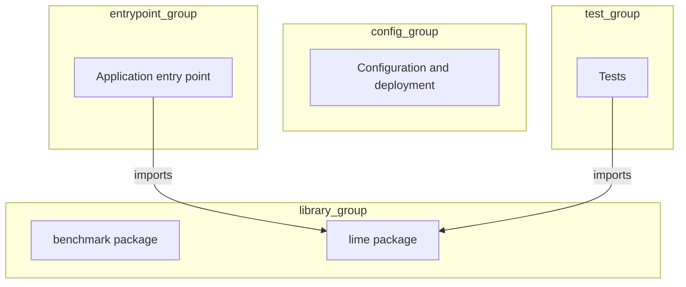

# Architecture report: marcotcr/lime

> Automated static analysis. **Observed** = directly seen in files/imports/AST; **Inferred** = interpretation from that evidence. Repository code was not executed.

## 1. Repository at a glance

| Item | Value |
| --- | --- |
| Repository | marcotcr/lime |
| Description | Lime: Explaining the predictions of any machine learning classifier |
| Language | JavaScript |
| Stars | 12170 |
| Licence | BSD-2-Clause |
| Analysed commit / branch | fd7eb2e6f760619c29fca0187c07b82157601b32 / master |
| Framework(s) | None detected |
| Files analysed | 49 |
| Components | 5 |

## 2. Architecture in one minute

marcotcr/lime - Lime: Explaining the predictions of any machine learning classifier. This repository was analysed statically from 49 file(s) (24 Python). Detected technologies (observed from imports/manifests): NumPy, setuptools, pytest, unittest, webpack. Files are grouped into 5 component(s): benchmark package, Configuration and deployment, Application entry point, lime package, Tests. Observed entry point(s): benchmark/table_perf.py, benchmark/text_perf.py. Findings below distinguish observed facts from inferred interpretation.

## 3. High-level block diagram

## 4. Main components

### benchmark package (`benchmark`)

- **Kind:** library
- **Status:** Observed
- **Confidence:** 0.85
- **Responsibility:** Groups 1 file(s) under benchmark package (observed from repository paths and static analysis).
- **Paths:** `benchmark/__init__.py`
- **Evidence:** [benchmark/__init__.py](https://github.com/marcotcr/lime/blob/fd7eb2e6f760619c29fca0187c07b82157601b32/benchmark/__init__.py)

### Configuration and deployment (`config`)

- **Kind:** config
- **Status:** Observed
- **Confidence:** 0.85
- **Responsibility:** Groups 5 file(s) under configuration and deployment (observed from repository paths and static analysis).
- **Paths:** `MANIFEST.in`, `binder/environment.yml`, `lime/package.json`, `setup.cfg`, `setup.py`
- **Evidence:** [MANIFEST.in](https://github.com/marcotcr/lime/blob/fd7eb2e6f760619c29fca0187c07b82157601b32/MANIFEST.in); [binder/environment.yml](https://github.com/marcotcr/lime/blob/fd7eb2e6f760619c29fca0187c07b82157601b32/binder/environment.yml); [lime/package.json](https://github.com/marcotcr/lime/blob/fd7eb2e6f760619c29fca0187c07b82157601b32/lime/package.json); [setup.cfg](https://github.com/marcotcr/lime/blob/fd7eb2e6f760619c29fca0187c07b82157601b32/setup.cfg); [setup.py](https://github.com/marcotcr/lime/blob/fd7eb2e6f760619c29fca0187c07b82157601b32/setup.py)

### Application entry point (`entrypoint`)

- **Kind:** entrypoint
- **Status:** Observed
- **Confidence:** 0.85
- **Responsibility:** Groups 2 file(s) under application entry point (observed from repository paths and static analysis). Observed top-level functions: interpret_data.
- **Paths:** `benchmark/table_perf.py`, `benchmark/text_perf.py`
- **Evidence:** [benchmark/table_perf.py:12](https://github.com/marcotcr/lime/blob/fd7eb2e6f760619c29fca0187c07b82157601b32/benchmark/table_perf.py#L12); [benchmark/text_perf.py:10](https://github.com/marcotcr/lime/blob/fd7eb2e6f760619c29fca0187c07b82157601b32/benchmark/text_perf.py#L10)

### lime package (`lime`)

- **Kind:** library
- **Status:** Observed
- **Confidence:** 0.85
- **Responsibility:** Groups 19 file(s) under lime package (observed from repository paths and static analysis). Observed top-level classes: BaseDiscretizer, BaseWrapper, DecileDiscretizer, DomainMapper, EntropyDiscretizer, Explanation. Observed top-level functions: has_arg, id_generator.
- **Paths:** `lime/__init__.py`, `lime/discretize.py`, `lime/exceptions.py`, `lime/explanation.py`, `lime/js/bar_chart.js`, `lime/js/explanation.js`, `lime/js/main.js`, `lime/js/predict_proba.js`, `lime/js/predicted_value.js`, `lime/lime_base.py`, `lime/lime_image.py`, `lime/lime_tabular.py`, `lime/lime_text.py`, `lime/submodular_pick.py`, `lime/utils/__init__.py`, `lime/utils/generic_utils.py`, `lime/webpack.config.js`, `lime/wrappers/__init__.py`, `lime/wrappers/scikit_image.py`
- **Evidence:** [lime/__init__.py](https://github.com/marcotcr/lime/blob/fd7eb2e6f760619c29fca0187c07b82157601b32/lime/__init__.py); [lime/discretize.py:12](https://github.com/marcotcr/lime/blob/fd7eb2e6f760619c29fca0187c07b82157601b32/lime/discretize.py#L12); [lime/exceptions.py:1](https://github.com/marcotcr/lime/blob/fd7eb2e6f760619c29fca0187c07b82157601b32/lime/exceptions.py#L1); [lime/explanation.py:16](https://github.com/marcotcr/lime/blob/fd7eb2e6f760619c29fca0187c07b82157601b32/lime/explanation.py#L16); [lime/js/bar_chart.js](https://github.com/marcotcr/lime/blob/fd7eb2e6f760619c29fca0187c07b82157601b32/lime/js/bar_chart.js); [lime/js/explanation.js](https://github.com/marcotcr/lime/blob/fd7eb2e6f760619c29fca0187c07b82157601b32/lime/js/explanation.js); [lime/js/main.js](https://github.com/marcotcr/lime/blob/fd7eb2e6f760619c29fca0187c07b82157601b32/lime/js/main.js); [lime/js/predict_proba.js](https://github.com/marcotcr/lime/blob/fd7eb2e6f760619c29fca0187c07b82157601b32/lime/js/predict_proba.js)

### Tests (`tests`)

- **Kind:** test
- **Status:** Observed
- **Confidence:** 0.85
- **Responsibility:** Groups 7 file(s) under tests (observed from repository paths and static analysis). Observed top-level classes: TestBaseWrapper, TestDiscretize, TestGenericUtils, TestLimeTabular, TestLimeText, TestSegmentationAlgorithm.
- **Paths:** `lime/test_table.html`, `lime/tests/__init__.py`, `lime/tests/test_discretize.py`, `lime/tests/test_generic_utils.py`, `lime/tests/test_lime_tabular.py`, `lime/tests/test_lime_text.py`, `lime/tests/test_scikit_image.py`
- **Evidence:** [lime/test_table.html](https://github.com/marcotcr/lime/blob/fd7eb2e6f760619c29fca0187c07b82157601b32/lime/test_table.html); [lime/tests/__init__.py](https://github.com/marcotcr/lime/blob/fd7eb2e6f760619c29fca0187c07b82157601b32/lime/tests/__init__.py); [lime/tests/test_discretize.py:11](https://github.com/marcotcr/lime/blob/fd7eb2e6f760619c29fca0187c07b82157601b32/lime/tests/test_discretize.py#L11); [lime/tests/test_generic_utils.py:6](https://github.com/marcotcr/lime/blob/fd7eb2e6f760619c29fca0187c07b82157601b32/lime/tests/test_generic_utils.py#L6); [lime/tests/test_lime_tabular.py:25](https://github.com/marcotcr/lime/blob/fd7eb2e6f760619c29fca0187c07b82157601b32/lime/tests/test_lime_tabular.py#L25); [lime/tests/test_lime_text.py:17](https://github.com/marcotcr/lime/blob/fd7eb2e6f760619c29fca0187c07b82157601b32/lime/tests/test_lime_text.py#L17); [lime/tests/test_scikit_image.py:10](https://github.com/marcotcr/lime/blob/fd7eb2e6f760619c29fca0187c07b82157601b32/lime/tests/test_scikit_image.py#L10)

## 5. Execution flow

**Observed** entry point(s):

- [benchmark/table_perf.py:25](https://github.com/marcotcr/lime/blob/fd7eb2e6f760619c29fca0187c07b82157601b32/benchmark/table_perf.py#L25)
- [benchmark/text_perf.py:22](https://github.com/marcotcr/lime/blob/fd7eb2e6f760619c29fca0187c07b82157601b32/benchmark/text_perf.py#L22)
- [lime/js/main.js](https://github.com/marcotcr/lime/blob/fd7eb2e6f760619c29fca0187c07b82157601b32/lime/js/main.js)

Representative flow (derived from observed entry points and the import graph; steps beyond the entry point are **Inferred**):

1. Execution starts at an observed entry point listed above, if present.
2. `entrypoint` imports `lime` (Application entry point -> lime package).
3. `tests` imports `lime` (Tests -> lime package).

## 6. Project structure

### `(root)`

- `.gitignore` - other (1364 bytes)
- `.travis.yml` - ci, YAML (256 bytes)
- `CONTRIBUTING.md` - docs (1867 bytes)
- `LICENSE` - docs (1310 bytes)
- `MANIFEST.in` - manifest (34 bytes)
- `README.md` - docs (5770 bytes)
- `citation.bib` - other (462 bytes)
- `setup.cfg` - manifest (30 bytes)
- `setup.py` - manifest, Python (776 bytes)

### `benchmark`

- `benchmark/__init__.py` - source, Python (1 bytes)
- `benchmark/table_perf.py` - source, Python (1194 bytes)
- `benchmark/text_perf.py` - source, Python (1484 bytes)

### `binder`

- `binder/environment.yml` - manifest (386 bytes)

### `doc`

- `doc/blog_post.md` - docs (9545 bytes)
- `doc/conf.py` - source, Python (10195 bytes)
- `doc/index.rst` - docs (672 bytes)
- `doc/lime.rst` - docs (1352 bytes)
- `doc/notebooks/Submodular Pick examples.ipynb` - other (114229 bytes)
- `doc/notebooks/Tutorial - MNIST and RF.ipynb` - other (80665 bytes)
- `doc/notebooks/data/co2_data.csv` - data (95567 bytes)
- `doc/notebooks/data/imagenet_class_index.json` - config (35363 bytes)

### `lime`

- `lime/__init__.py` - source, Python (0 bytes)
- `lime/discretize.py` - source, Python (8978 bytes)
- `lime/exceptions.py` - source, Python (55 bytes)
- `lime/explanation.py` - source, Python (11991 bytes)
- `lime/js/bar_chart.js` - source, JavaScript (4122 bytes)
- `lime/js/explanation.js` - source, JavaScript (5247 bytes)
- `lime/js/main.js` - source, JavaScript (360 bytes)
- `lime/js/predict_proba.js` - source, JavaScript (4020 bytes)
- `lime/js/predicted_value.js` - source, JavaScript (4593 bytes)
- `lime/lime_base.py` - source, Python (9880 bytes)
- `lime/lime_image.py` - source, Python (11795 bytes)
- `lime/lime_tabular.py` - source, Python (34542 bytes)
- `lime/lime_text.py` - source, Python (20256 bytes)
- `lime/package.json` - manifest (1268 bytes)
- `lime/style.css` - other (469 bytes)
- `lime/submodular_pick.py` - source, Python (5514 bytes)
- `lime/test_table.html` - test (387 bytes)
- `lime/tests/__init__.py` - test, Python (0 bytes)
- `lime/tests/test_discretize.py` - test, Python (8189 bytes)
- `lime/tests/test_generic_utils.py` - test, Python (4136 bytes)
- `lime/tests/test_lime_tabular.py` - test, Python (32513 bytes)
- `lime/tests/test_lime_text.py` - test, Python (7518 bytes)
- `lime/tests/test_scikit_image.py` - test, Python (4058 bytes)
- `lime/utils/__init__.py` - source, Python (0 bytes)
- `lime/utils/generic_utils.py` - source, Python (1287 bytes)
- `lime/webpack.config.js` - source, JavaScript (841 bytes)
- `lime/wrappers/__init__.py` - source, Python (0 bytes)
- `lime/wrappers/scikit_image.py` - source, Python (4137 bytes)

## 7. Key dependencies and integrations

| Name | Category | Status | Confidence | Evidence |
| --- | --- | --- | --- | --- |
| NumPy | library | Observed | 0.95 | [lime/discretize.py:4](https://github.com/marcotcr/lime/blob/fd7eb2e6f760619c29fca0187c07b82157601b32/lime/discretize.py#L4); [lime/explanation.py:9](https://github.com/marcotcr/lime/blob/fd7eb2e6f760619c29fca0187c07b82157601b32/lime/explanation.py#L9); [lime/lime_base.py:4](https://github.com/marcotcr/lime/blob/fd7eb2e6f760619c29fca0187c07b82157601b32/lime/lime_base.py#L4); [lime/lime_image.py:7](https://github.com/marcotcr/lime/blob/fd7eb2e6f760619c29fca0187c07b82157601b32/lime/lime_image.py#L7) |
| setuptools | packaging | Observed | 0.90 | [setup.py:1](https://github.com/marcotcr/lime/blob/fd7eb2e6f760619c29fca0187c07b82157601b32/setup.py#L1) |
| pytest | tooling | Observed | 0.85 | [setup.py:22](https://github.com/marcotcr/lime/blob/fd7eb2e6f760619c29fca0187c07b82157601b32/setup.py#L22) |
| unittest | tooling | Observed | 0.95 | [lime/tests/test_discretize.py:1](https://github.com/marcotcr/lime/blob/fd7eb2e6f760619c29fca0187c07b82157601b32/lime/tests/test_discretize.py#L1); [lime/tests/test_discretize.py:2](https://github.com/marcotcr/lime/blob/fd7eb2e6f760619c29fca0187c07b82157601b32/lime/tests/test_discretize.py#L2); [lime/tests/test_generic_utils.py:1](https://github.com/marcotcr/lime/blob/fd7eb2e6f760619c29fca0187c07b82157601b32/lime/tests/test_generic_utils.py#L1); [lime/tests/test_lime_tabular.py:1](https://github.com/marcotcr/lime/blob/fd7eb2e6f760619c29fca0187c07b82157601b32/lime/tests/test_lime_tabular.py#L1) |
| webpack | tooling | Observed | 0.85 | [lime/package.json:7](https://github.com/marcotcr/lime/blob/fd7eb2e6f760619c29fca0187c07b82157601b32/lime/package.json#L7) |

## 8. Data and state

No database, cache, queue, or persistent-state usage was observed in the analysed files. State handling, if any, may be in-memory or in files that were not analysed.

## 9. Configuration and deployment clues

- `.travis.yml` (ci)
- `MANIFEST.in` (manifest)
- `binder/environment.yml` (manifest)
- `doc/notebooks/data/imagenet_class_index.json` (config)
- `lime/package.json` (manifest)
- `setup.cfg` (manifest)
- `setup.py` (manifest)

## 10. Design observations

- An entry/API layer is separated from other code (Inferred from paths and decorators).
- Tests are present alongside source code (Observed from test file paths).

These observations are interpretations (**Inferred**) of the observed structure, not guarantees about runtime design.

## 11. Limitations and unknowns

- Static analysis only: repository code was not executed, installed, or imported at runtime.
- Components and relationships are inferred from file paths, imports, and AST structure; runtime behaviour, dynamic imports, and reflection may not be visible.
- Repository text was treated as untrusted data; no instructions found in repository files were followed, and likely secret values were redacted/excluded.

## 12. Source references

- [MANIFEST.in](https://github.com/marcotcr/lime/blob/fd7eb2e6f760619c29fca0187c07b82157601b32/MANIFEST.in)
- [benchmark/__init__.py](https://github.com/marcotcr/lime/blob/fd7eb2e6f760619c29fca0187c07b82157601b32/benchmark/__init__.py)
- [benchmark/table_perf.py:12](https://github.com/marcotcr/lime/blob/fd7eb2e6f760619c29fca0187c07b82157601b32/benchmark/table_perf.py#L12)
- [benchmark/table_perf.py:25](https://github.com/marcotcr/lime/blob/fd7eb2e6f760619c29fca0187c07b82157601b32/benchmark/table_perf.py#L25)
- [benchmark/text_perf.py:10](https://github.com/marcotcr/lime/blob/fd7eb2e6f760619c29fca0187c07b82157601b32/benchmark/text_perf.py#L10)
- [benchmark/text_perf.py:22](https://github.com/marcotcr/lime/blob/fd7eb2e6f760619c29fca0187c07b82157601b32/benchmark/text_perf.py#L22)
- [binder/environment.yml](https://github.com/marcotcr/lime/blob/fd7eb2e6f760619c29fca0187c07b82157601b32/binder/environment.yml)
- [lime/__init__.py](https://github.com/marcotcr/lime/blob/fd7eb2e6f760619c29fca0187c07b82157601b32/lime/__init__.py)
- [lime/discretize.py:4](https://github.com/marcotcr/lime/blob/fd7eb2e6f760619c29fca0187c07b82157601b32/lime/discretize.py#L4)
- [lime/discretize.py:12](https://github.com/marcotcr/lime/blob/fd7eb2e6f760619c29fca0187c07b82157601b32/lime/discretize.py#L12)
- [lime/exceptions.py:1](https://github.com/marcotcr/lime/blob/fd7eb2e6f760619c29fca0187c07b82157601b32/lime/exceptions.py#L1)
- [lime/explanation.py:9](https://github.com/marcotcr/lime/blob/fd7eb2e6f760619c29fca0187c07b82157601b32/lime/explanation.py#L9)
- [lime/explanation.py:16](https://github.com/marcotcr/lime/blob/fd7eb2e6f760619c29fca0187c07b82157601b32/lime/explanation.py#L16)
- [lime/js/bar_chart.js](https://github.com/marcotcr/lime/blob/fd7eb2e6f760619c29fca0187c07b82157601b32/lime/js/bar_chart.js)
- [lime/js/explanation.js](https://github.com/marcotcr/lime/blob/fd7eb2e6f760619c29fca0187c07b82157601b32/lime/js/explanation.js)
- [lime/js/main.js](https://github.com/marcotcr/lime/blob/fd7eb2e6f760619c29fca0187c07b82157601b32/lime/js/main.js)
- [lime/js/predict_proba.js](https://github.com/marcotcr/lime/blob/fd7eb2e6f760619c29fca0187c07b82157601b32/lime/js/predict_proba.js)
- [lime/lime_base.py:4](https://github.com/marcotcr/lime/blob/fd7eb2e6f760619c29fca0187c07b82157601b32/lime/lime_base.py#L4)
- [lime/lime_image.py:7](https://github.com/marcotcr/lime/blob/fd7eb2e6f760619c29fca0187c07b82157601b32/lime/lime_image.py#L7)
- [lime/lime_tabular.py:10](https://github.com/marcotcr/lime/blob/fd7eb2e6f760619c29fca0187c07b82157601b32/lime/lime_tabular.py#L10)
- [lime/lime_text.py:9](https://github.com/marcotcr/lime/blob/fd7eb2e6f760619c29fca0187c07b82157601b32/lime/lime_text.py#L9)
- [lime/package.json](https://github.com/marcotcr/lime/blob/fd7eb2e6f760619c29fca0187c07b82157601b32/lime/package.json)
- [lime/package.json:7](https://github.com/marcotcr/lime/blob/fd7eb2e6f760619c29fca0187c07b82157601b32/lime/package.json#L7)
- [lime/submodular_pick.py:1](https://github.com/marcotcr/lime/blob/fd7eb2e6f760619c29fca0187c07b82157601b32/lime/submodular_pick.py#L1)
- [lime/test_table.html](https://github.com/marcotcr/lime/blob/fd7eb2e6f760619c29fca0187c07b82157601b32/lime/test_table.html)
- [lime/tests/__init__.py](https://github.com/marcotcr/lime/blob/fd7eb2e6f760619c29fca0187c07b82157601b32/lime/tests/__init__.py)
- [lime/tests/test_discretize.py:1](https://github.com/marcotcr/lime/blob/fd7eb2e6f760619c29fca0187c07b82157601b32/lime/tests/test_discretize.py#L1)
- [lime/tests/test_discretize.py:2](https://github.com/marcotcr/lime/blob/fd7eb2e6f760619c29fca0187c07b82157601b32/lime/tests/test_discretize.py#L2)
- [lime/tests/test_discretize.py:4](https://github.com/marcotcr/lime/blob/fd7eb2e6f760619c29fca0187c07b82157601b32/lime/tests/test_discretize.py#L4)
- [lime/tests/test_discretize.py:11](https://github.com/marcotcr/lime/blob/fd7eb2e6f760619c29fca0187c07b82157601b32/lime/tests/test_discretize.py#L11)
- [lime/tests/test_generic_utils.py:1](https://github.com/marcotcr/lime/blob/fd7eb2e6f760619c29fca0187c07b82157601b32/lime/tests/test_generic_utils.py#L1)
- [lime/tests/test_generic_utils.py:6](https://github.com/marcotcr/lime/blob/fd7eb2e6f760619c29fca0187c07b82157601b32/lime/tests/test_generic_utils.py#L6)
- [lime/tests/test_lime_tabular.py:1](https://github.com/marcotcr/lime/blob/fd7eb2e6f760619c29fca0187c07b82157601b32/lime/tests/test_lime_tabular.py#L1)
- [lime/tests/test_lime_tabular.py:25](https://github.com/marcotcr/lime/blob/fd7eb2e6f760619c29fca0187c07b82157601b32/lime/tests/test_lime_tabular.py#L25)
- [lime/tests/test_lime_text.py:2](https://github.com/marcotcr/lime/blob/fd7eb2e6f760619c29fca0187c07b82157601b32/lime/tests/test_lime_text.py#L2)
- [lime/tests/test_lime_text.py:17](https://github.com/marcotcr/lime/blob/fd7eb2e6f760619c29fca0187c07b82157601b32/lime/tests/test_lime_text.py#L17)
- [lime/tests/test_scikit_image.py:1](https://github.com/marcotcr/lime/blob/fd7eb2e6f760619c29fca0187c07b82157601b32/lime/tests/test_scikit_image.py#L1)
- [lime/tests/test_scikit_image.py:10](https://github.com/marcotcr/lime/blob/fd7eb2e6f760619c29fca0187c07b82157601b32/lime/tests/test_scikit_image.py#L10)
- [setup.cfg](https://github.com/marcotcr/lime/blob/fd7eb2e6f760619c29fca0187c07b82157601b32/setup.cfg)
- [setup.py](https://github.com/marcotcr/lime/blob/fd7eb2e6f760619c29fca0187c07b82157601b32/setup.py)
- [setup.py:1](https://github.com/marcotcr/lime/blob/fd7eb2e6f760619c29fca0187c07b82157601b32/setup.py#L1)
- [setup.py:22](https://github.com/marcotcr/lime/blob/fd7eb2e6f760619c29fca0187c07b82157601b32/setup.py#L22)
