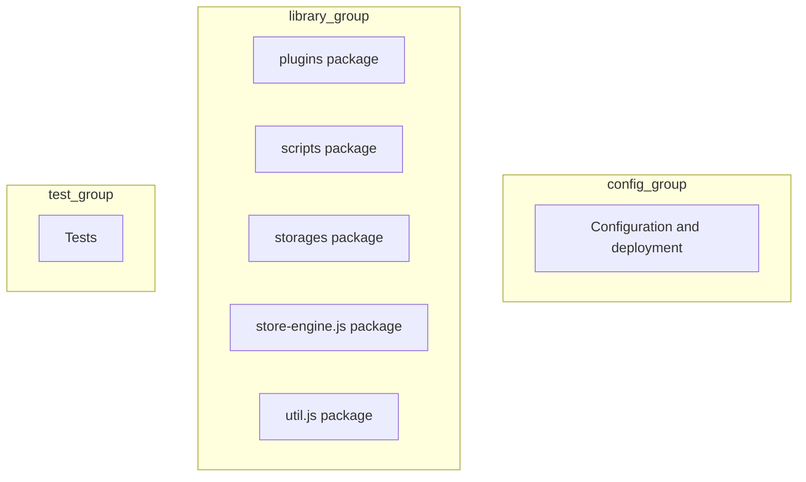

# Architecture report: marcuswestin/store.js

> Automated static analysis. **Observed** = directly seen in files/imports/AST; **Inferred** = interpretation from that evidence. Repository code was not executed.

## 1. Repository at a glance

| Item | Value |
| --- | --- |
| Repository | marcuswestin/store.js |
| Description | Cross-browser storage for all use cases, used across the web. |
| Language | JavaScript |
| Stars | 13971 |
| Licence | MIT |
| Analysed commit / branch | fe77ae9e7ca1c8fb9af27b9f53a14722cd14d9d4 / master |
| Framework(s) | None detected |
| Files analysed | 61 |
| Components | 7 |

## 2. Architecture in one minute

marcuswestin/store.js - Cross-browser storage for all use cases, used across the web.. This repository was analysed statically from 61 file(s) (0 Python). Detected technologies (observed from imports/manifests): no known frameworks/libraries. Files are grouped into 7 component(s): Configuration and deployment, plugins package, scripts package, storages package, store-engine.js package, Tests, util.js package. Findings below distinguish observed facts from inferred interpretation.

## 3. High-level block diagram

## 4. Main components

### Configuration and deployment (`config`)

- **Kind:** config
- **Status:** Observed
- **Confidence:** 0.85
- **Responsibility:** Groups 1 file(s) under configuration and deployment (observed from repository paths and static analysis).
- **Paths:** `package.json`
- **Evidence:** [package.json](https://github.com/marcuswestin/store.js/blob/fe77ae9e7ca1c8fb9af27b9f53a14722cd14d9d4/package.json)

### plugins package (`plugins`)

- **Kind:** library
- **Status:** Observed
- **Confidence:** 0.85
- **Responsibility:** Groups 24 file(s) under plugins package (observed from repository paths and static analysis).
- **Paths:** `plugins/all.js`, `plugins/all_tests.js`, `plugins/compression.js`, `plugins/compression_test.js`, `plugins/defaults.js`, `plugins/defaults_test.js`, `plugins/dump.js`, `plugins/dump_test.js`, `plugins/events.js`, `plugins/events_test.js`, `plugins/expire.js`, `plugins/expire_test.js`, `plugins/json2.js`, `plugins/json2_test.js`, `plugins/lib/json2.js`, `plugins/lib/lz-string.js`, `plugins/observe.js`, `plugins/observe_test.js`, `plugins/operations.js`, `plugins/operations_test.js`, `plugins/update.js`, `plugins/update_test.js`, `plugins/v1-backcompat.js`, `plugins/v1-backcompat_test.js`
- **Evidence:** [plugins/all.js](https://github.com/marcuswestin/store.js/blob/fe77ae9e7ca1c8fb9af27b9f53a14722cd14d9d4/plugins/all.js); [plugins/all_tests.js](https://github.com/marcuswestin/store.js/blob/fe77ae9e7ca1c8fb9af27b9f53a14722cd14d9d4/plugins/all_tests.js); [plugins/compression.js](https://github.com/marcuswestin/store.js/blob/fe77ae9e7ca1c8fb9af27b9f53a14722cd14d9d4/plugins/compression.js); [plugins/compression_test.js](https://github.com/marcuswestin/store.js/blob/fe77ae9e7ca1c8fb9af27b9f53a14722cd14d9d4/plugins/compression_test.js); [plugins/defaults.js](https://github.com/marcuswestin/store.js/blob/fe77ae9e7ca1c8fb9af27b9f53a14722cd14d9d4/plugins/defaults.js); [plugins/defaults_test.js](https://github.com/marcuswestin/store.js/blob/fe77ae9e7ca1c8fb9af27b9f53a14722cd14d9d4/plugins/defaults_test.js); [plugins/dump.js](https://github.com/marcuswestin/store.js/blob/fe77ae9e7ca1c8fb9af27b9f53a14722cd14d9d4/plugins/dump.js); [plugins/dump_test.js](https://github.com/marcuswestin/store.js/blob/fe77ae9e7ca1c8fb9af27b9f53a14722cd14d9d4/plugins/dump_test.js)

### scripts package (`scripts`)

- **Kind:** library
- **Status:** Observed
- **Confidence:** 0.85
- **Responsibility:** Groups 11 file(s) under scripts package (observed from repository paths and static analysis).
- **Paths:** `scripts/compile-builds.js`, `scripts/create-tunnel.js`, `scripts/release.sh`, `scripts/run-browser-tests-live-reload.js`, `scripts/run-node-tests.js`, `scripts/run-saucelabs-tests.js`, `scripts/saucelabs/list-supported-browsers.js`, `scripts/saucelabs/saucelabs-api.js`, `scripts/saucelabs/saucelabs-platformSets.js`, `scripts/saucelabs/saucelabs.js`, `scripts/saucelabs/tunnel.js`
- **Evidence:** [scripts/compile-builds.js](https://github.com/marcuswestin/store.js/blob/fe77ae9e7ca1c8fb9af27b9f53a14722cd14d9d4/scripts/compile-builds.js); [scripts/create-tunnel.js](https://github.com/marcuswestin/store.js/blob/fe77ae9e7ca1c8fb9af27b9f53a14722cd14d9d4/scripts/create-tunnel.js); [scripts/release.sh](https://github.com/marcuswestin/store.js/blob/fe77ae9e7ca1c8fb9af27b9f53a14722cd14d9d4/scripts/release.sh); [scripts/run-browser-tests-live-reload.js](https://github.com/marcuswestin/store.js/blob/fe77ae9e7ca1c8fb9af27b9f53a14722cd14d9d4/scripts/run-browser-tests-live-reload.js); [scripts/run-node-tests.js](https://github.com/marcuswestin/store.js/blob/fe77ae9e7ca1c8fb9af27b9f53a14722cd14d9d4/scripts/run-node-tests.js); [scripts/run-saucelabs-tests.js](https://github.com/marcuswestin/store.js/blob/fe77ae9e7ca1c8fb9af27b9f53a14722cd14d9d4/scripts/run-saucelabs-tests.js); [scripts/saucelabs/list-supported-browsers.js](https://github.com/marcuswestin/store.js/blob/fe77ae9e7ca1c8fb9af27b9f53a14722cd14d9d4/scripts/saucelabs/list-supported-browsers.js); [scripts/saucelabs/saucelabs-api.js](https://github.com/marcuswestin/store.js/blob/fe77ae9e7ca1c8fb9af27b9f53a14722cd14d9d4/scripts/saucelabs/saucelabs-api.js)

### storages package (`storages`)

- **Kind:** library
- **Status:** Observed
- **Confidence:** 0.85
- **Responsibility:** Groups 7 file(s) under storages package (observed from repository paths and static analysis).
- **Paths:** `storages/all.js`, `storages/cookieStorage.js`, `storages/localStorage.js`, `storages/memoryStorage.js`, `storages/oldFF-globalStorage.js`, `storages/oldIE-userDataStorage.js`, `storages/sessionStorage.js`
- **Evidence:** [storages/all.js](https://github.com/marcuswestin/store.js/blob/fe77ae9e7ca1c8fb9af27b9f53a14722cd14d9d4/storages/all.js); [storages/cookieStorage.js](https://github.com/marcuswestin/store.js/blob/fe77ae9e7ca1c8fb9af27b9f53a14722cd14d9d4/storages/cookieStorage.js); [storages/localStorage.js](https://github.com/marcuswestin/store.js/blob/fe77ae9e7ca1c8fb9af27b9f53a14722cd14d9d4/storages/localStorage.js); [storages/memoryStorage.js](https://github.com/marcuswestin/store.js/blob/fe77ae9e7ca1c8fb9af27b9f53a14722cd14d9d4/storages/memoryStorage.js); [storages/oldFF-globalStorage.js](https://github.com/marcuswestin/store.js/blob/fe77ae9e7ca1c8fb9af27b9f53a14722cd14d9d4/storages/oldFF-globalStorage.js); [storages/oldIE-userDataStorage.js](https://github.com/marcuswestin/store.js/blob/fe77ae9e7ca1c8fb9af27b9f53a14722cd14d9d4/storages/oldIE-userDataStorage.js); [storages/sessionStorage.js](https://github.com/marcuswestin/store.js/blob/fe77ae9e7ca1c8fb9af27b9f53a14722cd14d9d4/storages/sessionStorage.js)

### store-engine.js package (`store_engine_js`)

- **Kind:** library
- **Status:** Observed
- **Confidence:** 0.85
- **Responsibility:** Groups 1 file(s) under store-engine.js package (observed from repository paths and static analysis).
- **Paths:** `src/store-engine.js`
- **Evidence:** [src/store-engine.js](https://github.com/marcuswestin/store.js/blob/fe77ae9e7ca1c8fb9af27b9f53a14722cd14d9d4/src/store-engine.js)

### Tests (`tests`)

- **Kind:** test
- **Status:** Observed
- **Confidence:** 0.85
- **Responsibility:** Groups 7 file(s) under tests (observed from repository paths and static analysis).
- **Paths:** `tests/bugs/all.js`, `tests/bugs/gh-215.js`, `tests/bugs/gh-235.js`, `tests/bugs/gh-236.js`, `tests/bugs/gh-239.js`, `tests/tests.js`, `tests/util.js`
- **Evidence:** [tests/bugs/all.js](https://github.com/marcuswestin/store.js/blob/fe77ae9e7ca1c8fb9af27b9f53a14722cd14d9d4/tests/bugs/all.js); [tests/bugs/gh-215.js](https://github.com/marcuswestin/store.js/blob/fe77ae9e7ca1c8fb9af27b9f53a14722cd14d9d4/tests/bugs/gh-215.js); [tests/bugs/gh-235.js](https://github.com/marcuswestin/store.js/blob/fe77ae9e7ca1c8fb9af27b9f53a14722cd14d9d4/tests/bugs/gh-235.js); [tests/bugs/gh-236.js](https://github.com/marcuswestin/store.js/blob/fe77ae9e7ca1c8fb9af27b9f53a14722cd14d9d4/tests/bugs/gh-236.js); [tests/bugs/gh-239.js](https://github.com/marcuswestin/store.js/blob/fe77ae9e7ca1c8fb9af27b9f53a14722cd14d9d4/tests/bugs/gh-239.js); [tests/tests.js](https://github.com/marcuswestin/store.js/blob/fe77ae9e7ca1c8fb9af27b9f53a14722cd14d9d4/tests/tests.js); [tests/util.js](https://github.com/marcuswestin/store.js/blob/fe77ae9e7ca1c8fb9af27b9f53a14722cd14d9d4/tests/util.js)

### util.js package (`util_js`)

- **Kind:** library
- **Status:** Observed
- **Confidence:** 0.85
- **Responsibility:** Groups 1 file(s) under util.js package (observed from repository paths and static analysis).
- **Paths:** `src/util.js`
- **Evidence:** [src/util.js](https://github.com/marcuswestin/store.js/blob/fe77ae9e7ca1c8fb9af27b9f53a14722cd14d9d4/src/util.js)

## 5. Execution flow

No entry point was observed; the startup flow below is therefore limited.

Representative flow (derived from observed entry points and the import graph; steps beyond the entry point are **Inferred**):

1. Execution starts at an observed entry point listed above, if present.
2. No internal import relationships between components were observed.

## 6. Project structure

### `(root)`

- `.gitignore` - other (47 bytes)
- `COPYRIGHT` - other (34 bytes)
- `Changelog` - other (3014 bytes)
- `LICENSE` - docs (1085 bytes)
- `Makefile` - other (890 bytes)
- `README-More.md` - docs (6046 bytes)
- `README.md` - docs (11163 bytes)
- `package.json` - manifest (1723 bytes)
- `sublime-storejs.sublime-project` - other (162 bytes)

### `.circleci`

- `.circleci/config.yml` - ci, YAML (976 bytes)

### `plugins`

- `plugins/all.js` - source, JavaScript (257 bytes)
- `plugins/all_tests.js` - source, JavaScript (423 bytes)
- `plugins/compression.js` - source, JavaScript (541 bytes)
- `plugins/compression_test.js` - source, JavaScript (1137 bytes)
- `plugins/defaults.js` - source, JavaScript (312 bytes)
- `plugins/defaults_test.js` - source, JavaScript (324 bytes)
- `plugins/dump.js` - source, JavaScript (190 bytes)
- `plugins/dump_test.js` - source, JavaScript (463 bytes)
- `plugins/events.js` - source, JavaScript (1933 bytes)
- `plugins/events_test.js` - source, JavaScript (1704 bytes)
- `plugins/expire.js` - source, JavaScript (1225 bytes)
- `plugins/expire_test.js` - source, JavaScript (1509 bytes)
- `plugins/json2.js` - source, JavaScript (92 bytes)
- `plugins/json2_test.js` - source, JavaScript (220 bytes)
- `plugins/lib/json2.js` - source, JavaScript (18453 bytes)
- `plugins/lib/lz-string.js` - source, JavaScript (15891 bytes)
- `plugins/observe.js` - source, JavaScript (353 bytes)
- `plugins/observe_test.js` - source, JavaScript (681 bytes)
- `plugins/operations.js` - source, JavaScript (1273 bytes)
- `plugins/operations_test.js` - source, JavaScript (1739 bytes)
- `plugins/update.js` - source, JavaScript (360 bytes)
- `plugins/update_test.js` - source, JavaScript (973 bytes)
- `plugins/v1-backcompat.js` - source, JavaScript (1299 bytes)
- `plugins/v1-backcompat_test.js` - source, JavaScript (1435 bytes)

### `scripts`

- `scripts/compile-builds.js` - source, JavaScript (2059 bytes)
- `scripts/create-tunnel.js` - source, JavaScript (149 bytes)
- `scripts/release.sh` - source, Shell (1807 bytes)
- `scripts/run-browser-tests-live-reload.js` - source, JavaScript (208 bytes)
- `scripts/run-node-tests.js` - source, JavaScript (253 bytes)
- `scripts/run-saucelabs-tests.js` - source, JavaScript (1526 bytes)
- `scripts/saucelabs/list-supported-browsers.js` - source, JavaScript (376 bytes)
- `scripts/saucelabs/saucelabs-api.js` - source, JavaScript (1232 bytes)
- `scripts/saucelabs/saucelabs-platformSets.js` - source, JavaScript (2119 bytes)
- `scripts/saucelabs/saucelabs.js` - source, JavaScript (4586 bytes)
- `scripts/saucelabs/tunnel.js` - source, JavaScript (1935 bytes)

### `src`

- `src/store-engine.js` - source, JavaScript (6734 bytes)
- `src/util.js` - source, JavaScript (2403 bytes)

### `storages`

- `storages/all.js` - source, JavaScript (248 bytes)
- `storages/cookieStorage.js` - source, JavaScript (1475 bytes)
- `storages/localStorage.js` - source, JavaScript (631 bytes)
- `storages/memoryStorage.js` - source, JavaScript (768 bytes)
- `storages/oldFF-globalStorage.js` - source, JavaScript (749 bytes)
- `storages/oldIE-userDataStorage.js` - source, JavaScript (4054 bytes)
- `storages/sessionStorage.js` - source, JavaScript (648 bytes)

### `tests`

- `tests/bugs/all.js` - test, JavaScript (447 bytes)
- `tests/bugs/gh-215.js` - test, JavaScript (816 bytes)
- `tests/bugs/gh-235.js` - test, JavaScript (441 bytes)
- `tests/bugs/gh-236.js` - test, JavaScript (128 bytes)
- `tests/bugs/gh-239.js` - test, JavaScript (165 bytes)
- `tests/tests.js` - test, JavaScript (4932 bytes)
- `tests/util.js` - test, JavaScript (344 bytes)

## 7. Key dependencies and integrations

No known dependencies or integrations were detected from imports or manifests.

## 8. Data and state

No database, cache, queue, or persistent-state usage was observed in the analysed files. State handling, if any, may be in-memory or in files that were not analysed.

## 9. Configuration and deployment clues

- `.circleci/config.yml` (ci)
- `package.json` (manifest)

## 10. Design observations

- Tests are present alongside source code (Observed from test file paths).

These observations are interpretations (**Inferred**) of the observed structure, not guarantees about runtime design.

## 11. Limitations and unknowns

- Static analysis only: repository code was not executed, installed, or imported at runtime.
- Components and relationships are inferred from file paths, imports, and AST structure; runtime behaviour, dynamic imports, and reflection may not be visible.
- 6 file(s) were skipped during inventory (1 x lockfile excluded; 5 x vendored/generated directory excluded).
- No clear application entry point was observed in the analysed files.
- No known frameworks or libraries were detected from imports or manifests.
- Repository text was treated as untrusted data; no instructions found in repository files were followed, and likely secret values were redacted/excluded.
- JavaScript and TypeScript files were inventoried from paths and package manifests. They were not parsed with a full language AST, and repository code was not executed.

## 12. Source references

- [package.json](https://github.com/marcuswestin/store.js/blob/fe77ae9e7ca1c8fb9af27b9f53a14722cd14d9d4/package.json)
- [plugins/all.js](https://github.com/marcuswestin/store.js/blob/fe77ae9e7ca1c8fb9af27b9f53a14722cd14d9d4/plugins/all.js)
- [plugins/all_tests.js](https://github.com/marcuswestin/store.js/blob/fe77ae9e7ca1c8fb9af27b9f53a14722cd14d9d4/plugins/all_tests.js)
- [plugins/compression.js](https://github.com/marcuswestin/store.js/blob/fe77ae9e7ca1c8fb9af27b9f53a14722cd14d9d4/plugins/compression.js)
- [plugins/compression_test.js](https://github.com/marcuswestin/store.js/blob/fe77ae9e7ca1c8fb9af27b9f53a14722cd14d9d4/plugins/compression_test.js)
- [plugins/defaults.js](https://github.com/marcuswestin/store.js/blob/fe77ae9e7ca1c8fb9af27b9f53a14722cd14d9d4/plugins/defaults.js)
- [plugins/defaults_test.js](https://github.com/marcuswestin/store.js/blob/fe77ae9e7ca1c8fb9af27b9f53a14722cd14d9d4/plugins/defaults_test.js)
- [plugins/dump.js](https://github.com/marcuswestin/store.js/blob/fe77ae9e7ca1c8fb9af27b9f53a14722cd14d9d4/plugins/dump.js)
- [plugins/dump_test.js](https://github.com/marcuswestin/store.js/blob/fe77ae9e7ca1c8fb9af27b9f53a14722cd14d9d4/plugins/dump_test.js)
- [scripts/compile-builds.js](https://github.com/marcuswestin/store.js/blob/fe77ae9e7ca1c8fb9af27b9f53a14722cd14d9d4/scripts/compile-builds.js)
- [scripts/create-tunnel.js](https://github.com/marcuswestin/store.js/blob/fe77ae9e7ca1c8fb9af27b9f53a14722cd14d9d4/scripts/create-tunnel.js)
- [scripts/release.sh](https://github.com/marcuswestin/store.js/blob/fe77ae9e7ca1c8fb9af27b9f53a14722cd14d9d4/scripts/release.sh)
- [scripts/run-browser-tests-live-reload.js](https://github.com/marcuswestin/store.js/blob/fe77ae9e7ca1c8fb9af27b9f53a14722cd14d9d4/scripts/run-browser-tests-live-reload.js)
- [scripts/run-node-tests.js](https://github.com/marcuswestin/store.js/blob/fe77ae9e7ca1c8fb9af27b9f53a14722cd14d9d4/scripts/run-node-tests.js)
- [scripts/run-saucelabs-tests.js](https://github.com/marcuswestin/store.js/blob/fe77ae9e7ca1c8fb9af27b9f53a14722cd14d9d4/scripts/run-saucelabs-tests.js)
- [scripts/saucelabs/list-supported-browsers.js](https://github.com/marcuswestin/store.js/blob/fe77ae9e7ca1c8fb9af27b9f53a14722cd14d9d4/scripts/saucelabs/list-supported-browsers.js)
- [scripts/saucelabs/saucelabs-api.js](https://github.com/marcuswestin/store.js/blob/fe77ae9e7ca1c8fb9af27b9f53a14722cd14d9d4/scripts/saucelabs/saucelabs-api.js)
- [src/store-engine.js](https://github.com/marcuswestin/store.js/blob/fe77ae9e7ca1c8fb9af27b9f53a14722cd14d9d4/src/store-engine.js)
- [src/util.js](https://github.com/marcuswestin/store.js/blob/fe77ae9e7ca1c8fb9af27b9f53a14722cd14d9d4/src/util.js)
- [storages/all.js](https://github.com/marcuswestin/store.js/blob/fe77ae9e7ca1c8fb9af27b9f53a14722cd14d9d4/storages/all.js)
- [storages/cookieStorage.js](https://github.com/marcuswestin/store.js/blob/fe77ae9e7ca1c8fb9af27b9f53a14722cd14d9d4/storages/cookieStorage.js)
- [storages/localStorage.js](https://github.com/marcuswestin/store.js/blob/fe77ae9e7ca1c8fb9af27b9f53a14722cd14d9d4/storages/localStorage.js)
- [storages/memoryStorage.js](https://github.com/marcuswestin/store.js/blob/fe77ae9e7ca1c8fb9af27b9f53a14722cd14d9d4/storages/memoryStorage.js)
- [storages/oldFF-globalStorage.js](https://github.com/marcuswestin/store.js/blob/fe77ae9e7ca1c8fb9af27b9f53a14722cd14d9d4/storages/oldFF-globalStorage.js)
- [storages/oldIE-userDataStorage.js](https://github.com/marcuswestin/store.js/blob/fe77ae9e7ca1c8fb9af27b9f53a14722cd14d9d4/storages/oldIE-userDataStorage.js)
- [storages/sessionStorage.js](https://github.com/marcuswestin/store.js/blob/fe77ae9e7ca1c8fb9af27b9f53a14722cd14d9d4/storages/sessionStorage.js)
- [tests/bugs/all.js](https://github.com/marcuswestin/store.js/blob/fe77ae9e7ca1c8fb9af27b9f53a14722cd14d9d4/tests/bugs/all.js)
- [tests/bugs/gh-215.js](https://github.com/marcuswestin/store.js/blob/fe77ae9e7ca1c8fb9af27b9f53a14722cd14d9d4/tests/bugs/gh-215.js)
- [tests/bugs/gh-235.js](https://github.com/marcuswestin/store.js/blob/fe77ae9e7ca1c8fb9af27b9f53a14722cd14d9d4/tests/bugs/gh-235.js)
- [tests/bugs/gh-236.js](https://github.com/marcuswestin/store.js/blob/fe77ae9e7ca1c8fb9af27b9f53a14722cd14d9d4/tests/bugs/gh-236.js)
- [tests/bugs/gh-239.js](https://github.com/marcuswestin/store.js/blob/fe77ae9e7ca1c8fb9af27b9f53a14722cd14d9d4/tests/bugs/gh-239.js)
- [tests/tests.js](https://github.com/marcuswestin/store.js/blob/fe77ae9e7ca1c8fb9af27b9f53a14722cd14d9d4/tests/tests.js)
- [tests/util.js](https://github.com/marcuswestin/store.js/blob/fe77ae9e7ca1c8fb9af27b9f53a14722cd14d9d4/tests/util.js)
