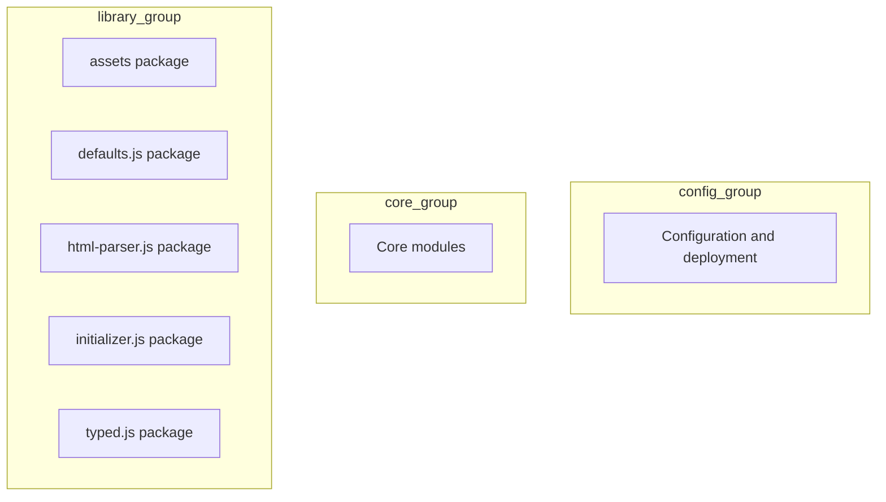

# Architecture report: mattboldt/typed.js

> Automated static analysis. **Observed** = directly seen in files/imports/AST; **Inferred** = interpretation from that evidence. Repository code was not executed.

## 1. Repository at a glance

| Item | Value |
| --- | --- |
| Repository | mattboldt/typed.js |
| Description | A JavaScript Typing Animation Library |
| Language | JavaScript |
| Stars | 16272 |
| Licence | Other |
| Analysed commit / branch | b2d6a7d9af6d9cd39830701f6b6a7cd98a37e13f / main |
| Framework(s) | None detected |
| Files analysed | 75 |
| Components | 7 |

## 2. Architecture in one minute

mattboldt/typed.js - A JavaScript Typing Animation Library. This repository was analysed statically from 75 file(s) (0 Python). Detected technologies (observed from imports/manifests): no known frameworks/libraries. Files are grouped into 7 component(s): assets package, Configuration and deployment, Core modules, defaults.js package, html-parser.js package, initializer.js package, typed.js package. Findings below distinguish observed facts from inferred interpretation.

## 3. High-level block diagram

## 4. Main components

### assets package (`assets`)

- **Kind:** library
- **Status:** Observed
- **Confidence:** 0.85
- **Responsibility:** Groups 1 file(s) under assets package (observed from repository paths and static analysis).
- **Paths:** `assets/demos.js`
- **Evidence:** [assets/demos.js](https://github.com/mattboldt/typed.js/blob/b2d6a7d9af6d9cd39830701f6b6a7cd98a37e13f/assets/demos.js)

### Configuration and deployment (`config`)

- **Kind:** config
- **Status:** Observed
- **Confidence:** 0.85
- **Responsibility:** Groups 1 file(s) under configuration and deployment (observed from repository paths and static analysis).
- **Paths:** `package.json`
- **Evidence:** [package.json](https://github.com/mattboldt/typed.js/blob/b2d6a7d9af6d9cd39830701f6b6a7cd98a37e13f/package.json)

### Core modules (`core`)

- **Kind:** core
- **Status:** Observed
- **Confidence:** 0.85
- **Responsibility:** Groups 2 file(s) under core modules (observed from repository paths and static analysis).
- **Paths:** `index.d.ts`, `typed.d.ts`
- **Evidence:** [index.d.ts](https://github.com/mattboldt/typed.js/blob/b2d6a7d9af6d9cd39830701f6b6a7cd98a37e13f/index.d.ts); [typed.d.ts](https://github.com/mattboldt/typed.js/blob/b2d6a7d9af6d9cd39830701f6b6a7cd98a37e13f/typed.d.ts)

### defaults.js package (`defaults_js`)

- **Kind:** library
- **Status:** Observed
- **Confidence:** 0.85
- **Responsibility:** Groups 1 file(s) under defaults.js package (observed from repository paths and static analysis).
- **Paths:** `src/defaults.js`
- **Evidence:** [src/defaults.js](https://github.com/mattboldt/typed.js/blob/b2d6a7d9af6d9cd39830701f6b6a7cd98a37e13f/src/defaults.js)

### html-parser.js package (`html_parser_js`)

- **Kind:** library
- **Status:** Observed
- **Confidence:** 0.85
- **Responsibility:** Groups 1 file(s) under html-parser.js package (observed from repository paths and static analysis).
- **Paths:** `src/html-parser.js`
- **Evidence:** [src/html-parser.js](https://github.com/mattboldt/typed.js/blob/b2d6a7d9af6d9cd39830701f6b6a7cd98a37e13f/src/html-parser.js)

### initializer.js package (`initializer_js`)

- **Kind:** library
- **Status:** Observed
- **Confidence:** 0.85
- **Responsibility:** Groups 1 file(s) under initializer.js package (observed from repository paths and static analysis).
- **Paths:** `src/initializer.js`
- **Evidence:** [src/initializer.js](https://github.com/mattboldt/typed.js/blob/b2d6a7d9af6d9cd39830701f6b6a7cd98a37e13f/src/initializer.js)

### typed.js package (`typed_js`)

- **Kind:** library
- **Status:** Observed
- **Confidence:** 0.85
- **Responsibility:** Groups 1 file(s) under typed.js package (observed from repository paths and static analysis).
- **Paths:** `src/typed.js`
- **Evidence:** [src/typed.js](https://github.com/mattboldt/typed.js/blob/b2d6a7d9af6d9cd39830701f6b6a7cd98a37e13f/src/typed.js)

## 5. Execution flow

No entry point was observed; the startup flow below is therefore limited.

Representative flow (derived from observed entry points and the import graph; steps beyond the entry point are **Inferred**):

1. Execution starts at an observed entry point listed above, if present.
2. No internal import relationships between components were observed.

## 6. Project structure

### `(root)`

- `.codeclimate.yml` - config (421 bytes)
- `.esdoc.json` - config (190 bytes)
- `.gitignore` - other (46 bytes)
- `.prettierrc` - other (49 bytes)
- `.travis.yml` - ci, YAML (213 bytes)
- `CODE_OF_CONDUCT.md` - docs (5488 bytes)
- `LICENSE.txt` - docs (35704 bytes)
- `LIMITED_COMMERCIAL_LICENSE.md` - docs (1646 bytes)
- `README.md` - docs (9387 bytes)
- `UNLIMITED_COMMERCIAL_LICENSE.md` - docs (1668 bytes)
- `index.d.ts` - source, TypeScript (6341 bytes)
- `index.html` - other (6483 bytes)
- `package.json` - manifest (927 bytes)
- `typed.d.ts` - source, TypeScript (3771 bytes)

### `.github`

- `.github/CONTRIBUTING.md` - docs (1277 bytes)
- `.github/ISSUE_TEMPLATE.md` - docs (707 bytes)
- `.github/PULL_REQUEST_TEMPLATE.md` - docs (1207 bytes)
- `.github/stale.yml` - config (684 bytes)

### `.vscode`

- `.vscode/launch.json` - config (380 bytes)
- `.vscode/settings.json` - config (234 bytes)

### `assets`

- `assets/demos.css` - other (717 bytes)
- `assets/demos.js` - source, JavaScript (3714 bytes)

### `docs`

- `docs/API.md` - docs (6329 bytes)
- `docs/assets/anchor.js` - docs (15344 bytes)
- `docs/assets/bass-addons.css` - docs (221 bytes)
- `docs/assets/bass.css` - docs (11677 bytes)
- `docs/assets/fonts/LICENSE.txt` - docs (4622 bytes)
- `docs/assets/fonts/source-code-pro.css` - docs (938 bytes)
- `docs/assets/github.css` - docs (1637 bytes)
- `docs/assets/site.js` - docs (4566 bytes)
- `docs/assets/split.css` - docs (585 bytes)
- `docs/assets/split.js` - docs (30356 bytes)
- `docs/assets/style.css` - docs (1804 bytes)
- `docs/ast/source/.external-ecmascript.js.json` - config (66686 bytes)
- `docs/badge.svg` - docs (791 bytes)
- `docs/class/src/html-parser.js~HTMLParser.html` - docs (12429 bytes)
- `docs/class/src/initializer.js~Initializer.html` - docs (13244 bytes)
- `docs/class/src/typed-using-raf.js~Typed.html` - docs (63392 bytes)
- `docs/class/src/typed.js~Typed.html` - docs (55827 bytes)
- `docs/coverage.json` - config (739 bytes)
- `docs/css/github.css` - docs (1327 bytes)
- `docs/css/identifiers.css` - docs (634 bytes)
- `docs/css/manual.css` - docs (2190 bytes)
- `docs/css/prettify-tomorrow.css` - docs (2026 bytes)
- `docs/css/search.css` - docs (1328 bytes)
- `docs/css/source.css` - docs (950 bytes)
- `docs/css/style.css` - docs (9224 bytes)
- `docs/css/test.css` - docs (984 bytes)
- `docs/file/src/defaults.js.html` - docs (6680 bytes)
- `docs/file/src/html-parser.js.html` - docs (5106 bytes)
- `docs/file/src/initializer.js.html` - docs (9171 bytes)
- `docs/file/src/typed-using-raf.js.html` - docs (17002 bytes)
- `docs/file/src/typed.js.html` - docs (16116 bytes)
- `docs/identifiers.html` - docs (9894 bytes)
- `docs/image/badge.svg` - docs (799 bytes)
- `docs/image/manual-badge.svg` - docs (795 bytes)
- `docs/index.html` - docs (46081 bytes)
- `docs/index.json` - config (77534 bytes)
- `docs/lint.json` - config (935 bytes)
- `docs/script/inherited-summary.js` - docs (815 bytes)
- `docs/script/inner-link.js` - docs (997 bytes)
- `docs/script/manual.js` - docs (470 bytes)
- `docs/script/patch-for-local.js` - docs (207 bytes)
- `docs/script/prettify/Apache-License-2.0.txt` - docs (11358 bytes)
- `docs/script/prettify/prettify.js` - docs (15502 bytes)
- `docs/script/pretty-print.js` - docs (759 bytes)
- `docs/script/search.js` - docs (3541 bytes)
- `docs/script/search_index.js` - docs (17662 bytes)
- `docs/script/test-summary.js` - docs (1761 bytes)
- `docs/source.html` - docs (6152 bytes)
- `docs/variable/index.html` - docs (12701 bytes)

### `src`

- `src/defaults.js` - source, JavaScript (3541 bytes)
- `src/html-parser.js` - source, JavaScript (1798 bytes)
- `src/initializer.js` - source, JavaScript (5935 bytes)
- `src/typed.js` - source, JavaScript (14267 bytes)

## 7. Key dependencies and integrations

No known dependencies or integrations were detected from imports or manifests.

## 8. Data and state

No database, cache, queue, or persistent-state usage was observed in the analysed files. State handling, if any, may be in-memory or in files that were not analysed.

## 9. Configuration and deployment clues

- `.codeclimate.yml` (config)
- `.esdoc.json` (config)
- `.github/stale.yml` (config)
- `.travis.yml` (ci)
- `.vscode/launch.json` (config)
- `.vscode/settings.json` (config)
- `docs/ast/source/.external-ecmascript.js.json` (config)
- `docs/coverage.json` (config)
- `docs/index.json` (config)
- `docs/lint.json` (config)
- `package.json` (manifest)

## 10. Design observations

- No strong design patterns could be established from the available evidence.

These observations are interpretations (**Inferred**) of the observed structure, not guarantees about runtime design.

## 11. Limitations and unknowns

- Static analysis only: repository code was not executed, installed, or imported at runtime.
- Components and relationships are inferred from file paths, imports, and AST structure; runtime behaviour, dynamic imports, and reflection may not be visible.
- 3 file(s) were skipped during inventory (3 x vendored/generated directory excluded).
- No clear application entry point was observed in the analysed files.
- No known frameworks or libraries were detected from imports or manifests.
- Repository text was treated as untrusted data; no instructions found in repository files were followed, and likely secret values were redacted/excluded.
- JavaScript and TypeScript files were inventoried from paths and package manifests. They were not parsed with a full language AST, and repository code was not executed.

## 12. Source references

- [assets/demos.js](https://github.com/mattboldt/typed.js/blob/b2d6a7d9af6d9cd39830701f6b6a7cd98a37e13f/assets/demos.js)
- [index.d.ts](https://github.com/mattboldt/typed.js/blob/b2d6a7d9af6d9cd39830701f6b6a7cd98a37e13f/index.d.ts)
- [package.json](https://github.com/mattboldt/typed.js/blob/b2d6a7d9af6d9cd39830701f6b6a7cd98a37e13f/package.json)
- [src/defaults.js](https://github.com/mattboldt/typed.js/blob/b2d6a7d9af6d9cd39830701f6b6a7cd98a37e13f/src/defaults.js)
- [src/html-parser.js](https://github.com/mattboldt/typed.js/blob/b2d6a7d9af6d9cd39830701f6b6a7cd98a37e13f/src/html-parser.js)
- [src/initializer.js](https://github.com/mattboldt/typed.js/blob/b2d6a7d9af6d9cd39830701f6b6a7cd98a37e13f/src/initializer.js)
- [src/typed.js](https://github.com/mattboldt/typed.js/blob/b2d6a7d9af6d9cd39830701f6b6a7cd98a37e13f/src/typed.js)
- [typed.d.ts](https://github.com/mattboldt/typed.js/blob/b2d6a7d9af6d9cd39830701f6b6a7cd98a37e13f/typed.d.ts)
