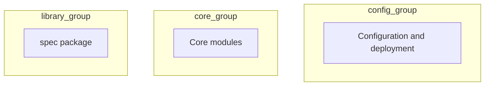

# Architecture report: mattdelacdev/WOW

> Automated static analysis. **Observed** = directly seen in files/imports/AST; **Inferred** = interpretation from that evidence. Repository code was not executed.

## 1. Repository at a glance

| Item | Value |
| --- | --- |
| Repository | mattdelacdev/WOW |
| Description | Reveal CSS animation as you scroll down a page |
| Language | JavaScript |
| Stars | 9890 |
| Licence | Not detected |
| Analysed commit / branch | c248bd26104b759f5efc7a1f5dcca7e758b5c793 / master |
| Framework(s) | None detected |
| Files analysed | 17 |
| Components | 3 |

## 2. Architecture in one minute

mattdelacdev/WOW - Reveal CSS animation as you scroll down a page. This repository was analysed statically from 17 file(s) (0 Python). Detected technologies (observed from imports/manifests): no known frameworks/libraries. Files are grouped into 3 component(s): Configuration and deployment, Core modules, spec package. Findings below distinguish observed facts from inferred interpretation.

## 3. High-level block diagram

## 4. Main components

### Configuration and deployment (`config`)

- **Kind:** config
- **Status:** Observed
- **Confidence:** 0.85
- **Responsibility:** Groups 2 file(s) under configuration and deployment (observed from repository paths and static analysis).
- **Paths:** `bower.json`, `package.json`
- **Evidence:** [bower.json](https://github.com/mattdelacdev/WOW/blob/c248bd26104b759f5efc7a1f5dcca7e758b5c793/bower.json); [package.json](https://github.com/mattdelacdev/WOW/blob/c248bd26104b759f5efc7a1f5dcca7e758b5c793/package.json)

### Core modules (`core`)

- **Kind:** core
- **Status:** Observed
- **Confidence:** 0.85
- **Responsibility:** Groups 1 file(s) under core modules (observed from repository paths and static analysis).
- **Paths:** `Gruntfile.js`
- **Evidence:** [Gruntfile.js](https://github.com/mattdelacdev/WOW/blob/c248bd26104b759f5efc7a1f5dcca7e758b5c793/Gruntfile.js)

### spec package (`spec`)

- **Kind:** library
- **Status:** Observed
- **Confidence:** 0.85
- **Responsibility:** Groups 3 file(s) under spec package (observed from repository paths and static analysis).
- **Paths:** `spec/javascripts/helpers/SpecHelper.js`, `spec/javascripts/libs/jasmine-jquery.js`, `spec/javascripts/wow-spec.js`
- **Evidence:** [spec/javascripts/helpers/SpecHelper.js](https://github.com/mattdelacdev/WOW/blob/c248bd26104b759f5efc7a1f5dcca7e758b5c793/spec/javascripts/helpers/SpecHelper.js); [spec/javascripts/libs/jasmine-jquery.js](https://github.com/mattdelacdev/WOW/blob/c248bd26104b759f5efc7a1f5dcca7e758b5c793/spec/javascripts/libs/jasmine-jquery.js); [spec/javascripts/wow-spec.js](https://github.com/mattdelacdev/WOW/blob/c248bd26104b759f5efc7a1f5dcca7e758b5c793/spec/javascripts/wow-spec.js)

## 5. Execution flow

No entry point was observed; the startup flow below is therefore limited.

Representative flow (derived from observed entry points and the import graph; steps beyond the entry point are **Inferred**):

1. Execution starts at an observed entry point listed above, if present.
2. No internal import relationships between components were observed.

## 6. Project structure

### `(root)`

- `.gitignore` - other (48 bytes)
- `.travis.yml` - ci, YAML (36 bytes)
- `Gruntfile.js` - source, JavaScript (2241 bytes)
- `README.md` - docs (4787 bytes)
- `bower.json` - config (403 bytes)
- `demo.html` - other (1579 bytes)
- `package.json` - manifest (962 bytes)

### `css`

- `css/libs/animate.css` - other (57095 bytes)
- `css/site.css` - other (411 bytes)

### `spec`

- `spec/coffeescripts/helpers/SpecHelper.coffee` - other (13 bytes)
- `spec/coffeescripts/wow-spec.coffee` - other (10346 bytes)
- `spec/javascripts/fixtures/custom.html` - other (418 bytes)
- `spec/javascripts/fixtures/simple.html` - other (421 bytes)
- `spec/javascripts/helpers/SpecHelper.js` - source, JavaScript (59 bytes)
- `spec/javascripts/libs/jasmine-jquery.js` - source, JavaScript (25057 bytes)
- `spec/javascripts/wow-spec.js` - source, JavaScript (10417 bytes)

### `src`

- `src/wow.coffee` - other (9131 bytes)

## 7. Key dependencies and integrations

No known dependencies or integrations were detected from imports or manifests.

## 8. Data and state

No database, cache, queue, or persistent-state usage was observed in the analysed files. State handling, if any, may be in-memory or in files that were not analysed.

## 9. Configuration and deployment clues

- `.travis.yml` (ci)
- `bower.json` (config)
- `package.json` (manifest)

## 10. Design observations

- No strong design patterns could be established from the available evidence.

These observations are interpretations (**Inferred**) of the observed structure, not guarantees about runtime design.

## 11. Limitations and unknowns

- Static analysis only: repository code was not executed, installed, or imported at runtime.
- Components and relationships are inferred from file paths, imports, and AST structure; runtime behaviour, dynamic imports, and reflection may not be visible.
- 1 file(s) were skipped during inventory (1 x vendored/generated directory excluded).
- No clear application entry point was observed in the analysed files.
- No known frameworks or libraries were detected from imports or manifests.
- Repository text was treated as untrusted data; no instructions found in repository files were followed, and likely secret values were redacted/excluded.
- JavaScript and TypeScript files were inventoried from paths and package manifests. They were not parsed with a full language AST, and repository code was not executed.

## 12. Source references

- [Gruntfile.js](https://github.com/mattdelacdev/WOW/blob/c248bd26104b759f5efc7a1f5dcca7e758b5c793/Gruntfile.js)
- [bower.json](https://github.com/mattdelacdev/WOW/blob/c248bd26104b759f5efc7a1f5dcca7e758b5c793/bower.json)
- [package.json](https://github.com/mattdelacdev/WOW/blob/c248bd26104b759f5efc7a1f5dcca7e758b5c793/package.json)
- [spec/javascripts/helpers/SpecHelper.js](https://github.com/mattdelacdev/WOW/blob/c248bd26104b759f5efc7a1f5dcca7e758b5c793/spec/javascripts/helpers/SpecHelper.js)
- [spec/javascripts/libs/jasmine-jquery.js](https://github.com/mattdelacdev/WOW/blob/c248bd26104b759f5efc7a1f5dcca7e758b5c793/spec/javascripts/libs/jasmine-jquery.js)
- [spec/javascripts/wow-spec.js](https://github.com/mattdelacdev/WOW/blob/c248bd26104b759f5efc7a1f5dcca7e758b5c793/spec/javascripts/wow-spec.js)
