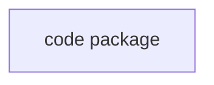

# Architecture report: max-mapper/art-of-node

> Automated static analysis. **Observed** = directly seen in files/imports/AST; **Inferred** = interpretation from that evidence. Repository code was not executed.

## 1. Repository at a glance

| Item | Value |
| --- | --- |
| Repository | max-mapper/art-of-node |
| Description | :snowflake: a short introduction to node.js |
| Language | JavaScript |
| Stars | 9859 |
| Licence | Other |
| Analysed commit / branch | 71d0aba060532c5b4f075c1cd0fad746515f3808 / master |
| Framework(s) | None detected |
| Files analysed | 13 |
| Components | 1 |

## 2. Architecture in one minute

max-mapper/art-of-node - :snowflake: a short introduction to node.js. This repository was analysed statically from 13 file(s) (0 Python). Detected technologies (observed from imports/manifests): no known frameworks/libraries. Files are grouped into 1 component(s): code package. Findings below distinguish observed facts from inferred interpretation.

## 3. High-level block diagram

## 4. Main components

### code package (`code`)

- **Kind:** library
- **Status:** Observed
- **Confidence:** 0.85
- **Responsibility:** Groups 4 file(s) under code package (observed from repository paths and static analysis).
- **Paths:** `code/1.js`, `code/2.js`, `code/3.js`, `code/4.js`
- **Evidence:** [code/1.js](https://github.com/max-mapper/art-of-node/blob/71d0aba060532c5b4f075c1cd0fad746515f3808/code/1.js); [code/2.js](https://github.com/max-mapper/art-of-node/blob/71d0aba060532c5b4f075c1cd0fad746515f3808/code/2.js); [code/3.js](https://github.com/max-mapper/art-of-node/blob/71d0aba060532c5b4f075c1cd0fad746515f3808/code/3.js); [code/4.js](https://github.com/max-mapper/art-of-node/blob/71d0aba060532c5b4f075c1cd0fad746515f3808/code/4.js)

## 5. Execution flow

No entry point was observed; the startup flow below is therefore limited.

Representative flow (derived from observed entry points and the import graph; steps beyond the entry point are **Inferred**):

1. Execution starts at an observed entry point listed above, if present.
2. No internal import relationships between components were observed.

## 6. Project structure

### `(root)`

- `LICENSE.md` - docs (108 bytes)
- `readme.es.md` - docs (24883 bytes)
- `readme.fr.md` - docs (42749 bytes)
- `readme.md` - docs (37982 bytes)
- `readme.pt-br.md` - docs (41996 bytes)
- `readme.ru.md` - docs (68043 bytes)
- `readme.zh-cn.md` - docs (35781 bytes)
- `readme.zh-tw.md` - docs (23997 bytes)

### `code`

- `code/1.js` - source, JavaScript (163 bytes)
- `code/2.js` - source, JavaScript (349 bytes)
- `code/3.js` - source, JavaScript (320 bytes)
- `code/4.js` - source, JavaScript (275 bytes)
- `code/number.txt` - docs (1 bytes)

## 7. Key dependencies and integrations

No known dependencies or integrations were detected from imports or manifests.

## 8. Data and state

No database, cache, queue, or persistent-state usage was observed in the analysed files. State handling, if any, may be in-memory or in files that were not analysed.

## 9. Configuration and deployment clues

No configuration, manifest, CI, or container files were observed.

## 10. Design observations

- The analysed code appears small or monolithic; few component boundaries were observed.

These observations are interpretations (**Inferred**) of the observed structure, not guarantees about runtime design.

## 11. Limitations and unknowns

- Static analysis only: repository code was not executed, installed, or imported at runtime.
- Components and relationships are inferred from file paths, imports, and AST structure; runtime behaviour, dynamic imports, and reflection may not be visible.
- No clear application entry point was observed in the analysed files.
- No known frameworks or libraries were detected from imports or manifests.
- Repository text was treated as untrusted data; no instructions found in repository files were followed, and likely secret values were redacted/excluded.
- JavaScript and TypeScript files were inventoried from paths and package manifests. They were not parsed with a full language AST, and repository code was not executed.

## 12. Source references

- [code/1.js](https://github.com/max-mapper/art-of-node/blob/71d0aba060532c5b4f075c1cd0fad746515f3808/code/1.js)
- [code/2.js](https://github.com/max-mapper/art-of-node/blob/71d0aba060532c5b4f075c1cd0fad746515f3808/code/2.js)
- [code/3.js](https://github.com/max-mapper/art-of-node/blob/71d0aba060532c5b4f075c1cd0fad746515f3808/code/3.js)
- [code/4.js](https://github.com/max-mapper/art-of-node/blob/71d0aba060532c5b4f075c1cd0fad746515f3808/code/4.js)
