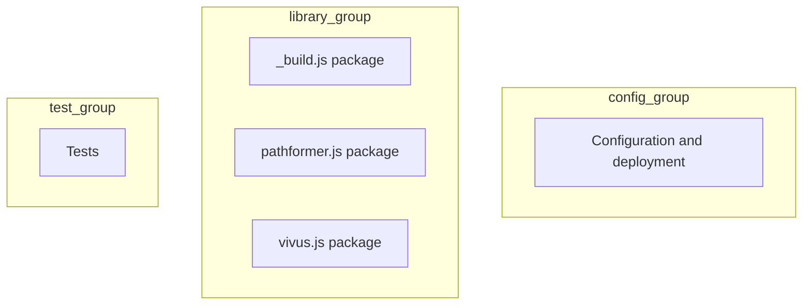

# Architecture report: maxwellito/vivus

> Automated static analysis. **Observed** = directly seen in files/imports/AST; **Inferred** = interpretation from that evidence. Repository code was not executed.

## 1. Repository at a glance

| Item | Value |
| --- | --- |
| Repository | maxwellito/vivus |
| Description | JavaScript library to make drawing animation on SVG |
| Language | JavaScript |
| Stars | 15479 |
| Licence | MIT |
| Analysed commit / branch | 06b7adb5d543b6b1d0d93fa83dea137b1f8644a5 / master |
| Framework(s) | None detected |
| Files analysed | 25 |
| Components | 5 |

## 2. Architecture in one minute

maxwellito/vivus - JavaScript library to make drawing animation on SVG. This repository was analysed statically from 25 file(s) (0 Python). Detected technologies (observed from imports/manifests): no known frameworks/libraries. Files are grouped into 5 component(s): _build.js package, Configuration and deployment, pathformer.js package, Tests, vivus.js package. Findings below distinguish observed facts from inferred interpretation.

## 3. High-level block diagram

## 4. Main components

### _build.js package (`build_js`)

- **Kind:** library
- **Status:** Observed
- **Confidence:** 0.85
- **Responsibility:** Groups 1 file(s) under _build.js package (observed from repository paths and static analysis).
- **Paths:** `src/_build.js`
- **Evidence:** [src/_build.js](https://github.com/maxwellito/vivus/blob/06b7adb5d543b6b1d0d93fa83dea137b1f8644a5/src/_build.js)

### Configuration and deployment (`config`)

- **Kind:** config
- **Status:** Observed
- **Confidence:** 0.85
- **Responsibility:** Groups 2 file(s) under configuration and deployment (observed from repository paths and static analysis).
- **Paths:** `bower.json`, `package.json`
- **Evidence:** [bower.json](https://github.com/maxwellito/vivus/blob/06b7adb5d543b6b1d0d93fa83dea137b1f8644a5/bower.json); [package.json](https://github.com/maxwellito/vivus/blob/06b7adb5d543b6b1d0d93fa83dea137b1f8644a5/package.json)

### pathformer.js package (`pathformer_js`)

- **Kind:** library
- **Status:** Observed
- **Confidence:** 0.85
- **Responsibility:** Groups 1 file(s) under pathformer.js package (observed from repository paths and static analysis).
- **Paths:** `src/pathformer.js`
- **Evidence:** [src/pathformer.js](https://github.com/maxwellito/vivus/blob/06b7adb5d543b6b1d0d93fa83dea137b1f8644a5/src/pathformer.js)

### Tests (`tests`)

- **Kind:** test
- **Status:** Observed
- **Confidence:** 0.85
- **Responsibility:** Groups 9 file(s) under tests (observed from repository paths and static analysis).
- **Paths:** `test/karma.conf.js`, `test/manual/hi-there.svg`, `test/manual/index.html`, `test/manual/obturateur.svg`, `test/manual/polaroid.svg`, `test/manual/synth.svg`, `test/unit.setup.js`, `test/unit/pathformer.spec.js`, `test/unit/vivus.spec.js`
- **Evidence:** [test/karma.conf.js](https://github.com/maxwellito/vivus/blob/06b7adb5d543b6b1d0d93fa83dea137b1f8644a5/test/karma.conf.js); [test/manual/hi-there.svg](https://github.com/maxwellito/vivus/blob/06b7adb5d543b6b1d0d93fa83dea137b1f8644a5/test/manual/hi-there.svg); [test/manual/index.html](https://github.com/maxwellito/vivus/blob/06b7adb5d543b6b1d0d93fa83dea137b1f8644a5/test/manual/index.html); [test/manual/obturateur.svg](https://github.com/maxwellito/vivus/blob/06b7adb5d543b6b1d0d93fa83dea137b1f8644a5/test/manual/obturateur.svg); [test/manual/polaroid.svg](https://github.com/maxwellito/vivus/blob/06b7adb5d543b6b1d0d93fa83dea137b1f8644a5/test/manual/polaroid.svg); [test/manual/synth.svg](https://github.com/maxwellito/vivus/blob/06b7adb5d543b6b1d0d93fa83dea137b1f8644a5/test/manual/synth.svg); [test/unit.setup.js](https://github.com/maxwellito/vivus/blob/06b7adb5d543b6b1d0d93fa83dea137b1f8644a5/test/unit.setup.js); [test/unit/pathformer.spec.js](https://github.com/maxwellito/vivus/blob/06b7adb5d543b6b1d0d93fa83dea137b1f8644a5/test/unit/pathformer.spec.js)

### vivus.js package (`vivus_js`)

- **Kind:** library
- **Status:** Observed
- **Confidence:** 0.85
- **Responsibility:** Groups 1 file(s) under vivus.js package (observed from repository paths and static analysis).
- **Paths:** `src/vivus.js`
- **Evidence:** [src/vivus.js](https://github.com/maxwellito/vivus/blob/06b7adb5d543b6b1d0d93fa83dea137b1f8644a5/src/vivus.js)

## 5. Execution flow

No entry point was observed; the startup flow below is therefore limited.

Representative flow (derived from observed entry points and the import graph; steps beyond the entry point are **Inferred**):

1. Execution starts at an observed entry point listed above, if present.
2. No internal import relationships between components were observed.

## 6. Project structure

### `(root)`

- `.eslintrc.json` - config (700 bytes)
- `.gitignore` - other (72 bytes)
- `.npmignore` - other (44 bytes)
- `.travis.yml` - ci, YAML (190 bytes)
- `CONTRIBUTING.md` - docs (924 bytes)
- `LICENSE` - docs (1072 bytes)
- `bower.json` - config (290 bytes)
- `hacks.md` - docs (865 bytes)
- `index.html` - other (21781 bytes)
- `package.json` - manifest (1023 bytes)
- `readme.md` - docs (20579 bytes)

### `.github`

- `.github/ISSUE_TEMPLATE.md` - docs (878 bytes)

### `assets`

- `assets/timelines.svg` - other (5973 bytes)

### `src`

- `src/_build.js` - source, JavaScript (850 bytes)
- `src/pathformer.js` - source, JavaScript (8755 bytes)
- `src/vivus.js` - source, JavaScript (24887 bytes)

### `test`

- `test/karma.conf.js` - test, JavaScript (2080 bytes)
- `test/manual/hi-there.svg` - test (2891 bytes)
- `test/manual/index.html` - test (11551 bytes)
- `test/manual/obturateur.svg` - test (910 bytes)
- `test/manual/polaroid.svg` - test (4379 bytes)
- `test/manual/synth.svg` - test (11345 bytes)
- `test/unit.setup.js` - test, JavaScript (392 bytes)
- `test/unit/pathformer.spec.js` - test, JavaScript (11779 bytes)
- `test/unit/vivus.spec.js` - test, JavaScript (23453 bytes)

## 7. Key dependencies and integrations

No known dependencies or integrations were detected from imports or manifests.

## 8. Data and state

No database, cache, queue, or persistent-state usage was observed in the analysed files. State handling, if any, may be in-memory or in files that were not analysed.

## 9. Configuration and deployment clues

- `.eslintrc.json` (config)
- `.travis.yml` (ci)
- `bower.json` (config)
- `package.json` (manifest)

## 10. Design observations

- Tests are present alongside source code (Observed from test file paths).

These observations are interpretations (**Inferred**) of the observed structure, not guarantees about runtime design.

## 11. Limitations and unknowns

- Static analysis only: repository code was not executed, installed, or imported at runtime.
- Components and relationships are inferred from file paths, imports, and AST structure; runtime behaviour, dynamic imports, and reflection may not be visible.
- 2 file(s) were skipped during inventory (1 x lockfile excluded; 1 x vendored/generated directory excluded).
- No clear application entry point was observed in the analysed files.
- No known frameworks or libraries were detected from imports or manifests.
- Repository text was treated as untrusted data; no instructions found in repository files were followed, and likely secret values were redacted/excluded.
- JavaScript and TypeScript files were inventoried from paths and package manifests. They were not parsed with a full language AST, and repository code was not executed.

## 12. Source references

- [bower.json](https://github.com/maxwellito/vivus/blob/06b7adb5d543b6b1d0d93fa83dea137b1f8644a5/bower.json)
- [package.json](https://github.com/maxwellito/vivus/blob/06b7adb5d543b6b1d0d93fa83dea137b1f8644a5/package.json)
- [src/_build.js](https://github.com/maxwellito/vivus/blob/06b7adb5d543b6b1d0d93fa83dea137b1f8644a5/src/_build.js)
- [src/pathformer.js](https://github.com/maxwellito/vivus/blob/06b7adb5d543b6b1d0d93fa83dea137b1f8644a5/src/pathformer.js)
- [src/vivus.js](https://github.com/maxwellito/vivus/blob/06b7adb5d543b6b1d0d93fa83dea137b1f8644a5/src/vivus.js)
- [test/karma.conf.js](https://github.com/maxwellito/vivus/blob/06b7adb5d543b6b1d0d93fa83dea137b1f8644a5/test/karma.conf.js)
- [test/manual/hi-there.svg](https://github.com/maxwellito/vivus/blob/06b7adb5d543b6b1d0d93fa83dea137b1f8644a5/test/manual/hi-there.svg)
- [test/manual/index.html](https://github.com/maxwellito/vivus/blob/06b7adb5d543b6b1d0d93fa83dea137b1f8644a5/test/manual/index.html)
- [test/manual/obturateur.svg](https://github.com/maxwellito/vivus/blob/06b7adb5d543b6b1d0d93fa83dea137b1f8644a5/test/manual/obturateur.svg)
- [test/manual/polaroid.svg](https://github.com/maxwellito/vivus/blob/06b7adb5d543b6b1d0d93fa83dea137b1f8644a5/test/manual/polaroid.svg)
- [test/manual/synth.svg](https://github.com/maxwellito/vivus/blob/06b7adb5d543b6b1d0d93fa83dea137b1f8644a5/test/manual/synth.svg)
- [test/unit.setup.js](https://github.com/maxwellito/vivus/blob/06b7adb5d543b6b1d0d93fa83dea137b1f8644a5/test/unit.setup.js)
- [test/unit/pathformer.spec.js](https://github.com/maxwellito/vivus/blob/06b7adb5d543b6b1d0d93fa83dea137b1f8644a5/test/unit/pathformer.spec.js)
