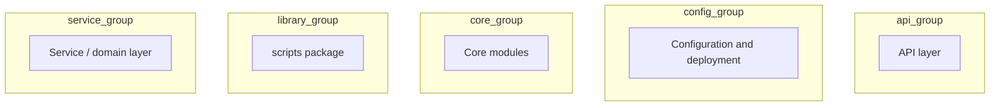

# Architecture report: mayswind/AriaNg

> Automated static analysis. **Observed** = directly seen in files/imports/AST; **Inferred** = interpretation from that evidence. Repository code was not executed.

## 1. Repository at a glance

| Item | Value |
| --- | --- |
| Repository | mayswind/AriaNg |
| Description | AriaNg, a modern web frontend making aria2 easier to use. |
| Language | JavaScript |
| Stars | 13274 |
| Licence | MIT |
| Analysed commit / branch | 56d44dc9e822a6f59aae13a542a0cab6cf292d30 / master |
| Framework(s) | None detected |
| Files analysed | 111 |
| Components | 5 |

## 2. Architecture in one minute

mayswind/AriaNg - AriaNg, a modern web frontend making aria2 easier to use.. This repository was analysed statically from 111 file(s) (0 Python). Detected technologies (observed from imports/manifests): GitHub Actions. Files are grouped into 5 component(s): API layer, Configuration and deployment, Core modules, scripts package, Service / domain layer. Findings below distinguish observed facts from inferred interpretation.

## 3. High-level block diagram

## 4. Main components

### API layer (`api_layer`)

- **Kind:** api
- **Status:** Observed
- **Confidence:** 0.85
- **Responsibility:** Groups 9 file(s) under api layer (observed from repository paths and static analysis).
- **Paths:** `src/scripts/controllers/command.js`, `src/scripts/controllers/debug.js`, `src/scripts/controllers/list.js`, `src/scripts/controllers/main.js`, `src/scripts/controllers/new.js`, `src/scripts/controllers/settings-aria2.js`, `src/scripts/controllers/settings-ariang.js`, `src/scripts/controllers/status.js`, `src/scripts/controllers/task-detail.js`
- **Evidence:** [src/scripts/controllers/command.js](https://github.com/mayswind/AriaNg/blob/56d44dc9e822a6f59aae13a542a0cab6cf292d30/src/scripts/controllers/command.js); [src/scripts/controllers/debug.js](https://github.com/mayswind/AriaNg/blob/56d44dc9e822a6f59aae13a542a0cab6cf292d30/src/scripts/controllers/debug.js); [src/scripts/controllers/list.js](https://github.com/mayswind/AriaNg/blob/56d44dc9e822a6f59aae13a542a0cab6cf292d30/src/scripts/controllers/list.js); [src/scripts/controllers/main.js](https://github.com/mayswind/AriaNg/blob/56d44dc9e822a6f59aae13a542a0cab6cf292d30/src/scripts/controllers/main.js); [src/scripts/controllers/new.js](https://github.com/mayswind/AriaNg/blob/56d44dc9e822a6f59aae13a542a0cab6cf292d30/src/scripts/controllers/new.js); [src/scripts/controllers/settings-aria2.js](https://github.com/mayswind/AriaNg/blob/56d44dc9e822a6f59aae13a542a0cab6cf292d30/src/scripts/controllers/settings-aria2.js); [src/scripts/controllers/settings-ariang.js](https://github.com/mayswind/AriaNg/blob/56d44dc9e822a6f59aae13a542a0cab6cf292d30/src/scripts/controllers/settings-ariang.js); [src/scripts/controllers/status.js](https://github.com/mayswind/AriaNg/blob/56d44dc9e822a6f59aae13a542a0cab6cf292d30/src/scripts/controllers/status.js)

### Configuration and deployment (`config`)

- **Kind:** config
- **Status:** Observed
- **Confidence:** 0.85
- **Responsibility:** Groups 11 file(s) under configuration and deployment (observed from repository paths and static analysis).
- **Paths:** `package.json`, `src/scripts/config/aria2Errors.js`, `src/scripts/config/aria2Options.js`, `src/scripts/config/aria2RpcConstants.js`, `src/scripts/config/buildConfiguration.js`, `src/scripts/config/configuration.js`, `src/scripts/config/constants.js`, `src/scripts/config/defaultLanguage.js`, `src/scripts/config/fileTypes.js`, `src/scripts/config/initiator.js`, `src/scripts/config/languages.js`
- **Evidence:** [package.json](https://github.com/mayswind/AriaNg/blob/56d44dc9e822a6f59aae13a542a0cab6cf292d30/package.json); [src/scripts/config/aria2Errors.js](https://github.com/mayswind/AriaNg/blob/56d44dc9e822a6f59aae13a542a0cab6cf292d30/src/scripts/config/aria2Errors.js); [src/scripts/config/aria2Options.js](https://github.com/mayswind/AriaNg/blob/56d44dc9e822a6f59aae13a542a0cab6cf292d30/src/scripts/config/aria2Options.js); [src/scripts/config/aria2RpcConstants.js](https://github.com/mayswind/AriaNg/blob/56d44dc9e822a6f59aae13a542a0cab6cf292d30/src/scripts/config/aria2RpcConstants.js); [src/scripts/config/buildConfiguration.js](https://github.com/mayswind/AriaNg/blob/56d44dc9e822a6f59aae13a542a0cab6cf292d30/src/scripts/config/buildConfiguration.js); [src/scripts/config/configuration.js](https://github.com/mayswind/AriaNg/blob/56d44dc9e822a6f59aae13a542a0cab6cf292d30/src/scripts/config/configuration.js); [src/scripts/config/constants.js](https://github.com/mayswind/AriaNg/blob/56d44dc9e822a6f59aae13a542a0cab6cf292d30/src/scripts/config/constants.js); [src/scripts/config/defaultLanguage.js](https://github.com/mayswind/AriaNg/blob/56d44dc9e822a6f59aae13a542a0cab6cf292d30/src/scripts/config/defaultLanguage.js)

### Core modules (`core`)

- **Kind:** core
- **Status:** Observed
- **Confidence:** 0.85
- **Responsibility:** Groups 1 file(s) under core modules (observed from repository paths and static analysis).
- **Paths:** `gulpfile.js`
- **Evidence:** [gulpfile.js](https://github.com/mayswind/AriaNg/blob/56d44dc9e822a6f59aae13a542a0cab6cf292d30/gulpfile.js)

### scripts package (`scripts`)

- **Kind:** library
- **Status:** Observed
- **Confidence:** 0.85
- **Responsibility:** Groups 23 file(s) under scripts package (observed from repository paths and static analysis).
- **Paths:** `src/scripts/directives/autoFocus.js`, `src/scripts/directives/blobDownload.js`, `src/scripts/directives/chart.js`, `src/scripts/directives/exportCommandApiDialog.js`, `src/scripts/directives/indeterminate.js`, `src/scripts/directives/pieceBar.js`, `src/scripts/directives/pieceMap.js`, `src/scripts/directives/placeholder.js`, `src/scripts/directives/setting.js`, `src/scripts/directives/settingDialog.js`, `src/scripts/directives/tooltip.js`, `src/scripts/directives/validUrls.js`, `src/scripts/filters/dateDuration.js`, `src/scripts/filters/fileOrderBy.js`, `src/scripts/filters/logOrderBy.js`, `src/scripts/filters/longDate.js`, `src/scripts/filters/peerOrderBy.js`, `src/scripts/filters/percent.js`, `src/scripts/filters/reverse.js`, `src/scripts/filters/taskOrderBy.js`, `src/scripts/filters/taskStatus.js`, `src/scripts/filters/timeDisplayName.js`, `src/scripts/filters/volume.js`
- **Evidence:** [src/scripts/directives/autoFocus.js](https://github.com/mayswind/AriaNg/blob/56d44dc9e822a6f59aae13a542a0cab6cf292d30/src/scripts/directives/autoFocus.js); [src/scripts/directives/blobDownload.js](https://github.com/mayswind/AriaNg/blob/56d44dc9e822a6f59aae13a542a0cab6cf292d30/src/scripts/directives/blobDownload.js); [src/scripts/directives/chart.js](https://github.com/mayswind/AriaNg/blob/56d44dc9e822a6f59aae13a542a0cab6cf292d30/src/scripts/directives/chart.js); [src/scripts/directives/exportCommandApiDialog.js](https://github.com/mayswind/AriaNg/blob/56d44dc9e822a6f59aae13a542a0cab6cf292d30/src/scripts/directives/exportCommandApiDialog.js); [src/scripts/directives/indeterminate.js](https://github.com/mayswind/AriaNg/blob/56d44dc9e822a6f59aae13a542a0cab6cf292d30/src/scripts/directives/indeterminate.js); [src/scripts/directives/pieceBar.js](https://github.com/mayswind/AriaNg/blob/56d44dc9e822a6f59aae13a542a0cab6cf292d30/src/scripts/directives/pieceBar.js); [src/scripts/directives/pieceMap.js](https://github.com/mayswind/AriaNg/blob/56d44dc9e822a6f59aae13a542a0cab6cf292d30/src/scripts/directives/pieceMap.js); [src/scripts/directives/placeholder.js](https://github.com/mayswind/AriaNg/blob/56d44dc9e822a6f59aae13a542a0cab6cf292d30/src/scripts/directives/placeholder.js)

### Service / domain layer (`service_layer`)

- **Kind:** service
- **Status:** Observed
- **Confidence:** 0.85
- **Responsibility:** Groups 23 file(s) under service / domain layer (observed from repository paths and static analysis).
- **Paths:** `src/scripts/core/__core.js`, `src/scripts/core/__fix.js`, `src/scripts/core/app.js`, `src/scripts/core/root.js`, `src/scripts/core/router.js`, `src/scripts/services/aria2HttpRpcService.js`, `src/scripts/services/aria2RpcService.js`, `src/scripts/services/aria2SettingService.js`, `src/scripts/services/aria2TaskService.js`, `src/scripts/services/aria2WebSocketRpcService.js`, `src/scripts/services/ariaNgAssetsCacheService.js`, `src/scripts/services/ariaNgCommonService.js`, `src/scripts/services/ariaNgFileService.js`, `src/scripts/services/ariaNgKeyboardService.js`, `src/scripts/services/ariaNgLanguageLoader.js`, `src/scripts/services/ariaNgLocalizationService.js`, `src/scripts/services/ariaNgLogService.js`, `src/scripts/services/ariaNgMonitorService.js`, `src/scripts/services/ariaNgNotificationService.js`, `src/scripts/services/ariaNgSettingService.js`, `src/scripts/services/ariaNgStorageService.js`, `src/scripts/services/ariaNgTitleService.js`, `src/scripts/services/ariaNgVersionService.js`
- **Evidence:** [src/scripts/core/__core.js](https://github.com/mayswind/AriaNg/blob/56d44dc9e822a6f59aae13a542a0cab6cf292d30/src/scripts/core/__core.js); [src/scripts/core/__fix.js](https://github.com/mayswind/AriaNg/blob/56d44dc9e822a6f59aae13a542a0cab6cf292d30/src/scripts/core/__fix.js); [src/scripts/core/app.js](https://github.com/mayswind/AriaNg/blob/56d44dc9e822a6f59aae13a542a0cab6cf292d30/src/scripts/core/app.js); [src/scripts/core/root.js](https://github.com/mayswind/AriaNg/blob/56d44dc9e822a6f59aae13a542a0cab6cf292d30/src/scripts/core/root.js); [src/scripts/core/router.js](https://github.com/mayswind/AriaNg/blob/56d44dc9e822a6f59aae13a542a0cab6cf292d30/src/scripts/core/router.js); [src/scripts/services/aria2HttpRpcService.js](https://github.com/mayswind/AriaNg/blob/56d44dc9e822a6f59aae13a542a0cab6cf292d30/src/scripts/services/aria2HttpRpcService.js); [src/scripts/services/aria2RpcService.js](https://github.com/mayswind/AriaNg/blob/56d44dc9e822a6f59aae13a542a0cab6cf292d30/src/scripts/services/aria2RpcService.js); [src/scripts/services/aria2SettingService.js](https://github.com/mayswind/AriaNg/blob/56d44dc9e822a6f59aae13a542a0cab6cf292d30/src/scripts/services/aria2SettingService.js)

## 5. Execution flow

**Observed** entry point(s):

- [src/scripts/controllers/main.js](https://github.com/mayswind/AriaNg/blob/56d44dc9e822a6f59aae13a542a0cab6cf292d30/src/scripts/controllers/main.js)
- [src/scripts/core/app.js](https://github.com/mayswind/AriaNg/blob/56d44dc9e822a6f59aae13a542a0cab6cf292d30/src/scripts/core/app.js)

Representative flow (derived from observed entry points and the import graph; steps beyond the entry point are **Inferred**):

1. Execution starts at an observed entry point listed above, if present.
2. No internal import relationships between components were observed.

## 6. Project structure

### `(root)`

- `.editorconfig` - config (468 bytes)
- `.eslintrc.json` - config (513 bytes)
- `.gitattributes` - other (11 bytes)
- `.gitignore` - other (2186 bytes)
- `LICENSE` - docs (1097 bytes)
- `README.md` - docs (5387 bytes)
- `gulpfile.js` - source, JavaScript (7656 bytes)
- `package.json` - manifest (2662 bytes)

### `.github`

- `.github/workflows/build-non-main-branch.yml` - ci, YAML (1084 bytes)
- `.github/workflows/build-release.yml` - ci, YAML (1188 bytes)
- `.github/workflows/build-snapshot.yml` - ci, YAML (2084 bytes)

### `i18n`

- `i18n/en.sample.txt` - docs (54950 bytes)

### `src`

- `src/index.html` - other (25364 bytes)
- `src/langs/cz_CZ.txt` - docs (64903 bytes)
- `src/langs/de_DE.txt` - docs (65491 bytes)
- `src/langs/es.txt` - docs (64605 bytes)
- `src/langs/fr_FR.txt` - docs (68051 bytes)
- `src/langs/it_IT.txt` - docs (58594 bytes)
- `src/langs/ja_JP.txt` - docs (46010 bytes)
- `src/langs/pl_PL.txt` - docs (60463 bytes)
- `src/langs/ru_RU.txt` - docs (98858 bytes)
- `src/langs/zh_Hans.txt` - docs (51931 bytes)
- `src/langs/zh_Hant.txt` - docs (52144 bytes)
- `src/robots.txt` - docs (36 bytes)
- `src/scripts/config/aria2Errors.js` - source, JavaScript (2940 bytes)
- `src/scripts/config/aria2Options.js` - source, JavaScript (32044 bytes)
- `src/scripts/config/aria2RpcConstants.js` - source, JavaScript (405 bytes)
- `src/scripts/config/buildConfiguration.js` - source, JavaScript (205 bytes)
- `src/scripts/config/configuration.js` - source, JavaScript (1628 bytes)
- `src/scripts/config/constants.js` - source, JavaScript (2200 bytes)
- `src/scripts/config/defaultLanguage.js` - source, JavaScript (70157 bytes)
- `src/scripts/config/fileTypes.js` - source, JavaScript (4956 bytes)
- `src/scripts/config/initiator.js` - source, JavaScript (409 bytes)
- `src/scripts/config/languages.js` - source, JavaScript (1292 bytes)
- `src/scripts/controllers/command.js` - source, JavaScript (4564 bytes)
- `src/scripts/controllers/debug.js` - source, JavaScript (9172 bytes)
- `src/scripts/controllers/list.js` - source, JavaScript (5606 bytes)
- `src/scripts/controllers/main.js` - source, JavaScript (16901 bytes)
- `src/scripts/controllers/new.js` - source, JavaScript (9696 bytes)
- `src/scripts/controllers/settings-aria2.js` - source, JavaScript (1554 bytes)
- `src/scripts/controllers/settings-ariang.js` - source, JavaScript (15764 bytes)
- `src/scripts/controllers/status.js` - source, JavaScript (2174 bytes)
- `src/scripts/controllers/task-detail.js` - source, JavaScript (25188 bytes)
- `src/scripts/core/__core.js` - source, JavaScript (909 bytes)
- `src/scripts/core/__fix.js` - source, JavaScript (532 bytes)
- `src/scripts/core/app.js` - source, JavaScript (583 bytes)
- `src/scripts/core/root.js` - source, JavaScript (18862 bytes)
- `src/scripts/core/router.js` - source, JavaScript (3454 bytes)
- `src/scripts/directives/autoFocus.js` - source, JavaScript (352 bytes)
- `src/scripts/directives/blobDownload.js` - source, JavaScript (791 bytes)
- `src/scripts/directives/chart.js` - source, JavaScript (8380 bytes)
- `src/scripts/directives/exportCommandApiDialog.js` - source, JavaScript (4490 bytes)
- `src/scripts/directives/indeterminate.js` - source, JavaScript (514 bytes)
- `src/scripts/directives/pieceBar.js` - source, JavaScript (1675 bytes)
- `src/scripts/directives/pieceMap.js` - source, JavaScript (2313 bytes)
- `src/scripts/directives/placeholder.js` - source, JavaScript (457 bytes)
- `src/scripts/directives/setting.js` - source, JavaScript (14318 bytes)
- `src/scripts/directives/settingDialog.js` - source, JavaScript (2656 bytes)
- `src/scripts/directives/tooltip.js` - source, JavaScript (2326 bytes)
- `src/scripts/directives/validUrls.js` - source, JavaScript (895 bytes)
- `src/scripts/filters/dateDuration.js` - source, JavaScript (368 bytes)
- `src/scripts/filters/fileOrderBy.js` - source, JavaScript (1222 bytes)
- `src/scripts/filters/logOrderBy.js` - source, JavaScript (667 bytes)
- `src/scripts/filters/longDate.js` - source, JavaScript (395 bytes)
- `src/scripts/filters/peerOrderBy.js` - source, JavaScript (1253 bytes)
- `src/scripts/filters/percent.js` - source, JavaScript (350 bytes)
- `src/scripts/filters/reverse.js` - source, JavaScript (268 bytes)
- `src/scripts/filters/taskOrderBy.js` - source, JavaScript (1391 bytes)
- `src/scripts/filters/taskStatus.js` - source, JavaScript (1315 bytes)
- `src/scripts/filters/timeDisplayName.js` - source, JavaScript (590 bytes)
- `src/scripts/filters/volume.js` - source, JavaScript (1512 bytes)
- `src/scripts/services/aria2HttpRpcService.js` - source, JavaScript (5358 bytes)
- `src/scripts/services/aria2RpcService.js` - source, JavaScript (25018 bytes)
- `src/scripts/services/aria2SettingService.js` - source, JavaScript (9030 bytes)
- `src/scripts/services/aria2TaskService.js` - source, JavaScript (41667 bytes)
- `src/scripts/services/aria2WebSocketRpcService.js` - source, JavaScript (10862 bytes)
- `src/scripts/services/ariaNgAssetsCacheService.js` - source, JavaScript (1581 bytes)
- `src/scripts/services/ariaNgCommonService.js` - source, JavaScript (12216 bytes)
- `src/scripts/services/ariaNgFileService.js` - source, JavaScript (7265 bytes)
- `src/scripts/services/ariaNgKeyboardService.js` - source, JavaScript (1901 bytes)
- `src/scripts/services/ariaNgLanguageLoader.js` - source, JavaScript (6277 bytes)
- `src/scripts/services/ariaNgLocalizationService.js` - source, JavaScript (629 bytes)
- `src/scripts/services/ariaNgLogService.js` - source, JavaScript (3319 bytes)
- `src/scripts/services/ariaNgMonitorService.js` - source, JavaScript (5592 bytes)
- `src/scripts/services/ariaNgNotificationService.js` - source, JavaScript (8492 bytes)
- `src/scripts/services/ariaNgSettingService.js` - source, JavaScript (29236 bytes)
- `src/scripts/services/ariaNgStorageService.js` - source, JavaScript (1394 bytes)
- `src/scripts/services/ariaNgTitleService.js` - source, JavaScript (5893 bytes)
- `src/scripts/services/ariaNgVersionService.js` - source, JavaScript (442 bytes)
- `src/styles/controls/angular-promise-buttons.css` - other (2912 bytes)
- `src/styles/controls/chart.css` - other (493 bytes)
- `src/styles/controls/global-status.css` - other (340 bytes)
- `src/styles/controls/new-task-table.css` - other (922 bytes)
- `src/styles/controls/piece-bar-map.css` - other (1012 bytes)
- `src/styles/controls/settings-table.css` - other (2843 bytes)
- `src/styles/controls/task-table.css` - other (2724 bytes)
- `src/styles/core/core.css` - other (6874 bytes)
- `src/styles/core/extend.css` - other (3559 bytes)
- `src/styles/theme/default-dark.css` - other (11223 bytes)
- `src/styles/theme/default.css` - other (12817 bytes)
- `src/views/debug.html` - other (11249 bytes)
- `src/views/export-command-api-dialog.html` - other (3005 bytes)
- `src/views/list.html` - other (13967 bytes)
- `src/views/new.html` - other (7348 bytes)
- `src/views/notification-reloadable.html` - other (262 bytes)
- `src/views/setting-dialog.html` - other (1343 bytes)
- `src/views/setting.html` - other (3674 bytes)
- `src/views/settings-aria2.html` - other (467 bytes)
- `src/views/settings-ariang.html` - other (36879 bytes)
- `src/views/status.html` - other (4124 bytes)
- `src/views/task-detail.html` - other (36062 bytes)

## 7. Key dependencies and integrations

| Name | Category | Status | Confidence | Evidence |
| --- | --- | --- | --- | --- |
| GitHub Actions | ci | Observed | 0.90 | [.github/workflows/build-non-main-branch.yml](https://github.com/mayswind/AriaNg/blob/56d44dc9e822a6f59aae13a542a0cab6cf292d30/.github/workflows/build-non-main-branch.yml); [.github/workflows/build-release.yml](https://github.com/mayswind/AriaNg/blob/56d44dc9e822a6f59aae13a542a0cab6cf292d30/.github/workflows/build-release.yml); [.github/workflows/build-snapshot.yml](https://github.com/mayswind/AriaNg/blob/56d44dc9e822a6f59aae13a542a0cab6cf292d30/.github/workflows/build-snapshot.yml) |

## 8. Data and state

No database, cache, queue, or persistent-state usage was observed in the analysed files. State handling, if any, may be in-memory or in files that were not analysed.

## 9. Configuration and deployment clues

- `.editorconfig` (config)
- `.eslintrc.json` (config)
- `.github/workflows/build-non-main-branch.yml` (ci)
- `.github/workflows/build-release.yml` (ci)
- `.github/workflows/build-snapshot.yml` (ci)
- `package.json` (manifest)

## 10. Design observations

- An entry/API layer is separated from other code (Inferred from paths and decorators).
- Service/domain code is distinct from entry and data code, suggesting layered separation (Inferred).

These observations are interpretations (**Inferred**) of the observed structure, not guarantees about runtime design.

## 11. Limitations and unknowns

- Static analysis only: repository code was not executed, installed, or imported at runtime.
- Components and relationships are inferred from file paths, imports, and AST structure; runtime behaviour, dynamic imports, and reflection may not be visible.
- No clear application entry point was observed in the analysed files.
- Repository text was treated as untrusted data; no instructions found in repository files were followed, and likely secret values were redacted/excluded.
- JavaScript and TypeScript files were inventoried from paths and package manifests. They were not parsed with a full language AST, and repository code was not executed.

## 12. Source references

- [.github/workflows/build-non-main-branch.yml](https://github.com/mayswind/AriaNg/blob/56d44dc9e822a6f59aae13a542a0cab6cf292d30/.github/workflows/build-non-main-branch.yml)
- [.github/workflows/build-release.yml](https://github.com/mayswind/AriaNg/blob/56d44dc9e822a6f59aae13a542a0cab6cf292d30/.github/workflows/build-release.yml)
- [.github/workflows/build-snapshot.yml](https://github.com/mayswind/AriaNg/blob/56d44dc9e822a6f59aae13a542a0cab6cf292d30/.github/workflows/build-snapshot.yml)
- [gulpfile.js](https://github.com/mayswind/AriaNg/blob/56d44dc9e822a6f59aae13a542a0cab6cf292d30/gulpfile.js)
- [package.json](https://github.com/mayswind/AriaNg/blob/56d44dc9e822a6f59aae13a542a0cab6cf292d30/package.json)
- [src/scripts/config/aria2Errors.js](https://github.com/mayswind/AriaNg/blob/56d44dc9e822a6f59aae13a542a0cab6cf292d30/src/scripts/config/aria2Errors.js)
- [src/scripts/config/aria2Options.js](https://github.com/mayswind/AriaNg/blob/56d44dc9e822a6f59aae13a542a0cab6cf292d30/src/scripts/config/aria2Options.js)
- [src/scripts/config/aria2RpcConstants.js](https://github.com/mayswind/AriaNg/blob/56d44dc9e822a6f59aae13a542a0cab6cf292d30/src/scripts/config/aria2RpcConstants.js)
- [src/scripts/config/buildConfiguration.js](https://github.com/mayswind/AriaNg/blob/56d44dc9e822a6f59aae13a542a0cab6cf292d30/src/scripts/config/buildConfiguration.js)
- [src/scripts/config/configuration.js](https://github.com/mayswind/AriaNg/blob/56d44dc9e822a6f59aae13a542a0cab6cf292d30/src/scripts/config/configuration.js)
- [src/scripts/config/constants.js](https://github.com/mayswind/AriaNg/blob/56d44dc9e822a6f59aae13a542a0cab6cf292d30/src/scripts/config/constants.js)
- [src/scripts/config/defaultLanguage.js](https://github.com/mayswind/AriaNg/blob/56d44dc9e822a6f59aae13a542a0cab6cf292d30/src/scripts/config/defaultLanguage.js)
- [src/scripts/controllers/command.js](https://github.com/mayswind/AriaNg/blob/56d44dc9e822a6f59aae13a542a0cab6cf292d30/src/scripts/controllers/command.js)
- [src/scripts/controllers/debug.js](https://github.com/mayswind/AriaNg/blob/56d44dc9e822a6f59aae13a542a0cab6cf292d30/src/scripts/controllers/debug.js)
- [src/scripts/controllers/list.js](https://github.com/mayswind/AriaNg/blob/56d44dc9e822a6f59aae13a542a0cab6cf292d30/src/scripts/controllers/list.js)
- [src/scripts/controllers/main.js](https://github.com/mayswind/AriaNg/blob/56d44dc9e822a6f59aae13a542a0cab6cf292d30/src/scripts/controllers/main.js)
- [src/scripts/controllers/new.js](https://github.com/mayswind/AriaNg/blob/56d44dc9e822a6f59aae13a542a0cab6cf292d30/src/scripts/controllers/new.js)
- [src/scripts/controllers/settings-aria2.js](https://github.com/mayswind/AriaNg/blob/56d44dc9e822a6f59aae13a542a0cab6cf292d30/src/scripts/controllers/settings-aria2.js)
- [src/scripts/controllers/settings-ariang.js](https://github.com/mayswind/AriaNg/blob/56d44dc9e822a6f59aae13a542a0cab6cf292d30/src/scripts/controllers/settings-ariang.js)
- [src/scripts/controllers/status.js](https://github.com/mayswind/AriaNg/blob/56d44dc9e822a6f59aae13a542a0cab6cf292d30/src/scripts/controllers/status.js)
- [src/scripts/core/__core.js](https://github.com/mayswind/AriaNg/blob/56d44dc9e822a6f59aae13a542a0cab6cf292d30/src/scripts/core/__core.js)
- [src/scripts/core/__fix.js](https://github.com/mayswind/AriaNg/blob/56d44dc9e822a6f59aae13a542a0cab6cf292d30/src/scripts/core/__fix.js)
- [src/scripts/core/app.js](https://github.com/mayswind/AriaNg/blob/56d44dc9e822a6f59aae13a542a0cab6cf292d30/src/scripts/core/app.js)
- [src/scripts/core/root.js](https://github.com/mayswind/AriaNg/blob/56d44dc9e822a6f59aae13a542a0cab6cf292d30/src/scripts/core/root.js)
- [src/scripts/core/router.js](https://github.com/mayswind/AriaNg/blob/56d44dc9e822a6f59aae13a542a0cab6cf292d30/src/scripts/core/router.js)
- [src/scripts/directives/autoFocus.js](https://github.com/mayswind/AriaNg/blob/56d44dc9e822a6f59aae13a542a0cab6cf292d30/src/scripts/directives/autoFocus.js)
- [src/scripts/directives/blobDownload.js](https://github.com/mayswind/AriaNg/blob/56d44dc9e822a6f59aae13a542a0cab6cf292d30/src/scripts/directives/blobDownload.js)
- [src/scripts/directives/chart.js](https://github.com/mayswind/AriaNg/blob/56d44dc9e822a6f59aae13a542a0cab6cf292d30/src/scripts/directives/chart.js)
- [src/scripts/directives/exportCommandApiDialog.js](https://github.com/mayswind/AriaNg/blob/56d44dc9e822a6f59aae13a542a0cab6cf292d30/src/scripts/directives/exportCommandApiDialog.js)
- [src/scripts/directives/indeterminate.js](https://github.com/mayswind/AriaNg/blob/56d44dc9e822a6f59aae13a542a0cab6cf292d30/src/scripts/directives/indeterminate.js)
- [src/scripts/directives/pieceBar.js](https://github.com/mayswind/AriaNg/blob/56d44dc9e822a6f59aae13a542a0cab6cf292d30/src/scripts/directives/pieceBar.js)
- [src/scripts/directives/pieceMap.js](https://github.com/mayswind/AriaNg/blob/56d44dc9e822a6f59aae13a542a0cab6cf292d30/src/scripts/directives/pieceMap.js)
- [src/scripts/directives/placeholder.js](https://github.com/mayswind/AriaNg/blob/56d44dc9e822a6f59aae13a542a0cab6cf292d30/src/scripts/directives/placeholder.js)
- [src/scripts/services/aria2HttpRpcService.js](https://github.com/mayswind/AriaNg/blob/56d44dc9e822a6f59aae13a542a0cab6cf292d30/src/scripts/services/aria2HttpRpcService.js)
- [src/scripts/services/aria2RpcService.js](https://github.com/mayswind/AriaNg/blob/56d44dc9e822a6f59aae13a542a0cab6cf292d30/src/scripts/services/aria2RpcService.js)
- [src/scripts/services/aria2SettingService.js](https://github.com/mayswind/AriaNg/blob/56d44dc9e822a6f59aae13a542a0cab6cf292d30/src/scripts/services/aria2SettingService.js)
