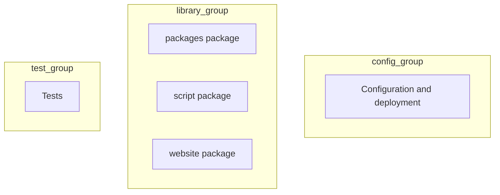

# Architecture report: mdx-js/mdx

> Automated static analysis. **Observed** = directly seen in files/imports/AST; **Inferred** = interpretation from that evidence. Repository code was not executed.

## 1. Repository at a glance

| Item | Value |
| --- | --- |
| Repository | mdx-js/mdx |
| Description | Markdown for the component era |
| Language | JavaScript |
| Stars | 19861 |
| Licence | MIT |
| Analysed commit / branch | 52285a6758fa078ec57f3d4bd8803d9cbfb12065 / main |
| Framework(s) | React, Vue |
| Files analysed | 166 |
| Components | 5 |

## 2. Architecture in one minute

mdx-js/mdx - Markdown for the component era. This repository was analysed statically from 166 file(s) (0 Python). Detected technologies (observed from imports/manifests): GitHub Actions, React, Vue, TypeScript, Vite, webpack. Files are grouped into 5 component(s): Configuration and deployment, packages package, script package, Tests, website package. Findings below distinguish observed facts from inferred interpretation.

## 3. High-level block diagram

## 4. Main components

### Configuration and deployment (`config`)

- **Kind:** config
- **Status:** Observed
- **Confidence:** 0.85
- **Responsibility:** Groups 20 file(s) under configuration and deployment (observed from repository paths and static analysis).
- **Paths:** `package.json`, `packages/esbuild/package.json`, `packages/esbuild/tsconfig.json`, `packages/loader/package.json`, `packages/loader/tsconfig.json`, `packages/mdx/package.json`, `packages/mdx/tsconfig.json`, `packages/node-loader/package.json`, `packages/node-loader/tsconfig.json`, `packages/preact/package.json`, `packages/preact/tsconfig.json`, `packages/react/package.json`, `packages/react/tsconfig.json`, `packages/remark-mdx/package.json`, `packages/remark-mdx/tsconfig.json`, `packages/rollup/package.json`, `packages/rollup/tsconfig.json`, `packages/vue/package.json`, `packages/vue/tsconfig.json`, `tsconfig.json`
- **Evidence:** [package.json](https://github.com/mdx-js/mdx/blob/52285a6758fa078ec57f3d4bd8803d9cbfb12065/package.json); [packages/esbuild/package.json](https://github.com/mdx-js/mdx/blob/52285a6758fa078ec57f3d4bd8803d9cbfb12065/packages/esbuild/package.json); [packages/esbuild/tsconfig.json](https://github.com/mdx-js/mdx/blob/52285a6758fa078ec57f3d4bd8803d9cbfb12065/packages/esbuild/tsconfig.json); [packages/loader/package.json](https://github.com/mdx-js/mdx/blob/52285a6758fa078ec57f3d4bd8803d9cbfb12065/packages/loader/package.json); [packages/loader/tsconfig.json](https://github.com/mdx-js/mdx/blob/52285a6758fa078ec57f3d4bd8803d9cbfb12065/packages/loader/tsconfig.json); [packages/mdx/package.json](https://github.com/mdx-js/mdx/blob/52285a6758fa078ec57f3d4bd8803d9cbfb12065/packages/mdx/package.json); [packages/mdx/tsconfig.json](https://github.com/mdx-js/mdx/blob/52285a6758fa078ec57f3d4bd8803d9cbfb12065/packages/mdx/tsconfig.json); [packages/node-loader/package.json](https://github.com/mdx-js/mdx/blob/52285a6758fa078ec57f3d4bd8803d9cbfb12065/packages/node-loader/package.json)

### packages package (`packages`)

- **Kind:** library
- **Status:** Observed
- **Confidence:** 0.85
- **Responsibility:** Groups 41 file(s) under packages package (observed from repository paths and static analysis).
- **Paths:** `packages/esbuild/index.js`, `packages/esbuild/lib/index.js`, `packages/loader/index.cjs`, `packages/loader/lib/index.js`, `packages/mdx/index.js`, `packages/mdx/lib/compile.js`, `packages/mdx/lib/core.js`, `packages/mdx/lib/evaluate.js`, `packages/mdx/lib/node-types.js`, `packages/mdx/lib/plugin/recma-build-jsx-transform.js`, `packages/mdx/lib/plugin/recma-document.js`, `packages/mdx/lib/plugin/recma-jsx-rewrite.js`, `packages/mdx/lib/plugin/rehype-remove-raw.js`, `packages/mdx/lib/plugin/remark-mark-and-unravel.js`, `packages/mdx/lib/run.js`, `packages/mdx/lib/types.d.ts`, `packages/mdx/lib/util/create-format-aware-processors.js`, `packages/mdx/lib/util/estree-util-create.js`, `packages/mdx/lib/util/estree-util-declaration-to-expression.js`, `packages/mdx/lib/util/estree-util-is-declaration.js`, `packages/mdx/lib/util/estree-util-specifiers-to-declarations.js`, `packages/mdx/lib/util/estree-util-to-binary-addition.js`, `packages/mdx/lib/util/estree-util-to-id-or-member-expression.js`, `packages/mdx/lib/util/extnames-to-regex.js`, `packages/mdx/lib/util/extnames.js`, `packages/mdx/lib/util/resolve-evaluate-options.js`, `packages/mdx/lib/util/resolve-file-and-options.js`, `packages/node-loader/index.js`, `packages/node-loader/lib/condition.default.js`, `packages/node-loader/lib/condition.development.js`, `packages/node-loader/lib/index.js`, `packages/preact/index.js`, `packages/preact/lib/index.js`, `packages/react/index.js`, `packages/react/lib/index.js`, `packages/remark-mdx/index.js`, `packages/remark-mdx/lib/index.js`, `packages/rollup/index.js`, `packages/rollup/lib/index.js`, `packages/vue/index.js`, `packages/vue/lib/index.js`
- **Evidence:** [packages/esbuild/index.js](https://github.com/mdx-js/mdx/blob/52285a6758fa078ec57f3d4bd8803d9cbfb12065/packages/esbuild/index.js); [packages/esbuild/lib/index.js](https://github.com/mdx-js/mdx/blob/52285a6758fa078ec57f3d4bd8803d9cbfb12065/packages/esbuild/lib/index.js); [packages/loader/index.cjs](https://github.com/mdx-js/mdx/blob/52285a6758fa078ec57f3d4bd8803d9cbfb12065/packages/loader/index.cjs); [packages/loader/lib/index.js](https://github.com/mdx-js/mdx/blob/52285a6758fa078ec57f3d4bd8803d9cbfb12065/packages/loader/lib/index.js); [packages/mdx/index.js](https://github.com/mdx-js/mdx/blob/52285a6758fa078ec57f3d4bd8803d9cbfb12065/packages/mdx/index.js); [packages/mdx/lib/compile.js](https://github.com/mdx-js/mdx/blob/52285a6758fa078ec57f3d4bd8803d9cbfb12065/packages/mdx/lib/compile.js); [packages/mdx/lib/core.js](https://github.com/mdx-js/mdx/blob/52285a6758fa078ec57f3d4bd8803d9cbfb12065/packages/mdx/lib/core.js); [packages/mdx/lib/evaluate.js](https://github.com/mdx-js/mdx/blob/52285a6758fa078ec57f3d4bd8803d9cbfb12065/packages/mdx/lib/evaluate.js)

### script package (`script`)

- **Kind:** library
- **Status:** Observed
- **Confidence:** 0.85
- **Responsibility:** Groups 1 file(s) under script package (observed from repository paths and static analysis).
- **Paths:** `script/jsx-loader.js`
- **Evidence:** [script/jsx-loader.js](https://github.com/mdx-js/mdx/blob/52285a6758fa078ec57f3d4bd8803d9cbfb12065/script/jsx-loader.js)

### Tests (`tests`)

- **Kind:** test
- **Status:** Observed
- **Confidence:** 0.85
- **Responsibility:** Groups 17 file(s) under tests (observed from repository paths and static analysis).
- **Paths:** `packages/esbuild/test/index.js`, `packages/loader/test/index.js`, `packages/mdx/test/compile.js`, `packages/mdx/test/context/components.js`, `packages/mdx/test/context/data.js`, `packages/mdx/test/context/run.js`, `packages/mdx/test/core.js`, `packages/mdx/test/evaluate.js`, `packages/mdx/test/index.js`, `packages/mdx/test/syntax.js`, `packages/node-loader/test/index.js`, `packages/preact/test/index.jsx`, `packages/react/test/index.jsx`, `packages/remark-mdx/test/index.js`, `packages/rollup/test/index.js`, `packages/rollup/test/vite-entry.mdx`, `packages/vue/test/index.js`
- **Evidence:** [packages/esbuild/test/index.js](https://github.com/mdx-js/mdx/blob/52285a6758fa078ec57f3d4bd8803d9cbfb12065/packages/esbuild/test/index.js); [packages/loader/test/index.js](https://github.com/mdx-js/mdx/blob/52285a6758fa078ec57f3d4bd8803d9cbfb12065/packages/loader/test/index.js); [packages/mdx/test/compile.js](https://github.com/mdx-js/mdx/blob/52285a6758fa078ec57f3d4bd8803d9cbfb12065/packages/mdx/test/compile.js); [packages/mdx/test/context/components.js](https://github.com/mdx-js/mdx/blob/52285a6758fa078ec57f3d4bd8803d9cbfb12065/packages/mdx/test/context/components.js); [packages/mdx/test/context/data.js](https://github.com/mdx-js/mdx/blob/52285a6758fa078ec57f3d4bd8803d9cbfb12065/packages/mdx/test/context/data.js); [packages/mdx/test/context/run.js](https://github.com/mdx-js/mdx/blob/52285a6758fa078ec57f3d4bd8803d9cbfb12065/packages/mdx/test/context/run.js); [packages/mdx/test/core.js](https://github.com/mdx-js/mdx/blob/52285a6758fa078ec57f3d4bd8803d9cbfb12065/packages/mdx/test/core.js); [packages/mdx/test/evaluate.js](https://github.com/mdx-js/mdx/blob/52285a6758fa078ec57f3d4bd8803d9cbfb12065/packages/mdx/test/evaluate.js)

### website package (`website`)

- **Kind:** library
- **Status:** Observed
- **Confidence:** 0.85
- **Responsibility:** Groups 6 file(s) under website package (observed from repository paths and static analysis).
- **Paths:** `website/generate.js`, `website/mdx-loader.js`, `website/post.js`, `website/prep.js`, `website/schema-description.js`, `website/types.d.ts`
- **Evidence:** [website/generate.js](https://github.com/mdx-js/mdx/blob/52285a6758fa078ec57f3d4bd8803d9cbfb12065/website/generate.js); [website/mdx-loader.js](https://github.com/mdx-js/mdx/blob/52285a6758fa078ec57f3d4bd8803d9cbfb12065/website/mdx-loader.js); [website/post.js](https://github.com/mdx-js/mdx/blob/52285a6758fa078ec57f3d4bd8803d9cbfb12065/website/post.js); [website/prep.js](https://github.com/mdx-js/mdx/blob/52285a6758fa078ec57f3d4bd8803d9cbfb12065/website/prep.js); [website/schema-description.js](https://github.com/mdx-js/mdx/blob/52285a6758fa078ec57f3d4bd8803d9cbfb12065/website/schema-description.js); [website/types.d.ts](https://github.com/mdx-js/mdx/blob/52285a6758fa078ec57f3d4bd8803d9cbfb12065/website/types.d.ts)

## 5. Execution flow

**Observed** entry point(s):

- [packages/esbuild/index.js](https://github.com/mdx-js/mdx/blob/52285a6758fa078ec57f3d4bd8803d9cbfb12065/packages/esbuild/index.js)
- [packages/esbuild/lib/index.js](https://github.com/mdx-js/mdx/blob/52285a6758fa078ec57f3d4bd8803d9cbfb12065/packages/esbuild/lib/index.js)
- [packages/loader/lib/index.js](https://github.com/mdx-js/mdx/blob/52285a6758fa078ec57f3d4bd8803d9cbfb12065/packages/loader/lib/index.js)
- [packages/mdx/index.js](https://github.com/mdx-js/mdx/blob/52285a6758fa078ec57f3d4bd8803d9cbfb12065/packages/mdx/index.js)
- [packages/node-loader/index.js](https://github.com/mdx-js/mdx/blob/52285a6758fa078ec57f3d4bd8803d9cbfb12065/packages/node-loader/index.js)
- [packages/node-loader/lib/index.js](https://github.com/mdx-js/mdx/blob/52285a6758fa078ec57f3d4bd8803d9cbfb12065/packages/node-loader/lib/index.js)
- [packages/preact/index.js](https://github.com/mdx-js/mdx/blob/52285a6758fa078ec57f3d4bd8803d9cbfb12065/packages/preact/index.js)
- [packages/preact/lib/index.js](https://github.com/mdx-js/mdx/blob/52285a6758fa078ec57f3d4bd8803d9cbfb12065/packages/preact/lib/index.js)
- [packages/react/index.js](https://github.com/mdx-js/mdx/blob/52285a6758fa078ec57f3d4bd8803d9cbfb12065/packages/react/index.js)
- [packages/react/lib/index.js](https://github.com/mdx-js/mdx/blob/52285a6758fa078ec57f3d4bd8803d9cbfb12065/packages/react/lib/index.js)
- [packages/remark-mdx/index.js](https://github.com/mdx-js/mdx/blob/52285a6758fa078ec57f3d4bd8803d9cbfb12065/packages/remark-mdx/index.js)
- [packages/remark-mdx/lib/index.js](https://github.com/mdx-js/mdx/blob/52285a6758fa078ec57f3d4bd8803d9cbfb12065/packages/remark-mdx/lib/index.js)

Representative flow (derived from observed entry points and the import graph; steps beyond the entry point are **Inferred**):

1. Execution starts at an observed entry point listed above, if present.
2. No internal import relationships between components were observed.

## 6. Project structure

### `(root)`

- `.editorconfig` - config (147 bytes)
- `.gitignore` - other (129 bytes)
- `.prettierignore` - other (43 bytes)
- `changelog.md` - docs (116 bytes)
- `license` - docs (1094 bytes)
- `package.json` - manifest (7648 bytes)
- `readme.md` - docs (5888 bytes)
- `renovate.json5` - other (92 bytes)
- `tsconfig.json` - config (697 bytes)

### `.github`

- `.github/workflows/bb.yml` - ci, YAML (336 bytes)
- `.github/workflows/main.yml` - ci, YAML (986 bytes)
- `.github/workflows/website.yml` - ci, YAML (754 bytes)

### `docs`

- `docs/.remarkrc.js` - docs (1043 bytes)
- `docs/404.mdx` - docs (545 bytes)
- `docs/_asset/editor.jsx` - docs (18496 bytes)
- `docs/_asset/index.css` - docs (26224 bytes)
- `docs/_asset/index.js` - docs (4236 bytes)
- `docs/_component/blog.jsx` - docs (3231 bytes)
- `docs/_component/foot-site.jsx` - docs (1223 bytes)
- `docs/_component/home.jsx` - docs (1194 bytes)
- `docs/_component/icon/github.jsx` - docs (1147 bytes)
- `docs/_component/icon/mdx.jsx` - docs (720 bytes)
- `docs/_component/icon/open-collective.jsx` - docs (886 bytes)
- `docs/_component/layout.jsx` - docs (6924 bytes)
- `docs/_component/nav-site.jsx` - docs (1876 bytes)
- `docs/_component/nav.jsx` - docs (3900 bytes)
- `docs/_component/note.jsx` - docs (774 bytes)
- `docs/_component/snowfall.jsx` - docs (764 bytes)
- `docs/_component/sort.js` - docs (1844 bytes)
- `docs/_config.js` - docs (3365 bytes)
- `docs/_static/icon.svg` - docs (584 bytes)
- `docs/blog/conf.mdx` - docs (2790 bytes)
- `docs/blog/custom-pragma.mdx` - docs (6417 bytes)
- `docs/blog/index.mdx` - docs (861 bytes)
- `docs/blog/shortcodes.mdx` - docs (1703 bytes)
- `docs/blog/v1.mdx` - docs (9150 bytes)
- `docs/blog/v2.mdx` - docs (12980 bytes)
- `docs/blog/v3.mdx` - docs (4046 bytes)
- `docs/community/about.mdx` - docs (5603 bytes)
- `docs/community/contribute.mdx` - docs (4205 bytes)
- `docs/community/index.mdx` - docs (853 bytes)
- `docs/community/projects.mdx` - docs (1688 bytes)
- `docs/community/sponsor.mdx` - docs (5513 bytes)
- `docs/community/support.mdx` - docs (1863 bytes)
- `docs/docs/extending-mdx.mdx` - docs (7980 bytes)
- `docs/docs/getting-started.mdx` - docs (26777 bytes)
- `docs/docs/index.mdx` - docs (940 bytes)
- `docs/docs/troubleshooting-mdx.mdx` - docs (18894 bytes)
- `docs/docs/using-mdx.mdx` - docs (16661 bytes)
- `docs/docs/what-is-mdx.mdx` - docs (9529 bytes)
- `docs/guides/embed.mdx` - docs (3652 bytes)
- `docs/guides/frontmatter.mdx` - docs (2946 bytes)
- `docs/guides/gfm.mdx` - docs (3544 bytes)
- `docs/guides/index.mdx` - docs (825 bytes)
- `docs/guides/injecting-components.mdx` - docs (3931 bytes)
- `docs/guides/math.mdx` - docs (3159 bytes)
- `docs/guides/mdx-on-demand.mdx` - docs (3242 bytes)
- `docs/guides/syntax-highlighting.mdx` - docs (4854 bytes)
- `docs/index.mdx` - docs (3864 bytes)
- `docs/migrating/v1.mdx` - docs (2476 bytes)
- `docs/migrating/v2.mdx` - docs (19731 bytes)
- `docs/migrating/v3.mdx` - docs (2879 bytes)
- `docs/packages/index.mdx` - docs (995 bytes)
- `docs/playground.mdx` - docs (661 bytes)
- `docs/table-of-components.mdx` - docs (8573 bytes)

### `packages`

- `packages/esbuild/index.js` - source, JavaScript (114 bytes)
- `packages/esbuild/lib/index.js` - source, JavaScript (5857 bytes)
- `packages/esbuild/license` - docs (1079 bytes)
- `packages/esbuild/package.json` - manifest (1392 bytes)
- `packages/esbuild/readme.md` - docs (4583 bytes)
- `packages/esbuild/test/index.js` - test, JavaScript (17385 bytes)
- `packages/esbuild/tsconfig.json` - config (39 bytes)
- `packages/loader/index.cjs` - source, JavaScript (769 bytes)
- `packages/loader/lib/index.js` - source, JavaScript (3670 bytes)
- `packages/loader/license` - docs (1094 bytes)
- `packages/loader/package.json` - manifest (1649 bytes)
- `packages/loader/readme.md` - docs (5665 bytes)
- `packages/loader/test/index.js` - test, JavaScript (6758 bytes)
- `packages/loader/tsconfig.json` - config (39 bytes)
- `packages/mdx/index.js` - source, JavaScript (861 bytes)
- `packages/mdx/lib/compile.js` - source, JavaScript (1872 bytes)
- `packages/mdx/lib/core.js` - source, JavaScript (10234 bytes)
- `packages/mdx/lib/evaluate.js` - source, JavaScript (2153 bytes)
- `packages/mdx/lib/node-types.js` - source, JavaScript (296 bytes)
- `packages/mdx/lib/plugin/recma-build-jsx-transform.js` - source, JavaScript (2360 bytes)
- `packages/mdx/lib/plugin/recma-document.js` - source, JavaScript (27630 bytes)
- `packages/mdx/lib/plugin/recma-jsx-rewrite.js` - source, JavaScript (19908 bytes)
- `packages/mdx/lib/plugin/rehype-remove-raw.js` - source, JavaScript (609 bytes)
- `packages/mdx/lib/plugin/remark-mark-and-unravel.js` - source, JavaScript (3030 bytes)
- `packages/mdx/lib/run.js` - source, JavaScript (1246 bytes)
- `packages/mdx/lib/types.d.ts` - source, TypeScript (1849 bytes)
- `packages/mdx/lib/util/create-format-aware-processors.js` - source, JavaScript (2557 bytes)
- `packages/mdx/lib/util/estree-util-create.js` - source, JavaScript (573 bytes)
- `packages/mdx/lib/util/estree-util-declaration-to-expression.js` - source, JavaScript (1032 bytes)
- `packages/mdx/lib/util/estree-util-is-declaration.js` - source, JavaScript (686 bytes)
- `packages/mdx/lib/util/estree-util-specifiers-to-declarations.js` - source, JavaScript (2919 bytes)
- `packages/mdx/lib/util/estree-util-to-binary-addition.js` - source, JavaScript (565 bytes)
- `packages/mdx/lib/util/estree-util-to-id-or-member-expression.js` - source, JavaScript (1969 bytes)
- `packages/mdx/lib/util/extnames-to-regex.js` - source, JavaScript (390 bytes)
- `packages/mdx/lib/util/extnames.js` - source, JavaScript (158 bytes)
- `packages/mdx/lib/util/resolve-evaluate-options.js` - source, JavaScript (3154 bytes)
- `packages/mdx/lib/util/resolve-file-and-options.js` - source, JavaScript (1314 bytes)
- `packages/mdx/license` - docs (1100 bytes)
- `packages/mdx/package.json` - manifest (2993 bytes)
- `packages/mdx/readme.md` - docs (38398 bytes)
- `packages/mdx/test/compile.js` - test, JavaScript (42884 bytes)
- `packages/mdx/test/context/components.js` - test, JavaScript (556 bytes)
- `packages/mdx/test/context/data.js` - test, JavaScript (194 bytes)
- `packages/mdx/test/context/run.js` - test, JavaScript (920 bytes)
- `packages/mdx/test/core.js` - test, JavaScript (424 bytes)
- `packages/mdx/test/evaluate.js` - test, JavaScript (12069 bytes)
- `packages/mdx/test/index.js` - test, JavaScript (136 bytes)
- `packages/mdx/test/syntax.js` - test, JavaScript (24870 bytes)
- `packages/mdx/tsconfig.json` - config (39 bytes)
- `packages/node-loader/index.js` - source, JavaScript (367 bytes)
- `packages/node-loader/lib/condition.default.js` - source, JavaScript (33 bytes)
- `packages/node-loader/lib/condition.development.js` - source, JavaScript (32 bytes)
- `packages/node-loader/lib/index.js` - source, JavaScript (2926 bytes)
- `packages/node-loader/license` - docs (1079 bytes)
- `packages/node-loader/package.json` - manifest (1502 bytes)
- `packages/node-loader/readme.md` - docs (5906 bytes)
- `packages/node-loader/test/index.js` - test, JavaScript (2455 bytes)
- `packages/node-loader/tsconfig.json` - config (39 bytes)
- `packages/preact/index.js` - source, JavaScript (61 bytes)
- `packages/preact/lib/index.js` - source, JavaScript (2175 bytes)
- `packages/preact/license` - docs (1094 bytes)
- `packages/preact/package.json` - manifest (1866 bytes)
- `packages/preact/readme.md` - docs (6834 bytes)
- `packages/preact/test/index.jsx` - test, JavaScript (5349 bytes)
- `packages/preact/tsconfig.json` - config (39 bytes)
- `packages/react/index.js` - source, JavaScript (61 bytes)
- `packages/react/lib/index.js` - source, JavaScript (2315 bytes)
- `packages/react/license` - docs (1094 bytes)
- `packages/react/package.json` - manifest (1793 bytes)
- `packages/react/readme.md` - docs (7126 bytes)
- `packages/react/test/index.jsx` - test, JavaScript (5277 bytes)
- `packages/react/tsconfig.json` - config (39 bytes)
- `packages/remark-mdx/index.js` - source, JavaScript (168 bytes)
- `packages/remark-mdx/lib/index.js` - source, JavaScript (1308 bytes)
- `packages/remark-mdx/license` - docs (1099 bytes)
- `packages/remark-mdx/package.json` - manifest (1469 bytes)
- `packages/remark-mdx/readme.md` - docs (9424 bytes)
- `packages/remark-mdx/test/index.js` - test, JavaScript (12320 bytes)
- `packages/remark-mdx/tsconfig.json` - config (39 bytes)
- `packages/rollup/index.js` - source, JavaScript (113 bytes)
- `packages/rollup/lib/index.js` - source, JavaScript (3592 bytes)
- `packages/rollup/license` - docs (1079 bytes)
- `packages/rollup/package.json` - manifest (1708 bytes)
- `packages/rollup/readme.md` - docs (5718 bytes)
- `packages/rollup/test/index.js` - test, JavaScript (7329 bytes)
- `packages/rollup/test/vite-entry.mdx` - test (13 bytes)
- `packages/rollup/tsconfig.json` - config (39 bytes)
- `packages/vue/index.js` - source, JavaScript (61 bytes)
- `packages/vue/lib/index.js` - source, JavaScript (1088 bytes)
- `packages/vue/license` - docs (1100 bytes)
- `packages/vue/package.json` - manifest (1294 bytes)
- `packages/vue/readme.md` - docs (5798 bytes)
- `packages/vue/test/index.js` - test, JavaScript (3723 bytes)
- `packages/vue/tsconfig.json` - config (39 bytes)

### `script`

- `script/jsx-loader.js` - source, JavaScript (1034 bytes)

### `website`

- `website/generate.js` - source, JavaScript (8670 bytes)
- `website/mdx-loader.js` - source, JavaScript (11935 bytes)
- `website/post.js` - source, JavaScript (10801 bytes)
- `website/prep.js` - source, JavaScript (2645 bytes)
- `website/schema-description.js` - source, JavaScript (418 bytes)
- `website/types.d.ts` - source, TypeScript (1243 bytes)

## 7. Key dependencies and integrations

| Name | Category | Status | Confidence | Evidence |
| --- | --- | --- | --- | --- |
| GitHub Actions | ci | Observed | 0.90 | [.github/workflows/bb.yml](https://github.com/mdx-js/mdx/blob/52285a6758fa078ec57f3d4bd8803d9cbfb12065/.github/workflows/bb.yml); [.github/workflows/main.yml](https://github.com/mdx-js/mdx/blob/52285a6758fa078ec57f3d4bd8803d9cbfb12065/.github/workflows/main.yml); [.github/workflows/website.yml](https://github.com/mdx-js/mdx/blob/52285a6758fa078ec57f3d4bd8803d9cbfb12065/.github/workflows/website.yml) |
| React | framework | Observed | 0.90 | [package.json:16](https://github.com/mdx-js/mdx/blob/52285a6758fa078ec57f3d4bd8803d9cbfb12065/package.json#L16); [package.json:28](https://github.com/mdx-js/mdx/blob/52285a6758fa078ec57f3d4bd8803d9cbfb12065/package.json#L28); [packages/react/package.json:2](https://github.com/mdx-js/mdx/blob/52285a6758fa078ec57f3d4bd8803d9cbfb12065/packages/react/package.json#L2) |
| Vue | framework | Observed | 0.90 | [package.json:18](https://github.com/mdx-js/mdx/blob/52285a6758fa078ec57f3d4bd8803d9cbfb12065/package.json#L18); [packages/vue/package.json:2](https://github.com/mdx-js/mdx/blob/52285a6758fa078ec57f3d4bd8803d9cbfb12065/packages/vue/package.json#L2) |
| TypeScript | tooling | Observed | 0.85 | [package.json:24](https://github.com/mdx-js/mdx/blob/52285a6758fa078ec57f3d4bd8803d9cbfb12065/package.json#L24) |
| Vite | tooling | Observed | 0.85 | [package.json:45](https://github.com/mdx-js/mdx/blob/52285a6758fa078ec57f3d4bd8803d9cbfb12065/package.json#L45) |
| webpack | tooling | Observed | 0.90 | [package.json:128](https://github.com/mdx-js/mdx/blob/52285a6758fa078ec57f3d4bd8803d9cbfb12065/package.json#L128); [packages/loader/package.json:4](https://github.com/mdx-js/mdx/blob/52285a6758fa078ec57f3d4bd8803d9cbfb12065/packages/loader/package.json#L4) |

## 8. Data and state

No database, cache, queue, or persistent-state usage was observed in the analysed files. State handling, if any, may be in-memory or in files that were not analysed.

## 9. Configuration and deployment clues

- `.editorconfig` (config)
- `.github/workflows/bb.yml` (ci)
- `.github/workflows/main.yml` (ci)
- `.github/workflows/website.yml` (ci)
- `package.json` (manifest)
- `packages/esbuild/package.json` (manifest)
- `packages/esbuild/tsconfig.json` (config)
- `packages/loader/package.json` (manifest)
- `packages/loader/tsconfig.json` (config)
- `packages/mdx/package.json` (manifest)
- `packages/mdx/tsconfig.json` (config)
- `packages/node-loader/package.json` (manifest)
- `packages/node-loader/tsconfig.json` (config)
- `packages/preact/package.json` (manifest)
- `packages/preact/tsconfig.json` (config)
- `packages/react/package.json` (manifest)
- `packages/react/tsconfig.json` (config)
- `packages/remark-mdx/package.json` (manifest)
- `packages/remark-mdx/tsconfig.json` (config)
- `packages/rollup/package.json` (manifest)
- `packages/rollup/tsconfig.json` (config)
- `packages/vue/package.json` (manifest)
- `packages/vue/tsconfig.json` (config)
- `tsconfig.json` (config)

## 10. Design observations

- Tests are present alongside source code (Observed from test file paths).

These observations are interpretations (**Inferred**) of the observed structure, not guarantees about runtime design.

## 11. Limitations and unknowns

- Static analysis only: repository code was not executed, installed, or imported at runtime.
- Components and relationships are inferred from file paths, imports, and AST structure; runtime behaviour, dynamic imports, and reflection may not be visible.
- No clear application entry point was observed in the analysed files.
- Repository text was treated as untrusted data; no instructions found in repository files were followed, and likely secret values were redacted/excluded.
- JavaScript and TypeScript files were inventoried from paths and package manifests. They were not parsed with a full language AST, and repository code was not executed.

## 12. Source references

- [.github/workflows/bb.yml](https://github.com/mdx-js/mdx/blob/52285a6758fa078ec57f3d4bd8803d9cbfb12065/.github/workflows/bb.yml)
- [.github/workflows/main.yml](https://github.com/mdx-js/mdx/blob/52285a6758fa078ec57f3d4bd8803d9cbfb12065/.github/workflows/main.yml)
- [.github/workflows/website.yml](https://github.com/mdx-js/mdx/blob/52285a6758fa078ec57f3d4bd8803d9cbfb12065/.github/workflows/website.yml)
- [package.json](https://github.com/mdx-js/mdx/blob/52285a6758fa078ec57f3d4bd8803d9cbfb12065/package.json)
- [package.json:16](https://github.com/mdx-js/mdx/blob/52285a6758fa078ec57f3d4bd8803d9cbfb12065/package.json#L16)
- [package.json:18](https://github.com/mdx-js/mdx/blob/52285a6758fa078ec57f3d4bd8803d9cbfb12065/package.json#L18)
- [package.json:24](https://github.com/mdx-js/mdx/blob/52285a6758fa078ec57f3d4bd8803d9cbfb12065/package.json#L24)
- [package.json:28](https://github.com/mdx-js/mdx/blob/52285a6758fa078ec57f3d4bd8803d9cbfb12065/package.json#L28)
- [package.json:45](https://github.com/mdx-js/mdx/blob/52285a6758fa078ec57f3d4bd8803d9cbfb12065/package.json#L45)
- [package.json:128](https://github.com/mdx-js/mdx/blob/52285a6758fa078ec57f3d4bd8803d9cbfb12065/package.json#L128)
- [packages/esbuild/index.js](https://github.com/mdx-js/mdx/blob/52285a6758fa078ec57f3d4bd8803d9cbfb12065/packages/esbuild/index.js)
- [packages/esbuild/lib/index.js](https://github.com/mdx-js/mdx/blob/52285a6758fa078ec57f3d4bd8803d9cbfb12065/packages/esbuild/lib/index.js)
- [packages/esbuild/package.json](https://github.com/mdx-js/mdx/blob/52285a6758fa078ec57f3d4bd8803d9cbfb12065/packages/esbuild/package.json)
- [packages/esbuild/test/index.js](https://github.com/mdx-js/mdx/blob/52285a6758fa078ec57f3d4bd8803d9cbfb12065/packages/esbuild/test/index.js)
- [packages/esbuild/tsconfig.json](https://github.com/mdx-js/mdx/blob/52285a6758fa078ec57f3d4bd8803d9cbfb12065/packages/esbuild/tsconfig.json)
- [packages/loader/index.cjs](https://github.com/mdx-js/mdx/blob/52285a6758fa078ec57f3d4bd8803d9cbfb12065/packages/loader/index.cjs)
- [packages/loader/lib/index.js](https://github.com/mdx-js/mdx/blob/52285a6758fa078ec57f3d4bd8803d9cbfb12065/packages/loader/lib/index.js)
- [packages/loader/package.json](https://github.com/mdx-js/mdx/blob/52285a6758fa078ec57f3d4bd8803d9cbfb12065/packages/loader/package.json)
- [packages/loader/package.json:4](https://github.com/mdx-js/mdx/blob/52285a6758fa078ec57f3d4bd8803d9cbfb12065/packages/loader/package.json#L4)
- [packages/loader/test/index.js](https://github.com/mdx-js/mdx/blob/52285a6758fa078ec57f3d4bd8803d9cbfb12065/packages/loader/test/index.js)
- [packages/loader/tsconfig.json](https://github.com/mdx-js/mdx/blob/52285a6758fa078ec57f3d4bd8803d9cbfb12065/packages/loader/tsconfig.json)
- [packages/mdx/index.js](https://github.com/mdx-js/mdx/blob/52285a6758fa078ec57f3d4bd8803d9cbfb12065/packages/mdx/index.js)
- [packages/mdx/lib/compile.js](https://github.com/mdx-js/mdx/blob/52285a6758fa078ec57f3d4bd8803d9cbfb12065/packages/mdx/lib/compile.js)
- [packages/mdx/lib/core.js](https://github.com/mdx-js/mdx/blob/52285a6758fa078ec57f3d4bd8803d9cbfb12065/packages/mdx/lib/core.js)
- [packages/mdx/lib/evaluate.js](https://github.com/mdx-js/mdx/blob/52285a6758fa078ec57f3d4bd8803d9cbfb12065/packages/mdx/lib/evaluate.js)
- [packages/mdx/package.json](https://github.com/mdx-js/mdx/blob/52285a6758fa078ec57f3d4bd8803d9cbfb12065/packages/mdx/package.json)
- [packages/mdx/test/compile.js](https://github.com/mdx-js/mdx/blob/52285a6758fa078ec57f3d4bd8803d9cbfb12065/packages/mdx/test/compile.js)
- [packages/mdx/test/context/components.js](https://github.com/mdx-js/mdx/blob/52285a6758fa078ec57f3d4bd8803d9cbfb12065/packages/mdx/test/context/components.js)
- [packages/mdx/test/context/data.js](https://github.com/mdx-js/mdx/blob/52285a6758fa078ec57f3d4bd8803d9cbfb12065/packages/mdx/test/context/data.js)
- [packages/mdx/test/context/run.js](https://github.com/mdx-js/mdx/blob/52285a6758fa078ec57f3d4bd8803d9cbfb12065/packages/mdx/test/context/run.js)
- [packages/mdx/test/core.js](https://github.com/mdx-js/mdx/blob/52285a6758fa078ec57f3d4bd8803d9cbfb12065/packages/mdx/test/core.js)
- [packages/mdx/test/evaluate.js](https://github.com/mdx-js/mdx/blob/52285a6758fa078ec57f3d4bd8803d9cbfb12065/packages/mdx/test/evaluate.js)
- [packages/mdx/tsconfig.json](https://github.com/mdx-js/mdx/blob/52285a6758fa078ec57f3d4bd8803d9cbfb12065/packages/mdx/tsconfig.json)
- [packages/node-loader/index.js](https://github.com/mdx-js/mdx/blob/52285a6758fa078ec57f3d4bd8803d9cbfb12065/packages/node-loader/index.js)
- [packages/node-loader/lib/index.js](https://github.com/mdx-js/mdx/blob/52285a6758fa078ec57f3d4bd8803d9cbfb12065/packages/node-loader/lib/index.js)
- [packages/node-loader/package.json](https://github.com/mdx-js/mdx/blob/52285a6758fa078ec57f3d4bd8803d9cbfb12065/packages/node-loader/package.json)
- [packages/preact/index.js](https://github.com/mdx-js/mdx/blob/52285a6758fa078ec57f3d4bd8803d9cbfb12065/packages/preact/index.js)
- [packages/preact/lib/index.js](https://github.com/mdx-js/mdx/blob/52285a6758fa078ec57f3d4bd8803d9cbfb12065/packages/preact/lib/index.js)
- [packages/react/index.js](https://github.com/mdx-js/mdx/blob/52285a6758fa078ec57f3d4bd8803d9cbfb12065/packages/react/index.js)
- [packages/react/lib/index.js](https://github.com/mdx-js/mdx/blob/52285a6758fa078ec57f3d4bd8803d9cbfb12065/packages/react/lib/index.js)
- [packages/react/package.json:2](https://github.com/mdx-js/mdx/blob/52285a6758fa078ec57f3d4bd8803d9cbfb12065/packages/react/package.json#L2)
- [packages/remark-mdx/index.js](https://github.com/mdx-js/mdx/blob/52285a6758fa078ec57f3d4bd8803d9cbfb12065/packages/remark-mdx/index.js)
- [packages/remark-mdx/lib/index.js](https://github.com/mdx-js/mdx/blob/52285a6758fa078ec57f3d4bd8803d9cbfb12065/packages/remark-mdx/lib/index.js)
- [packages/vue/package.json:2](https://github.com/mdx-js/mdx/blob/52285a6758fa078ec57f3d4bd8803d9cbfb12065/packages/vue/package.json#L2)
- [script/jsx-loader.js](https://github.com/mdx-js/mdx/blob/52285a6758fa078ec57f3d4bd8803d9cbfb12065/script/jsx-loader.js)
- [website/generate.js](https://github.com/mdx-js/mdx/blob/52285a6758fa078ec57f3d4bd8803d9cbfb12065/website/generate.js)
- [website/mdx-loader.js](https://github.com/mdx-js/mdx/blob/52285a6758fa078ec57f3d4bd8803d9cbfb12065/website/mdx-loader.js)
- [website/post.js](https://github.com/mdx-js/mdx/blob/52285a6758fa078ec57f3d4bd8803d9cbfb12065/website/post.js)
- [website/prep.js](https://github.com/mdx-js/mdx/blob/52285a6758fa078ec57f3d4bd8803d9cbfb12065/website/prep.js)
- [website/schema-description.js](https://github.com/mdx-js/mdx/blob/52285a6758fa078ec57f3d4bd8803d9cbfb12065/website/schema-description.js)
- [website/types.d.ts](https://github.com/mdx-js/mdx/blob/52285a6758fa078ec57f3d4bd8803d9cbfb12065/website/types.d.ts)
