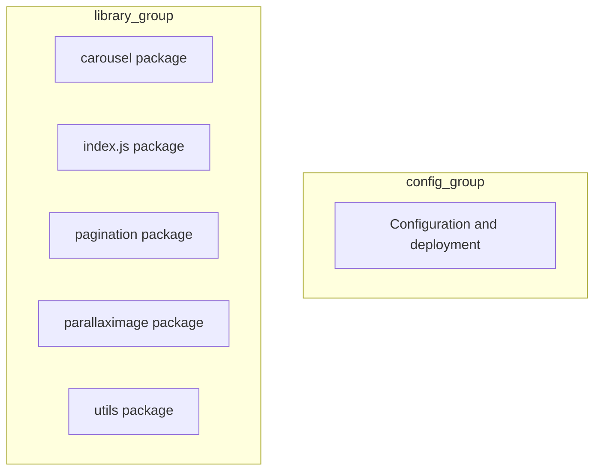

# Architecture report: meliorence/react-native-snap-carousel

> Automated static analysis. **Observed** = directly seen in files/imports/AST; **Inferred** = interpretation from that evidence. Repository code was not executed.

## 1. Repository at a glance

| Item | Value |
| --- | --- |
| Repository | meliorence/react-native-snap-carousel |
| Description | Swiper/carousel component for React Native featuring previews, multiple layouts, parallax images, performant handling of huge numbers of items, and more. Compatible with Android & iOS. |
| Language | JavaScript |
| Stars | 10486 |
| Licence | BSD-3-Clause |
| Analysed commit / branch | 9c39995f4813f0e8ee1be7797512f4e89708167f / master |
| Framework(s) | React |
| Files analysed | 78 |
| Components | 6 |

## 2. Architecture in one minute

meliorence/react-native-snap-carousel - Swiper/carousel component for React Native featuring previews, multiple layouts, parallax images, performant handling of huge numbers of items, and more. Compatible with Android & iOS.. This repository was analysed statically from 78 file(s) (0 Python). Detected technologies (observed from imports/manifests): React, Jest. Files are grouped into 6 component(s): carousel package, Configuration and deployment, index.js package, pagination package, parallaximage package, utils package. Findings below distinguish observed facts from inferred interpretation.

## 3. High-level block diagram

## 4. Main components

### carousel package (`carousel`)

- **Kind:** library
- **Status:** Observed
- **Confidence:** 0.85
- **Responsibility:** Groups 1 file(s) under carousel package (observed from repository paths and static analysis).
- **Paths:** `src/carousel/Carousel.js`
- **Evidence:** [src/carousel/Carousel.js](https://github.com/meliorence/react-native-snap-carousel/blob/9c39995f4813f0e8ee1be7797512f4e89708167f/src/carousel/Carousel.js)

### Configuration and deployment (`config`)

- **Kind:** config
- **Status:** Observed
- **Confidence:** 0.85
- **Responsibility:** Groups 1 file(s) under configuration and deployment (observed from repository paths and static analysis).
- **Paths:** `package.json`
- **Evidence:** [package.json](https://github.com/meliorence/react-native-snap-carousel/blob/9c39995f4813f0e8ee1be7797512f4e89708167f/package.json)

### index.js package (`index_js`)

- **Kind:** library
- **Status:** Observed
- **Confidence:** 0.85
- **Responsibility:** Groups 1 file(s) under index.js package (observed from repository paths and static analysis).
- **Paths:** `src/index.js`
- **Evidence:** [src/index.js](https://github.com/meliorence/react-native-snap-carousel/blob/9c39995f4813f0e8ee1be7797512f4e89708167f/src/index.js)

### pagination package (`pagination`)

- **Kind:** library
- **Status:** Observed
- **Confidence:** 0.85
- **Responsibility:** Groups 3 file(s) under pagination package (observed from repository paths and static analysis).
- **Paths:** `src/pagination/Pagination.js`, `src/pagination/Pagination.style.js`, `src/pagination/PaginationDot.js`
- **Evidence:** [src/pagination/Pagination.js](https://github.com/meliorence/react-native-snap-carousel/blob/9c39995f4813f0e8ee1be7797512f4e89708167f/src/pagination/Pagination.js); [src/pagination/Pagination.style.js](https://github.com/meliorence/react-native-snap-carousel/blob/9c39995f4813f0e8ee1be7797512f4e89708167f/src/pagination/Pagination.style.js); [src/pagination/PaginationDot.js](https://github.com/meliorence/react-native-snap-carousel/blob/9c39995f4813f0e8ee1be7797512f4e89708167f/src/pagination/PaginationDot.js)

### parallaximage package (`parallaximage`)

- **Kind:** library
- **Status:** Observed
- **Confidence:** 0.85
- **Responsibility:** Groups 2 file(s) under parallaximage package (observed from repository paths and static analysis).
- **Paths:** `src/parallaximage/ParallaxImage.js`, `src/parallaximage/ParallaxImage.style.js`
- **Evidence:** [src/parallaximage/ParallaxImage.js](https://github.com/meliorence/react-native-snap-carousel/blob/9c39995f4813f0e8ee1be7797512f4e89708167f/src/parallaximage/ParallaxImage.js); [src/parallaximage/ParallaxImage.style.js](https://github.com/meliorence/react-native-snap-carousel/blob/9c39995f4813f0e8ee1be7797512f4e89708167f/src/parallaximage/ParallaxImage.style.js)

### utils package (`utils`)

- **Kind:** library
- **Status:** Observed
- **Confidence:** 0.85
- **Responsibility:** Groups 1 file(s) under utils package (observed from repository paths and static analysis).
- **Paths:** `src/utils/animations.js`
- **Evidence:** [src/utils/animations.js](https://github.com/meliorence/react-native-snap-carousel/blob/9c39995f4813f0e8ee1be7797512f4e89708167f/src/utils/animations.js)

## 5. Execution flow

**Observed** entry point(s):

- [src/index.js](https://github.com/meliorence/react-native-snap-carousel/blob/9c39995f4813f0e8ee1be7797512f4e89708167f/src/index.js)

Representative flow (derived from observed entry points and the import graph; steps beyond the entry point are **Inferred**):

1. Execution starts at an observed entry point listed above, if present.
2. No internal import relationships between components were observed.

## 6. Project structure

### `(root)`

- `.eslintrc` - other (949 bytes)
- `.gitignore` - other (47 bytes)
- `.npmignore` - other (51 bytes)
- `CHANGELOG.md` - docs (16401 bytes)
- `CONTRIBUTING.md` - docs (2174 bytes)
- `ISSUE_TEMPLATE.md` - docs (5476 bytes)
- `LICENSE` - docs (1510 bytes)
- `PULL_REQUEST_TEMPLATE.md` - docs (1898 bytes)
- `README.md` - docs (12892 bytes)
- `package.json` - manifest (1821 bytes)

### `doc`

- `doc/CUSTOM_INTERPOLATIONS.md` - docs (16746 bytes)
- `doc/KNOWN_ISSUES.md` - docs (8124 bytes)
- `doc/PAGINATION.md` - docs (5938 bytes)
- `doc/PARALLAX_IMAGE.md` - docs (6100 bytes)
- `doc/PROPS_METHODS_AND_GETTERS.md` - docs (14003 bytes)
- `doc/TIPS_AND_TRICKS.md` - docs (15020 bytes)
- `doc/VERSION_4.md` - docs (4706 bytes)

### `example`

- `example/.buckconfig` - other (114 bytes)
- `example/.flowconfig` - other (2113 bytes)
- `example/.gitattributes` - other (16 bytes)
- `example/.gitignore` - other (813 bytes)
- `example/.prettierrc.js` - source, JavaScript (120 bytes)
- `example/.watchmanconfig` - other (2 bytes)
- `example/__tests__/index.js` - source, JavaScript (274 bytes)
- `example/android/.project` - other (433 bytes)
- `example/android/.settings/org.eclipse.buildship.core.prefs` - other (54 bytes)
- `example/android/app/_BUCK` - other (1308 bytes)
- `example/android/app/build.gradle` - manifest (7952 bytes)
- `example/android/app/build_defs.bzl` - other (602 bytes)
- `example/android/app/proguard-rules.pro` - other (435 bytes)
- `example/android/app/src/debug/AndroidManifest.xml` - other (368 bytes)
- `example/android/app/src/main/AndroidManifest.xml` - other (969 bytes)
- `example/android/app/src/main/java/com/example/MainActivity.java` - source, Java (341 bytes)
- `example/android/app/src/main/java/com/example/MainApplication.java` - source, Java (2274 bytes)
- `example/android/app/src/main/res/values/strings.xml` - other (70 bytes)
- `example/android/app/src/main/res/values/styles.xml` - other (246 bytes)
- `example/android/build.gradle` - manifest (999 bytes)
- `example/android/gradle.properties` - other (910 bytes)
- `example/android/gradle/wrapper/gradle-wrapper.properties` - other (200 bytes)
- `example/android/gradlew` - other (5916 bytes)
- `example/android/gradlew.bat` - other (2941 bytes)
- `example/android/settings.gradle` - other (191 bytes)
- `example/app.json` - config (51 bytes)
- `example/babel.config.js` - source, JavaScript (77 bytes)
- `example/index.js` - source, JavaScript (183 bytes)
- `example/ios/Podfile` - other (2767 bytes)
- `example/ios/Podfile.lock` - other (12446 bytes)
- `example/ios/example-tvOS/Info.plist` - other (1489 bytes)
- `example/ios/example-tvOSTests/Info.plist` - other (765 bytes)
- `example/ios/example.xcodeproj/project.pbxproj` - other (39969 bytes)
- `example/ios/example.xcodeproj/xcshareddata/xcschemes/example-tvOS.xcscheme` - other (4986 bytes)
- `example/ios/example.xcodeproj/xcshareddata/xcschemes/example.xcscheme` - other (4921 bytes)
- `example/ios/example.xcworkspace/contents.xcworkspacedata` - other (225 bytes)
- `example/ios/example/AppDelegate.h` - source, C/C++ (386 bytes)
- `example/ios/example/AppDelegate.m` - other (1412 bytes)
- `example/ios/example/Base.lproj/LaunchScreen.xib` - other (3710 bytes)
- `example/ios/example/Images.xcassets/AppIcon.appiconset/Contents.json` - config (585 bytes)
- `example/ios/example/Images.xcassets/Contents.json` - config (63 bytes)
- `example/ios/example/Info.plist` - other (1599 bytes)
- `example/ios/example/main.m` - other (390 bytes)
- `example/ios/exampleTests/Info.plist` - other (733 bytes)
- `example/ios/exampleTests/exampleTests.m` - other (1975 bytes)
- `example/metro.config.js` - source, JavaScript (300 bytes)
- `example/package.json` - manifest (659 bytes)
- `example/src/components/SliderEntry.js` - source, JavaScript (2455 bytes)
- `example/src/index.js` - source, JavaScript (8372 bytes)
- `example/src/static/entries.js` - source, JavaScript (2116 bytes)
- `example/src/styles/SliderEntry.style.js` - source, JavaScript (2758 bytes)
- `example/src/styles/index.style.js` - source, JavaScript (1545 bytes)
- `example/src/utils/animations.js` - source, JavaScript (5758 bytes)

### `src`

- `src/carousel/Carousel.js` - source, JavaScript (48503 bytes)
- `src/index.js` - source, JavaScript (302 bytes)
- `src/pagination/Pagination.js` - source, JavaScript (5545 bytes)
- `src/pagination/Pagination.style.js` - source, JavaScript (637 bytes)
- `src/pagination/PaginationDot.js` - source, JavaScript (4767 bytes)
- `src/parallaximage/ParallaxImage.js` - source, JavaScript (7001 bytes)
- `src/parallaximage/ParallaxImage.style.js` - source, JavaScript (453 bytes)
- `src/utils/animations.js` - source, JavaScript (11915 bytes)

## 7. Key dependencies and integrations

| Name | Category | Status | Confidence | Evidence |
| --- | --- | --- | --- | --- |
| React | framework | Observed | 0.90 | [example/package.json:6](https://github.com/meliorence/react-native-snap-carousel/blob/9c39995f4813f0e8ee1be7797512f4e89708167f/example/package.json#L6); [package.json:2](https://github.com/meliorence/react-native-snap-carousel/blob/9c39995f4813f0e8ee1be7797512f4e89708167f/package.json#L2) |
| Jest | tooling | Observed | 0.85 | [example/package.json:9](https://github.com/meliorence/react-native-snap-carousel/blob/9c39995f4813f0e8ee1be7797512f4e89708167f/example/package.json#L9) |

## 8. Data and state

No database, cache, queue, or persistent-state usage was observed in the analysed files. State handling, if any, may be in-memory or in files that were not analysed.

## 9. Configuration and deployment clues

- `example/android/app/build.gradle` (manifest)
- `example/android/build.gradle` (manifest)
- `example/app.json` (config)
- `example/ios/example/Images.xcassets/AppIcon.appiconset/Contents.json` (config)
- `example/ios/example/Images.xcassets/Contents.json` (config)
- `example/package.json` (manifest)
- `package.json` (manifest)

## 10. Design observations

- No strong design patterns could be established from the available evidence.

These observations are interpretations (**Inferred**) of the observed structure, not guarantees about runtime design.

## 11. Limitations and unknowns

- Static analysis only: repository code was not executed, installed, or imported at runtime.
- Components and relationships are inferred from file paths, imports, and AST structure; runtime behaviour, dynamic imports, and reflection may not be visible.
- No clear application entry point was observed in the analysed files.
- Repository text was treated as untrusted data; no instructions found in repository files were followed, and likely secret values were redacted/excluded.
- JavaScript and TypeScript files were inventoried from paths and package manifests. They were not parsed with a full language AST, and repository code was not executed.

## 12. Source references

- [example/package.json:6](https://github.com/meliorence/react-native-snap-carousel/blob/9c39995f4813f0e8ee1be7797512f4e89708167f/example/package.json#L6)
- [example/package.json:9](https://github.com/meliorence/react-native-snap-carousel/blob/9c39995f4813f0e8ee1be7797512f4e89708167f/example/package.json#L9)
- [package.json](https://github.com/meliorence/react-native-snap-carousel/blob/9c39995f4813f0e8ee1be7797512f4e89708167f/package.json)
- [package.json:2](https://github.com/meliorence/react-native-snap-carousel/blob/9c39995f4813f0e8ee1be7797512f4e89708167f/package.json#L2)
- [src/carousel/Carousel.js](https://github.com/meliorence/react-native-snap-carousel/blob/9c39995f4813f0e8ee1be7797512f4e89708167f/src/carousel/Carousel.js)
- [src/index.js](https://github.com/meliorence/react-native-snap-carousel/blob/9c39995f4813f0e8ee1be7797512f4e89708167f/src/index.js)
- [src/pagination/Pagination.js](https://github.com/meliorence/react-native-snap-carousel/blob/9c39995f4813f0e8ee1be7797512f4e89708167f/src/pagination/Pagination.js)
- [src/pagination/Pagination.style.js](https://github.com/meliorence/react-native-snap-carousel/blob/9c39995f4813f0e8ee1be7797512f4e89708167f/src/pagination/Pagination.style.js)
- [src/pagination/PaginationDot.js](https://github.com/meliorence/react-native-snap-carousel/blob/9c39995f4813f0e8ee1be7797512f4e89708167f/src/pagination/PaginationDot.js)
- [src/parallaximage/ParallaxImage.js](https://github.com/meliorence/react-native-snap-carousel/blob/9c39995f4813f0e8ee1be7797512f4e89708167f/src/parallaximage/ParallaxImage.js)
- [src/parallaximage/ParallaxImage.style.js](https://github.com/meliorence/react-native-snap-carousel/blob/9c39995f4813f0e8ee1be7797512f4e89708167f/src/parallaximage/ParallaxImage.style.js)
- [src/utils/animations.js](https://github.com/meliorence/react-native-snap-carousel/blob/9c39995f4813f0e8ee1be7797512f4e89708167f/src/utils/animations.js)
