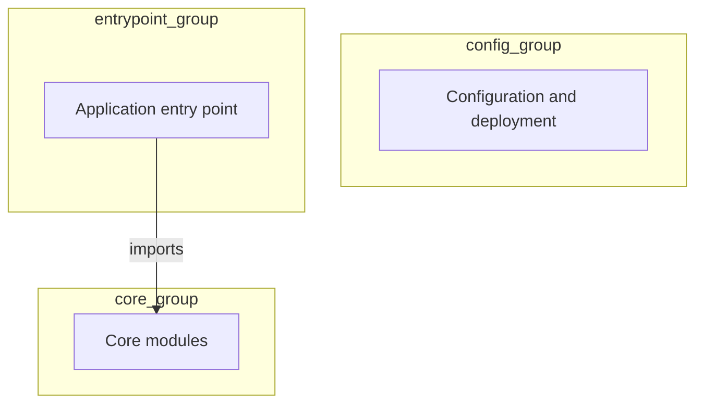

# Architecture report: menzi11/BullshitGenerator

> Automated static analysis. **Observed** = directly seen in files/imports/AST; **Inferred** = interpretation from that evidence. Repository code was not executed.

## 1. Repository at a glance

| Item | Value |
| --- | --- |
| Repository | menzi11/BullshitGenerator |
| Description |  Needs to generate some texts to test if my GUI rendering codes good or not. so I made this. |
| Language | JavaScript |
| Stars | 15499 |
| Licence | Other |
| Analysed commit / branch | e783aa0aa6cc4d1e00ba5369515ff787f72b7601 / master |
| Framework(s) | None detected |
| Files analysed | 10 |
| Components | 3 |

## 2. Architecture in one minute

menzi11/BullshitGenerator -  Needs to generate some texts to test if my GUI rendering codes good or not. so I made this.. This repository was analysed statically from 10 file(s) (2 Python). Detected technologies (observed from imports/manifests): no known frameworks/libraries. Files are grouped into 3 component(s): Configuration and deployment, Core modules, Application entry point. Observed entry point(s): 自动狗屁不通文章生成器.py. Findings below distinguish observed facts from inferred interpretation.

## 3. High-level block diagram

## 4. Main components

### Configuration and deployment (`config`)

- **Kind:** config
- **Status:** Observed
- **Confidence:** 0.85
- **Responsibility:** Groups 1 file(s) under configuration and deployment (observed from repository paths and static analysis).
- **Paths:** `data.json`
- **Evidence:** [data.json](https://github.com/menzi11/BullshitGenerator/blob/e783aa0aa6cc4d1e00ba5369515ff787f72b7601/data.json)

### Core modules (`core`)

- **Kind:** core
- **Status:** Observed
- **Confidence:** 0.85
- **Responsibility:** Groups 3 file(s) under core modules (observed from repository paths and static analysis). Observed top-level functions: 读JSON文件.
- **Paths:** `index.js`, `readJSON.js`, `readJSON.py`
- **Evidence:** [index.js](https://github.com/menzi11/BullshitGenerator/blob/e783aa0aa6cc4d1e00ba5369515ff787f72b7601/index.js); [readJSON.js](https://github.com/menzi11/BullshitGenerator/blob/e783aa0aa6cc4d1e00ba5369515ff787f72b7601/readJSON.js); [readJSON.py:6](https://github.com/menzi11/BullshitGenerator/blob/e783aa0aa6cc4d1e00ba5369515ff787f72b7601/readJSON.py#L6)

### Application entry point (`entrypoint`)

- **Kind:** entrypoint
- **Status:** Observed
- **Confidence:** 0.85
- **Responsibility:** Groups 1 file(s) under application entry point (observed from repository paths and static analysis). Observed top-level functions: 另起一段, 来点名人名言, 洗牌遍历.
- **Paths:** `自动狗屁不通文章生成器.py`
- **Evidence:** [自动狗屁不通文章生成器.py:17](https://github.com/menzi11/BullshitGenerator/blob/e783aa0aa6cc4d1e00ba5369515ff787f72b7601/%E8%87%AA%E5%8A%A8%E7%8B%97%E5%B1%81%E4%B8%8D%E9%80%9A%E6%96%87%E7%AB%A0%E7%94%9F%E6%88%90%E5%99%A8.py#L17)

## 5. Execution flow

**Observed** entry point(s):

- [index.js](https://github.com/menzi11/BullshitGenerator/blob/e783aa0aa6cc4d1e00ba5369515ff787f72b7601/index.js)
- [自动狗屁不通文章生成器.py:41](https://github.com/menzi11/BullshitGenerator/blob/e783aa0aa6cc4d1e00ba5369515ff787f72b7601/%E8%87%AA%E5%8A%A8%E7%8B%97%E5%B1%81%E4%B8%8D%E9%80%9A%E6%96%87%E7%AB%A0%E7%94%9F%E6%88%90%E5%99%A8.py#L41)

Representative flow (derived from observed entry points and the import graph; steps beyond the entry point are **Inferred**):

1. Execution starts at an observed entry point listed above, if present.
2. `entrypoint` imports `core` (Application entry point -> Core modules).

## 6. Project structure

### `(root)`

- `.gitignore` - other (1241 bytes)
- `LICENSE` - docs (2586 bytes)
- `LICENSE_CN` - other (2010 bytes)
- `README.md` - docs (1836 bytes)
- `data.json` - config (11833 bytes)
- `index.html` - other (15852 bytes)
- `index.js` - source, JavaScript (15494 bytes)
- `readJSON.js` - source, JavaScript (451 bytes)
- `readJSON.py` - source, Python (419 bytes)
- `自动狗屁不通文章生成器.py` - source, Python (1441 bytes)

## 7. Key dependencies and integrations

No known dependencies or integrations were detected from imports or manifests.

## 8. Data and state

No database, cache, queue, or persistent-state usage was observed in the analysed files. State handling, if any, may be in-memory or in files that were not analysed.

## 9. Configuration and deployment clues

- `data.json` (config)

## 10. Design observations

- An entry/API layer is separated from other code (Inferred from paths and decorators).

These observations are interpretations (**Inferred**) of the observed structure, not guarantees about runtime design.

## 11. Limitations and unknowns

- Static analysis only: repository code was not executed, installed, or imported at runtime.
- Components and relationships are inferred from file paths, imports, and AST structure; runtime behaviour, dynamic imports, and reflection may not be visible.
- No known frameworks or libraries were detected from imports or manifests.
- Repository text was treated as untrusted data; no instructions found in repository files were followed, and likely secret values were redacted/excluded.

## 12. Source references

- [data.json](https://github.com/menzi11/BullshitGenerator/blob/e783aa0aa6cc4d1e00ba5369515ff787f72b7601/data.json)
- [index.js](https://github.com/menzi11/BullshitGenerator/blob/e783aa0aa6cc4d1e00ba5369515ff787f72b7601/index.js)
- [readJSON.js](https://github.com/menzi11/BullshitGenerator/blob/e783aa0aa6cc4d1e00ba5369515ff787f72b7601/readJSON.js)
- [readJSON.py:6](https://github.com/menzi11/BullshitGenerator/blob/e783aa0aa6cc4d1e00ba5369515ff787f72b7601/readJSON.py#L6)
- [自动狗屁不通文章生成器.py:17](https://github.com/menzi11/BullshitGenerator/blob/e783aa0aa6cc4d1e00ba5369515ff787f72b7601/%E8%87%AA%E5%8A%A8%E7%8B%97%E5%B1%81%E4%B8%8D%E9%80%9A%E6%96%87%E7%AB%A0%E7%94%9F%E6%88%90%E5%99%A8.py#L17)
- [自动狗屁不通文章生成器.py:41](https://github.com/menzi11/BullshitGenerator/blob/e783aa0aa6cc4d1e00ba5369515ff787f72b7601/%E8%87%AA%E5%8A%A8%E7%8B%97%E5%B1%81%E4%B8%8D%E9%80%9A%E6%96%87%E7%AB%A0%E7%94%9F%E6%88%90%E5%99%A8.py#L41)
