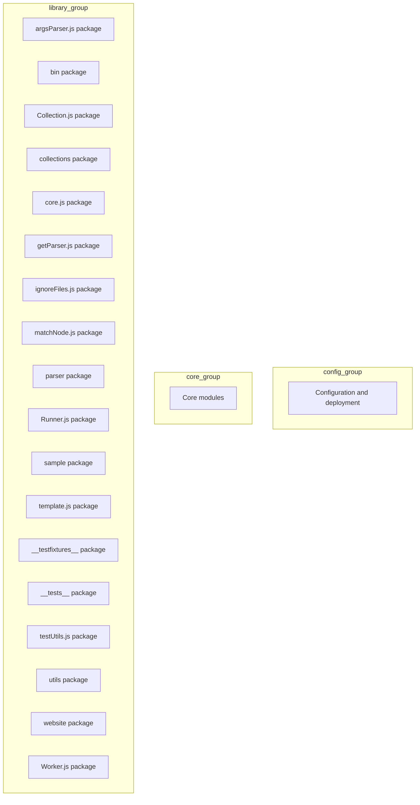

# Architecture report: meta/jscodeshift

> Automated static analysis. **Observed** = directly seen in files/imports/AST; **Inferred** = interpretation from that evidence. Repository code was not executed.

## 1. Repository at a glance

| Item | Value |
| --- | --- |
| Repository | meta/jscodeshift |
| Description | A JavaScript codemod toolkit. |
| Language | JavaScript |
| Stars | 10048 |
| Licence | MIT |
| Analysed commit / branch | 938bc3c355dd77fd3cc8063c8615ee0f9caeed89 / main |
| Framework(s) | None detected |
| Files analysed | 102 |
| Components | 20 |

## 2. Architecture in one minute

meta/jscodeshift - A JavaScript codemod toolkit.. This repository was analysed statically from 102 file(s) (0 Python). Detected technologies (observed from imports/manifests): GitHub Actions, Jest. Files are grouped into 20 component(s): argsParser.js package, bin package, Collection.js package, collections package, Configuration and deployment, Core modules, core.js package, getParser.js package. Findings below distinguish observed facts from inferred interpretation.

## 3. High-level block diagram

## 4. Main components

### argsParser.js package (`argsparser_js`)

- **Kind:** library
- **Status:** Observed
- **Confidence:** 0.85
- **Responsibility:** Groups 1 file(s) under argsparser.js package (observed from repository paths and static analysis).
- **Paths:** `src/argsParser.js`
- **Evidence:** [src/argsParser.js](https://github.com/meta/jscodeshift/blob/938bc3c355dd77fd3cc8063c8615ee0f9caeed89/src/argsParser.js)

### bin package (`bin`)

- **Kind:** library
- **Status:** Observed
- **Confidence:** 0.85
- **Responsibility:** Groups 3 file(s) under bin package (observed from repository paths and static analysis).
- **Paths:** `bin/__tests__/jscodeshift-test.js`, `bin/jscodeshift.js`, `bin/jscodeshift.sh`
- **Evidence:** [bin/__tests__/jscodeshift-test.js](https://github.com/meta/jscodeshift/blob/938bc3c355dd77fd3cc8063c8615ee0f9caeed89/bin/__tests__/jscodeshift-test.js); [bin/jscodeshift.js](https://github.com/meta/jscodeshift/blob/938bc3c355dd77fd3cc8063c8615ee0f9caeed89/bin/jscodeshift.js); [bin/jscodeshift.sh](https://github.com/meta/jscodeshift/blob/938bc3c355dd77fd3cc8063c8615ee0f9caeed89/bin/jscodeshift.sh)

### Collection.js package (`collection_js`)

- **Kind:** library
- **Status:** Observed
- **Confidence:** 0.85
- **Responsibility:** Groups 1 file(s) under collection.js package (observed from repository paths and static analysis).
- **Paths:** `src/Collection.js`
- **Evidence:** [src/Collection.js](https://github.com/meta/jscodeshift/blob/938bc3c355dd77fd3cc8063c8615ee0f9caeed89/src/Collection.js)

### collections package (`collections`)

- **Kind:** library
- **Status:** Observed
- **Confidence:** 0.85
- **Responsibility:** Groups 9 file(s) under collections package (observed from repository paths and static analysis).
- **Paths:** `src/collections/ImportDeclaration.js`, `src/collections/JSXElement.js`, `src/collections/Node.js`, `src/collections/VariableDeclarator.js`, `src/collections/__tests__/ImportDeclaration-test.js`, `src/collections/__tests__/JSXElement-test.js`, `src/collections/__tests__/Node-test.js`, `src/collections/__tests__/VariableDeclarator-test.js`, `src/collections/index.js`
- **Evidence:** [src/collections/ImportDeclaration.js](https://github.com/meta/jscodeshift/blob/938bc3c355dd77fd3cc8063c8615ee0f9caeed89/src/collections/ImportDeclaration.js); [src/collections/JSXElement.js](https://github.com/meta/jscodeshift/blob/938bc3c355dd77fd3cc8063c8615ee0f9caeed89/src/collections/JSXElement.js); [src/collections/Node.js](https://github.com/meta/jscodeshift/blob/938bc3c355dd77fd3cc8063c8615ee0f9caeed89/src/collections/Node.js); [src/collections/VariableDeclarator.js](https://github.com/meta/jscodeshift/blob/938bc3c355dd77fd3cc8063c8615ee0f9caeed89/src/collections/VariableDeclarator.js); [src/collections/__tests__/ImportDeclaration-test.js](https://github.com/meta/jscodeshift/blob/938bc3c355dd77fd3cc8063c8615ee0f9caeed89/src/collections/__tests__/ImportDeclaration-test.js); [src/collections/__tests__/JSXElement-test.js](https://github.com/meta/jscodeshift/blob/938bc3c355dd77fd3cc8063c8615ee0f9caeed89/src/collections/__tests__/JSXElement-test.js); [src/collections/__tests__/Node-test.js](https://github.com/meta/jscodeshift/blob/938bc3c355dd77fd3cc8063c8615ee0f9caeed89/src/collections/__tests__/Node-test.js); [src/collections/__tests__/VariableDeclarator-test.js](https://github.com/meta/jscodeshift/blob/938bc3c355dd77fd3cc8063c8615ee0f9caeed89/src/collections/__tests__/VariableDeclarator-test.js)

### Configuration and deployment (`config`)

- **Kind:** config
- **Status:** Observed
- **Confidence:** 0.85
- **Responsibility:** Groups 4 file(s) under configuration and deployment (observed from repository paths and static analysis).
- **Paths:** `package.json`, `website/.astro/settings.json`, `website/package.json`, `website/tsconfig.json`
- **Evidence:** [package.json](https://github.com/meta/jscodeshift/blob/938bc3c355dd77fd3cc8063c8615ee0f9caeed89/package.json); [website/.astro/settings.json](https://github.com/meta/jscodeshift/blob/938bc3c355dd77fd3cc8063c8615ee0f9caeed89/website/.astro/settings.json); [website/package.json](https://github.com/meta/jscodeshift/blob/938bc3c355dd77fd3cc8063c8615ee0f9caeed89/website/package.json); [website/tsconfig.json](https://github.com/meta/jscodeshift/blob/938bc3c355dd77fd3cc8063c8615ee0f9caeed89/website/tsconfig.json)

### Core modules (`core`)

- **Kind:** core
- **Status:** Observed
- **Confidence:** 0.85
- **Responsibility:** Groups 1 file(s) under core modules (observed from repository paths and static analysis).
- **Paths:** `index.js`
- **Evidence:** [index.js](https://github.com/meta/jscodeshift/blob/938bc3c355dd77fd3cc8063c8615ee0f9caeed89/index.js)

### core.js package (`core_js`)

- **Kind:** library
- **Status:** Observed
- **Confidence:** 0.85
- **Responsibility:** Groups 1 file(s) under core.js package (observed from repository paths and static analysis).
- **Paths:** `src/core.js`
- **Evidence:** [src/core.js](https://github.com/meta/jscodeshift/blob/938bc3c355dd77fd3cc8063c8615ee0f9caeed89/src/core.js)

### getParser.js package (`getparser_js`)

- **Kind:** library
- **Status:** Observed
- **Confidence:** 0.85
- **Responsibility:** Groups 1 file(s) under getparser.js package (observed from repository paths and static analysis).
- **Paths:** `src/getParser.js`
- **Evidence:** [src/getParser.js](https://github.com/meta/jscodeshift/blob/938bc3c355dd77fd3cc8063c8615ee0f9caeed89/src/getParser.js)

### ignoreFiles.js package (`ignorefiles_js`)

- **Kind:** library
- **Status:** Observed
- **Confidence:** 0.85
- **Responsibility:** Groups 1 file(s) under ignorefiles.js package (observed from repository paths and static analysis).
- **Paths:** `src/ignoreFiles.js`
- **Evidence:** [src/ignoreFiles.js](https://github.com/meta/jscodeshift/blob/938bc3c355dd77fd3cc8063c8615ee0f9caeed89/src/ignoreFiles.js)

### matchNode.js package (`matchnode_js`)

- **Kind:** library
- **Status:** Observed
- **Confidence:** 0.85
- **Responsibility:** Groups 1 file(s) under matchnode.js package (observed from repository paths and static analysis).
- **Paths:** `src/matchNode.js`
- **Evidence:** [src/matchNode.js](https://github.com/meta/jscodeshift/blob/938bc3c355dd77fd3cc8063c8615ee0f9caeed89/src/matchNode.js)

### parser package (`parser`)

- **Kind:** library
- **Status:** Observed
- **Confidence:** 0.85
- **Responsibility:** Groups 7 file(s) under parser package (observed from repository paths and static analysis).
- **Paths:** `parser/__tests__/tsx-test.js`, `parser/babel5Compat.js`, `parser/babylon.js`, `parser/flow.js`, `parser/ts.js`, `parser/tsOptions.js`, `parser/tsx.js`
- **Evidence:** [parser/__tests__/tsx-test.js](https://github.com/meta/jscodeshift/blob/938bc3c355dd77fd3cc8063c8615ee0f9caeed89/parser/__tests__/tsx-test.js); [parser/babel5Compat.js](https://github.com/meta/jscodeshift/blob/938bc3c355dd77fd3cc8063c8615ee0f9caeed89/parser/babel5Compat.js); [parser/babylon.js](https://github.com/meta/jscodeshift/blob/938bc3c355dd77fd3cc8063c8615ee0f9caeed89/parser/babylon.js); [parser/flow.js](https://github.com/meta/jscodeshift/blob/938bc3c355dd77fd3cc8063c8615ee0f9caeed89/parser/flow.js); [parser/ts.js](https://github.com/meta/jscodeshift/blob/938bc3c355dd77fd3cc8063c8615ee0f9caeed89/parser/ts.js); [parser/tsOptions.js](https://github.com/meta/jscodeshift/blob/938bc3c355dd77fd3cc8063c8615ee0f9caeed89/parser/tsOptions.js); [parser/tsx.js](https://github.com/meta/jscodeshift/blob/938bc3c355dd77fd3cc8063c8615ee0f9caeed89/parser/tsx.js)

### Runner.js package (`runner_js`)

- **Kind:** library
- **Status:** Observed
- **Confidence:** 0.85
- **Responsibility:** Groups 1 file(s) under runner.js package (observed from repository paths and static analysis).
- **Paths:** `src/Runner.js`
- **Evidence:** [src/Runner.js](https://github.com/meta/jscodeshift/blob/938bc3c355dd77fd3cc8063c8615ee0f9caeed89/src/Runner.js)

### sample package (`sample`)

- **Kind:** library
- **Status:** Observed
- **Confidence:** 0.85
- **Responsibility:** Groups 6 file(s) under sample package (observed from repository paths and static analysis).
- **Paths:** `sample/__testfixtures__/reverse-identifiers.input.js`, `sample/__testfixtures__/reverse-identifiers.output.js`, `sample/__testfixtures__/typescript/reverse-identifiers.input.ts`, `sample/__testfixtures__/typescript/reverse-identifiers.output.ts`, `sample/__tests__/reverse-identifiers-test.js`, `sample/reverse-identifiers.js`
- **Evidence:** [sample/__testfixtures__/reverse-identifiers.input.js](https://github.com/meta/jscodeshift/blob/938bc3c355dd77fd3cc8063c8615ee0f9caeed89/sample/__testfixtures__/reverse-identifiers.input.js); [sample/__testfixtures__/reverse-identifiers.output.js](https://github.com/meta/jscodeshift/blob/938bc3c355dd77fd3cc8063c8615ee0f9caeed89/sample/__testfixtures__/reverse-identifiers.output.js); [sample/__testfixtures__/typescript/reverse-identifiers.input.ts](https://github.com/meta/jscodeshift/blob/938bc3c355dd77fd3cc8063c8615ee0f9caeed89/sample/__testfixtures__/typescript/reverse-identifiers.input.ts); [sample/__testfixtures__/typescript/reverse-identifiers.output.ts](https://github.com/meta/jscodeshift/blob/938bc3c355dd77fd3cc8063c8615ee0f9caeed89/sample/__testfixtures__/typescript/reverse-identifiers.output.ts); [sample/__tests__/reverse-identifiers-test.js](https://github.com/meta/jscodeshift/blob/938bc3c355dd77fd3cc8063c8615ee0f9caeed89/sample/__tests__/reverse-identifiers-test.js); [sample/reverse-identifiers.js](https://github.com/meta/jscodeshift/blob/938bc3c355dd77fd3cc8063c8615ee0f9caeed89/sample/reverse-identifiers.js)

### template.js package (`template_js`)

- **Kind:** library
- **Status:** Observed
- **Confidence:** 0.85
- **Responsibility:** Groups 1 file(s) under template.js package (observed from repository paths and static analysis).
- **Paths:** `src/template.js`
- **Evidence:** [src/template.js](https://github.com/meta/jscodeshift/blob/938bc3c355dd77fd3cc8063c8615ee0f9caeed89/src/template.js)

### __testfixtures__ package (`testfixtures`)

- **Kind:** library
- **Status:** Observed
- **Confidence:** 0.85
- **Responsibility:** Groups 9 file(s) under __testfixtures__ package (observed from repository paths and static analysis).
- **Paths:** `src/__testfixtures__/test-async-transform.input.js`, `src/__testfixtures__/test-async-transform.js`, `src/__testfixtures__/test-async-transform.output.js`, `src/__testfixtures__/test-sync-transform.input.js`, `src/__testfixtures__/test-sync-transform.js`, `src/__testfixtures__/test-sync-transform.output.js`, `src/__testfixtures__/test-tsx-transform.input.tsx`, `src/__testfixtures__/test-tsx-transform.js`, `src/__testfixtures__/test-tsx-transform.output.tsx`
- **Evidence:** [src/__testfixtures__/test-async-transform.input.js](https://github.com/meta/jscodeshift/blob/938bc3c355dd77fd3cc8063c8615ee0f9caeed89/src/__testfixtures__/test-async-transform.input.js); [src/__testfixtures__/test-async-transform.js](https://github.com/meta/jscodeshift/blob/938bc3c355dd77fd3cc8063c8615ee0f9caeed89/src/__testfixtures__/test-async-transform.js); [src/__testfixtures__/test-async-transform.output.js](https://github.com/meta/jscodeshift/blob/938bc3c355dd77fd3cc8063c8615ee0f9caeed89/src/__testfixtures__/test-async-transform.output.js); [src/__testfixtures__/test-sync-transform.input.js](https://github.com/meta/jscodeshift/blob/938bc3c355dd77fd3cc8063c8615ee0f9caeed89/src/__testfixtures__/test-sync-transform.input.js); [src/__testfixtures__/test-sync-transform.js](https://github.com/meta/jscodeshift/blob/938bc3c355dd77fd3cc8063c8615ee0f9caeed89/src/__testfixtures__/test-sync-transform.js); [src/__testfixtures__/test-sync-transform.output.js](https://github.com/meta/jscodeshift/blob/938bc3c355dd77fd3cc8063c8615ee0f9caeed89/src/__testfixtures__/test-sync-transform.output.js); [src/__testfixtures__/test-tsx-transform.input.tsx](https://github.com/meta/jscodeshift/blob/938bc3c355dd77fd3cc8063c8615ee0f9caeed89/src/__testfixtures__/test-tsx-transform.input.tsx); [src/__testfixtures__/test-tsx-transform.js](https://github.com/meta/jscodeshift/blob/938bc3c355dd77fd3cc8063c8615ee0f9caeed89/src/__testfixtures__/test-tsx-transform.js)

### __tests__ package (`tests`)

- **Kind:** library
- **Status:** Observed
- **Confidence:** 0.85
- **Responsibility:** Groups 9 file(s) under __tests__ package (observed from repository paths and static analysis).
- **Paths:** `src/__tests__/Collection-test.js`, `src/__tests__/Worker-test.js`, `src/__tests__/argsParser-test.js`, `src/__tests__/core-test.js`, `src/__tests__/ignoreFiles-test.js`, `src/__tests__/matchNode-test.js`, `src/__tests__/template-test.js`, `src/__tests__/testUtils-test.js`, `src/__tests__/ts-decorator-auto-accessor-test.js`
- **Evidence:** [src/__tests__/Collection-test.js](https://github.com/meta/jscodeshift/blob/938bc3c355dd77fd3cc8063c8615ee0f9caeed89/src/__tests__/Collection-test.js); [src/__tests__/Worker-test.js](https://github.com/meta/jscodeshift/blob/938bc3c355dd77fd3cc8063c8615ee0f9caeed89/src/__tests__/Worker-test.js); [src/__tests__/argsParser-test.js](https://github.com/meta/jscodeshift/blob/938bc3c355dd77fd3cc8063c8615ee0f9caeed89/src/__tests__/argsParser-test.js); [src/__tests__/core-test.js](https://github.com/meta/jscodeshift/blob/938bc3c355dd77fd3cc8063c8615ee0f9caeed89/src/__tests__/core-test.js); [src/__tests__/ignoreFiles-test.js](https://github.com/meta/jscodeshift/blob/938bc3c355dd77fd3cc8063c8615ee0f9caeed89/src/__tests__/ignoreFiles-test.js); [src/__tests__/matchNode-test.js](https://github.com/meta/jscodeshift/blob/938bc3c355dd77fd3cc8063c8615ee0f9caeed89/src/__tests__/matchNode-test.js); [src/__tests__/template-test.js](https://github.com/meta/jscodeshift/blob/938bc3c355dd77fd3cc8063c8615ee0f9caeed89/src/__tests__/template-test.js); [src/__tests__/testUtils-test.js](https://github.com/meta/jscodeshift/blob/938bc3c355dd77fd3cc8063c8615ee0f9caeed89/src/__tests__/testUtils-test.js)

### testUtils.js package (`testutils_js`)

- **Kind:** library
- **Status:** Observed
- **Confidence:** 0.85
- **Responsibility:** Groups 1 file(s) under testutils.js package (observed from repository paths and static analysis).
- **Paths:** `src/testUtils.js`
- **Evidence:** [src/testUtils.js](https://github.com/meta/jscodeshift/blob/938bc3c355dd77fd3cc8063c8615ee0f9caeed89/src/testUtils.js)

### utils package (`utils`)

- **Kind:** library
- **Status:** Observed
- **Confidence:** 0.85
- **Responsibility:** Groups 8 file(s) under utils package (observed from repository paths and static analysis).
- **Paths:** `src/utils/__tests__/intersection-test.js`, `src/utils/__tests__/once-test.js`, `src/utils/__tests__/union-test.js`, `src/utils/intersection.js`, `src/utils/once.js`, `src/utils/union.js`, `utils/requirePackage.js`, `utils/testUtils.js`
- **Evidence:** [src/utils/__tests__/intersection-test.js](https://github.com/meta/jscodeshift/blob/938bc3c355dd77fd3cc8063c8615ee0f9caeed89/src/utils/__tests__/intersection-test.js); [src/utils/__tests__/once-test.js](https://github.com/meta/jscodeshift/blob/938bc3c355dd77fd3cc8063c8615ee0f9caeed89/src/utils/__tests__/once-test.js); [src/utils/__tests__/union-test.js](https://github.com/meta/jscodeshift/blob/938bc3c355dd77fd3cc8063c8615ee0f9caeed89/src/utils/__tests__/union-test.js); [src/utils/intersection.js](https://github.com/meta/jscodeshift/blob/938bc3c355dd77fd3cc8063c8615ee0f9caeed89/src/utils/intersection.js); [src/utils/once.js](https://github.com/meta/jscodeshift/blob/938bc3c355dd77fd3cc8063c8615ee0f9caeed89/src/utils/once.js); [src/utils/union.js](https://github.com/meta/jscodeshift/blob/938bc3c355dd77fd3cc8063c8615ee0f9caeed89/src/utils/union.js); [utils/requirePackage.js](https://github.com/meta/jscodeshift/blob/938bc3c355dd77fd3cc8063c8615ee0f9caeed89/utils/requirePackage.js); [utils/testUtils.js](https://github.com/meta/jscodeshift/blob/938bc3c355dd77fd3cc8063c8615ee0f9caeed89/utils/testUtils.js)

### website package (`website`)

- **Kind:** library
- **Status:** Observed
- **Confidence:** 0.85
- **Responsibility:** Groups 4 file(s) under website package (observed from repository paths and static analysis).
- **Paths:** `website/.astro/types.d.ts`, `website/astro.config.mjs`, `website/src/content/config.ts`, `website/src/env.d.ts`
- **Evidence:** [website/.astro/types.d.ts](https://github.com/meta/jscodeshift/blob/938bc3c355dd77fd3cc8063c8615ee0f9caeed89/website/.astro/types.d.ts); [website/astro.config.mjs](https://github.com/meta/jscodeshift/blob/938bc3c355dd77fd3cc8063c8615ee0f9caeed89/website/astro.config.mjs); [website/src/content/config.ts](https://github.com/meta/jscodeshift/blob/938bc3c355dd77fd3cc8063c8615ee0f9caeed89/website/src/content/config.ts); [website/src/env.d.ts](https://github.com/meta/jscodeshift/blob/938bc3c355dd77fd3cc8063c8615ee0f9caeed89/website/src/env.d.ts)

### Worker.js package (`worker_js`)

- **Kind:** library
- **Status:** Observed
- **Confidence:** 0.85
- **Responsibility:** Groups 1 file(s) under worker.js package (observed from repository paths and static analysis).
- **Paths:** `src/Worker.js`
- **Evidence:** [src/Worker.js](https://github.com/meta/jscodeshift/blob/938bc3c355dd77fd3cc8063c8615ee0f9caeed89/src/Worker.js)

## 5. Execution flow

**Observed** entry point(s):

- [bin/jscodeshift.js](https://github.com/meta/jscodeshift/blob/938bc3c355dd77fd3cc8063c8615ee0f9caeed89/bin/jscodeshift.js)
- [index.js](https://github.com/meta/jscodeshift/blob/938bc3c355dd77fd3cc8063c8615ee0f9caeed89/index.js)
- [src/collections/index.js](https://github.com/meta/jscodeshift/blob/938bc3c355dd77fd3cc8063c8615ee0f9caeed89/src/collections/index.js)

Representative flow (derived from observed entry points and the import graph; steps beyond the entry point are **Inferred**):

1. Execution starts at an observed entry point listed above, if present.
2. No internal import relationships between components were observed.

## 6. Project structure

### `(root)`

- `.editorconfig` - config (131 bytes)
- `.eslintignore` - other (40 bytes)
- `.eslintrc` - other (315 bytes)
- `.gitattributes` - other (26 bytes)
- `.gitignore` - other (20 bytes)
- `.node-version` - other (8 bytes)
- `.npmignore` - other (113 bytes)
- `CHANGELOG.md` - docs (7915 bytes)
- `CODE_OF_CONDUCT.md` - docs (249 bytes)
- `CONTRIBUTING.md` - docs (1657 bytes)
- `LICENSE` - docs (1086 bytes)
- `README.md` - docs (24595 bytes)
- `index.js` - source, JavaScript (231 bytes)
- `package.json` - manifest (1966 bytes)

### `.changeset`

- `.changeset/README.md` - docs (510 bytes)
- `.changeset/config.json` - config (271 bytes)
- `.changeset/export-declaration-insert.md` - docs (389 bytes)

### `.github`

- `.github/workflows/cr.yml` - ci, YAML (444 bytes)
- `.github/workflows/pull_request.yml` - ci, YAML (120 bytes)
- `.github/workflows/push.yml` - ci, YAML (698 bytes)
- `.github/workflows/test.yml` - ci, YAML (485 bytes)

### `bin`

- `bin/__tests__/jscodeshift-test.js` - source, JavaScript (14719 bytes)
- `bin/jscodeshift.js` - source, JavaScript (4982 bytes)
- `bin/jscodeshift.sh` - source, Shell (255 bytes)

### `parser`

- `parser/__tests__/.eslintrc` - other (76 bytes)
- `parser/__tests__/__snapshots__/tsx-test.js.snap` - other (1031 bytes)
- `parser/__tests__/tsx-test.js` - source, JavaScript (689 bytes)
- `parser/babel5Compat.js` - source, JavaScript (1181 bytes)
- `parser/babylon.js` - source, JavaScript (1218 bytes)
- `parser/flow.js` - source, JavaScript (734 bytes)
- `parser/ts.js` - source, JavaScript (504 bytes)
- `parser/tsOptions.js` - source, JavaScript (1033 bytes)
- `parser/tsx.js` - source, JavaScript (612 bytes)

### `recipes`

- `recipes/retain-first-comment.md` - docs (1789 bytes)

### `sample`

- `sample/__testfixtures__/reverse-identifiers.input.js` - source, JavaScript (131 bytes)
- `sample/__testfixtures__/reverse-identifiers.output.js` - source, JavaScript (131 bytes)
- `sample/__testfixtures__/typescript/reverse-identifiers.input.ts` - source, TypeScript (177 bytes)
- `sample/__testfixtures__/typescript/reverse-identifiers.output.ts` - source, TypeScript (177 bytes)
- `sample/__tests__/__snapshots__/reverse-identifiers-test.js.snap` - other (218 bytes)
- `sample/__tests__/reverse-identifiers-test.js` - source, JavaScript (1568 bytes)
- `sample/reverse-identifiers.js` - source, JavaScript (535 bytes)

### `src`

- `src/Collection.js` - source, JavaScript (12341 bytes)
- `src/Runner.js` - source, JavaScript (9405 bytes)
- `src/Worker.js` - source, JavaScript (5611 bytes)
- `src/__testfixtures__/test-async-transform.input.js` - source, JavaScript (36 bytes)
- `src/__testfixtures__/test-async-transform.js` - source, JavaScript (323 bytes)
- `src/__testfixtures__/test-async-transform.output.js` - source, JavaScript (41 bytes)
- `src/__testfixtures__/test-sync-transform.input.js` - source, JavaScript (36 bytes)
- `src/__testfixtures__/test-sync-transform.js` - source, JavaScript (229 bytes)
- `src/__testfixtures__/test-sync-transform.output.js` - source, JavaScript (41 bytes)
- `src/__testfixtures__/test-tsx-transform.input.tsx` - source, TypeScript (88 bytes)
- `src/__testfixtures__/test-tsx-transform.js` - source, JavaScript (213 bytes)
- `src/__testfixtures__/test-tsx-transform.output.tsx` - source, TypeScript (93 bytes)
- `src/__tests__/.eslintrc` - other (76 bytes)
- `src/__tests__/Collection-test.js` - source, JavaScript (11065 bytes)
- `src/__tests__/Worker-test.js` - source, JavaScript (4309 bytes)
- `src/__tests__/__snapshots__/testUtils-test.js.snap` - other (1342 bytes)
- `src/__tests__/argsParser-test.js` - source, JavaScript (8558 bytes)
- `src/__tests__/core-test.js` - source, JavaScript (2053 bytes)
- `src/__tests__/ignoreFiles-test.js` - source, JavaScript (2610 bytes)
- `src/__tests__/matchNode-test.js` - source, JavaScript (3295 bytes)
- `src/__tests__/template-test.js` - source, JavaScript (5972 bytes)
- `src/__tests__/testUtils-test.js` - source, JavaScript (5854 bytes)
- `src/__tests__/ts-decorator-auto-accessor-test.js` - source, JavaScript (579 bytes)
- `src/argsParser.js` - source, JavaScript (7727 bytes)
- `src/collections/ImportDeclaration.js` - source, JavaScript (2931 bytes)
- `src/collections/JSXElement.js` - source, JavaScript (5667 bytes)
- `src/collections/Node.js` - source, JavaScript (5210 bytes)
- `src/collections/VariableDeclarator.js` - source, JavaScript (5593 bytes)
- `src/collections/__tests__/.eslintrc` - other (76 bytes)
- `src/collections/__tests__/.jshintrc` - other (109 bytes)
- `src/collections/__tests__/ImportDeclaration-test.js` - source, JavaScript (4469 bytes)
- `src/collections/__tests__/JSXElement-test.js` - source, JavaScript (5020 bytes)
- `src/collections/__tests__/Node-test.js` - source, JavaScript (14697 bytes)
- `src/collections/__tests__/VariableDeclarator-test.js` - source, JavaScript (7970 bytes)
- `src/collections/index.js` - source, JavaScript (387 bytes)
- `src/core.js` - source, JavaScript (4476 bytes)
- `src/getParser.js` - source, JavaScript (648 bytes)
- `src/ignoreFiles.js` - source, JavaScript (2565 bytes)
- `src/matchNode.js` - source, JavaScript (971 bytes)
- `src/template.js` - source, JavaScript (4907 bytes)
- `src/testUtils.js` - source, JavaScript (6097 bytes)
- `src/utils/__tests__/intersection-test.js` - source, JavaScript (797 bytes)
- `src/utils/__tests__/once-test.js` - source, JavaScript (559 bytes)
- `src/utils/__tests__/union-test.js` - source, JavaScript (765 bytes)
- `src/utils/intersection.js` - source, JavaScript (639 bytes)
- `src/utils/once.js` - source, JavaScript (478 bytes)
- `src/utils/union.js` - source, JavaScript (457 bytes)

### `utils`

- `utils/requirePackage.js` - source, JavaScript (595 bytes)
- `utils/testUtils.js` - source, JavaScript (1400 bytes)

### `website`

- `website/.astro/settings.json` - config (63 bytes)
- `website/.astro/types.d.ts` - source, TypeScript (5705 bytes)
- `website/README.md` - docs (1638 bytes)
- `website/astro.config.mjs` - source, JavaScript (900 bytes)
- `website/package.json` - manifest (323 bytes)
- `website/public/favicon.svg` - other (2212 bytes)
- `website/src/content/config.ts` - source, TypeScript (185 bytes)
- `website/src/content/docs/index.mdx` - docs (394 bytes)
- `website/src/content/docs/overview/introduction.mdx` - docs (1711 bytes)
- `website/src/content/docs/run/cli.mdx` - docs (3437 bytes)
- `website/src/env.d.ts` - source, TypeScript (85 bytes)
- `website/tsconfig.json` - config (42 bytes)

## 7. Key dependencies and integrations

| Name | Category | Status | Confidence | Evidence |
| --- | --- | --- | --- | --- |
| GitHub Actions | ci | Observed | 0.90 | [.github/workflows/cr.yml](https://github.com/meta/jscodeshift/blob/938bc3c355dd77fd3cc8063c8615ee0f9caeed89/.github/workflows/cr.yml); [.github/workflows/pull_request.yml](https://github.com/meta/jscodeshift/blob/938bc3c355dd77fd3cc8063c8615ee0f9caeed89/.github/workflows/pull_request.yml); [.github/workflows/push.yml](https://github.com/meta/jscodeshift/blob/938bc3c355dd77fd3cc8063c8615ee0f9caeed89/.github/workflows/push.yml); [.github/workflows/test.yml](https://github.com/meta/jscodeshift/blob/938bc3c355dd77fd3cc8063c8615ee0f9caeed89/.github/workflows/test.yml) |
| Jest | tooling | Observed | 0.85 | [package.json:14](https://github.com/meta/jscodeshift/blob/938bc3c355dd77fd3cc8063c8615ee0f9caeed89/package.json#L14) |

## 8. Data and state

No database, cache, queue, or persistent-state usage was observed in the analysed files. State handling, if any, may be in-memory or in files that were not analysed.

## 9. Configuration and deployment clues

- `.changeset/config.json` (config)
- `.editorconfig` (config)
- `.github/workflows/cr.yml` (ci)
- `.github/workflows/pull_request.yml` (ci)
- `.github/workflows/push.yml` (ci)
- `.github/workflows/test.yml` (ci)
- `package.json` (manifest)
- `website/.astro/settings.json` (config)
- `website/package.json` (manifest)
- `website/tsconfig.json` (config)

## 10. Design observations

- No strong design patterns could be established from the available evidence.

These observations are interpretations (**Inferred**) of the observed structure, not guarantees about runtime design.

## 11. Limitations and unknowns

- Static analysis only: repository code was not executed, installed, or imported at runtime.
- Components and relationships are inferred from file paths, imports, and AST structure; runtime behaviour, dynamic imports, and reflection may not be visible.
- 4 file(s) were skipped during inventory (2 x lockfile excluded; 2 x vendored/generated directory excluded).
- No clear application entry point was observed in the analysed files.
- Repository text was treated as untrusted data; no instructions found in repository files were followed, and likely secret values were redacted/excluded.
- JavaScript and TypeScript files were inventoried from paths and package manifests. They were not parsed with a full language AST, and repository code was not executed.

## 12. Source references

- [.github/workflows/cr.yml](https://github.com/meta/jscodeshift/blob/938bc3c355dd77fd3cc8063c8615ee0f9caeed89/.github/workflows/cr.yml)
- [.github/workflows/pull_request.yml](https://github.com/meta/jscodeshift/blob/938bc3c355dd77fd3cc8063c8615ee0f9caeed89/.github/workflows/pull_request.yml)
- [.github/workflows/push.yml](https://github.com/meta/jscodeshift/blob/938bc3c355dd77fd3cc8063c8615ee0f9caeed89/.github/workflows/push.yml)
- [.github/workflows/test.yml](https://github.com/meta/jscodeshift/blob/938bc3c355dd77fd3cc8063c8615ee0f9caeed89/.github/workflows/test.yml)
- [bin/__tests__/jscodeshift-test.js](https://github.com/meta/jscodeshift/blob/938bc3c355dd77fd3cc8063c8615ee0f9caeed89/bin/__tests__/jscodeshift-test.js)
- [bin/jscodeshift.js](https://github.com/meta/jscodeshift/blob/938bc3c355dd77fd3cc8063c8615ee0f9caeed89/bin/jscodeshift.js)
- [bin/jscodeshift.sh](https://github.com/meta/jscodeshift/blob/938bc3c355dd77fd3cc8063c8615ee0f9caeed89/bin/jscodeshift.sh)
- [index.js](https://github.com/meta/jscodeshift/blob/938bc3c355dd77fd3cc8063c8615ee0f9caeed89/index.js)
- [package.json](https://github.com/meta/jscodeshift/blob/938bc3c355dd77fd3cc8063c8615ee0f9caeed89/package.json)
- [package.json:14](https://github.com/meta/jscodeshift/blob/938bc3c355dd77fd3cc8063c8615ee0f9caeed89/package.json#L14)
- [parser/__tests__/tsx-test.js](https://github.com/meta/jscodeshift/blob/938bc3c355dd77fd3cc8063c8615ee0f9caeed89/parser/__tests__/tsx-test.js)
- [parser/babel5Compat.js](https://github.com/meta/jscodeshift/blob/938bc3c355dd77fd3cc8063c8615ee0f9caeed89/parser/babel5Compat.js)
- [parser/babylon.js](https://github.com/meta/jscodeshift/blob/938bc3c355dd77fd3cc8063c8615ee0f9caeed89/parser/babylon.js)
- [parser/flow.js](https://github.com/meta/jscodeshift/blob/938bc3c355dd77fd3cc8063c8615ee0f9caeed89/parser/flow.js)
- [parser/ts.js](https://github.com/meta/jscodeshift/blob/938bc3c355dd77fd3cc8063c8615ee0f9caeed89/parser/ts.js)
- [parser/tsOptions.js](https://github.com/meta/jscodeshift/blob/938bc3c355dd77fd3cc8063c8615ee0f9caeed89/parser/tsOptions.js)
- [parser/tsx.js](https://github.com/meta/jscodeshift/blob/938bc3c355dd77fd3cc8063c8615ee0f9caeed89/parser/tsx.js)
- [sample/__testfixtures__/reverse-identifiers.input.js](https://github.com/meta/jscodeshift/blob/938bc3c355dd77fd3cc8063c8615ee0f9caeed89/sample/__testfixtures__/reverse-identifiers.input.js)
- [sample/__testfixtures__/reverse-identifiers.output.js](https://github.com/meta/jscodeshift/blob/938bc3c355dd77fd3cc8063c8615ee0f9caeed89/sample/__testfixtures__/reverse-identifiers.output.js)
- [sample/__testfixtures__/typescript/reverse-identifiers.input.ts](https://github.com/meta/jscodeshift/blob/938bc3c355dd77fd3cc8063c8615ee0f9caeed89/sample/__testfixtures__/typescript/reverse-identifiers.input.ts)
- [sample/__testfixtures__/typescript/reverse-identifiers.output.ts](https://github.com/meta/jscodeshift/blob/938bc3c355dd77fd3cc8063c8615ee0f9caeed89/sample/__testfixtures__/typescript/reverse-identifiers.output.ts)
- [sample/__tests__/reverse-identifiers-test.js](https://github.com/meta/jscodeshift/blob/938bc3c355dd77fd3cc8063c8615ee0f9caeed89/sample/__tests__/reverse-identifiers-test.js)
- [sample/reverse-identifiers.js](https://github.com/meta/jscodeshift/blob/938bc3c355dd77fd3cc8063c8615ee0f9caeed89/sample/reverse-identifiers.js)
- [src/Collection.js](https://github.com/meta/jscodeshift/blob/938bc3c355dd77fd3cc8063c8615ee0f9caeed89/src/Collection.js)
- [src/Runner.js](https://github.com/meta/jscodeshift/blob/938bc3c355dd77fd3cc8063c8615ee0f9caeed89/src/Runner.js)
- [src/Worker.js](https://github.com/meta/jscodeshift/blob/938bc3c355dd77fd3cc8063c8615ee0f9caeed89/src/Worker.js)
- [src/__testfixtures__/test-async-transform.input.js](https://github.com/meta/jscodeshift/blob/938bc3c355dd77fd3cc8063c8615ee0f9caeed89/src/__testfixtures__/test-async-transform.input.js)
- [src/__testfixtures__/test-async-transform.js](https://github.com/meta/jscodeshift/blob/938bc3c355dd77fd3cc8063c8615ee0f9caeed89/src/__testfixtures__/test-async-transform.js)
- [src/__testfixtures__/test-async-transform.output.js](https://github.com/meta/jscodeshift/blob/938bc3c355dd77fd3cc8063c8615ee0f9caeed89/src/__testfixtures__/test-async-transform.output.js)
- [src/__testfixtures__/test-sync-transform.input.js](https://github.com/meta/jscodeshift/blob/938bc3c355dd77fd3cc8063c8615ee0f9caeed89/src/__testfixtures__/test-sync-transform.input.js)
- [src/__testfixtures__/test-sync-transform.js](https://github.com/meta/jscodeshift/blob/938bc3c355dd77fd3cc8063c8615ee0f9caeed89/src/__testfixtures__/test-sync-transform.js)
- [src/__testfixtures__/test-sync-transform.output.js](https://github.com/meta/jscodeshift/blob/938bc3c355dd77fd3cc8063c8615ee0f9caeed89/src/__testfixtures__/test-sync-transform.output.js)
- [src/__testfixtures__/test-tsx-transform.input.tsx](https://github.com/meta/jscodeshift/blob/938bc3c355dd77fd3cc8063c8615ee0f9caeed89/src/__testfixtures__/test-tsx-transform.input.tsx)
- [src/__testfixtures__/test-tsx-transform.js](https://github.com/meta/jscodeshift/blob/938bc3c355dd77fd3cc8063c8615ee0f9caeed89/src/__testfixtures__/test-tsx-transform.js)
- [src/__tests__/Collection-test.js](https://github.com/meta/jscodeshift/blob/938bc3c355dd77fd3cc8063c8615ee0f9caeed89/src/__tests__/Collection-test.js)
- [src/__tests__/Worker-test.js](https://github.com/meta/jscodeshift/blob/938bc3c355dd77fd3cc8063c8615ee0f9caeed89/src/__tests__/Worker-test.js)
- [src/__tests__/argsParser-test.js](https://github.com/meta/jscodeshift/blob/938bc3c355dd77fd3cc8063c8615ee0f9caeed89/src/__tests__/argsParser-test.js)
- [src/__tests__/core-test.js](https://github.com/meta/jscodeshift/blob/938bc3c355dd77fd3cc8063c8615ee0f9caeed89/src/__tests__/core-test.js)
- [src/__tests__/ignoreFiles-test.js](https://github.com/meta/jscodeshift/blob/938bc3c355dd77fd3cc8063c8615ee0f9caeed89/src/__tests__/ignoreFiles-test.js)
- [src/__tests__/matchNode-test.js](https://github.com/meta/jscodeshift/blob/938bc3c355dd77fd3cc8063c8615ee0f9caeed89/src/__tests__/matchNode-test.js)
- [src/__tests__/template-test.js](https://github.com/meta/jscodeshift/blob/938bc3c355dd77fd3cc8063c8615ee0f9caeed89/src/__tests__/template-test.js)
- [src/__tests__/testUtils-test.js](https://github.com/meta/jscodeshift/blob/938bc3c355dd77fd3cc8063c8615ee0f9caeed89/src/__tests__/testUtils-test.js)
- [src/argsParser.js](https://github.com/meta/jscodeshift/blob/938bc3c355dd77fd3cc8063c8615ee0f9caeed89/src/argsParser.js)
- [src/collections/ImportDeclaration.js](https://github.com/meta/jscodeshift/blob/938bc3c355dd77fd3cc8063c8615ee0f9caeed89/src/collections/ImportDeclaration.js)
- [src/collections/JSXElement.js](https://github.com/meta/jscodeshift/blob/938bc3c355dd77fd3cc8063c8615ee0f9caeed89/src/collections/JSXElement.js)
- [src/collections/Node.js](https://github.com/meta/jscodeshift/blob/938bc3c355dd77fd3cc8063c8615ee0f9caeed89/src/collections/Node.js)
- [src/collections/VariableDeclarator.js](https://github.com/meta/jscodeshift/blob/938bc3c355dd77fd3cc8063c8615ee0f9caeed89/src/collections/VariableDeclarator.js)
- [src/collections/__tests__/ImportDeclaration-test.js](https://github.com/meta/jscodeshift/blob/938bc3c355dd77fd3cc8063c8615ee0f9caeed89/src/collections/__tests__/ImportDeclaration-test.js)
- [src/collections/__tests__/JSXElement-test.js](https://github.com/meta/jscodeshift/blob/938bc3c355dd77fd3cc8063c8615ee0f9caeed89/src/collections/__tests__/JSXElement-test.js)
- [src/collections/__tests__/Node-test.js](https://github.com/meta/jscodeshift/blob/938bc3c355dd77fd3cc8063c8615ee0f9caeed89/src/collections/__tests__/Node-test.js)
- [src/collections/__tests__/VariableDeclarator-test.js](https://github.com/meta/jscodeshift/blob/938bc3c355dd77fd3cc8063c8615ee0f9caeed89/src/collections/__tests__/VariableDeclarator-test.js)
- [src/collections/index.js](https://github.com/meta/jscodeshift/blob/938bc3c355dd77fd3cc8063c8615ee0f9caeed89/src/collections/index.js)
- [src/core.js](https://github.com/meta/jscodeshift/blob/938bc3c355dd77fd3cc8063c8615ee0f9caeed89/src/core.js)
- [src/getParser.js](https://github.com/meta/jscodeshift/blob/938bc3c355dd77fd3cc8063c8615ee0f9caeed89/src/getParser.js)
- [src/ignoreFiles.js](https://github.com/meta/jscodeshift/blob/938bc3c355dd77fd3cc8063c8615ee0f9caeed89/src/ignoreFiles.js)
- [src/matchNode.js](https://github.com/meta/jscodeshift/blob/938bc3c355dd77fd3cc8063c8615ee0f9caeed89/src/matchNode.js)
- [src/template.js](https://github.com/meta/jscodeshift/blob/938bc3c355dd77fd3cc8063c8615ee0f9caeed89/src/template.js)
- [src/testUtils.js](https://github.com/meta/jscodeshift/blob/938bc3c355dd77fd3cc8063c8615ee0f9caeed89/src/testUtils.js)
- [src/utils/__tests__/intersection-test.js](https://github.com/meta/jscodeshift/blob/938bc3c355dd77fd3cc8063c8615ee0f9caeed89/src/utils/__tests__/intersection-test.js)
- [src/utils/__tests__/once-test.js](https://github.com/meta/jscodeshift/blob/938bc3c355dd77fd3cc8063c8615ee0f9caeed89/src/utils/__tests__/once-test.js)
- [src/utils/__tests__/union-test.js](https://github.com/meta/jscodeshift/blob/938bc3c355dd77fd3cc8063c8615ee0f9caeed89/src/utils/__tests__/union-test.js)
- [src/utils/intersection.js](https://github.com/meta/jscodeshift/blob/938bc3c355dd77fd3cc8063c8615ee0f9caeed89/src/utils/intersection.js)
- [src/utils/once.js](https://github.com/meta/jscodeshift/blob/938bc3c355dd77fd3cc8063c8615ee0f9caeed89/src/utils/once.js)
- [src/utils/union.js](https://github.com/meta/jscodeshift/blob/938bc3c355dd77fd3cc8063c8615ee0f9caeed89/src/utils/union.js)
- [utils/requirePackage.js](https://github.com/meta/jscodeshift/blob/938bc3c355dd77fd3cc8063c8615ee0f9caeed89/utils/requirePackage.js)
- [utils/testUtils.js](https://github.com/meta/jscodeshift/blob/938bc3c355dd77fd3cc8063c8615ee0f9caeed89/utils/testUtils.js)
- [website/.astro/settings.json](https://github.com/meta/jscodeshift/blob/938bc3c355dd77fd3cc8063c8615ee0f9caeed89/website/.astro/settings.json)
- [website/.astro/types.d.ts](https://github.com/meta/jscodeshift/blob/938bc3c355dd77fd3cc8063c8615ee0f9caeed89/website/.astro/types.d.ts)
- [website/astro.config.mjs](https://github.com/meta/jscodeshift/blob/938bc3c355dd77fd3cc8063c8615ee0f9caeed89/website/astro.config.mjs)
- [website/package.json](https://github.com/meta/jscodeshift/blob/938bc3c355dd77fd3cc8063c8615ee0f9caeed89/website/package.json)
- [website/src/content/config.ts](https://github.com/meta/jscodeshift/blob/938bc3c355dd77fd3cc8063c8615ee0f9caeed89/website/src/content/config.ts)
- [website/src/env.d.ts](https://github.com/meta/jscodeshift/blob/938bc3c355dd77fd3cc8063c8615ee0f9caeed89/website/src/env.d.ts)
- [website/tsconfig.json](https://github.com/meta/jscodeshift/blob/938bc3c355dd77fd3cc8063c8615ee0f9caeed89/website/tsconfig.json)
