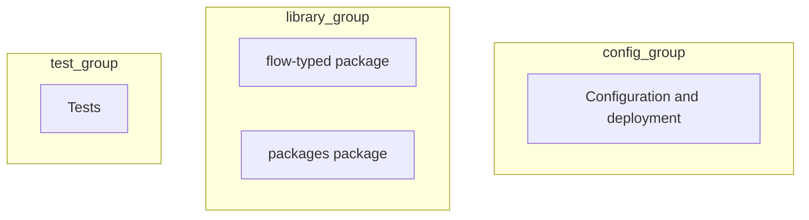

# Architecture report: meta/stylex

> Automated static analysis. **Observed** = directly seen in files/imports/AST; **Inferred** = interpretation from that evidence. Repository code was not executed.

## 1. Repository at a glance

| Item | Value |
| --- | --- |
| Repository | meta/stylex |
| Description | StyleX is the styling system for ambitious user interfaces. |
| Language | JavaScript |
| Stars | 10495 |
| Licence | MIT |
| Analysed commit / branch | 6d7464dee9374f3ab99ddd37ae4de3accdc53ba3 / main |
| Framework(s) | Express, Next.js, React, Svelte |
| Files analysed | 799 |
| Components | 4 |

## 2. Architecture in one minute

meta/stylex - StyleX is the styling system for ambitious user interfaces.. This repository was analysed statically from 799 file(s) (0 Python). Detected technologies (observed from imports/manifests): GitHub Actions, Express, Next.js, React, Svelte, React Router. Files are grouped into 4 component(s): Configuration and deployment, flow-typed package, packages package, Tests. Findings below distinguish observed facts from inferred interpretation.

## 3. High-level block diagram

## 4. Main components

### Configuration and deployment (`config`)

- **Kind:** config
- **Status:** Observed
- **Confidence:** 0.85
- **Responsibility:** Groups 38 file(s) under configuration and deployment (observed from repository paths and static analysis).
- **Paths:** `flow-typed.config.json`, `package.json`, `packages/@stylexjs/atoms/package.json`, `packages/@stylexjs/babel-plugin/package.json`, `packages/@stylexjs/cli/package.json`, `packages/@stylexjs/create-stylex-app/package.json`, `packages/@stylexjs/create-stylex-app/templates.json`, `packages/@stylexjs/devtools-extension/manifests/base.json`, `packages/@stylexjs/devtools-extension/manifests/chrome.json`, `packages/@stylexjs/devtools-extension/manifests/firefox.json`, `packages/@stylexjs/devtools-extension/manifests/safari.json`, `packages/@stylexjs/devtools-extension/package.json`, `packages/@stylexjs/eslint-plugin/package.json`, `packages/@stylexjs/postcss-plugin/__tests__/__auto_discovery_fixtures__/package.json`, `packages/@stylexjs/postcss-plugin/package.json`, `packages/@stylexjs/rollup-plugin/__tests__/__fixtures__/.babelrc.json`, `packages/@stylexjs/rollup-plugin/package.json`, `packages/@stylexjs/shared/package.json`, `packages/@stylexjs/stylex/package.json`, `packages/@stylexjs/unplugin/package.json`, `packages/benchmarks/package.json`, `packages/compiler-conformance/fixtures/create-basic/expected.json`, `packages/compiler-conformance/fixtures/create-basic/manifest.json`, `packages/compiler-conformance/fixtures/define-vars-theme/expected.json`, `packages/compiler-conformance/fixtures/define-vars-theme/manifest.json`, `packages/compiler-conformance/fixtures/keyframes-and-when/expected.json`, `packages/compiler-conformance/fixtures/keyframes-and-when/manifest.json`, `packages/compiler-conformance/fixtures/options-warning/expected.json`, `packages/compiler-conformance/fixtures/options-warning/manifest.json`, `packages/compiler-conformance/fixtures/props-and-merge/expected.json`, `packages/compiler-conformance/fixtures/props-and-merge/manifest.json`, `packages/compiler-conformance/fixtures/runtime-injection/expected.json`, `packages/compiler-conformance/fixtures/runtime-injection/manifest.json`, `packages/compiler-conformance/fixtures/strip-stylex-import-extension/expected.json`, `packages/compiler-conformance/fixtures/strip-stylex-import-extension/manifest.json`, `packages/compiler-conformance/fixtures/validation-error/expected.json`, `packages/compiler-conformance/fixtures/validation-error/manifest.json`, `packages/compiler-conformance/package.json`
- **Evidence:** [flow-typed.config.json](https://github.com/meta/stylex/blob/6d7464dee9374f3ab99ddd37ae4de3accdc53ba3/flow-typed.config.json); [package.json](https://github.com/meta/stylex/blob/6d7464dee9374f3ab99ddd37ae4de3accdc53ba3/package.json); [packages/@stylexjs/atoms/package.json](https://github.com/meta/stylex/blob/6d7464dee9374f3ab99ddd37ae4de3accdc53ba3/packages/%40stylexjs/atoms/package.json); [packages/@stylexjs/babel-plugin/package.json](https://github.com/meta/stylex/blob/6d7464dee9374f3ab99ddd37ae4de3accdc53ba3/packages/%40stylexjs/babel-plugin/package.json); [packages/@stylexjs/cli/package.json](https://github.com/meta/stylex/blob/6d7464dee9374f3ab99ddd37ae4de3accdc53ba3/packages/%40stylexjs/cli/package.json); [packages/@stylexjs/create-stylex-app/package.json](https://github.com/meta/stylex/blob/6d7464dee9374f3ab99ddd37ae4de3accdc53ba3/packages/%40stylexjs/create-stylex-app/package.json); [packages/@stylexjs/create-stylex-app/templates.json](https://github.com/meta/stylex/blob/6d7464dee9374f3ab99ddd37ae4de3accdc53ba3/packages/%40stylexjs/create-stylex-app/templates.json); [packages/@stylexjs/devtools-extension/manifests/base.json](https://github.com/meta/stylex/blob/6d7464dee9374f3ab99ddd37ae4de3accdc53ba3/packages/%40stylexjs/devtools-extension/manifests/base.json)

### flow-typed package (`flow_typed`)

- **Kind:** library
- **Status:** Observed
- **Confidence:** 0.85
- **Responsibility:** Groups 87 file(s) under flow-typed package (observed from repository paths and static analysis).
- **Paths:** `flow-typed/babel-plugins.js`, `flow-typed/environments/bom.js`, `flow-typed/environments/cssom.js`, `flow-typed/environments/dom.js`, `flow-typed/environments/html.js`, `flow-typed/environments/jsx.js`, `flow-typed/environments/node.js`, `flow-typed/environments/streams.js`, `flow-typed/flow-api-translator.js`, `flow-typed/npm/@babel/cli_vx.x.x.js`, `flow-typed/npm/@babel/core.js`, `flow-typed/npm/@babel/eslint-parser_vx.x.x.js`, `flow-typed/npm/@babel/generator.js`, `flow-typed/npm/@babel/helper-module-imports.js`, `flow-typed/npm/@babel/node_vx.x.x.js`, `flow-typed/npm/@babel/parser.js`, `flow-typed/npm/@babel/preset-env_vx.x.x.js`, `flow-typed/npm/@babel/preset-flow_vx.x.x.js`, `flow-typed/npm/@babel/preset-react_vx.x.x.js`, `flow-typed/npm/@babel/preset-typescript_vx.x.x.js`, `flow-typed/npm/@babel/traverse.js`, `flow-typed/npm/@babel/types.js`, `flow-typed/npm/@chromatic-com/storybook_vx.x.x.js`, `flow-typed/npm/@csstools/css-tokenizer_v3.x.x.js`, `flow-typed/npm/ansis_vx.x.x.js`, `flow-typed/npm/autoprefixer_vx.x.x.js`, `flow-typed/npm/babel-loader_vx.x.x.js`, `flow-typed/npm/benchmark_vx.x.x.js`, `flow-typed/npm/brotli-size_vx.x.x.js`, `flow-typed/npm/chalk_v4.x.x.js`, `flow-typed/npm/clean-css_vx.x.x.js`, `flow-typed/npm/clsx_v1.x.x.js`, `flow-typed/npm/codemirror_vx.x.x.js`, `flow-typed/npm/colors_v1.x.x.js`, `flow-typed/npm/cross-env_vx.x.x.js`, `flow-typed/npm/css-loader_vx.x.x.js`, `flow-typed/npm/css-mediaquery_vx.x.x.js`, `flow-typed/npm/css-shorthand-expand_vx.x.x.js`, `flow-typed/npm/esbuild_vx.x.x.js`, `flow-typed/npm/estree.js`, `flow-typed/npm/fast-glob_vx.x.x.js`, `flow-typed/npm/fb-watchman_vx.x.x.js`, `flow-typed/npm/file-loader_vx.x.x.js`, `flow-typed/npm/flow-bin_v0.x.x.js`, `flow-typed/npm/flow-enums-runtime_v0.x.x.js`, `flow-typed/npm/glob-parent_vx.x.x.js`, `flow-typed/npm/html-webpack-plugin_vx.x.x.js`, `flow-typed/npm/husky_vx.x.x.js`, `flow-typed/npm/invariant_v2.x.x.js`, `flow-typed/npm/is-glob_vx.x.x.js`, `flow-typed/npm/jest-environment-jsdom_vx.x.x.js`, `flow-typed/npm/jest_v27.x.x.js`, `flow-typed/npm/jest_vx.x.x.js`, `flow-typed/npm/js-yaml_v4.x.x.js`, `flow-typed/npm/json5_vx.x.x.js`, `flow-typed/npm/mkdirp_v1.x.x.js`, `flow-typed/npm/next_vx.x.x.js`, `flow-typed/npm/playwright_vx.x.x.js`, `flow-typed/npm/postcss-loader_vx.x.x.js`, `flow-typed/npm/postcss-nesting_vx.x.x.js`, `flow-typed/npm/postcss-value-parser_vx.x.x.js`, `flow-typed/npm/postcss_vx.x.x.js`, `flow-typed/npm/react-codemirror2_vx.x.x.js`, `flow-typed/npm/react-refresh_vx.x.x.js`, `flow-typed/npm/rimraf_v5.x.x.js`, `flow-typed/npm/rollup-plugin-jsx-remove-attributes_vx.x.x.js`, `flow-typed/npm/rollup-plugin-node-externals_vx.x.x.js`, `flow-typed/npm/rollup.js`, `flow-typed/npm/scripts_vx.x.x.js`, `flow-typed/npm/semver_v7.x.x.js`, `flow-typed/npm/serve_vx.x.x.js`, `flow-typed/npm/storybook_vx.x.x.js`, `flow-typed/npm/string-natural-compare_v3.x.x.js`, `flow-typed/npm/styled-jsx_vx.x.x.js`, `flow-typed/npm/stylelint_vx.x.x.js`, `flow-typed/npm/styleq_vx.x.x.js`, `flow-typed/npm/terser_vx.x.x.js`, `flow-typed/npm/typescript-eslint_vx.x.x.js`, `flow-typed/npm/typescript_vx.x.x.js`, `flow-typed/npm/unplugin_vx.x.x.js`, `flow-typed/npm/vite-plugin-dts_vx.x.x.js`, `flow-typed/npm/vitest_vx.x.x.js`, `flow-typed/npm/webpack-cli_vx.x.x.js`, `flow-typed/npm/webpack-dev-server_vx.x.x.js`, `flow-typed/npm/webpack_v5.x.x.js`, `flow-typed/npm/yargs_v17.x.x.js`, `flow-typed/stubs.js`
- **Evidence:** [flow-typed/babel-plugins.js](https://github.com/meta/stylex/blob/6d7464dee9374f3ab99ddd37ae4de3accdc53ba3/flow-typed/babel-plugins.js); [flow-typed/environments/bom.js](https://github.com/meta/stylex/blob/6d7464dee9374f3ab99ddd37ae4de3accdc53ba3/flow-typed/environments/bom.js); [flow-typed/environments/cssom.js](https://github.com/meta/stylex/blob/6d7464dee9374f3ab99ddd37ae4de3accdc53ba3/flow-typed/environments/cssom.js); [flow-typed/environments/dom.js](https://github.com/meta/stylex/blob/6d7464dee9374f3ab99ddd37ae4de3accdc53ba3/flow-typed/environments/dom.js); [flow-typed/environments/html.js](https://github.com/meta/stylex/blob/6d7464dee9374f3ab99ddd37ae4de3accdc53ba3/flow-typed/environments/html.js); [flow-typed/environments/jsx.js](https://github.com/meta/stylex/blob/6d7464dee9374f3ab99ddd37ae4de3accdc53ba3/flow-typed/environments/jsx.js); [flow-typed/environments/node.js](https://github.com/meta/stylex/blob/6d7464dee9374f3ab99ddd37ae4de3accdc53ba3/flow-typed/environments/node.js); [flow-typed/environments/streams.js](https://github.com/meta/stylex/blob/6d7464dee9374f3ab99ddd37ae4de3accdc53ba3/flow-typed/environments/streams.js)

### packages package (`packages`)

- **Kind:** library
- **Status:** Observed
- **Confidence:** 0.85
- **Responsibility:** Groups 398 file(s) under packages package (observed from repository paths and static analysis).
- **Paths:** `packages/@stylexjs/atoms/src/babel-transform.d.ts`, `packages/@stylexjs/atoms/src/babel-transform.js`, `packages/@stylexjs/atoms/src/index.d.ts`, `packages/@stylexjs/atoms/src/index.js`, `packages/@stylexjs/babel-plugin/__tests__/__fixtures__/constants.stylex.js`, `packages/@stylexjs/babel-plugin/__tests__/__fixtures__/themeVars.stylex.js`, `packages/@stylexjs/babel-plugin/__tests__/evaluation-import-test.js`, `packages/@stylexjs/babel-plugin/__tests__/golden-fixtures-test.js`, `packages/@stylexjs/babel-plugin/__tests__/legacy/stylex-transform-call-test.js`, `packages/@stylexjs/babel-plugin/__tests__/legacy/stylex-transform-legacy-shorthands-test.js`, `packages/@stylexjs/babel-plugin/__tests__/legacy/transform-legacy-polyfills-test.js`, `packages/@stylexjs/babel-plugin/__tests__/legacy/transform-logical-properties-test.js`, `packages/@stylexjs/babel-plugin/__tests__/legacy/transform-logical-values-test.js`, `packages/@stylexjs/babel-plugin/__tests__/legacy/transform-pre-plugin-test.js`, `packages/@stylexjs/babel-plugin/__tests__/shared-stylex-nested-transforms-test.js`, `packages/@stylexjs/babel-plugin/__tests__/stylex-nested-utils-test.js`, `packages/@stylexjs/babel-plugin/__tests__/transform-import-export-test.js`, `packages/@stylexjs/babel-plugin/__tests__/transform-polyfills-test.js`, `packages/@stylexjs/babel-plugin/__tests__/transform-process-test.js`, `packages/@stylexjs/babel-plugin/__tests__/transform-stylex-create-test.js`, `packages/@stylexjs/babel-plugin/__tests__/transform-stylex-createTheme-test.js`, `packages/@stylexjs/babel-plugin/__tests__/transform-stylex-createThemeNested-test.js`, `packages/@stylexjs/babel-plugin/__tests__/transform-stylex-defineConsts-test.js`, `packages/@stylexjs/babel-plugin/__tests__/transform-stylex-defineConstsNested-test.js`, `packages/@stylexjs/babel-plugin/__tests__/transform-stylex-defineMarker-test.js`, `packages/@stylexjs/babel-plugin/__tests__/transform-stylex-defineVars-test.js`, `packages/@stylexjs/babel-plugin/__tests__/transform-stylex-defineVarsNested-test.js`, `packages/@stylexjs/babel-plugin/__tests__/transform-stylex-keyframes-test.js`, `packages/@stylexjs/babel-plugin/__tests__/transform-stylex-positionTry-test.js`, `packages/@stylexjs/babel-plugin/__tests__/transform-stylex-props-test.js`, `packages/@stylexjs/babel-plugin/__tests__/transform-stylex-viewTransitionClass-test.js`, `packages/@stylexjs/babel-plugin/__tests__/transform-stylex-when-test.js`, `packages/@stylexjs/babel-plugin/__tests__/transform-value-normalization-test.js`, `packages/@stylexjs/babel-plugin/__tests__/validation-import-export-test.js`, `packages/@stylexjs/babel-plugin/__tests__/validation-stylex-create-test.js`, `packages/@stylexjs/babel-plugin/__tests__/validation-stylex-createTheme-test.js`, `packages/@stylexjs/babel-plugin/__tests__/validation-stylex-defineConsts-test.js`, `packages/@stylexjs/babel-plugin/__tests__/validation-stylex-defineMarker-test.js`, `packages/@stylexjs/babel-plugin/__tests__/validation-stylex-defineVars-test.js`, `packages/@stylexjs/babel-plugin/__tests__/validation-stylex-keyframes-test.js`, `packages/@stylexjs/babel-plugin/jest.config.js`, `packages/@stylexjs/babel-plugin/rollup.config.mjs`, `packages/@stylexjs/babel-plugin/src/index.d.ts`, `packages/@stylexjs/babel-plugin/src/index.js`, `packages/@stylexjs/babel-plugin/src/shared/common-types.d.ts`, `packages/@stylexjs/babel-plugin/src/shared/common-types.js`, `packages/@stylexjs/babel-plugin/src/shared/hash.js`, `packages/@stylexjs/babel-plugin/src/shared/index.js`, `packages/@stylexjs/babel-plugin/src/shared/messages.js`, `packages/@stylexjs/babel-plugin/src/shared/physical-rtl/generate-ltr.js`, `packages/@stylexjs/babel-plugin/src/shared/physical-rtl/generate-rtl.js`, `packages/@stylexjs/babel-plugin/src/shared/preprocess-rules/PreRule.js`, `packages/@stylexjs/babel-plugin/src/shared/preprocess-rules/__tests__/PreRule-test.js`, `packages/@stylexjs/babel-plugin/src/shared/preprocess-rules/__tests__/flatten-raw-style-obj-test.js`, `packages/@stylexjs/babel-plugin/src/shared/preprocess-rules/application-order.js`, `packages/@stylexjs/babel-plugin/src/shared/preprocess-rules/basic-validation.js`, `packages/@stylexjs/babel-plugin/src/shared/preprocess-rules/flatten-raw-style-obj.js`, `packages/@stylexjs/babel-plugin/src/shared/preprocess-rules/index.js`, `packages/@stylexjs/babel-plugin/src/shared/preprocess-rules/legacy-expand-shorthands.js`, `packages/@stylexjs/babel-plugin/src/shared/preprocess-rules/property-specificity.js`, `packages/@stylexjs/babel-plugin/src/shared/stylex-consts-utils.js`, `packages/@stylexjs/babel-plugin/src/shared/stylex-create-theme-nested.d.ts`, `packages/@stylexjs/babel-plugin/src/shared/stylex-create-theme-nested.js`, `packages/@stylexjs/babel-plugin/src/shared/stylex-create-theme.d.ts`, `packages/@stylexjs/babel-plugin/src/shared/stylex-create-theme.js`, `packages/@stylexjs/babel-plugin/src/shared/stylex-create.js`, `packages/@stylexjs/babel-plugin/src/shared/stylex-defaultMarker.js`, `packages/@stylexjs/babel-plugin/src/shared/stylex-define-consts-nested.js`, `packages/@stylexjs/babel-plugin/src/shared/stylex-define-consts.js`, `packages/@stylexjs/babel-plugin/src/shared/stylex-define-vars-nested.js`, `packages/@stylexjs/babel-plugin/src/shared/stylex-define-vars.d.ts`, `packages/@stylexjs/babel-plugin/src/shared/stylex-define-vars.js`, `packages/@stylexjs/babel-plugin/src/shared/stylex-first-that-works.js`, `packages/@stylexjs/babel-plugin/src/shared/stylex-keyframes.js`, `packages/@stylexjs/babel-plugin/src/shared/stylex-nested-utils.js`, `packages/@stylexjs/babel-plugin/src/shared/stylex-position-try.js`, `packages/@stylexjs/babel-plugin/src/shared/stylex-vars-utils.js`, `packages/@stylexjs/babel-plugin/src/shared/stylex-view-transition-class.js`, `packages/@stylexjs/babel-plugin/src/shared/types/__tests__/stylex-types-test.js`, `packages/@stylexjs/babel-plugin/src/shared/types/index.d.ts`, `packages/@stylexjs/babel-plugin/src/shared/types/index.js`, `packages/@stylexjs/babel-plugin/src/shared/utils/Rule.js`, `packages/@stylexjs/babel-plugin/src/shared/utils/__tests__/convert-to-className-test.js`, `packages/@stylexjs/babel-plugin/src/shared/utils/__tests__/split-css-value-test.js`, `packages/@stylexjs/babel-plugin/src/shared/utils/__tests__/transform-value-test.js`, `packages/@stylexjs/babel-plugin/src/shared/utils/convert-to-className.js`, `packages/@stylexjs/babel-plugin/src/shared/utils/dashify.js`, `packages/@stylexjs/babel-plugin/src/shared/utils/default-options.js`, `packages/@stylexjs/babel-plugin/src/shared/utils/file-based-identifier.js`, `packages/@stylexjs/babel-plugin/src/shared/utils/generate-css-rule.js`, `packages/@stylexjs/babel-plugin/src/shared/utils/normalize-value.js`, `packages/@stylexjs/babel-plugin/src/shared/utils/normalizers/convert-camel-case-values.js`, `packages/@stylexjs/babel-plugin/src/shared/utils/normalizers/detect-unclosed-fns.js`, `packages/@stylexjs/babel-plugin/src/shared/utils/normalizers/detect-unclosed-strings.js`, `packages/@stylexjs/babel-plugin/src/shared/utils/normalizers/font-size-px-to-rem.js`, `packages/@stylexjs/babel-plugin/src/shared/utils/normalizers/leading-zero.js`, `packages/@stylexjs/babel-plugin/src/shared/utils/normalizers/quotes.js`, `packages/@stylexjs/babel-plugin/src/shared/utils/normalizers/timings.js`, `packages/@stylexjs/babel-plugin/src/shared/utils/normalizers/whitespace.js`, `packages/@stylexjs/babel-plugin/src/shared/utils/normalizers/zero-dimensions.js`, `packages/@stylexjs/babel-plugin/src/shared/utils/object-utils.js`, `packages/@stylexjs/babel-plugin/src/shared/utils/rule-utils.js`, `packages/@stylexjs/babel-plugin/src/shared/utils/split-css-value.js`, `packages/@stylexjs/babel-plugin/src/shared/utils/transform-value.js`, `packages/@stylexjs/babel-plugin/src/shared/validate.js`, `packages/@stylexjs/babel-plugin/src/shared/when/when.js`, `packages/@stylexjs/babel-plugin/src/utils/__tests__/evaluate-path-test.js`, `packages/@stylexjs/babel-plugin/src/utils/__tests__/js-to-ast-test.js`, `packages/@stylexjs/babel-plugin/src/utils/__tests__/state-manager-test.js`, `packages/@stylexjs/babel-plugin/src/utils/add-sourcemap-data.js`, `packages/@stylexjs/babel-plugin/src/utils/ast-helpers.js`, `packages/@stylexjs/babel-plugin/src/utils/dev-classname.js`, `packages/@stylexjs/babel-plugin/src/utils/evaluate-path.js`, `packages/@stylexjs/babel-plugin/src/utils/evaluation-errors.js`, `packages/@stylexjs/babel-plugin/src/utils/helpers.js`, `packages/@stylexjs/babel-plugin/src/utils/js-to-ast.js`, `packages/@stylexjs/babel-plugin/src/utils/state-manager.js`, `packages/@stylexjs/babel-plugin/src/utils/validate.js`, `packages/@stylexjs/babel-plugin/src/visitors/__tests__/parse-stylex-create-arg-test.js`, `packages/@stylexjs/babel-plugin/src/visitors/imports.js`, `packages/@stylexjs/babel-plugin/src/visitors/parse-stylex-create-arg.js`, `packages/@stylexjs/babel-plugin/src/visitors/stylex-create-theme-nested.js`, `packages/@stylexjs/babel-plugin/src/visitors/stylex-create-theme.js`, `packages/@stylexjs/babel-plugin/src/visitors/stylex-create.js`, `packages/@stylexjs/babel-plugin/src/visitors/stylex-default-marker.js`, `packages/@stylexjs/babel-plugin/src/visitors/stylex-define-consts-nested.js`, `packages/@stylexjs/babel-plugin/src/visitors/stylex-define-consts.js`, `packages/@stylexjs/babel-plugin/src/visitors/stylex-define-marker.js`, `packages/@stylexjs/babel-plugin/src/visitors/stylex-define-vars-nested.js`, `packages/@stylexjs/babel-plugin/src/visitors/stylex-define-vars.js`, `packages/@stylexjs/babel-plugin/src/visitors/stylex-keyframes.js`, `packages/@stylexjs/babel-plugin/src/visitors/stylex-merge.js`, `packages/@stylexjs/babel-plugin/src/visitors/stylex-position-try.js`, `packages/@stylexjs/babel-plugin/src/visitors/stylex-props.js`, `packages/@stylexjs/babel-plugin/src/visitors/stylex-view-transition-class.js`, `packages/@stylexjs/babel-plugin/src/visitors/visitor-utils.js`, `packages/@stylexjs/babel-plugin/test-utils/babel-conformance-adapter.js`, `packages/@stylexjs/cli/.babelrc.js`, `packages/@stylexjs/cli/__tests__/__mocks__/snapshot/components/button.js`, `packages/@stylexjs/cli/__tests__/__mocks__/snapshot/index.js`, `packages/@stylexjs/cli/__tests__/__mocks__/snapshot/pages/home.js`, `packages/@stylexjs/cli/__tests__/__mocks__/snapshot2/components/button.js`, `packages/@stylexjs/cli/__tests__/__mocks__/snapshot2/index.js`, `packages/@stylexjs/cli/__tests__/__mocks__/snapshot2/pages/home.js`, `packages/@stylexjs/cli/__tests__/__mocks__/source/components/button.js`, `packages/@stylexjs/cli/__tests__/__mocks__/source/index.js`, `packages/@stylexjs/cli/__tests__/__mocks__/source/pages/home.js`, `packages/@stylexjs/cli/__tests__/__mocks__/source2/components/button.js`, `packages/@stylexjs/cli/__tests__/__mocks__/source2/index.js`, `packages/@stylexjs/cli/__tests__/__mocks__/source2/pages/home.js`, `packages/@stylexjs/cli/__tests__/compile-stylex-folder-test.js`, `packages/@stylexjs/cli/rollup.config.mjs`, `packages/@stylexjs/cli/src/cache.js`, `packages/@stylexjs/cli/src/config.js`, `packages/@stylexjs/cli/src/errors.js`, `packages/@stylexjs/cli/src/files.js`, `packages/@stylexjs/cli/src/hash.js`, `packages/@stylexjs/cli/src/index.js`, `packages/@stylexjs/cli/src/modules.js`, `packages/@stylexjs/cli/src/options.js`, `packages/@stylexjs/cli/src/plugins.js`, `packages/@stylexjs/cli/src/transform.js`, `packages/@stylexjs/cli/src/watcher.js`, `packages/@stylexjs/create-stylex-app/.babelrc.js`, `packages/@stylexjs/create-stylex-app/src/index.js`, `packages/@stylexjs/create-stylex-app/src/templates.js`, `packages/@stylexjs/create-stylex-app/src/utils/fetch-template.js`, `packages/@stylexjs/create-stylex-app/src/utils/files.js`, `packages/@stylexjs/create-stylex-app/src/utils/packages.js`, `packages/@stylexjs/devtools-extension/.babelrc.js`, `packages/@stylexjs/devtools-extension/__tests__/App-test.js`, `packages/@stylexjs/devtools-extension/__tests__/MatchedStyles-test.js`, `packages/@stylexjs/devtools-extension/__tests__/SourceRow-test.js`, `packages/@stylexjs/devtools-extension/__tests__/ValueEditor-test.js`, `packages/@stylexjs/devtools-extension/__tests__/browserAdapters-test.js`, `packages/@stylexjs/devtools-extension/__tests__/browserRouting-test.js`, `packages/@stylexjs/devtools-extension/__tests__/clipboard-test.js`, `packages/@stylexjs/devtools-extension/__tests__/collectStylexDebugData-test.js`, `packages/@stylexjs/devtools-extension/__tests__/css-test.js`, `packages/@stylexjs/devtools-extension/__tests__/cssVariables-test.js`, `packages/@stylexjs/devtools-extension/__tests__/declarationAnalysis-test.js`, `packages/@stylexjs/devtools-extension/__tests__/declarationModel-test.js`, `packages/@stylexjs/devtools-extension/__tests__/formatValue-test.js`, `packages/@stylexjs/devtools-extension/__tests__/inspectedClient-test.js`, `packages/@stylexjs/devtools-extension/__tests__/overrideStore-test.js`, `packages/@stylexjs/devtools-extension/__tests__/safariRelay-test.js`, `packages/@stylexjs/devtools-extension/__tests__/selectorAnalysis-test.js`, `packages/@stylexjs/devtools-extension/__tests__/sourceSnippet-test.js`, `packages/@stylexjs/devtools-extension/__tests__/useDebugData-test.js`, `packages/@stylexjs/devtools-extension/__tests__/valueSyntax-test.js`, `packages/@stylexjs/devtools-extension/jest.config.js`, `packages/@stylexjs/devtools-extension/rollup.config.mjs`, `packages/@stylexjs/devtools-extension/scripts/extensionFiles.mjs`, `packages/@stylexjs/devtools-extension/scripts/lint-firefox.mjs`, `packages/@stylexjs/devtools-extension/scripts/package.mjs`, `packages/@stylexjs/devtools-extension/scripts/verify-build.mjs`, `packages/@stylexjs/devtools-extension/src/devtools/bridge.js`, `packages/@stylexjs/devtools-extension/src/devtools/browserApi.js`, `packages/@stylexjs/devtools-extension/src/devtools/createSidebarPane.js`, `packages/@stylexjs/devtools-extension/src/devtools/inspectedClient.js`, `packages/@stylexjs/devtools-extension/src/devtools/inspectedPageRelay.js`, `packages/@stylexjs/devtools-extension/src/devtools/main.js`, `packages/@stylexjs/devtools-extension/src/devtools/safariRelayProtocol.js`, `packages/@stylexjs/devtools-extension/src/devtools/sourceResources.js`, `packages/@stylexjs/devtools-extension/src/inspected/collector.js`, `packages/@stylexjs/devtools-extension/src/inspected/declarationAnalysis.js`, `packages/@stylexjs/devtools-extension/src/inspected/overrideStore.js`, `packages/@stylexjs/devtools-extension/src/inspected/ruleOverrideSheet.js`, `packages/@stylexjs/devtools-extension/src/inspected/runtime.js`, `packages/@stylexjs/devtools-extension/src/inspected/runtimeEntry.js`, `packages/@stylexjs/devtools-extension/src/inspected/runtimeKey.js`, `packages/@stylexjs/devtools-extension/src/inspected/runtimeState.js`, `packages/@stylexjs/devtools-extension/src/inspected/selectorAnalysis.js`, `packages/@stylexjs/devtools-extension/src/panel/App.jsx`, `packages/@stylexjs/devtools-extension/src/panel/components/Button.js`, `packages/@stylexjs/devtools-extension/src/panel/components/ComboBox.js`, `packages/@stylexjs/devtools-extension/src/panel/components/CopyMetadataButton.js`, `packages/@stylexjs/devtools-extension/src/panel/components/EyeIcon.js`, `packages/@stylexjs/devtools-extension/src/panel/components/Logo.js`, `packages/@stylexjs/devtools-extension/src/panel/components/MatchedStyles.js`, `packages/@stylexjs/devtools-extension/src/panel/components/OverridesSection.js`, `packages/@stylexjs/devtools-extension/src/panel/components/Section.js`, `packages/@stylexjs/devtools-extension/src/panel/components/SourceRow.js`, `packages/@stylexjs/devtools-extension/src/panel/components/SourcesList.js`, `packages/@stylexjs/devtools-extension/src/panel/components/ValueEditor.js`, `packages/@stylexjs/devtools-extension/src/panel/components/VariableValue.js`, `packages/@stylexjs/devtools-extension/src/panel/declarations/documentPrinter.js`, `packages/@stylexjs/devtools-extension/src/panel/declarations/formatValue.js`, `packages/@stylexjs/devtools-extension/src/panel/declarations/model.js`, `packages/@stylexjs/devtools-extension/src/panel/declarations/valueTree.js`, `packages/@stylexjs/devtools-extension/src/panel/hooks/useDebugData.js`, `packages/@stylexjs/devtools-extension/src/panel/hooks/useValueLineLength.js`, `packages/@stylexjs/devtools-extension/src/panel/main.js`, `packages/@stylexjs/devtools-extension/src/panel/theme.stylex.js`, `packages/@stylexjs/devtools-extension/src/types.js`, `packages/@stylexjs/devtools-extension/src/utils/clipboard.js`, `packages/@stylexjs/devtools-extension/src/utils/css.js`, `packages/@stylexjs/devtools-extension/src/utils/cssVariables.js`, `packages/@stylexjs/devtools-extension/src/utils/exportMetadata.js`, `packages/@stylexjs/devtools-extension/src/utils/resourceMatching.js`, `packages/@stylexjs/devtools-extension/src/utils/sourceLocation.js`, `packages/@stylexjs/devtools-extension/src/utils/sourceSnippet.js`, `packages/@stylexjs/devtools-extension/src/utils/valueSyntax.js`, `packages/@stylexjs/eslint-plugin/__tests__/stylex-enforce-extension-test.js`, `packages/@stylexjs/eslint-plugin/__tests__/stylex-no-conflicting-props-test.js`, `packages/@stylexjs/eslint-plugin/__tests__/stylex-no-legacy-contextual-styles-test.js`, `packages/@stylexjs/eslint-plugin/__tests__/stylex-no-lookahead-selectors-test.js`, `packages/@stylexjs/eslint-plugin/__tests__/stylex-no-nonstandard-styles-test.js`, `packages/@stylexjs/eslint-plugin/__tests__/stylex-no-unused-test.js`, `packages/@stylexjs/eslint-plugin/__tests__/stylex-sort-keys-test.js`, `packages/@stylexjs/eslint-plugin/__tests__/stylex-valid-shorthands-test.js`, `packages/@stylexjs/eslint-plugin/__tests__/stylex-valid-styles-test.js`, `packages/@stylexjs/eslint-plugin/jest.config.js`, `packages/@stylexjs/eslint-plugin/rollup.config.mjs`, `packages/@stylexjs/eslint-plugin/src/index.js`, `packages/@stylexjs/eslint-plugin/src/reference/cleanOrderPriorities.js`, `packages/@stylexjs/eslint-plugin/src/reference/cssProperties.js`, `packages/@stylexjs/eslint-plugin/src/reference/namedColors.js`, `packages/@stylexjs/eslint-plugin/src/reference/recessOrderPriorities.js`, `packages/@stylexjs/eslint-plugin/src/rules/isAbsoluteLength.js`, `packages/@stylexjs/eslint-plugin/src/rules/isAnimationName.js`, `packages/@stylexjs/eslint-plugin/src/rules/isCSSVariable.js`, `packages/@stylexjs/eslint-plugin/src/rules/isHexColor.js`, `packages/@stylexjs/eslint-plugin/src/rules/isNumber.js`, `packages/@stylexjs/eslint-plugin/src/rules/isPercentage.js`, `packages/@stylexjs/eslint-plugin/src/rules/isPositionTryFallbacks.js`, `packages/@stylexjs/eslint-plugin/src/rules/isRelativeLength.js`, `packages/@stylexjs/eslint-plugin/src/rules/isString.js`, `packages/@stylexjs/eslint-plugin/src/rules/isStylexEnvMember.js`, `packages/@stylexjs/eslint-plugin/src/rules/isStylexResolvedVarsToken.js`, `packages/@stylexjs/eslint-plugin/src/rules/makeLiteralRule.js`, `packages/@stylexjs/eslint-plugin/src/rules/makeRangeRule.js`, `packages/@stylexjs/eslint-plugin/src/rules/makeRegExRule.js`, `packages/@stylexjs/eslint-plugin/src/rules/makeUnionRule.js`, `packages/@stylexjs/eslint-plugin/src/stylex-enforce-extension.js`, `packages/@stylexjs/eslint-plugin/src/stylex-no-conflicting-props.js`, `packages/@stylexjs/eslint-plugin/src/stylex-no-legacy-contextual-styles.js`, `packages/@stylexjs/eslint-plugin/src/stylex-no-lookahead-selectors.js`, `packages/@stylexjs/eslint-plugin/src/stylex-no-nonstandard-styles.js`, `packages/@stylexjs/eslint-plugin/src/stylex-no-unused.js`, `packages/@stylexjs/eslint-plugin/src/stylex-sort-keys.js`, `packages/@stylexjs/eslint-plugin/src/stylex-valid-shorthands.js`, `packages/@stylexjs/eslint-plugin/src/stylex-valid-styles.js`, `packages/@stylexjs/eslint-plugin/src/utils/createImportTracker.js`, `packages/@stylexjs/eslint-plugin/src/utils/evaluate.js`, `packages/@stylexjs/eslint-plugin/src/utils/formatPropertiesWithNodeIndentation.js`, `packages/@stylexjs/eslint-plugin/src/utils/getDistance.js`, `packages/@stylexjs/eslint-plugin/src/utils/getNodeIndentation.js`, `packages/@stylexjs/eslint-plugin/src/utils/getPropertyName.js`, `packages/@stylexjs/eslint-plugin/src/utils/getPropertyPriorityAndType.js`, `packages/@stylexjs/eslint-plugin/src/utils/getSourceCode.js`, `packages/@stylexjs/eslint-plugin/src/utils/isWhiteSpaceOrEmpty.js`, `packages/@stylexjs/eslint-plugin/src/utils/makeVariableCheckingRule.js`, `packages/@stylexjs/eslint-plugin/src/utils/resolveKey.js`, `packages/@stylexjs/eslint-plugin/src/utils/split-css-value.js`, `packages/@stylexjs/eslint-plugin/src/utils/splitShorthands.js`, `packages/@stylexjs/postcss-plugin/__tests__/__auto_discovery_fixtures__/babel.config.js`, `packages/@stylexjs/postcss-plugin/__tests__/__auto_discovery_fixtures__/src/local-rsd.js`, `packages/@stylexjs/postcss-plugin/__tests__/__auto_discovery_fixtures__/src/local-stylex.js`, `packages/@stylexjs/postcss-plugin/__tests__/__auto_discovery_fixtures__/src/types.d.ts`, `packages/@stylexjs/postcss-plugin/__tests__/__fixtures__/.babelrc.js`, `packages/@stylexjs/postcss-plugin/__tests__/__fixtures__/import-sources-object.js`, `packages/@stylexjs/postcss-plugin/__tests__/__fixtures__/import-sources-string.js`, `packages/@stylexjs/postcss-plugin/__tests__/__fixtures__/styles-second.js`, `packages/@stylexjs/postcss-plugin/__tests__/__fixtures__/styles.js`, `packages/@stylexjs/postcss-plugin/__tests__/builder-rebuild-test.js`, `packages/@stylexjs/postcss-plugin/__tests__/index-test.js`, `packages/@stylexjs/postcss-plugin/jest.config.js`, `packages/@stylexjs/postcss-plugin/src/builder.js`, `packages/@stylexjs/postcss-plugin/src/bundler.js`, `packages/@stylexjs/postcss-plugin/src/discovery.js`, `packages/@stylexjs/postcss-plugin/src/index.js`, `packages/@stylexjs/postcss-plugin/src/plugin.js`, `packages/@stylexjs/rollup-plugin/.babelrc.cjs`, `packages/@stylexjs/rollup-plugin/__tests__/__fixtures__/customSource.js`, `packages/@stylexjs/rollup-plugin/__tests__/__fixtures__/index.js`, `packages/@stylexjs/rollup-plugin/__tests__/__fixtures__/npmStyles.js`, `packages/@stylexjs/rollup-plugin/__tests__/__fixtures__/otherStyles.js`, `packages/@stylexjs/rollup-plugin/__tests__/index-test.js`, `packages/@stylexjs/rollup-plugin/src/index.js`, `packages/@stylexjs/shared/src/index.js`, `packages/@stylexjs/shared/src/utils/property-priorities.js`, `packages/@stylexjs/stylex/.babelrc.js`, `packages/@stylexjs/stylex/__tests__/createOrderedCSSStyleSheet-test.js`, `packages/@stylexjs/stylex/__tests__/createSheet-test.js`, `packages/@stylexjs/stylex/__tests__/inject-test.js`, `packages/@stylexjs/stylex/__tests__/stylex-test.js`, `packages/@stylexjs/stylex/flow-tests/theming/ButtonTokenThemes.js`, `packages/@stylexjs/stylex/flow-tests/theming/ButtonTokens.stylex.js`, `packages/@stylexjs/stylex/jest.config.js`, `packages/@stylexjs/stylex/rollup.config.mjs`, `packages/@stylexjs/stylex/src/inject.js`, `packages/@stylexjs/stylex/src/stylesheet/createCSSStyleSheet.js`, `packages/@stylexjs/stylex/src/stylesheet/createOrderedCSSStyleSheet.js`, `packages/@stylexjs/stylex/src/stylesheet/createSheet.js`, `packages/@stylexjs/stylex/src/stylesheet/utils.js`, `packages/@stylexjs/stylex/src/stylex.js`, `packages/@stylexjs/stylex/src/types/StyleXCSSTypes.js`, `packages/@stylexjs/stylex/src/types/StyleXOpaqueTypes.js`, `packages/@stylexjs/stylex/src/types/StyleXTypes.d.ts`, `packages/@stylexjs/stylex/src/types/StyleXTypes.js`, `packages/@stylexjs/stylex/src/types/StyleXUtils.js`, `packages/@stylexjs/stylex/src/types/VarTypes.js`, `packages/@stylexjs/unplugin/.babelrc.cjs`, `packages/@stylexjs/unplugin/__tests__/runtime.test.js`, `packages/@stylexjs/unplugin/__tests__/unplugin.test.js`, `packages/@stylexjs/unplugin/babel-plugins/add-mjs-extension.js`, `packages/@stylexjs/unplugin/src/bun.d.ts`, `packages/@stylexjs/unplugin/src/bun.js`, `packages/@stylexjs/unplugin/src/consts.js`, `packages/@stylexjs/unplugin/src/core.d.ts`, `packages/@stylexjs/unplugin/src/core.js`, `packages/@stylexjs/unplugin/src/dev-inject-middleware.js`, `packages/@stylexjs/unplugin/src/esbuild.d.ts`, `packages/@stylexjs/unplugin/src/esbuild.js`, `packages/@stylexjs/unplugin/src/farm.d.ts`, `packages/@stylexjs/unplugin/src/farm.js`, `packages/@stylexjs/unplugin/src/index.d.ts`, `packages/@stylexjs/unplugin/src/index.js`, `packages/@stylexjs/unplugin/src/rolldown.d.ts`, `packages/@stylexjs/unplugin/src/rolldown.js`, `packages/@stylexjs/unplugin/src/rollup.d.ts`, `packages/@stylexjs/unplugin/src/rollup.js`, `packages/@stylexjs/unplugin/src/rspack.d.ts`, `packages/@stylexjs/unplugin/src/rspack.js`, `packages/@stylexjs/unplugin/src/unloader.d.ts`, `packages/@stylexjs/unplugin/src/unloader.js`, `packages/@stylexjs/unplugin/src/vite.d.ts`, `packages/@stylexjs/unplugin/src/vite.js`, `packages/@stylexjs/unplugin/src/webpack.d.ts`, `packages/@stylexjs/unplugin/src/webpack.js`, `packages/benchmarks/compare.js`, `packages/benchmarks/perf/fixtures/colors.stylex.js`, `packages/benchmarks/perf/fixtures/create-basic.js`, `packages/benchmarks/perf/fixtures/create-complex.js`, `packages/benchmarks/perf/fixtures/createTheme-basic.js`, `packages/benchmarks/perf/fixtures/createTheme-complex.js`, `packages/benchmarks/perf/fixtures/sizes.stylex.js`, `packages/benchmarks/perf/helpers.js`, `packages/benchmarks/perf/run.js`, `packages/benchmarks/size/fixtures/index.js`, `packages/benchmarks/size/fixtures/lotsOfStylesDynamic.js`, `packages/benchmarks/size/rollup.config.mjs`, `packages/benchmarks/size/run.js`, `packages/compiler-conformance/__tests__/conformance-harness-test.js`, `packages/compiler-conformance/fixtures/create-basic/input.js`, `packages/compiler-conformance/fixtures/define-vars-theme/input.stylex.js`, `packages/compiler-conformance/fixtures/keyframes-and-when/input.js`, `packages/compiler-conformance/fixtures/options-warning/input.js`, `packages/compiler-conformance/fixtures/props-and-merge/input.jsx`, `packages/compiler-conformance/fixtures/runtime-injection/input.js`, `packages/compiler-conformance/fixtures/strip-stylex-import-extension/input.js`, `packages/compiler-conformance/fixtures/strip-stylex-import-extension/tokens.stylex.js`, `packages/compiler-conformance/fixtures/validation-error/input.js`, `packages/compiler-conformance/jest.config.cjs`, `packages/compiler-conformance/src/ast.js`, `packages/compiler-conformance/src/fixtures.js`, `packages/compiler-conformance/src/index.js`
- **Evidence:** [packages/@stylexjs/atoms/src/babel-transform.d.ts](https://github.com/meta/stylex/blob/6d7464dee9374f3ab99ddd37ae4de3accdc53ba3/packages/%40stylexjs/atoms/src/babel-transform.d.ts); [packages/@stylexjs/atoms/src/babel-transform.js](https://github.com/meta/stylex/blob/6d7464dee9374f3ab99ddd37ae4de3accdc53ba3/packages/%40stylexjs/atoms/src/babel-transform.js); [packages/@stylexjs/atoms/src/index.d.ts](https://github.com/meta/stylex/blob/6d7464dee9374f3ab99ddd37ae4de3accdc53ba3/packages/%40stylexjs/atoms/src/index.d.ts); [packages/@stylexjs/atoms/src/index.js](https://github.com/meta/stylex/blob/6d7464dee9374f3ab99ddd37ae4de3accdc53ba3/packages/%40stylexjs/atoms/src/index.js); [packages/@stylexjs/babel-plugin/__tests__/__fixtures__/constants.stylex.js](https://github.com/meta/stylex/blob/6d7464dee9374f3ab99ddd37ae4de3accdc53ba3/packages/%40stylexjs/babel-plugin/__tests__/__fixtures__/constants.stylex.js); [packages/@stylexjs/babel-plugin/__tests__/__fixtures__/themeVars.stylex.js](https://github.com/meta/stylex/blob/6d7464dee9374f3ab99ddd37ae4de3accdc53ba3/packages/%40stylexjs/babel-plugin/__tests__/__fixtures__/themeVars.stylex.js); [packages/@stylexjs/babel-plugin/__tests__/evaluation-import-test.js](https://github.com/meta/stylex/blob/6d7464dee9374f3ab99ddd37ae4de3accdc53ba3/packages/%40stylexjs/babel-plugin/__tests__/evaluation-import-test.js); [packages/@stylexjs/babel-plugin/__tests__/golden-fixtures-test.js](https://github.com/meta/stylex/blob/6d7464dee9374f3ab99ddd37ae4de3accdc53ba3/packages/%40stylexjs/babel-plugin/__tests__/golden-fixtures-test.js)

### Tests (`tests`)

- **Kind:** test
- **Status:** Observed
- **Confidence:** 0.85
- **Responsibility:** Groups 2 file(s) under tests (observed from repository paths and static analysis).
- **Paths:** `packages/benchmarks/perf/tests/transform-create-tests.js`, `packages/benchmarks/perf/tests/transform-create-theme-tests.js`
- **Evidence:** [packages/benchmarks/perf/tests/transform-create-tests.js](https://github.com/meta/stylex/blob/6d7464dee9374f3ab99ddd37ae4de3accdc53ba3/packages/benchmarks/perf/tests/transform-create-tests.js); [packages/benchmarks/perf/tests/transform-create-theme-tests.js](https://github.com/meta/stylex/blob/6d7464dee9374f3ab99ddd37ae4de3accdc53ba3/packages/benchmarks/perf/tests/transform-create-theme-tests.js)

## 5. Execution flow

**Observed** entry point(s):

- [examples/example-bun/src/App.jsx](https://github.com/meta/stylex/blob/6d7464dee9374f3ab99ddd37ae4de3accdc53ba3/examples/example-bun/src/App.jsx)
- [examples/example-esbuild/src/App.jsx](https://github.com/meta/stylex/blob/6d7464dee9374f3ab99ddd37ae4de3accdc53ba3/examples/example-esbuild/src/App.jsx)
- [packages/@stylexjs/atoms/src/index.js](https://github.com/meta/stylex/blob/6d7464dee9374f3ab99ddd37ae4de3accdc53ba3/packages/%40stylexjs/atoms/src/index.js)
- [packages/@stylexjs/postcss-plugin/src/index.js](https://github.com/meta/stylex/blob/6d7464dee9374f3ab99ddd37ae4de3accdc53ba3/packages/%40stylexjs/postcss-plugin/src/index.js)
- [packages/compiler-conformance/src/index.js](https://github.com/meta/stylex/blob/6d7464dee9374f3ab99ddd37ae4de3accdc53ba3/packages/compiler-conformance/src/index.js)

Representative flow (derived from observed entry points and the import graph; steps beyond the entry point are **Inferred**):

1. Execution starts at an observed entry point listed above, if present.
2. No internal import relationships between components were observed.

## 6. Project structure

### `(root)`

- `.eslintrc.js` - source, JavaScript (5537 bytes)
- `.flowconfig` - other (889 bytes)
- `.gitignore` - other (97 bytes)
- `.nvmrc` - other (3 bytes)
- `.prettierignore` - other (365 bytes)
- `.watchmanconfig` - other (3 bytes)
- `CHANGELOG.md` - docs (10955 bytes)
- `LICENSE` - docs (1088 bytes)
- `README.md` - docs (3895 bytes)
- `flow-typed.config.json` - config (107 bytes)
- `package.json` - manifest (2377 bytes)

### `.github`

- `.github/CODEOWNERS` - other (56 bytes)
- `.github/CODE_OF_CONDUCT.md` - docs (3541 bytes)
- `.github/CONTRIBUTING.md` - docs (2769 bytes)
- `.github/ISSUE_TEMPLATE/bug.yml` - config (1145 bytes)
- `.github/ISSUE_TEMPLATE/feature.yml` - config (325 bytes)
- `.github/PULL_REQUEST_TEMPLATE.md` - docs (454 bytes)
- `.github/copilot-instructions.md` - docs (1317 bytes)
- `.github/dependabot.yml` - config (1142 bytes)
- `.github/workflows/benchmarks.yml` - ci, YAML (4192 bytes)
- `.github/workflows/publish.yml` - ci, YAML (1925 bytes)
- `.github/workflows/tests.yml` - ci, YAML (1935 bytes)
- `.github/workflows/typos.toml` - ci, YAML (286 bytes)

### `.vscode`

- `.vscode/extensions.json` - config (69 bytes)
- `.vscode/settings.json` - config (43 bytes)

### `examples`

- `examples/example-bun/.eslintrc.js` - source, JavaScript (450 bytes)
- `examples/example-bun/README.md` - docs (1954 bytes)
- `examples/example-bun/bunfig.toml` - config (52 bytes)
- `examples/example-bun/package.json` - manifest (656 bytes)
- `examples/example-bun/scripts/build.mjs` - source, JavaScript (1459 bytes)
- `examples/example-bun/scripts/dev.mjs` - source, JavaScript (1050 bytes)
- `examples/example-bun/scripts/start.mjs` - source, JavaScript (917 bytes)
- `examples/example-bun/src/App.jsx` - source, JavaScript (966 bytes)
- `examples/example-bun/src/global.css` - other (35 bytes)
- `examples/example-bun/src/globalTokens.stylex.js` - source, JavaScript (602 bytes)
- `examples/example-bun/src/index.dev.html` - other (456 bytes)
- `examples/example-bun/src/index.html` - other (426 bytes)
- `examples/example-bun/src/main.jsx` - source, JavaScript (380 bytes)
- `examples/example-cli/.gitignore` - other (109 bytes)
- `examples/example-cli/.stylex.json5` - other (303 bytes)
- `examples/example-cli/README.md` - docs (42 bytes)
- `examples/example-cli/package.json` - manifest (473 bytes)
- `examples/example-cli/source/app/CardThemes.ts` - source, TypeScript (547 bytes)
- `examples/example-cli/source/app/CardTokens.stylex.ts` - source, TypeScript (332 bytes)
- `examples/example-cli/source/app/Counter.tsx` - source, TypeScript (2194 bytes)
- `examples/example-cli/source/app/globalTokens.stylex.ts` - source, TypeScript (12991 bytes)
- `examples/example-cli/source/app/globals.css` - other (278 bytes)
- `examples/example-cli/source/app/layout.tsx` - source, TypeScript (1156 bytes)
- `examples/example-cli/source/app/page.tsx` - source, TypeScript (5080 bytes)
- `examples/example-cli/source/components/Card.tsx` - source, TypeScript (2608 bytes)
- `examples/example-cli/tsconfig.json` - config (459 bytes)
- `examples/example-esbuild/.eslintrc.js` - source, JavaScript (450 bytes)
- `examples/example-esbuild/README.md` - docs (1507 bytes)
- `examples/example-esbuild/package.json` - manifest (585 bytes)
- `examples/example-esbuild/public/index.html` - other (444 bytes)
- `examples/example-esbuild/scripts/build.mjs` - source, JavaScript (1145 bytes)
- `examples/example-esbuild/src/App.jsx` - source, JavaScript (1118 bytes)
- `examples/example-esbuild/src/global.css` - other (32 bytes)
- `examples/example-esbuild/src/globalTokens.stylex.js` - source, JavaScript (611 bytes)
- `examples/example-nextjs/.eslintrc.js` - source, JavaScript (450 bytes)
- `examples/example-nextjs/.gitignore` - other (391 bytes)
- `examples/example-nextjs/README.md` - docs (3283 bytes)
- `examples/example-nextjs/app/InteractiveCard.tsx` - source, TypeScript (6215 bytes)
- `examples/example-nextjs/app/app.css` - other (524 bytes)
- `examples/example-nextjs/app/darkMode.stylex.ts` - source, TypeScript (2074 bytes)
- `examples/example-nextjs/app/ds-demo/page.tsx` - source, TypeScript (20040 bytes)
- `examples/example-nextjs/app/ds-demo/tokens.stylex.ts` - source, TypeScript (7009 bytes)
- `examples/example-nextjs/app/globalTokens.stylex.ts` - source, TypeScript (13584 bytes)
- `examples/example-nextjs/app/layout.tsx` - source, TypeScript (918 bytes)
- `examples/example-nextjs/app/nested-demo/CrossFileSection.tsx` - source, TypeScript (5524 bytes)
- `examples/example-nextjs/app/nested-demo/page.tsx` - source, TypeScript (15935 bytes)
- `examples/example-nextjs/app/nested-demo/tokens.stylex.ts` - source, TypeScript (5535 bytes)
- `examples/example-nextjs/app/page.tsx` - source, TypeScript (5718 bytes)
- `examples/example-nextjs/app/theming-demos/page.tsx` - source, TypeScript (5276 bytes)
- `examples/example-nextjs/babel.config.js` - source, JavaScript (816 bytes)
- `examples/example-nextjs/components/Card.tsx` - source, TypeScript (2826 bytes)
- `examples/example-nextjs/components/CardTokens.stylex.ts` - source, TypeScript (352 bytes)
- `examples/example-nextjs/components/CrossFileNestedDemo.tsx` - source, TypeScript (3058 bytes)
- `examples/example-nextjs/components/NestedDemo.tsx` - source, TypeScript (2193 bytes)
- `examples/example-nextjs/components/NestedTokensDemo.stylex.ts` - source, TypeScript (5389 bytes)
- `examples/example-nextjs/next.config.js` - source, JavaScript (292 bytes)
- `examples/example-nextjs/package.json` - manifest (892 bytes)
- `examples/example-nextjs/postcss.config.js` - source, JavaScript (622 bytes)
- `examples/example-nextjs/public/next.svg` - other (1375 bytes)
- `examples/example-nextjs/public/vercel.svg` - other (629 bytes)
- `examples/example-nextjs/tsconfig.json` - config (626 bytes)
- `examples/example-react-router/.gitignore` - other (33 bytes)
- `examples/example-react-router/README.md` - docs (3214 bytes)
- `examples/example-react-router/package.json` - manifest (1017 bytes)
- `examples/example-react-router/server.js` - source, JavaScript (910 bytes)
- `examples/example-react-router/src/components/MainArticle.tsx` - source, TypeScript (872 bytes)
- `examples/example-react-router/src/entry.browser.tsx` - source, TypeScript (1847 bytes)
- `examples/example-react-router/src/entry.rsc.tsx` - source, TypeScript (1414 bytes)
- `examples/example-react-router/src/entry.ssr.tsx` - source, TypeScript (1409 bytes)
- `examples/example-react-router/src/routes/about/route.tsx` - source, TypeScript (419 bytes)
- `examples/example-react-router/src/routes/config.ts` - source, TypeScript (685 bytes)
- `examples/example-react-router/src/routes/home/route.tsx` - source, TypeScript (617 bytes)
- `examples/example-react-router/src/routes/root/DevStyleXInject.tsx` - source, TypeScript (429 bytes)
- `examples/example-react-router/src/routes/root/client.tsx` - source, TypeScript (4597 bytes)
- `examples/example-react-router/src/routes/root/route.tsx` - source, TypeScript (609 bytes)
- `examples/example-react-router/src/stylex.css` - other (320 bytes)
- `examples/example-react-router/tsconfig.json` - config (441 bytes)
- `examples/example-react-router/vite.config.ts` - source, TypeScript (658 bytes)
- `examples/example-redwoodsdk/.gitignore` - other (733 bytes)
- `examples/example-redwoodsdk/README.md` - docs (2344 bytes)
- `examples/example-redwoodsdk/eslint.config.cjs` - source, JavaScript (1253 bytes)
- `examples/example-redwoodsdk/package.json` - manifest (1632 bytes)
- `examples/example-redwoodsdk/public/favicon-dark.svg` - other (1899 bytes)
- `examples/example-redwoodsdk/public/favicon-light.svg` - other (1658 bytes)
- `examples/example-redwoodsdk/src/app/DevStyleXInject.tsx` - source, TypeScript (410 bytes)
- `examples/example-redwoodsdk/src/app/Document.tsx` - source, TypeScript (1498 bytes)
- `examples/example-redwoodsdk/src/app/components/Copy.tsx` - source, TypeScript (1266 bytes)
- `examples/example-redwoodsdk/src/app/headers.ts` - source, TypeScript (1532 bytes)
- `examples/example-redwoodsdk/src/app/pages/Counter.tsx` - source, TypeScript (1205 bytes)
- `examples/example-redwoodsdk/src/app/pages/Home.tsx` - source, TypeScript (340 bytes)
- `examples/example-redwoodsdk/src/app/pages/Welcome.tsx` - source, TypeScript (5003 bytes)
- `examples/example-redwoodsdk/src/app/root.css` - other (32 bytes)
- `examples/example-redwoodsdk/src/app/shared/links.ts` - source, TypeScript (276 bytes)
- `examples/example-redwoodsdk/src/client.tsx` - source, TypeScript (332 bytes)
- `examples/example-redwoodsdk/src/worker.tsx` - source, TypeScript (691 bytes)
- `examples/example-redwoodsdk/tsconfig.json` - config (1710 bytes)
- `examples/example-redwoodsdk/types/css.d.ts` - source, TypeScript (388 bytes)
- `examples/example-redwoodsdk/types/rw.d.ts` - source, TypeScript (367 bytes)
- `examples/example-redwoodsdk/types/vite.d.ts` - source, TypeScript (267 bytes)
- `examples/example-redwoodsdk/vite.config.mts` - other (586 bytes)
- `examples/example-redwoodsdk/worker-configuration.d.ts` - source, TypeScript (332 bytes)
- `examples/example-redwoodsdk/wrangler.jsonc` - other (568 bytes)
- `examples/example-rollup/README.md` - docs (35 bytes)
- `examples/example-rollup/babel.config.mjs` - source, JavaScript (437 bytes)
- `examples/example-rollup/eslint.config.cjs` - source, JavaScript (818 bytes)
- `examples/example-rollup/index.html` - other (283 bytes)
- `examples/example-rollup/package.json` - manifest (987 bytes)
- `examples/example-rollup/rollup.config.mjs` - source, JavaScript (1067 bytes)
- `examples/example-rollup/src/App.js` - source, JavaScript (824 bytes)
- `examples/example-rollup/src/index.js` - source, JavaScript (426 bytes)
- `examples/example-rspack/README.md` - docs (1711 bytes)
- `examples/example-rspack/eslint.config.cjs` - source, JavaScript (818 bytes)
- `examples/example-rspack/package.json` - manifest (638 bytes)
- `examples/example-rspack/public/index.html` - other (324 bytes)
- `examples/example-rspack/rspack.config.js` - source, JavaScript (1483 bytes)
- `examples/example-rspack/src/App.jsx` - source, JavaScript (650 bytes)
- `examples/example-rspack/src/global.css` - other (290 bytes)
- `examples/example-rspack/src/main.jsx` - source, JavaScript (399 bytes)
- `examples/example-storybook/.babelrc.cjs` - source, JavaScript (359 bytes)
- `examples/example-storybook/.storybook/main.ts` - source, TypeScript (1822 bytes)
- `examples/example-storybook/.storybook/preview.ts` - source, TypeScript (467 bytes)
- `examples/example-storybook/.storybook/vitest.setup.ts` - source, TypeScript (651 bytes)
- `examples/example-storybook/README.md` - docs (1218 bytes)
- `examples/example-storybook/eslint.config.mjs` - source, JavaScript (1939 bytes)
- `examples/example-storybook/package.json` - manifest (1450 bytes)
- `examples/example-storybook/postcss.config.mjs` - source, JavaScript (802 bytes)
- `examples/example-storybook/stories/Button.stories.ts` - source, TypeScript (2038 bytes)
- `examples/example-storybook/stories/Button.tsx` - source, TypeScript (2349 bytes)
- `examples/example-storybook/stories/Card.stories.ts` - source, TypeScript (916 bytes)
- `examples/example-storybook/stories/Card.tsx` - source, TypeScript (1169 bytes)
- `examples/example-storybook/stories/styles.css` - other (258 bytes)
- `examples/example-storybook/vite-storybook.config.ts` - source, TypeScript (934 bytes)
- `examples/example-storybook/vitest.config.ts` - source, TypeScript (1308 bytes)
- `examples/example-sveltekit/.gitignore` - other (210 bytes)
- `examples/example-sveltekit/README.md` - docs (859 bytes)
- `examples/example-sveltekit/eslint.config.js` - source, JavaScript (1148 bytes)
- `examples/example-sveltekit/package.json` - manifest (1008 bytes)
- `examples/example-sveltekit/src/app.css` - other (108 bytes)
- `examples/example-sveltekit/src/app.d.ts` - source, TypeScript (286 bytes)
- `examples/example-sveltekit/src/app.html` - other (286 bytes)
- `examples/example-sveltekit/src/lib/assets/favicon.svg` - other (1569 bytes)
- `examples/example-sveltekit/src/routes/+layout.svelte` - source, Svelte (443 bytes)
- `examples/example-sveltekit/src/routes/+page.svelte` - source, Svelte (1250 bytes)
- `examples/example-sveltekit/static/robots.txt` - docs (63 bytes)
- `examples/example-sveltekit/svelte.config.js` - source, JavaScript (868 bytes)
- `examples/example-sveltekit/tsconfig.json` - config (692 bytes)
- `examples/example-sveltekit/vite.config.ts` - source, TypeScript (524 bytes)
- `examples/example-vite-react/.gitignore` - other (253 bytes)
- `examples/example-vite-react/README.md` - docs (1588 bytes)
- `examples/example-vite-react/eslint.config.js` - source, JavaScript (1393 bytes)
- `examples/example-vite-react/index.html` - other (367 bytes)
- `examples/example-vite-react/package.json` - manifest (955 bytes)
- `examples/example-vite-react/public/vite.svg` - other (1497 bytes)
- `examples/example-vite-react/src/App.tsx` - source, TypeScript (3814 bytes)
- `examples/example-vite-react/src/assets/react.svg` - other (4126 bytes)
- `examples/example-vite-react/src/index.css` - other (108 bytes)
- `examples/example-vite-react/src/main.tsx` - source, TypeScript (498 bytes)
- `examples/example-vite-react/tsconfig.app.json` - config (732 bytes)
- `examples/example-vite-react/tsconfig.json` - config (119 bytes)
- `examples/example-vite-react/tsconfig.node.json` - config (653 bytes)
- `examples/example-vite-react/vite.config.ts` - source, TypeScript (413 bytes)
- `examples/example-vite-rsc/.gitignore` - other (18 bytes)
- `examples/example-vite-rsc/README.md` - docs (2855 bytes)
- `examples/example-vite-rsc/eslint.config.cjs` - source, JavaScript (1212 bytes)
- `examples/example-vite-rsc/package.json` - manifest (788 bytes)
- `examples/example-vite-rsc/public/vite.svg` - other (1497 bytes)
- `examples/example-vite-rsc/src/DevStyleXInject.tsx` - source, TypeScript (657 bytes)
- `examples/example-vite-rsc/src/action.tsx` - source, TypeScript (389 bytes)
- `examples/example-vite-rsc/src/assets/react.svg` - other (4126 bytes)
- `examples/example-vite-rsc/src/client.tsx` - source, TypeScript (1284 bytes)
- `examples/example-vite-rsc/src/framework/entry.browser.tsx` - source, TypeScript (4111 bytes)
- `examples/example-vite-rsc/src/framework/entry.rsc.tsx` - source, TypeScript (4465 bytes)
- `examples/example-vite-rsc/src/framework/entry.ssr.tsx` - source, TypeScript (2493 bytes)
- `examples/example-vite-rsc/src/index.css` - other (33 bytes)
- `examples/example-vite-rsc/src/root.tsx` - source, TypeScript (3901 bytes)
- `examples/example-vite-rsc/tsconfig.json` - config (473 bytes)
- `examples/example-vite-rsc/vite.config.ts` - source, TypeScript (2608 bytes)
- `examples/example-vite/README.md` - docs (1442 bytes)
- `examples/example-vite/eslint.config.cjs` - source, JavaScript (818 bytes)
- `examples/example-vite/index.html` - other (321 bytes)
- `examples/example-vite/package.json` - manifest (615 bytes)
- `examples/example-vite/src/App.jsx` - source, JavaScript (824 bytes)
- `examples/example-vite/src/index.css` - other (175 bytes)
- `examples/example-vite/src/main.jsx` - source, JavaScript (379 bytes)
- `examples/example-vite/vite.config.mjs` - source, JavaScript (483 bytes)
- `examples/example-waku/.gitignore` - other (61 bytes)
- `examples/example-waku/README.md` - docs (2493 bytes)
- `examples/example-waku/eslint.config.cjs` - source, JavaScript (1212 bytes)
- `examples/example-waku/package.json` - manifest (797 bytes)
- `examples/example-waku/public/robots.txt` - docs (29 bytes)
- `examples/example-waku/src/components/DevStyleXInject.tsx` - source, TypeScript (658 bytes)
- `examples/example-waku/src/components/counter.tsx` - source, TypeScript (1110 bytes)
- `examples/example-waku/src/components/footer.tsx` - source, TypeScript (1080 bytes)
- `examples/example-waku/src/components/header.tsx` - source, TypeScript (1102 bytes)
- `examples/example-waku/src/global.css` - other (403 bytes)
- `examples/example-waku/src/pages.gen.ts` - source, TypeScript (698 bytes)
- `examples/example-waku/src/pages/_layout.tsx` - source, TypeScript (2177 bytes)
- `examples/example-waku/src/pages/about.tsx` - source, TypeScript (1386 bytes)
- `examples/example-waku/src/pages/index.tsx` - source, TypeScript (1434 bytes)
- `examples/example-waku/tsconfig.json` - config (371 bytes)
- `examples/example-waku/waku.config.ts` - source, TypeScript (837 bytes)
- `examples/example-webpack/.babelrc.js` - source, JavaScript (270 bytes)
- `examples/example-webpack/.eslintrc.js` - source, JavaScript (443 bytes)
- `examples/example-webpack/README.md` - docs (3153 bytes)
- `examples/example-webpack/index.html` - other (293 bytes)
- `examples/example-webpack/package.json` - manifest (1083 bytes)
- `examples/example-webpack/src/App.jsx` - source, JavaScript (2116 bytes)
- `examples/example-webpack/src/app.css` - other (379 bytes)
- `examples/example-webpack/src/assets/stylex.svg` - other (3274 bytes)
- `examples/example-webpack/src/assets/webpack.svg` - other (623 bytes)
- `examples/example-webpack/src/components/CTAButton.jsx` - source, JavaScript (1990 bytes)
- `examples/example-webpack/src/index.js` - source, JavaScript (395 bytes)
- `examples/example-webpack/src/tokens.stylex.js` - source, JavaScript (664 bytes)
- `examples/example-webpack/webpack.config.js` - source, JavaScript (2050 bytes)

### `flow-typed`

- `flow-typed/babel-plugins.js` - source, JavaScript (726 bytes)
- `flow-typed/environments/bom.js` - source, JavaScript (66069 bytes)
- `flow-typed/environments/cssom.js` - source, JavaScript (10331 bytes)
- `flow-typed/environments/dom.js` - source, JavaScript (112964 bytes)
- `flow-typed/environments/html.js` - source, JavaScript (40568 bytes)
- `flow-typed/environments/jsx.js` - source, JavaScript (18257 bytes)
- `flow-typed/environments/node.js` - source, JavaScript (123644 bytes)
- `flow-typed/environments/streams.js` - source, JavaScript (3020 bytes)
- `flow-typed/flow-api-translator.js` - source, JavaScript (1052 bytes)
- `flow-typed/npm/@babel/cli_vx.x.x.js` - source, JavaScript (2764 bytes)
- `flow-typed/npm/@babel/core.js` - source, JavaScript (27461 bytes)
- `flow-typed/npm/@babel/eslint-parser_vx.x.x.js` - source, JavaScript (505 bytes)
- `flow-typed/npm/@babel/generator.js` - source, JavaScript (8093 bytes)
- `flow-typed/npm/@babel/helper-module-imports.js` - source, JavaScript (6105 bytes)
- `flow-typed/npm/@babel/node_vx.x.x.js` - source, JavaScript (1668 bytes)
- `flow-typed/npm/@babel/parser.js` - source, JavaScript (7706 bytes)
- `flow-typed/npm/@babel/preset-env_vx.x.x.js` - source, JavaScript (5608 bytes)
- `flow-typed/npm/@babel/preset-flow_vx.x.x.js` - source, JavaScript (1234 bytes)
- `flow-typed/npm/@babel/preset-react_vx.x.x.js` - source, JavaScript (1003 bytes)
- `flow-typed/npm/@babel/preset-typescript_vx.x.x.js` - source, JavaScript (1043 bytes)
- `flow-typed/npm/@babel/traverse.js` - source, JavaScript (45827 bytes)
- `flow-typed/npm/@babel/types.js` - source, JavaScript (165879 bytes)
- `flow-typed/npm/@chromatic-com/storybook_vx.x.x.js` - source, JavaScript (1486 bytes)
- `flow-typed/npm/@csstools/css-tokenizer_v3.x.x.js` - source, JavaScript (22126 bytes)
- `flow-typed/npm/ansis_vx.x.x.js` - source, JavaScript (812 bytes)
- `flow-typed/npm/autoprefixer_vx.x.x.js` - source, JavaScript (17646 bytes)
- `flow-typed/npm/babel-loader_vx.x.x.js` - source, JavaScript (1720 bytes)
- `flow-typed/npm/benchmark_vx.x.x.js` - source, JavaScript (840 bytes)
- `flow-typed/npm/brotli-size_vx.x.x.js` - source, JavaScript (943 bytes)
- `flow-typed/npm/chalk_v4.x.x.js` - source, JavaScript (5207 bytes)
- `flow-typed/npm/clean-css_vx.x.x.js` - source, JavaScript (31583 bytes)
- `flow-typed/npm/clsx_v1.x.x.js` - source, JavaScript (363 bytes)
- `flow-typed/npm/codemirror_vx.x.x.js` - source, JavaScript (53735 bytes)
- `flow-typed/npm/colors_v1.x.x.js` - source, JavaScript (1753 bytes)
- `flow-typed/npm/cross-env_vx.x.x.js` - source, JavaScript (1898 bytes)
- `flow-typed/npm/css-loader_vx.x.x.js` - source, JavaScript (3205 bytes)
- `flow-typed/npm/css-mediaquery_vx.x.x.js` - source, JavaScript (875 bytes)
- `flow-typed/npm/css-shorthand-expand_vx.x.x.js` - source, JavaScript (3101 bytes)
- `flow-typed/npm/esbuild_vx.x.x.js` - source, JavaScript (990 bytes)
- `flow-typed/npm/estree.js` - source, JavaScript (18691 bytes)
- `flow-typed/npm/fast-glob_vx.x.x.js` - source, JavaScript (6290 bytes)
- `flow-typed/npm/fb-watchman_vx.x.x.js` - source, JavaScript (854 bytes)
- `flow-typed/npm/file-loader_vx.x.x.js` - source, JavaScript (1307 bytes)
- `flow-typed/npm/flow-bin_v0.x.x.js` - source, JavaScript (189 bytes)
- `flow-typed/npm/flow-enums-runtime_v0.x.x.js` - source, JavaScript (660 bytes)
- `flow-typed/npm/glob-parent_vx.x.x.js` - source, JavaScript (854 bytes)
- `flow-typed/npm/html-webpack-plugin_vx.x.x.js` - source, JavaScript (2462 bytes)
- `flow-typed/npm/husky_vx.x.x.js` - source, JavaScript (1048 bytes)
- `flow-typed/npm/invariant_v2.x.x.js` - source, JavaScript (482 bytes)
- `flow-typed/npm/is-glob_vx.x.x.js` - source, JavaScript (826 bytes)
- `flow-typed/npm/jest-environment-jsdom_vx.x.x.js` - source, JavaScript (1045 bytes)
- `flow-typed/npm/jest_v27.x.x.js` - source, JavaScript (36711 bytes)
- `flow-typed/npm/jest_vx.x.x.js` - source, JavaScript (1059 bytes)
- `flow-typed/npm/js-yaml_v4.x.x.js` - source, JavaScript (5743 bytes)
- `flow-typed/npm/json5_vx.x.x.js` - source, JavaScript (317 bytes)
- `flow-typed/npm/mkdirp_v1.x.x.js` - source, JavaScript (909 bytes)
- `flow-typed/npm/next_vx.x.x.js` - source, JavaScript (457 bytes)
- `flow-typed/npm/playwright_vx.x.x.js` - source, JavaScript (23588 bytes)
- `flow-typed/npm/postcss-loader_vx.x.x.js` - source, JavaScript (1349 bytes)
- `flow-typed/npm/postcss-nesting_vx.x.x.js` - source, JavaScript (490 bytes)
- `flow-typed/npm/postcss-value-parser_vx.x.x.js` - source, JavaScript (1941 bytes)
- `flow-typed/npm/postcss_vx.x.x.js` - source, JavaScript (5715 bytes)
- `flow-typed/npm/react-codemirror2_vx.x.x.js` - source, JavaScript (896 bytes)
- `flow-typed/npm/react-refresh_vx.x.x.js` - source, JavaScript (2105 bytes)
- `flow-typed/npm/rimraf_v5.x.x.js` - source, JavaScript (378 bytes)
- `flow-typed/npm/rollup-plugin-jsx-remove-attributes_vx.x.x.js` - source, JavaScript (549 bytes)
- `flow-typed/npm/rollup-plugin-node-externals_vx.x.x.js` - source, JavaScript (1079 bytes)
- `flow-typed/npm/rollup.js` - source, JavaScript (30497 bytes)
- `flow-typed/npm/scripts_vx.x.x.js` - source, JavaScript (1369 bytes)
- `flow-typed/npm/semver_v7.x.x.js` - source, JavaScript (6098 bytes)
- `flow-typed/npm/serve_vx.x.x.js` - source, JavaScript (820 bytes)
- `flow-typed/npm/storybook_vx.x.x.js` - source, JavaScript (13614 bytes)
- `flow-typed/npm/string-natural-compare_v3.x.x.js` - source, JavaScript (393 bytes)
- `flow-typed/npm/styled-jsx_vx.x.x.js` - source, JavaScript (474 bytes)
- `flow-typed/npm/stylelint_vx.x.x.js` - source, JavaScript (128025 bytes)
- `flow-typed/npm/styleq_vx.x.x.js` - source, JavaScript (985 bytes)
- `flow-typed/npm/terser_vx.x.x.js` - source, JavaScript (6379 bytes)
- `flow-typed/npm/typescript-eslint_vx.x.x.js` - source, JavaScript (1733 bytes)
- `flow-typed/npm/typescript_vx.x.x.js` - source, JavaScript (2419 bytes)
- `flow-typed/npm/unplugin_vx.x.x.js` - source, JavaScript (9781 bytes)
- `flow-typed/npm/vite-plugin-dts_vx.x.x.js` - source, JavaScript (489 bytes)
- `flow-typed/npm/vitest_vx.x.x.js` - source, JavaScript (12245 bytes)
- `flow-typed/npm/webpack-cli_vx.x.x.js` - source, JavaScript (2159 bytes)
- `flow-typed/npm/webpack-dev-server_vx.x.x.js` - source, JavaScript (7369 bytes)
- `flow-typed/npm/webpack_v5.x.x.js` - source, JavaScript (19931 bytes)
- `flow-typed/npm/yargs_v17.x.x.js` - source, JavaScript (10204 bytes)
- `flow-typed/stubs.js` - source, JavaScript (294 bytes)

### `packages`

- `packages/@stylexjs/atoms/README.md` - docs (1601 bytes)
- `packages/@stylexjs/atoms/package.json` - manifest (651 bytes)
- `packages/@stylexjs/atoms/src/babel-transform.d.ts` - source, TypeScript (1089 bytes)
- `packages/@stylexjs/atoms/src/babel-transform.js` - source, JavaScript (9070 bytes)
- `packages/@stylexjs/atoms/src/babel-transform.js.flow` - other (1274 bytes)
- `packages/@stylexjs/atoms/src/index.d.ts` - source, TypeScript (572 bytes)
- `packages/@stylexjs/atoms/src/index.js` - source, JavaScript (714 bytes)
- `packages/@stylexjs/atoms/src/index.js.flow` - other (572 bytes)
- `packages/@stylexjs/babel-plugin/.babelrc` - other (341 bytes)
- `packages/@stylexjs/babel-plugin/README.md` - docs (3969 bytes)
- `packages/@stylexjs/babel-plugin/__tests__/__fixtures__/constants.stylex.js` - source, JavaScript (584 bytes)
- `packages/@stylexjs/babel-plugin/__tests__/__fixtures__/themeVars.stylex.js` - source, JavaScript (444 bytes)
- `packages/@stylexjs/babel-plugin/__tests__/evaluation-import-test.js` - source, JavaScript (15076 bytes)
- `packages/@stylexjs/babel-plugin/__tests__/golden-fixtures-test.js` - source, JavaScript (1626 bytes)
- `packages/@stylexjs/babel-plugin/__tests__/legacy/stylex-transform-call-test.js` - source, JavaScript (71239 bytes)
- `packages/@stylexjs/babel-plugin/__tests__/legacy/stylex-transform-legacy-shorthands-test.js` - source, JavaScript (57853 bytes)
- `packages/@stylexjs/babel-plugin/__tests__/legacy/transform-legacy-polyfills-test.js` - source, JavaScript (28642 bytes)
- `packages/@stylexjs/babel-plugin/__tests__/legacy/transform-logical-properties-test.js` - source, JavaScript (65772 bytes)
- `packages/@stylexjs/babel-plugin/__tests__/legacy/transform-logical-values-test.js` - source, JavaScript (21960 bytes)
- `packages/@stylexjs/babel-plugin/__tests__/legacy/transform-pre-plugin-test.js` - source, JavaScript (4180 bytes)
- `packages/@stylexjs/babel-plugin/__tests__/shared-stylex-nested-transforms-test.js` - source, JavaScript (11601 bytes)
- `packages/@stylexjs/babel-plugin/__tests__/stylex-nested-utils-test.js` - source, JavaScript (13812 bytes)
- `packages/@stylexjs/babel-plugin/__tests__/transform-import-export-test.js` - source, JavaScript (19617 bytes)
- `packages/@stylexjs/babel-plugin/__tests__/transform-polyfills-test.js` - source, JavaScript (1629 bytes)
- `packages/@stylexjs/babel-plugin/__tests__/transform-process-test.js` - source, JavaScript (91171 bytes)
- `packages/@stylexjs/babel-plugin/__tests__/transform-stylex-create-test.js` - source, JavaScript (187932 bytes)
- `packages/@stylexjs/babel-plugin/__tests__/transform-stylex-createTheme-test.js` - source, JavaScript (46983 bytes)
- `packages/@stylexjs/babel-plugin/__tests__/transform-stylex-createThemeNested-test.js` - source, JavaScript (8024 bytes)
- `packages/@stylexjs/babel-plugin/__tests__/transform-stylex-defineConsts-test.js` - source, JavaScript (34732 bytes)
- `packages/@stylexjs/babel-plugin/__tests__/transform-stylex-defineConstsNested-test.js` - source, JavaScript (9529 bytes)
- `packages/@stylexjs/babel-plugin/__tests__/transform-stylex-defineMarker-test.js` - source, JavaScript (1815 bytes)
- `packages/@stylexjs/babel-plugin/__tests__/transform-stylex-defineVars-test.js` - source, JavaScript (33957 bytes)
- `packages/@stylexjs/babel-plugin/__tests__/transform-stylex-defineVarsNested-test.js` - source, JavaScript (24680 bytes)
- `packages/@stylexjs/babel-plugin/__tests__/transform-stylex-keyframes-test.js` - source, JavaScript (7516 bytes)
- `packages/@stylexjs/babel-plugin/__tests__/transform-stylex-positionTry-test.js` - source, JavaScript (6475 bytes)
- `packages/@stylexjs/babel-plugin/__tests__/transform-stylex-props-test.js` - source, JavaScript (113628 bytes)
- `packages/@stylexjs/babel-plugin/__tests__/transform-stylex-viewTransitionClass-test.js` - source, JavaScript (7565 bytes)
- `packages/@stylexjs/babel-plugin/__tests__/transform-stylex-when-test.js` - source, JavaScript (13817 bytes)
- `packages/@stylexjs/babel-plugin/__tests__/transform-value-normalization-test.js` - source, JavaScript (18623 bytes)
- `packages/@stylexjs/babel-plugin/__tests__/validation-import-export-test.js` - source, JavaScript (2422 bytes)
- `packages/@stylexjs/babel-plugin/__tests__/validation-stylex-create-test.js` - source, JavaScript (30470 bytes)
- `packages/@stylexjs/babel-plugin/__tests__/validation-stylex-createTheme-test.js` - source, JavaScript (4329 bytes)
- `packages/@stylexjs/babel-plugin/__tests__/validation-stylex-defineConsts-test.js` - source, JavaScript (7044 bytes)
- `packages/@stylexjs/babel-plugin/__tests__/validation-stylex-defineMarker-test.js` - source, JavaScript (3500 bytes)
- `packages/@stylexjs/babel-plugin/__tests__/validation-stylex-defineVars-test.js` - source, JavaScript (9559 bytes)
- `packages/@stylexjs/babel-plugin/__tests__/validation-stylex-keyframes-test.js` - source, JavaScript (3129 bytes)
- `packages/@stylexjs/babel-plugin/jest.config.js` - source, JavaScript (664 bytes)
- `packages/@stylexjs/babel-plugin/package.json` - manifest (1470 bytes)
- `packages/@stylexjs/babel-plugin/rollup.config.mjs` - source, JavaScript (4135 bytes)
- `packages/@stylexjs/babel-plugin/src/index.d.ts` - source, TypeScript (2189 bytes)
- `packages/@stylexjs/babel-plugin/src/index.js` - source, JavaScript (37167 bytes)
- `packages/@stylexjs/babel-plugin/src/shared/README.md` - docs (4691 bytes)
- `packages/@stylexjs/babel-plugin/src/shared/common-types.d.ts` - source, TypeScript (2354 bytes)
- `packages/@stylexjs/babel-plugin/src/shared/common-types.js` - source, JavaScript (2497 bytes)
- `packages/@stylexjs/babel-plugin/src/shared/hash.js` - source, JavaScript (2312 bytes)
- `packages/@stylexjs/babel-plugin/src/shared/index.js` - source, JavaScript (3134 bytes)
- `packages/@stylexjs/babel-plugin/src/shared/messages.js` - source, JavaScript (3836 bytes)
- `packages/@stylexjs/babel-plugin/src/shared/physical-rtl/generate-ltr.js` - source, JavaScript (4303 bytes)
- `packages/@stylexjs/babel-plugin/src/shared/physical-rtl/generate-rtl.js` - source, JavaScript (6633 bytes)
- `packages/@stylexjs/babel-plugin/src/shared/preprocess-rules/PreRule.js` - source, JavaScript (4210 bytes)
- `packages/@stylexjs/babel-plugin/src/shared/preprocess-rules/__tests__/PreRule-test.js` - source, JavaScript (940 bytes)
- `packages/@stylexjs/babel-plugin/src/shared/preprocess-rules/__tests__/flatten-raw-style-obj-test.js` - source, JavaScript (18957 bytes)
- `packages/@stylexjs/babel-plugin/src/shared/preprocess-rules/application-order.js` - source, JavaScript (27330 bytes)
- `packages/@stylexjs/babel-plugin/src/shared/preprocess-rules/basic-validation.js` - source, JavaScript (2667 bytes)
- `packages/@stylexjs/babel-plugin/src/shared/preprocess-rules/flatten-raw-style-obj.js` - source, JavaScript (5762 bytes)
- `packages/@stylexjs/babel-plugin/src/shared/preprocess-rules/index.js` - source, JavaScript (2115 bytes)
- `packages/@stylexjs/babel-plugin/src/shared/preprocess-rules/legacy-expand-shorthands.js` - source, JavaScript (16389 bytes)
- `packages/@stylexjs/babel-plugin/src/shared/preprocess-rules/property-specificity.js` - source, JavaScript (7948 bytes)
- `packages/@stylexjs/babel-plugin/src/shared/stylex-consts-utils.js` - source, JavaScript (335 bytes)
- `packages/@stylexjs/babel-plugin/src/shared/stylex-create-theme-nested.d.ts` - source, TypeScript (1472 bytes)
- `packages/@stylexjs/babel-plugin/src/shared/stylex-create-theme-nested.js` - source, JavaScript (1845 bytes)
- `packages/@stylexjs/babel-plugin/src/shared/stylex-create-theme.d.ts` - source, TypeScript (717 bytes)
- `packages/@stylexjs/babel-plugin/src/shared/stylex-create-theme.js` - source, JavaScript (2869 bytes)
- `packages/@stylexjs/babel-plugin/src/shared/stylex-create.js` - source, JavaScript (4416 bytes)
- `packages/@stylexjs/babel-plugin/src/shared/stylex-defaultMarker.js` - source, JavaScript (631 bytes)
- `packages/@stylexjs/babel-plugin/src/shared/stylex-define-consts-nested.js` - source, JavaScript (1938 bytes)
- `packages/@stylexjs/babel-plugin/src/shared/stylex-define-consts.js` - source, JavaScript (1341 bytes)
- `packages/@stylexjs/babel-plugin/src/shared/stylex-define-vars-nested.js` - source, JavaScript (1748 bytes)
- `packages/@stylexjs/babel-plugin/src/shared/stylex-define-vars.d.ts` - source, TypeScript (895 bytes)
- `packages/@stylexjs/babel-plugin/src/shared/stylex-define-vars.js` - source, JavaScript (3575 bytes)
- `packages/@stylexjs/babel-plugin/src/shared/stylex-first-that-works.js` - source, JavaScript (1230 bytes)
- `packages/@stylexjs/babel-plugin/src/shared/stylex-keyframes.js` - source, JavaScript (3441 bytes)
- `packages/@stylexjs/babel-plugin/src/shared/stylex-nested-utils.js` - source, JavaScript (12327 bytes)
- `packages/@stylexjs/babel-plugin/src/shared/stylex-position-try.js` - source, JavaScript (3454 bytes)
- `packages/@stylexjs/babel-plugin/src/shared/stylex-vars-utils.js` - source, JavaScript (2531 bytes)
- `packages/@stylexjs/babel-plugin/src/shared/stylex-view-transition-class.js` - source, JavaScript (2772 bytes)
- `packages/@stylexjs/babel-plugin/src/shared/types/__tests__/stylex-types-test.js` - source, JavaScript (5852 bytes)
- `packages/@stylexjs/babel-plugin/src/shared/types/index.d.ts` - source, TypeScript (7671 bytes)
- `packages/@stylexjs/babel-plugin/src/shared/types/index.js` - source, JavaScript (9551 bytes)
- `packages/@stylexjs/babel-plugin/src/shared/utils/Rule.js` - source, JavaScript (2065 bytes)
- `packages/@stylexjs/babel-plugin/src/shared/utils/__tests__/convert-to-className-test.js` - source, JavaScript (3513 bytes)
- `packages/@stylexjs/babel-plugin/src/shared/utils/__tests__/split-css-value-test.js` - source, JavaScript (1390 bytes)
- `packages/@stylexjs/babel-plugin/src/shared/utils/__tests__/transform-value-test.js` - source, JavaScript (4448 bytes)
- `packages/@stylexjs/babel-plugin/src/shared/utils/convert-to-className.js` - source, JavaScript (3748 bytes)
- `packages/@stylexjs/babel-plugin/src/shared/utils/dashify.js` - source, JavaScript (334 bytes)
- `packages/@stylexjs/babel-plugin/src/shared/utils/default-options.js` - source, JavaScript (841 bytes)
- `packages/@stylexjs/babel-plugin/src/shared/utils/file-based-identifier.js` - source, JavaScript (444 bytes)
- `packages/@stylexjs/babel-plugin/src/shared/utils/generate-css-rule.js` - source, JavaScript (3129 bytes)
- `packages/@stylexjs/babel-plugin/src/shared/utils/normalize-value.js` - source, JavaScript (1688 bytes)
- `packages/@stylexjs/babel-plugin/src/shared/utils/normalizers/convert-camel-case-values.js` - source, JavaScript (720 bytes)
- `packages/@stylexjs/babel-plugin/src/shared/utils/normalizers/detect-unclosed-fns.js` - source, JavaScript (576 bytes)
- `packages/@stylexjs/babel-plugin/src/shared/utils/normalizers/detect-unclosed-strings.js` - source, JavaScript (597 bytes)
- `packages/@stylexjs/babel-plugin/src/shared/utils/normalizers/font-size-px-to-rem.js` - source, JavaScript (929 bytes)
- `packages/@stylexjs/babel-plugin/src/shared/utils/normalizers/leading-zero.js` - source, JavaScript (903 bytes)
- `packages/@stylexjs/babel-plugin/src/shared/utils/normalizers/quotes.js` - source, JavaScript (542 bytes)
- `packages/@stylexjs/babel-plugin/src/shared/utils/normalizers/timings.js` - source, JavaScript (910 bytes)
- `packages/@stylexjs/babel-plugin/src/shared/utils/normalizers/whitespace.js` - source, JavaScript (1464 bytes)
- `packages/@stylexjs/babel-plugin/src/shared/utils/normalizers/zero-dimensions.js` - source, JavaScript (1813 bytes)
- `packages/@stylexjs/babel-plugin/src/shared/utils/object-utils.js` - source, JavaScript (3416 bytes)
- `packages/@stylexjs/babel-plugin/src/shared/utils/rule-utils.js` - source, JavaScript (1480 bytes)
- `packages/@stylexjs/babel-plugin/src/shared/utils/split-css-value.js` - source, JavaScript (1359 bytes)
- `packages/@stylexjs/babel-plugin/src/shared/utils/transform-value.js` - source, JavaScript (7740 bytes)
- `packages/@stylexjs/babel-plugin/src/shared/validate.js` - source, JavaScript (704 bytes)
- `packages/@stylexjs/babel-plugin/src/shared/when/when.js` - source, JavaScript (4742 bytes)
- `packages/@stylexjs/babel-plugin/src/utils/__tests__/evaluate-path-test.js` - source, JavaScript (18175 bytes)
- `packages/@stylexjs/babel-plugin/src/utils/__tests__/js-to-ast-test.js` - source, JavaScript (1069 bytes)
- `packages/@stylexjs/babel-plugin/src/utils/__tests__/state-manager-test.js` - source, JavaScript (18764 bytes)
- `packages/@stylexjs/babel-plugin/src/utils/add-sourcemap-data.js` - source, JavaScript (4638 bytes)
- `packages/@stylexjs/babel-plugin/src/utils/ast-helpers.js` - source, JavaScript (7090 bytes)
- `packages/@stylexjs/babel-plugin/src/utils/dev-classname.js` - source, JavaScript (1899 bytes)
- `packages/@stylexjs/babel-plugin/src/utils/evaluate-path.js` - source, JavaScript (38512 bytes)
- `packages/@stylexjs/babel-plugin/src/utils/evaluation-errors.js` - source, JavaScript (2587 bytes)
- `packages/@stylexjs/babel-plugin/src/utils/helpers.js` - source, JavaScript (302 bytes)
- `packages/@stylexjs/babel-plugin/src/utils/js-to-ast.js` - source, JavaScript (1011 bytes)
- `packages/@stylexjs/babel-plugin/src/utils/state-manager.js` - source, JavaScript (28102 bytes)
- `packages/@stylexjs/babel-plugin/src/utils/validate.js` - source, JavaScript (8564 bytes)
- `packages/@stylexjs/babel-plugin/src/visitors/__tests__/parse-stylex-create-arg-test.js` - source, JavaScript (11999 bytes)
- `packages/@stylexjs/babel-plugin/src/visitors/imports.js` - source, JavaScript (9496 bytes)
- `packages/@stylexjs/babel-plugin/src/visitors/parse-stylex-create-arg.js` - source, JavaScript (9242 bytes)
- `packages/@stylexjs/babel-plugin/src/visitors/stylex-create-theme-nested.js` - source, JavaScript (4240 bytes)
- `packages/@stylexjs/babel-plugin/src/visitors/stylex-create-theme.js` - source, JavaScript (7689 bytes)
- `packages/@stylexjs/babel-plugin/src/visitors/stylex-create.js` - source, JavaScript (19776 bytes)
- `packages/@stylexjs/babel-plugin/src/visitors/stylex-default-marker.js` - source, JavaScript (1557 bytes)
- `packages/@stylexjs/babel-plugin/src/visitors/stylex-define-consts-nested.js` - source, JavaScript (3144 bytes)
- `packages/@stylexjs/babel-plugin/src/visitors/stylex-define-consts.js` - source, JavaScript (4634 bytes)
- `packages/@stylexjs/babel-plugin/src/visitors/stylex-define-marker.js` - source, JavaScript (3101 bytes)
- `packages/@stylexjs/babel-plugin/src/visitors/stylex-define-vars-nested.js` - source, JavaScript (3056 bytes)
- `packages/@stylexjs/babel-plugin/src/visitors/stylex-define-vars.js` - source, JavaScript (12931 bytes)
- `packages/@stylexjs/babel-plugin/src/visitors/stylex-keyframes.js` - source, JavaScript (4275 bytes)
- `packages/@stylexjs/babel-plugin/src/visitors/stylex-merge.js` - source, JavaScript (9955 bytes)
- `packages/@stylexjs/babel-plugin/src/visitors/stylex-position-try.js` - source, JavaScript (5216 bytes)
- `packages/@stylexjs/babel-plugin/src/visitors/stylex-props.js` - source, JavaScript (17148 bytes)
- `packages/@stylexjs/babel-plugin/src/visitors/stylex-view-transition-class.js` - source, JavaScript (5428 bytes)
- `packages/@stylexjs/babel-plugin/src/visitors/visitor-utils.js` - source, JavaScript (7508 bytes)
- `packages/@stylexjs/babel-plugin/test-utils/babel-conformance-adapter.js` - source, JavaScript (2228 bytes)
- `packages/@stylexjs/cli/.babelrc.js` - source, JavaScript (360 bytes)
- `packages/@stylexjs/cli/README.md` - docs (1710 bytes)
- `packages/@stylexjs/cli/__tests__/__mocks__/snapshot/components/button.js` - source, JavaScript (699 bytes)
- `packages/@stylexjs/cli/__tests__/__mocks__/snapshot/index.js` - source, JavaScript (695 bytes)
- `packages/@stylexjs/cli/__tests__/__mocks__/snapshot/nonjs.txt` - docs (93 bytes)
- `packages/@stylexjs/cli/__tests__/__mocks__/snapshot/pages/home.js` - source, JavaScript (697 bytes)
- `packages/@stylexjs/cli/__tests__/__mocks__/snapshot/stylex_bundle.css` - other (541 bytes)
- `packages/@stylexjs/cli/__tests__/__mocks__/snapshot2/components/button.js` - source, JavaScript (706 bytes)
- `packages/@stylexjs/cli/__tests__/__mocks__/snapshot2/index.js` - source, JavaScript (700 bytes)
- `packages/@stylexjs/cli/__tests__/__mocks__/snapshot2/nonjs.txt` - docs (93 bytes)
- `packages/@stylexjs/cli/__tests__/__mocks__/snapshot2/pages/home.js` - source, JavaScript (704 bytes)
- `packages/@stylexjs/cli/__tests__/__mocks__/source/components/button.js` - source, JavaScript (806 bytes)
- `packages/@stylexjs/cli/__tests__/__mocks__/source/index.js` - source, JavaScript (803 bytes)
- `packages/@stylexjs/cli/__tests__/__mocks__/source/nonjs.txt` - docs (93 bytes)
- `packages/@stylexjs/cli/__tests__/__mocks__/source/pages/home.js` - source, JavaScript (804 bytes)
- `packages/@stylexjs/cli/__tests__/__mocks__/source2/components/button.js` - source, JavaScript (806 bytes)
- `packages/@stylexjs/cli/__tests__/__mocks__/source2/index.js` - source, JavaScript (803 bytes)
- `packages/@stylexjs/cli/__tests__/__mocks__/source2/nonjs.txt` - docs (93 bytes)
- `packages/@stylexjs/cli/__tests__/__mocks__/source2/pages/home.js` - source, JavaScript (804 bytes)
- `packages/@stylexjs/cli/__tests__/compile-stylex-folder-test.js` - source, JavaScript (16763 bytes)
- `packages/@stylexjs/cli/package.json` - manifest (1301 bytes)
- `packages/@stylexjs/cli/rollup.config.mjs` - source, JavaScript (901 bytes)
- `packages/@stylexjs/cli/src/cache.js` - source, JavaScript (4691 bytes)
- `packages/@stylexjs/cli/src/config.js` - source, JavaScript (1096 bytes)
- `packages/@stylexjs/cli/src/errors.js` - source, JavaScript (506 bytes)
- `packages/@stylexjs/cli/src/files.js` - source, JavaScript (2282 bytes)
- `packages/@stylexjs/cli/src/hash.js` - source, JavaScript (1890 bytes)
- `packages/@stylexjs/cli/src/index.js` - source, JavaScript (5094 bytes)
- `packages/@stylexjs/cli/src/modules.js` - source, JavaScript (3348 bytes)
- `packages/@stylexjs/cli/src/options.js` - source, JavaScript (1929 bytes)
- `packages/@stylexjs/cli/src/plugins.js` - source, JavaScript (3676 bytes)
- `packages/@stylexjs/cli/src/transform.js` - source, JavaScript (5542 bytes)
- `packages/@stylexjs/cli/src/watcher.js` - source, JavaScript (3322 bytes)
- `packages/@stylexjs/create-stylex-app/.babelrc.js` - source, JavaScript (449 bytes)
- `packages/@stylexjs/create-stylex-app/package.json` - manifest (986 bytes)
- `packages/@stylexjs/create-stylex-app/src/index.js` - source, JavaScript (12611 bytes)
- `packages/@stylexjs/create-stylex-app/src/templates.js` - source, JavaScript (1048 bytes)
- `packages/@stylexjs/create-stylex-app/src/utils/fetch-template.js` - source, JavaScript (2565 bytes)
- `packages/@stylexjs/create-stylex-app/src/utils/files.js` - source, JavaScript (946 bytes)
- `packages/@stylexjs/create-stylex-app/src/utils/packages.js` - source, JavaScript (2403 bytes)
- `packages/@stylexjs/create-stylex-app/templates.json` - config (5106 bytes)
- `packages/@stylexjs/devtools-extension/.babelrc.js` - source, JavaScript (679 bytes)
- `packages/@stylexjs/devtools-extension/.gitignore` - other (16 bytes)
- `packages/@stylexjs/devtools-extension/README.md` - docs (2502 bytes)
- `packages/@stylexjs/devtools-extension/__tests__/App-test.js` - source, JavaScript (2062 bytes)
- `packages/@stylexjs/devtools-extension/__tests__/MatchedStyles-test.js` - source, JavaScript (5875 bytes)
- `packages/@stylexjs/devtools-extension/__tests__/SourceRow-test.js` - source, JavaScript (4077 bytes)
- `packages/@stylexjs/devtools-extension/__tests__/ValueEditor-test.js` - source, JavaScript (3830 bytes)
- `packages/@stylexjs/devtools-extension/__tests__/browserAdapters-test.js` - source, JavaScript (6766 bytes)
- `packages/@stylexjs/devtools-extension/__tests__/browserRouting-test.js` - source, JavaScript (2562 bytes)
- `packages/@stylexjs/devtools-extension/__tests__/clipboard-test.js` - source, JavaScript (2064 bytes)
- `packages/@stylexjs/devtools-extension/__tests__/collectStylexDebugData-test.js` - source, JavaScript (12313 bytes)
- `packages/@stylexjs/devtools-extension/__tests__/css-test.js` - source, JavaScript (678 bytes)
- `packages/@stylexjs/devtools-extension/__tests__/cssVariables-test.js` - source, JavaScript (1041 bytes)
- `packages/@stylexjs/devtools-extension/__tests__/declarationAnalysis-test.js` - source, JavaScript (2207 bytes)
- `packages/@stylexjs/devtools-extension/__tests__/declarationModel-test.js` - source, JavaScript (2767 bytes)
- `packages/@stylexjs/devtools-extension/__tests__/formatValue-test.js` - source, JavaScript (4426 bytes)
- `packages/@stylexjs/devtools-extension/__tests__/inspectedClient-test.js` - source, JavaScript (2126 bytes)
- `packages/@stylexjs/devtools-extension/__tests__/overrideStore-test.js` - source, JavaScript (16105 bytes)
- `packages/@stylexjs/devtools-extension/__tests__/safariRelay-test.js` - source, JavaScript (6479 bytes)
- `packages/@stylexjs/devtools-extension/__tests__/selectorAnalysis-test.js` - source, JavaScript (3754 bytes)
- `packages/@stylexjs/devtools-extension/__tests__/sourceSnippet-test.js` - source, JavaScript (2598 bytes)
- `packages/@stylexjs/devtools-extension/__tests__/useDebugData-test.js` - source, JavaScript (2206 bytes)
- `packages/@stylexjs/devtools-extension/__tests__/valueSyntax-test.js` - source, JavaScript (956 bytes)
- `packages/@stylexjs/devtools-extension/devtools.html` - other (270 bytes)
- `packages/@stylexjs/devtools-extension/icons/stylex-icon.svg` - other (3837 bytes)
- `packages/@stylexjs/devtools-extension/jest.config.js` - source, JavaScript (306 bytes)
- `packages/@stylexjs/devtools-extension/manifests/base.json` - config (463 bytes)
- `packages/@stylexjs/devtools-extension/manifests/chrome.json` - config (38 bytes)
- `packages/@stylexjs/devtools-extension/manifests/firefox.json` - config (219 bytes)
- `packages/@stylexjs/devtools-extension/manifests/safari.json` - config (87 bytes)
- `packages/@stylexjs/devtools-extension/package.json` - manifest (1228 bytes)
- `packages/@stylexjs/devtools-extension/panel.html` - other (397 bytes)
- `packages/@stylexjs/devtools-extension/rollup.config.mjs` - source, JavaScript (5628 bytes)
- `packages/@stylexjs/devtools-extension/scripts/extensionFiles.mjs` - source, JavaScript (3920 bytes)
- `packages/@stylexjs/devtools-extension/scripts/lint-firefox.mjs` - source, JavaScript (1630 bytes)
- `packages/@stylexjs/devtools-extension/scripts/package.mjs` - source, JavaScript (2569 bytes)
- `packages/@stylexjs/devtools-extension/scripts/verify-build.mjs` - source, JavaScript (728 bytes)
- `packages/@stylexjs/devtools-extension/src/devtools/bridge.js` - source, JavaScript (3140 bytes)
- `packages/@stylexjs/devtools-extension/src/devtools/browserApi.js` - source, JavaScript (1173 bytes)
- `packages/@stylexjs/devtools-extension/src/devtools/createSidebarPane.js` - source, JavaScript (1457 bytes)
- `packages/@stylexjs/devtools-extension/src/devtools/inspectedClient.js` - source, JavaScript (4225 bytes)
- `packages/@stylexjs/devtools-extension/src/devtools/inspectedPageRelay.js` - source, JavaScript (7022 bytes)
- `packages/@stylexjs/devtools-extension/src/devtools/main.js` - source, JavaScript (606 bytes)
- `packages/@stylexjs/devtools-extension/src/devtools/safariRelayProtocol.js` - source, JavaScript (648 bytes)
- `packages/@stylexjs/devtools-extension/src/devtools/sourceResources.js` - source, JavaScript (3729 bytes)
- `packages/@stylexjs/devtools-extension/src/inspected/collector.js` - source, JavaScript (15649 bytes)
- `packages/@stylexjs/devtools-extension/src/inspected/declarationAnalysis.js` - source, JavaScript (3072 bytes)
- `packages/@stylexjs/devtools-extension/src/inspected/overrideStore.js` - source, JavaScript (14677 bytes)
- `packages/@stylexjs/devtools-extension/src/inspected/ruleOverrideSheet.js` - source, JavaScript (4845 bytes)
- `packages/@stylexjs/devtools-extension/src/inspected/runtime.js` - source, JavaScript (1477 bytes)
- `packages/@stylexjs/devtools-extension/src/inspected/runtimeEntry.js` - source, JavaScript (411 bytes)
- `packages/@stylexjs/devtools-extension/src/inspected/runtimeKey.js` - source, JavaScript (288 bytes)
- `packages/@stylexjs/devtools-extension/src/inspected/runtimeState.js` - source, JavaScript (2749 bytes)
- `packages/@stylexjs/devtools-extension/src/inspected/selectorAnalysis.js` - source, JavaScript (5880 bytes)
- `packages/@stylexjs/devtools-extension/src/panel/App.jsx` - source, JavaScript (4684 bytes)
- `packages/@stylexjs/devtools-extension/src/panel/components/Button.js` - source, JavaScript (1096 bytes)
- `packages/@stylexjs/devtools-extension/src/panel/components/ComboBox.js` - source, JavaScript (5267 bytes)
- `packages/@stylexjs/devtools-extension/src/panel/components/CopyMetadataButton.js` - source, JavaScript (1393 bytes)
- `packages/@stylexjs/devtools-extension/src/panel/components/EyeIcon.js` - source, JavaScript (822 bytes)
- `packages/@stylexjs/devtools-extension/src/panel/components/Logo.js` - source, JavaScript (7998 bytes)
- `packages/@stylexjs/devtools-extension/src/panel/components/MatchedStyles.js` - source, JavaScript (10500 bytes)
- `packages/@stylexjs/devtools-extension/src/panel/components/OverridesSection.js` - source, JavaScript (6173 bytes)
- `packages/@stylexjs/devtools-extension/src/panel/components/Section.js` - source, JavaScript (767 bytes)
- `packages/@stylexjs/devtools-extension/src/panel/components/SourceRow.js` - source, JavaScript (6414 bytes)
- `packages/@stylexjs/devtools-extension/src/panel/components/SourcesList.js` - source, JavaScript (936 bytes)
- `packages/@stylexjs/devtools-extension/src/panel/components/ValueEditor.js` - source, JavaScript (2925 bytes)
- `packages/@stylexjs/devtools-extension/src/panel/components/VariableValue.js` - source, JavaScript (2851 bytes)
- `packages/@stylexjs/devtools-extension/src/panel/declarations/documentPrinter.js` - source, JavaScript (4532 bytes)
- `packages/@stylexjs/devtools-extension/src/panel/declarations/formatValue.js` - source, JavaScript (2257 bytes)
- `packages/@stylexjs/devtools-extension/src/panel/declarations/model.js` - source, JavaScript (5648 bytes)
- `packages/@stylexjs/devtools-extension/src/panel/declarations/valueTree.js` - source, JavaScript (4567 bytes)
- `packages/@stylexjs/devtools-extension/src/panel/hooks/useDebugData.js` - source, JavaScript (2383 bytes)
- `packages/@stylexjs/devtools-extension/src/panel/hooks/useValueLineLength.js` - source, JavaScript (2230 bytes)
- `packages/@stylexjs/devtools-extension/src/panel/index.css` - other (163 bytes)
- `packages/@stylexjs/devtools-extension/src/panel/main.js` - source, JavaScript (441 bytes)
- `packages/@stylexjs/devtools-extension/src/panel/theme.stylex.js` - source, JavaScript (767 bytes)
- `packages/@stylexjs/devtools-extension/src/types.js` - source, JavaScript (3363 bytes)
- `packages/@stylexjs/devtools-extension/src/utils/clipboard.js` - source, JavaScript (970 bytes)
- `packages/@stylexjs/devtools-extension/src/utils/css.js` - source, JavaScript (850 bytes)
- `packages/@stylexjs/devtools-extension/src/utils/cssVariables.js` - source, JavaScript (1504 bytes)
- `packages/@stylexjs/devtools-extension/src/utils/exportMetadata.js` - source, JavaScript (3793 bytes)
- `packages/@stylexjs/devtools-extension/src/utils/resourceMatching.js` - source, JavaScript (3503 bytes)
- `packages/@stylexjs/devtools-extension/src/utils/sourceLocation.js` - source, JavaScript (988 bytes)
- `packages/@stylexjs/devtools-extension/src/utils/sourceSnippet.js` - source, JavaScript (4642 bytes)
- `packages/@stylexjs/devtools-extension/src/utils/valueSyntax.js` - source, JavaScript (2960 bytes)
- `packages/@stylexjs/eslint-plugin/.babelrc` - other (341 bytes)
- `packages/@stylexjs/eslint-plugin/README.md` - docs (7668 bytes)
- `packages/@stylexjs/eslint-plugin/__tests__/stylex-enforce-extension-test.js` - source, JavaScript (34156 bytes)
- `packages/@stylexjs/eslint-plugin/__tests__/stylex-no-conflicting-props-test.js` - source, JavaScript (8048 bytes)
- `packages/@stylexjs/eslint-plugin/__tests__/stylex-no-legacy-contextual-styles-test.js` - source, JavaScript (3954 bytes)
- `packages/@stylexjs/eslint-plugin/__tests__/stylex-no-lookahead-selectors-test.js` - source, JavaScript (9187 bytes)
- `packages/@stylexjs/eslint-plugin/__tests__/stylex-no-nonstandard-styles-test.js` - source, JavaScript (15678 bytes)
- `packages/@stylexjs/eslint-plugin/__tests__/stylex-no-unused-test.js` - source, JavaScript (10688 bytes)
- `packages/@stylexjs/eslint-plugin/__tests__/stylex-sort-keys-test.js` - source, JavaScript (35241 bytes)
- `packages/@stylexjs/eslint-plugin/__tests__/stylex-valid-shorthands-test.js` - source, JavaScript (78344 bytes)
- `packages/@stylexjs/eslint-plugin/__tests__/stylex-valid-styles-test.js` - source, JavaScript (94697 bytes)
- `packages/@stylexjs/eslint-plugin/flow_modules/eslint/eslint-ast.js.flow` - other (762 bytes)
- `packages/@stylexjs/eslint-plugin/flow_modules/eslint/eslint-rule.js.flow` - other (3699 bytes)
- `packages/@stylexjs/eslint-plugin/flow_modules/eslint/index.js.flow` - other (303 bytes)
- `packages/@stylexjs/eslint-plugin/flow_modules/estree/index.js.flow` - other (17320 bytes)
- `packages/@stylexjs/eslint-plugin/jest.config.js` - source, JavaScript (584 bytes)
- `packages/@stylexjs/eslint-plugin/package.json` - manifest (855 bytes)
- `packages/@stylexjs/eslint-plugin/rollup.config.mjs` - source, JavaScript (792 bytes)
- `packages/@stylexjs/eslint-plugin/src/index.js` - source, JavaScript (1572 bytes)
- `packages/@stylexjs/eslint-plugin/src/reference/cleanOrderPriorities.js` - source, JavaScript (9636 bytes)
- `packages/@stylexjs/eslint-plugin/src/reference/cssProperties.js` - source, JavaScript (69986 bytes)
- `packages/@stylexjs/eslint-plugin/src/reference/namedColors.js` - source, JavaScript (2522 bytes)
- `packages/@stylexjs/eslint-plugin/src/reference/recessOrderPriorities.js` - source, JavaScript (9873 bytes)
- `packages/@stylexjs/eslint-plugin/src/rules/isAbsoluteLength.js` - source, JavaScript (925 bytes)
- `packages/@stylexjs/eslint-plugin/src/rules/isAnimationName.js` - source, JavaScript (2508 bytes)
- `packages/@stylexjs/eslint-plugin/src/rules/isCSSVariable.js` - source, JavaScript (1067 bytes)
- `packages/@stylexjs/eslint-plugin/src/rules/isHexColor.js` - source, JavaScript (813 bytes)
- `packages/@stylexjs/eslint-plugin/src/rules/isNumber.js` - source, JavaScript (2846 bytes)
- `packages/@stylexjs/eslint-plugin/src/rules/isPercentage.js` - source, JavaScript (860 bytes)
- `packages/@stylexjs/eslint-plugin/src/rules/isPositionTryFallbacks.js` - source, JavaScript (2561 bytes)
- `packages/@stylexjs/eslint-plugin/src/rules/isRelativeLength.js` - source, JavaScript (1127 bytes)
- `packages/@stylexjs/eslint-plugin/src/rules/isString.js` - source, JavaScript (789 bytes)
- `packages/@stylexjs/eslint-plugin/src/rules/isStylexEnvMember.js` - source, JavaScript (1678 bytes)
- `packages/@stylexjs/eslint-plugin/src/rules/isStylexResolvedVarsToken.js` - source, JavaScript (2099 bytes)
- `packages/@stylexjs/eslint-plugin/src/rules/makeLiteralRule.js` - source, JavaScript (2176 bytes)
- `packages/@stylexjs/eslint-plugin/src/rules/makeRangeRule.js` - source, JavaScript (851 bytes)
- `packages/@stylexjs/eslint-plugin/src/rules/makeRegExRule.js` - source, JavaScript (816 bytes)
- `packages/@stylexjs/eslint-plugin/src/rules/makeUnionRule.js` - source, JavaScript (1548 bytes)
- `packages/@stylexjs/eslint-plugin/src/stylex-enforce-extension.js` - source, JavaScript (14747 bytes)
- `packages/@stylexjs/eslint-plugin/src/stylex-no-conflicting-props.js` - source, JavaScript (4187 bytes)
- `packages/@stylexjs/eslint-plugin/src/stylex-no-legacy-contextual-styles.js` - source, JavaScript (4835 bytes)
- `packages/@stylexjs/eslint-plugin/src/stylex-no-lookahead-selectors.js` - source, JavaScript (3777 bytes)
- `packages/@stylexjs/eslint-plugin/src/stylex-no-nonstandard-styles.js` - source, JavaScript (14684 bytes)
- `packages/@stylexjs/eslint-plugin/src/stylex-no-unused.js` - source, JavaScript (8813 bytes)
- `packages/@stylexjs/eslint-plugin/src/stylex-sort-keys.js` - source, JavaScript (17726 bytes)
- `packages/@stylexjs/eslint-plugin/src/stylex-valid-shorthands.js` - source, JavaScript (9120 bytes)
- `packages/@stylexjs/eslint-plugin/src/stylex-valid-styles.js` - source, JavaScript (43977 bytes)
- `packages/@stylexjs/eslint-plugin/src/utils/createImportTracker.js` - source, JavaScript (2721 bytes)
- `packages/@stylexjs/eslint-plugin/src/utils/evaluate.js` - source, JavaScript (987 bytes)
- `packages/@stylexjs/eslint-plugin/src/utils/formatPropertiesWithNodeIndentation.js` - source, JavaScript (876 bytes)
- `packages/@stylexjs/eslint-plugin/src/utils/getDistance.js` - source, JavaScript (2637 bytes)
- `packages/@stylexjs/eslint-plugin/src/utils/getNodeIndentation.js` - source, JavaScript (1143 bytes)
- `packages/@stylexjs/eslint-plugin/src/utils/getPropertyName.js` - source, JavaScript (2923 bytes)
- `packages/@stylexjs/eslint-plugin/src/utils/getPropertyPriorityAndType.js` - source, JavaScript (3610 bytes)
- `packages/@stylexjs/eslint-plugin/src/utils/getSourceCode.js` - source, JavaScript (870 bytes)
- `packages/@stylexjs/eslint-plugin/src/utils/isWhiteSpaceOrEmpty.js` - source, JavaScript (303 bytes)
- `packages/@stylexjs/eslint-plugin/src/utils/makeVariableCheckingRule.js` - source, JavaScript (1646 bytes)
- `packages/@stylexjs/eslint-plugin/src/utils/resolveKey.js` - source, JavaScript (1198 bytes)
- `packages/@stylexjs/eslint-plugin/src/utils/split-css-value.js` - source, JavaScript (3218 bytes)
- `packages/@stylexjs/eslint-plugin/src/utils/splitShorthands.js` - source, JavaScript (36529 bytes)
- `packages/@stylexjs/postcss-plugin/README.md` - docs (3560 bytes)
- `packages/@stylexjs/postcss-plugin/__tests__/__auto_discovery_fixtures__/README.md` - docs (159 bytes)
- `packages/@stylexjs/postcss-plugin/__tests__/__auto_discovery_fixtures__/babel.config.js` - source, JavaScript (412 bytes)
- `packages/@stylexjs/postcss-plugin/__tests__/__auto_discovery_fixtures__/package.json` - manifest (147 bytes)
- `packages/@stylexjs/postcss-plugin/__tests__/__auto_discovery_fixtures__/src/local-rsd.js` - source, JavaScript (308 bytes)
- `packages/@stylexjs/postcss-plugin/__tests__/__auto_discovery_fixtures__/src/local-stylex.js` - source, JavaScript (312 bytes)
- `packages/@stylexjs/postcss-plugin/__tests__/__auto_discovery_fixtures__/src/types.d.ts` - source, TypeScript (46 bytes)
- `packages/@stylexjs/postcss-plugin/__tests__/__fixtures__/.babelrc.js` - source, JavaScript (113 bytes)
- `packages/@stylexjs/postcss-plugin/__tests__/__fixtures__/import-sources-object.js` - source, JavaScript (320 bytes)
- `packages/@stylexjs/postcss-plugin/__tests__/__fixtures__/import-sources-string.js` - source, JavaScript (315 bytes)
- `packages/@stylexjs/postcss-plugin/__tests__/__fixtures__/styles-second.js` - source, JavaScript (326 bytes)
- `packages/@stylexjs/postcss-plugin/__tests__/__fixtures__/styles.js` - source, JavaScript (327 bytes)
- `packages/@stylexjs/postcss-plugin/__tests__/builder-rebuild-test.js` - source, JavaScript (4634 bytes)
- `packages/@stylexjs/postcss-plugin/__tests__/index-test.js` - source, JavaScript (17047 bytes)
- `packages/@stylexjs/postcss-plugin/jest.config.js` - source, JavaScript (335 bytes)
- `packages/@stylexjs/postcss-plugin/package.json` - manifest (544 bytes)
- `packages/@stylexjs/postcss-plugin/src/builder.js` - source, JavaScript (6602 bytes)
- `packages/@stylexjs/postcss-plugin/src/bundler.js` - source, JavaScript (2424 bytes)
- `packages/@stylexjs/postcss-plugin/src/discovery.js` - source, JavaScript (12615 bytes)
- `packages/@stylexjs/postcss-plugin/src/index.js` - source, JavaScript (268 bytes)
- `packages/@stylexjs/postcss-plugin/src/plugin.js` - source, JavaScript (4743 bytes)
- `packages/@stylexjs/rollup-plugin/.babelrc.cjs` - source, JavaScript (473 bytes)
- `packages/@stylexjs/rollup-plugin/README.md` - docs (1274 bytes)
- `packages/@stylexjs/rollup-plugin/__tests__/__fixtures__/.babelrc.json` - config (128 bytes)
- `packages/@stylexjs/rollup-plugin/__tests__/__fixtures__/customSource.js` - source, JavaScript (323 bytes)
- `packages/@stylexjs/rollup-plugin/__tests__/__fixtures__/index.js` - source, JavaScript (829 bytes)
- `packages/@stylexjs/rollup-plugin/__tests__/__fixtures__/npmStyles.js` - source, JavaScript (390 bytes)
- `packages/@stylexjs/rollup-plugin/__tests__/__fixtures__/otherStyles.js` - source, JavaScript (375 bytes)
- `packages/@stylexjs/rollup-plugin/__tests__/index-test.js` - source, JavaScript (10467 bytes)
- `packages/@stylexjs/rollup-plugin/package.json` - manifest (1454 bytes)
- `packages/@stylexjs/rollup-plugin/src/index.js` - source, JavaScript (6103 bytes)
- `packages/@stylexjs/shared/.babelrc` - other (341 bytes)
- `packages/@stylexjs/shared/package.json` - manifest (513 bytes)
- `packages/@stylexjs/shared/src/index.js` - source, JavaScript (1352 bytes)
- `packages/@stylexjs/shared/src/utils/property-priorities.js` - source, JavaScript (27980 bytes)
- `packages/@stylexjs/stylex/.babelrc.js` - source, JavaScript (701 bytes)
- `packages/@stylexjs/stylex/README.md` - docs (5493 bytes)
- `packages/@stylexjs/stylex/__tests__/createOrderedCSSStyleSheet-test.js` - source, JavaScript (15415 bytes)
- `packages/@stylexjs/stylex/__tests__/createSheet-test.js` - source, JavaScript (5442 bytes)
- `packages/@stylexjs/stylex/__tests__/inject-test.js` - source, JavaScript (16940 bytes)
- `packages/@stylexjs/stylex/__tests__/stylex-test.js` - source, JavaScript (9366 bytes)
- `packages/@stylexjs/stylex/flow-tests/stylex-create.js.flow` - other (9432 bytes)
- `packages/@stylexjs/stylex/flow-tests/test1.js.flow` - other (652 bytes)
- `packages/@stylexjs/stylex/flow-tests/test2.js.flow` - other (823 bytes)
- `packages/@stylexjs/stylex/flow-tests/test3.js.flow` - other (838 bytes)
- `packages/@stylexjs/stylex/flow-tests/test4.js.flow` - other (840 bytes)
- `packages/@stylexjs/stylex/flow-tests/theming/ButtonTokenThemes.js` - source, JavaScript (909 bytes)
- `packages/@stylexjs/stylex/flow-tests/theming/ButtonTokens.stylex.js` - source, JavaScript (666 bytes)
- `packages/@stylexjs/stylex/flow-tests/theming1.js.flow` - other (6123 bytes)
- `packages/@stylexjs/stylex/jest.config.js` - source, JavaScript (668 bytes)
- `packages/@stylexjs/stylex/package.json` - manifest (2208 bytes)
- `packages/@stylexjs/stylex/rollup.config.mjs` - source, JavaScript (1520 bytes)
- `packages/@stylexjs/stylex/src/inject.js` - source, JavaScript (3618 bytes)
- `packages/@stylexjs/stylex/src/stylesheet/createCSSStyleSheet.js` - source, JavaScript (1380 bytes)
- `packages/@stylexjs/stylex/src/stylesheet/createOrderedCSSStyleSheet.js` - source, JavaScript (8006 bytes)
- `packages/@stylexjs/stylex/src/stylesheet/createSheet.js` - source, JavaScript (2195 bytes)
- `packages/@stylexjs/stylex/src/stylesheet/utils.js` - source, JavaScript (1027 bytes)
- `packages/@stylexjs/stylex/src/stylex.js` - source, JavaScript (10821 bytes)
- `packages/@stylexjs/stylex/src/types/StyleXCSSTypes.js` - source, JavaScript (46339 bytes)
- `packages/@stylexjs/stylex/src/types/StyleXOpaqueTypes.js` - source, JavaScript (449 bytes)
- `packages/@stylexjs/stylex/src/types/StyleXTypes.d.ts` - source, TypeScript (13776 bytes)
- `packages/@stylexjs/stylex/src/types/StyleXTypes.js` - source, JavaScript (10688 bytes)
- `packages/@stylexjs/stylex/src/types/StyleXUtils.js` - source, JavaScript (356 bytes)
- `packages/@stylexjs/stylex/src/types/VarTypes.js` - source, JavaScript (3113 bytes)
- `packages/@stylexjs/unplugin/.babelrc.cjs` - source, JavaScript (648 bytes)
- `packages/@stylexjs/unplugin/README.md` - docs (7292 bytes)
- `packages/@stylexjs/unplugin/__tests__/runtime.test.js` - source, JavaScript (3213 bytes)
- `packages/@stylexjs/unplugin/__tests__/unplugin.test.js` - source, JavaScript (19528 bytes)
- `packages/@stylexjs/unplugin/babel-plugins/add-mjs-extension.js` - source, JavaScript (1599 bytes)
- `packages/@stylexjs/unplugin/package.json` - manifest (2528 bytes)
- `packages/@stylexjs/unplugin/src/bun.d.ts` - source, TypeScript (466 bytes)
- `packages/@stylexjs/unplugin/src/bun.js` - source, JavaScript (2368 bytes)
- `packages/@stylexjs/unplugin/src/consts.js` - source, JavaScript (4107 bytes)
- `packages/@stylexjs/unplugin/src/core.d.ts` - source, TypeScript (1159 bytes)
- `packages/@stylexjs/unplugin/src/core.js` - source, JavaScript (17622 bytes)
- `packages/@stylexjs/unplugin/src/dev-inject-middleware.js` - source, JavaScript (601 bytes)
- `packages/@stylexjs/unplugin/src/esbuild.d.ts` - source, TypeScript (323 bytes)
- `packages/@stylexjs/unplugin/src/esbuild.js` - source, JavaScript (2705 bytes)
- `packages/@stylexjs/unplugin/src/farm.d.ts` - source, TypeScript (323 bytes)
- `packages/@stylexjs/unplugin/src/farm.js` - source, JavaScript (331 bytes)
- `packages/@stylexjs/unplugin/src/index.d.ts` - source, TypeScript (965 bytes)
- `packages/@stylexjs/unplugin/src/index.js` - source, JavaScript (926 bytes)
- `packages/@stylexjs/unplugin/src/rolldown.d.ts` - source, TypeScript (323 bytes)
- `packages/@stylexjs/unplugin/src/rolldown.js` - source, JavaScript (456 bytes)
- `packages/@stylexjs/unplugin/src/rollup.d.ts` - source, TypeScript (323 bytes)
- `packages/@stylexjs/unplugin/src/rollup.js` - source, JavaScript (2848 bytes)
- `packages/@stylexjs/unplugin/src/rspack.d.ts` - source, TypeScript (323 bytes)
- `packages/@stylexjs/unplugin/src/rspack.js` - source, JavaScript (465 bytes)
- `packages/@stylexjs/unplugin/src/unloader.d.ts` - source, TypeScript (323 bytes)
- `packages/@stylexjs/unplugin/src/unloader.js` - source, JavaScript (339 bytes)
- `packages/@stylexjs/unplugin/src/vite.d.ts` - source, TypeScript (323 bytes)
- `packages/@stylexjs/unplugin/src/vite.js` - source, JavaScript (7289 bytes)
- `packages/@stylexjs/unplugin/src/webpack.d.ts` - source, TypeScript (323 bytes)
- `packages/@stylexjs/unplugin/src/webpack.js` - source, JavaScript (2375 bytes)
- `packages/benchmarks/compare.js` - source, JavaScript (2816 bytes)
- `packages/benchmarks/package.json` - manifest (581 bytes)
- `packages/benchmarks/perf/fixtures/colors.stylex.js` - source, JavaScript (2893 bytes)
- `packages/benchmarks/perf/fixtures/create-basic.js` - source, JavaScript (660 bytes)
- `packages/benchmarks/perf/fixtures/create-complex.js` - source, JavaScript (4510 bytes)
- `packages/benchmarks/perf/fixtures/createTheme-basic.js` - source, JavaScript (2881 bytes)
- `packages/benchmarks/perf/fixtures/createTheme-complex.js` - source, JavaScript (28279 bytes)
- `packages/benchmarks/perf/fixtures/sizes.stylex.js` - source, JavaScript (1137 bytes)
- `packages/benchmarks/perf/helpers.js` - source, JavaScript (1993 bytes)
- `packages/benchmarks/perf/run.js` - source, JavaScript (1873 bytes)
- `packages/benchmarks/perf/tests/transform-create-tests.js` - test, JavaScript (803 bytes)
- `packages/benchmarks/perf/tests/transform-create-theme-tests.js` - test, JavaScript (870 bytes)
- `packages/benchmarks/size/fixtures/index.js` - source, JavaScript (586 bytes)
- `packages/benchmarks/size/fixtures/lotsOfStylesDynamic.js` - source, JavaScript (18216 bytes)
- `packages/benchmarks/size/rollup.config.mjs` - source, JavaScript (781 bytes)
- `packages/benchmarks/size/run.js` - source, JavaScript (2617 bytes)
- `packages/compiler-conformance/README.md` - docs (8118 bytes)
- `packages/compiler-conformance/__tests__/conformance-harness-test.js` - source, JavaScript (12227 bytes)
- `packages/compiler-conformance/fixtures/create-basic/expected.json` - config (752 bytes)
- `packages/compiler-conformance/fixtures/create-basic/input.js` - source, JavaScript (341 bytes)
- `packages/compiler-conformance/fixtures/create-basic/manifest.json` - config (140 bytes)
- `packages/compiler-conformance/fixtures/define-vars-theme/expected.json` - config (1210 bytes)
- `packages/compiler-conformance/fixtures/define-vars-theme/input.stylex.js` - source, JavaScript (464 bytes)
- `packages/compiler-conformance/fixtures/define-vars-theme/manifest.json` - config (537 bytes)
- `packages/compiler-conformance/fixtures/keyframes-and-when/expected.json` - config (1235 bytes)
- `packages/compiler-conformance/fixtures/keyframes-and-when/input.js` - source, JavaScript (518 bytes)
- `packages/compiler-conformance/fixtures/keyframes-and-when/manifest.json` - config (181 bytes)
- `packages/compiler-conformance/fixtures/options-warning/expected.json` - config (416 bytes)
- `packages/compiler-conformance/fixtures/options-warning/input.js` - source, JavaScript (216 bytes)
- `packages/compiler-conformance/fixtures/options-warning/manifest.json` - config (224 bytes)
- `packages/compiler-conformance/fixtures/props-and-merge/expected.json` - config (859 bytes)
- `packages/compiler-conformance/fixtures/props-and-merge/input.jsx` - source, JavaScript (509 bytes)
- `packages/compiler-conformance/fixtures/props-and-merge/manifest.json` - config (187 bytes)
- `packages/compiler-conformance/fixtures/runtime-injection/expected.json` - config (724 bytes)
- `packages/compiler-conformance/fixtures/runtime-injection/input.js` - source, JavaScript (312 bytes)
- `packages/compiler-conformance/fixtures/runtime-injection/manifest.json` - config (206 bytes)
- `packages/compiler-conformance/fixtures/strip-stylex-import-extension/expected.json` - config (360 bytes)
- `packages/compiler-conformance/fixtures/strip-stylex-import-extension/input.js` - source, JavaScript (257 bytes)
- `packages/compiler-conformance/fixtures/strip-stylex-import-extension/manifest.json` - config (324 bytes)
- `packages/compiler-conformance/fixtures/strip-stylex-import-extension/tokens.stylex.js` - source, JavaScript (235 bytes)
- `packages/compiler-conformance/fixtures/validation-error/expected.json` - config (129 bytes)
- `packages/compiler-conformance/fixtures/validation-error/input.js` - source, JavaScript (277 bytes)
- `packages/compiler-conformance/fixtures/validation-error/manifest.json` - config (142 bytes)
- `packages/compiler-conformance/jest.config.cjs` - source, JavaScript (408 bytes)
- `packages/compiler-conformance/package.json` - manifest (418 bytes)
- `packages/compiler-conformance/src/ast.js` - source, JavaScript (3672 bytes)
- `packages/compiler-conformance/src/fixtures.js` - source, JavaScript (2472 bytes)
- `packages/compiler-conformance/src/index.js` - source, JavaScript (1032 bytes)

## 7. Key dependencies and integrations

| Name | Category | Status | Confidence | Evidence |
| --- | --- | --- | --- | --- |
| GitHub Actions | ci | Observed | 0.90 | [.github/workflows/benchmarks.yml](https://github.com/meta/stylex/blob/6d7464dee9374f3ab99ddd37ae4de3accdc53ba3/.github/workflows/benchmarks.yml); [.github/workflows/publish.yml](https://github.com/meta/stylex/blob/6d7464dee9374f3ab99ddd37ae4de3accdc53ba3/.github/workflows/publish.yml); [.github/workflows/tests.yml](https://github.com/meta/stylex/blob/6d7464dee9374f3ab99ddd37ae4de3accdc53ba3/.github/workflows/tests.yml); [.github/workflows/typos.toml](https://github.com/meta/stylex/blob/6d7464dee9374f3ab99ddd37ae4de3accdc53ba3/.github/workflows/typos.toml) |
| Express | framework | Observed | 0.85 | [examples/example-react-router/package.json:16](https://github.com/meta/stylex/blob/6d7464dee9374f3ab99ddd37ae4de3accdc53ba3/examples/example-react-router/package.json#L16) |
| Next.js | framework | Observed | 0.85 | [examples/example-nextjs/package.json:3](https://github.com/meta/stylex/blob/6d7464dee9374f3ab99ddd37ae4de3accdc53ba3/examples/example-nextjs/package.json#L3) |
| React | framework | Observed | 0.90 | [examples/example-bun/package.json:16](https://github.com/meta/stylex/blob/6d7464dee9374f3ab99ddd37ae4de3accdc53ba3/examples/example-bun/package.json#L16); [examples/example-bun/package.json:17](https://github.com/meta/stylex/blob/6d7464dee9374f3ab99ddd37ae4de3accdc53ba3/examples/example-bun/package.json#L17); [examples/example-cli/package.json:9](https://github.com/meta/stylex/blob/6d7464dee9374f3ab99ddd37ae4de3accdc53ba3/examples/example-cli/package.json#L9); [examples/example-cli/package.json:10](https://github.com/meta/stylex/blob/6d7464dee9374f3ab99ddd37ae4de3accdc53ba3/examples/example-cli/package.json#L10) |
| Svelte | framework | Observed | 0.85 | [examples/example-sveltekit/package.json:2](https://github.com/meta/stylex/blob/6d7464dee9374f3ab99ddd37ae4de3accdc53ba3/examples/example-sveltekit/package.json#L2) |
| React Router | library | Observed | 0.85 | [examples/example-react-router/package.json:2](https://github.com/meta/stylex/blob/6d7464dee9374f3ab99ddd37ae4de3accdc53ba3/examples/example-react-router/package.json#L2) |
| Jest | tooling | Observed | 0.85 | [package.json:33](https://github.com/meta/stylex/blob/6d7464dee9374f3ab99ddd37ae4de3accdc53ba3/package.json#L33) |
| TypeScript | tooling | Observed | 0.90 | [examples/example-cli/package.json:14](https://github.com/meta/stylex/blob/6d7464dee9374f3ab99ddd37ae4de3accdc53ba3/examples/example-cli/package.json#L14); [examples/example-nextjs/package.json:26](https://github.com/meta/stylex/blob/6d7464dee9374f3ab99ddd37ae4de3accdc53ba3/examples/example-nextjs/package.json#L26); [examples/example-react-router/package.json:32](https://github.com/meta/stylex/blob/6d7464dee9374f3ab99ddd37ae4de3accdc53ba3/examples/example-react-router/package.json#L32); [examples/example-redwoodsdk/package.json:36](https://github.com/meta/stylex/blob/6d7464dee9374f3ab99ddd37ae4de3accdc53ba3/examples/example-redwoodsdk/package.json#L36) |
| Vite | tooling | Observed | 0.90 | [examples/example-react-router/package.json:6](https://github.com/meta/stylex/blob/6d7464dee9374f3ab99ddd37ae4de3accdc53ba3/examples/example-react-router/package.json#L6); [examples/example-redwoodsdk/package.json:12](https://github.com/meta/stylex/blob/6d7464dee9374f3ab99ddd37ae4de3accdc53ba3/examples/example-redwoodsdk/package.json#L12); [examples/example-sveltekit/package.json:7](https://github.com/meta/stylex/blob/6d7464dee9374f3ab99ddd37ae4de3accdc53ba3/examples/example-sveltekit/package.json#L7); [examples/example-vite-react/package.json:2](https://github.com/meta/stylex/blob/6d7464dee9374f3ab99ddd37ae4de3accdc53ba3/examples/example-vite-react/package.json#L2) |
| Vitest | tooling | Observed | 0.85 | [examples/example-storybook/package.json:17](https://github.com/meta/stylex/blob/6d7464dee9374f3ab99ddd37ae4de3accdc53ba3/examples/example-storybook/package.json#L17) |
| webpack | tooling | Observed | 0.85 | [examples/example-webpack/package.json:3](https://github.com/meta/stylex/blob/6d7464dee9374f3ab99ddd37ae4de3accdc53ba3/examples/example-webpack/package.json#L3) |

## 8. Data and state

No database, cache, queue, or persistent-state usage was observed in the analysed files. State handling, if any, may be in-memory or in files that were not analysed.

## 9. Configuration and deployment clues

- `.github/ISSUE_TEMPLATE/bug.yml` (config)
- `.github/ISSUE_TEMPLATE/feature.yml` (config)
- `.github/dependabot.yml` (config)
- `.github/workflows/benchmarks.yml` (ci)
- `.github/workflows/publish.yml` (ci)
- `.github/workflows/tests.yml` (ci)
- `.github/workflows/typos.toml` (ci)
- `.vscode/extensions.json` (config)
- `.vscode/settings.json` (config)
- `examples/example-bun/bunfig.toml` (config)
- `examples/example-bun/package.json` (manifest)
- `examples/example-cli/package.json` (manifest)
- `examples/example-cli/tsconfig.json` (config)
- `examples/example-esbuild/package.json` (manifest)
- `examples/example-nextjs/package.json` (manifest)
- `examples/example-nextjs/tsconfig.json` (config)
- `examples/example-react-router/package.json` (manifest)
- `examples/example-react-router/tsconfig.json` (config)
- `examples/example-redwoodsdk/package.json` (manifest)
- `examples/example-redwoodsdk/tsconfig.json` (config)
- `examples/example-rollup/package.json` (manifest)
- `examples/example-rspack/package.json` (manifest)
- `examples/example-storybook/package.json` (manifest)
- `examples/example-sveltekit/package.json` (manifest)
- `examples/example-sveltekit/tsconfig.json` (config)
- `examples/example-vite-react/package.json` (manifest)
- `examples/example-vite-react/tsconfig.app.json` (config)
- `examples/example-vite-react/tsconfig.json` (config)
- `examples/example-vite-react/tsconfig.node.json` (config)
- `examples/example-vite-rsc/package.json` (manifest)
- `examples/example-vite-rsc/tsconfig.json` (config)
- `examples/example-vite/package.json` (manifest)
- `examples/example-waku/package.json` (manifest)
- `examples/example-waku/tsconfig.json` (config)
- `examples/example-webpack/package.json` (manifest)
- `flow-typed.config.json` (config)
- `package.json` (manifest)
- `packages/@stylexjs/atoms/package.json` (manifest)
- `packages/@stylexjs/babel-plugin/package.json` (manifest)
- `packages/@stylexjs/cli/package.json` (manifest)
- `packages/@stylexjs/create-stylex-app/package.json` (manifest)
- `packages/@stylexjs/create-stylex-app/templates.json` (config)
- `packages/@stylexjs/devtools-extension/manifests/base.json` (config)
- `packages/@stylexjs/devtools-extension/manifests/chrome.json` (config)
- `packages/@stylexjs/devtools-extension/manifests/firefox.json` (config)
- `packages/@stylexjs/devtools-extension/manifests/safari.json` (config)
- `packages/@stylexjs/devtools-extension/package.json` (manifest)
- `packages/@stylexjs/eslint-plugin/package.json` (manifest)
- `packages/@stylexjs/postcss-plugin/__tests__/__auto_discovery_fixtures__/package.json` (manifest)
- `packages/@stylexjs/postcss-plugin/package.json` (manifest)
- `packages/@stylexjs/rollup-plugin/__tests__/__fixtures__/.babelrc.json` (config)
- `packages/@stylexjs/rollup-plugin/package.json` (manifest)
- `packages/@stylexjs/shared/package.json` (manifest)
- `packages/@stylexjs/stylex/package.json` (manifest)
- `packages/@stylexjs/unplugin/package.json` (manifest)
- `packages/benchmarks/package.json` (manifest)
- `packages/compiler-conformance/fixtures/create-basic/expected.json` (config)
- `packages/compiler-conformance/fixtures/create-basic/manifest.json` (config)
- `packages/compiler-conformance/fixtures/define-vars-theme/expected.json` (config)
- `packages/compiler-conformance/fixtures/define-vars-theme/manifest.json` (config)
- `packages/compiler-conformance/fixtures/keyframes-and-when/expected.json` (config)
- `packages/compiler-conformance/fixtures/keyframes-and-when/manifest.json` (config)
- `packages/compiler-conformance/fixtures/options-warning/expected.json` (config)
- `packages/compiler-conformance/fixtures/options-warning/manifest.json` (config)
- `packages/compiler-conformance/fixtures/props-and-merge/expected.json` (config)
- `packages/compiler-conformance/fixtures/props-and-merge/manifest.json` (config)
- `packages/compiler-conformance/fixtures/runtime-injection/expected.json` (config)
- `packages/compiler-conformance/fixtures/runtime-injection/manifest.json` (config)
- `packages/compiler-conformance/fixtures/strip-stylex-import-extension/expected.json` (config)
- `packages/compiler-conformance/fixtures/strip-stylex-import-extension/manifest.json` (config)
- `packages/compiler-conformance/fixtures/validation-error/expected.json` (config)
- `packages/compiler-conformance/fixtures/validation-error/manifest.json` (config)
- `packages/compiler-conformance/package.json` (manifest)

## 10. Design observations

- Tests are present alongside source code (Observed from test file paths).

These observations are interpretations (**Inferred**) of the observed structure, not guarantees about runtime design.

## 11. Limitations and unknowns

- Static analysis only: repository code was not executed, installed, or imported at runtime.
- Components and relationships are inferred from file paths, imports, and AST structure; runtime behaviour, dynamic imports, and reflection may not be visible.
- 1 file(s) were skipped during inventory (1 x likely secret file excluded).
- No clear application entry point was observed in the analysed files.
- Repository text was treated as untrusted data; no instructions found in repository files were followed, and likely secret values were redacted/excluded.
- JavaScript and TypeScript files were inventoried from paths and package manifests. They were not parsed with a full language AST, and repository code was not executed.

## 12. Source references

- [.github/workflows/benchmarks.yml](https://github.com/meta/stylex/blob/6d7464dee9374f3ab99ddd37ae4de3accdc53ba3/.github/workflows/benchmarks.yml)
- [.github/workflows/publish.yml](https://github.com/meta/stylex/blob/6d7464dee9374f3ab99ddd37ae4de3accdc53ba3/.github/workflows/publish.yml)
- [.github/workflows/tests.yml](https://github.com/meta/stylex/blob/6d7464dee9374f3ab99ddd37ae4de3accdc53ba3/.github/workflows/tests.yml)
- [.github/workflows/typos.toml](https://github.com/meta/stylex/blob/6d7464dee9374f3ab99ddd37ae4de3accdc53ba3/.github/workflows/typos.toml)
- [examples/example-bun/package.json:16](https://github.com/meta/stylex/blob/6d7464dee9374f3ab99ddd37ae4de3accdc53ba3/examples/example-bun/package.json#L16)
- [examples/example-bun/package.json:17](https://github.com/meta/stylex/blob/6d7464dee9374f3ab99ddd37ae4de3accdc53ba3/examples/example-bun/package.json#L17)
- [examples/example-bun/src/App.jsx](https://github.com/meta/stylex/blob/6d7464dee9374f3ab99ddd37ae4de3accdc53ba3/examples/example-bun/src/App.jsx)
- [examples/example-cli/package.json:9](https://github.com/meta/stylex/blob/6d7464dee9374f3ab99ddd37ae4de3accdc53ba3/examples/example-cli/package.json#L9)
- [examples/example-cli/package.json:10](https://github.com/meta/stylex/blob/6d7464dee9374f3ab99ddd37ae4de3accdc53ba3/examples/example-cli/package.json#L10)
- [examples/example-cli/package.json:14](https://github.com/meta/stylex/blob/6d7464dee9374f3ab99ddd37ae4de3accdc53ba3/examples/example-cli/package.json#L14)
- [examples/example-esbuild/package.json:14](https://github.com/meta/stylex/blob/6d7464dee9374f3ab99ddd37ae4de3accdc53ba3/examples/example-esbuild/package.json#L14)
- [examples/example-esbuild/package.json:15](https://github.com/meta/stylex/blob/6d7464dee9374f3ab99ddd37ae4de3accdc53ba3/examples/example-esbuild/package.json#L15)
- [examples/example-esbuild/src/App.jsx](https://github.com/meta/stylex/blob/6d7464dee9374f3ab99ddd37ae4de3accdc53ba3/examples/example-esbuild/src/App.jsx)
- [examples/example-nextjs/package.json:3](https://github.com/meta/stylex/blob/6d7464dee9374f3ab99ddd37ae4de3accdc53ba3/examples/example-nextjs/package.json#L3)
- [examples/example-nextjs/package.json:15](https://github.com/meta/stylex/blob/6d7464dee9374f3ab99ddd37ae4de3accdc53ba3/examples/example-nextjs/package.json#L15)
- [examples/example-nextjs/package.json:16](https://github.com/meta/stylex/blob/6d7464dee9374f3ab99ddd37ae4de3accdc53ba3/examples/example-nextjs/package.json#L16)
- [examples/example-nextjs/package.json:26](https://github.com/meta/stylex/blob/6d7464dee9374f3ab99ddd37ae4de3accdc53ba3/examples/example-nextjs/package.json#L26)
- [examples/example-react-router/package.json:2](https://github.com/meta/stylex/blob/6d7464dee9374f3ab99ddd37ae4de3accdc53ba3/examples/example-react-router/package.json#L2)
- [examples/example-react-router/package.json:6](https://github.com/meta/stylex/blob/6d7464dee9374f3ab99ddd37ae4de3accdc53ba3/examples/example-react-router/package.json#L6)
- [examples/example-react-router/package.json:16](https://github.com/meta/stylex/blob/6d7464dee9374f3ab99ddd37ae4de3accdc53ba3/examples/example-react-router/package.json#L16)
- [examples/example-react-router/package.json:32](https://github.com/meta/stylex/blob/6d7464dee9374f3ab99ddd37ae4de3accdc53ba3/examples/example-react-router/package.json#L32)
- [examples/example-redwoodsdk/package.json:12](https://github.com/meta/stylex/blob/6d7464dee9374f3ab99ddd37ae4de3accdc53ba3/examples/example-redwoodsdk/package.json#L12)
- [examples/example-redwoodsdk/package.json:36](https://github.com/meta/stylex/blob/6d7464dee9374f3ab99ddd37ae4de3accdc53ba3/examples/example-redwoodsdk/package.json#L36)
- [examples/example-storybook/package.json:17](https://github.com/meta/stylex/blob/6d7464dee9374f3ab99ddd37ae4de3accdc53ba3/examples/example-storybook/package.json#L17)
- [examples/example-sveltekit/package.json:2](https://github.com/meta/stylex/blob/6d7464dee9374f3ab99ddd37ae4de3accdc53ba3/examples/example-sveltekit/package.json#L2)
- [examples/example-sveltekit/package.json:7](https://github.com/meta/stylex/blob/6d7464dee9374f3ab99ddd37ae4de3accdc53ba3/examples/example-sveltekit/package.json#L7)
- [examples/example-sveltekit/package.json:30](https://github.com/meta/stylex/blob/6d7464dee9374f3ab99ddd37ae4de3accdc53ba3/examples/example-sveltekit/package.json#L30)
- [examples/example-vite-react/package.json:2](https://github.com/meta/stylex/blob/6d7464dee9374f3ab99ddd37ae4de3accdc53ba3/examples/example-vite-react/package.json#L2)
- [examples/example-vite-react/package.json:32](https://github.com/meta/stylex/blob/6d7464dee9374f3ab99ddd37ae4de3accdc53ba3/examples/example-vite-react/package.json#L32)
- [examples/example-vite-rsc/package.json:2](https://github.com/meta/stylex/blob/6d7464dee9374f3ab99ddd37ae4de3accdc53ba3/examples/example-vite-rsc/package.json#L2)
- [examples/example-vite/package.json:2](https://github.com/meta/stylex/blob/6d7464dee9374f3ab99ddd37ae4de3accdc53ba3/examples/example-vite/package.json#L2)
- [examples/example-waku/package.json:22](https://github.com/meta/stylex/blob/6d7464dee9374f3ab99ddd37ae4de3accdc53ba3/examples/example-waku/package.json#L22)
- [examples/example-webpack/package.json:3](https://github.com/meta/stylex/blob/6d7464dee9374f3ab99ddd37ae4de3accdc53ba3/examples/example-webpack/package.json#L3)
- [flow-typed.config.json](https://github.com/meta/stylex/blob/6d7464dee9374f3ab99ddd37ae4de3accdc53ba3/flow-typed.config.json)
- [flow-typed/babel-plugins.js](https://github.com/meta/stylex/blob/6d7464dee9374f3ab99ddd37ae4de3accdc53ba3/flow-typed/babel-plugins.js)
- [flow-typed/environments/bom.js](https://github.com/meta/stylex/blob/6d7464dee9374f3ab99ddd37ae4de3accdc53ba3/flow-typed/environments/bom.js)
- [flow-typed/environments/cssom.js](https://github.com/meta/stylex/blob/6d7464dee9374f3ab99ddd37ae4de3accdc53ba3/flow-typed/environments/cssom.js)
- [flow-typed/environments/dom.js](https://github.com/meta/stylex/blob/6d7464dee9374f3ab99ddd37ae4de3accdc53ba3/flow-typed/environments/dom.js)
- [flow-typed/environments/html.js](https://github.com/meta/stylex/blob/6d7464dee9374f3ab99ddd37ae4de3accdc53ba3/flow-typed/environments/html.js)
- [flow-typed/environments/jsx.js](https://github.com/meta/stylex/blob/6d7464dee9374f3ab99ddd37ae4de3accdc53ba3/flow-typed/environments/jsx.js)
- [flow-typed/environments/node.js](https://github.com/meta/stylex/blob/6d7464dee9374f3ab99ddd37ae4de3accdc53ba3/flow-typed/environments/node.js)
- [flow-typed/environments/streams.js](https://github.com/meta/stylex/blob/6d7464dee9374f3ab99ddd37ae4de3accdc53ba3/flow-typed/environments/streams.js)
- [package.json](https://github.com/meta/stylex/blob/6d7464dee9374f3ab99ddd37ae4de3accdc53ba3/package.json)
- [package.json:33](https://github.com/meta/stylex/blob/6d7464dee9374f3ab99ddd37ae4de3accdc53ba3/package.json#L33)
- [packages/@stylexjs/atoms/package.json](https://github.com/meta/stylex/blob/6d7464dee9374f3ab99ddd37ae4de3accdc53ba3/packages/%40stylexjs/atoms/package.json)
- [packages/@stylexjs/atoms/src/babel-transform.d.ts](https://github.com/meta/stylex/blob/6d7464dee9374f3ab99ddd37ae4de3accdc53ba3/packages/%40stylexjs/atoms/src/babel-transform.d.ts)
- [packages/@stylexjs/atoms/src/babel-transform.js](https://github.com/meta/stylex/blob/6d7464dee9374f3ab99ddd37ae4de3accdc53ba3/packages/%40stylexjs/atoms/src/babel-transform.js)
- [packages/@stylexjs/atoms/src/index.d.ts](https://github.com/meta/stylex/blob/6d7464dee9374f3ab99ddd37ae4de3accdc53ba3/packages/%40stylexjs/atoms/src/index.d.ts)
- [packages/@stylexjs/atoms/src/index.js](https://github.com/meta/stylex/blob/6d7464dee9374f3ab99ddd37ae4de3accdc53ba3/packages/%40stylexjs/atoms/src/index.js)
- [packages/@stylexjs/babel-plugin/__tests__/__fixtures__/constants.stylex.js](https://github.com/meta/stylex/blob/6d7464dee9374f3ab99ddd37ae4de3accdc53ba3/packages/%40stylexjs/babel-plugin/__tests__/__fixtures__/constants.stylex.js)
- [packages/@stylexjs/babel-plugin/__tests__/__fixtures__/themeVars.stylex.js](https://github.com/meta/stylex/blob/6d7464dee9374f3ab99ddd37ae4de3accdc53ba3/packages/%40stylexjs/babel-plugin/__tests__/__fixtures__/themeVars.stylex.js)
- [packages/@stylexjs/babel-plugin/__tests__/evaluation-import-test.js](https://github.com/meta/stylex/blob/6d7464dee9374f3ab99ddd37ae4de3accdc53ba3/packages/%40stylexjs/babel-plugin/__tests__/evaluation-import-test.js)
- [packages/@stylexjs/babel-plugin/__tests__/golden-fixtures-test.js](https://github.com/meta/stylex/blob/6d7464dee9374f3ab99ddd37ae4de3accdc53ba3/packages/%40stylexjs/babel-plugin/__tests__/golden-fixtures-test.js)
- [packages/@stylexjs/babel-plugin/package.json](https://github.com/meta/stylex/blob/6d7464dee9374f3ab99ddd37ae4de3accdc53ba3/packages/%40stylexjs/babel-plugin/package.json)
- [packages/@stylexjs/cli/package.json](https://github.com/meta/stylex/blob/6d7464dee9374f3ab99ddd37ae4de3accdc53ba3/packages/%40stylexjs/cli/package.json)
- [packages/@stylexjs/create-stylex-app/package.json](https://github.com/meta/stylex/blob/6d7464dee9374f3ab99ddd37ae4de3accdc53ba3/packages/%40stylexjs/create-stylex-app/package.json)
- [packages/@stylexjs/create-stylex-app/templates.json](https://github.com/meta/stylex/blob/6d7464dee9374f3ab99ddd37ae4de3accdc53ba3/packages/%40stylexjs/create-stylex-app/templates.json)
- [packages/@stylexjs/devtools-extension/manifests/base.json](https://github.com/meta/stylex/blob/6d7464dee9374f3ab99ddd37ae4de3accdc53ba3/packages/%40stylexjs/devtools-extension/manifests/base.json)
- [packages/@stylexjs/postcss-plugin/src/index.js](https://github.com/meta/stylex/blob/6d7464dee9374f3ab99ddd37ae4de3accdc53ba3/packages/%40stylexjs/postcss-plugin/src/index.js)
- [packages/benchmarks/perf/tests/transform-create-tests.js](https://github.com/meta/stylex/blob/6d7464dee9374f3ab99ddd37ae4de3accdc53ba3/packages/benchmarks/perf/tests/transform-create-tests.js)
- [packages/benchmarks/perf/tests/transform-create-theme-tests.js](https://github.com/meta/stylex/blob/6d7464dee9374f3ab99ddd37ae4de3accdc53ba3/packages/benchmarks/perf/tests/transform-create-theme-tests.js)
- [packages/compiler-conformance/src/index.js](https://github.com/meta/stylex/blob/6d7464dee9374f3ab99ddd37ae4de3accdc53ba3/packages/compiler-conformance/src/index.js)
