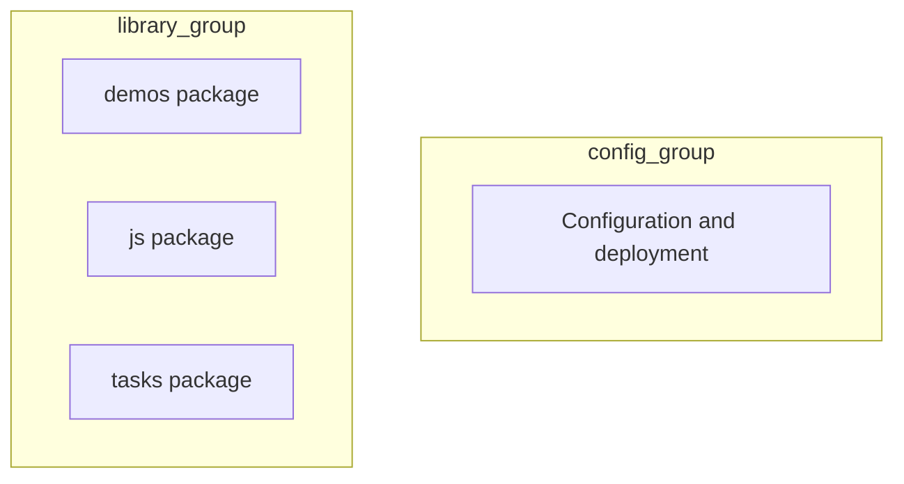

# Architecture report: metafizzy/zdog

> Automated static analysis. **Observed** = directly seen in files/imports/AST; **Inferred** = interpretation from that evidence. Repository code was not executed.

## 1. Repository at a glance

| Item | Value |
| --- | --- |
| Repository | metafizzy/zdog |
| Description | Flat, round, designer-friendly pseudo-3D engine for canvas & SVG |
| Language | JavaScript |
| Stars | 10698 |
| Licence | Not detected |
| Analysed commit / branch | dde8684be686bc6d3cbedb6be49875c0a03a14c0 / master |
| Framework(s) | None detected |
| Files analysed | 66 |
| Components | 4 |

## 2. Architecture in one minute

metafizzy/zdog - Flat, round, designer-friendly pseudo-3D engine for canvas & SVG. This repository was analysed statically from 66 file(s) (0 Python). Detected technologies (observed from imports/manifests): no known frameworks/libraries. Files are grouped into 4 component(s): Configuration and deployment, demos package, js package, tasks package. Findings below distinguish observed facts from inferred interpretation.

## 3. High-level block diagram

## 4. Main components

### Configuration and deployment (`config`)

- **Kind:** config
- **Status:** Observed
- **Confidence:** 0.85
- **Responsibility:** Groups 2 file(s) under configuration and deployment (observed from repository paths and static analysis).
- **Paths:** `bower.json`, `package.json`
- **Evidence:** [bower.json](https://github.com/metafizzy/zdog/blob/dde8684be686bc6d3cbedb6be49875c0a03a14c0/bower.json); [package.json](https://github.com/metafizzy/zdog/blob/dde8684be686bc6d3cbedb6be49875c0a03a14c0/package.json)

### demos package (`demos`)

- **Kind:** library
- **Status:** Observed
- **Confidence:** 0.85
- **Responsibility:** Groups 19 file(s) under demos package (observed from repository paths and static analysis).
- **Paths:** `demos/.eslintrc.js`, `demos/box-cross/box-cross.js`, `demos/dot-cube/dot-cube.js`, `demos/fullscreen/fullscreen.js`, `demos/hello-world-canvas/hello-world-canvas.js`, `demos/hello-world-svg/hello-world-svg.js`, `demos/hemisphere-cone-ball/hemisphere-cone-ball.js`, `demos/houses/houses.js`, `demos/kid-kit/kid-kit.js`, `demos/kirby-parasol/kirby-parasol.js`, `demos/no-illo-canvas/no-illo-canvas.js`, `demos/no-illo-svg/no-illo-svg.js`, `demos/path-commands/path-commands.js`, `demos/resize/resize.js`, `demos/shade-and-shades/shade-and-shades.js`, `demos/shapes/shapes.js`, `demos/solids/solids.js`, `demos/strutter/strutter.js`, `demos/zdog-logo/zdog-logo.js`
- **Evidence:** [demos/.eslintrc.js](https://github.com/metafizzy/zdog/blob/dde8684be686bc6d3cbedb6be49875c0a03a14c0/demos/.eslintrc.js); [demos/box-cross/box-cross.js](https://github.com/metafizzy/zdog/blob/dde8684be686bc6d3cbedb6be49875c0a03a14c0/demos/box-cross/box-cross.js); [demos/dot-cube/dot-cube.js](https://github.com/metafizzy/zdog/blob/dde8684be686bc6d3cbedb6be49875c0a03a14c0/demos/dot-cube/dot-cube.js); [demos/fullscreen/fullscreen.js](https://github.com/metafizzy/zdog/blob/dde8684be686bc6d3cbedb6be49875c0a03a14c0/demos/fullscreen/fullscreen.js); [demos/hello-world-canvas/hello-world-canvas.js](https://github.com/metafizzy/zdog/blob/dde8684be686bc6d3cbedb6be49875c0a03a14c0/demos/hello-world-canvas/hello-world-canvas.js); [demos/hello-world-svg/hello-world-svg.js](https://github.com/metafizzy/zdog/blob/dde8684be686bc6d3cbedb6be49875c0a03a14c0/demos/hello-world-svg/hello-world-svg.js); [demos/hemisphere-cone-ball/hemisphere-cone-ball.js](https://github.com/metafizzy/zdog/blob/dde8684be686bc6d3cbedb6be49875c0a03a14c0/demos/hemisphere-cone-ball/hemisphere-cone-ball.js); [demos/houses/houses.js](https://github.com/metafizzy/zdog/blob/dde8684be686bc6d3cbedb6be49875c0a03a14c0/demos/houses/houses.js)

### js package (`js`)

- **Kind:** library
- **Status:** Observed
- **Confidence:** 0.85
- **Responsibility:** Groups 19 file(s) under js package (observed from repository paths and static analysis).
- **Paths:** `js/anchor.js`, `js/boilerplate.js`, `js/box.js`, `js/canvas-renderer.js`, `js/cone.js`, `js/cylinder.js`, `js/dragger.js`, `js/ellipse.js`, `js/group.js`, `js/hemisphere.js`, `js/illustration.js`, `js/index.js`, `js/path-command.js`, `js/polygon.js`, `js/rect.js`, `js/rounded-rect.js`, `js/shape.js`, `js/svg-renderer.js`, `js/vector.js`
- **Evidence:** [js/anchor.js](https://github.com/metafizzy/zdog/blob/dde8684be686bc6d3cbedb6be49875c0a03a14c0/js/anchor.js); [js/boilerplate.js](https://github.com/metafizzy/zdog/blob/dde8684be686bc6d3cbedb6be49875c0a03a14c0/js/boilerplate.js); [js/box.js](https://github.com/metafizzy/zdog/blob/dde8684be686bc6d3cbedb6be49875c0a03a14c0/js/box.js); [js/canvas-renderer.js](https://github.com/metafizzy/zdog/blob/dde8684be686bc6d3cbedb6be49875c0a03a14c0/js/canvas-renderer.js); [js/cone.js](https://github.com/metafizzy/zdog/blob/dde8684be686bc6d3cbedb6be49875c0a03a14c0/js/cone.js); [js/cylinder.js](https://github.com/metafizzy/zdog/blob/dde8684be686bc6d3cbedb6be49875c0a03a14c0/js/cylinder.js); [js/dragger.js](https://github.com/metafizzy/zdog/blob/dde8684be686bc6d3cbedb6be49875c0a03a14c0/js/dragger.js); [js/ellipse.js](https://github.com/metafizzy/zdog/blob/dde8684be686bc6d3cbedb6be49875c0a03a14c0/js/ellipse.js)

### tasks package (`tasks`)

- **Kind:** library
- **Status:** Observed
- **Confidence:** 0.85
- **Responsibility:** Groups 3 file(s) under tasks package (observed from repository paths and static analysis).
- **Paths:** `tasks/.eslintrc.js`, `tasks/bundle.js`, `tasks/version.js`
- **Evidence:** [tasks/.eslintrc.js](https://github.com/metafizzy/zdog/blob/dde8684be686bc6d3cbedb6be49875c0a03a14c0/tasks/.eslintrc.js); [tasks/bundle.js](https://github.com/metafizzy/zdog/blob/dde8684be686bc6d3cbedb6be49875c0a03a14c0/tasks/bundle.js); [tasks/version.js](https://github.com/metafizzy/zdog/blob/dde8684be686bc6d3cbedb6be49875c0a03a14c0/tasks/version.js)

## 5. Execution flow

**Observed** entry point(s):

- [js/index.js](https://github.com/metafizzy/zdog/blob/dde8684be686bc6d3cbedb6be49875c0a03a14c0/js/index.js)

Representative flow (derived from observed entry points and the import graph; steps beyond the entry point are **Inferred**):

1. Execution starts at an observed entry point listed above, if present.
2. No internal import relationships between components were observed.

## 6. Project structure

### `(root)`

- `.eslintrc.js` - source, JavaScript (300 bytes)
- `.gitignore` - other (42 bytes)
- `README.md` - docs (3562 bytes)
- `bower.json` - config (408 bytes)
- `package.json` - manifest (1076 bytes)

### `.github`

- `.github/contributing.md` - docs (1807 bytes)
- `.github/issue_template.md` - docs (243 bytes)

### `demos`

- `demos/.eslintrc.js` - source, JavaScript (181 bytes)
- `demos/box-cross/box-cross.js` - source, JavaScript (2250 bytes)
- `demos/box-cross/index.html` - other (938 bytes)
- `demos/dot-cube/dot-cube.js` - source, JavaScript (1880 bytes)
- `demos/dot-cube/index.html` - other (917 bytes)
- `demos/fullscreen/fullscreen.js` - source, JavaScript (1104 bytes)
- `demos/fullscreen/index.html` - other (1000 bytes)
- `demos/hello-world-canvas/hello-world-canvas.js` - source, JavaScript (655 bytes)
- `demos/hello-world-canvas/index.html` - other (1169 bytes)
- `demos/hello-world-svg/hello-world-svg.js` - source, JavaScript (655 bytes)
- `demos/hello-world-svg/index.html` - other (1151 bytes)
- `demos/hemisphere-cone-ball/hemisphere-cone-ball.js` - source, JavaScript (2103 bytes)
- `demos/hemisphere-cone-ball/index.html` - other (1052 bytes)
- `demos/houses/houses.js` - source, JavaScript (3746 bytes)
- `demos/houses/index.html` - other (1220 bytes)
- `demos/kid-kit/index.html` - other (1051 bytes)
- `demos/kid-kit/kid-kit.js` - source, JavaScript (4923 bytes)
- `demos/kirby-parasol/index.html` - other (970 bytes)
- `demos/kirby-parasol/kirby-parasol.js` - source, JavaScript (5148 bytes)
- `demos/no-illo-canvas/index.html` - other (1123 bytes)
- `demos/no-illo-canvas/no-illo-canvas.js` - source, JavaScript (1683 bytes)
- `demos/no-illo-svg/index.html` - other (1099 bytes)
- `demos/no-illo-svg/no-illo-svg.js` - source, JavaScript (1629 bytes)
- `demos/path-commands/index.html` - other (1069 bytes)
- `demos/path-commands/path-commands.js` - source, JavaScript (1495 bytes)
- `demos/resize/index.html` - other (1291 bytes)
- `demos/resize/resize.js` - source, JavaScript (1607 bytes)
- `demos/shade-and-shades/index.html` - other (916 bytes)
- `demos/shade-and-shades/shade-and-shades.js` - source, JavaScript (3367 bytes)
- `demos/shapes/index.html` - other (1292 bytes)
- `demos/shapes/shapes.js` - source, JavaScript (2301 bytes)
- `demos/solids/index.html` - other (1243 bytes)
- `demos/solids/solids.js` - source, JavaScript (8997 bytes)
- `demos/strutter/index.html` - other (1078 bytes)
- `demos/strutter/strutter.js` - source, JavaScript (3911 bytes)
- `demos/zdog-logo/index.html` - other (983 bytes)
- `demos/zdog-logo/zdog-logo.js` - source, JavaScript (4865 bytes)

### `js`

- `js/anchor.js` - source, JavaScript (6168 bytes)
- `js/boilerplate.js` - source, JavaScript (1423 bytes)
- `js/box.js` - source, JavaScript (4131 bytes)
- `js/canvas-renderer.js` - source, JavaScript (1484 bytes)
- `js/cone.js` - source, JavaScript (3970 bytes)
- `js/cylinder.js` - source, JavaScript (4352 bytes)
- `js/dragger.js` - source, JavaScript (3158 bytes)
- `js/ellipse.js` - source, JavaScript (1232 bytes)
- `js/group.js` - source, JavaScript (1437 bytes)
- `js/hemisphere.js` - source, JavaScript (2923 bytes)
- `js/illustration.js` - source, JavaScript (6909 bytes)
- `js/index.js` - source, JavaScript (1705 bytes)
- `js/path-command.js` - source, JavaScript (2536 bytes)
- `js/polygon.js` - source, JavaScript (767 bytes)
- `js/rect.js` - source, JavaScript (650 bytes)
- `js/rounded-rect.js` - source, JavaScript (1551 bytes)
- `js/shape.js` - source, JavaScript (6242 bytes)
- `js/svg-renderer.js` - source, JavaScript (1872 bytes)
- `js/vector.js` - source, JavaScript (3531 bytes)

### `tasks`

- `tasks/.eslintrc.js` - source, JavaScript (179 bytes)
- `tasks/bundle.js` - source, JavaScript (631 bytes)
- `tasks/version.js` - source, JavaScript (412 bytes)

## 7. Key dependencies and integrations

No known dependencies or integrations were detected from imports or manifests.

## 8. Data and state

No database, cache, queue, or persistent-state usage was observed in the analysed files. State handling, if any, may be in-memory or in files that were not analysed.

## 9. Configuration and deployment clues

- `bower.json` (config)
- `package.json` (manifest)

## 10. Design observations

- No strong design patterns could be established from the available evidence.

These observations are interpretations (**Inferred**) of the observed structure, not guarantees about runtime design.

## 11. Limitations and unknowns

- Static analysis only: repository code was not executed, installed, or imported at runtime.
- Components and relationships are inferred from file paths, imports, and AST structure; runtime behaviour, dynamic imports, and reflection may not be visible.
- 2 file(s) were skipped during inventory (1 x lockfile excluded; 1 x vendored/generated directory excluded).
- No clear application entry point was observed in the analysed files.
- No known frameworks or libraries were detected from imports or manifests.
- Repository text was treated as untrusted data; no instructions found in repository files were followed, and likely secret values were redacted/excluded.
- JavaScript and TypeScript files were inventoried from paths and package manifests. They were not parsed with a full language AST, and repository code was not executed.

## 12. Source references

- [bower.json](https://github.com/metafizzy/zdog/blob/dde8684be686bc6d3cbedb6be49875c0a03a14c0/bower.json)
- [demos/.eslintrc.js](https://github.com/metafizzy/zdog/blob/dde8684be686bc6d3cbedb6be49875c0a03a14c0/demos/.eslintrc.js)
- [demos/box-cross/box-cross.js](https://github.com/metafizzy/zdog/blob/dde8684be686bc6d3cbedb6be49875c0a03a14c0/demos/box-cross/box-cross.js)
- [demos/dot-cube/dot-cube.js](https://github.com/metafizzy/zdog/blob/dde8684be686bc6d3cbedb6be49875c0a03a14c0/demos/dot-cube/dot-cube.js)
- [demos/fullscreen/fullscreen.js](https://github.com/metafizzy/zdog/blob/dde8684be686bc6d3cbedb6be49875c0a03a14c0/demos/fullscreen/fullscreen.js)
- [demos/hello-world-canvas/hello-world-canvas.js](https://github.com/metafizzy/zdog/blob/dde8684be686bc6d3cbedb6be49875c0a03a14c0/demos/hello-world-canvas/hello-world-canvas.js)
- [demos/hello-world-svg/hello-world-svg.js](https://github.com/metafizzy/zdog/blob/dde8684be686bc6d3cbedb6be49875c0a03a14c0/demos/hello-world-svg/hello-world-svg.js)
- [demos/hemisphere-cone-ball/hemisphere-cone-ball.js](https://github.com/metafizzy/zdog/blob/dde8684be686bc6d3cbedb6be49875c0a03a14c0/demos/hemisphere-cone-ball/hemisphere-cone-ball.js)
- [demos/houses/houses.js](https://github.com/metafizzy/zdog/blob/dde8684be686bc6d3cbedb6be49875c0a03a14c0/demos/houses/houses.js)
- [js/anchor.js](https://github.com/metafizzy/zdog/blob/dde8684be686bc6d3cbedb6be49875c0a03a14c0/js/anchor.js)
- [js/boilerplate.js](https://github.com/metafizzy/zdog/blob/dde8684be686bc6d3cbedb6be49875c0a03a14c0/js/boilerplate.js)
- [js/box.js](https://github.com/metafizzy/zdog/blob/dde8684be686bc6d3cbedb6be49875c0a03a14c0/js/box.js)
- [js/canvas-renderer.js](https://github.com/metafizzy/zdog/blob/dde8684be686bc6d3cbedb6be49875c0a03a14c0/js/canvas-renderer.js)
- [js/cone.js](https://github.com/metafizzy/zdog/blob/dde8684be686bc6d3cbedb6be49875c0a03a14c0/js/cone.js)
- [js/cylinder.js](https://github.com/metafizzy/zdog/blob/dde8684be686bc6d3cbedb6be49875c0a03a14c0/js/cylinder.js)
- [js/dragger.js](https://github.com/metafizzy/zdog/blob/dde8684be686bc6d3cbedb6be49875c0a03a14c0/js/dragger.js)
- [js/ellipse.js](https://github.com/metafizzy/zdog/blob/dde8684be686bc6d3cbedb6be49875c0a03a14c0/js/ellipse.js)
- [js/index.js](https://github.com/metafizzy/zdog/blob/dde8684be686bc6d3cbedb6be49875c0a03a14c0/js/index.js)
- [package.json](https://github.com/metafizzy/zdog/blob/dde8684be686bc6d3cbedb6be49875c0a03a14c0/package.json)
- [tasks/.eslintrc.js](https://github.com/metafizzy/zdog/blob/dde8684be686bc6d3cbedb6be49875c0a03a14c0/tasks/.eslintrc.js)
- [tasks/bundle.js](https://github.com/metafizzy/zdog/blob/dde8684be686bc6d3cbedb6be49875c0a03a14c0/tasks/bundle.js)
- [tasks/version.js](https://github.com/metafizzy/zdog/blob/dde8684be686bc6d3cbedb6be49875c0a03a14c0/tasks/version.js)
