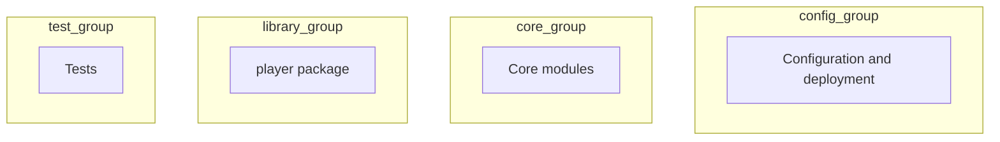

# Architecture report: mholt/PapaParse

> Automated static analysis. **Observed** = directly seen in files/imports/AST; **Inferred** = interpretation from that evidence. Repository code was not executed.

## 1. Repository at a glance

| Item | Value |
| --- | --- |
| Repository | mholt/PapaParse |
| Description | Fast and powerful CSV (delimited text) parser that gracefully handles large files and malformed input |
| Language | JavaScript |
| Stars | 13596 |
| Licence | MIT |
| Analysed commit / branch | 7fe53c8c46cf00f7b59db403af4f2a91eaa54dc4 / master |
| Framework(s) | None detected |
| Files analysed | 42 |
| Components | 4 |

## 2. Architecture in one minute

mholt/PapaParse - Fast and powerful CSV (delimited text) parser that gracefully handles large files and malformed input. This repository was analysed statically from 42 file(s) (0 Python). Detected technologies (observed from imports/manifests): GitHub Actions. Files are grouped into 4 component(s): Configuration and deployment, Core modules, player package, Tests. Findings below distinguish observed facts from inferred interpretation.

## 3. High-level block diagram

## 4. Main components

### Configuration and deployment (`config`)

- **Kind:** config
- **Status:** Observed
- **Confidence:** 0.85
- **Responsibility:** Groups 2 file(s) under configuration and deployment (observed from repository paths and static analysis).
- **Paths:** `bower.json`, `package.json`
- **Evidence:** [bower.json](https://github.com/mholt/PapaParse/blob/7fe53c8c46cf00f7b59db403af4f2a91eaa54dc4/bower.json); [package.json](https://github.com/mholt/PapaParse/blob/7fe53c8c46cf00f7b59db403af4f2a91eaa54dc4/package.json)

### Core modules (`core`)

- **Kind:** core
- **Status:** Observed
- **Confidence:** 0.85
- **Responsibility:** Groups 2 file(s) under core modules (observed from repository paths and static analysis).
- **Paths:** `Gruntfile.js`, `papaparse.js`
- **Evidence:** [Gruntfile.js](https://github.com/mholt/PapaParse/blob/7fe53c8c46cf00f7b59db403af4f2a91eaa54dc4/Gruntfile.js); [papaparse.js](https://github.com/mholt/PapaParse/blob/7fe53c8c46cf00f7b59db403af4f2a91eaa54dc4/papaparse.js)

### player package (`player`)

- **Kind:** library
- **Status:** Observed
- **Confidence:** 0.85
- **Responsibility:** Groups 1 file(s) under player package (observed from repository paths and static analysis).
- **Paths:** `player/player.js`
- **Evidence:** [player/player.js](https://github.com/mholt/PapaParse/blob/7fe53c8c46cf00f7b59db403af4f2a91eaa54dc4/player/player.js)

### Tests (`tests`)

- **Kind:** test
- **Status:** Observed
- **Confidence:** 0.85
- **Responsibility:** Groups 11 file(s) under tests (observed from repository paths and static analysis).
- **Paths:** `tests/.eslintrc.js`, `tests/long-sample.csv`, `tests/node-tests.js`, `tests/sample-header.csv`, `tests/sample.csv`, `tests/slow-sample.csv`, `tests/test-cases.js`, `tests/test.js`, `tests/tests.html`, `tests/utf-8-bom-sample.csv`, `tests/verylong-sample.csv`
- **Evidence:** [tests/.eslintrc.js](https://github.com/mholt/PapaParse/blob/7fe53c8c46cf00f7b59db403af4f2a91eaa54dc4/tests/.eslintrc.js); [tests/long-sample.csv](https://github.com/mholt/PapaParse/blob/7fe53c8c46cf00f7b59db403af4f2a91eaa54dc4/tests/long-sample.csv); [tests/node-tests.js](https://github.com/mholt/PapaParse/blob/7fe53c8c46cf00f7b59db403af4f2a91eaa54dc4/tests/node-tests.js); [tests/sample-header.csv](https://github.com/mholt/PapaParse/blob/7fe53c8c46cf00f7b59db403af4f2a91eaa54dc4/tests/sample-header.csv); [tests/sample.csv](https://github.com/mholt/PapaParse/blob/7fe53c8c46cf00f7b59db403af4f2a91eaa54dc4/tests/sample.csv); [tests/slow-sample.csv](https://github.com/mholt/PapaParse/blob/7fe53c8c46cf00f7b59db403af4f2a91eaa54dc4/tests/slow-sample.csv); [tests/test-cases.js](https://github.com/mholt/PapaParse/blob/7fe53c8c46cf00f7b59db403af4f2a91eaa54dc4/tests/test-cases.js); [tests/test.js](https://github.com/mholt/PapaParse/blob/7fe53c8c46cf00f7b59db403af4f2a91eaa54dc4/tests/test.js)

## 5. Execution flow

**Observed** entry point(s):

- [papaparse.js](https://github.com/mholt/PapaParse/blob/7fe53c8c46cf00f7b59db403af4f2a91eaa54dc4/papaparse.js)

Representative flow (derived from observed entry points and the import graph; steps beyond the entry point are **Inferred**):

1. Execution starts at an observed entry point listed above, if present.
2. No internal import relationships between components were observed.

## 6. Project structure

### `(root)`

- `.eslintrc.js` - source, JavaScript (7017 bytes)
- `.gitignore` - other (72 bytes)
- `.npmignore` - other (50 bytes)
- `CHANGELOG.md` - docs (2846 bytes)
- `Gruntfile.js` - source, JavaScript (462 bytes)
- `LICENSE` - docs (1079 bytes)
- `README.md` - docs (3392 bytes)
- `bower.json` - config (653 bytes)
- `package.json` - manifest (1399 bytes)
- `papaparse.js` - source, JavaScript (51769 bytes)

### `.github`

- `.github/workflows/node.js.yml` - ci, YAML (831 bytes)

### `docs`

- `docs/CNAME` - docs (17 bytes)
- `docs/Caddyfile` - docs (19 bytes)
- `docs/demo.html` - docs (8042 bytes)
- `docs/docs.html` - docs (33203 bytes)
- `docs/faq.html` - docs (15628 bytes)
- `docs/index.html` - docs (18369 bytes)
- `docs/resources/css/common.css` - docs (7025 bytes)
- `docs/resources/css/demo.css` - docs (2012 bytes)
- `docs/resources/css/home.css` - docs (3352 bytes)
- `docs/resources/css/tomorrow.highlight.css` - docs (1475 bytes)
- `docs/resources/css/unsemantic.css` - docs (12902 bytes)
- `docs/resources/files/malformed.tsv` - docs (367 bytes)
- `docs/resources/js/common.js` - docs (585 bytes)
- `docs/resources/js/demo.js` - docs (5346 bytes)
- `docs/resources/js/home.js` - docs (10307 bytes)
- `docs/resources/js/lovers.js` - docs (5822 bytes)
- `docs/resources/js/papaparse.js` - docs (50646 bytes)

### `player`

- `player/player.css` - other (12326 bytes)
- `player/player.html` - other (2967 bytes)
- `player/player.js` - source, JavaScript (4050 bytes)

### `tests`

- `tests/.eslintrc.js` - test, JavaScript (144 bytes)
- `tests/long-sample.csv` - test (1209 bytes)
- `tests/node-tests.js` - test, JavaScript (8274 bytes)
- `tests/sample-header.csv` - test (52 bytes)
- `tests/sample.csv` - test (11 bytes)
- `tests/slow-sample.csv` - test (12 bytes)
- `tests/test-cases.js` - test, JavaScript (84459 bytes)
- `tests/test.js` - test, JavaScript (948 bytes)
- `tests/tests.html` - test (723 bytes)
- `tests/utf-8-bom-sample.csv` - test (15 bytes)
- `tests/verylong-sample.csv` - test (70940 bytes)

## 7. Key dependencies and integrations

| Name | Category | Status | Confidence | Evidence |
| --- | --- | --- | --- | --- |
| GitHub Actions | ci | Observed | 0.85 | [.github/workflows/node.js.yml](https://github.com/mholt/PapaParse/blob/7fe53c8c46cf00f7b59db403af4f2a91eaa54dc4/.github/workflows/node.js.yml) |

## 8. Data and state

No database, cache, queue, or persistent-state usage was observed in the analysed files. State handling, if any, may be in-memory or in files that were not analysed.

## 9. Configuration and deployment clues

- `.github/workflows/node.js.yml` (ci)
- `bower.json` (config)
- `package.json` (manifest)

## 10. Design observations

- Tests are present alongside source code (Observed from test file paths).

These observations are interpretations (**Inferred**) of the observed structure, not guarantees about runtime design.

## 11. Limitations and unknowns

- Static analysis only: repository code was not executed, installed, or imported at runtime.
- Components and relationships are inferred from file paths, imports, and AST structure; runtime behaviour, dynamic imports, and reflection may not be visible.
- No clear application entry point was observed in the analysed files.
- Repository text was treated as untrusted data; no instructions found in repository files were followed, and likely secret values were redacted/excluded.
- JavaScript and TypeScript files were inventoried from paths and package manifests. They were not parsed with a full language AST, and repository code was not executed.

## 12. Source references

- [.github/workflows/node.js.yml](https://github.com/mholt/PapaParse/blob/7fe53c8c46cf00f7b59db403af4f2a91eaa54dc4/.github/workflows/node.js.yml)
- [Gruntfile.js](https://github.com/mholt/PapaParse/blob/7fe53c8c46cf00f7b59db403af4f2a91eaa54dc4/Gruntfile.js)
- [bower.json](https://github.com/mholt/PapaParse/blob/7fe53c8c46cf00f7b59db403af4f2a91eaa54dc4/bower.json)
- [package.json](https://github.com/mholt/PapaParse/blob/7fe53c8c46cf00f7b59db403af4f2a91eaa54dc4/package.json)
- [papaparse.js](https://github.com/mholt/PapaParse/blob/7fe53c8c46cf00f7b59db403af4f2a91eaa54dc4/papaparse.js)
- [player/player.js](https://github.com/mholt/PapaParse/blob/7fe53c8c46cf00f7b59db403af4f2a91eaa54dc4/player/player.js)
- [tests/.eslintrc.js](https://github.com/mholt/PapaParse/blob/7fe53c8c46cf00f7b59db403af4f2a91eaa54dc4/tests/.eslintrc.js)
- [tests/long-sample.csv](https://github.com/mholt/PapaParse/blob/7fe53c8c46cf00f7b59db403af4f2a91eaa54dc4/tests/long-sample.csv)
- [tests/node-tests.js](https://github.com/mholt/PapaParse/blob/7fe53c8c46cf00f7b59db403af4f2a91eaa54dc4/tests/node-tests.js)
- [tests/sample-header.csv](https://github.com/mholt/PapaParse/blob/7fe53c8c46cf00f7b59db403af4f2a91eaa54dc4/tests/sample-header.csv)
- [tests/sample.csv](https://github.com/mholt/PapaParse/blob/7fe53c8c46cf00f7b59db403af4f2a91eaa54dc4/tests/sample.csv)
- [tests/slow-sample.csv](https://github.com/mholt/PapaParse/blob/7fe53c8c46cf00f7b59db403af4f2a91eaa54dc4/tests/slow-sample.csv)
- [tests/test-cases.js](https://github.com/mholt/PapaParse/blob/7fe53c8c46cf00f7b59db403af4f2a91eaa54dc4/tests/test-cases.js)
- [tests/test.js](https://github.com/mholt/PapaParse/blob/7fe53c8c46cf00f7b59db403af4f2a91eaa54dc4/tests/test.js)
