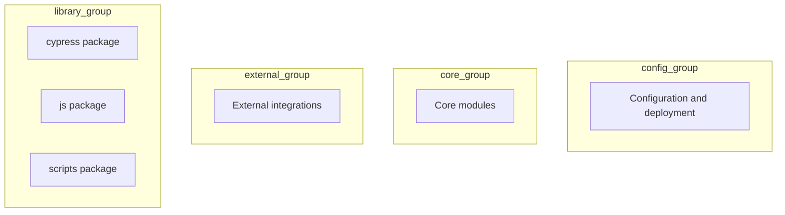

# Architecture report: michalsnik/aos

> Automated static analysis. **Observed** = directly seen in files/imports/AST; **Inferred** = interpretation from that evidence. Repository code was not executed.

## 1. Repository at a glance

| Item | Value |
| --- | --- |
| Repository | michalsnik/aos |
| Description | Animate on scroll library |
| Language | JavaScript |
| Stars | 28054 |
| Licence | MIT |
| Analysed commit / branch | 329fb34f777034345f4d3f4def4dc3bcc300cc2e / next |
| Framework(s) | None detected |
| Files analysed | 57 |
| Components | 6 |

## 2. Architecture in one minute

michalsnik/aos - Animate on scroll library. This repository was analysed statically from 57 file(s) (0 Python). Detected technologies (observed from imports/manifests): no known frameworks/libraries. Files are grouped into 6 component(s): Configuration and deployment, Core modules, cypress package, External integrations, js package, scripts package. Findings below distinguish observed facts from inferred interpretation.

## 3. High-level block diagram

## 4. Main components

### Configuration and deployment (`config`)

- **Kind:** config
- **Status:** Observed
- **Confidence:** 0.85
- **Responsibility:** Groups 2 file(s) under configuration and deployment (observed from repository paths and static analysis).
- **Paths:** `cypress.json`, `package.json`
- **Evidence:** [cypress.json](https://github.com/michalsnik/aos/blob/329fb34f777034345f4d3f4def4dc3bcc300cc2e/cypress.json); [package.json](https://github.com/michalsnik/aos/blob/329fb34f777034345f4d3f4def4dc3bcc300cc2e/package.json)

### Core modules (`core`)

- **Kind:** core
- **Status:** Observed
- **Confidence:** 0.85
- **Responsibility:** Groups 1 file(s) under core modules (observed from repository paths and static analysis).
- **Paths:** `rollup.config.js`
- **Evidence:** [rollup.config.js](https://github.com/michalsnik/aos/blob/329fb34f777034345f4d3f4def4dc3bcc300cc2e/rollup.config.js)

### cypress package (`cypress`)

- **Kind:** library
- **Status:** Observed
- **Confidence:** 0.85
- **Responsibility:** Groups 3 file(s) under cypress package (observed from repository paths and static analysis).
- **Paths:** `cypress/plugins/index.js`, `cypress/support/commands.js`, `cypress/support/index.js`
- **Evidence:** [cypress/plugins/index.js](https://github.com/michalsnik/aos/blob/329fb34f777034345f4d3f4def4dc3bcc300cc2e/cypress/plugins/index.js); [cypress/support/commands.js](https://github.com/michalsnik/aos/blob/329fb34f777034345f4d3f4def4dc3bcc300cc2e/cypress/support/commands.js); [cypress/support/index.js](https://github.com/michalsnik/aos/blob/329fb34f777034345f4d3f4def4dc3bcc300cc2e/cypress/support/index.js)

### External integrations (`external_integrations`)

- **Kind:** external
- **Status:** Observed
- **Confidence:** 0.85
- **Responsibility:** Groups 17 file(s) under external integrations (observed from repository paths and static analysis).
- **Paths:** `cypress/integration/aos_spec.js`, `cypress/integration/js_events_spec.js`, `cypress/integration/mutation_spec.js`, `cypress/integration/settings_anchorPlacement_spec.js`, `cypress/integration/settings_anchor_spec.js`, `cypress/integration/settings_animatedClassName_spec.js`, `cypress/integration/settings_delay_spec.js`, `cypress/integration/settings_disableMutationObserver_spec.js`, `cypress/integration/settings_disable_spec.js`, `cypress/integration/settings_duration_spec.js`, `cypress/integration/settings_easing_spec.js`, `cypress/integration/settings_initClassName_spec.js`, `cypress/integration/settings_mirror.js`, `cypress/integration/settings_offset_spec.js`, `cypress/integration/settings_once_spec.js`, `cypress/integration/settings_startEvent_spec.js`, `cypress/integration/settings_useClassNames.js`
- **Evidence:** [cypress/integration/aos_spec.js](https://github.com/michalsnik/aos/blob/329fb34f777034345f4d3f4def4dc3bcc300cc2e/cypress/integration/aos_spec.js); [cypress/integration/js_events_spec.js](https://github.com/michalsnik/aos/blob/329fb34f777034345f4d3f4def4dc3bcc300cc2e/cypress/integration/js_events_spec.js); [cypress/integration/mutation_spec.js](https://github.com/michalsnik/aos/blob/329fb34f777034345f4d3f4def4dc3bcc300cc2e/cypress/integration/mutation_spec.js); [cypress/integration/settings_anchorPlacement_spec.js](https://github.com/michalsnik/aos/blob/329fb34f777034345f4d3f4def4dc3bcc300cc2e/cypress/integration/settings_anchorPlacement_spec.js); [cypress/integration/settings_anchor_spec.js](https://github.com/michalsnik/aos/blob/329fb34f777034345f4d3f4def4dc3bcc300cc2e/cypress/integration/settings_anchor_spec.js); [cypress/integration/settings_animatedClassName_spec.js](https://github.com/michalsnik/aos/blob/329fb34f777034345f4d3f4def4dc3bcc300cc2e/cypress/integration/settings_animatedClassName_spec.js); [cypress/integration/settings_delay_spec.js](https://github.com/michalsnik/aos/blob/329fb34f777034345f4d3f4def4dc3bcc300cc2e/cypress/integration/settings_delay_spec.js); [cypress/integration/settings_disableMutationObserver_spec.js](https://github.com/michalsnik/aos/blob/329fb34f777034345f4d3f4def4dc3bcc300cc2e/cypress/integration/settings_disableMutationObserver_spec.js)

### js package (`js`)

- **Kind:** library
- **Status:** Observed
- **Confidence:** 0.85
- **Responsibility:** Groups 9 file(s) under js package (observed from repository paths and static analysis).
- **Paths:** `src/js/aos.js`, `src/js/helpers/detector.js`, `src/js/helpers/elements.js`, `src/js/helpers/getInlineOption.js`, `src/js/helpers/handleScroll.js`, `src/js/helpers/offsetCalculator.js`, `src/js/helpers/prepare.js`, `src/js/libs/observer.js`, `src/js/libs/offset.js`
- **Evidence:** [src/js/aos.js](https://github.com/michalsnik/aos/blob/329fb34f777034345f4d3f4def4dc3bcc300cc2e/src/js/aos.js); [src/js/helpers/detector.js](https://github.com/michalsnik/aos/blob/329fb34f777034345f4d3f4def4dc3bcc300cc2e/src/js/helpers/detector.js); [src/js/helpers/elements.js](https://github.com/michalsnik/aos/blob/329fb34f777034345f4d3f4def4dc3bcc300cc2e/src/js/helpers/elements.js); [src/js/helpers/getInlineOption.js](https://github.com/michalsnik/aos/blob/329fb34f777034345f4d3f4def4dc3bcc300cc2e/src/js/helpers/getInlineOption.js); [src/js/helpers/handleScroll.js](https://github.com/michalsnik/aos/blob/329fb34f777034345f4d3f4def4dc3bcc300cc2e/src/js/helpers/handleScroll.js); [src/js/helpers/offsetCalculator.js](https://github.com/michalsnik/aos/blob/329fb34f777034345f4d3f4def4dc3bcc300cc2e/src/js/helpers/offsetCalculator.js); [src/js/helpers/prepare.js](https://github.com/michalsnik/aos/blob/329fb34f777034345f4d3f4def4dc3bcc300cc2e/src/js/helpers/prepare.js); [src/js/libs/observer.js](https://github.com/michalsnik/aos/blob/329fb34f777034345f4d3f4def4dc3bcc300cc2e/src/js/libs/observer.js)

### scripts package (`scripts`)

- **Kind:** library
- **Status:** Observed
- **Confidence:** 0.85
- **Responsibility:** Groups 2 file(s) under scripts package (observed from repository paths and static analysis).
- **Paths:** `scripts/run-cypress-tests.js`, `scripts/start-server.js`
- **Evidence:** [scripts/run-cypress-tests.js](https://github.com/michalsnik/aos/blob/329fb34f777034345f4d3f4def4dc3bcc300cc2e/scripts/run-cypress-tests.js); [scripts/start-server.js](https://github.com/michalsnik/aos/blob/329fb34f777034345f4d3f4def4dc3bcc300cc2e/scripts/start-server.js)

## 5. Execution flow

**Observed** entry point(s):

- [cypress/plugins/index.js](https://github.com/michalsnik/aos/blob/329fb34f777034345f4d3f4def4dc3bcc300cc2e/cypress/plugins/index.js)
- [cypress/support/index.js](https://github.com/michalsnik/aos/blob/329fb34f777034345f4d3f4def4dc3bcc300cc2e/cypress/support/index.js)

Representative flow (derived from observed entry points and the import graph; steps beyond the entry point are **Inferred**):

1. Execution starts at an observed entry point listed above, if present.
2. No internal import relationships between components were observed.

## 6. Project structure

### `(root)`

- `.babelrc` - other (141 bytes)
- `.editorconfig` - config (208 bytes)
- `.eslintrc.json` - config (220 bytes)
- `.gitattributes` - other (222 bytes)
- `.gitignore` - other (353 bytes)
- `.npmignore` - other (40 bytes)
- `.travis.yml` - ci, YAML (60 bytes)
- `CONTRIBUTING.md` - docs (1169 bytes)
- `ISSUE_TEMPLATE.md` - docs (866 bytes)
- `LICENSE` - docs (1083 bytes)
- `PULL_REQUEST_TEMPLATE.md` - docs (685 bytes)
- `README.md` - docs (10772 bytes)
- `cypress.json` - config (91 bytes)
- `package.json` - manifest (1770 bytes)
- `rollup.config.js` - source, JavaScript (1066 bytes)

### `cypress`

- `cypress/integration/aos_spec.js` - source, JavaScript (1757 bytes)
- `cypress/integration/js_events_spec.js` - source, JavaScript (1643 bytes)
- `cypress/integration/mutation_spec.js` - source, JavaScript (1747 bytes)
- `cypress/integration/settings_anchorPlacement_spec.js` - source, JavaScript (2011 bytes)
- `cypress/integration/settings_anchor_spec.js` - source, JavaScript (1607 bytes)
- `cypress/integration/settings_animatedClassName_spec.js` - source, JavaScript (900 bytes)
- `cypress/integration/settings_delay_spec.js` - source, JavaScript (433 bytes)
- `cypress/integration/settings_disableMutationObserver_spec.js` - source, JavaScript (598 bytes)
- `cypress/integration/settings_disable_spec.js` - source, JavaScript (750 bytes)
- `cypress/integration/settings_duration_spec.js` - source, JavaScript (455 bytes)
- `cypress/integration/settings_easing_spec.js` - source, JavaScript (462 bytes)
- `cypress/integration/settings_initClassName_spec.js` - source, JavaScript (666 bytes)
- `cypress/integration/settings_mirror.js` - source, JavaScript (1038 bytes)
- `cypress/integration/settings_offset_spec.js` - source, JavaScript (2338 bytes)
- `cypress/integration/settings_once_spec.js` - source, JavaScript (1885 bytes)
- `cypress/integration/settings_startEvent_spec.js` - source, JavaScript (806 bytes)
- `cypress/integration/settings_useClassNames.js` - source, JavaScript (1298 bytes)
- `cypress/plugins/index.js` - source, JavaScript (257 bytes)
- `cypress/support/commands.js` - source, JavaScript (350 bytes)
- `cypress/support/index.js` - source, JavaScript (21 bytes)

### `demo`

- `demo/anchor.html` - other (2782 bytes)
- `demo/animatecss.html` - other (2515 bytes)
- `demo/async.html` - other (1136 bytes)
- `demo/css/styles.css` - other (2272 bytes)
- `demo/index.html` - other (2738 bytes)
- `demo/offset.html` - other (2896 bytes)
- `demo/once.html` - other (2149 bytes)

### `scripts`

- `scripts/run-cypress-tests.js` - source, JavaScript (180 bytes)
- `scripts/start-server.js` - source, JavaScript (309 bytes)

### `src`

- `src/js/aos.js` - source, JavaScript (5850 bytes)
- `src/js/helpers/detector.js` - source, JavaScript (4641 bytes)
- `src/js/helpers/elements.js` - source, JavaScript (298 bytes)
- `src/js/helpers/getInlineOption.js` - source, JavaScript (533 bytes)
- `src/js/helpers/handleScroll.js` - source, JavaScript (1994 bytes)
- `src/js/helpers/offsetCalculator.js` - source, JavaScript (2270 bytes)
- `src/js/helpers/prepare.js` - source, JavaScript (1086 bytes)
- `src/js/libs/observer.js` - source, JavaScript (1304 bytes)
- `src/js/libs/offset.js` - source, JavaScript (525 bytes)
- `src/sass/_animations.scss` - other (3968 bytes)
- `src/sass/_core.scss` - other (502 bytes)
- `src/sass/_easing.scss` - other (1297 bytes)
- `src/sass/aos.scss` - other (56 bytes)

## 7. Key dependencies and integrations

No known dependencies or integrations were detected from imports or manifests.

## 8. Data and state

No database, cache, queue, or persistent-state usage was observed in the analysed files. State handling, if any, may be in-memory or in files that were not analysed.

## 9. Configuration and deployment clues

- `.editorconfig` (config)
- `.eslintrc.json` (config)
- `.travis.yml` (ci)
- `cypress.json` (config)
- `package.json` (manifest)

## 10. Design observations

- External integrations appear isolated behind a boundary component (Inferred from imports/paths).

These observations are interpretations (**Inferred**) of the observed structure, not guarantees about runtime design.

## 11. Limitations and unknowns

- Static analysis only: repository code was not executed, installed, or imported at runtime.
- Components and relationships are inferred from file paths, imports, and AST structure; runtime behaviour, dynamic imports, and reflection may not be visible.
- 1 file(s) were skipped during inventory (1 x lockfile excluded).
- No clear application entry point was observed in the analysed files.
- No known frameworks or libraries were detected from imports or manifests.
- Repository text was treated as untrusted data; no instructions found in repository files were followed, and likely secret values were redacted/excluded.
- JavaScript and TypeScript files were inventoried from paths and package manifests. They were not parsed with a full language AST, and repository code was not executed.

## 12. Source references

- [cypress.json](https://github.com/michalsnik/aos/blob/329fb34f777034345f4d3f4def4dc3bcc300cc2e/cypress.json)
- [cypress/integration/aos_spec.js](https://github.com/michalsnik/aos/blob/329fb34f777034345f4d3f4def4dc3bcc300cc2e/cypress/integration/aos_spec.js)
- [cypress/integration/js_events_spec.js](https://github.com/michalsnik/aos/blob/329fb34f777034345f4d3f4def4dc3bcc300cc2e/cypress/integration/js_events_spec.js)
- [cypress/integration/mutation_spec.js](https://github.com/michalsnik/aos/blob/329fb34f777034345f4d3f4def4dc3bcc300cc2e/cypress/integration/mutation_spec.js)
- [cypress/integration/settings_anchorPlacement_spec.js](https://github.com/michalsnik/aos/blob/329fb34f777034345f4d3f4def4dc3bcc300cc2e/cypress/integration/settings_anchorPlacement_spec.js)
- [cypress/integration/settings_anchor_spec.js](https://github.com/michalsnik/aos/blob/329fb34f777034345f4d3f4def4dc3bcc300cc2e/cypress/integration/settings_anchor_spec.js)
- [cypress/integration/settings_animatedClassName_spec.js](https://github.com/michalsnik/aos/blob/329fb34f777034345f4d3f4def4dc3bcc300cc2e/cypress/integration/settings_animatedClassName_spec.js)
- [cypress/integration/settings_delay_spec.js](https://github.com/michalsnik/aos/blob/329fb34f777034345f4d3f4def4dc3bcc300cc2e/cypress/integration/settings_delay_spec.js)
- [cypress/integration/settings_disableMutationObserver_spec.js](https://github.com/michalsnik/aos/blob/329fb34f777034345f4d3f4def4dc3bcc300cc2e/cypress/integration/settings_disableMutationObserver_spec.js)
- [cypress/plugins/index.js](https://github.com/michalsnik/aos/blob/329fb34f777034345f4d3f4def4dc3bcc300cc2e/cypress/plugins/index.js)
- [cypress/support/commands.js](https://github.com/michalsnik/aos/blob/329fb34f777034345f4d3f4def4dc3bcc300cc2e/cypress/support/commands.js)
- [cypress/support/index.js](https://github.com/michalsnik/aos/blob/329fb34f777034345f4d3f4def4dc3bcc300cc2e/cypress/support/index.js)
- [package.json](https://github.com/michalsnik/aos/blob/329fb34f777034345f4d3f4def4dc3bcc300cc2e/package.json)
- [rollup.config.js](https://github.com/michalsnik/aos/blob/329fb34f777034345f4d3f4def4dc3bcc300cc2e/rollup.config.js)
- [scripts/run-cypress-tests.js](https://github.com/michalsnik/aos/blob/329fb34f777034345f4d3f4def4dc3bcc300cc2e/scripts/run-cypress-tests.js)
- [scripts/start-server.js](https://github.com/michalsnik/aos/blob/329fb34f777034345f4d3f4def4dc3bcc300cc2e/scripts/start-server.js)
- [src/js/aos.js](https://github.com/michalsnik/aos/blob/329fb34f777034345f4d3f4def4dc3bcc300cc2e/src/js/aos.js)
- [src/js/helpers/detector.js](https://github.com/michalsnik/aos/blob/329fb34f777034345f4d3f4def4dc3bcc300cc2e/src/js/helpers/detector.js)
- [src/js/helpers/elements.js](https://github.com/michalsnik/aos/blob/329fb34f777034345f4d3f4def4dc3bcc300cc2e/src/js/helpers/elements.js)
- [src/js/helpers/getInlineOption.js](https://github.com/michalsnik/aos/blob/329fb34f777034345f4d3f4def4dc3bcc300cc2e/src/js/helpers/getInlineOption.js)
- [src/js/helpers/handleScroll.js](https://github.com/michalsnik/aos/blob/329fb34f777034345f4d3f4def4dc3bcc300cc2e/src/js/helpers/handleScroll.js)
- [src/js/helpers/offsetCalculator.js](https://github.com/michalsnik/aos/blob/329fb34f777034345f4d3f4def4dc3bcc300cc2e/src/js/helpers/offsetCalculator.js)
- [src/js/helpers/prepare.js](https://github.com/michalsnik/aos/blob/329fb34f777034345f4d3f4def4dc3bcc300cc2e/src/js/helpers/prepare.js)
- [src/js/libs/observer.js](https://github.com/michalsnik/aos/blob/329fb34f777034345f4d3f4def4dc3bcc300cc2e/src/js/libs/observer.js)
