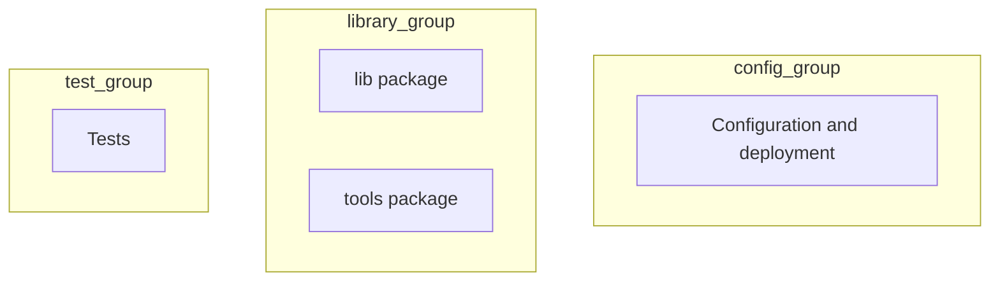

# Architecture report: mishoo/UglifyJS

> Automated static analysis. **Observed** = directly seen in files/imports/AST; **Inferred** = interpretation from that evidence. Repository code was not executed.

## 1. Repository at a glance

| Item | Value |
| --- | --- |
| Repository | mishoo/UglifyJS |
| Description |  JavaScript parser / mangler / compressor / beautifier toolkit |
| Language | JavaScript |
| Stars | 13365 |
| Licence | Other |
| Analysed commit / branch | 111746bbae5f55c88e3b82b42f14fd0f3129ea53 / master |
| Framework(s) | None detected |
| Files analysed | 278 |
| Components | 4 |

## 2. Architecture in one minute

mishoo/UglifyJS -  JavaScript parser / mangler / compressor / beautifier toolkit. This repository was analysed statically from 278 file(s) (0 Python). Detected technologies (observed from imports/manifests): GitHub Actions. Files are grouped into 4 component(s): Configuration and deployment, lib package, Tests, tools package. Findings below distinguish observed facts from inferred interpretation.

## 3. High-level block diagram

## 4. Main components

### Configuration and deployment (`config`)

- **Kind:** config
- **Status:** Observed
- **Confidence:** 0.85
- **Responsibility:** Groups 2 file(s) under configuration and deployment (observed from repository paths and static analysis).
- **Paths:** `package.json`, `tools/domprops.json`
- **Evidence:** [package.json](https://github.com/mishoo/UglifyJS/blob/111746bbae5f55c88e3b82b42f14fd0f3129ea53/package.json); [tools/domprops.json](https://github.com/mishoo/UglifyJS/blob/111746bbae5f55c88e3b82b42f14fd0f3129ea53/tools/domprops.json)

### lib package (`lib`)

- **Kind:** library
- **Status:** Observed
- **Confidence:** 0.85
- **Responsibility:** Groups 10 file(s) under lib package (observed from repository paths and static analysis).
- **Paths:** `lib/ast.js`, `lib/minify.js`, `lib/mozilla-ast.js`, `lib/output.js`, `lib/parse.js`, `lib/propmangle.js`, `lib/scope.js`, `lib/sourcemap.js`, `lib/transform.js`, `lib/utils.js`
- **Evidence:** [lib/ast.js](https://github.com/mishoo/UglifyJS/blob/111746bbae5f55c88e3b82b42f14fd0f3129ea53/lib/ast.js); [lib/minify.js](https://github.com/mishoo/UglifyJS/blob/111746bbae5f55c88e3b82b42f14fd0f3129ea53/lib/minify.js); [lib/mozilla-ast.js](https://github.com/mishoo/UglifyJS/blob/111746bbae5f55c88e3b82b42f14fd0f3129ea53/lib/mozilla-ast.js); [lib/output.js](https://github.com/mishoo/UglifyJS/blob/111746bbae5f55c88e3b82b42f14fd0f3129ea53/lib/output.js); [lib/parse.js](https://github.com/mishoo/UglifyJS/blob/111746bbae5f55c88e3b82b42f14fd0f3129ea53/lib/parse.js); [lib/propmangle.js](https://github.com/mishoo/UglifyJS/blob/111746bbae5f55c88e3b82b42f14fd0f3129ea53/lib/propmangle.js); [lib/scope.js](https://github.com/mishoo/UglifyJS/blob/111746bbae5f55c88e3b82b42f14fd0f3129ea53/lib/scope.js); [lib/sourcemap.js](https://github.com/mishoo/UglifyJS/blob/111746bbae5f55c88e3b82b42f14fd0f3129ea53/lib/sourcemap.js)

### Tests (`tests`)

- **Kind:** test
- **Status:** Observed
- **Confidence:** 0.85
- **Responsibility:** Groups 251 file(s) under tests (observed from repository paths and static analysis).
- **Paths:** `test/benchmark.js`, `test/compress.js`, `test/compress/annotations.js`, `test/compress/arguments.js`, `test/compress/arrays.js`, `test/compress/arrows.js`, `test/compress/asm.js`, `test/compress/assignments.js`, `test/compress/awaits.js`, `test/compress/bigint.js`, `test/compress/blocks.js`, `test/compress/booleans.js`, `test/compress/classes.js`, `test/compress/comparisons.js`, `test/compress/concat-strings.js`, `test/compress/conditionals.js`, `test/compress/const.js`, `test/compress/dead-code.js`, `test/compress/debugger.js`, `test/compress/default-values.js`, `test/compress/destructured.js`, `test/compress/directives.js`, `test/compress/drop-console.js`, `test/compress/drop-unused.js`, `test/compress/evaluate.js`, `test/compress/exponentiation.js`, `test/compress/exports.js`, `test/compress/functions.js`, `test/compress/global_defs.js`, `test/compress/hoist_props.js`, `test/compress/hoist_vars.js`, `test/compress/html_comments.js`, `test/compress/ie.js`, `test/compress/if_return.js`, `test/compress/imports.js`, `test/compress/indentation.js`, `test/compress/issue-1034.js`, `test/compress/issue-1041.js`, `test/compress/issue-1052.js`, `test/compress/issue-1105.js`, `test/compress/issue-12.js`, `test/compress/issue-1202.js`, `test/compress/issue-126.js`, `test/compress/issue-1261.js`, `test/compress/issue-1275.js`, `test/compress/issue-1321.js`, `test/compress/issue-143.js`, `test/compress/issue-1431.js`, `test/compress/issue-1443.js`, `test/compress/issue-1446.js`, `test/compress/issue-1447.js`, `test/compress/issue-1569.js`, `test/compress/issue-1588.js`, `test/compress/issue-1609.js`, `test/compress/issue-1639.js`, `test/compress/issue-1656.js`, `test/compress/issue-1673.js`, `test/compress/issue-1704.js`, `test/compress/issue-1733.js`, `test/compress/issue-1750.js`, `test/compress/issue-1770.js`, `test/compress/issue-1787.js`, `test/compress/issue-1833.js`, `test/compress/issue-1943.js`, `test/compress/issue-208.js`, `test/compress/issue-22.js`, `test/compress/issue-2652.js`, `test/compress/issue-267.js`, `test/compress/issue-269.js`, `test/compress/issue-2719.js`, `test/compress/issue-281.js`, `test/compress/issue-2871.js`, `test/compress/issue-2989.js`, `test/compress/issue-368.js`, `test/compress/issue-3768.js`, `test/compress/issue-44.js`, `test/compress/issue-5614.js`, `test/compress/issue-59.js`, `test/compress/issue-597.js`, `test/compress/issue-611.js`, `test/compress/issue-637.js`, `test/compress/issue-640.js`, `test/compress/issue-747.js`, `test/compress/issue-751.js`, `test/compress/issue-782.js`, `test/compress/issue-892.js`, `test/compress/issue-913.js`, `test/compress/issue-973.js`, `test/compress/issue-976.js`, `test/compress/issue-979.js`, `test/compress/join_vars.js`, `test/compress/keep_fargs.js`, `test/compress/labels.js`, `test/compress/let.js`, `test/compress/loops.js`, `test/compress/max_line_len.js`, `test/compress/merge_vars.js`, `test/compress/negate-iife.js`, `test/compress/new.js`, `test/compress/node_version.js`, `test/compress/nullish.js`, `test/compress/numbers.js`, `test/compress/objects.js`, `test/compress/optional-chains.js`, `test/compress/preserve_line.js`, `test/compress/properties.js`, `test/compress/pure_funcs.js`, `test/compress/pure_getters.js`, `test/compress/reduce_vars.js`, `test/compress/regexp.js`, `test/compress/rename.js`, `test/compress/rests.js`, `test/compress/return_undefined.js`, `test/compress/sandbox.js`, `test/compress/sequences.js`, `test/compress/side_effects.js`, `test/compress/spreads.js`, `test/compress/string-literal.js`, `test/compress/switches.js`, `test/compress/templates.js`, `test/compress/transform.js`, `test/compress/typeof.js`, `test/compress/unicode.js`, `test/compress/varify.js`, `test/compress/webkit.js`, `test/compress/wrap_iife.js`, `test/compress/yields.js`, `test/exports.js`, `test/fetch.js`, `test/input/comments/filter.js`, `test/input/enclose/input.js`, `test/input/global_defs/nested.js`, `test/input/global_defs/simple.js`, `test/input/invalid/assign_1.js`, `test/input/invalid/assign_2.js`, `test/input/invalid/assign_3.js`, `test/input/invalid/assign_4.js`, `test/input/invalid/assign_5.js`, `test/input/invalid/delete.js`, `test/input/invalid/destructured_var.js`, `test/input/invalid/dot_1.js`, `test/input/invalid/dot_2.js`, `test/input/invalid/dot_3.js`, `test/input/invalid/else.js`, `test/input/invalid/eof.js`, `test/input/invalid/for-await.js`, `test/input/invalid/for-in_1.js`, `test/input/invalid/for-in_2.js`, `test/input/invalid/for-of_1.js`, `test/input/invalid/for-of_2.js`, `test/input/invalid/function_1.js`, `test/input/invalid/function_2.js`, `test/input/invalid/function_3.js`, `test/input/invalid/loop-no-body.js`, `test/input/invalid/object.js`, `test/input/invalid/optional-template.js`, `test/input/invalid/return.js`, `test/input/invalid/simple.js`, `test/input/invalid/switch.js`, `test/input/invalid/tab.js`, `test/input/invalid/try.js`, `test/input/invalid/var.js`, `test/input/issue-1236/simple.js`, `test/input/issue-1242/bar.es5`, `test/input/issue-1242/baz.es5`, `test/input/issue-1242/foo.es5`, `test/input/issue-1242/qux.js`, `test/input/issue-1323/sample.js`, `test/input/issue-1431/sample.js`, `test/input/issue-1482/beautify.js`, `test/input/issue-1482/braces.js`, `test/input/issue-1482/default.js`, `test/input/issue-1482/input.js`, `test/input/issue-1632/^{foo}[bar](baz)+$.js`, `test/input/issue-2082/sample.js`, `test/input/issue-2310/input.js`, `test/input/issue-3040/expect.js`, `test/input/issue-3040/input.js`, `test/input/issue-3294/input.js`, `test/input/issue-3294/output.js`, `test/input/issue-3315/config.json`, `test/input/issue-3315/input.js`, `test/input/issue-3441/input.js`, `test/input/issue-505/input.js`, `test/input/issue-505/output.js`, `test/input/issue-520/input.js`, `test/input/issue-520/output.js`, `test/input/module/expect.js`, `test/input/module/input.js`, `test/input/reduce/destructured_assign.js`, `test/input/reduce/destructured_assign.reduced.js`, `test/input/reduce/destructured_catch.js`, `test/input/reduce/destructured_catch.reduced.js`, `test/input/reduce/diff_error.js`, `test/input/reduce/diff_error.reduced.js`, `test/input/reduce/export_default.js`, `test/input/reduce/label.js`, `test/input/reduce/label.reduced.js`, `test/input/reduce/setter.js`, `test/input/reduce/setter.reduced.js`, `test/input/reduce/unsafe_math.js`, `test/input/reduce/unsafe_math.reduced.js`, `test/input/rename/input.js`, `test/jetstream.js`, `test/mocha.js`, `test/mocha/arguments.js`, `test/mocha/awaits.js`, `test/mocha/bug-report.js`, `test/mocha/cli.js`, `test/mocha/comments.js`, `test/mocha/directives.js`, `test/mocha/exports.js`, `test/mocha/getter-setter.js`, `test/mocha/glob.js`, `test/mocha/imports.js`, `test/mocha/let.js`, `test/mocha/line-endings.js`, `test/mocha/minify-file-map.js`, `test/mocha/minify.js`, `test/mocha/number-literal.js`, `test/mocha/operator.js`, `test/mocha/parentheses.js`, `test/mocha/reduce.js`, `test/mocha/sourcemaps.js`, `test/mocha/spidermonkey.js`, `test/mocha/string-literal.js`, `test/mocha/templates.js`, `test/mocha/tokens.js`, `test/mocha/with.js`, `test/mocha/yields.js`, `test/mozilla-ast.js`, `test/node.js`, `test/reduce.js`, `test/release/acorn.sh`, `test/release/benchmark.js`, `test/release/bootstrap.sh`, `test/release/buble.sh`, `test/release/butternut.sh`, `test/release/install.sh`, `test/release/jetstream.js`, `test/release/mathjs.sh`, `test/release/rollup-es.sh`, `test/release/rollup-ts.sh`, `test/release/run.js`, `test/release/sucrase.sh`, `test/release/web-tooling-benchmark.sh`, `test/sandbox.js`, `test/ufuzz/actions.js`, `test/ufuzz/index.js`, `test/ufuzz/job.js`, `test/ufuzz/options.json`
- **Evidence:** [test/benchmark.js](https://github.com/mishoo/UglifyJS/blob/111746bbae5f55c88e3b82b42f14fd0f3129ea53/test/benchmark.js); [test/compress.js](https://github.com/mishoo/UglifyJS/blob/111746bbae5f55c88e3b82b42f14fd0f3129ea53/test/compress.js); [test/compress/annotations.js](https://github.com/mishoo/UglifyJS/blob/111746bbae5f55c88e3b82b42f14fd0f3129ea53/test/compress/annotations.js); [test/compress/arguments.js](https://github.com/mishoo/UglifyJS/blob/111746bbae5f55c88e3b82b42f14fd0f3129ea53/test/compress/arguments.js); [test/compress/arrays.js](https://github.com/mishoo/UglifyJS/blob/111746bbae5f55c88e3b82b42f14fd0f3129ea53/test/compress/arrays.js); [test/compress/arrows.js](https://github.com/mishoo/UglifyJS/blob/111746bbae5f55c88e3b82b42f14fd0f3129ea53/test/compress/arrows.js); [test/compress/asm.js](https://github.com/mishoo/UglifyJS/blob/111746bbae5f55c88e3b82b42f14fd0f3129ea53/test/compress/asm.js); [test/compress/assignments.js](https://github.com/mishoo/UglifyJS/blob/111746bbae5f55c88e3b82b42f14fd0f3129ea53/test/compress/assignments.js)

### tools package (`tools`)

- **Kind:** library
- **Status:** Observed
- **Confidence:** 0.85
- **Responsibility:** Groups 3 file(s) under tools package (observed from repository paths and static analysis).
- **Paths:** `tools/exports.js`, `tools/node.js`, `tools/tty.js`
- **Evidence:** [tools/exports.js](https://github.com/mishoo/UglifyJS/blob/111746bbae5f55c88e3b82b42f14fd0f3129ea53/tools/exports.js); [tools/node.js](https://github.com/mishoo/UglifyJS/blob/111746bbae5f55c88e3b82b42f14fd0f3129ea53/tools/node.js); [tools/tty.js](https://github.com/mishoo/UglifyJS/blob/111746bbae5f55c88e3b82b42f14fd0f3129ea53/tools/tty.js)

## 5. Execution flow

**Observed** entry point(s):

- [bin/uglifyjs](https://github.com/mishoo/UglifyJS/blob/111746bbae5f55c88e3b82b42f14fd0f3129ea53/bin/uglifyjs)
- [tools/node.js](https://github.com/mishoo/UglifyJS/blob/111746bbae5f55c88e3b82b42f14fd0f3129ea53/tools/node.js)

Representative flow (derived from observed entry points and the import graph; steps beyond the entry point are **Inferred**):

1. Execution starts at an observed entry point listed above, if present.
2. No internal import relationships between components were observed.

## 6. Project structure

### `(root)`

- `.gitattributes` - other (20 bytes)
- `.gitignore` - other (35 bytes)
- `CONTRIBUTING.md` - docs (1553 bytes)
- `LICENSE` - docs (1348 bytes)
- `README.md` - docs (58113 bytes)
- `package.json` - manifest (1068 bytes)

### `.github`

- `.github/ISSUE_TEMPLATE/bug_report.md` - docs (1536 bytes)
- `.github/workflows/build.yml` - ci, YAML (1474 bytes)
- `.github/workflows/ci.yml` - ci, YAML (994 bytes)
- `.github/workflows/moz.yml` - ci, YAML (335 bytes)
- `.github/workflows/ufuzz.yml` - ci, YAML (1105 bytes)

### `bin`

- `bin/uglifyjs` - other (24463 bytes)

### `lib`

- `lib/ast.js` - source, JavaScript (84317 bytes)
- `lib/minify.js` - source, JavaScript (11419 bytes)
- `lib/mozilla-ast.js` - source, JavaScript (46799 bytes)
- `lib/output.js` - source, JavaScript (67737 bytes)
- `lib/parse.js` - source, JavaScript (84311 bytes)
- `lib/propmangle.js` - source, JavaScript (12280 bytes)
- `lib/scope.js` - source, JavaScript (31697 bytes)
- `lib/sourcemap.js` - source, JavaScript (7057 bytes)
- `lib/transform.js` - source, JavaScript (9628 bytes)
- `lib/utils.js` - source, JavaScript (9361 bytes)

### `test`

- `test/benchmark.js` - test, JavaScript (3384 bytes)
- `test/compress.js` - test, JavaScript (17988 bytes)
- `test/compress/annotations.js` - test, JavaScript (10184 bytes)
- `test/compress/arguments.js` - test, JavaScript (23058 bytes)
- `test/compress/arrays.js` - test, JavaScript (11122 bytes)
- `test/compress/arrows.js` - test, JavaScript (27455 bytes)
- `test/compress/asm.js` - test, JavaScript (6486 bytes)
- `test/compress/assignments.js` - test, JavaScript (16462 bytes)
- `test/compress/awaits.js` - test, JavaScript (79898 bytes)
- `test/compress/bigint.js` - test, JavaScript (2092 bytes)
- `test/compress/blocks.js` - test, JavaScript (1437 bytes)
- `test/compress/booleans.js` - test, JavaScript (19809 bytes)
- `test/compress/classes.js` - test, JavaScript (86266 bytes)
- `test/compress/comparisons.js` - test, JavaScript (14260 bytes)
- `test/compress/concat-strings.js` - test, JavaScript (7170 bytes)
- `test/compress/conditionals.js` - test, JavaScript (66792 bytes)
- `test/compress/const.js` - test, JavaScript (42698 bytes)
- `test/compress/dead-code.js` - test, JavaScript (35633 bytes)
- `test/compress/debugger.js` - test, JavaScript (319 bytes)
- `test/compress/default-values.js` - test, JavaScript (62584 bytes)
- `test/compress/destructured.js` - test, JavaScript (83256 bytes)
- `test/compress/directives.js` - test, JavaScript (3287 bytes)
- `test/compress/drop-console.js` - test, JavaScript (514 bytes)
- `test/compress/drop-unused.js` - test, JavaScript (75741 bytes)
- `test/compress/evaluate.js` - test, JavaScript (72602 bytes)
- `test/compress/exponentiation.js` - test, JavaScript (3051 bytes)
- `test/compress/exports.js` - test, JavaScript (11775 bytes)
- `test/compress/functions.js` - test, JavaScript (191489 bytes)
- `test/compress/global_defs.js` - test, JavaScript (4645 bytes)
- `test/compress/hoist_props.js` - test, JavaScript (24284 bytes)
- `test/compress/hoist_vars.js` - test, JavaScript (16787 bytes)
- `test/compress/html_comments.js` - test, JavaScript (2854 bytes)
- `test/compress/ie.js` - test, JavaScript (71815 bytes)
- `test/compress/if_return.js` - test, JavaScript (49547 bytes)
- `test/compress/imports.js` - test, JavaScript (5382 bytes)
- `test/compress/indentation.js` - test, JavaScript (1853 bytes)
- `test/compress/issue-1034.js` - test, JavaScript (8719 bytes)
- `test/compress/issue-1041.js` - test, JavaScript (480 bytes)
- `test/compress/issue-1052.js` - test, JavaScript (3281 bytes)
- `test/compress/issue-1105.js` - test, JavaScript (7190 bytes)
- `test/compress/issue-12.js` - test, JavaScript (1478 bytes)
- `test/compress/issue-1202.js` - test, JavaScript (981 bytes)
- `test/compress/issue-126.js` - test, JavaScript (839 bytes)
- `test/compress/issue-1261.js` - test, JavaScript (7194 bytes)
- `test/compress/issue-1275.js` - test, JavaScript (1309 bytes)
- `test/compress/issue-1321.js` - test, JavaScript (1253 bytes)
- `test/compress/issue-143.js` - test, JavaScript (1406 bytes)
- `test/compress/issue-1431.js` - test, JavaScript (3264 bytes)
- `test/compress/issue-1443.js` - test, JavaScript (1282 bytes)
- `test/compress/issue-1446.js` - test, JavaScript (1808 bytes)
- `test/compress/issue-1447.js` - test, JavaScript (910 bytes)
- `test/compress/issue-1569.js` - test, JavaScript (345 bytes)
- `test/compress/issue-1588.js` - test, JavaScript (1721 bytes)
- `test/compress/issue-1609.js` - test, JavaScript (1671 bytes)
- `test/compress/issue-1639.js` - test, JavaScript (1695 bytes)
- `test/compress/issue-1656.js` - test, JavaScript (932 bytes)
- `test/compress/issue-1673.js` - test, JavaScript (3258 bytes)
- `test/compress/issue-1704.js` - test, JavaScript (9275 bytes)
- `test/compress/issue-1733.js` - test, JavaScript (2177 bytes)
- `test/compress/issue-1750.js` - test, JavaScript (945 bytes)
- `test/compress/issue-1770.js` - test, JavaScript (5783 bytes)
- `test/compress/issue-1787.js` - test, JavaScript (344 bytes)
- `test/compress/issue-1833.js` - test, JavaScript (2431 bytes)
- `test/compress/issue-1943.js` - test, JavaScript (378 bytes)
- `test/compress/issue-208.js` - test, JavaScript (1502 bytes)
- `test/compress/issue-22.js` - test, JavaScript (348 bytes)
- `test/compress/issue-2652.js` - test, JavaScript (477 bytes)
- `test/compress/issue-267.js` - test, JavaScript (210 bytes)
- `test/compress/issue-269.js` - test, JavaScript (2028 bytes)
- `test/compress/issue-2719.js` - test, JavaScript (827 bytes)
- `test/compress/issue-281.js` - test, JavaScript (10248 bytes)
- `test/compress/issue-2871.js` - test, JavaScript (651 bytes)
- `test/compress/issue-2989.js` - test, JavaScript (413 bytes)
- `test/compress/issue-368.js` - test, JavaScript (1337 bytes)
- `test/compress/issue-3768.js` - test, JavaScript (2862 bytes)
- `test/compress/issue-44.js` - test, JavaScript (625 bytes)
- `test/compress/issue-5614.js` - test, JavaScript (4107 bytes)
- `test/compress/issue-59.js` - test, JavaScript (551 bytes)
- `test/compress/issue-597.js` - test, JavaScript (3241 bytes)
- `test/compress/issue-611.js` - test, JavaScript (325 bytes)
- `test/compress/issue-637.js` - test, JavaScript (355 bytes)
- `test/compress/issue-640.js` - test, JavaScript (7302 bytes)
- `test/compress/issue-747.js` - test, JavaScript (1236 bytes)
- `test/compress/issue-751.js` - test, JavaScript (557 bytes)
- `test/compress/issue-782.js` - test, JavaScript (943 bytes)
- `test/compress/issue-892.js` - test, JavaScript (807 bytes)
- `test/compress/issue-913.js` - test, JavaScript (400 bytes)
- `test/compress/issue-973.js` - test, JavaScript (3416 bytes)
- `test/compress/issue-976.js` - test, JavaScript (3755 bytes)
- `test/compress/issue-979.js` - test, JavaScript (2166 bytes)
- `test/compress/join_vars.js` - test, JavaScript (29903 bytes)
- `test/compress/keep_fargs.js` - test, JavaScript (29135 bytes)
- `test/compress/labels.js` - test, JavaScript (7981 bytes)
- `test/compress/let.js` - test, JavaScript (48574 bytes)
- `test/compress/loops.js` - test, JavaScript (25438 bytes)
- `test/compress/max_line_len.js` - test, JavaScript (1641 bytes)
- `test/compress/merge_vars.js` - test, JavaScript (75825 bytes)
- `test/compress/negate-iife.js` - test, JavaScript (9954 bytes)
- `test/compress/new.js` - test, JavaScript (3025 bytes)
- `test/compress/node_version.js` - test, JavaScript (728 bytes)
- `test/compress/nullish.js` - test, JavaScript (7568 bytes)
- `test/compress/numbers.js` - test, JavaScript (31398 bytes)
- `test/compress/objects.js` - test, JavaScript (10678 bytes)
- `test/compress/optional-chains.js` - test, JavaScript (13683 bytes)
- `test/compress/preserve_line.js` - test, JavaScript (3721 bytes)
- `test/compress/properties.js` - test, JavaScript (56698 bytes)
- `test/compress/pure_funcs.js` - test, JavaScript (8427 bytes)
- `test/compress/pure_getters.js` - test, JavaScript (35837 bytes)
- `test/compress/reduce_vars.js` - test, JavaScript (171964 bytes)
- `test/compress/regexp.js` - test, JavaScript (10786 bytes)
- `test/compress/rename.js` - test, JavaScript (16400 bytes)
- `test/compress/rests.js` - test, JavaScript (32997 bytes)
- `test/compress/return_undefined.js` - test, JavaScript (2973 bytes)
- `test/compress/sandbox.js` - test, JavaScript (4373 bytes)
- `test/compress/sequences.js` - test, JavaScript (27326 bytes)
- `test/compress/side_effects.js` - test, JavaScript (19894 bytes)
- `test/compress/spreads.js` - test, JavaScript (24191 bytes)
- `test/compress/string-literal.js` - test, JavaScript (669 bytes)
- `test/compress/switches.js` - test, JavaScript (33688 bytes)
- `test/compress/templates.js` - test, JavaScript (17704 bytes)
- `test/compress/transform.js` - test, JavaScript (2386 bytes)
- `test/compress/typeof.js` - test, JavaScript (17454 bytes)
- `test/compress/unicode.js` - test, JavaScript (8085 bytes)
- `test/compress/varify.js` - test, JavaScript (17131 bytes)
- `test/compress/webkit.js` - test, JavaScript (6102 bytes)
- `test/compress/wrap_iife.js` - test, JavaScript (954 bytes)
- `test/compress/yields.js` - test, JavaScript (49763 bytes)
- `test/exports.js` - test, JavaScript (638 bytes)
- `test/fetch.js` - test, JavaScript (885 bytes)
- `test/input/comments/filter.js` - test, JavaScript (28 bytes)
- `test/input/enclose/input.js` - test, JavaScript (67 bytes)
- `test/input/global_defs/nested.js` - test, JavaScript (23 bytes)
- `test/input/global_defs/simple.js` - test, JavaScript (16 bytes)
- `test/input/invalid/assign_1.js` - test, JavaScript (23 bytes)
- `test/input/invalid/assign_2.js` - test, JavaScript (40 bytes)
- `test/input/invalid/assign_3.js` - test, JavaScript (26 bytes)
- `test/input/invalid/assign_4.js` - test, JavaScript (30 bytes)
- `test/input/invalid/assign_5.js` - test, JavaScript (37 bytes)
- `test/input/invalid/delete.js` - test, JavaScript (185 bytes)
- `test/input/invalid/destructured_var.js` - test, JavaScript (101 bytes)
- `test/input/invalid/dot_1.js` - test, JavaScript (4 bytes)
- `test/input/invalid/dot_2.js` - test, JavaScript (5 bytes)
- `test/input/invalid/dot_3.js` - test, JavaScript (7 bytes)
- `test/input/invalid/else.js` - test, JavaScript (15 bytes)
- `test/input/invalid/eof.js` - test, JavaScript (10 bytes)
- `test/input/invalid/for-await.js` - test, JavaScript (32 bytes)
- `test/input/invalid/for-in_1.js` - test, JavaScript (68 bytes)
- `test/input/invalid/for-in_2.js` - test, JavaScript (66 bytes)
- `test/input/invalid/for-of_1.js` - test, JavaScript (55 bytes)
- `test/input/invalid/for-of_2.js` - test, JavaScript (56 bytes)
- `test/input/invalid/function_1.js` - test, JavaScript (71 bytes)
- `test/input/invalid/function_2.js` - test, JavaScript (64 bytes)
- `test/input/invalid/function_3.js` - test, JavaScript (72 bytes)
- `test/input/invalid/loop-no-body.js` - test, JavaScript (29 bytes)
- `test/input/invalid/object.js` - test, JavaScript (21 bytes)
- `test/input/invalid/optional-template.js` - test, JavaScript (16 bytes)
- `test/input/invalid/return.js` - test, JavaScript (11 bytes)
- `test/input/invalid/simple.js` - test, JavaScript (15 bytes)
- `test/input/invalid/switch.js` - test, JavaScript (37 bytes)
- `test/input/invalid/tab.js` - test, JavaScript (19 bytes)
- `test/input/invalid/try.js` - test, JavaScript (107 bytes)
- `test/input/invalid/var.js` - test, JavaScript (81 bytes)
- `test/input/issue-1236/simple.js` - test, JavaScript (128 bytes)
- `test/input/issue-1242/bar.es5` - test (69 bytes)
- `test/input/issue-1242/baz.es5` - test (59 bytes)
- `test/input/issue-1242/foo.es5` - test (108 bytes)
- `test/input/issue-1242/qux.js` - test, JavaScript (76 bytes)
- `test/input/issue-1323/sample.js` - test, JavaScript (97 bytes)
- `test/input/issue-1431/sample.js` - test, JavaScript (202 bytes)
- `test/input/issue-1482/beautify.js` - test, JavaScript (430 bytes)
- `test/input/issue-1482/braces.js` - test, JavaScript (798 bytes)
- `test/input/issue-1482/default.js` - test, JavaScript (340 bytes)
- `test/input/issue-1482/input.js` - test, JavaScript (405 bytes)
- `test/input/issue-1632/^{foo}[bar](baz)+$.js` - test, JavaScript (15 bytes)
- `test/input/issue-2082/sample.js` - test, JavaScript (15 bytes)
- `test/input/issue-2310/input.js` - test, JavaScript (128 bytes)
- `test/input/issue-3040/expect.js` - test, JavaScript (2041 bytes)
- `test/input/issue-3040/input.js` - test, JavaScript (1398 bytes)
- `test/input/issue-3294/input.js` - test, JavaScript (565 bytes)
- `test/input/issue-3294/output.js` - test, JavaScript (317 bytes)
- `test/input/issue-3315/config.json` - test (111 bytes)
- `test/input/issue-3315/input.js` - test, JavaScript (118 bytes)
- `test/input/issue-3441/input.js` - test, JavaScript (432 bytes)
- `test/input/issue-505/input.js` - test, JavaScript (102 bytes)
- `test/input/issue-505/output.js` - test, JavaScript (340 bytes)
- `test/input/issue-520/input.js` - test, JavaScript (490 bytes)
- `test/input/issue-520/output.js` - test, JavaScript (317 bytes)
- `test/input/module/expect.js` - test, JavaScript (155 bytes)
- `test/input/module/input.js` - test, JavaScript (315 bytes)
- `test/input/reduce/destructured_assign.js` - test, JavaScript (62 bytes)
- `test/input/reduce/destructured_assign.reduced.js` - test, JavaScript (274 bytes)
- `test/input/reduce/destructured_catch.js` - test, JavaScript (80 bytes)
- `test/input/reduce/destructured_catch.reduced.js` - test, JavaScript (269 bytes)
- `test/input/reduce/diff_error.js` - test, JavaScript (110 bytes)
- `test/input/reduce/diff_error.reduced.js` - test, JavaScript (188 bytes)
- `test/input/reduce/export_default.js` - test, JavaScript (327 bytes)
- `test/input/reduce/label.js` - test, JavaScript (47 bytes)
- `test/input/reduce/label.reduced.js` - test, JavaScript (194 bytes)
- `test/input/reduce/setter.js` - test, JavaScript (69 bytes)
- `test/input/reduce/setter.reduced.js` - test, JavaScript (230 bytes)
- `test/input/reduce/unsafe_math.js` - test, JavaScript (719 bytes)
- `test/input/reduce/unsafe_math.reduced.js` - test, JavaScript (227 bytes)
- `test/input/rename/input.js` - test, JavaScript (83 bytes)
- `test/jetstream.js` - test, JavaScript (4806 bytes)
- `test/mocha.js` - test, JavaScript (3344 bytes)
- `test/mocha/arguments.js` - test, JavaScript (1289 bytes)
- `test/mocha/awaits.js` - test, JavaScript (2676 bytes)
- `test/mocha/bug-report.js` - test, JavaScript (1471 bytes)
- `test/mocha/cli.js` - test, JavaScript (45782 bytes)
- `test/mocha/comments.js` - test, JavaScript (17606 bytes)
- `test/mocha/directives.js` - test, JavaScript (13884 bytes)
- `test/mocha/exports.js` - test, JavaScript (6734 bytes)
- `test/mocha/getter-setter.js` - test, JavaScript (1943 bytes)
- `test/mocha/glob.js` - test, JavaScript (3258 bytes)
- `test/mocha/imports.js` - test, JavaScript (4192 bytes)
- `test/mocha/let.js` - test, JavaScript (3202 bytes)
- `test/mocha/line-endings.js` - test, JavaScript (1908 bytes)
- `test/mocha/minify-file-map.js` - test, JavaScript (1893 bytes)
- `test/mocha/minify.js` - test, JavaScript (16086 bytes)
- `test/mocha/number-literal.js` - test, JavaScript (3056 bytes)
- `test/mocha/operator.js` - test, JavaScript (21617 bytes)
- `test/mocha/parentheses.js` - test, JavaScript (3752 bytes)
- `test/mocha/reduce.js` - test, JavaScript (17661 bytes)
- `test/mocha/sourcemaps.js` - test, JavaScript (16283 bytes)
- `test/mocha/spidermonkey.js` - test, JavaScript (4519 bytes)
- `test/mocha/string-literal.js` - test, JavaScript (5146 bytes)
- `test/mocha/templates.js` - test, JavaScript (2539 bytes)
- `test/mocha/tokens.js` - test, JavaScript (1210 bytes)
- `test/mocha/with.js` - test, JavaScript (958 bytes)
- `test/mocha/yields.js` - test, JavaScript (3201 bytes)
- `test/mozilla-ast.js` - test, JavaScript (6717 bytes)
- `test/node.js` - test, JavaScript (289 bytes)
- `test/reduce.js` - test, JavaScript (33055 bytes)
- `test/release/acorn.sh` - test, Shell (3319 bytes)
- `test/release/benchmark.js` - test, JavaScript (339 bytes)
- `test/release/bootstrap.sh` - test, Shell (8181 bytes)
- `test/release/buble.sh` - test, Shell (1891 bytes)
- `test/release/butternut.sh` - test, Shell (1338 bytes)
- `test/release/install.sh` - test, Shell (1804 bytes)
- `test/release/jetstream.js` - test, JavaScript (308 bytes)
- `test/release/mathjs.sh` - test, Shell (9062 bytes)
- `test/release/rollup-es.sh` - test, Shell (2436 bytes)
- `test/release/rollup-ts.sh` - test, Shell (2016 bytes)
- `test/release/run.js` - test, JavaScript (484 bytes)
- `test/release/sucrase.sh` - test, Shell (4104 bytes)
- `test/release/web-tooling-benchmark.sh` - test, Shell (2026 bytes)
- `test/sandbox.js` - test, JavaScript (12089 bytes)
- `test/ufuzz/actions.js` - test, JavaScript (2418 bytes)
- `test/ufuzz/index.js` - test, JavaScript (100926 bytes)
- `test/ufuzz/job.js` - test, JavaScript (2051 bytes)
- `test/ufuzz/options.json` - test (1080 bytes)

### `tools`

- `tools/domprops.html` - other (13612 bytes)
- `tools/domprops.json` - config (183589 bytes)
- `tools/exports.js` - source, JavaScript (270 bytes)
- `tools/node.js` - source, JavaScript (3850 bytes)
- `tools/tty.js` - source, JavaScript (794 bytes)

## 7. Key dependencies and integrations

| Name | Category | Status | Confidence | Evidence |
| --- | --- | --- | --- | --- |
| GitHub Actions | ci | Observed | 0.90 | [.github/workflows/build.yml](https://github.com/mishoo/UglifyJS/blob/111746bbae5f55c88e3b82b42f14fd0f3129ea53/.github/workflows/build.yml); [.github/workflows/ci.yml](https://github.com/mishoo/UglifyJS/blob/111746bbae5f55c88e3b82b42f14fd0f3129ea53/.github/workflows/ci.yml); [.github/workflows/moz.yml](https://github.com/mishoo/UglifyJS/blob/111746bbae5f55c88e3b82b42f14fd0f3129ea53/.github/workflows/moz.yml); [.github/workflows/ufuzz.yml](https://github.com/mishoo/UglifyJS/blob/111746bbae5f55c88e3b82b42f14fd0f3129ea53/.github/workflows/ufuzz.yml) |

## 8. Data and state

No database, cache, queue, or persistent-state usage was observed in the analysed files. State handling, if any, may be in-memory or in files that were not analysed.

## 9. Configuration and deployment clues

- `.github/workflows/build.yml` (ci)
- `.github/workflows/ci.yml` (ci)
- `.github/workflows/moz.yml` (ci)
- `.github/workflows/ufuzz.yml` (ci)
- `package.json` (manifest)
- `tools/domprops.json` (config)

## 10. Design observations

- Tests are present alongside source code (Observed from test file paths).

These observations are interpretations (**Inferred**) of the observed structure, not guarantees about runtime design.

## 11. Limitations and unknowns

- Static analysis only: repository code was not executed, installed, or imported at runtime.
- Components and relationships are inferred from file paths, imports, and AST structure; runtime behaviour, dynamic imports, and reflection may not be visible.
- No clear application entry point was observed in the analysed files.
- Repository text was treated as untrusted data; no instructions found in repository files were followed, and likely secret values were redacted/excluded.
- JavaScript and TypeScript files were inventoried from paths and package manifests. They were not parsed with a full language AST, and repository code was not executed.

## 12. Source references

- [.github/workflows/build.yml](https://github.com/mishoo/UglifyJS/blob/111746bbae5f55c88e3b82b42f14fd0f3129ea53/.github/workflows/build.yml)
- [.github/workflows/ci.yml](https://github.com/mishoo/UglifyJS/blob/111746bbae5f55c88e3b82b42f14fd0f3129ea53/.github/workflows/ci.yml)
- [.github/workflows/moz.yml](https://github.com/mishoo/UglifyJS/blob/111746bbae5f55c88e3b82b42f14fd0f3129ea53/.github/workflows/moz.yml)
- [.github/workflows/ufuzz.yml](https://github.com/mishoo/UglifyJS/blob/111746bbae5f55c88e3b82b42f14fd0f3129ea53/.github/workflows/ufuzz.yml)
- [bin/uglifyjs](https://github.com/mishoo/UglifyJS/blob/111746bbae5f55c88e3b82b42f14fd0f3129ea53/bin/uglifyjs)
- [lib/ast.js](https://github.com/mishoo/UglifyJS/blob/111746bbae5f55c88e3b82b42f14fd0f3129ea53/lib/ast.js)
- [lib/minify.js](https://github.com/mishoo/UglifyJS/blob/111746bbae5f55c88e3b82b42f14fd0f3129ea53/lib/minify.js)
- [lib/mozilla-ast.js](https://github.com/mishoo/UglifyJS/blob/111746bbae5f55c88e3b82b42f14fd0f3129ea53/lib/mozilla-ast.js)
- [lib/output.js](https://github.com/mishoo/UglifyJS/blob/111746bbae5f55c88e3b82b42f14fd0f3129ea53/lib/output.js)
- [lib/parse.js](https://github.com/mishoo/UglifyJS/blob/111746bbae5f55c88e3b82b42f14fd0f3129ea53/lib/parse.js)
- [lib/propmangle.js](https://github.com/mishoo/UglifyJS/blob/111746bbae5f55c88e3b82b42f14fd0f3129ea53/lib/propmangle.js)
- [lib/scope.js](https://github.com/mishoo/UglifyJS/blob/111746bbae5f55c88e3b82b42f14fd0f3129ea53/lib/scope.js)
- [lib/sourcemap.js](https://github.com/mishoo/UglifyJS/blob/111746bbae5f55c88e3b82b42f14fd0f3129ea53/lib/sourcemap.js)
- [package.json](https://github.com/mishoo/UglifyJS/blob/111746bbae5f55c88e3b82b42f14fd0f3129ea53/package.json)
- [test/benchmark.js](https://github.com/mishoo/UglifyJS/blob/111746bbae5f55c88e3b82b42f14fd0f3129ea53/test/benchmark.js)
- [test/compress.js](https://github.com/mishoo/UglifyJS/blob/111746bbae5f55c88e3b82b42f14fd0f3129ea53/test/compress.js)
- [test/compress/annotations.js](https://github.com/mishoo/UglifyJS/blob/111746bbae5f55c88e3b82b42f14fd0f3129ea53/test/compress/annotations.js)
- [test/compress/arguments.js](https://github.com/mishoo/UglifyJS/blob/111746bbae5f55c88e3b82b42f14fd0f3129ea53/test/compress/arguments.js)
- [test/compress/arrays.js](https://github.com/mishoo/UglifyJS/blob/111746bbae5f55c88e3b82b42f14fd0f3129ea53/test/compress/arrays.js)
- [test/compress/arrows.js](https://github.com/mishoo/UglifyJS/blob/111746bbae5f55c88e3b82b42f14fd0f3129ea53/test/compress/arrows.js)
- [test/compress/asm.js](https://github.com/mishoo/UglifyJS/blob/111746bbae5f55c88e3b82b42f14fd0f3129ea53/test/compress/asm.js)
- [test/compress/assignments.js](https://github.com/mishoo/UglifyJS/blob/111746bbae5f55c88e3b82b42f14fd0f3129ea53/test/compress/assignments.js)
- [tools/domprops.json](https://github.com/mishoo/UglifyJS/blob/111746bbae5f55c88e3b82b42f14fd0f3129ea53/tools/domprops.json)
- [tools/exports.js](https://github.com/mishoo/UglifyJS/blob/111746bbae5f55c88e3b82b42f14fd0f3129ea53/tools/exports.js)
- [tools/node.js](https://github.com/mishoo/UglifyJS/blob/111746bbae5f55c88e3b82b42f14fd0f3129ea53/tools/node.js)
- [tools/tty.js](https://github.com/mishoo/UglifyJS/blob/111746bbae5f55c88e3b82b42f14fd0f3129ea53/tools/tty.js)
