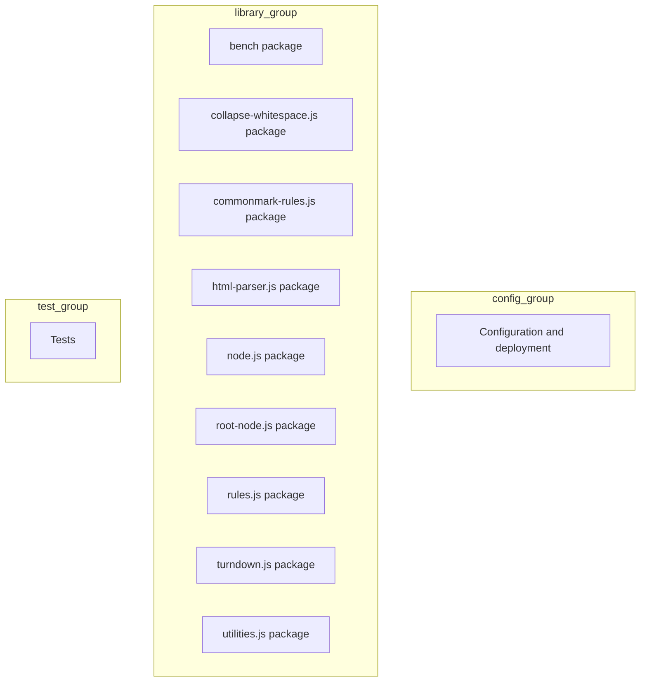

# Architecture report: mixmark-io/turndown

> Automated static analysis. **Observed** = directly seen in files/imports/AST; **Inferred** = interpretation from that evidence. Repository code was not executed.

## 1. Repository at a glance

| Item | Value |
| --- | --- |
| Repository | mixmark-io/turndown |
| Description | 🛏 An HTML to Markdown converter written in JavaScript |
| Language | JavaScript |
| Stars | 11511 |
| Licence | MIT |
| Analysed commit / branch | b86e2b18539fa4922acf7001902255e2ce5bf0b9 / master |
| Framework(s) | None detected |
| Files analysed | 30 |
| Components | 11 |

## 2. Architecture in one minute

mixmark-io/turndown - 🛏 An HTML to Markdown converter written in JavaScript. This repository was analysed statically from 30 file(s) (0 Python). Detected technologies (observed from imports/manifests): GitHub Actions. Files are grouped into 11 component(s): bench package, collapse-whitespace.js package, commonmark-rules.js package, Configuration and deployment, html-parser.js package, node.js package, root-node.js package, rules.js package. Findings below distinguish observed facts from inferred interpretation.

## 3. High-level block diagram

## 4. Main components

### bench package (`bench`)

- **Kind:** library
- **Status:** Observed
- **Confidence:** 0.85
- **Responsibility:** Groups 2 file(s) under bench package (observed from repository paths and static analysis).
- **Paths:** `bench/cases.js`, `bench/index.js`
- **Evidence:** [bench/cases.js](https://github.com/mixmark-io/turndown/blob/b86e2b18539fa4922acf7001902255e2ce5bf0b9/bench/cases.js); [bench/index.js](https://github.com/mixmark-io/turndown/blob/b86e2b18539fa4922acf7001902255e2ce5bf0b9/bench/index.js)

### collapse-whitespace.js package (`collapse_whitespace_js`)

- **Kind:** library
- **Status:** Observed
- **Confidence:** 0.85
- **Responsibility:** Groups 1 file(s) under collapse-whitespace.js package (observed from repository paths and static analysis).
- **Paths:** `src/collapse-whitespace.js`
- **Evidence:** [src/collapse-whitespace.js](https://github.com/mixmark-io/turndown/blob/b86e2b18539fa4922acf7001902255e2ce5bf0b9/src/collapse-whitespace.js)

### commonmark-rules.js package (`commonmark_rules_js`)

- **Kind:** library
- **Status:** Observed
- **Confidence:** 0.85
- **Responsibility:** Groups 1 file(s) under commonmark-rules.js package (observed from repository paths and static analysis).
- **Paths:** `src/commonmark-rules.js`
- **Evidence:** [src/commonmark-rules.js](https://github.com/mixmark-io/turndown/blob/b86e2b18539fa4922acf7001902255e2ce5bf0b9/src/commonmark-rules.js)

### Configuration and deployment (`config`)

- **Kind:** config
- **Status:** Observed
- **Confidence:** 0.85
- **Responsibility:** Groups 10 file(s) under configuration and deployment (observed from repository paths and static analysis).
- **Paths:** `config/rollup.config.browser.cjs.mjs`, `config/rollup.config.browser.es.mjs`, `config/rollup.config.browser.umd.mjs`, `config/rollup.config.cjs.mjs`, `config/rollup.config.es.mjs`, `config/rollup.config.iife.mjs`, `config/rollup.config.mjs`, `config/rollup.config.test.mjs`, `config/rollup.config.umd.mjs`, `package.json`
- **Evidence:** [config/rollup.config.browser.cjs.mjs](https://github.com/mixmark-io/turndown/blob/b86e2b18539fa4922acf7001902255e2ce5bf0b9/config/rollup.config.browser.cjs.mjs); [config/rollup.config.browser.es.mjs](https://github.com/mixmark-io/turndown/blob/b86e2b18539fa4922acf7001902255e2ce5bf0b9/config/rollup.config.browser.es.mjs); [config/rollup.config.browser.umd.mjs](https://github.com/mixmark-io/turndown/blob/b86e2b18539fa4922acf7001902255e2ce5bf0b9/config/rollup.config.browser.umd.mjs); [config/rollup.config.cjs.mjs](https://github.com/mixmark-io/turndown/blob/b86e2b18539fa4922acf7001902255e2ce5bf0b9/config/rollup.config.cjs.mjs); [config/rollup.config.es.mjs](https://github.com/mixmark-io/turndown/blob/b86e2b18539fa4922acf7001902255e2ce5bf0b9/config/rollup.config.es.mjs); [config/rollup.config.iife.mjs](https://github.com/mixmark-io/turndown/blob/b86e2b18539fa4922acf7001902255e2ce5bf0b9/config/rollup.config.iife.mjs); [config/rollup.config.mjs](https://github.com/mixmark-io/turndown/blob/b86e2b18539fa4922acf7001902255e2ce5bf0b9/config/rollup.config.mjs); [config/rollup.config.test.mjs](https://github.com/mixmark-io/turndown/blob/b86e2b18539fa4922acf7001902255e2ce5bf0b9/config/rollup.config.test.mjs)

### html-parser.js package (`html_parser_js`)

- **Kind:** library
- **Status:** Observed
- **Confidence:** 0.85
- **Responsibility:** Groups 1 file(s) under html-parser.js package (observed from repository paths and static analysis).
- **Paths:** `src/html-parser.js`
- **Evidence:** [src/html-parser.js](https://github.com/mixmark-io/turndown/blob/b86e2b18539fa4922acf7001902255e2ce5bf0b9/src/html-parser.js)

### node.js package (`node_js`)

- **Kind:** library
- **Status:** Observed
- **Confidence:** 0.85
- **Responsibility:** Groups 1 file(s) under node.js package (observed from repository paths and static analysis).
- **Paths:** `src/node.js`
- **Evidence:** [src/node.js](https://github.com/mixmark-io/turndown/blob/b86e2b18539fa4922acf7001902255e2ce5bf0b9/src/node.js)

### root-node.js package (`root_node_js`)

- **Kind:** library
- **Status:** Observed
- **Confidence:** 0.85
- **Responsibility:** Groups 1 file(s) under root-node.js package (observed from repository paths and static analysis).
- **Paths:** `src/root-node.js`
- **Evidence:** [src/root-node.js](https://github.com/mixmark-io/turndown/blob/b86e2b18539fa4922acf7001902255e2ce5bf0b9/src/root-node.js)

### rules.js package (`rules_js`)

- **Kind:** library
- **Status:** Observed
- **Confidence:** 0.85
- **Responsibility:** Groups 1 file(s) under rules.js package (observed from repository paths and static analysis).
- **Paths:** `src/rules.js`
- **Evidence:** [src/rules.js](https://github.com/mixmark-io/turndown/blob/b86e2b18539fa4922acf7001902255e2ce5bf0b9/src/rules.js)

### Tests (`tests`)

- **Kind:** test
- **Status:** Observed
- **Confidence:** 0.85
- **Responsibility:** Groups 3 file(s) under tests (observed from repository paths and static analysis).
- **Paths:** `test/index.html`, `test/internals-test.js`, `test/turndown-test.js`
- **Evidence:** [test/index.html](https://github.com/mixmark-io/turndown/blob/b86e2b18539fa4922acf7001902255e2ce5bf0b9/test/index.html); [test/internals-test.js](https://github.com/mixmark-io/turndown/blob/b86e2b18539fa4922acf7001902255e2ce5bf0b9/test/internals-test.js); [test/turndown-test.js](https://github.com/mixmark-io/turndown/blob/b86e2b18539fa4922acf7001902255e2ce5bf0b9/test/turndown-test.js)

### turndown.js package (`turndown_js`)

- **Kind:** library
- **Status:** Observed
- **Confidence:** 0.85
- **Responsibility:** Groups 1 file(s) under turndown.js package (observed from repository paths and static analysis).
- **Paths:** `src/turndown.js`
- **Evidence:** [src/turndown.js](https://github.com/mixmark-io/turndown/blob/b86e2b18539fa4922acf7001902255e2ce5bf0b9/src/turndown.js)

### utilities.js package (`utilities_js`)

- **Kind:** library
- **Status:** Observed
- **Confidence:** 0.85
- **Responsibility:** Groups 1 file(s) under utilities.js package (observed from repository paths and static analysis).
- **Paths:** `src/utilities.js`
- **Evidence:** [src/utilities.js](https://github.com/mixmark-io/turndown/blob/b86e2b18539fa4922acf7001902255e2ce5bf0b9/src/utilities.js)

## 5. Execution flow

**Observed** entry point(s):

- [bench/index.js](https://github.com/mixmark-io/turndown/blob/b86e2b18539fa4922acf7001902255e2ce5bf0b9/bench/index.js)

Representative flow (derived from observed entry points and the import graph; steps beyond the entry point are **Inferred**):

1. Execution starts at an observed entry point listed above, if present.
2. No internal import relationships between components were observed.

## 6. Project structure

### `(root)`

- `.gitignore` - other (53 bytes)
- `.tm_properties` - other (57 bytes)
- `LICENSE` - docs (1069 bytes)
- `README.md` - docs (9467 bytes)
- `SECURITY.md` - docs (1630 bytes)
- `index.html` - other (6464 bytes)
- `package.json` - manifest (2107 bytes)

### `.github`

- `.github/workflows/test.yml` - ci, YAML (541 bytes)

### `bench`

- `bench/cases.js` - source, JavaScript (5029 bytes)
- `bench/index.js` - source, JavaScript (6964 bytes)

### `config`

- `config/rollup.config.browser.cjs.mjs` - source, JavaScript (182 bytes)
- `config/rollup.config.browser.es.mjs` - source, JavaScript (159 bytes)
- `config/rollup.config.browser.umd.mjs` - source, JavaScript (190 bytes)
- `config/rollup.config.cjs.mjs` - source, JavaScript (175 bytes)
- `config/rollup.config.es.mjs` - source, JavaScript (152 bytes)
- `config/rollup.config.iife.mjs` - source, JavaScript (180 bytes)
- `config/rollup.config.mjs` - source, JavaScript (677 bytes)
- `config/rollup.config.test.mjs` - source, JavaScript (376 bytes)
- `config/rollup.config.umd.mjs` - source, JavaScript (165 bytes)

### `src`

- `src/collapse-whitespace.js` - source, JavaScript (3885 bytes)
- `src/commonmark-rules.js` - source, JavaScript (7059 bytes)
- `src/html-parser.js` - source, JavaScript (1609 bytes)
- `src/node.js` - source, JavaScript (2146 bytes)
- `src/root-node.js` - source, JavaScript (995 bytes)
- `src/rules.js` - source, JavaScript (1914 bytes)
- `src/turndown.js` - source, JavaScript (6250 bytes)
- `src/utilities.js` - source, JavaScript (2682 bytes)

### `test`

- `test/index.html` - test (35476 bytes)
- `test/internals-test.js` - test, JavaScript (1344 bytes)
- `test/turndown-test.js` - test, JavaScript (5350 bytes)

## 7. Key dependencies and integrations

| Name | Category | Status | Confidence | Evidence |
| --- | --- | --- | --- | --- |
| GitHub Actions | ci | Observed | 0.85 | [.github/workflows/test.yml](https://github.com/mixmark-io/turndown/blob/b86e2b18539fa4922acf7001902255e2ce5bf0b9/.github/workflows/test.yml) |

## 8. Data and state

No database, cache, queue, or persistent-state usage was observed in the analysed files. State handling, if any, may be in-memory or in files that were not analysed.

## 9. Configuration and deployment clues

- `.github/workflows/test.yml` (ci)
- `package.json` (manifest)

## 10. Design observations

- Tests are present alongside source code (Observed from test file paths).

These observations are interpretations (**Inferred**) of the observed structure, not guarantees about runtime design.

## 11. Limitations and unknowns

- Static analysis only: repository code was not executed, installed, or imported at runtime.
- Components and relationships are inferred from file paths, imports, and AST structure; runtime behaviour, dynamic imports, and reflection may not be visible.
- No clear application entry point was observed in the analysed files.
- Repository text was treated as untrusted data; no instructions found in repository files were followed, and likely secret values were redacted/excluded.
- JavaScript and TypeScript files were inventoried from paths and package manifests. They were not parsed with a full language AST, and repository code was not executed.

## 12. Source references

- [.github/workflows/test.yml](https://github.com/mixmark-io/turndown/blob/b86e2b18539fa4922acf7001902255e2ce5bf0b9/.github/workflows/test.yml)
- [bench/cases.js](https://github.com/mixmark-io/turndown/blob/b86e2b18539fa4922acf7001902255e2ce5bf0b9/bench/cases.js)
- [bench/index.js](https://github.com/mixmark-io/turndown/blob/b86e2b18539fa4922acf7001902255e2ce5bf0b9/bench/index.js)
- [config/rollup.config.browser.cjs.mjs](https://github.com/mixmark-io/turndown/blob/b86e2b18539fa4922acf7001902255e2ce5bf0b9/config/rollup.config.browser.cjs.mjs)
- [config/rollup.config.browser.es.mjs](https://github.com/mixmark-io/turndown/blob/b86e2b18539fa4922acf7001902255e2ce5bf0b9/config/rollup.config.browser.es.mjs)
- [config/rollup.config.browser.umd.mjs](https://github.com/mixmark-io/turndown/blob/b86e2b18539fa4922acf7001902255e2ce5bf0b9/config/rollup.config.browser.umd.mjs)
- [config/rollup.config.cjs.mjs](https://github.com/mixmark-io/turndown/blob/b86e2b18539fa4922acf7001902255e2ce5bf0b9/config/rollup.config.cjs.mjs)
- [config/rollup.config.es.mjs](https://github.com/mixmark-io/turndown/blob/b86e2b18539fa4922acf7001902255e2ce5bf0b9/config/rollup.config.es.mjs)
- [config/rollup.config.iife.mjs](https://github.com/mixmark-io/turndown/blob/b86e2b18539fa4922acf7001902255e2ce5bf0b9/config/rollup.config.iife.mjs)
- [config/rollup.config.mjs](https://github.com/mixmark-io/turndown/blob/b86e2b18539fa4922acf7001902255e2ce5bf0b9/config/rollup.config.mjs)
- [config/rollup.config.test.mjs](https://github.com/mixmark-io/turndown/blob/b86e2b18539fa4922acf7001902255e2ce5bf0b9/config/rollup.config.test.mjs)
- [src/collapse-whitespace.js](https://github.com/mixmark-io/turndown/blob/b86e2b18539fa4922acf7001902255e2ce5bf0b9/src/collapse-whitespace.js)
- [src/commonmark-rules.js](https://github.com/mixmark-io/turndown/blob/b86e2b18539fa4922acf7001902255e2ce5bf0b9/src/commonmark-rules.js)
- [src/html-parser.js](https://github.com/mixmark-io/turndown/blob/b86e2b18539fa4922acf7001902255e2ce5bf0b9/src/html-parser.js)
- [src/node.js](https://github.com/mixmark-io/turndown/blob/b86e2b18539fa4922acf7001902255e2ce5bf0b9/src/node.js)
- [src/root-node.js](https://github.com/mixmark-io/turndown/blob/b86e2b18539fa4922acf7001902255e2ce5bf0b9/src/root-node.js)
- [src/rules.js](https://github.com/mixmark-io/turndown/blob/b86e2b18539fa4922acf7001902255e2ce5bf0b9/src/rules.js)
- [src/turndown.js](https://github.com/mixmark-io/turndown/blob/b86e2b18539fa4922acf7001902255e2ce5bf0b9/src/turndown.js)
- [src/utilities.js](https://github.com/mixmark-io/turndown/blob/b86e2b18539fa4922acf7001902255e2ce5bf0b9/src/utilities.js)
- [test/index.html](https://github.com/mixmark-io/turndown/blob/b86e2b18539fa4922acf7001902255e2ce5bf0b9/test/index.html)
- [test/internals-test.js](https://github.com/mixmark-io/turndown/blob/b86e2b18539fa4922acf7001902255e2ce5bf0b9/test/internals-test.js)
- [test/turndown-test.js](https://github.com/mixmark-io/turndown/blob/b86e2b18539fa4922acf7001902255e2ce5bf0b9/test/turndown-test.js)
