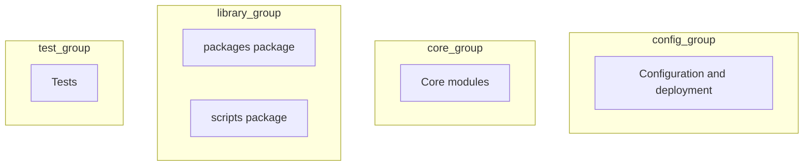

# Architecture report: mjmlio/mjml

> Automated static analysis. **Observed** = directly seen in files/imports/AST; **Inferred** = interpretation from that evidence. Repository code was not executed.

## 1. Repository at a glance

| Item | Value |
| --- | --- |
| Repository | mjmlio/mjml |
| Description | MJML: the only framework that makes responsive email easy |
| Language | JavaScript |
| Stars | 18295 |
| Licence | MIT |
| Analysed commit / branch | 40ddfbb4c04e13dd9572aa0d5b1c58826a163289 / master |
| Framework(s) | None detected |
| Files analysed | 245 |
| Components | 5 |

## 2. Architecture in one minute

mjmlio/mjml - MJML: the only framework that makes responsive email easy. This repository was analysed statically from 245 file(s) (0 Python). Detected technologies (observed from imports/manifests): GitHub Actions, webpack. Files are grouped into 5 component(s): Configuration and deployment, Core modules, packages package, scripts package, Tests. Findings below distinguish observed facts from inferred interpretation.

## 3. High-level block diagram

## 4. Main components

### Configuration and deployment (`config`)

- **Kind:** config
- **Status:** Observed
- **Confidence:** 0.85
- **Responsibility:** Groups 34 file(s) under configuration and deployment (observed from repository paths and static analysis).
- **Paths:** `lerna.json`, `package.json`, `packages/mjml-accordion/package.json`, `packages/mjml-body/package.json`, `packages/mjml-browser/package.json`, `packages/mjml-button/package.json`, `packages/mjml-carousel/package.json`, `packages/mjml-cli/package.json`, `packages/mjml-column/package.json`, `packages/mjml-core/package.json`, `packages/mjml-divider/package.json`, `packages/mjml-group/package.json`, `packages/mjml-head-attributes/package.json`, `packages/mjml-head-breakpoint/package.json`, `packages/mjml-head-font/package.json`, `packages/mjml-head-html-attributes/package.json`, `packages/mjml-head-preview/package.json`, `packages/mjml-head-style/package.json`, `packages/mjml-head-title/package.json`, `packages/mjml-head/package.json`, `packages/mjml-hero/package.json`, `packages/mjml-image/package.json`, `packages/mjml-navbar/package.json`, `packages/mjml-parser-xml/package.json`, `packages/mjml-preset-core/package.json`, `packages/mjml-raw/package.json`, `packages/mjml-section/package.json`, `packages/mjml-social/package.json`, `packages/mjml-spacer/package.json`, `packages/mjml-table/package.json`, `packages/mjml-text/package.json`, `packages/mjml-validator/package.json`, `packages/mjml-wrapper/package.json`, `packages/mjml/package.json`
- **Evidence:** [lerna.json](https://github.com/mjmlio/mjml/blob/40ddfbb4c04e13dd9572aa0d5b1c58826a163289/lerna.json); [package.json](https://github.com/mjmlio/mjml/blob/40ddfbb4c04e13dd9572aa0d5b1c58826a163289/package.json); [packages/mjml-accordion/package.json](https://github.com/mjmlio/mjml/blob/40ddfbb4c04e13dd9572aa0d5b1c58826a163289/packages/mjml-accordion/package.json); [packages/mjml-body/package.json](https://github.com/mjmlio/mjml/blob/40ddfbb4c04e13dd9572aa0d5b1c58826a163289/packages/mjml-body/package.json); [packages/mjml-browser/package.json](https://github.com/mjmlio/mjml/blob/40ddfbb4c04e13dd9572aa0d5b1c58826a163289/packages/mjml-browser/package.json); [packages/mjml-button/package.json](https://github.com/mjmlio/mjml/blob/40ddfbb4c04e13dd9572aa0d5b1c58826a163289/packages/mjml-button/package.json); [packages/mjml-carousel/package.json](https://github.com/mjmlio/mjml/blob/40ddfbb4c04e13dd9572aa0d5b1c58826a163289/packages/mjml-carousel/package.json); [packages/mjml-cli/package.json](https://github.com/mjmlio/mjml/blob/40ddfbb4c04e13dd9572aa0d5b1c58826a163289/packages/mjml-cli/package.json)

### Core modules (`core`)

- **Kind:** core
- **Status:** Observed
- **Confidence:** 0.85
- **Responsibility:** Groups 3 file(s) under core modules (observed from repository paths and static analysis).
- **Paths:** `babel.config.js`, `test.js`, `type.js`
- **Evidence:** [babel.config.js](https://github.com/mjmlio/mjml/blob/40ddfbb4c04e13dd9572aa0d5b1c58826a163289/babel.config.js); [test.js](https://github.com/mjmlio/mjml/blob/40ddfbb4c04e13dd9572aa0d5b1c58826a163289/test.js); [type.js](https://github.com/mjmlio/mjml/blob/40ddfbb4c04e13dd9572aa0d5b1c58826a163289/type.js)

### packages package (`packages`)

- **Kind:** library
- **Status:** Observed
- **Confidence:** 0.85
- **Responsibility:** Groups 97 file(s) under packages package (observed from repository paths and static analysis).
- **Paths:** `packages/mjml-accordion/src/Accordion.js`, `packages/mjml-accordion/src/AccordionElement.js`, `packages/mjml-accordion/src/AccordionText.js`, `packages/mjml-accordion/src/AccordionTitle.js`, `packages/mjml-accordion/src/index.js`, `packages/mjml-body/src/helpers/preview.js`, `packages/mjml-body/src/index.js`, `packages/mjml-browser/browser-mocks/empty.js`, `packages/mjml-browser/browser-mocks/fs.js`, `packages/mjml-browser/browser-mocks/htmlnano.js`, `packages/mjml-browser/browser-mocks/minify.js`, `packages/mjml-browser/browser-mocks/mjmlconfig.js`, `packages/mjml-browser/browser-mocks/skeleton-loader.js`, `packages/mjml-browser/smoke-browser-global.js`, `packages/mjml-browser/webpack.config.js`, `packages/mjml-button/src/index.js`, `packages/mjml-carousel/src/Carousel.js`, `packages/mjml-carousel/src/CarouselImage.js`, `packages/mjml-carousel/src/index.js`, `packages/mjml-cli/src/client.js`, `packages/mjml-cli/src/commands/outputToConsole.js`, `packages/mjml-cli/src/commands/outputToFile.js`, `packages/mjml-cli/src/commands/readFile.js`, `packages/mjml-cli/src/commands/readStream.js`, `packages/mjml-cli/src/commands/watchFiles.js`, `packages/mjml-cli/src/helpers/defaultOptions.js`, `packages/mjml-cli/src/helpers/fileContext.js`, `packages/mjml-column/src/index.js`, `packages/mjml-core/src/components.js`, `packages/mjml-core/src/createComponent.js`, `packages/mjml-core/src/helpers/conditionalTag.js`, `packages/mjml-core/src/helpers/fonts.js`, `packages/mjml-core/src/helpers/formatAttributes.js`, `packages/mjml-core/src/helpers/formatHtml.js`, `packages/mjml-core/src/helpers/genRandomHexString.js`, `packages/mjml-core/src/helpers/jsonToXML.js`, `packages/mjml-core/src/helpers/makeLowerBreakpoint.js`, `packages/mjml-core/src/helpers/mediaQueries.js`, `packages/mjml-core/src/helpers/mergeOutlookConditionnals.js`, `packages/mjml-core/src/helpers/minifyOutlookConditionnals.js`, `packages/mjml-core/src/helpers/mjmlconfig.js`, `packages/mjml-core/src/helpers/shorthandParser.js`, `packages/mjml-core/src/helpers/skeleton.js`, `packages/mjml-core/src/helpers/styles.js`, `packages/mjml-core/src/helpers/suffixCssClasses.js`, `packages/mjml-core/src/helpers/widthParser.js`, `packages/mjml-core/src/index.js`, `packages/mjml-core/src/node-only/skeleton-loader.js`, `packages/mjml-core/src/types/boolean.js`, `packages/mjml-core/src/types/color.js`, `packages/mjml-core/src/types/enum.js`, `packages/mjml-core/src/types/helpers/colors.js`, `packages/mjml-core/src/types/index.js`, `packages/mjml-core/src/types/integer.js`, `packages/mjml-core/src/types/string.js`, `packages/mjml-core/src/types/type.js`, `packages/mjml-core/src/types/unit.js`, `packages/mjml-divider/src/index.js`, `packages/mjml-group/src/index.js`, `packages/mjml-head-attributes/src/index.js`, `packages/mjml-head-breakpoint/src/index.js`, `packages/mjml-head-font/src/index.js`, `packages/mjml-head-html-attributes/src/index.js`, `packages/mjml-head-preview/src/index.js`, `packages/mjml-head-style/src/index.js`, `packages/mjml-head-title/src/index.js`, `packages/mjml-head/src/index.js`, `packages/mjml-hero/src/index.js`, `packages/mjml-image/src/index.js`, `packages/mjml-navbar/src/Navbar.js`, `packages/mjml-navbar/src/NavbarLink.js`, `packages/mjml-navbar/src/index.js`, `packages/mjml-parser-xml/src/helpers/cleanNode.js`, `packages/mjml-parser-xml/src/helpers/convertBooleansOnAttrs.js`, `packages/mjml-parser-xml/src/helpers/setEmptyAttributes.js`, `packages/mjml-parser-xml/src/index.js`, `packages/mjml-preset-core/src/dependencies.js`, `packages/mjml-preset-core/src/index.js`, `packages/mjml-raw/src/index.js`, `packages/mjml-section/src/index.js`, `packages/mjml-social/src/Social.js`, `packages/mjml-social/src/SocialElement.js`, `packages/mjml-social/src/index.js`, `packages/mjml-spacer/src/index.js`, `packages/mjml-table/src/index.js`, `packages/mjml-text/src/index.js`, `packages/mjml-validator/src/MJMLRulesCollection.js`, `packages/mjml-validator/src/dependencies.js`, `packages/mjml-validator/src/index.js`, `packages/mjml-validator/src/rules/errorAttr.js`, `packages/mjml-validator/src/rules/ruleError.js`, `packages/mjml-validator/src/rules/validAttributes.js`, `packages/mjml-validator/src/rules/validChildren.js`, `packages/mjml-validator/src/rules/validTag.js`, `packages/mjml-validator/src/rules/validTypes.js`, `packages/mjml-wrapper/src/index.js`, `packages/mjml/src/index.js`
- **Evidence:** [packages/mjml-accordion/src/Accordion.js](https://github.com/mjmlio/mjml/blob/40ddfbb4c04e13dd9572aa0d5b1c58826a163289/packages/mjml-accordion/src/Accordion.js); [packages/mjml-accordion/src/AccordionElement.js](https://github.com/mjmlio/mjml/blob/40ddfbb4c04e13dd9572aa0d5b1c58826a163289/packages/mjml-accordion/src/AccordionElement.js); [packages/mjml-accordion/src/AccordionText.js](https://github.com/mjmlio/mjml/blob/40ddfbb4c04e13dd9572aa0d5b1c58826a163289/packages/mjml-accordion/src/AccordionText.js); [packages/mjml-accordion/src/AccordionTitle.js](https://github.com/mjmlio/mjml/blob/40ddfbb4c04e13dd9572aa0d5b1c58826a163289/packages/mjml-accordion/src/AccordionTitle.js); [packages/mjml-accordion/src/index.js](https://github.com/mjmlio/mjml/blob/40ddfbb4c04e13dd9572aa0d5b1c58826a163289/packages/mjml-accordion/src/index.js); [packages/mjml-body/src/helpers/preview.js](https://github.com/mjmlio/mjml/blob/40ddfbb4c04e13dd9572aa0d5b1c58826a163289/packages/mjml-body/src/helpers/preview.js); [packages/mjml-body/src/index.js](https://github.com/mjmlio/mjml/blob/40ddfbb4c04e13dd9572aa0d5b1c58826a163289/packages/mjml-body/src/index.js); [packages/mjml-browser/browser-mocks/empty.js](https://github.com/mjmlio/mjml/blob/40ddfbb4c04e13dd9572aa0d5b1c58826a163289/packages/mjml-browser/browser-mocks/empty.js)

### scripts package (`scripts`)

- **Kind:** library
- **Status:** Observed
- **Confidence:** 0.85
- **Responsibility:** Groups 1 file(s) under scripts package (observed from repository paths and static analysis).
- **Paths:** `scripts/smoke-cli-pack.sh`
- **Evidence:** [scripts/smoke-cli-pack.sh](https://github.com/mjmlio/mjml/blob/40ddfbb4c04e13dd9572aa0d5b1c58826a163289/scripts/smoke-cli-pack.sh)

### Tests (`tests`)

- **Kind:** test
- **Status:** Observed
- **Confidence:** 0.85
- **Responsibility:** Groups 42 file(s) under tests (observed from repository paths and static analysis).
- **Paths:** `packages/mjml-core/tests/.eslintrc`, `packages/mjml-core/tests/jsonToXml.test.js`, `packages/mjml-core/tests/mergeOutlookConditionnals.test.js`, `packages/mjml-core/tests/minifyOutlookConditionnals.test.js`, `packages/mjml-core/tests/shorthandParser.test.js`, `packages/mjml-core/tests/skeleton.test.js`, `packages/mjml-core/tests/widthParser.test.js`, `packages/mjml-parser-xml/test/incl.mjml`, `packages/mjml-parser-xml/test/parser.test.js`, `packages/mjml-parser-xml/test/preprocessors.test.js`, `packages/mjml-parser-xml/test/test-utils.js`, `packages/mjml-parser-xml/test/test-values.js`, `packages/mjml/test/accordion-fontFamily.test.js`, `packages/mjml/test/accordion-padding.test.js`, `packages/mjml/test/accordionTitle-fontWeight.test.js`, `packages/mjml/test/beautify-output.test.js`, `packages/mjml/test/border-radius-string.test.js`, `packages/mjml/test/carousel-hoverSupported.test.js`, `packages/mjml/test/column-border-radius.test.js`, `packages/mjml/test/hero-padding-inner-width.test.js`, `packages/mjml/test/html-attributes.test.js`, `packages/mjml/test/html-comments.test.js`, `packages/mjml/test/htmlmin-ignore.test.js`, `packages/mjml/test/ignore-includes-cli.test.js`, `packages/mjml/test/ignore-includes.test.js`, `packages/mjml/test/include-path-cli.test.js`, `packages/mjml/test/include-path-security.test.js`, `packages/mjml/test/include-path-traversal.test.js`, `packages/mjml/test/include-path.test.js`, `packages/mjml/test/lazy-head-style.test.js`, `packages/mjml/test/navbar-ico-padding.test.js`, `packages/mjml/test/section-gutter.test.js`, `packages/mjml/test/social-align.test.js`, `packages/mjml/test/social-border.test.js`, `packages/mjml/test/social-icon-height.test.js`, `packages/mjml/test/table-cellspacing.test.js`, `packages/mjml/test/tableWidth.test.js`, `packages/mjml/test/template-syntax-sanitization.test.js`, `packages/mjml/test/utils.js`, `packages/mjml/test/watch-cli.test.js`, `packages/mjml/test/wrapper-border-radius.test.js`, `packages/mjml/test/wrapper-gap.test.js`
- **Evidence:** [packages/mjml-core/tests/.eslintrc](https://github.com/mjmlio/mjml/blob/40ddfbb4c04e13dd9572aa0d5b1c58826a163289/packages/mjml-core/tests/.eslintrc); [packages/mjml-core/tests/jsonToXml.test.js](https://github.com/mjmlio/mjml/blob/40ddfbb4c04e13dd9572aa0d5b1c58826a163289/packages/mjml-core/tests/jsonToXml.test.js); [packages/mjml-core/tests/mergeOutlookConditionnals.test.js](https://github.com/mjmlio/mjml/blob/40ddfbb4c04e13dd9572aa0d5b1c58826a163289/packages/mjml-core/tests/mergeOutlookConditionnals.test.js); [packages/mjml-core/tests/minifyOutlookConditionnals.test.js](https://github.com/mjmlio/mjml/blob/40ddfbb4c04e13dd9572aa0d5b1c58826a163289/packages/mjml-core/tests/minifyOutlookConditionnals.test.js); [packages/mjml-core/tests/shorthandParser.test.js](https://github.com/mjmlio/mjml/blob/40ddfbb4c04e13dd9572aa0d5b1c58826a163289/packages/mjml-core/tests/shorthandParser.test.js); [packages/mjml-core/tests/skeleton.test.js](https://github.com/mjmlio/mjml/blob/40ddfbb4c04e13dd9572aa0d5b1c58826a163289/packages/mjml-core/tests/skeleton.test.js); [packages/mjml-core/tests/widthParser.test.js](https://github.com/mjmlio/mjml/blob/40ddfbb4c04e13dd9572aa0d5b1c58826a163289/packages/mjml-core/tests/widthParser.test.js); [packages/mjml-parser-xml/test/incl.mjml](https://github.com/mjmlio/mjml/blob/40ddfbb4c04e13dd9572aa0d5b1c58826a163289/packages/mjml-parser-xml/test/incl.mjml)

## 5. Execution flow

**Observed** entry point(s):

- [packages/mjml-accordion/src/index.js](https://github.com/mjmlio/mjml/blob/40ddfbb4c04e13dd9572aa0d5b1c58826a163289/packages/mjml-accordion/src/index.js)
- [packages/mjml-body/src/index.js](https://github.com/mjmlio/mjml/blob/40ddfbb4c04e13dd9572aa0d5b1c58826a163289/packages/mjml-body/src/index.js)
- [packages/mjml-button/src/index.js](https://github.com/mjmlio/mjml/blob/40ddfbb4c04e13dd9572aa0d5b1c58826a163289/packages/mjml-button/src/index.js)
- [packages/mjml-carousel/src/index.js](https://github.com/mjmlio/mjml/blob/40ddfbb4c04e13dd9572aa0d5b1c58826a163289/packages/mjml-carousel/src/index.js)
- [packages/mjml-cli/bin/mjml](https://github.com/mjmlio/mjml/blob/40ddfbb4c04e13dd9572aa0d5b1c58826a163289/packages/mjml-cli/bin/mjml)
- [packages/mjml-column/src/index.js](https://github.com/mjmlio/mjml/blob/40ddfbb4c04e13dd9572aa0d5b1c58826a163289/packages/mjml-column/src/index.js)
- [packages/mjml-core/src/index.js](https://github.com/mjmlio/mjml/blob/40ddfbb4c04e13dd9572aa0d5b1c58826a163289/packages/mjml-core/src/index.js)
- [packages/mjml-divider/src/index.js](https://github.com/mjmlio/mjml/blob/40ddfbb4c04e13dd9572aa0d5b1c58826a163289/packages/mjml-divider/src/index.js)
- [packages/mjml-group/src/index.js](https://github.com/mjmlio/mjml/blob/40ddfbb4c04e13dd9572aa0d5b1c58826a163289/packages/mjml-group/src/index.js)
- [packages/mjml-head-attributes/src/index.js](https://github.com/mjmlio/mjml/blob/40ddfbb4c04e13dd9572aa0d5b1c58826a163289/packages/mjml-head-attributes/src/index.js)
- [packages/mjml-head-breakpoint/src/index.js](https://github.com/mjmlio/mjml/blob/40ddfbb4c04e13dd9572aa0d5b1c58826a163289/packages/mjml-head-breakpoint/src/index.js)
- [packages/mjml/bin/mjml](https://github.com/mjmlio/mjml/blob/40ddfbb4c04e13dd9572aa0d5b1c58826a163289/packages/mjml/bin/mjml)

Representative flow (derived from observed entry points and the import graph; steps beyond the entry point are **Inferred**):

1. Execution starts at an observed entry point listed above, if present.
2. No internal import relationships between components were observed.

## 6. Project structure

### `(root)`

- `.editorconfig` - config (778 bytes)
- `.eslintignore` - other (145 bytes)
- `.eslintrc` - other (503 bytes)
- `.gitignore` - other (109 bytes)
- `.prettierignore` - other (13 bytes)
- `.prettierrc` - other (89 bytes)
- `CONTRIBUTING.md` - docs (6341 bytes)
- `LICENSE.md` - docs (1095 bytes)
- `README.md` - docs (12307 bytes)
- `babel.config.js` - source, JavaScript (512 bytes)
- `lerna.json` - config (263 bytes)
- `package.json` - manifest (2046 bytes)
- `readme-ja.md` - docs (8893 bytes)
- `test.js` - source, JavaScript (1347 bytes)
- `type.js` - source, JavaScript (908 bytes)

### `.github`

- `.github/ISSUE_TEMPLATE/bug_report.md` - docs (997 bytes)
- `.github/ISSUE_TEMPLATE/feature_request.md` - docs (560 bytes)
- `.github/workflows/build-documentation.yml` - ci, YAML (349 bytes)
- `.github/workflows/mjml-workflow.yml` - ci, YAML (866 bytes)
- `.github/workflows/npm-publish.yml` - ci, YAML (1642 bytes)

### `doc`

- `doc/basic.md` - docs (5793 bytes)
- `doc/body_components.md` - docs (166 bytes)
- `doc/community-components.md` - docs (733 bytes)
- `doc/community-contributions.md` - docs (3876 bytes)
- `doc/components_1.md` - docs (2873 bytes)
- `doc/components_2.md` - docs (1949 bytes)
- `doc/config.json` - config (1675 bytes)
- `doc/create.md` - docs (675 bytes)
- `doc/ending-tags.md` - docs (1207 bytes)
- `doc/getting_started.md` - docs (3588 bytes)
- `doc/guide.md` - docs (1922 bytes)
- `doc/head_components.md` - docs (180 bytes)
- `doc/install.md` - docs (23390 bytes)
- `doc/mjml-bar-chart.md` - docs (969 bytes)
- `doc/mjml-chart.md` - docs (405 bytes)
- `doc/mjml-chartjs.md` - docs (505 bytes)
- `doc/mjml-mso-button.md` - docs (1346 bytes)
- `doc/mjml-qr-code.md` - docs (390 bytes)
- `doc/ports.md` - docs (2510 bytes)
- `doc/tooling.md` - docs (3392 bytes)
- `doc/using_mjml_in_json.md` - docs (1861 bytes)

### `packages`

- `packages/mjml-accordion/README.md` - docs (11505 bytes)
- `packages/mjml-accordion/package.json` - manifest (694 bytes)
- `packages/mjml-accordion/src/Accordion.js` - source, JavaScript (3669 bytes)
- `packages/mjml-accordion/src/AccordionElement.js` - source, JavaScript (3118 bytes)
- `packages/mjml-accordion/src/AccordionText.js` - source, JavaScript (2706 bytes)
- `packages/mjml-accordion/src/AccordionTitle.js` - source, JavaScript (3784 bytes)
- `packages/mjml-accordion/src/index.js` - source, JavaScript (236 bytes)
- `packages/mjml-body/README.md` - docs (1332 bytes)
- `packages/mjml-body/package.json` - manifest (679 bytes)
- `packages/mjml-body/src/helpers/preview.js` - source, JavaScript (243 bytes)
- `packages/mjml-body/src/index.js` - source, JavaScript (1373 bytes)
- `packages/mjml-browser/README.md` - docs (410 bytes)
- `packages/mjml-browser/browser-mocks/empty.js` - source, JavaScript (36 bytes)
- `packages/mjml-browser/browser-mocks/fs.js` - source, JavaScript (159 bytes)
- `packages/mjml-browser/browser-mocks/htmlnano.js` - source, JavaScript (251 bytes)
- `packages/mjml-browser/browser-mocks/minify.js` - source, JavaScript (708 bytes)
- `packages/mjml-browser/browser-mocks/mjmlconfig.js` - source, JavaScript (1094 bytes)
- `packages/mjml-browser/browser-mocks/skeleton-loader.js` - source, JavaScript (204 bytes)
- `packages/mjml-browser/package.json` - manifest (1164 bytes)
- `packages/mjml-browser/smoke-browser-global.js` - source, JavaScript (2550 bytes)
- `packages/mjml-browser/webpack.config.js` - source, JavaScript (3025 bytes)
- `packages/mjml-button/README.md` - docs (7070 bytes)
- `packages/mjml-button/package.json` - manifest (685 bytes)
- `packages/mjml-button/src/index.js` - source, JavaScript (5247 bytes)
- `packages/mjml-carousel/README.md` - docs (5764 bytes)
- `packages/mjml-carousel/package.json` - manifest (691 bytes)
- `packages/mjml-carousel/src/Carousel.js` - source, JavaScript (10783 bytes)
- `packages/mjml-carousel/src/CarouselImage.js` - source, JavaScript (4016 bytes)
- `packages/mjml-carousel/src/index.js` - source, JavaScript (108 bytes)
- `packages/mjml-cli/README.md` - docs (8900 bytes)
- `packages/mjml-cli/bin/mjml` - other (51 bytes)
- `packages/mjml-cli/package.json` - manifest (972 bytes)
- `packages/mjml-cli/src/client.js` - source, JavaScript (12654 bytes)
- `packages/mjml-cli/src/commands/outputToConsole.js` - source, JavaScript (274 bytes)
- `packages/mjml-cli/src/commands/outputToFile.js` - source, JavaScript (1195 bytes)
- `packages/mjml-cli/src/commands/readFile.js` - source, JavaScript (417 bytes)
- `packages/mjml-cli/src/commands/readStream.js` - source, JavaScript (299 bytes)
- `packages/mjml-cli/src/commands/watchFiles.js` - source, JavaScript (4164 bytes)
- `packages/mjml-cli/src/helpers/defaultOptions.js` - source, JavaScript (54 bytes)
- `packages/mjml-cli/src/helpers/fileContext.js` - source, JavaScript (2383 bytes)
- `packages/mjml-column/README.md` - docs (6368 bytes)
- `packages/mjml-column/package.json` - manifest (685 bytes)
- `packages/mjml-column/src/index.js` - source, JavaScript (15924 bytes)
- `packages/mjml-core/README.md` - docs (336 bytes)
- `packages/mjml-core/package.json` - manifest (997 bytes)
- `packages/mjml-core/src/components.js` - source, JavaScript (536 bytes)
- `packages/mjml-core/src/createComponent.js` - source, JavaScript (6562 bytes)
- `packages/mjml-core/src/helpers/conditionalTag.js` - source, JavaScript (823 bytes)
- `packages/mjml-core/src/helpers/fonts.js` - source, JavaScript (857 bytes)
- `packages/mjml-core/src/helpers/formatAttributes.js` - source, JavaScript (599 bytes)
- `packages/mjml-core/src/helpers/formatHtml.js` - source, JavaScript (1012 bytes)
- `packages/mjml-core/src/helpers/genRandomHexString.js` - source, JavaScript (182 bytes)
- `packages/mjml-core/src/helpers/jsonToXML.js` - source, JavaScript (432 bytes)
- `packages/mjml-core/src/helpers/makeLowerBreakpoint.js` - source, JavaScript (209 bytes)
- `packages/mjml-core/src/helpers/mediaQueries.js` - source, JavaScript (1590 bytes)
- `packages/mjml-core/src/helpers/mergeOutlookConditionnals.js` - source, JavaScript (176 bytes)
- `packages/mjml-core/src/helpers/minifyOutlookConditionnals.js` - source, JavaScript (480 bytes)
- `packages/mjml-core/src/helpers/mjmlconfig.js` - source, JavaScript (4546 bytes)
- `packages/mjml-core/src/helpers/shorthandParser.js` - source, JavaScript (732 bytes)
- `packages/mjml-core/src/helpers/skeleton.js` - source, JavaScript (2204 bytes)
- `packages/mjml-core/src/helpers/styles.js` - source, JavaScript (773 bytes)
- `packages/mjml-core/src/helpers/suffixCssClasses.js` - source, JavaScript (146 bytes)
- `packages/mjml-core/src/helpers/widthParser.js` - source, JavaScript (457 bytes)
- `packages/mjml-core/src/index.js` - source, JavaScript (30441 bytes)
- `packages/mjml-core/src/node-only/skeleton-loader.js` - source, JavaScript (298 bytes)
- `packages/mjml-core/src/types/boolean.js` - source, JavaScript (302 bytes)
- `packages/mjml-core/src/types/color.js` - source, JavaScript (761 bytes)
- `packages/mjml-core/src/types/enum.js` - source, JavaScript (480 bytes)
- `packages/mjml-core/src/types/helpers/colors.js` - source, JavaScript (2259 bytes)
- `packages/mjml-core/src/types/index.js` - source, JavaScript (738 bytes)
- `packages/mjml-core/src/types/integer.js` - source, JavaScript (203 bytes)
- `packages/mjml-core/src/types/string.js` - source, JavaScript (200 bytes)
- `packages/mjml-core/src/types/type.js` - source, JavaScript (1089 bytes)
- `packages/mjml-core/src/types/unit.js` - source, JavaScript (1008 bytes)
- `packages/mjml-core/tests/.eslintrc` - test (134 bytes)
- `packages/mjml-core/tests/jsonToXml.test.js` - test, JavaScript (1502 bytes)
- `packages/mjml-core/tests/mergeOutlookConditionnals.test.js` - test, JavaScript (1401 bytes)
- `packages/mjml-core/tests/minifyOutlookConditionnals.test.js` - test, JavaScript (5045 bytes)
- `packages/mjml-core/tests/shorthandParser.test.js` - test, JavaScript (1102 bytes)
- `packages/mjml-core/tests/skeleton.test.js` - test, JavaScript (1877 bytes)
- `packages/mjml-core/tests/widthParser.test.js` - test, JavaScript (809 bytes)
- `packages/mjml-divider/README.md` - docs (2199 bytes)
- `packages/mjml-divider/package.json` - manifest (688 bytes)
- `packages/mjml-divider/src/index.js` - source, JavaScript (2741 bytes)
- `packages/mjml-group/README.md` - docs (2840 bytes)
- `packages/mjml-group/package.json` - manifest (682 bytes)
- `packages/mjml-group/src/index.js` - source, JavaScript (5381 bytes)
- `packages/mjml-head-attributes/README.md` - docs (1318 bytes)
- `packages/mjml-head-attributes/package.json` - manifest (712 bytes)
- `packages/mjml-head-attributes/src/index.js` - source, JavaScript (832 bytes)
- `packages/mjml-head-breakpoint/README.md` - docs (698 bytes)
- `packages/mjml-head-breakpoint/package.json` - manifest (712 bytes)
- `packages/mjml-head-breakpoint/src/index.js` - source, JavaScript (333 bytes)
- `packages/mjml-head-font/README.md` - docs (1032 bytes)
- `packages/mjml-head-font/package.json` - manifest (694 bytes)
- `packages/mjml-head-font/src/index.js` - source, JavaScript (332 bytes)
- `packages/mjml-head-html-attributes/README.md` - docs (1759 bytes)
- `packages/mjml-head-html-attributes/package.json` - manifest (727 bytes)
- `packages/mjml-head-html-attributes/src/index.js` - source, JavaScript (826 bytes)
- `packages/mjml-head-preview/README.md` - docs (517 bytes)
- `packages/mjml-head-preview/package.json` - manifest (703 bytes)
- `packages/mjml-head-preview/src/index.js` - source, JavaScript (256 bytes)
- `packages/mjml-head-style/README.md` - docs (1844 bytes)
- `packages/mjml-head-style/package.json` - manifest (697 bytes)
- `packages/mjml-head-style/src/index.js` - source, JavaScript (386 bytes)
- `packages/mjml-head-title/README.md` - docs (652 bytes)
- `packages/mjml-head-title/package.json` - manifest (697 bytes)
- `packages/mjml-head-title/src/index.js` - source, JavaScript (250 bytes)
- `packages/mjml-head/package.json` - manifest (679 bytes)
- `packages/mjml-head/src/index.js` - source, JavaScript (185 bytes)
- `packages/mjml-hero/README.md` - docs (6181 bytes)
- `packages/mjml-hero/package.json` - manifest (679 bytes)
- `packages/mjml-hero/src/index.js` - source, JavaScript (10974 bytes)
- `packages/mjml-image/README.md` - docs (5591 bytes)
- `packages/mjml-image/package.json` - manifest (682 bytes)
- `packages/mjml-image/src/index.js` - source, JavaScript (4646 bytes)
- `packages/mjml-navbar/README.md` - docs (11202 bytes)
- `packages/mjml-navbar/package.json` - manifest (685 bytes)
- `packages/mjml-navbar/src/Navbar.js` - source, JavaScript (5613 bytes)
- `packages/mjml-navbar/src/NavbarLink.js` - source, JavaScript (3380 bytes)
- `packages/mjml-navbar/src/index.js` - source, JavaScript (98 bytes)
- `packages/mjml-parser-xml/package.json` - manifest (834 bytes)
- `packages/mjml-parser-xml/src/helpers/cleanNode.js` - source, JavaScript (395 bytes)
- `packages/mjml-parser-xml/src/helpers/convertBooleansOnAttrs.js` - source, JavaScript (347 bytes)
- `packages/mjml-parser-xml/src/helpers/setEmptyAttributes.js` - source, JavaScript (216 bytes)
- `packages/mjml-parser-xml/src/index.js` - source, JavaScript (11653 bytes)
- `packages/mjml-parser-xml/test/incl.mjml` - test (181 bytes)
- `packages/mjml-parser-xml/test/parser.test.js` - test, JavaScript (1045 bytes)
- `packages/mjml-parser-xml/test/preprocessors.test.js` - test, JavaScript (1365 bytes)
- `packages/mjml-parser-xml/test/test-utils.js` - test, JavaScript (1396 bytes)
- `packages/mjml-parser-xml/test/test-values.js` - test, JavaScript (15222 bytes)
- `packages/mjml-preset-core/README.md` - docs (395 bytes)
- `packages/mjml-preset-core/package.json` - manifest (1391 bytes)
- `packages/mjml-preset-core/src/dependencies.js` - source, JavaScript (1492 bytes)
- `packages/mjml-preset-core/src/index.js` - source, JavaScript (1556 bytes)
- `packages/mjml-raw/README.md` - docs (2004 bytes)
- `packages/mjml-raw/package.json` - manifest (676 bytes)
- `packages/mjml-raw/src/index.js` - source, JavaScript (302 bytes)
- `packages/mjml-section/README.md` - docs (5962 bytes)
- `packages/mjml-section/package.json` - manifest (688 bytes)
- `packages/mjml-section/src/index.js` - source, JavaScript (14591 bytes)
- `packages/mjml-social/README.md` - docs (12481 bytes)
- `packages/mjml-social/package.json` - manifest (685 bytes)
- `packages/mjml-social/src/Social.js` - source, JavaScript (4135 bytes)
- `packages/mjml-social/src/SocialElement.js` - source, JavaScript (8880 bytes)
- `packages/mjml-social/src/index.js` - source, JavaScript (104 bytes)
- `packages/mjml-spacer/README.md` - docs (1666 bytes)
- `packages/mjml-spacer/package.json` - manifest (685 bytes)
- `packages/mjml-spacer/src/index.js` - source, JavaScript (903 bytes)
- `packages/mjml-table/README.md` - docs (4647 bytes)
- `packages/mjml-table/package.json` - manifest (683 bytes)
- `packages/mjml-table/src/index.js` - source, JavaScript (2674 bytes)
- `packages/mjml-text/README.md` - docs (4161 bytes)
- `packages/mjml-text/package.json` - manifest (679 bytes)
- `packages/mjml-text/src/index.js` - source, JavaScript (2375 bytes)
- `packages/mjml-validator/README.md` - docs (1797 bytes)
- `packages/mjml-validator/package.json` - manifest (642 bytes)
- `packages/mjml-validator/src/MJMLRulesCollection.js` - source, JavaScript (641 bytes)
- `packages/mjml-validator/src/dependencies.js` - source, JavaScript (866 bytes)
- `packages/mjml-validator/src/index.js` - source, JavaScript (1224 bytes)
- `packages/mjml-validator/src/rules/errorAttr.js` - source, JavaScript (507 bytes)
- `packages/mjml-validator/src/rules/ruleError.js` - source, JavaScript (622 bytes)
- `packages/mjml-validator/src/rules/validAttributes.js` - source, JavaScript (868 bytes)
- `packages/mjml-validator/src/rules/validChildren.js` - source, JavaScript (1288 bytes)
- `packages/mjml-validator/src/rules/validTag.js` - source, JavaScript (539 bytes)
- `packages/mjml-validator/src/rules/validTypes.js` - source, JavaScript (723 bytes)
- `packages/mjml-wrapper/README.md` - docs (6468 bytes)
- `packages/mjml-wrapper/package.json` - manifest (717 bytes)
- `packages/mjml-wrapper/src/index.js` - source, JavaScript (1133 bytes)
- `packages/mjml/README.md` - docs (11980 bytes)
- `packages/mjml/bin/mjml` - other (57 bytes)
- `packages/mjml/package.json` - manifest (991 bytes)
- `packages/mjml/src/index.js` - source, JavaScript (396 bytes)
- `packages/mjml/test/accordion-fontFamily.test.js` - test, JavaScript (2502 bytes)
- `packages/mjml/test/accordion-padding.test.js` - test, JavaScript (1918 bytes)
- `packages/mjml/test/accordionTitle-fontWeight.test.js` - test, JavaScript (2871 bytes)
- `packages/mjml/test/beautify-output.test.js` - test, JavaScript (11225 bytes)
- `packages/mjml/test/border-radius-string.test.js` - test, JavaScript (6272 bytes)
- `packages/mjml/test/carousel-hoverSupported.test.js` - test, JavaScript (1351 bytes)
- `packages/mjml/test/column-border-radius.test.js` - test, JavaScript (1718 bytes)
- `packages/mjml/test/hero-padding-inner-width.test.js` - test, JavaScript (2579 bytes)
- `packages/mjml/test/html-attributes.test.js` - test, JavaScript (2248 bytes)
- `packages/mjml/test/html-comments.test.js` - test, JavaScript (1113 bytes)
- `packages/mjml/test/htmlmin-ignore.test.js` - test, JavaScript (2513 bytes)
- `packages/mjml/test/ignore-includes-cli.test.js` - test, JavaScript (7055 bytes)
- `packages/mjml/test/ignore-includes.test.js` - test, JavaScript (2863 bytes)
- `packages/mjml/test/include-path-cli.test.js` - test, JavaScript (3727 bytes)
- `packages/mjml/test/include-path-security.test.js` - test, JavaScript (5983 bytes)
- `packages/mjml/test/include-path-traversal.test.js` - test, JavaScript (3362 bytes)
- `packages/mjml/test/include-path.test.js` - test, JavaScript (4197 bytes)
- `packages/mjml/test/lazy-head-style.test.js` - test, JavaScript (1197 bytes)
- `packages/mjml/test/navbar-ico-padding.test.js` - test, JavaScript (1675 bytes)
- `packages/mjml/test/section-gutter.test.js` - test, JavaScript (17516 bytes)
- `packages/mjml/test/social-align.test.js` - test, JavaScript (1152 bytes)
- `packages/mjml/test/social-border.test.js` - test, JavaScript (3737 bytes)
- `packages/mjml/test/social-icon-height.test.js` - test, JavaScript (1489 bytes)
- `packages/mjml/test/table-cellspacing.test.js` - test, JavaScript (1847 bytes)
- `packages/mjml/test/tableWidth.test.js` - test, JavaScript (3653 bytes)
- `packages/mjml/test/template-syntax-sanitization.test.js` - test, JavaScript (12289 bytes)
- `packages/mjml/test/utils.js` - test, JavaScript (312 bytes)
- `packages/mjml/test/watch-cli.test.js` - test, JavaScript (9066 bytes)
- `packages/mjml/test/wrapper-border-radius.test.js` - test, JavaScript (1973 bytes)
- `packages/mjml/test/wrapper-gap.test.js` - test, JavaScript (1681 bytes)

### `scripts`

- `scripts/smoke-cli-pack.sh` - source, Shell (887 bytes)

## 7. Key dependencies and integrations

| Name | Category | Status | Confidence | Evidence |
| --- | --- | --- | --- | --- |
| GitHub Actions | ci | Observed | 0.90 | [.github/workflows/build-documentation.yml](https://github.com/mjmlio/mjml/blob/40ddfbb4c04e13dd9572aa0d5b1c58826a163289/.github/workflows/build-documentation.yml); [.github/workflows/mjml-workflow.yml](https://github.com/mjmlio/mjml/blob/40ddfbb4c04e13dd9572aa0d5b1c58826a163289/.github/workflows/mjml-workflow.yml); [.github/workflows/npm-publish.yml](https://github.com/mjmlio/mjml/blob/40ddfbb4c04e13dd9572aa0d5b1c58826a163289/.github/workflows/npm-publish.yml) |
| webpack | tooling | Observed | 0.85 | [packages/mjml-browser/package.json:21](https://github.com/mjmlio/mjml/blob/40ddfbb4c04e13dd9572aa0d5b1c58826a163289/packages/mjml-browser/package.json#L21) |

## 8. Data and state

No database, cache, queue, or persistent-state usage was observed in the analysed files. State handling, if any, may be in-memory or in files that were not analysed.

## 9. Configuration and deployment clues

- `.editorconfig` (config)
- `.github/workflows/build-documentation.yml` (ci)
- `.github/workflows/mjml-workflow.yml` (ci)
- `.github/workflows/npm-publish.yml` (ci)
- `doc/config.json` (config)
- `lerna.json` (config)
- `package.json` (manifest)
- `packages/mjml-accordion/package.json` (manifest)
- `packages/mjml-body/package.json` (manifest)
- `packages/mjml-browser/package.json` (manifest)
- `packages/mjml-button/package.json` (manifest)
- `packages/mjml-carousel/package.json` (manifest)
- `packages/mjml-cli/package.json` (manifest)
- `packages/mjml-column/package.json` (manifest)
- `packages/mjml-core/package.json` (manifest)
- `packages/mjml-divider/package.json` (manifest)
- `packages/mjml-group/package.json` (manifest)
- `packages/mjml-head-attributes/package.json` (manifest)
- `packages/mjml-head-breakpoint/package.json` (manifest)
- `packages/mjml-head-font/package.json` (manifest)
- `packages/mjml-head-html-attributes/package.json` (manifest)
- `packages/mjml-head-preview/package.json` (manifest)
- `packages/mjml-head-style/package.json` (manifest)
- `packages/mjml-head-title/package.json` (manifest)
- `packages/mjml-head/package.json` (manifest)
- `packages/mjml-hero/package.json` (manifest)
- `packages/mjml-image/package.json` (manifest)
- `packages/mjml-navbar/package.json` (manifest)
- `packages/mjml-parser-xml/package.json` (manifest)
- `packages/mjml-preset-core/package.json` (manifest)
- `packages/mjml-raw/package.json` (manifest)
- `packages/mjml-section/package.json` (manifest)
- `packages/mjml-social/package.json` (manifest)
- `packages/mjml-spacer/package.json` (manifest)
- `packages/mjml-table/package.json` (manifest)
- `packages/mjml-text/package.json` (manifest)
- `packages/mjml-validator/package.json` (manifest)
- `packages/mjml-wrapper/package.json` (manifest)
- `packages/mjml/package.json` (manifest)

## 10. Design observations

- Tests are present alongside source code (Observed from test file paths).

These observations are interpretations (**Inferred**) of the observed structure, not guarantees about runtime design.

## 11. Limitations and unknowns

- Static analysis only: repository code was not executed, installed, or imported at runtime.
- Components and relationships are inferred from file paths, imports, and AST structure; runtime behaviour, dynamic imports, and reflection may not be visible.
- No clear application entry point was observed in the analysed files.
- Repository text was treated as untrusted data; no instructions found in repository files were followed, and likely secret values were redacted/excluded.
- JavaScript and TypeScript files were inventoried from paths and package manifests. They were not parsed with a full language AST, and repository code was not executed.

## 12. Source references

- [.github/workflows/build-documentation.yml](https://github.com/mjmlio/mjml/blob/40ddfbb4c04e13dd9572aa0d5b1c58826a163289/.github/workflows/build-documentation.yml)
- [.github/workflows/mjml-workflow.yml](https://github.com/mjmlio/mjml/blob/40ddfbb4c04e13dd9572aa0d5b1c58826a163289/.github/workflows/mjml-workflow.yml)
- [.github/workflows/npm-publish.yml](https://github.com/mjmlio/mjml/blob/40ddfbb4c04e13dd9572aa0d5b1c58826a163289/.github/workflows/npm-publish.yml)
- [babel.config.js](https://github.com/mjmlio/mjml/blob/40ddfbb4c04e13dd9572aa0d5b1c58826a163289/babel.config.js)
- [lerna.json](https://github.com/mjmlio/mjml/blob/40ddfbb4c04e13dd9572aa0d5b1c58826a163289/lerna.json)
- [package.json](https://github.com/mjmlio/mjml/blob/40ddfbb4c04e13dd9572aa0d5b1c58826a163289/package.json)
- [packages/mjml-accordion/package.json](https://github.com/mjmlio/mjml/blob/40ddfbb4c04e13dd9572aa0d5b1c58826a163289/packages/mjml-accordion/package.json)
- [packages/mjml-accordion/src/Accordion.js](https://github.com/mjmlio/mjml/blob/40ddfbb4c04e13dd9572aa0d5b1c58826a163289/packages/mjml-accordion/src/Accordion.js)
- [packages/mjml-accordion/src/AccordionElement.js](https://github.com/mjmlio/mjml/blob/40ddfbb4c04e13dd9572aa0d5b1c58826a163289/packages/mjml-accordion/src/AccordionElement.js)
- [packages/mjml-accordion/src/AccordionText.js](https://github.com/mjmlio/mjml/blob/40ddfbb4c04e13dd9572aa0d5b1c58826a163289/packages/mjml-accordion/src/AccordionText.js)
- [packages/mjml-accordion/src/AccordionTitle.js](https://github.com/mjmlio/mjml/blob/40ddfbb4c04e13dd9572aa0d5b1c58826a163289/packages/mjml-accordion/src/AccordionTitle.js)
- [packages/mjml-accordion/src/index.js](https://github.com/mjmlio/mjml/blob/40ddfbb4c04e13dd9572aa0d5b1c58826a163289/packages/mjml-accordion/src/index.js)
- [packages/mjml-body/package.json](https://github.com/mjmlio/mjml/blob/40ddfbb4c04e13dd9572aa0d5b1c58826a163289/packages/mjml-body/package.json)
- [packages/mjml-body/src/helpers/preview.js](https://github.com/mjmlio/mjml/blob/40ddfbb4c04e13dd9572aa0d5b1c58826a163289/packages/mjml-body/src/helpers/preview.js)
- [packages/mjml-body/src/index.js](https://github.com/mjmlio/mjml/blob/40ddfbb4c04e13dd9572aa0d5b1c58826a163289/packages/mjml-body/src/index.js)
- [packages/mjml-browser/browser-mocks/empty.js](https://github.com/mjmlio/mjml/blob/40ddfbb4c04e13dd9572aa0d5b1c58826a163289/packages/mjml-browser/browser-mocks/empty.js)
- [packages/mjml-browser/package.json](https://github.com/mjmlio/mjml/blob/40ddfbb4c04e13dd9572aa0d5b1c58826a163289/packages/mjml-browser/package.json)
- [packages/mjml-browser/package.json:21](https://github.com/mjmlio/mjml/blob/40ddfbb4c04e13dd9572aa0d5b1c58826a163289/packages/mjml-browser/package.json#L21)
- [packages/mjml-button/package.json](https://github.com/mjmlio/mjml/blob/40ddfbb4c04e13dd9572aa0d5b1c58826a163289/packages/mjml-button/package.json)
- [packages/mjml-button/src/index.js](https://github.com/mjmlio/mjml/blob/40ddfbb4c04e13dd9572aa0d5b1c58826a163289/packages/mjml-button/src/index.js)
- [packages/mjml-carousel/package.json](https://github.com/mjmlio/mjml/blob/40ddfbb4c04e13dd9572aa0d5b1c58826a163289/packages/mjml-carousel/package.json)
- [packages/mjml-carousel/src/index.js](https://github.com/mjmlio/mjml/blob/40ddfbb4c04e13dd9572aa0d5b1c58826a163289/packages/mjml-carousel/src/index.js)
- [packages/mjml-cli/bin/mjml](https://github.com/mjmlio/mjml/blob/40ddfbb4c04e13dd9572aa0d5b1c58826a163289/packages/mjml-cli/bin/mjml)
- [packages/mjml-cli/package.json](https://github.com/mjmlio/mjml/blob/40ddfbb4c04e13dd9572aa0d5b1c58826a163289/packages/mjml-cli/package.json)
- [packages/mjml-column/src/index.js](https://github.com/mjmlio/mjml/blob/40ddfbb4c04e13dd9572aa0d5b1c58826a163289/packages/mjml-column/src/index.js)
- [packages/mjml-core/src/index.js](https://github.com/mjmlio/mjml/blob/40ddfbb4c04e13dd9572aa0d5b1c58826a163289/packages/mjml-core/src/index.js)
- [packages/mjml-core/tests/.eslintrc](https://github.com/mjmlio/mjml/blob/40ddfbb4c04e13dd9572aa0d5b1c58826a163289/packages/mjml-core/tests/.eslintrc)
- [packages/mjml-core/tests/jsonToXml.test.js](https://github.com/mjmlio/mjml/blob/40ddfbb4c04e13dd9572aa0d5b1c58826a163289/packages/mjml-core/tests/jsonToXml.test.js)
- [packages/mjml-core/tests/mergeOutlookConditionnals.test.js](https://github.com/mjmlio/mjml/blob/40ddfbb4c04e13dd9572aa0d5b1c58826a163289/packages/mjml-core/tests/mergeOutlookConditionnals.test.js)
- [packages/mjml-core/tests/minifyOutlookConditionnals.test.js](https://github.com/mjmlio/mjml/blob/40ddfbb4c04e13dd9572aa0d5b1c58826a163289/packages/mjml-core/tests/minifyOutlookConditionnals.test.js)
- [packages/mjml-core/tests/shorthandParser.test.js](https://github.com/mjmlio/mjml/blob/40ddfbb4c04e13dd9572aa0d5b1c58826a163289/packages/mjml-core/tests/shorthandParser.test.js)
- [packages/mjml-core/tests/skeleton.test.js](https://github.com/mjmlio/mjml/blob/40ddfbb4c04e13dd9572aa0d5b1c58826a163289/packages/mjml-core/tests/skeleton.test.js)
- [packages/mjml-core/tests/widthParser.test.js](https://github.com/mjmlio/mjml/blob/40ddfbb4c04e13dd9572aa0d5b1c58826a163289/packages/mjml-core/tests/widthParser.test.js)
- [packages/mjml-divider/src/index.js](https://github.com/mjmlio/mjml/blob/40ddfbb4c04e13dd9572aa0d5b1c58826a163289/packages/mjml-divider/src/index.js)
- [packages/mjml-group/src/index.js](https://github.com/mjmlio/mjml/blob/40ddfbb4c04e13dd9572aa0d5b1c58826a163289/packages/mjml-group/src/index.js)
- [packages/mjml-head-attributes/src/index.js](https://github.com/mjmlio/mjml/blob/40ddfbb4c04e13dd9572aa0d5b1c58826a163289/packages/mjml-head-attributes/src/index.js)
- [packages/mjml-head-breakpoint/src/index.js](https://github.com/mjmlio/mjml/blob/40ddfbb4c04e13dd9572aa0d5b1c58826a163289/packages/mjml-head-breakpoint/src/index.js)
- [packages/mjml-parser-xml/test/incl.mjml](https://github.com/mjmlio/mjml/blob/40ddfbb4c04e13dd9572aa0d5b1c58826a163289/packages/mjml-parser-xml/test/incl.mjml)
- [packages/mjml/bin/mjml](https://github.com/mjmlio/mjml/blob/40ddfbb4c04e13dd9572aa0d5b1c58826a163289/packages/mjml/bin/mjml)
- [scripts/smoke-cli-pack.sh](https://github.com/mjmlio/mjml/blob/40ddfbb4c04e13dd9572aa0d5b1c58826a163289/scripts/smoke-cli-pack.sh)
- [test.js](https://github.com/mjmlio/mjml/blob/40ddfbb4c04e13dd9572aa0d5b1c58826a163289/test.js)
- [type.js](https://github.com/mjmlio/mjml/blob/40ddfbb4c04e13dd9572aa0d5b1c58826a163289/type.js)
