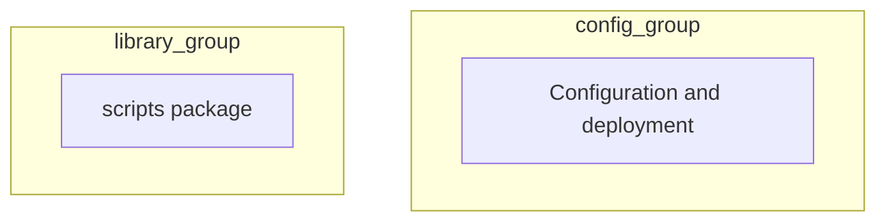

# Architecture report: mnfst/awesome-free-llm-apis

> Automated static analysis. **Observed** = directly seen in files/imports/AST; **Inferred** = interpretation from that evidence. Repository code was not executed.

## 1. Repository at a glance

| Item | Value |
| --- | --- |
| Repository | mnfst/awesome-free-llm-apis |
| Description | List of Permanent Free LLM API  (API Keys) |
| Language | JavaScript |
| Stars | 13187 |
| Licence | CC0-1.0 |
| Analysed commit / branch | 8e24de4f149855a75c2cb24e2e5d0155bada240f / main |
| Framework(s) | None detected |
| Files analysed | 38 |
| Components | 2 |

## 2. Architecture in one minute

mnfst/awesome-free-llm-apis - List of Permanent Free LLM API  (API Keys). This repository was analysed statically from 38 file(s) (0 Python). Detected technologies (observed from imports/manifests): GitHub Actions. Files are grouped into 2 component(s): Configuration and deployment, scripts package. Findings below distinguish observed facts from inferred interpretation.

## 3. High-level block diagram

## 4. Main components

### Configuration and deployment (`config`)

- **Kind:** config
- **Status:** Observed
- **Confidence:** 0.85
- **Responsibility:** Groups 3 file(s) under configuration and deployment (observed from repository paths and static analysis).
- **Paths:** `data.json`, `package.json`, `sources.json`
- **Evidence:** [data.json](https://github.com/mnfst/awesome-free-llm-apis/blob/8e24de4f149855a75c2cb24e2e5d0155bada240f/data.json); [package.json](https://github.com/mnfst/awesome-free-llm-apis/blob/8e24de4f149855a75c2cb24e2e5d0155bada240f/package.json); [sources.json](https://github.com/mnfst/awesome-free-llm-apis/blob/8e24de4f149855a75c2cb24e2e5d0155bada240f/sources.json)

### scripts package (`scripts`)

- **Kind:** library
- **Status:** Observed
- **Confidence:** 0.85
- **Responsibility:** Groups 7 file(s) under scripts package (observed from repository paths and static analysis).
- **Paths:** `scripts/check-sources.js`, `scripts/generate-readme.js`, `scripts/generate-skill.js`, `scripts/provider-setup.js`, `scripts/test-generated-endpoints.js`, `scripts/validate-data.js`, `scripts/verify-providers.js`
- **Evidence:** [scripts/check-sources.js](https://github.com/mnfst/awesome-free-llm-apis/blob/8e24de4f149855a75c2cb24e2e5d0155bada240f/scripts/check-sources.js); [scripts/generate-readme.js](https://github.com/mnfst/awesome-free-llm-apis/blob/8e24de4f149855a75c2cb24e2e5d0155bada240f/scripts/generate-readme.js); [scripts/generate-skill.js](https://github.com/mnfst/awesome-free-llm-apis/blob/8e24de4f149855a75c2cb24e2e5d0155bada240f/scripts/generate-skill.js); [scripts/provider-setup.js](https://github.com/mnfst/awesome-free-llm-apis/blob/8e24de4f149855a75c2cb24e2e5d0155bada240f/scripts/provider-setup.js); [scripts/test-generated-endpoints.js](https://github.com/mnfst/awesome-free-llm-apis/blob/8e24de4f149855a75c2cb24e2e5d0155bada240f/scripts/test-generated-endpoints.js); [scripts/validate-data.js](https://github.com/mnfst/awesome-free-llm-apis/blob/8e24de4f149855a75c2cb24e2e5d0155bada240f/scripts/validate-data.js); [scripts/verify-providers.js](https://github.com/mnfst/awesome-free-llm-apis/blob/8e24de4f149855a75c2cb24e2e5d0155bada240f/scripts/verify-providers.js)

## 5. Execution flow

No entry point was observed; the startup flow below is therefore limited.

Representative flow (derived from observed entry points and the import graph; steps beyond the entry point are **Inferred**):

1. Execution starts at an observed entry point listed above, if present.
2. No internal import relationships between components were observed.

## 6. Project structure

### `(root)`

- `.gitignore` - other (106 bytes)
- `CLAUDE.md` - docs (1574 bytes)
- `README.md` - docs (25374 bytes)
- `contributing.md` - docs (1860 bytes)
- `data.json` - config (34639 bytes)
- `license` - docs (7048 bytes)
- `package.json` - manifest (567 bytes)
- `sources.json` - config (48260 bytes)

### `.claude`

- `.claude/hooks/no-attribution.sh` - source, Shell (634 bytes)
- `.claude/hooks/no-claude-app-writes.sh` - source, Shell (1151 bytes)
- `.claude/settings.json` - config (708 bytes)

### `.github`

- `.github/FUNDING.yml` - config (39 bytes)
- `.github/workflows/ci.yml` - ci, YAML (1000 bytes)
- `.github/workflows/generate-readme.yml` - ci, YAML (893 bytes)
- `.github/workflows/no-claude-badge.yml` - ci, YAML (5772 bytes)

### `.verify`

- `.verify/report-2026-07-29.json` - config (34424 bytes)
- `.verify/report-2026-07-30-v2.json` - config (42597 bytes)
- `.verify/report-2026-07-30.json` - config (37460 bytes)
- `.verify/report-llm7-test.json` - config (2420 bytes)
- `.verify/report-ovh-llama-now.json` - config (489 bytes)
- `.verify/report-ovh-test.json` - config (6896 bytes)
- `.verify/state.json` - config (801 bytes)

### `agents`

- `agents/provider-sync.md` - docs (12786 bytes)
- `agents/triage.md` - docs (13250 bytes)

### `free-llm-apis`

- `free-llm-apis/SKILL.md` - docs (3578 bytes)
- `free-llm-apis/references/inference-providers.md` - docs (21701 bytes)
- `free-llm-apis/references/provider-apis.md` - docs (8221 bytes)

### `media`

- `media/okapi-logo-dark.svg` - other (6391 bytes)
- `media/okapi-logo-light.svg` - other (6391 bytes)
- `media/sponsor-slot-dark.svg` - other (610 bytes)
- `media/sponsor-slot-light.svg` - other (610 bytes)

### `scripts`

- `scripts/check-sources.js` - source, JavaScript (12570 bytes)
- `scripts/generate-readme.js` - source, JavaScript (5951 bytes)
- `scripts/generate-skill.js` - source, JavaScript (7144 bytes)
- `scripts/provider-setup.js` - source, JavaScript (1716 bytes)
- `scripts/test-generated-endpoints.js` - source, JavaScript (2967 bytes)
- `scripts/validate-data.js` - source, JavaScript (6165 bytes)
- `scripts/verify-providers.js` - source, JavaScript (23282 bytes)

## 7. Key dependencies and integrations

| Name | Category | Status | Confidence | Evidence |
| --- | --- | --- | --- | --- |
| GitHub Actions | ci | Observed | 0.90 | [.github/workflows/ci.yml](https://github.com/mnfst/awesome-free-llm-apis/blob/8e24de4f149855a75c2cb24e2e5d0155bada240f/.github/workflows/ci.yml); [.github/workflows/generate-readme.yml](https://github.com/mnfst/awesome-free-llm-apis/blob/8e24de4f149855a75c2cb24e2e5d0155bada240f/.github/workflows/generate-readme.yml); [.github/workflows/no-claude-badge.yml](https://github.com/mnfst/awesome-free-llm-apis/blob/8e24de4f149855a75c2cb24e2e5d0155bada240f/.github/workflows/no-claude-badge.yml) |

## 8. Data and state

No database, cache, queue, or persistent-state usage was observed in the analysed files. State handling, if any, may be in-memory or in files that were not analysed.

## 9. Configuration and deployment clues

- `.claude/settings.json` (config)
- `.github/FUNDING.yml` (config)
- `.github/workflows/ci.yml` (ci)
- `.github/workflows/generate-readme.yml` (ci)
- `.github/workflows/no-claude-badge.yml` (ci)
- `.verify/report-2026-07-29.json` (config)
- `.verify/report-2026-07-30-v2.json` (config)
- `.verify/report-2026-07-30.json` (config)
- `.verify/report-llm7-test.json` (config)
- `.verify/report-ovh-llama-now.json` (config)
- `.verify/report-ovh-test.json` (config)
- `.verify/state.json` (config)
- `data.json` (config)
- `package.json` (manifest)
- `sources.json` (config)

## 10. Design observations

- No strong design patterns could be established from the available evidence.

These observations are interpretations (**Inferred**) of the observed structure, not guarantees about runtime design.

## 11. Limitations and unknowns

- Static analysis only: repository code was not executed, installed, or imported at runtime.
- Components and relationships are inferred from file paths, imports, and AST structure; runtime behaviour, dynamic imports, and reflection may not be visible.
- 1 file(s) were skipped during inventory (1 x likely secret file excluded).
- No clear application entry point was observed in the analysed files.
- Repository text was treated as untrusted data; no instructions found in repository files were followed, and likely secret values were redacted/excluded.
- JavaScript and TypeScript files were inventoried from paths and package manifests. They were not parsed with a full language AST, and repository code was not executed.

## 12. Source references

- [.github/workflows/ci.yml](https://github.com/mnfst/awesome-free-llm-apis/blob/8e24de4f149855a75c2cb24e2e5d0155bada240f/.github/workflows/ci.yml)
- [.github/workflows/generate-readme.yml](https://github.com/mnfst/awesome-free-llm-apis/blob/8e24de4f149855a75c2cb24e2e5d0155bada240f/.github/workflows/generate-readme.yml)
- [.github/workflows/no-claude-badge.yml](https://github.com/mnfst/awesome-free-llm-apis/blob/8e24de4f149855a75c2cb24e2e5d0155bada240f/.github/workflows/no-claude-badge.yml)
- [data.json](https://github.com/mnfst/awesome-free-llm-apis/blob/8e24de4f149855a75c2cb24e2e5d0155bada240f/data.json)
- [package.json](https://github.com/mnfst/awesome-free-llm-apis/blob/8e24de4f149855a75c2cb24e2e5d0155bada240f/package.json)
- [scripts/check-sources.js](https://github.com/mnfst/awesome-free-llm-apis/blob/8e24de4f149855a75c2cb24e2e5d0155bada240f/scripts/check-sources.js)
- [scripts/generate-readme.js](https://github.com/mnfst/awesome-free-llm-apis/blob/8e24de4f149855a75c2cb24e2e5d0155bada240f/scripts/generate-readme.js)
- [scripts/generate-skill.js](https://github.com/mnfst/awesome-free-llm-apis/blob/8e24de4f149855a75c2cb24e2e5d0155bada240f/scripts/generate-skill.js)
- [scripts/provider-setup.js](https://github.com/mnfst/awesome-free-llm-apis/blob/8e24de4f149855a75c2cb24e2e5d0155bada240f/scripts/provider-setup.js)
- [scripts/test-generated-endpoints.js](https://github.com/mnfst/awesome-free-llm-apis/blob/8e24de4f149855a75c2cb24e2e5d0155bada240f/scripts/test-generated-endpoints.js)
- [scripts/validate-data.js](https://github.com/mnfst/awesome-free-llm-apis/blob/8e24de4f149855a75c2cb24e2e5d0155bada240f/scripts/validate-data.js)
- [scripts/verify-providers.js](https://github.com/mnfst/awesome-free-llm-apis/blob/8e24de4f149855a75c2cb24e2e5d0155bada240f/scripts/verify-providers.js)
- [sources.json](https://github.com/mnfst/awesome-free-llm-apis/blob/8e24de4f149855a75c2cb24e2e5d0155bada240f/sources.json)
