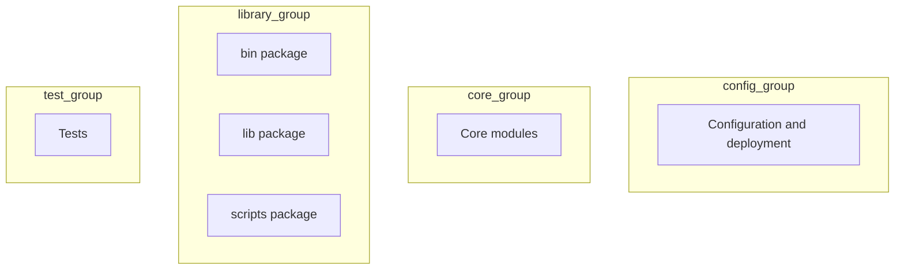

# Architecture report: mochajs/mocha

> Automated static analysis. **Observed** = directly seen in files/imports/AST; **Inferred** = interpretation from that evidence. Repository code was not executed.

## 1. Repository at a glance

| Item | Value |
| --- | --- |
| Repository | mochajs/mocha |
| Description | ☕️ Classic, reliable, trusted test framework for Node.js and the browser |
| Language | JavaScript |
| Stars | 22912 |
| Licence | MIT |
| Analysed commit / branch | 5b5afa7b12e3f76f4e0c6afa12e960c0b378358c / main |
| Framework(s) | None detected |
| Files analysed | 673 |
| Components | 6 |

## 2. Architecture in one minute

mochajs/mocha - ☕️ Classic, reliable, trusted test framework for Node.js and the browser. This repository was analysed statically from 673 file(s) (0 Python). Detected technologies (observed from imports/manifests): GitHub Actions, TypeScript, webpack. Files are grouped into 6 component(s): bin package, Configuration and deployment, Core modules, lib package, scripts package, Tests. Findings below distinguish observed facts from inferred interpretation.

## 3. High-level block diagram

## 4. Main components

### bin package (`bin`)

- **Kind:** library
- **Status:** Observed
- **Confidence:** 0.85
- **Responsibility:** Groups 1 file(s) under bin package (observed from repository paths and static analysis).
- **Paths:** `bin/mocha.js`
- **Evidence:** [bin/mocha.js](https://github.com/mochajs/mocha/blob/5b5afa7b12e3f76f4e0c6afa12e960c0b378358c/bin/mocha.js)

### Configuration and deployment (`config`)

- **Kind:** config
- **Status:** Observed
- **Confidence:** 0.85
- **Responsibility:** Groups 7 file(s) under configuration and deployment (observed from repository paths and static analysis).
- **Paths:** `lib/mocharc.json`, `netlify.toml`, `package.json`, `renovate.json`, `repro/.mocharc.yml`, `repro/package.json`, `tsconfig.json`
- **Evidence:** [lib/mocharc.json](https://github.com/mochajs/mocha/blob/5b5afa7b12e3f76f4e0c6afa12e960c0b378358c/lib/mocharc.json); [netlify.toml](https://github.com/mochajs/mocha/blob/5b5afa7b12e3f76f4e0c6afa12e960c0b378358c/netlify.toml); [package.json](https://github.com/mochajs/mocha/blob/5b5afa7b12e3f76f4e0c6afa12e960c0b378358c/package.json); [renovate.json](https://github.com/mochajs/mocha/blob/5b5afa7b12e3f76f4e0c6afa12e960c0b378358c/renovate.json); [repro/.mocharc.yml](https://github.com/mochajs/mocha/blob/5b5afa7b12e3f76f4e0c6afa12e960c0b378358c/repro/.mocharc.yml); [repro/package.json](https://github.com/mochajs/mocha/blob/5b5afa7b12e3f76f4e0c6afa12e960c0b378358c/repro/package.json); [tsconfig.json](https://github.com/mochajs/mocha/blob/5b5afa7b12e3f76f4e0c6afa12e960c0b378358c/tsconfig.json)

### Core modules (`core`)

- **Kind:** core
- **Status:** Observed
- **Confidence:** 0.85
- **Responsibility:** Groups 6 file(s) under core modules (observed from repository paths and static analysis).
- **Paths:** `browser-entry.js`, `eslint.config.cjs`, `index.js`, `mocha.mjs`, `playwright.config.js`, `rollup.config.js`
- **Evidence:** [browser-entry.js](https://github.com/mochajs/mocha/blob/5b5afa7b12e3f76f4e0c6afa12e960c0b378358c/browser-entry.js); [eslint.config.cjs](https://github.com/mochajs/mocha/blob/5b5afa7b12e3f76f4e0c6afa12e960c0b378358c/eslint.config.cjs); [index.js](https://github.com/mochajs/mocha/blob/5b5afa7b12e3f76f4e0c6afa12e960c0b378358c/index.js); [mocha.mjs](https://github.com/mochajs/mocha/blob/5b5afa7b12e3f76f4e0c6afa12e960c0b378358c/mocha.mjs); [playwright.config.js](https://github.com/mochajs/mocha/blob/5b5afa7b12e3f76f4e0c6afa12e960c0b378358c/playwright.config.js); [rollup.config.js](https://github.com/mochajs/mocha/blob/5b5afa7b12e3f76f4e0c6afa12e960c0b378358c/rollup.config.js)

### lib package (`lib`)

- **Kind:** library
- **Status:** Observed
- **Confidence:** 0.85
- **Responsibility:** Groups 64 file(s) under lib package (observed from repository paths and static analysis).
- **Paths:** `lib/browser/highlight-tags.js`, `lib/browser/parse-query.js`, `lib/cli/cli.js`, `lib/cli/collect-files.cjs`, `lib/cli/commands.js`, `lib/cli/config.cjs`, `lib/cli/index.cjs`, `lib/cli/init.js`, `lib/cli/lookup-files.js`, `lib/cli/node-flags.cjs`, `lib/cli/one-and-dones.js`, `lib/cli/options.cjs`, `lib/cli/parse-args.js`, `lib/cli/run-helpers.cjs`, `lib/cli/run-option-metadata.cjs`, `lib/cli/run.cjs`, `lib/cli/unparse-args.js`, `lib/cli/watch-run.cjs`, `lib/context.js`, `lib/error-constants.js`, `lib/errors.js`, `lib/hook.js`, `lib/interfaces/bdd.js`, `lib/interfaces/common.js`, `lib/interfaces/exports.js`, `lib/interfaces/index.js`, `lib/interfaces/qunit.js`, `lib/interfaces/tdd.js`, `lib/mocha.cjs`, `lib/nodejs/buffered-worker-pool.js`, `lib/nodejs/esm-utils.cjs`, `lib/nodejs/file-unloader.js`, `lib/nodejs/parallel-buffered-runner.js`, `lib/nodejs/reporters/parallel-buffered.js`, `lib/nodejs/serializer.js`, `lib/nodejs/worker-core.js`, `lib/nodejs/worker.js`, `lib/pending.js`, `lib/plugin-loader.js`, `lib/reporters/base.js`, `lib/reporters/doc.js`, `lib/reporters/dot.js`, `lib/reporters/github-actions.js`, `lib/reporters/html.js`, `lib/reporters/index.cjs`, `lib/reporters/json-stream.js`, `lib/reporters/json.js`, `lib/reporters/landing.js`, `lib/reporters/list.js`, `lib/reporters/markdown.js`, `lib/reporters/min.js`, `lib/reporters/nyan.js`, `lib/reporters/progress.js`, `lib/reporters/spec.js`, `lib/reporters/tap.js`, `lib/reporters/xunit.js`, `lib/runnable.js`, `lib/runner.js`, `lib/stats-collector.js`, `lib/suite.js`, `lib/test.js`, `lib/types.d.ts`, `lib/utils.cjs`, `lib/utils/regexp.js`
- **Evidence:** [lib/browser/highlight-tags.js](https://github.com/mochajs/mocha/blob/5b5afa7b12e3f76f4e0c6afa12e960c0b378358c/lib/browser/highlight-tags.js); [lib/browser/parse-query.js](https://github.com/mochajs/mocha/blob/5b5afa7b12e3f76f4e0c6afa12e960c0b378358c/lib/browser/parse-query.js); [lib/cli/cli.js](https://github.com/mochajs/mocha/blob/5b5afa7b12e3f76f4e0c6afa12e960c0b378358c/lib/cli/cli.js); [lib/cli/collect-files.cjs](https://github.com/mochajs/mocha/blob/5b5afa7b12e3f76f4e0c6afa12e960c0b378358c/lib/cli/collect-files.cjs); [lib/cli/commands.js](https://github.com/mochajs/mocha/blob/5b5afa7b12e3f76f4e0c6afa12e960c0b378358c/lib/cli/commands.js); [lib/cli/config.cjs](https://github.com/mochajs/mocha/blob/5b5afa7b12e3f76f4e0c6afa12e960c0b378358c/lib/cli/config.cjs); [lib/cli/index.cjs](https://github.com/mochajs/mocha/blob/5b5afa7b12e3f76f4e0c6afa12e960c0b378358c/lib/cli/index.cjs); [lib/cli/init.js](https://github.com/mochajs/mocha/blob/5b5afa7b12e3f76f4e0c6afa12e960c0b378358c/lib/cli/init.js)

### scripts package (`scripts`)

- **Kind:** library
- **Status:** Observed
- **Confidence:** 0.85
- **Responsibility:** Groups 4 file(s) under scripts package (observed from repository paths and static analysis).
- **Paths:** `scripts/linkify-changelog.js`, `scripts/merge-coverage.js`, `scripts/pick-from-package-json.js`, `scripts/update-authors.cjs`
- **Evidence:** [scripts/linkify-changelog.js](https://github.com/mochajs/mocha/blob/5b5afa7b12e3f76f4e0c6afa12e960c0b378358c/scripts/linkify-changelog.js); [scripts/merge-coverage.js](https://github.com/mochajs/mocha/blob/5b5afa7b12e3f76f4e0c6afa12e960c0b378358c/scripts/merge-coverage.js); [scripts/pick-from-package-json.js](https://github.com/mochajs/mocha/blob/5b5afa7b12e3f76f4e0c6afa12e960c0b378358c/scripts/pick-from-package-json.js); [scripts/update-authors.cjs](https://github.com/mochajs/mocha/blob/5b5afa7b12e3f76f4e0c6afa12e960c0b378358c/scripts/update-authors.cjs)

### Tests (`tests`)

- **Kind:** test
- **Status:** Observed
- **Confidence:** 0.85
- **Responsibility:** Groups 431 file(s) under tests (observed from repository paths and static analysis).
- **Paths:** `repro/test/hello.spec.js`, `test/README.md`, `test/assertions.cjs`, `test/browser-specific/esm.spec.js`, `test/browser-specific/fixtures/esm.fixture.js`, `test/browser-specific/fixtures/webpack/webpack.config.cjs`, `test/browser-specific/fixtures/webpack/webpack.fixture.js`, `test/browser-specific/setup.cjs`, `test/browser/config.js`, `test/browser/global-setup.js`, `test/browser/run.spec.js`, `test/browser/server.js`, `test/compiler-cjs/test.js`, `test/compiler-cjs/test.js.compiled`, `test/compiler-cjs/test.ts`, `test/compiler-cjs/test.ts.compiled`, `test/compiler-esm/package.json`, `test/compiler-esm/test-tla.js`, `test/compiler-esm/test-tla.js.compiled`, `test/compiler-esm/test-tla.mjs`, `test/compiler-esm/test-tla.mjs.compiled`, `test/compiler-esm/test-tla.ts`, `test/compiler-esm/test-tla.ts.compiled`, `test/compiler-esm/test.js`, `test/compiler-esm/test.js.compiled`, `test/compiler-esm/test.mjs`, `test/compiler-esm/test.mjs.compiled`, `test/compiler-esm/test.ts`, `test/compiler-esm/test.ts.compiled`, `test/compiler-fixtures/esm-loader.fixture.js`, `test/compiler-fixtures/esm-only-loader/README.md`, `test/compiler-fixtures/esm-only-loader/esm-loader.fixture.js`, `test/compiler-fixtures/esm-only-loader/esm.fixture.js`, `test/compiler-fixtures/esm-only-loader/package.json`, `test/compiler-fixtures/esm.fixture.cjs`, `test/compiler-fixtures/foo.fixture.cjs`, `test/compiler-fixtures/js.fixture.cjs`, `test/compiler-fixtures/ts.fixture.cjs`, `test/compiler/test.coffee`, `test/compiler/test.foo`, `test/integration/README.md`, `test/integration/color.spec.cjs`, `test/integration/common-js-require.spec.cjs`, `test/integration/compiler-cjs.spec.cjs`, `test/integration/compiler-esm-only-loader.spec.cjs`, `test/integration/compiler-esm.spec.cjs`, `test/integration/compiler-globbing.spec.cjs`, `test/integration/config.spec.cjs`, `test/integration/constants.js`, `test/integration/diffs.spec.cjs`, `test/integration/duplicate-arguments.spec.cjs`, `test/integration/esm.spec.cjs`, `test/integration/events.spec.cjs`, `test/integration/fifo.spec.cjs`, `test/integration/file-utils.spec.cjs`, `test/integration/fixtures/__default__.fixture.js`, `test/integration/fixtures/cascade.fixture.js`, `test/integration/fixtures/collect-files.fixture.js`, `test/integration/fixtures/common-js-require.fixture.cjs`, `test/integration/fixtures/config/mocha-config/index.js`, `test/integration/fixtures/config/mocha-config/package.json`, `test/integration/fixtures/config/mocharc.cjs`, `test/integration/fixtures/config/mocharc.js`, `test/integration/fixtures/config/mocharc.json`, `test/integration/fixtures/config/mocharc.yaml`, `test/integration/fixtures/config/mocharcWithThrowError.cjs`, `test/integration/fixtures/current-test-title.fixture.cjs`, `test/integration/fixtures/diff-hang-protection.fixture.cjs`, `test/integration/fixtures/diffs/diffs.css.in`, `test/integration/fixtures/diffs/diffs.css.out`, `test/integration/fixtures/diffs/diffs.fixture.cjs`, `test/integration/fixtures/diffs/output`, `test/integration/fixtures/esm/add.js`, `test/integration/fixtures/esm/dir-cjs-require/index.js`, `test/integration/fixtures/esm/esm-failure.fixture.js`, `test/integration/fixtures/esm/esm-success.fixture.js`, `test/integration/fixtures/esm/js-folder/add.js`, `test/integration/fixtures/esm/js-folder/esm-in-js.fixture.js`, `test/integration/fixtures/esm/js-folder/package.json`, `test/integration/fixtures/esm/loader-with-module-not-found/loader-that-recognizes-ts.js`, `test/integration/fixtures/esm/loader-with-module-not-found/test-that-imports-non-existing-module.fixture.js`, `test/integration/fixtures/esm/loader-with-module-not-found/test-that-imports-non-existing-module.fixture.ts`, `test/integration/fixtures/esm/syntax-error/esm-syntax-error.fixture.js`, `test/integration/fixtures/esm/test-that-uses-dir-cjs-require.fixture.js/index.js`, `test/integration/fixtures/esm/type-module/package.json`, `test/integration/fixtures/esm/type-module/test-that-imports-non-existing-module.fixture.js`, `test/integration/fixtures/exit.fixture.cjs`, `test/integration/fixtures/failing-sync.fixture.cjs`, `test/integration/fixtures/failing.fixture.cjs`, `test/integration/fixtures/glob/glob.spec.js`, `test/integration/fixtures/glob/nested/glob.spec.js`, `test/integration/fixtures/global-variable-occupied.fixture.js`, `test/integration/fixtures/hooks/after-each-hook-async-error.fixture.js`, `test/integration/fixtures/hooks/after-each-hook-error.fixture.js`, `test/integration/fixtures/hooks/after-each-this-test-error.fixture.js`, `test/integration/fixtures/hooks/after-hook-async-error.fixture.js`, `test/integration/fixtures/hooks/after-hook-deepnested-error.fixture.js`, `test/integration/fixtures/hooks/after-hook-error.fixture.js`, `test/integration/fixtures/hooks/after-hook-nested-error.fixture.js`, `test/integration/fixtures/hooks/before-each-hook-async-error.fixture.js`, `test/integration/fixtures/hooks/before-each-hook-error-with-fail-affected-nested.fixture.js`, `test/integration/fixtures/hooks/before-each-hook-error-with-fail-affected.fixture.js`, `test/integration/fixtures/hooks/before-each-hook-error.fixture.js`, `test/integration/fixtures/hooks/before-each-hook-throw-non-error.fixture.js`, `test/integration/fixtures/hooks/before-hook-async-error-tip.fixture.js`, `test/integration/fixtures/hooks/before-hook-async-error.fixture.js`, `test/integration/fixtures/hooks/before-hook-deepnested-error.fixture.js`, `test/integration/fixtures/hooks/before-hook-error-tip.fixture.js`, `test/integration/fixtures/hooks/before-hook-error-with-fail-affected.fixture.js`, `test/integration/fixtures/hooks/before-hook-error.fixture.js`, `test/integration/fixtures/hooks/before-hook-nested-error.fixture.js`, `test/integration/fixtures/hooks/before-hook-root-error.fixture.js`, `test/integration/fixtures/hooks/before-hook-throw-non-error.fixture.js`, `test/integration/fixtures/hooks/multiple-hook-async-error.fixture.js`, `test/integration/fixtures/hooks/multiple-hook-error.fixture.js`, `test/integration/fixtures/multiple-done-async.fixture.js`, `test/integration/fixtures/multiple-done-before-each.fixture.js`, `test/integration/fixtures/multiple-done-before.fixture.js`, `test/integration/fixtures/multiple-done-specs.fixture.js`, `test/integration/fixtures/multiple-done-with-error.fixture.js`, `test/integration/fixtures/multiple-done.fixture.js`, `test/integration/fixtures/multiple-runs/clean-references.fixture.cjs`, `test/integration/fixtures/multiple-runs/dispose.fixture.cjs`, `test/integration/fixtures/multiple-runs/multiple-runs-with-different-output-suite.fixture.js`, `test/integration/fixtures/multiple-runs/multiple-runs-with-flaky-before-each-suite.fixture.js`, `test/integration/fixtures/multiple-runs/multiple-runs-with-flaky-before-each.fixture.cjs`, `test/integration/fixtures/multiple-runs/run-thrice-helper.cjs`, `test/integration/fixtures/multiple-runs/run-thrice.fixture.cjs`, `test/integration/fixtures/multiple-runs/start-second-run-if-previous-is-still-running-suite.fixture.js`, `test/integration/fixtures/multiple-runs/start-second-run-if-previous-is-still-running.fixture.cjs`, `test/integration/fixtures/no-diff.fixture.cjs`, `test/integration/fixtures/options/allow-uncaught/propagate.fixture.cjs`, `test/integration/fixtures/options/allow-uncaught/this-skip-it.fixture.js`, `test/integration/fixtures/options/async-only-async.fixture.js`, `test/integration/fixtures/options/async-only-sync.fixture.js`, `test/integration/fixtures/options/bail-async.fixture.js`, `test/integration/fixtures/options/bail-with-after.fixture.cjs`, `test/integration/fixtures/options/bail-with-afterEach.fixture.cjs`, `test/integration/fixtures/options/bail-with-before.fixture.cjs`, `test/integration/fixtures/options/bail-with-beforeEach.fixture.cjs`, `test/integration/fixtures/options/bail-with-test.fixture.cjs`, `test/integration/fixtures/options/bail.fixture.js`, `test/integration/fixtures/options/delay-fail.fixture.js`, `test/integration/fixtures/options/delay-only.fixture.cjs`, `test/integration/fixtures/options/delay.fixture.cjs`, `test/integration/fixtures/options/dry-run/dry-run.fixture.js`, `test/integration/fixtures/options/dry-run/stack-size.fixture.cjs`, `test/integration/fixtures/options/extension/test1.fixture.js`, `test/integration/fixtures/options/extension/test2.fixture.coffee`, `test/integration/fixtures/options/file-alpha.fixture.js`, `test/integration/fixtures/options/file-beta.fixture.js`, `test/integration/fixtures/options/file-theta.fixture.js`, `test/integration/fixtures/options/forbid-only/only-before-each.fixture.js`, `test/integration/fixtures/options/forbid-only/only-before.fixture.js`, `test/integration/fixtures/options/forbid-only/only-empty-suite.fixture.js`, `test/integration/fixtures/options/forbid-only/only-suite.fixture.js`, `test/integration/fixtures/options/forbid-only/only.fixture.js`, `test/integration/fixtures/options/forbid-only/passed.fixture.js`, `test/integration/fixtures/options/forbid-pending/before-this-skip.fixture.js`, `test/integration/fixtures/options/forbid-pending/beforeEach-this-skip.fixture.js`, `test/integration/fixtures/options/forbid-pending/passed.fixture.js`, `test/integration/fixtures/options/forbid-pending/pending.fixture.js`, `test/integration/fixtures/options/forbid-pending/skip-empty-suite.fixture.js`, `test/integration/fixtures/options/forbid-pending/skip-suite.fixture.js`, `test/integration/fixtures/options/forbid-pending/skip.fixture.js`, `test/integration/fixtures/options/forbid-pending/this-skip.fixture.js`, `test/integration/fixtures/options/grep.fixture.js`, `test/integration/fixtures/options/ignore/fail.fixture.js`, `test/integration/fixtures/options/ignore/nested/fail.fixture.js`, `test/integration/fixtures/options/ignore/nested/pass.fixture.js`, `test/integration/fixtures/options/ignore/pass.fixture.js`, `test/integration/fixtures/options/jobs/fail-in-parallel.fixture.cjs`, `test/integration/fixtures/options/node-flags/import-break-find-up.mjs`, `test/integration/fixtures/options/node-flags/tsx-config/.mocharc.yml`, `test/integration/fixtures/options/node-flags/tsx.fixture.ts`, `test/integration/fixtures/options/only/bdd.fixture.js`, `test/integration/fixtures/options/only/qunit.fixture.js`, `test/integration/fixtures/options/only/tdd.fixture.js`, `test/integration/fixtures/options/open-inspector.fixture.cjs`, `test/integration/fixtures/options/parallel/bail.fixture.js`, `test/integration/fixtures/options/parallel/exclusive-test-a.fixture.js`, `test/integration/fixtures/options/parallel/exclusive-test-b.fixture.js`, `test/integration/fixtures/options/parallel/retries-a.fixture.js`, `test/integration/fixtures/options/parallel/retries-b.fixture.js`, `test/integration/fixtures/options/parallel/syntax-err.fixture.js`, `test/integration/fixtures/options/parallel/test-a.fixture.js`, `test/integration/fixtures/options/parallel/test-b.fixture.js`, `test/integration/fixtures/options/parallel/test-c.fixture.js`, `test/integration/fixtures/options/parallel/test-d.fixture.js`, `test/integration/fixtures/options/parallel/uncaught.fixture.js`, `test/integration/fixtures/options/reporter-esm.fixture.js`, `test/integration/fixtures/options/reporter-with-options.fixture.cjs`, `test/integration/fixtures/options/retries.fixture.js`, `test/integration/fixtures/options/slow-test.fixture.js`, `test/integration/fixtures/options/sort-alpha.fixture.js`, `test/integration/fixtures/options/sort-beta.fixture.js`, `test/integration/fixtures/options/timeout-unref.fixture.js`, `test/integration/fixtures/options/watch/dependency.fixture.cjs`, `test/integration/fixtures/options/watch/global-install.fixture.cjs`, `test/integration/fixtures/options/watch/global-leak.fixture.cjs`, `test/integration/fixtures/options/watch/hook.fixture.cjs`, `test/integration/fixtures/options/watch/test-file-change.fixture.js`, `test/integration/fixtures/options/watch/test-with-dependency.fixture.cjs`, `test/integration/fixtures/options/watch/test-with-global-install.fixture.cjs`, `test/integration/fixtures/parallel/circular-error-array.js`, `test/integration/fixtures/parallel/circular-error-object.js`, `test/integration/fixtures/parallel/getter-error-object.js`, `test/integration/fixtures/parallel/non-circular-error.js`, `test/integration/fixtures/parallel/test1.js`, `test/integration/fixtures/parallel/test2.js`, `test/integration/fixtures/parallel/test3.js`, `test/integration/fixtures/parallel/testworkerid1.js`, `test/integration/fixtures/parallel/testworkerid2.js`, `test/integration/fixtures/parallel/testworkerid3.js`, `test/integration/fixtures/parallel/worker-death.js`, `test/integration/fixtures/passing-async.fixture.js`, `test/integration/fixtures/passing-sync.fixture.js`, `test/integration/fixtures/passing.fixture.cjs`, `test/integration/fixtures/pending/programmatic.fixture.cjs`, `test/integration/fixtures/pending/skip-async-before-hooks.fixture.cjs`, `test/integration/fixtures/pending/skip-async-before-nested.fixture.js`, `test/integration/fixtures/pending/skip-async-before.fixture.js`, `test/integration/fixtures/pending/skip-async-beforeEach.fixture.cjs`, `test/integration/fixtures/pending/skip-async-spec.fixture.cjs`, `test/integration/fixtures/pending/skip-hierarchy.fixture.js`, `test/integration/fixtures/pending/skip-shorthand.fixture.js`, `test/integration/fixtures/pending/skip-sync-after.fixture.js`, `test/integration/fixtures/pending/skip-sync-before-hooks.fixture.cjs`, `test/integration/fixtures/pending/skip-sync-before-inner.fixture.cjs`, `test/integration/fixtures/pending/skip-sync-before-nested.fixture.js`, `test/integration/fixtures/pending/skip-sync-before.fixture.js`, `test/integration/fixtures/pending/skip-sync-beforeEach-cond.fixture.js`, `test/integration/fixtures/pending/skip-sync-beforeEach.fixture.cjs`, `test/integration/fixtures/pending/skip-sync-spec.fixture.cjs`, `test/integration/fixtures/pending/spec.fixture.js`, `test/integration/fixtures/plugins/global-fixtures/global-setup-teardown-multiple.fixture.cjs`, `test/integration/fixtures/plugins/global-fixtures/global-setup-teardown.fixture.cjs`, `test/integration/fixtures/plugins/global-fixtures/global-setup-throws.fixture.cjs`, `test/integration/fixtures/plugins/global-fixtures/global-setup.fixture.cjs`, `test/integration/fixtures/plugins/global-fixtures/global-teardown-throws.fixture.cjs`, `test/integration/fixtures/plugins/global-fixtures/global-teardown.fixture.cjs`, `test/integration/fixtures/plugins/root-hooks/esm/package.json`, `test/integration/fixtures/plugins/root-hooks/esm/root-hook-defs-esm.fixture.js`, `test/integration/fixtures/plugins/root-hooks/package.json`, `test/integration/fixtures/plugins/root-hooks/root-hook-defs-a.fixture.js`, `test/integration/fixtures/plugins/root-hooks/root-hook-defs-b.fixture.js`, `test/integration/fixtures/plugins/root-hooks/root-hook-defs-c.fixture.js`, `test/integration/fixtures/plugins/root-hooks/root-hook-defs-d.fixture.js`, `test/integration/fixtures/plugins/root-hooks/root-hook-defs-esm-broken.fixture.js`, `test/integration/fixtures/plugins/root-hooks/root-hook-defs-esm.fixture.js`, `test/integration/fixtures/plugins/root-hooks/root-hook-test-2.fixture.js`, `test/integration/fixtures/plugins/root-hooks/root-hook-test.fixture.js`, `test/integration/fixtures/regression/issue-1991.fixture.js`, `test/integration/fixtures/regression/issue-2315.fixture.js`, `test/integration/fixtures/regression/issue-2406.fixture.js`, `test/integration/fixtures/regression/issue-2417.fixture.js`, `test/integration/fixtures/reporters.fixture.js`, `test/integration/fixtures/retries/async.fixture.js`, `test/integration/fixtures/retries/early-pass.fixture.cjs`, `test/integration/fixtures/retries/hooks.fixture.js`, `test/integration/fixtures/retries/nested.fixture.js`, `test/integration/fixtures/runner/events-bail-retries.fixture.cjs`, `test/integration/fixtures/runner/events-bail.fixture.cjs`, `test/integration/fixtures/runner/events-basic.fixture.cjs`, `test/integration/fixtures/runner/events-delay.fixture.cjs`, `test/integration/fixtures/runner/events-retries.fixture.cjs`, `test/integration/fixtures/signals-sigabrt.fixture.js`, `test/integration/fixtures/signals-sigterm-numeric.fixture.cjs`, `test/integration/fixtures/signals-sigterm.fixture.js`, `test/integration/fixtures/simple-reporter.cjs`, `test/integration/fixtures/simple-ui.fixture.cjs`, `test/integration/fixtures/simple-ui.fixture.js`, `test/integration/fixtures/stack-trace.fixture.cjs`, `test/integration/fixtures/suite/suite-no-callback.fixture.js`, `test/integration/fixtures/suite/suite-returning-value.fixture.js`, `test/integration/fixtures/suite/suite-skipped-callback.fixture.js`, `test/integration/fixtures/suite/suite-skipped-no-callback.fixture.js`, `test/integration/fixtures/test-for-simple-ui.fixture.js`, `test/integration/fixtures/timeout-chained-call.fixture.js`, `test/integration/fixtures/timeout-override.fixture.js`, `test/integration/fixtures/timeout.fixture.js`, `test/integration/fixtures/uncaught/after-runner.fixture.js`, `test/integration/fixtures/uncaught/double.fixture.js`, `test/integration/fixtures/uncaught/fatal.fixture.js`, `test/integration/fixtures/uncaught/hook.fixture.js`, `test/integration/fixtures/uncaught/issue-1327.fixture.js`, `test/integration/fixtures/uncaught/issue-1417.fixture.js`, `test/integration/fixtures/uncaught/listeners.fixture.cjs`, `test/integration/fixtures/uncaught/pending.fixture.js`, `test/integration/fixtures/uncaught/recover.fixture.cjs`, `test/integration/fixtures/uncaught/unhandled.fixture.js`, `test/integration/glob.spec.cjs`, `test/integration/global-variable.spec.cjs`, `test/integration/help.spec.js`, `test/integration/helpers.cjs`, `test/integration/hook-err.spec.cjs`, `test/integration/hooks.spec.cjs`, `test/integration/init.spec.cjs`, `test/integration/invalid-arguments.spec.cjs`, `test/integration/multiple-done.spec.cjs`, `test/integration/multiple-runs.spec.cjs`, `test/integration/no-diff.spec.cjs`, `test/integration/only.spec.cjs`, `test/integration/options/allowUncaught.spec.cjs`, `test/integration/options/asyncOnly.spec.cjs`, `test/integration/options/bail.spec.cjs`, `test/integration/options/delay.spec.cjs`, `test/integration/options/dryRun.spec.cjs`, `test/integration/options/exit.spec.cjs`, `test/integration/options/extension.spec.cjs`, `test/integration/options/failZero.spec.cjs`, `test/integration/options/file.spec.cjs`, `test/integration/options/forbidOnly.spec.cjs`, `test/integration/options/forbidPending.spec.cjs`, `test/integration/options/grep.spec.cjs`, `test/integration/options/ignore.spec.cjs`, `test/integration/options/invert.spec.cjs`, `test/integration/options/jobs.spec.cjs`, `test/integration/options/listInterfaces.spec.cjs`, `test/integration/options/listReporters.spec.cjs`, `test/integration/options/node-flags.spec.cjs`, `test/integration/options/parallel.spec.cjs`, `test/integration/options/passOnFailingTestSuite.spec.cjs`, `test/integration/options/posixExitCodes.spec.cjs`, `test/integration/options/reporter-option.spec.cjs`, `test/integration/options/reporter.spec.cjs`, `test/integration/options/retries.spec.cjs`, `test/integration/options/run-preparation.spec.js`, `test/integration/options/sort.spec.cjs`, `test/integration/options/timeout.spec.cjs`, `test/integration/options/ui.spec.cjs`, `test/integration/options/watch.spec.cjs`, `test/integration/package-entrypoint.spec.cjs`, `test/integration/parallel.spec.cjs`, `test/integration/pending.spec.cjs`, `test/integration/plugins/global-fixtures.spec.cjs`, `test/integration/plugins/root-hooks.spec.cjs`, `test/integration/regression.spec.cjs`, `test/integration/repo-tooling.spec.cjs`, `test/integration/reporters.spec.cjs`, `test/integration/retries.spec.cjs`, `test/integration/suite.spec.cjs`, `test/integration/timeout.spec.cjs`, `test/integration/uncaught.spec.cjs`, `test/interfaces/bdd.spec.js`, `test/interfaces/exports.spec.cjs`, `test/interfaces/qunit.spec.js`, `test/interfaces/tdd.spec.js`, `test/jsapi/index.js`, `test/node-unit/buffered-worker-pool.spec.cjs`, `test/node-unit/cli/cli.spec.js`, `test/node-unit/cli/config.spec.cjs`, `test/node-unit/cli/fixtures/bad-module.fixture.js`, `test/node-unit/cli/fixtures/bad-require.fixture.cjs`, `test/node-unit/cli/mocha-flags.spec.cjs`, `test/node-unit/cli/node-flags.spec.cjs`, `test/node-unit/cli/options.spec.js`, `test/node-unit/cli/parse-args.spec.js`, `test/node-unit/cli/run-helpers.spec.cjs`, `test/node-unit/cli/run.spec.cjs`, `test/node-unit/cli/unparse-args.spec.js`, `test/node-unit/esm-utils.spec.cjs`, `test/node-unit/fixtures/broken-default-import.js`, `test/node-unit/fixtures/broken-syntax.ts`, `test/node-unit/fixtures/commonjs/mock-mocha-forbidden-exclusivity-err.ts`, `test/node-unit/fixtures/commonjs/package.json`, `test/node-unit/fixtures/dumb-module.fixture.js`, `test/node-unit/fixtures/dumber-module.fixture.js`, `test/node-unit/fixtures/mock-ts-node-compile-err.ts`, `test/node-unit/fixtures/module-without-default-export.js`, `test/node-unit/fixtures/wonky-reporter.fixture.js`, `test/node-unit/merge-coverage.spec.cjs`, `test/node-unit/mocha.spec.cjs`, `test/node-unit/parallel-buffered-runner.spec.cjs`, `test/node-unit/reporters/parallel-buffered.spec.cjs`, `test/node-unit/serializer.spec.cjs`, `test/node-unit/stack-trace-filter.spec.cjs`, `test/node-unit/utils.spec.cjs`, `test/node-unit/worker.spec.cjs`, `test/only/bdd-require.spec.cjs`, `test/only/global/bdd.spec.js`, `test/only/global/qunit.spec.js`, `test/only/global/tdd.spec.js`, `test/reporters/base.spec.cjs`, `test/reporters/doc.spec.cjs`, `test/reporters/dot.spec.cjs`, `test/reporters/github-actions.spec.cjs`, `test/reporters/helpers.cjs`, `test/reporters/json-stream.spec.cjs`, `test/reporters/json.spec.js`, `test/reporters/landing.spec.cjs`, `test/reporters/list.spec.cjs`, `test/reporters/markdown.spec.cjs`, `test/reporters/min.spec.cjs`, `test/reporters/nyan.spec.cjs`, `test/reporters/progress.spec.cjs`, `test/reporters/spec.spec.cjs`, `test/reporters/tap.spec.cjs`, `test/reporters/xunit.spec.cjs`, `test/require/a.cjs`, `test/require/b.coffee`, `test/require/c.cjs`, `test/require/d.coffee`, `test/require/require.spec.cjs`, `test/setup.cjs`, `test/smoke/smoke.spec.cjs`, `test/unit/context.spec.cjs`, `test/unit/duration.spec.cjs`, `test/unit/errors.spec.cjs`, `test/unit/globals.spec.cjs`, `test/unit/grep.spec.cjs`, `test/unit/hook-async.spec.cjs`, `test/unit/hook-sync-nested.spec.cjs`, `test/unit/hook-sync.spec.cjs`, `test/unit/hook-timeout.spec.cjs`, `test/unit/hook.spec.cjs`, `test/unit/interfaces/exports.spec.cjs`, `test/unit/mocha.spec.cjs`, `test/unit/overspecified-async.spec.cjs`, `test/unit/parse-query.spec.cjs`, `test/unit/plugin-loader.spec.cjs`, `test/unit/reporters/base-diff-protection.spec.cjs`, `test/unit/required-tokens.spec.cjs`, `test/unit/root.spec.cjs`, `test/unit/runnable.spec.cjs`, `test/unit/runner.spec.cjs`, `test/unit/suite.spec.cjs`, `test/unit/test.spec.cjs`, `test/unit/throw.spec.cjs`, `test/unit/timeout.spec.cjs`, `test/unit/utils.spec.cjs`
- **Evidence:** [repro/test/hello.spec.js](https://github.com/mochajs/mocha/blob/5b5afa7b12e3f76f4e0c6afa12e960c0b378358c/repro/test/hello.spec.js); [test/README.md](https://github.com/mochajs/mocha/blob/5b5afa7b12e3f76f4e0c6afa12e960c0b378358c/test/README.md); [test/assertions.cjs](https://github.com/mochajs/mocha/blob/5b5afa7b12e3f76f4e0c6afa12e960c0b378358c/test/assertions.cjs); [test/browser-specific/esm.spec.js](https://github.com/mochajs/mocha/blob/5b5afa7b12e3f76f4e0c6afa12e960c0b378358c/test/browser-specific/esm.spec.js); [test/browser-specific/fixtures/esm.fixture.js](https://github.com/mochajs/mocha/blob/5b5afa7b12e3f76f4e0c6afa12e960c0b378358c/test/browser-specific/fixtures/esm.fixture.js); [test/browser-specific/fixtures/webpack/webpack.config.cjs](https://github.com/mochajs/mocha/blob/5b5afa7b12e3f76f4e0c6afa12e960c0b378358c/test/browser-specific/fixtures/webpack/webpack.config.cjs); [test/browser-specific/fixtures/webpack/webpack.fixture.js](https://github.com/mochajs/mocha/blob/5b5afa7b12e3f76f4e0c6afa12e960c0b378358c/test/browser-specific/fixtures/webpack/webpack.fixture.js); [test/browser-specific/setup.cjs](https://github.com/mochajs/mocha/blob/5b5afa7b12e3f76f4e0c6afa12e960c0b378358c/test/browser-specific/setup.cjs)

## 5. Execution flow

**Observed** entry point(s):

- [bin/mocha.js](https://github.com/mochajs/mocha/blob/5b5afa7b12e3f76f4e0c6afa12e960c0b378358c/bin/mocha.js)
- [index.js](https://github.com/mochajs/mocha/blob/5b5afa7b12e3f76f4e0c6afa12e960c0b378358c/index.js)
- [lib/interfaces/index.js](https://github.com/mochajs/mocha/blob/5b5afa7b12e3f76f4e0c6afa12e960c0b378358c/lib/interfaces/index.js)
- [test/integration/fixtures/config/mocha-config/index.js](https://github.com/mochajs/mocha/blob/5b5afa7b12e3f76f4e0c6afa12e960c0b378358c/test/integration/fixtures/config/mocha-config/index.js)

Representative flow (derived from observed entry points and the import graph; steps beyond the entry point are **Inferred**):

1. Execution starts at an observed entry point listed above, if present.
2. No internal import relationships between components were observed.

## 6. Project structure

### `(root)`

- `.browserslistrc` - other (257 bytes)
- `.gitattributes` - other (19 bytes)
- `.gitignore` - other (1929 bytes)
- `.knip.jsonc` - other (811 bytes)
- `.mailmap` - other (2044 bytes)
- `.mocharc.yml` - config (207 bytes)
- `.nycrc` - other (581 bytes)
- `.prettierignore` - other (173 bytes)
- `.wallaby.cjs` - source, JavaScript (1497 bytes)
- `AGENTS.md` - docs (6942 bytes)
- `AUTHORS` - other (22470 bytes)
- `CHANGELOG.md` - docs (180201 bytes)
- `FUNDING.md` - docs (869 bytes)
- `LICENSE` - docs (1123 bytes)
- `MAINTAINERS.md` - docs (23465 bytes)
- `PROJECT_CHARTER.md` - docs (5613 bytes)
- `README.md` - docs (4432 bytes)
- `SECURITY.md` - docs (598 bytes)
- `browser-entry.js` - source, JavaScript (4899 bytes)
- `eslint.config.cjs` - source, JavaScript (4412 bytes)
- `index.js` - source, JavaScript (76 bytes)
- `mocha.css` - other (10106 bytes)
- `mocha.mjs` - source, JavaScript (1816 bytes)
- `netlify.toml` - config (205 bytes)
- `package.json` - manifest (7149 bytes)
- `playwright.config.js` - source, JavaScript (624 bytes)
- `renovate.json` - config (178 bytes)
- `rollup.config.js` - source, JavaScript (1407 bytes)
- `tsconfig.json` - config (228 bytes)

### `.github`

- `.github/CODE_OF_CONDUCT.md` - docs (160 bytes)
- `.github/CONTRIBUTING.md` - docs (15135 bytes)
- `.github/DEVELOPMENT.md` - docs (3171 bytes)
- `.github/FUNDING.yml` - config (25 bytes)
- `.github/ISSUE_TEMPLATE/01-bug.yml` - config (2423 bytes)
- `.github/ISSUE_TEMPLATE/02-documentation.yml` - config (1289 bytes)
- `.github/ISSUE_TEMPLATE/03-feature-request.yml` - config (1671 bytes)
- `.github/ISSUE_TEMPLATE/04-performance.yml` - config (3186 bytes)
- `.github/ISSUE_TEMPLATE/05-repository-tooling.yml` - config (1575 bytes)
- `.github/ISSUE_TEMPLATE/config.yml` - config (603 bytes)
- `.github/PULL_REQUEST_TEMPLATE.md` - docs (728 bytes)
- `.github/copilot-instructions.md` - docs (1187 bytes)
- `.github/dependabot.yml` - config (186 bytes)
- `.github/release-please/config.json` - config (933 bytes)
- `.github/release-please/manifest.json` - config (15 bytes)
- `.github/workflows/add-to-project.yml` - ci, YAML (959 bytes)
- `.github/workflows/auto-label.yml` - ci, YAML (560 bytes)
- `.github/workflows/blocked-pr.yml` - ci, YAML (1302 bytes)
- `.github/workflows/cla.yml` - ci, YAML (755 bytes)
- `.github/workflows/docs.yml` - ci, YAML (677 bytes)
- `.github/workflows/format.yml` - ci, YAML (302 bytes)
- `.github/workflows/mocha.yml` - ci, YAML (3615 bytes)
- `.github/workflows/nightly-site-deploy.yml` - ci, YAML (549 bytes)
- `.github/workflows/npm-script.yml` - ci, YAML (3663 bytes)
- `.github/workflows/octoguide.yml` - ci, YAML (618 bytes)
- `.github/workflows/protect-manifest.yml` - ci, YAML (709 bytes)
- `.github/workflows/release-comment.yml` - ci, YAML (457 bytes)
- `.github/workflows/release-please.yml` - ci, YAML (2102 bytes)
- `.github/workflows/remove-waiting-label.yml` - ci, YAML (1806 bytes)
- `.github/workflows/slop-detection.yml` - ci, YAML (2078 bytes)
- `.github/workflows/stale-branches.yml` - ci, YAML (3615 bytes)
- `.github/workflows/stale.yml` - ci, YAML (4322 bytes)

### `bin`

- `bin/mocha.js` - source, JavaScript (4675 bytes)

### `docs`

- `docs/.gitignore` - docs (61 bytes)
- `docs/.knip.jsonc` - docs (246 bytes)
- `docs/.prettierrc.json` - config (29 bytes)
- `docs/README.md` - docs (647 bytes)
- `docs/_data/blocklist.json` - config (637 bytes)
- `docs/_data/supporters.cjs` - docs (9970 bytes)
- `docs/_redirects` - docs (88 bytes)
- `docs/astro.config.ts` - docs (7058 bytes)
- `docs/netlify.toml` - config (205 bytes)
- `docs/package.json` - manifest (807 bytes)
- `docs/public/example/Array.js` - docs (1910 bytes)
- `docs/public/example/tests.html` - docs (603 bytes)
- `docs/public/favicon.svg` - docs (1686 bytes)
- `docs/src/components/Badges.astro` - docs (1106 bytes)
- `docs/src/components/ClientRedirects.astro` - docs (10241 bytes)
- `docs/src/components/FixtureWizard.astro` - docs (11111 bytes)
- `docs/src/components/Footer.astro` - docs (5056 bytes)
- `docs/src/components/Head.astro` - docs (273 bytes)
- `docs/src/components/HomepagePageTitle.astro` - docs (1179 bytes)
- `docs/src/components/PageTitle.astro` - docs (248 bytes)
- `docs/src/components/Supporters.astro` - docs (1324 bytes)
- `docs/src/components/discord.svg` - docs (1134 bytes)
- `docs/src/components/icon-dark.svg` - docs (1686 bytes)
- `docs/src/components/icon-light.svg` - docs (1686 bytes)
- `docs/src/components/mocha-logo.svg` - docs (7016 bytes)
- `docs/src/components/mocha-thumbnail.svg` - docs (31364 bytes)
- `docs/src/components/openjsf-logo.svg` - docs (6002 bytes)
- `docs/src/content.config.ts` - docs (419 bytes)
- `docs/src/content/docs/blog/2026-community-sponsorships.mdx` - docs (4766 bytes)
- `docs/src/content/docs/blog/maintenance-reboot.mdx` - docs (6171 bytes)
- `docs/src/content/docs/blog/mocha-12-rc-1.mdx` - docs (7049 bytes)
- `docs/src/content/docs/blog/mocha-12-stable.mdx` - docs (15278 bytes)
- `docs/src/content/docs/declaring/dynamic-tests.mdx` - docs (2627 bytes)
- `docs/src/content/docs/declaring/exclusive-tests.mdx` - docs (2900 bytes)
- `docs/src/content/docs/declaring/inclusive-tests.mdx` - docs (3279 bytes)
- `docs/src/content/docs/declaring/pending-tests.mdx` - docs (666 bytes)
- `docs/src/content/docs/declaring/retrying-tests.mdx` - docs (1178 bytes)
- `docs/src/content/docs/explainers/compilers-deprecation.mdx` - docs (2583 bytes)
- `docs/src/content/docs/explainers/count-assertions.mdx` - docs (1039 bytes)
- `docs/src/content/docs/explainers/detecting-multiple-calls-to-done.mdx` - docs (903 bytes)
- `docs/src/content/docs/explainers/environment-variables.mdx` - docs (1119 bytes)
- `docs/src/content/docs/explainers/find-global-leaks.mdx` - docs (514 bytes)
- `docs/src/content/docs/explainers/global-variables.mdx` - docs (1681 bytes)
- `docs/src/content/docs/explainers/nodejs-native-esm-support.mdx` - docs (1542 bytes)
- `docs/src/content/docs/explainers/programmatic-usage.mdx` - docs (2810 bytes)
- `docs/src/content/docs/explainers/related-tools.mdx` - docs (592 bytes)
- `docs/src/content/docs/explainers/run-cycle-overview.mdx` - docs (4176 bytes)
- `docs/src/content/docs/explainers/security-vulnerability-reports.mdx` - docs (2678 bytes)
- `docs/src/content/docs/explainers/shared-behaviours.mdx` - docs (1848 bytes)
- `docs/src/content/docs/explainers/spies.mdx` - docs (1961 bytes)
- `docs/src/content/docs/explainers/stub-stdout.mdx` - docs (1027 bytes)
- `docs/src/content/docs/explainers/tagging.mdx` - docs (1162 bytes)
- `docs/src/content/docs/explainers/test-duration.mdx` - docs (952 bytes)
- `docs/src/content/docs/explainers/test-fixture-decision-tree.mdx` - docs (380 bytes)
- `docs/src/content/docs/explainers/third-party-reporters.mdx` - docs (2247 bytes)
- `docs/src/content/docs/explainers/third-party-uis.mdx` - docs (6642 bytes)
- `docs/src/content/docs/explainers/typescript.mdx` - docs (3033 bytes)
- `docs/src/content/docs/features/arrow-functions.mdx` - docs (1015 bytes)
- `docs/src/content/docs/features/assertions.mdx` - docs (797 bytes)
- `docs/src/content/docs/features/asynchronous-code.mdx` - docs (3466 bytes)
- `docs/src/content/docs/features/diffs.mdx` - docs (425 bytes)
- `docs/src/content/docs/features/error-codes.mdx` - docs (2505 bytes)
- `docs/src/content/docs/features/global-fixtures.mdx` - docs (4680 bytes)
- `docs/src/content/docs/features/hooks.mdx` - docs (3515 bytes)
- `docs/src/content/docs/features/parallel-mode.mdx` - docs (8424 bytes)
- `docs/src/content/docs/features/root-hook-plugins.mdx` - docs (6659 bytes)
- `docs/src/content/docs/features/timeouts.mdx` - docs (1541 bytes)
- `docs/src/content/docs/getting-started.mdx` - docs (2163 bytes)
- `docs/src/content/docs/index.mdx` - docs (2147 bytes)
- `docs/src/content/docs/interfaces/about.mdx` - docs (257 bytes)
- `docs/src/content/docs/interfaces/bdd.mdx` - docs (1049 bytes)
- `docs/src/content/docs/interfaces/exports.mdx` - docs (997 bytes)
- `docs/src/content/docs/interfaces/qunit.mdx` - docs (748 bytes)
- `docs/src/content/docs/interfaces/require.mdx` - docs (757 bytes)
- `docs/src/content/docs/interfaces/tdd.mdx` - docs (444 bytes)
- `docs/src/content/docs/interfaces/third-party.mdx` - docs (218 bytes)
- `docs/src/content/docs/reporters/about.mdx` - docs (267 bytes)
- `docs/src/content/docs/reporters/doc.mdx` - docs (1417 bytes)
- `docs/src/content/docs/reporters/dot.mdx` - docs (367 bytes)
- `docs/src/content/docs/reporters/github-actions.mdx` - docs (1009 bytes)
- `docs/src/content/docs/reporters/html.mdx` - docs (158 bytes)
- `docs/src/content/docs/reporters/json-stream.mdx` - docs (352 bytes)
- `docs/src/content/docs/reporters/json.mdx` - docs (351 bytes)
- `docs/src/content/docs/reporters/landing.mdx` - docs (328 bytes)
- `docs/src/content/docs/reporters/list.mdx` - docs (273 bytes)
- `docs/src/content/docs/reporters/markdown.mdx` - docs (474 bytes)
- `docs/src/content/docs/reporters/min.mdx` - docs (324 bytes)
- `docs/src/content/docs/reporters/nyan.mdx` - docs (189 bytes)
- `docs/src/content/docs/reporters/progress.mdx` - docs (205 bytes)
- `docs/src/content/docs/reporters/spec.mdx` - docs (297 bytes)
- `docs/src/content/docs/reporters/tap.mdx` - docs (258 bytes)
- `docs/src/content/docs/reporters/third-party.mdx` - docs (422 bytes)
- `docs/src/content/docs/reporters/xunit.mdx` - docs (515 bytes)
- `docs/src/content/docs/running/browsers.mdx` - docs (3697 bytes)
- `docs/src/content/docs/running/cli.mdx` - docs (23652 bytes)
- `docs/src/content/docs/running/configuring.mdx` - docs (4426 bytes)
- `docs/src/content/docs/running/editor-plugins.mdx` - docs (1812 bytes)
- `docs/src/content/docs/running/test-globs.mdx` - docs (1501 bytes)
- `docs/src/env.d.ts` - docs (85 bytes)
- `docs/src/style/custom.css` - docs (1729 bytes)
- `docs/tsconfig.json` - config (42 bytes)

### `example`

- `example/config/.mocharc.cjs` - source, JavaScript (1702 bytes)
- `example/config/.mocharc.json` - config (398 bytes)
- `example/config/.mocharc.jsonc` - other (462 bytes)
- `example/config/.mocharc.yml` - config (1340 bytes)
- `example/config/README.md` - docs (329 bytes)

### `lib`

- `lib/browser/highlight-tags.js` - source, JavaScript (992 bytes)
- `lib/browser/parse-query.js` - source, JavaScript (482 bytes)
- `lib/browser/template.html` - other (462 bytes)
- `lib/cli/cli.js` - source, JavaScript (4179 bytes)
- `lib/cli/collect-files.cjs` - source, JavaScript (3351 bytes)
- `lib/cli/commands.js` - source, JavaScript (161 bytes)
- `lib/cli/config.cjs` - source, JavaScript (3034 bytes)
- `lib/cli/index.cjs` - source, JavaScript (53 bytes)
- `lib/cli/init.js` - source, JavaScript (1086 bytes)
- `lib/cli/lookup-files.js` - source, JavaScript (4484 bytes)
- `lib/cli/node-flags.cjs` - source, JavaScript (2577 bytes)
- `lib/cli/one-and-dones.js` - source, JavaScript (1619 bytes)
- `lib/cli/options.cjs` - source, JavaScript (5363 bytes)
- `lib/cli/parse-args.js` - source, JavaScript (11588 bytes)
- `lib/cli/run-helpers.cjs` - source, JavaScript (9103 bytes)
- `lib/cli/run-option-metadata.cjs` - source, JavaScript (6377 bytes)
- `lib/cli/run.cjs` - source, JavaScript (3957 bytes)
- `lib/cli/unparse-args.js` - source, JavaScript (1181 bytes)
- `lib/cli/watch-run.cjs` - source, JavaScript (21048 bytes)
- `lib/context.js` - source, JavaScript (2266 bytes)
- `lib/error-constants.js` - source, JavaScript (2773 bytes)
- `lib/errors.js` - source, JavaScript (11394 bytes)
- `lib/hook.js` - source, JavaScript (1695 bytes)
- `lib/interfaces/bdd.js` - source, JavaScript (2607 bytes)
- `lib/interfaces/common.js` - source, JavaScript (4691 bytes)
- `lib/interfaces/exports.js` - source, JavaScript (1515 bytes)
- `lib/interfaces/index.js` - source, JavaScript (293 bytes)
- `lib/interfaces/qunit.js` - source, JavaScript (2233 bytes)
- `lib/interfaces/tdd.js` - source, JavaScript (2448 bytes)
- `lib/mocha.cjs` - source, JavaScript (36619 bytes)
- `lib/mocharc.json` - config (201 bytes)
- `lib/nodejs/buffered-worker-pool.js` - source, JavaScript (5670 bytes)
- `lib/nodejs/esm-utils.cjs` - source, JavaScript (6722 bytes)
- `lib/nodejs/file-unloader.js` - source, JavaScript (577 bytes)
- `lib/nodejs/parallel-buffered-runner.js` - source, JavaScript (13149 bytes)
- `lib/nodejs/reporters/parallel-buffered.js` - source, JavaScript (4565 bytes)
- `lib/nodejs/serializer.js` - source, JavaScript (12691 bytes)
- `lib/nodejs/worker-core.js` - source, JavaScript (5789 bytes)
- `lib/nodejs/worker.js` - source, JavaScript (245 bytes)
- `lib/pending.js` - source, JavaScript (272 bytes)
- `lib/plugin-loader.js` - source, JavaScript (8375 bytes)
- `lib/reporters/base.js` - source, JavaScript (15541 bytes)
- `lib/reporters/doc.js` - source, JavaScript (2519 bytes)
- `lib/reporters/dot.js` - source, JavaScript (1915 bytes)
- `lib/reporters/github-actions.js` - source, JavaScript (3828 bytes)
- `lib/reporters/html.js` - source, JavaScript (12328 bytes)
- `lib/reporters/index.cjs` - source, JavaScript (1511 bytes)
- `lib/reporters/json-stream.js` - source, JavaScript (2096 bytes)
- `lib/reporters/json.js` - source, JavaScript (3818 bytes)
- `lib/reporters/landing.js` - source, JavaScript (2592 bytes)
- `lib/reporters/list.js` - source, JavaScript (1896 bytes)
- `lib/reporters/markdown.js` - source, JavaScript (2609 bytes)
- `lib/reporters/min.js` - source, JavaScript (1076 bytes)
- `lib/reporters/nyan.js` - source, JavaScript (5575 bytes)
- `lib/reporters/progress.js` - source, JavaScript (2576 bytes)
- `lib/reporters/spec.js` - source, JavaScript (2412 bytes)
- `lib/reporters/tap.js` - source, JavaScript (6626 bytes)
- `lib/reporters/xunit.js` - source, JavaScript (5966 bytes)
- `lib/runnable.js` - source, JavaScript (11139 bytes)
- `lib/runner.js` - source, JavaScript (39317 bytes)
- `lib/stats-collector.js` - source, JavaScript (1539 bytes)
- `lib/suite.js` - source, JavaScript (16011 bytes)
- `lib/test.js` - source, JavaScript (2512 bytes)
- `lib/types.d.ts` - source, TypeScript (9692 bytes)
- `lib/utils.cjs` - source, JavaScript (20540 bytes)
- `lib/utils/regexp.js` - source, JavaScript (440 bytes)

### `repro`

- `repro/.gitignore` - other (13 bytes)
- `repro/.mocharc.yml` - config (3 bytes)
- `repro/README.md` - docs (4210 bytes)
- `repro/package.json` - manifest (646 bytes)
- `repro/test/hello.spec.js` - test, JavaScript (23 bytes)

### `scripts`

- `scripts/linkify-changelog.js` - source, JavaScript (536 bytes)
- `scripts/merge-coverage.js` - source, JavaScript (6378 bytes)
- `scripts/pick-from-package-json.js` - source, JavaScript (761 bytes)
- `scripts/update-authors.cjs` - source, JavaScript (1601 bytes)

### `test`

- `test/README.md` - test (1287 bytes)
- `test/assertions.cjs` - test, JavaScript (11446 bytes)
- `test/browser-specific/esm.spec.js` - test, JavaScript (244 bytes)
- `test/browser-specific/fixtures/esm.fixture.js` - test, JavaScript (102 bytes)
- `test/browser-specific/fixtures/webpack/webpack.config.cjs` - test, JavaScript (396 bytes)
- `test/browser-specific/fixtures/webpack/webpack.fixture.js` - test, JavaScript (88 bytes)
- `test/browser-specific/setup.cjs` - test, JavaScript (191 bytes)
- `test/browser/config.js` - test, JavaScript (1297 bytes)
- `test/browser/global-setup.js` - test, JavaScript (1566 bytes)
- `test/browser/run.spec.js` - test, JavaScript (660 bytes)
- `test/browser/server.js` - test, JavaScript (3140 bytes)
- `test/compiler-cjs/test.js` - test, JavaScript (178 bytes)
- `test/compiler-cjs/test.js.compiled` - test (180 bytes)
- `test/compiler-cjs/test.ts` - test, TypeScript (187 bytes)
- `test/compiler-cjs/test.ts.compiled` - test (180 bytes)
- `test/compiler-esm/package.json` - test (84 bytes)
- `test/compiler-esm/test-tla.js` - test, JavaScript (217 bytes)
- `test/compiler-esm/test-tla.js.compiled` - test (217 bytes)
- `test/compiler-esm/test-tla.mjs` - test, JavaScript (217 bytes)
- `test/compiler-esm/test-tla.mjs.compiled` - test (217 bytes)
- `test/compiler-esm/test-tla.ts` - test, TypeScript (256 bytes)
- `test/compiler-esm/test-tla.ts.compiled` - test (250 bytes)
- `test/compiler-esm/test.js` - test, JavaScript (178 bytes)
- `test/compiler-esm/test.js.compiled` - test (178 bytes)
- `test/compiler-esm/test.mjs` - test, JavaScript (178 bytes)
- `test/compiler-esm/test.mjs.compiled` - test (174 bytes)
- `test/compiler-esm/test.ts` - test, TypeScript (217 bytes)
- `test/compiler-esm/test.ts.compiled` - test (211 bytes)
- `test/compiler-fixtures/esm-loader.fixture.js` - test, JavaScript (496 bytes)
- `test/compiler-fixtures/esm-only-loader/README.md` - test (545 bytes)
- `test/compiler-fixtures/esm-only-loader/esm-loader.fixture.js` - test, JavaScript (496 bytes)
- `test/compiler-fixtures/esm-only-loader/esm.fixture.js` - test, JavaScript (105 bytes)
- `test/compiler-fixtures/esm-only-loader/package.json` - test (130 bytes)
- `test/compiler-fixtures/esm.fixture.cjs` - test, JavaScript (209 bytes)
- `test/compiler-fixtures/foo.fixture.cjs` - test, JavaScript (357 bytes)
- `test/compiler-fixtures/js.fixture.cjs` - test, JavaScript (346 bytes)
- `test/compiler-fixtures/ts.fixture.cjs` - test, JavaScript (215 bytes)
- `test/compiler/test.coffee` - test (110 bytes)
- `test/compiler/test.foo` - test (2 bytes)
- `test/integration/README.md` - test (2903 bytes)
- `test/integration/color.spec.cjs` - test, JavaScript (463 bytes)
- `test/integration/common-js-require.spec.cjs` - test, JavaScript (870 bytes)
- `test/integration/compiler-cjs.spec.cjs` - test, JavaScript (1985 bytes)
- `test/integration/compiler-esm-only-loader.spec.cjs` - test, JavaScript (1764 bytes)
- `test/integration/compiler-esm.spec.cjs` - test, JavaScript (1685 bytes)
- `test/integration/compiler-globbing.spec.cjs` - test, JavaScript (1141 bytes)
- `test/integration/config.spec.cjs` - test, JavaScript (3968 bytes)
- `test/integration/constants.js` - test, JavaScript (354 bytes)
- `test/integration/diffs.spec.cjs` - test, JavaScript (2769 bytes)
- `test/integration/duplicate-arguments.spec.cjs` - test, JavaScript (1002 bytes)
- `test/integration/esm.spec.cjs` - test, JavaScript (3186 bytes)
- `test/integration/events.spec.cjs` - test, JavaScript (2787 bytes)
- `test/integration/fifo.spec.cjs` - test, JavaScript (2461 bytes)
- `test/integration/file-utils.spec.cjs` - test, JavaScript (9160 bytes)
- `test/integration/fixtures/__default__.fixture.js` - test, JavaScript (199 bytes)
- `test/integration/fixtures/cascade.fixture.js` - test, JavaScript (1107 bytes)
- `test/integration/fixtures/collect-files.fixture.js` - test, JavaScript (142 bytes)
- `test/integration/fixtures/common-js-require.fixture.cjs` - test, JavaScript (1512 bytes)
- `test/integration/fixtures/config/mocha-config/index.js` - test, JavaScript (123 bytes)
- `test/integration/fixtures/config/mocha-config/package.json` - test (261 bytes)
- `test/integration/fixtures/config/mocharc.cjs` - test, JavaScript (121 bytes)
- `test/integration/fixtures/config/mocharc.js` - test, JavaScript (104 bytes)
- `test/integration/fixtures/config/mocharc.json` - test (98 bytes)
- `test/integration/fixtures/config/mocharc.yaml` - test (71 bytes)
- `test/integration/fixtures/config/mocharcWithThrowError.cjs` - test, JavaScript (175 bytes)
- `test/integration/fixtures/current-test-title.fixture.cjs` - test, JavaScript (1023 bytes)
- `test/integration/fixtures/diff-hang-protection.fixture.cjs` - test, JavaScript (897 bytes)
- `test/integration/fixtures/diffs/diffs.css.in` - test (123 bytes)
- `test/integration/fixtures/diffs/diffs.css.out` - test (146 bytes)
- `test/integration/fixtures/diffs/diffs.fixture.cjs` - test, JavaScript (3004 bytes)
- `test/integration/fixtures/diffs/output` - test (1395 bytes)
- `test/integration/fixtures/esm/add.js` - test, JavaScript (46 bytes)
- `test/integration/fixtures/esm/dir-cjs-require/index.js` - test, JavaScript (48 bytes)
- `test/integration/fixtures/esm/esm-failure.fixture.js` - test, JavaScript (126 bytes)
- `test/integration/fixtures/esm/esm-success.fixture.js` - test, JavaScript (116 bytes)
- `test/integration/fixtures/esm/js-folder/add.js` - test, JavaScript (46 bytes)
- `test/integration/fixtures/esm/js-folder/esm-in-js.fixture.js` - test, JavaScript (143 bytes)
- `test/integration/fixtures/esm/js-folder/package.json` - test (23 bytes)
- `test/integration/fixtures/esm/loader-with-module-not-found/loader-that-recognizes-ts.js` - test, JavaScript (387 bytes)
- `test/integration/fixtures/esm/loader-with-module-not-found/test-that-imports-non-existing-module.fixture.js` - test, JavaScript (31 bytes)
- `test/integration/fixtures/esm/loader-with-module-not-found/test-that-imports-non-existing-module.fixture.ts` - test, TypeScript (129 bytes)
- `test/integration/fixtures/esm/syntax-error/esm-syntax-error.fixture.js` - test, JavaScript (103 bytes)
- `test/integration/fixtures/esm/test-that-uses-dir-cjs-require.fixture.js/index.js` - test, JavaScript (195 bytes)
- `test/integration/fixtures/esm/type-module/package.json` - test (23 bytes)
- `test/integration/fixtures/esm/type-module/test-that-imports-non-existing-module.fixture.js` - test, JavaScript (167 bytes)
- `test/integration/fixtures/exit.fixture.cjs` - test, JavaScript (163 bytes)
- `test/integration/fixtures/failing-sync.fixture.cjs` - test, JavaScript (146 bytes)
- `test/integration/fixtures/failing.fixture.cjs` - test, JavaScript (343 bytes)
- `test/integration/fixtures/glob/glob.spec.js` - test, JavaScript (161 bytes)
- `test/integration/fixtures/glob/nested/glob.spec.js` - test, JavaScript (161 bytes)
- `test/integration/fixtures/global-variable-occupied.fixture.js` - test, JavaScript (143 bytes)
- `test/integration/fixtures/hooks/after-each-hook-async-error.fixture.js` - test, JavaScript (541 bytes)
- `test/integration/fixtures/hooks/after-each-hook-error.fixture.js` - test, JavaScript (492 bytes)
- `test/integration/fixtures/hooks/after-each-this-test-error.fixture.js` - test, JavaScript (220 bytes)
- `test/integration/fixtures/hooks/after-hook-async-error.fixture.js` - test, JavaScript (554 bytes)
- `test/integration/fixtures/hooks/after-hook-deepnested-error.fixture.js` - test, JavaScript (373 bytes)
- `test/integration/fixtures/hooks/after-hook-error.fixture.js` - test, JavaScript (505 bytes)
- `test/integration/fixtures/hooks/after-hook-nested-error.fixture.js` - test, JavaScript (386 bytes)
- `test/integration/fixtures/hooks/before-each-hook-async-error.fixture.js` - test, JavaScript (586 bytes)
- `test/integration/fixtures/hooks/before-each-hook-error-with-fail-affected-nested.fixture.js` - test, JavaScript (528 bytes)
- `test/integration/fixtures/hooks/before-each-hook-error-with-fail-affected.fixture.js` - test, JavaScript (481 bytes)
- `test/integration/fixtures/hooks/before-each-hook-error.fixture.js` - test, JavaScript (537 bytes)
- `test/integration/fixtures/hooks/before-each-hook-throw-non-error.fixture.js` - test, JavaScript (734 bytes)
- `test/integration/fixtures/hooks/before-hook-async-error-tip.fixture.js` - test, JavaScript (272 bytes)
- `test/integration/fixtures/hooks/before-hook-async-error.fixture.js` - test, JavaScript (567 bytes)
- `test/integration/fixtures/hooks/before-hook-deepnested-error.fixture.js` - test, JavaScript (374 bytes)
- `test/integration/fixtures/hooks/before-hook-error-tip.fixture.js` - test, JavaScript (223 bytes)
- `test/integration/fixtures/hooks/before-hook-error-with-fail-affected.fixture.js` - test, JavaScript (461 bytes)
- `test/integration/fixtures/hooks/before-hook-error.fixture.js` - test, JavaScript (518 bytes)
- `test/integration/fixtures/hooks/before-hook-nested-error.fixture.js` - test, JavaScript (285 bytes)
- `test/integration/fixtures/hooks/before-hook-root-error.fixture.js` - test, JavaScript (169 bytes)
- `test/integration/fixtures/hooks/before-hook-throw-non-error.fixture.js` - test, JavaScript (908 bytes)
- `test/integration/fixtures/hooks/multiple-hook-async-error.fixture.js` - test, JavaScript (3082 bytes)
- `test/integration/fixtures/hooks/multiple-hook-error.fixture.js` - test, JavaScript (2825 bytes)
- `test/integration/fixtures/multiple-done-async.fixture.js` - test, JavaScript (409 bytes)
- `test/integration/fixtures/multiple-done-before-each.fixture.js` - test, JavaScript (271 bytes)
- `test/integration/fixtures/multiple-done-before.fixture.js` - test, JavaScript (202 bytes)
- `test/integration/fixtures/multiple-done-specs.fixture.js` - test, JavaScript (192 bytes)
- `test/integration/fixtures/multiple-done-with-error.fixture.js` - test, JavaScript (158 bytes)
- `test/integration/fixtures/multiple-done.fixture.js` - test, JavaScript (392 bytes)
- `test/integration/fixtures/multiple-runs/clean-references.fixture.cjs` - test, JavaScript (194 bytes)
- `test/integration/fixtures/multiple-runs/dispose.fixture.cjs` - test, JavaScript (174 bytes)
- `test/integration/fixtures/multiple-runs/multiple-runs-with-different-output-suite.fixture.js` - test, JavaScript (364 bytes)
- `test/integration/fixtures/multiple-runs/multiple-runs-with-flaky-before-each-suite.fixture.js` - test, JavaScript (313 bytes)
- `test/integration/fixtures/multiple-runs/multiple-runs-with-flaky-before-each.fixture.cjs` - test, JavaScript (351 bytes)
- `test/integration/fixtures/multiple-runs/run-thrice-helper.cjs` - test, JavaScript (511 bytes)
- `test/integration/fixtures/multiple-runs/run-thrice.fixture.cjs` - test, JavaScript (195 bytes)
- `test/integration/fixtures/multiple-runs/start-second-run-if-previous-is-still-running-suite.fixture.js` - test, JavaScript (103 bytes)
- `test/integration/fixtures/multiple-runs/start-second-run-if-previous-is-still-running.fixture.cjs` - test, JavaScript (294 bytes)
- `test/integration/fixtures/no-diff.fixture.cjs` - test, JavaScript (192 bytes)
- `test/integration/fixtures/options/allow-uncaught/propagate.fixture.cjs` - test, JavaScript (286 bytes)
- `test/integration/fixtures/options/allow-uncaught/this-skip-it.fixture.js` - test, JavaScript (512 bytes)
- `test/integration/fixtures/options/async-only-async.fixture.js` - test, JavaScript (65 bytes)
- `test/integration/fixtures/options/async-only-sync.fixture.js` - test, JavaScript (54 bytes)
- `test/integration/fixtures/options/bail-async.fixture.js` - test, JavaScript (576 bytes)
- `test/integration/fixtures/options/bail-with-after.fixture.cjs` - test, JavaScript (1681 bytes)
- `test/integration/fixtures/options/bail-with-afterEach.fixture.cjs` - test, JavaScript (1687 bytes)
- `test/integration/fixtures/options/bail-with-before.fixture.cjs` - test, JavaScript (1344 bytes)
- `test/integration/fixtures/options/bail-with-beforeEach.fixture.cjs` - test, JavaScript (1369 bytes)
- `test/integration/fixtures/options/bail-with-test.fixture.cjs` - test, JavaScript (1367 bytes)
- `test/integration/fixtures/options/bail.fixture.js` - test, JavaScript (560 bytes)
- `test/integration/fixtures/options/delay-fail.fixture.js` - test, JavaScript (150 bytes)
- `test/integration/fixtures/options/delay-only.fixture.cjs` - test, JavaScript (496 bytes)
- `test/integration/fixtures/options/delay.fixture.cjs` - test, JavaScript (307 bytes)
- `test/integration/fixtures/options/dry-run/dry-run.fixture.js` - test, JavaScript (830 bytes)
- `test/integration/fixtures/options/dry-run/stack-size.fixture.cjs` - test, JavaScript (235 bytes)
- `test/integration/fixtures/options/extension/test1.fixture.js` - test, JavaScript (141 bytes)
- `test/integration/fixtures/options/extension/test2.fixture.coffee` - test (110 bytes)
- `test/integration/fixtures/options/file-alpha.fixture.js` - test, JavaScript (302 bytes)
- `test/integration/fixtures/options/file-beta.fixture.js` - test, JavaScript (225 bytes)
- `test/integration/fixtures/options/file-theta.fixture.js` - test, JavaScript (126 bytes)
- `test/integration/fixtures/options/forbid-only/only-before-each.fixture.js` - test, JavaScript (178 bytes)
- `test/integration/fixtures/options/forbid-only/only-before.fixture.js` - test, JavaScript (170 bytes)
- `test/integration/fixtures/options/forbid-only/only-empty-suite.fixture.js` - test, JavaScript (85 bytes)
- `test/integration/fixtures/options/forbid-only/only-suite.fixture.js` - test, JavaScript (116 bytes)
- `test/integration/fixtures/options/forbid-only/only.fixture.js` - test, JavaScript (175 bytes)
- `test/integration/fixtures/options/forbid-only/passed.fixture.js` - test, JavaScript (168 bytes)
- `test/integration/fixtures/options/forbid-pending/before-this-skip.fixture.js` - test, JavaScript (157 bytes)
- `test/integration/fixtures/options/forbid-pending/beforeEach-this-skip.fixture.js` - test, JavaScript (165 bytes)
- `test/integration/fixtures/options/forbid-pending/passed.fixture.js` - test, JavaScript (165 bytes)
- `test/integration/fixtures/options/forbid-pending/pending.fixture.js` - test, JavaScript (158 bytes)
- `test/integration/fixtures/options/forbid-pending/skip-empty-suite.fixture.js` - test, JavaScript (88 bytes)
- `test/integration/fixtures/options/forbid-pending/skip-suite.fixture.js` - test, JavaScript (119 bytes)
- `test/integration/fixtures/options/forbid-pending/skip.fixture.js` - test, JavaScript (178 bytes)
- `test/integration/fixtures/options/forbid-pending/this-skip.fixture.js` - test, JavaScript (191 bytes)
- `test/integration/fixtures/options/grep.fixture.js` - test, JavaScript (429 bytes)
- `test/integration/fixtures/options/ignore/fail.fixture.js` - test, JavaScript (154 bytes)
- `test/integration/fixtures/options/ignore/nested/fail.fixture.js` - test, JavaScript (161 bytes)
- `test/integration/fixtures/options/ignore/nested/pass.fixture.js` - test, JavaScript (116 bytes)
- `test/integration/fixtures/options/ignore/pass.fixture.js` - test, JavaScript (109 bytes)
- `test/integration/fixtures/options/jobs/fail-in-parallel.fixture.cjs` - test, JavaScript (149 bytes)
- `test/integration/fixtures/options/node-flags/import-break-find-up.mjs` - test, JavaScript (589 bytes)
- `test/integration/fixtures/options/node-flags/tsx-config/.mocharc.yml` - test (30 bytes)
- `test/integration/fixtures/options/node-flags/tsx.fixture.ts` - test, TypeScript (299 bytes)
- `test/integration/fixtures/options/only/bdd.fixture.js` - test, JavaScript (2056 bytes)
- `test/integration/fixtures/options/only/qunit.fixture.js` - test, JavaScript (614 bytes)
- `test/integration/fixtures/options/only/tdd.fixture.js` - test, JavaScript (932 bytes)
- `test/integration/fixtures/options/open-inspector.fixture.cjs` - test, JavaScript (121 bytes)
- `test/integration/fixtures/options/parallel/bail.fixture.js` - test, JavaScript (166 bytes)
- `test/integration/fixtures/options/parallel/exclusive-test-a.fixture.js` - test, JavaScript (117 bytes)
- `test/integration/fixtures/options/parallel/exclusive-test-b.fixture.js` - test, JavaScript (107 bytes)
- `test/integration/fixtures/options/parallel/retries-a.fixture.js` - test, JavaScript (82 bytes)
- `test/integration/fixtures/options/parallel/retries-b.fixture.js` - test, JavaScript (190 bytes)
- `test/integration/fixtures/options/parallel/syntax-err.fixture.js` - test, JavaScript (10 bytes)
- `test/integration/fixtures/options/parallel/test-a.fixture.js` - test, JavaScript (67 bytes)
- `test/integration/fixtures/options/parallel/test-b.fixture.js` - test, JavaScript (58 bytes)
- `test/integration/fixtures/options/parallel/test-c.fixture.js` - test, JavaScript (102 bytes)
- `test/integration/fixtures/options/parallel/test-d.fixture.js` - test, JavaScript (160 bytes)
- `test/integration/fixtures/options/parallel/uncaught.fixture.js` - test, JavaScript (159 bytes)
- `test/integration/fixtures/options/reporter-esm.fixture.js` - test, JavaScript (134 bytes)
- `test/integration/fixtures/options/reporter-with-options.fixture.cjs` - test, JavaScript (159 bytes)
- `test/integration/fixtures/options/retries.fixture.js` - test, JavaScript (131 bytes)
- `test/integration/fixtures/options/slow-test.fixture.js` - test, JavaScript (217 bytes)
- `test/integration/fixtures/options/sort-alpha.fixture.js` - test, JavaScript (188 bytes)
- `test/integration/fixtures/options/sort-beta.fixture.js` - test, JavaScript (125 bytes)
- `test/integration/fixtures/options/timeout-unref.fixture.js` - test, JavaScript (76 bytes)
- `test/integration/fixtures/options/watch/dependency.fixture.cjs` - test, JavaScript (39 bytes)
- `test/integration/fixtures/options/watch/global-install.fixture.cjs` - test, JavaScript (64 bytes)
- `test/integration/fixtures/options/watch/global-leak.fixture.cjs` - test, JavaScript (69 bytes)
- `test/integration/fixtures/options/watch/hook.fixture.cjs` - test, JavaScript (123 bytes)
- `test/integration/fixtures/options/watch/test-file-change.fixture.js` - test, JavaScript (177 bytes)
- `test/integration/fixtures/options/watch/test-with-dependency.fixture.cjs` - test, JavaScript (169 bytes)
- `test/integration/fixtures/options/watch/test-with-global-install.fixture.cjs` - test, JavaScript (190 bytes)
- `test/integration/fixtures/parallel/circular-error-array.js` - test, JavaScript (229 bytes)
- `test/integration/fixtures/parallel/circular-error-object.js` - test, JavaScript (305 bytes)
- `test/integration/fixtures/parallel/getter-error-object.js` - test, JavaScript (251 bytes)
- `test/integration/fixtures/parallel/non-circular-error.js` - test, JavaScript (91 bytes)
- `test/integration/fixtures/parallel/test1.js` - test, JavaScript (112 bytes)
- `test/integration/fixtures/parallel/test2.js` - test, JavaScript (112 bytes)
- `test/integration/fixtures/parallel/test3.js` - test, JavaScript (168 bytes)
- `test/integration/fixtures/parallel/testworkerid1.js` - test, JavaScript (172 bytes)
- `test/integration/fixtures/parallel/testworkerid2.js` - test, JavaScript (172 bytes)
- `test/integration/fixtures/parallel/testworkerid3.js` - test, JavaScript (228 bytes)
- `test/integration/fixtures/parallel/worker-death.js` - test, JavaScript (173 bytes)
- `test/integration/fixtures/passing-async.fixture.js` - test, JavaScript (132 bytes)
- `test/integration/fixtures/passing-sync.fixture.js` - test, JavaScript (94 bytes)
- `test/integration/fixtures/passing.fixture.cjs` - test, JavaScript (189 bytes)
- `test/integration/fixtures/pending/programmatic.fixture.cjs` - test, JavaScript (271 bytes)
- `test/integration/fixtures/pending/skip-async-before-hooks.fixture.cjs` - test, JavaScript (1675 bytes)
- `test/integration/fixtures/pending/skip-async-before-nested.fixture.js` - test, JavaScript (1013 bytes)
- `test/integration/fixtures/pending/skip-async-before.fixture.js` - test, JavaScript (567 bytes)
- `test/integration/fixtures/pending/skip-async-beforeEach.fixture.cjs` - test, JavaScript (1109 bytes)
- `test/integration/fixtures/pending/skip-async-spec.fixture.cjs` - test, JavaScript (687 bytes)
- `test/integration/fixtures/pending/skip-hierarchy.fixture.js` - test, JavaScript (199 bytes)
- `test/integration/fixtures/pending/skip-shorthand.fixture.js` - test, JavaScript (222 bytes)
- `test/integration/fixtures/pending/skip-sync-after.fixture.js` - test, JavaScript (380 bytes)
- `test/integration/fixtures/pending/skip-sync-before-hooks.fixture.cjs` - test, JavaScript (1579 bytes)
- `test/integration/fixtures/pending/skip-sync-before-inner.fixture.cjs` - test, JavaScript (1239 bytes)
- `test/integration/fixtures/pending/skip-sync-before-nested.fixture.js` - test, JavaScript (933 bytes)
- `test/integration/fixtures/pending/skip-sync-before.fixture.js` - test, JavaScript (466 bytes)
- `test/integration/fixtures/pending/skip-sync-beforeEach-cond.fixture.js` - test, JavaScript (595 bytes)
- `test/integration/fixtures/pending/skip-sync-beforeEach.fixture.cjs` - test, JavaScript (1014 bytes)
- `test/integration/fixtures/pending/skip-sync-spec.fixture.cjs` - test, JavaScript (642 bytes)
- `test/integration/fixtures/pending/spec.fixture.js` - test, JavaScript (73 bytes)
- `test/integration/fixtures/plugins/global-fixtures/global-setup-teardown-multiple.fixture.cjs` - test, JavaScript (331 bytes)
- `test/integration/fixtures/plugins/global-fixtures/global-setup-teardown.fixture.cjs` - test, JavaScript (236 bytes)
- `test/integration/fixtures/plugins/global-fixtures/global-setup-throws.fixture.cjs` - test, JavaScript (196 bytes)
- `test/integration/fixtures/plugins/global-fixtures/global-setup.fixture.cjs` - test, JavaScript (98 bytes)
- `test/integration/fixtures/plugins/global-fixtures/global-teardown-throws.fixture.cjs` - test, JavaScript (185 bytes)
- `test/integration/fixtures/plugins/global-fixtures/global-teardown.fixture.cjs` - test, JavaScript (106 bytes)
- `test/integration/fixtures/plugins/root-hooks/esm/package.json` - test (21 bytes)
- `test/integration/fixtures/plugins/root-hooks/esm/root-hook-defs-esm.fixture.js` - test, JavaScript (151 bytes)
- `test/integration/fixtures/plugins/root-hooks/package.json` - test (27 bytes)
- `test/integration/fixtures/plugins/root-hooks/root-hook-defs-a.fixture.js` - test, JavaScript (244 bytes)
- `test/integration/fixtures/plugins/root-hooks/root-hook-defs-b.fixture.js` - test, JavaScript (628 bytes)
- `test/integration/fixtures/plugins/root-hooks/root-hook-defs-c.fixture.js` - test, JavaScript (258 bytes)
- `test/integration/fixtures/plugins/root-hooks/root-hook-defs-d.fixture.js` - test, JavaScript (641 bytes)
- `test/integration/fixtures/plugins/root-hooks/root-hook-defs-esm-broken.fixture.js` - test, JavaScript (139 bytes)
- `test/integration/fixtures/plugins/root-hooks/root-hook-defs-esm.fixture.js` - test, JavaScript (139 bytes)
- `test/integration/fixtures/plugins/root-hooks/root-hook-test-2.fixture.js` - test, JavaScript (159 bytes)
- `test/integration/fixtures/plugins/root-hooks/root-hook-test.fixture.js` - test, JavaScript (154 bytes)
- `test/integration/fixtures/regression/issue-1991.fixture.js` - test, JavaScript (1270 bytes)
- `test/integration/fixtures/regression/issue-2315.fixture.js` - test, JavaScript (237 bytes)
- `test/integration/fixtures/regression/issue-2406.fixture.js` - test, JavaScript (577 bytes)
- `test/integration/fixtures/regression/issue-2417.fixture.js` - test, JavaScript (213 bytes)
- `test/integration/fixtures/reporters.fixture.js` - test, JavaScript (2083 bytes)
- `test/integration/fixtures/retries/async.fixture.js` - test, JavaScript (573 bytes)
- `test/integration/fixtures/retries/early-pass.fixture.cjs` - test, JavaScript (501 bytes)
- `test/integration/fixtures/retries/hooks.fixture.js` - test, JavaScript (504 bytes)
- `test/integration/fixtures/retries/nested.fixture.js` - test, JavaScript (237 bytes)
- `test/integration/fixtures/runner/events-bail-retries.fixture.cjs` - test, JavaScript (1572 bytes)
- `test/integration/fixtures/runner/events-bail.fixture.cjs` - test, JavaScript (1444 bytes)
- `test/integration/fixtures/runner/events-basic.fixture.cjs` - test, JavaScript (1834 bytes)
- `test/integration/fixtures/runner/events-delay.fixture.cjs` - test, JavaScript (1938 bytes)
- `test/integration/fixtures/runner/events-retries.fixture.cjs` - test, JavaScript (1537 bytes)
- `test/integration/fixtures/signals-sigabrt.fixture.js` - test, JavaScript (141 bytes)
- `test/integration/fixtures/signals-sigterm-numeric.fixture.cjs` - test, JavaScript (194 bytes)
- `test/integration/fixtures/signals-sigterm.fixture.js` - test, JavaScript (141 bytes)
- `test/integration/fixtures/simple-reporter.cjs` - test, JavaScript (1294 bytes)
- `test/integration/fixtures/simple-ui.fixture.cjs` - test, JavaScript (855 bytes)
- `test/integration/fixtures/simple-ui.fixture.js` - test, JavaScript (915 bytes)
- `test/integration/fixtures/stack-trace.fixture.cjs` - test, JavaScript (146 bytes)
- `test/integration/fixtures/suite/suite-no-callback.fixture.js` - test, JavaScript (55 bytes)
- `test/integration/fixtures/suite/suite-returning-value.fixture.js` - test, JavaScript (99 bytes)
- `test/integration/fixtures/suite/suite-skipped-callback.fixture.js` - test, JavaScript (77 bytes)
- `test/integration/fixtures/suite/suite-skipped-no-callback.fixture.js` - test, JavaScript (64 bytes)
- `test/integration/fixtures/test-for-simple-ui.fixture.js` - test, JavaScript (56 bytes)
- `test/integration/fixtures/timeout-chained-call.fixture.js` - test, JavaScript (268 bytes)
- `test/integration/fixtures/timeout-override.fixture.js` - test, JavaScript (199 bytes)
- `test/integration/fixtures/timeout.fixture.js` - test, JavaScript (339 bytes)
- `test/integration/fixtures/uncaught/after-runner.fixture.js` - test, JavaScript (183 bytes)
- `test/integration/fixtures/uncaught/double.fixture.js` - test, JavaScript (576 bytes)
- `test/integration/fixtures/uncaught/fatal.fixture.js` - test, JavaScript (598 bytes)
- `test/integration/fixtures/uncaught/hook.fixture.js` - test, JavaScript (289 bytes)
- `test/integration/fixtures/uncaught/issue-1327.fixture.js` - test, JavaScript (367 bytes)
- `test/integration/fixtures/uncaught/issue-1417.fixture.js` - test, JavaScript (709 bytes)
- `test/integration/fixtures/uncaught/listeners.fixture.cjs` - test, JavaScript (393 bytes)
- `test/integration/fixtures/uncaught/pending.fixture.js` - test, JavaScript (337 bytes)
- `test/integration/fixtures/uncaught/recover.fixture.cjs` - test, JavaScript (653 bytes)
- `test/integration/fixtures/uncaught/unhandled.fixture.js` - test, JavaScript (166 bytes)
- `test/integration/glob.spec.cjs` - test, JavaScript (5582 bytes)
- `test/integration/global-variable.spec.cjs` - test, JavaScript (1295 bytes)
- `test/integration/help.spec.js` - test, JavaScript (2272 bytes)
- `test/integration/helpers.cjs` - test, JavaScript (29705 bytes)
- `test/integration/hook-err.spec.cjs` - test, JavaScript (13374 bytes)
- `test/integration/hooks.spec.cjs` - test, JavaScript (1643 bytes)
- `test/integration/init.spec.cjs` - test, JavaScript (2944 bytes)
- `test/integration/invalid-arguments.spec.cjs` - test, JavaScript (567 bytes)
- `test/integration/multiple-done.spec.cjs` - test, JavaScript (5284 bytes)
- `test/integration/multiple-runs.spec.cjs` - test, JavaScript (3208 bytes)
- `test/integration/no-diff.spec.cjs` - test, JavaScript (885 bytes)
- `test/integration/only.spec.cjs` - test, JavaScript (1817 bytes)
- `test/integration/options/allowUncaught.spec.cjs` - test, JavaScript (1402 bytes)
- `test/integration/options/asyncOnly.spec.cjs` - test, JavaScript (855 bytes)
- `test/integration/options/bail.spec.cjs` - test, JavaScript (4030 bytes)
- `test/integration/options/delay.spec.cjs` - test, JavaScript (1429 bytes)
- `test/integration/options/dryRun.spec.cjs` - test, JavaScript (1201 bytes)
- `test/integration/options/exit.spec.cjs` - test, JavaScript (2139 bytes)
- `test/integration/options/extension.spec.cjs` - test, JavaScript (1272 bytes)
- `test/integration/options/failZero.spec.cjs` - test, JavaScript (564 bytes)
- `test/integration/options/file.spec.cjs` - test, JavaScript (3744 bytes)
- `test/integration/options/forbidOnly.spec.cjs` - test, JavaScript (4514 bytes)
- `test/integration/options/forbidPending.spec.cjs` - test, JavaScript (2590 bytes)
- `test/integration/options/grep.spec.cjs` - test, JavaScript (2305 bytes)
- `test/integration/options/ignore.spec.cjs` - test, JavaScript (2229 bytes)
- `test/integration/options/invert.spec.cjs` - test, JavaScript (589 bytes)
- `test/integration/options/jobs.spec.cjs` - test, JavaScript (855 bytes)
- `test/integration/options/listInterfaces.spec.cjs` - test, JavaScript (1503 bytes)
- `test/integration/options/listReporters.spec.cjs` - test, JavaScript (1942 bytes)
- `test/integration/options/node-flags.spec.cjs` - test, JavaScript (2322 bytes)
- `test/integration/options/parallel.spec.cjs` - test, JavaScript (18263 bytes)
- `test/integration/options/passOnFailingTestSuite.spec.cjs` - test, JavaScript (1113 bytes)
- `test/integration/options/posixExitCodes.spec.cjs` - test, JavaScript (5368 bytes)
- `test/integration/options/reporter-option.spec.cjs` - test, JavaScript (6241 bytes)
- `test/integration/options/reporter.spec.cjs` - test, JavaScript (595 bytes)
- `test/integration/options/retries.spec.cjs` - test, JavaScript (675 bytes)
- `test/integration/options/run-preparation.spec.js` - test, JavaScript (1053 bytes)
- `test/integration/options/sort.spec.cjs` - test, JavaScript (652 bytes)
- `test/integration/options/timeout.spec.cjs` - test, JavaScript (4146 bytes)
- `test/integration/options/ui.spec.cjs` - test, JavaScript (1655 bytes)
- `test/integration/options/watch.spec.cjs` - test, JavaScript (22290 bytes)
- `test/integration/package-entrypoint.spec.cjs` - test, JavaScript (2372 bytes)
- `test/integration/parallel.spec.cjs` - test, JavaScript (3956 bytes)
- `test/integration/pending.spec.cjs` - test, JavaScript (10930 bytes)
- `test/integration/plugins/global-fixtures.spec.cjs` - test, JavaScript (10080 bytes)
- `test/integration/plugins/root-hooks.spec.cjs` - test, JavaScript (8631 bytes)
- `test/integration/regression.spec.cjs` - test, JavaScript (2507 bytes)
- `test/integration/repo-tooling.spec.cjs` - test, JavaScript (587 bytes)
- `test/integration/reporters.spec.cjs` - test, JavaScript (7552 bytes)
- `test/integration/retries.spec.cjs` - test, JavaScript (3270 bytes)
- `test/integration/suite.spec.cjs` - test, JavaScript (1956 bytes)
- `test/integration/timeout.spec.cjs` - test, JavaScript (1263 bytes)
- `test/integration/uncaught.spec.cjs` - test, JavaScript (6362 bytes)
- `test/interfaces/bdd.spec.js` - test, JavaScript (1616 bytes)
- `test/interfaces/exports.spec.cjs` - test, JavaScript (959 bytes)
- `test/interfaces/qunit.spec.js` - test, JavaScript (347 bytes)
- `test/interfaces/tdd.spec.js` - test, JavaScript (942 bytes)
- `test/jsapi/index.js` - test, JavaScript (653 bytes)
- `test/node-unit/buffered-worker-pool.spec.cjs` - test, JavaScript (5357 bytes)
- `test/node-unit/cli/cli.spec.js` - test, JavaScript (786 bytes)
- `test/node-unit/cli/config.spec.cjs` - test, JavaScript (7299 bytes)
- `test/node-unit/cli/fixtures/bad-module.fixture.js` - test, JavaScript (41 bytes)
- `test/node-unit/cli/fixtures/bad-require.fixture.cjs` - test, JavaScript (17 bytes)
- `test/node-unit/cli/mocha-flags.spec.cjs` - test, JavaScript (1218 bytes)
- `test/node-unit/cli/node-flags.spec.cjs` - test, JavaScript (5389 bytes)
- `test/node-unit/cli/options.spec.js` - test, JavaScript (29309 bytes)
- `test/node-unit/cli/parse-args.spec.js` - test, JavaScript (11207 bytes)
- `test/node-unit/cli/run-helpers.spec.cjs` - test, JavaScript (4058 bytes)
- `test/node-unit/cli/run.spec.cjs` - test, JavaScript (1340 bytes)
- `test/node-unit/cli/unparse-args.spec.js` - test, JavaScript (2661 bytes)
- `test/node-unit/esm-utils.spec.cjs` - test, JavaScript (5743 bytes)
- `test/node-unit/fixtures/broken-default-import.js` - test, JavaScript (106 bytes)
- `test/node-unit/fixtures/broken-syntax.ts` - test, TypeScript (3 bytes)
- `test/node-unit/fixtures/commonjs/mock-mocha-forbidden-exclusivity-err.ts` - test, TypeScript (520 bytes)
- `test/node-unit/fixtures/commonjs/package.json` - test (25 bytes)
- `test/node-unit/fixtures/dumb-module.fixture.js` - test, JavaScript (0 bytes)
- `test/node-unit/fixtures/dumber-module.fixture.js` - test, JavaScript (0 bytes)
- `test/node-unit/fixtures/mock-ts-node-compile-err.ts` - test, TypeScript (367 bytes)
- `test/node-unit/fixtures/module-without-default-export.js` - test, JavaScript (25 bytes)
- `test/node-unit/fixtures/wonky-reporter.fixture.js` - test, JavaScript (46 bytes)
- `test/node-unit/merge-coverage.spec.cjs` - test, JavaScript (2729 bytes)
- `test/node-unit/mocha.spec.cjs` - test, JavaScript (11793 bytes)
- `test/node-unit/parallel-buffered-runner.spec.cjs` - test, JavaScript (21024 bytes)
- `test/node-unit/reporters/parallel-buffered.spec.cjs` - test, JavaScript (6698 bytes)
- `test/node-unit/serializer.spec.cjs` - test, JavaScript (17748 bytes)
- `test/node-unit/stack-trace-filter.spec.cjs` - test, JavaScript (7137 bytes)
- `test/node-unit/utils.spec.cjs` - test, JavaScript (2409 bytes)
- `test/node-unit/worker.spec.cjs` - test, JavaScript (6928 bytes)
- `test/only/bdd-require.spec.cjs` - test, JavaScript (489 bytes)
- `test/only/global/bdd.spec.js` - test, JavaScript (344 bytes)
- `test/only/global/qunit.spec.js` - test, JavaScript (356 bytes)
- `test/only/global/tdd.spec.js` - test, JavaScript (350 bytes)
- `test/reporters/base.spec.cjs` - test, JavaScript (18767 bytes)
- `test/reporters/doc.spec.cjs` - test, JavaScript (8455 bytes)
- `test/reporters/dot.spec.cjs` - test, JavaScript (7907 bytes)
- `test/reporters/github-actions.spec.cjs` - test, JavaScript (6775 bytes)
- `test/reporters/helpers.cjs` - test, JavaScript (6696 bytes)
- `test/reporters/json-stream.spec.cjs` - test, JavaScript (5163 bytes)
- `test/reporters/json.spec.js` - test, JavaScript (6119 bytes)
- `test/reporters/landing.spec.cjs` - test, JavaScript (3567 bytes)
- `test/reporters/list.spec.cjs` - test, JavaScript (6461 bytes)
- `test/reporters/markdown.spec.cjs` - test, JavaScript (3355 bytes)
- `test/reporters/min.spec.cjs` - test, JavaScript (1442 bytes)
- `test/reporters/nyan.spec.cjs` - test, JavaScript (17173 bytes)
- `test/reporters/progress.spec.cjs` - test, JavaScript (3604 bytes)
- `test/reporters/spec.spec.cjs` - test, JavaScript (4613 bytes)
- `test/reporters/tap.spec.cjs` - test, JavaScript (16556 bytes)
- `test/reporters/xunit.spec.cjs` - test, JavaScript (20974 bytes)
- `test/require/a.cjs` - test, JavaScript (87 bytes)
- `test/require/b.coffee` - test (54 bytes)
- `test/require/c.cjs` - test, JavaScript (87 bytes)
- `test/require/d.coffee` - test (54 bytes)
- `test/require/require.spec.cjs` - test, JavaScript (336 bytes)
- `test/setup.cjs` - test, JavaScript (212 bytes)
- `test/smoke/smoke.spec.cjs` - test, JavaScript (543 bytes)
- `test/unit/context.spec.cjs` - test, JavaScript (2453 bytes)
- `test/unit/duration.spec.cjs` - test, JavaScript (559 bytes)
- `test/unit/errors.spec.cjs` - test, JavaScript (3173 bytes)
- `test/unit/globals.spec.cjs` - test, JavaScript (934 bytes)
- `test/unit/grep.spec.cjs` - test, JavaScript (2176 bytes)
- `test/unit/hook-async.spec.cjs` - test, JavaScript (2832 bytes)
- `test/unit/hook-sync-nested.spec.cjs` - test, JavaScript (2732 bytes)
- `test/unit/hook-sync.spec.cjs` - test, JavaScript (2159 bytes)
- `test/unit/hook-timeout.spec.cjs` - test, JavaScript (175 bytes)
- `test/unit/hook.spec.cjs` - test, JavaScript (1226 bytes)
- `test/unit/interfaces/exports.spec.cjs` - test, JavaScript (1754 bytes)
- `test/unit/mocha.spec.cjs` - test, JavaScript (39423 bytes)
- `test/unit/overspecified-async.spec.cjs` - test, JavaScript (247 bytes)
- `test/unit/parse-query.spec.cjs` - test, JavaScript (636 bytes)
- `test/unit/plugin-loader.spec.cjs` - test, JavaScript (15855 bytes)
- `test/unit/reporters/base-diff-protection.spec.cjs` - test, JavaScript (3202 bytes)
- `test/unit/required-tokens.spec.cjs` - test, JavaScript (239 bytes)
- `test/unit/root.spec.cjs` - test, JavaScript (248 bytes)
- `test/unit/runnable.spec.cjs` - test, JavaScript (21870 bytes)
- `test/unit/runner.spec.cjs` - test, JavaScript (43338 bytes)
- `test/unit/suite.spec.cjs` - test, JavaScript (21066 bytes)
- `test/unit/test.spec.cjs` - test, JavaScript (3428 bytes)
- `test/unit/throw.spec.cjs` - test, JavaScript (6159 bytes)
- `test/unit/timeout.spec.cjs` - test, JavaScript (3047 bytes)
- `test/unit/utils.spec.cjs` - test, JavaScript (29522 bytes)

## 7. Key dependencies and integrations

| Name | Category | Status | Confidence | Evidence |
| --- | --- | --- | --- | --- |
| GitHub Actions | ci | Observed | 0.90 | [.github/workflows/add-to-project.yml](https://github.com/mochajs/mocha/blob/5b5afa7b12e3f76f4e0c6afa12e960c0b378358c/.github/workflows/add-to-project.yml); [.github/workflows/auto-label.yml](https://github.com/mochajs/mocha/blob/5b5afa7b12e3f76f4e0c6afa12e960c0b378358c/.github/workflows/auto-label.yml); [.github/workflows/blocked-pr.yml](https://github.com/mochajs/mocha/blob/5b5afa7b12e3f76f4e0c6afa12e960c0b378358c/.github/workflows/blocked-pr.yml); [.github/workflows/cla.yml](https://github.com/mochajs/mocha/blob/5b5afa7b12e3f76f4e0c6afa12e960c0b378358c/.github/workflows/cla.yml) |
| TypeScript | tooling | Observed | 0.90 | [docs/package.json:23](https://github.com/mochajs/mocha/blob/5b5afa7b12e3f76f4e0c6afa12e960c0b378358c/docs/package.json#L23); [package.json:144](https://github.com/mochajs/mocha/blob/5b5afa7b12e3f76f4e0c6afa12e960c0b378358c/package.json#L144) |
| webpack | tooling | Observed | 0.85 | [package.json:63](https://github.com/mochajs/mocha/blob/5b5afa7b12e3f76f4e0c6afa12e960c0b378358c/package.json#L63) |

## 8. Data and state

No database, cache, queue, or persistent-state usage was observed in the analysed files. State handling, if any, may be in-memory or in files that were not analysed.

## 9. Configuration and deployment clues

- `.github/FUNDING.yml` (config)
- `.github/ISSUE_TEMPLATE/01-bug.yml` (config)
- `.github/ISSUE_TEMPLATE/02-documentation.yml` (config)
- `.github/ISSUE_TEMPLATE/03-feature-request.yml` (config)
- `.github/ISSUE_TEMPLATE/04-performance.yml` (config)
- `.github/ISSUE_TEMPLATE/05-repository-tooling.yml` (config)
- `.github/ISSUE_TEMPLATE/config.yml` (config)
- `.github/dependabot.yml` (config)
- `.github/release-please/config.json` (config)
- `.github/release-please/manifest.json` (config)
- `.github/workflows/add-to-project.yml` (ci)
- `.github/workflows/auto-label.yml` (ci)
- `.github/workflows/blocked-pr.yml` (ci)
- `.github/workflows/cla.yml` (ci)
- `.github/workflows/docs.yml` (ci)
- `.github/workflows/format.yml` (ci)
- `.github/workflows/mocha.yml` (ci)
- `.github/workflows/nightly-site-deploy.yml` (ci)
- `.github/workflows/npm-script.yml` (ci)
- `.github/workflows/octoguide.yml` (ci)
- `.github/workflows/protect-manifest.yml` (ci)
- `.github/workflows/release-comment.yml` (ci)
- `.github/workflows/release-please.yml` (ci)
- `.github/workflows/remove-waiting-label.yml` (ci)
- `.github/workflows/slop-detection.yml` (ci)
- `.github/workflows/stale-branches.yml` (ci)
- `.github/workflows/stale.yml` (ci)
- `.mocharc.yml` (config)
- `docs/.prettierrc.json` (config)
- `docs/_data/blocklist.json` (config)
- `docs/netlify.toml` (config)
- `docs/package.json` (manifest)
- `docs/tsconfig.json` (config)
- `example/config/.mocharc.json` (config)
- `example/config/.mocharc.yml` (config)
- `lib/mocharc.json` (config)
- `netlify.toml` (config)
- `package.json` (manifest)
- `renovate.json` (config)
- `repro/.mocharc.yml` (config)
- `repro/package.json` (manifest)
- `tsconfig.json` (config)

## 10. Design observations

- Tests are present alongside source code (Observed from test file paths).

These observations are interpretations (**Inferred**) of the observed structure, not guarantees about runtime design.

## 11. Limitations and unknowns

- Static analysis only: repository code was not executed, installed, or imported at runtime.
- Components and relationships are inferred from file paths, imports, and AST structure; runtime behaviour, dynamic imports, and reflection may not be visible.
- 2 file(s) were skipped during inventory (1 x likely secret file excluded; 1 x lockfile excluded).
- No clear application entry point was observed in the analysed files.
- Repository text was treated as untrusted data; no instructions found in repository files were followed, and likely secret values were redacted/excluded.
- JavaScript and TypeScript files were inventoried from paths and package manifests. They were not parsed with a full language AST, and repository code was not executed.

## 12. Source references

- [.github/workflows/add-to-project.yml](https://github.com/mochajs/mocha/blob/5b5afa7b12e3f76f4e0c6afa12e960c0b378358c/.github/workflows/add-to-project.yml)
- [.github/workflows/auto-label.yml](https://github.com/mochajs/mocha/blob/5b5afa7b12e3f76f4e0c6afa12e960c0b378358c/.github/workflows/auto-label.yml)
- [.github/workflows/blocked-pr.yml](https://github.com/mochajs/mocha/blob/5b5afa7b12e3f76f4e0c6afa12e960c0b378358c/.github/workflows/blocked-pr.yml)
- [.github/workflows/cla.yml](https://github.com/mochajs/mocha/blob/5b5afa7b12e3f76f4e0c6afa12e960c0b378358c/.github/workflows/cla.yml)
- [.github/workflows/docs.yml](https://github.com/mochajs/mocha/blob/5b5afa7b12e3f76f4e0c6afa12e960c0b378358c/.github/workflows/docs.yml)
- [.github/workflows/format.yml](https://github.com/mochajs/mocha/blob/5b5afa7b12e3f76f4e0c6afa12e960c0b378358c/.github/workflows/format.yml)
- [.github/workflows/mocha.yml](https://github.com/mochajs/mocha/blob/5b5afa7b12e3f76f4e0c6afa12e960c0b378358c/.github/workflows/mocha.yml)
- [.github/workflows/nightly-site-deploy.yml](https://github.com/mochajs/mocha/blob/5b5afa7b12e3f76f4e0c6afa12e960c0b378358c/.github/workflows/nightly-site-deploy.yml)
- [bin/mocha.js](https://github.com/mochajs/mocha/blob/5b5afa7b12e3f76f4e0c6afa12e960c0b378358c/bin/mocha.js)
- [browser-entry.js](https://github.com/mochajs/mocha/blob/5b5afa7b12e3f76f4e0c6afa12e960c0b378358c/browser-entry.js)
- [docs/package.json:23](https://github.com/mochajs/mocha/blob/5b5afa7b12e3f76f4e0c6afa12e960c0b378358c/docs/package.json#L23)
- [eslint.config.cjs](https://github.com/mochajs/mocha/blob/5b5afa7b12e3f76f4e0c6afa12e960c0b378358c/eslint.config.cjs)
- [index.js](https://github.com/mochajs/mocha/blob/5b5afa7b12e3f76f4e0c6afa12e960c0b378358c/index.js)
- [lib/browser/highlight-tags.js](https://github.com/mochajs/mocha/blob/5b5afa7b12e3f76f4e0c6afa12e960c0b378358c/lib/browser/highlight-tags.js)
- [lib/browser/parse-query.js](https://github.com/mochajs/mocha/blob/5b5afa7b12e3f76f4e0c6afa12e960c0b378358c/lib/browser/parse-query.js)
- [lib/cli/cli.js](https://github.com/mochajs/mocha/blob/5b5afa7b12e3f76f4e0c6afa12e960c0b378358c/lib/cli/cli.js)
- [lib/cli/collect-files.cjs](https://github.com/mochajs/mocha/blob/5b5afa7b12e3f76f4e0c6afa12e960c0b378358c/lib/cli/collect-files.cjs)
- [lib/cli/commands.js](https://github.com/mochajs/mocha/blob/5b5afa7b12e3f76f4e0c6afa12e960c0b378358c/lib/cli/commands.js)
- [lib/cli/config.cjs](https://github.com/mochajs/mocha/blob/5b5afa7b12e3f76f4e0c6afa12e960c0b378358c/lib/cli/config.cjs)
- [lib/cli/index.cjs](https://github.com/mochajs/mocha/blob/5b5afa7b12e3f76f4e0c6afa12e960c0b378358c/lib/cli/index.cjs)
- [lib/cli/init.js](https://github.com/mochajs/mocha/blob/5b5afa7b12e3f76f4e0c6afa12e960c0b378358c/lib/cli/init.js)
- [lib/interfaces/index.js](https://github.com/mochajs/mocha/blob/5b5afa7b12e3f76f4e0c6afa12e960c0b378358c/lib/interfaces/index.js)
- [lib/mocharc.json](https://github.com/mochajs/mocha/blob/5b5afa7b12e3f76f4e0c6afa12e960c0b378358c/lib/mocharc.json)
- [mocha.mjs](https://github.com/mochajs/mocha/blob/5b5afa7b12e3f76f4e0c6afa12e960c0b378358c/mocha.mjs)
- [netlify.toml](https://github.com/mochajs/mocha/blob/5b5afa7b12e3f76f4e0c6afa12e960c0b378358c/netlify.toml)
- [package.json](https://github.com/mochajs/mocha/blob/5b5afa7b12e3f76f4e0c6afa12e960c0b378358c/package.json)
- [package.json:63](https://github.com/mochajs/mocha/blob/5b5afa7b12e3f76f4e0c6afa12e960c0b378358c/package.json#L63)
- [package.json:144](https://github.com/mochajs/mocha/blob/5b5afa7b12e3f76f4e0c6afa12e960c0b378358c/package.json#L144)
- [playwright.config.js](https://github.com/mochajs/mocha/blob/5b5afa7b12e3f76f4e0c6afa12e960c0b378358c/playwright.config.js)
- [renovate.json](https://github.com/mochajs/mocha/blob/5b5afa7b12e3f76f4e0c6afa12e960c0b378358c/renovate.json)
- [repro/.mocharc.yml](https://github.com/mochajs/mocha/blob/5b5afa7b12e3f76f4e0c6afa12e960c0b378358c/repro/.mocharc.yml)
- [repro/package.json](https://github.com/mochajs/mocha/blob/5b5afa7b12e3f76f4e0c6afa12e960c0b378358c/repro/package.json)
- [repro/test/hello.spec.js](https://github.com/mochajs/mocha/blob/5b5afa7b12e3f76f4e0c6afa12e960c0b378358c/repro/test/hello.spec.js)
- [rollup.config.js](https://github.com/mochajs/mocha/blob/5b5afa7b12e3f76f4e0c6afa12e960c0b378358c/rollup.config.js)
- [scripts/linkify-changelog.js](https://github.com/mochajs/mocha/blob/5b5afa7b12e3f76f4e0c6afa12e960c0b378358c/scripts/linkify-changelog.js)
- [scripts/merge-coverage.js](https://github.com/mochajs/mocha/blob/5b5afa7b12e3f76f4e0c6afa12e960c0b378358c/scripts/merge-coverage.js)
- [scripts/pick-from-package-json.js](https://github.com/mochajs/mocha/blob/5b5afa7b12e3f76f4e0c6afa12e960c0b378358c/scripts/pick-from-package-json.js)
- [scripts/update-authors.cjs](https://github.com/mochajs/mocha/blob/5b5afa7b12e3f76f4e0c6afa12e960c0b378358c/scripts/update-authors.cjs)
- [test/README.md](https://github.com/mochajs/mocha/blob/5b5afa7b12e3f76f4e0c6afa12e960c0b378358c/test/README.md)
- [test/assertions.cjs](https://github.com/mochajs/mocha/blob/5b5afa7b12e3f76f4e0c6afa12e960c0b378358c/test/assertions.cjs)
- [test/browser-specific/esm.spec.js](https://github.com/mochajs/mocha/blob/5b5afa7b12e3f76f4e0c6afa12e960c0b378358c/test/browser-specific/esm.spec.js)
- [test/browser-specific/fixtures/esm.fixture.js](https://github.com/mochajs/mocha/blob/5b5afa7b12e3f76f4e0c6afa12e960c0b378358c/test/browser-specific/fixtures/esm.fixture.js)
- [test/browser-specific/fixtures/webpack/webpack.config.cjs](https://github.com/mochajs/mocha/blob/5b5afa7b12e3f76f4e0c6afa12e960c0b378358c/test/browser-specific/fixtures/webpack/webpack.config.cjs)
- [test/browser-specific/fixtures/webpack/webpack.fixture.js](https://github.com/mochajs/mocha/blob/5b5afa7b12e3f76f4e0c6afa12e960c0b378358c/test/browser-specific/fixtures/webpack/webpack.fixture.js)
- [test/browser-specific/setup.cjs](https://github.com/mochajs/mocha/blob/5b5afa7b12e3f76f4e0c6afa12e960c0b378358c/test/browser-specific/setup.cjs)
- [test/integration/fixtures/config/mocha-config/index.js](https://github.com/mochajs/mocha/blob/5b5afa7b12e3f76f4e0c6afa12e960c0b378358c/test/integration/fixtures/config/mocha-config/index.js)
- [tsconfig.json](https://github.com/mochajs/mocha/blob/5b5afa7b12e3f76f4e0c6afa12e960c0b378358c/tsconfig.json)
