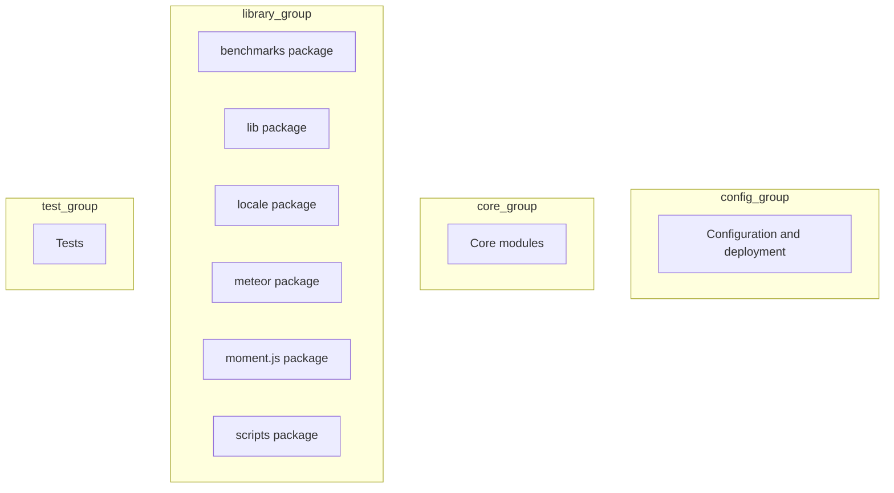

# Architecture report: moment/moment

> Automated static analysis. **Observed** = directly seen in files/imports/AST; **Inferred** = interpretation from that evidence. Repository code was not executed.

## 1. Repository at a glance

| Item | Value |
| --- | --- |
| Repository | moment/moment |
| Description | Parse, validate, manipulate, and display dates in javascript. |
| Language | JavaScript |
| Stars | 47873 |
| Licence | MIT |
| Analysed commit / branch | c2a703a4d84aa57ee2722ff8fb4a8016279fb3c4 / develop |
| Framework(s) | None detected |
| Files analysed | 659 |
| Components | 9 |

## 2. Architecture in one minute

moment/moment - Parse, validate, manipulate, and display dates in javascript.. This repository was analysed statically from 659 file(s) (0 Python). Detected technologies (observed from imports/manifests): GitHub Actions, TypeScript. Files are grouped into 9 component(s): benchmarks package, Configuration and deployment, Core modules, lib package, locale package, meteor package, moment.js package, scripts package. Findings below distinguish observed facts from inferred interpretation.

## 3. High-level block diagram

## 4. Main components

### benchmarks package (`benchmarks`)

- **Kind:** library
- **Status:** Observed
- **Confidence:** 0.85
- **Responsibility:** Groups 16 file(s) under benchmarks package (observed from repository paths and static analysis).
- **Paths:** `benchmarks/add.js`, `benchmarks/clone.js`, `benchmarks/compare.js`, `benchmarks/endOf.js`, `benchmarks/fromDate.js`, `benchmarks/fromDateUtc.js`, `benchmarks/get.js`, `benchmarks/isObjectEmpty.js`, `benchmarks/load-missing.js`, `benchmarks/makeDuration.js`, `benchmarks/parseCompactWeekday.js`, `benchmarks/query.js`, `benchmarks/set.js`, `benchmarks/startOf.js`, `benchmarks/subtract.js`, `benchmarks/zeroFill.js`
- **Evidence:** [benchmarks/add.js](https://github.com/moment/moment/blob/c2a703a4d84aa57ee2722ff8fb4a8016279fb3c4/benchmarks/add.js); [benchmarks/clone.js](https://github.com/moment/moment/blob/c2a703a4d84aa57ee2722ff8fb4a8016279fb3c4/benchmarks/clone.js); [benchmarks/compare.js](https://github.com/moment/moment/blob/c2a703a4d84aa57ee2722ff8fb4a8016279fb3c4/benchmarks/compare.js); [benchmarks/endOf.js](https://github.com/moment/moment/blob/c2a703a4d84aa57ee2722ff8fb4a8016279fb3c4/benchmarks/endOf.js); [benchmarks/fromDate.js](https://github.com/moment/moment/blob/c2a703a4d84aa57ee2722ff8fb4a8016279fb3c4/benchmarks/fromDate.js); [benchmarks/fromDateUtc.js](https://github.com/moment/moment/blob/c2a703a4d84aa57ee2722ff8fb4a8016279fb3c4/benchmarks/fromDateUtc.js); [benchmarks/get.js](https://github.com/moment/moment/blob/c2a703a4d84aa57ee2722ff8fb4a8016279fb3c4/benchmarks/get.js); [benchmarks/isObjectEmpty.js](https://github.com/moment/moment/blob/c2a703a4d84aa57ee2722ff8fb4a8016279fb3c4/benchmarks/isObjectEmpty.js)

### Configuration and deployment (`config`)

- **Kind:** config
- **Status:** Observed
- **Confidence:** 0.85
- **Responsibility:** Groups 4 file(s) under configuration and deployment (observed from repository paths and static analysis).
- **Paths:** `bower.json`, `component.json`, `composer.json`, `package.json`
- **Evidence:** [bower.json](https://github.com/moment/moment/blob/c2a703a4d84aa57ee2722ff8fb4a8016279fb3c4/bower.json); [component.json](https://github.com/moment/moment/blob/c2a703a4d84aa57ee2722ff8fb4a8016279fb3c4/component.json); [composer.json](https://github.com/moment/moment/blob/c2a703a4d84aa57ee2722ff8fb4a8016279fb3c4/composer.json); [package.json](https://github.com/moment/moment/blob/c2a703a4d84aa57ee2722ff8fb4a8016279fb3c4/package.json)

### Core modules (`core`)

- **Kind:** core
- **Status:** Observed
- **Confidence:** 0.85
- **Responsibility:** Groups 5 file(s) under core modules (observed from repository paths and static analysis).
- **Paths:** `dojo.profile.js`, `ender.js`, `eslint.config.js`, `moment.d.ts`, `moment.js`
- **Evidence:** [dojo.profile.js](https://github.com/moment/moment/blob/c2a703a4d84aa57ee2722ff8fb4a8016279fb3c4/dojo.profile.js); [ender.js](https://github.com/moment/moment/blob/c2a703a4d84aa57ee2722ff8fb4a8016279fb3c4/ender.js); [eslint.config.js](https://github.com/moment/moment/blob/c2a703a4d84aa57ee2722ff8fb4a8016279fb3c4/eslint.config.js); [moment.d.ts](https://github.com/moment/moment/blob/c2a703a4d84aa57ee2722ff8fb4a8016279fb3c4/moment.d.ts); [moment.js](https://github.com/moment/moment/blob/c2a703a4d84aa57ee2722ff8fb4a8016279fb3c4/moment.js)

### lib package (`lib`)

- **Kind:** library
- **Status:** Observed
- **Confidence:** 0.85
- **Responsibility:** Groups 109 file(s) under lib package (observed from repository paths and static analysis).
- **Paths:** `src/lib/create/check-overflow.js`, `src/lib/create/date-from-array.js`, `src/lib/create/from-anything.js`, `src/lib/create/from-array.js`, `src/lib/create/from-object.js`, `src/lib/create/from-string-and-array.js`, `src/lib/create/from-string-and-format.js`, `src/lib/create/from-string.js`, `src/lib/create/local.js`, `src/lib/create/parsing-flags.js`, `src/lib/create/utc.js`, `src/lib/create/valid.js`, `src/lib/duration/abs.js`, `src/lib/duration/add-subtract.js`, `src/lib/duration/as.js`, `src/lib/duration/bubble.js`, `src/lib/duration/clone.js`, `src/lib/duration/constructor.js`, `src/lib/duration/create.js`, `src/lib/duration/duration.js`, `src/lib/duration/get.js`, `src/lib/duration/humanize.js`, `src/lib/duration/iso-string.js`, `src/lib/duration/prototype.js`, `src/lib/duration/valid.js`, `src/lib/format/format.js`, `src/lib/locale/base-config.js`, `src/lib/locale/calendar.js`, `src/lib/locale/constructor.js`, `src/lib/locale/en.js`, `src/lib/locale/formats.js`, `src/lib/locale/invalid.js`, `src/lib/locale/lists.js`, `src/lib/locale/locale.js`, `src/lib/locale/locales.js`, `src/lib/locale/ordinal.js`, `src/lib/locale/pre-post-format.js`, `src/lib/locale/prototype.js`, `src/lib/locale/relative.js`, `src/lib/locale/set.js`, `src/lib/moment/add-subtract.js`, `src/lib/moment/calendar.js`, `src/lib/moment/clone.js`, `src/lib/moment/compare.js`, `src/lib/moment/constructor.js`, `src/lib/moment/creation-data.js`, `src/lib/moment/diff.js`, `src/lib/moment/format.js`, `src/lib/moment/from.js`, `src/lib/moment/get-set.js`, `src/lib/moment/locale.js`, `src/lib/moment/min-max.js`, `src/lib/moment/moment.js`, `src/lib/moment/now.js`, `src/lib/moment/prototype.js`, `src/lib/moment/start-end-of.js`, `src/lib/moment/to-type.js`, `src/lib/moment/to.js`, `src/lib/moment/valid.js`, `src/lib/parse/regex.js`, `src/lib/parse/token.js`, `src/lib/units/aliases.js`, `src/lib/units/constants.js`, `src/lib/units/day-of-month.js`, `src/lib/units/day-of-week.js`, `src/lib/units/day-of-year.js`, `src/lib/units/era.js`, `src/lib/units/hour.js`, `src/lib/units/millisecond.js`, `src/lib/units/minute.js`, `src/lib/units/month.js`, `src/lib/units/offset.js`, `src/lib/units/priorities.js`, `src/lib/units/quarter.js`, `src/lib/units/second.js`, `src/lib/units/timestamp.js`, `src/lib/units/timezone.js`, `src/lib/units/units.js`, `src/lib/units/week-calendar-utils.js`, `src/lib/units/week-year.js`, `src/lib/units/week.js`, `src/lib/units/year.js`, `src/lib/utils/abs-ceil.js`, `src/lib/utils/abs-floor.js`, `src/lib/utils/abs-round.js`, `src/lib/utils/compare-arrays.js`, `src/lib/utils/defaults.js`, `src/lib/utils/deprecate.js`, `src/lib/utils/extend.js`, `src/lib/utils/has-own-prop.js`, `src/lib/utils/hooks.js`, `src/lib/utils/index-of.js`, `src/lib/utils/is-array.js`, `src/lib/utils/is-calendar-spec.js`, `src/lib/utils/is-date.js`, `src/lib/utils/is-function.js`, `src/lib/utils/is-leap-year.js`, `src/lib/utils/is-moment-input.js`, `src/lib/utils/is-number.js`, `src/lib/utils/is-object-empty.js`, `src/lib/utils/is-object.js`, `src/lib/utils/is-string.js`, `src/lib/utils/is-undefined.js`, `src/lib/utils/keys.js`, `src/lib/utils/map.js`, `src/lib/utils/mod.js`, `src/lib/utils/some.js`, `src/lib/utils/to-int.js`, `src/lib/utils/zero-fill.js`
- **Evidence:** [src/lib/create/check-overflow.js](https://github.com/moment/moment/blob/c2a703a4d84aa57ee2722ff8fb4a8016279fb3c4/src/lib/create/check-overflow.js); [src/lib/create/date-from-array.js](https://github.com/moment/moment/blob/c2a703a4d84aa57ee2722ff8fb4a8016279fb3c4/src/lib/create/date-from-array.js); [src/lib/create/from-anything.js](https://github.com/moment/moment/blob/c2a703a4d84aa57ee2722ff8fb4a8016279fb3c4/src/lib/create/from-anything.js); [src/lib/create/from-array.js](https://github.com/moment/moment/blob/c2a703a4d84aa57ee2722ff8fb4a8016279fb3c4/src/lib/create/from-array.js); [src/lib/create/from-object.js](https://github.com/moment/moment/blob/c2a703a4d84aa57ee2722ff8fb4a8016279fb3c4/src/lib/create/from-object.js); [src/lib/create/from-string-and-array.js](https://github.com/moment/moment/blob/c2a703a4d84aa57ee2722ff8fb4a8016279fb3c4/src/lib/create/from-string-and-array.js); [src/lib/create/from-string-and-format.js](https://github.com/moment/moment/blob/c2a703a4d84aa57ee2722ff8fb4a8016279fb3c4/src/lib/create/from-string-and-format.js); [src/lib/create/from-string.js](https://github.com/moment/moment/blob/c2a703a4d84aa57ee2722ff8fb4a8016279fb3c4/src/lib/create/from-string.js)

### locale package (`locale`)

- **Kind:** library
- **Status:** Observed
- **Confidence:** 0.85
- **Responsibility:** Groups 278 file(s) under locale package (observed from repository paths and static analysis).
- **Paths:** `locale/af.js`, `locale/am-et.js`, `locale/ar-dz.js`, `locale/ar-kw.js`, `locale/ar-ly.js`, `locale/ar-ma.js`, `locale/ar-ps.js`, `locale/ar-sa.js`, `locale/ar-tn.js`, `locale/ar.js`, `locale/az.js`, `locale/be.js`, `locale/bg.js`, `locale/bm.js`, `locale/bn-bd.js`, `locale/bn.js`, `locale/bo.js`, `locale/br.js`, `locale/bs.js`, `locale/ca.js`, `locale/cs.js`, `locale/cv.js`, `locale/cy.js`, `locale/da.js`, `locale/de-at.js`, `locale/de-ch.js`, `locale/de.js`, `locale/dv.js`, `locale/el.js`, `locale/en-au.js`, `locale/en-ca.js`, `locale/en-gb.js`, `locale/en-ie.js`, `locale/en-il.js`, `locale/en-in.js`, `locale/en-nz.js`, `locale/en-sg.js`, `locale/eo.js`, `locale/es-do.js`, `locale/es-mx.js`, `locale/es-us.js`, `locale/es.js`, `locale/et.js`, `locale/eu.js`, `locale/fa.js`, `locale/fi.js`, `locale/fil.js`, `locale/fo.js`, `locale/fr-ca.js`, `locale/fr-ch.js`, `locale/fr.js`, `locale/fy.js`, `locale/ga.js`, `locale/gd.js`, `locale/gl.js`, `locale/gom-deva.js`, `locale/gom-latn.js`, `locale/gu.js`, `locale/he.js`, `locale/hi.js`, `locale/hr.js`, `locale/hu.js`, `locale/hy-am.js`, `locale/id.js`, `locale/is.js`, `locale/it-ch.js`, `locale/it.js`, `locale/ja.js`, `locale/jv.js`, `locale/ka.js`, `locale/kk.js`, `locale/km.js`, `locale/kn.js`, `locale/ko.js`, `locale/ku-kmr.js`, `locale/ku.js`, `locale/ky.js`, `locale/lb.js`, `locale/lo.js`, `locale/lt.js`, `locale/lv.js`, `locale/me.js`, `locale/mi.js`, `locale/mk.js`, `locale/ml.js`, `locale/mn.js`, `locale/mr.js`, `locale/ms-my.js`, `locale/ms.js`, `locale/mt.js`, `locale/my.js`, `locale/nb.js`, `locale/ne.js`, `locale/nl-be.js`, `locale/nl.js`, `locale/nn.js`, `locale/oc-lnc.js`, `locale/pa-in.js`, `locale/pl.js`, `locale/ps.js`, `locale/pt-br.js`, `locale/pt.js`, `locale/ro.js`, `locale/ru.js`, `locale/sd.js`, `locale/se.js`, `locale/si.js`, `locale/sk.js`, `locale/sl.js`, `locale/sq.js`, `locale/sr-cyrl.js`, `locale/sr.js`, `locale/ss.js`, `locale/sv.js`, `locale/sw.js`, `locale/ta.js`, `locale/te.js`, `locale/tet.js`, `locale/tg.js`, `locale/th.js`, `locale/tk.js`, `locale/tl-ph.js`, `locale/tlh.js`, `locale/tr.js`, `locale/tzl.js`, `locale/tzm-latn.js`, `locale/tzm.js`, `locale/ug-cn.js`, `locale/uk.js`, `locale/ur.js`, `locale/uz-latn.js`, `locale/uz.js`, `locale/vi.js`, `locale/x-pseudo.js`, `locale/yo.js`, `locale/zh-cn.js`, `locale/zh-hk.js`, `locale/zh-mo.js`, `locale/zh-tw.js`, `src/locale/af.js`, `src/locale/am-et.js`, `src/locale/ar-dz.js`, `src/locale/ar-kw.js`, `src/locale/ar-ly.js`, `src/locale/ar-ma.js`, `src/locale/ar-ps.js`, `src/locale/ar-sa.js`, `src/locale/ar-tn.js`, `src/locale/ar.js`, `src/locale/az.js`, `src/locale/be.js`, `src/locale/bg.js`, `src/locale/bm.js`, `src/locale/bn-bd.js`, `src/locale/bn.js`, `src/locale/bo.js`, `src/locale/br.js`, `src/locale/bs.js`, `src/locale/ca.js`, `src/locale/cs.js`, `src/locale/cv.js`, `src/locale/cy.js`, `src/locale/da.js`, `src/locale/de-at.js`, `src/locale/de-ch.js`, `src/locale/de.js`, `src/locale/dv.js`, `src/locale/el.js`, `src/locale/en-au.js`, `src/locale/en-ca.js`, `src/locale/en-gb.js`, `src/locale/en-ie.js`, `src/locale/en-il.js`, `src/locale/en-in.js`, `src/locale/en-nz.js`, `src/locale/en-sg.js`, `src/locale/eo.js`, `src/locale/es-do.js`, `src/locale/es-mx.js`, `src/locale/es-us.js`, `src/locale/es.js`, `src/locale/et.js`, `src/locale/eu.js`, `src/locale/fa.js`, `src/locale/fi.js`, `src/locale/fil.js`, `src/locale/fo.js`, `src/locale/fr-ca.js`, `src/locale/fr-ch.js`, `src/locale/fr.js`, `src/locale/fy.js`, `src/locale/ga.js`, `src/locale/gd.js`, `src/locale/gl.js`, `src/locale/gom-deva.js`, `src/locale/gom-latn.js`, `src/locale/gu.js`, `src/locale/he.js`, `src/locale/hi.js`, `src/locale/hr.js`, `src/locale/hu.js`, `src/locale/hy-am.js`, `src/locale/id.js`, `src/locale/is.js`, `src/locale/it-ch.js`, `src/locale/it.js`, `src/locale/ja.js`, `src/locale/jv.js`, `src/locale/ka.js`, `src/locale/kk.js`, `src/locale/km.js`, `src/locale/kn.js`, `src/locale/ko.js`, `src/locale/ku-kmr.js`, `src/locale/ku.js`, `src/locale/ky.js`, `src/locale/lb.js`, `src/locale/lo.js`, `src/locale/lt.js`, `src/locale/lv.js`, `src/locale/me.js`, `src/locale/mi.js`, `src/locale/mk.js`, `src/locale/ml.js`, `src/locale/mn.js`, `src/locale/mr.js`, `src/locale/ms-my.js`, `src/locale/ms.js`, `src/locale/mt.js`, `src/locale/my.js`, `src/locale/nb.js`, `src/locale/ne.js`, `src/locale/nl-be.js`, `src/locale/nl.js`, `src/locale/nn.js`, `src/locale/oc-lnc.js`, `src/locale/pa-in.js`, `src/locale/pl.js`, `src/locale/ps.js`, `src/locale/pt-br.js`, `src/locale/pt.js`, `src/locale/ro.js`, `src/locale/ru.js`, `src/locale/sd.js`, `src/locale/se.js`, `src/locale/si.js`, `src/locale/sk.js`, `src/locale/sl.js`, `src/locale/sq.js`, `src/locale/sr-cyrl.js`, `src/locale/sr.js`, `src/locale/ss.js`, `src/locale/sv.js`, `src/locale/sw.js`, `src/locale/ta.js`, `src/locale/te.js`, `src/locale/tet.js`, `src/locale/tg.js`, `src/locale/th.js`, `src/locale/tk.js`, `src/locale/tl-ph.js`, `src/locale/tlh.js`, `src/locale/tr.js`, `src/locale/tzl.js`, `src/locale/tzm-latn.js`, `src/locale/tzm.js`, `src/locale/ug-cn.js`, `src/locale/uk.js`, `src/locale/ur.js`, `src/locale/uz-latn.js`, `src/locale/uz.js`, `src/locale/vi.js`, `src/locale/x-pseudo.js`, `src/locale/yo.js`, `src/locale/zh-cn.js`, `src/locale/zh-hk.js`, `src/locale/zh-mo.js`, `src/locale/zh-tw.js`
- **Evidence:** [locale/af.js](https://github.com/moment/moment/blob/c2a703a4d84aa57ee2722ff8fb4a8016279fb3c4/locale/af.js); [locale/am-et.js](https://github.com/moment/moment/blob/c2a703a4d84aa57ee2722ff8fb4a8016279fb3c4/locale/am-et.js); [locale/ar-dz.js](https://github.com/moment/moment/blob/c2a703a4d84aa57ee2722ff8fb4a8016279fb3c4/locale/ar-dz.js); [locale/ar-kw.js](https://github.com/moment/moment/blob/c2a703a4d84aa57ee2722ff8fb4a8016279fb3c4/locale/ar-kw.js); [locale/ar-ly.js](https://github.com/moment/moment/blob/c2a703a4d84aa57ee2722ff8fb4a8016279fb3c4/locale/ar-ly.js); [locale/ar-ma.js](https://github.com/moment/moment/blob/c2a703a4d84aa57ee2722ff8fb4a8016279fb3c4/locale/ar-ma.js); [locale/ar-ps.js](https://github.com/moment/moment/blob/c2a703a4d84aa57ee2722ff8fb4a8016279fb3c4/locale/ar-ps.js); [locale/ar-sa.js](https://github.com/moment/moment/blob/c2a703a4d84aa57ee2722ff8fb4a8016279fb3c4/locale/ar-sa.js)

### meteor package (`meteor`)

- **Kind:** library
- **Status:** Observed
- **Confidence:** 0.85
- **Responsibility:** Groups 3 file(s) under meteor package (observed from repository paths and static analysis).
- **Paths:** `meteor/export.js`, `meteor/package.js`, `meteor/test.js`
- **Evidence:** [meteor/export.js](https://github.com/moment/moment/blob/c2a703a4d84aa57ee2722ff8fb4a8016279fb3c4/meteor/export.js); [meteor/package.js](https://github.com/moment/moment/blob/c2a703a4d84aa57ee2722ff8fb4a8016279fb3c4/meteor/package.js); [meteor/test.js](https://github.com/moment/moment/blob/c2a703a4d84aa57ee2722ff8fb4a8016279fb3c4/meteor/test.js)

### moment.js package (`moment_js`)

- **Kind:** library
- **Status:** Observed
- **Confidence:** 0.85
- **Responsibility:** Groups 1 file(s) under moment.js package (observed from repository paths and static analysis).
- **Paths:** `src/moment.js`
- **Evidence:** [src/moment.js](https://github.com/moment/moment/blob/c2a703a4d84aa57ee2722ff8fb4a8016279fb3c4/src/moment.js)

### scripts package (`scripts`)

- **Kind:** library
- **Status:** Observed
- **Confidence:** 0.85
- **Responsibility:** Groups 14 file(s) under scripts package (observed from repository paths and static analysis).
- **Paths:** `scripts/benchmark.js`, `scripts/build.js`, `scripts/bump-version.js`, `scripts/check-months-parse.js`, `scripts/check-package.js`, `scripts/install-hooks.js`, `scripts/locales.js`, `scripts/minify.js`, `scripts/qunit-reporter.js`, `scripts/test-runtime.js`, `scripts/test-typescript-package.js`, `scripts/test.js`, `scripts/update-component.js`, `scripts/update-index.js`
- **Evidence:** [scripts/benchmark.js](https://github.com/moment/moment/blob/c2a703a4d84aa57ee2722ff8fb4a8016279fb3c4/scripts/benchmark.js); [scripts/build.js](https://github.com/moment/moment/blob/c2a703a4d84aa57ee2722ff8fb4a8016279fb3c4/scripts/build.js); [scripts/bump-version.js](https://github.com/moment/moment/blob/c2a703a4d84aa57ee2722ff8fb4a8016279fb3c4/scripts/bump-version.js); [scripts/check-months-parse.js](https://github.com/moment/moment/blob/c2a703a4d84aa57ee2722ff8fb4a8016279fb3c4/scripts/check-months-parse.js); [scripts/check-package.js](https://github.com/moment/moment/blob/c2a703a4d84aa57ee2722ff8fb4a8016279fb3c4/scripts/check-package.js); [scripts/install-hooks.js](https://github.com/moment/moment/blob/c2a703a4d84aa57ee2722ff8fb4a8016279fb3c4/scripts/install-hooks.js); [scripts/locales.js](https://github.com/moment/moment/blob/c2a703a4d84aa57ee2722ff8fb4a8016279fb3c4/scripts/locales.js); [scripts/minify.js](https://github.com/moment/moment/blob/c2a703a4d84aa57ee2722ff8fb4a8016279fb3c4/scripts/minify.js)

### Tests (`tests`)

- **Kind:** test
- **Status:** Observed
- **Confidence:** 0.85
- **Responsibility:** Groups 198 file(s) under tests (observed from repository paths and static analysis).
- **Paths:** `src/test/helpers/common-locale.js`, `src/test/helpers/deprecation-handler.js`, `src/test/helpers/dst.js`, `src/test/helpers/each-own-prop.js`, `src/test/helpers/each.js`, `src/test/helpers/has-own-prop.js`, `src/test/helpers/object-keys.js`, `src/test/locale/af.js`, `src/test/locale/am-et.js`, `src/test/locale/ar-dz.js`, `src/test/locale/ar-kw.js`, `src/test/locale/ar-ly.js`, `src/test/locale/ar-ma.js`, `src/test/locale/ar-ps.js`, `src/test/locale/ar-sa.js`, `src/test/locale/ar-tn.js`, `src/test/locale/ar.js`, `src/test/locale/az.js`, `src/test/locale/be.js`, `src/test/locale/bg.js`, `src/test/locale/bm.js`, `src/test/locale/bn-bd.js`, `src/test/locale/bn.js`, `src/test/locale/bo.js`, `src/test/locale/br.js`, `src/test/locale/bs.js`, `src/test/locale/ca.js`, `src/test/locale/cs.js`, `src/test/locale/cv.js`, `src/test/locale/cy.js`, `src/test/locale/da.js`, `src/test/locale/de-at.js`, `src/test/locale/de-ch.js`, `src/test/locale/de.js`, `src/test/locale/dv.js`, `src/test/locale/el.js`, `src/test/locale/en-au.js`, `src/test/locale/en-ca.js`, `src/test/locale/en-gb.js`, `src/test/locale/en-ie.js`, `src/test/locale/en-il.js`, `src/test/locale/en-in.js`, `src/test/locale/en-nz.js`, `src/test/locale/en-sg.js`, `src/test/locale/en.js`, `src/test/locale/eo.js`, `src/test/locale/es-do.js`, `src/test/locale/es-mx.js`, `src/test/locale/es-us.js`, `src/test/locale/es.js`, `src/test/locale/et.js`, `src/test/locale/eu.js`, `src/test/locale/fa.js`, `src/test/locale/fi.js`, `src/test/locale/fil.js`, `src/test/locale/fo.js`, `src/test/locale/fr-ca.js`, `src/test/locale/fr-ch.js`, `src/test/locale/fr.js`, `src/test/locale/fy.js`, `src/test/locale/ga.js`, `src/test/locale/gd.js`, `src/test/locale/gl.js`, `src/test/locale/gom-deva.js`, `src/test/locale/gom-latn.js`, `src/test/locale/gu.js`, `src/test/locale/he.js`, `src/test/locale/hi.js`, `src/test/locale/hr.js`, `src/test/locale/hu.js`, `src/test/locale/hy-am.js`, `src/test/locale/id.js`, `src/test/locale/is.js`, `src/test/locale/it-ch.js`, `src/test/locale/it.js`, `src/test/locale/ja.js`, `src/test/locale/jv.js`, `src/test/locale/ka.js`, `src/test/locale/kk.js`, `src/test/locale/km.js`, `src/test/locale/kn.js`, `src/test/locale/ko.js`, `src/test/locale/ku-kmr.js`, `src/test/locale/ku.js`, `src/test/locale/ky.js`, `src/test/locale/lb.js`, `src/test/locale/lo.js`, `src/test/locale/lt.js`, `src/test/locale/lv.js`, `src/test/locale/me.js`, `src/test/locale/mi.js`, `src/test/locale/mk.js`, `src/test/locale/ml.js`, `src/test/locale/mn.js`, `src/test/locale/mr.js`, `src/test/locale/ms-my.js`, `src/test/locale/ms.js`, `src/test/locale/mt.js`, `src/test/locale/my.js`, `src/test/locale/nb.js`, `src/test/locale/ne.js`, `src/test/locale/nl-be.js`, `src/test/locale/nl.js`, `src/test/locale/nn.js`, `src/test/locale/oc-lnc.js`, `src/test/locale/pa-in.js`, `src/test/locale/pl.js`, `src/test/locale/ps.js`, `src/test/locale/pt-br.js`, `src/test/locale/pt.js`, `src/test/locale/ro.js`, `src/test/locale/ru.js`, `src/test/locale/sd.js`, `src/test/locale/se.js`, `src/test/locale/si.js`, `src/test/locale/sk.js`, `src/test/locale/sl.js`, `src/test/locale/sq.js`, `src/test/locale/sr-cyrl.js`, `src/test/locale/sr.js`, `src/test/locale/ss.js`, `src/test/locale/sv.js`, `src/test/locale/sw.js`, `src/test/locale/ta.js`, `src/test/locale/te.js`, `src/test/locale/tet.js`, `src/test/locale/tg.js`, `src/test/locale/th.js`, `src/test/locale/tk.js`, `src/test/locale/tl-ph.js`, `src/test/locale/tlh.js`, `src/test/locale/tr.js`, `src/test/locale/tzl.js`, `src/test/locale/tzm-latn.js`, `src/test/locale/tzm.js`, `src/test/locale/ug-cn.js`, `src/test/locale/uk.js`, `src/test/locale/ur.js`, `src/test/locale/uz-latn.js`, `src/test/locale/uz.js`, `src/test/locale/vi.js`, `src/test/locale/x-pseudo.js`, `src/test/locale/yo.js`, `src/test/locale/zh-cn.js`, `src/test/locale/zh-hk.js`, `src/test/locale/zh-mo.js`, `src/test/locale/zh-tw.js`, `src/test/moment/add_subtract.js`, `src/test/moment/calendar.js`, `src/test/moment/create.js`, `src/test/moment/creation-data.js`, `src/test/moment/days_in_month.js`, `src/test/moment/days_in_year.js`, `src/test/moment/deprecate.js`, `src/test/moment/diff.js`, `src/test/moment/duration.js`, `src/test/moment/duration_from_moments.js`, `src/test/moment/duration_invalid.js`, `src/test/moment/format.js`, `src/test/moment/from_to.js`, `src/test/moment/getters_setters.js`, `src/test/moment/instanceof.js`, `src/test/moment/invalid.js`, `src/test/moment/is-leap-year.js`, `src/test/moment/is_after.js`, `src/test/moment/is_array.js`, `src/test/moment/is_before.js`, `src/test/moment/is_between.js`, `src/test/moment/is_date.js`, `src/test/moment/is_moment.js`, `src/test/moment/is_number.js`, `src/test/moment/is_same.js`, `src/test/moment/is_same_or_after.js`, `src/test/moment/is_same_or_before.js`, `src/test/moment/is_valid.js`, `src/test/moment/leapyear.js`, `src/test/moment/listers.js`, `src/test/moment/locale.js`, `src/test/moment/locale_inheritance.js`, `src/test/moment/locale_load_sanity.js`, `src/test/moment/locale_update.js`, `src/test/moment/min_max.js`, `src/test/moment/mutable.js`, `src/test/moment/normalize_units.js`, `src/test/moment/now.js`, `src/test/moment/parsing_flags.js`, `src/test/moment/preparse_postformat.js`, `src/test/moment/quarter.js`, `src/test/moment/relative_time.js`, `src/test/moment/start_end_of.js`, `src/test/moment/string_prototype.js`, `src/test/moment/to_type.js`, `src/test/moment/utc.js`, `src/test/moment/utc_offset.js`, `src/test/moment/week_year.js`, `src/test/moment/weekday.js`, `src/test/moment/weeks.js`, `src/test/moment/weeks_in_year.js`
- **Evidence:** [src/test/helpers/common-locale.js](https://github.com/moment/moment/blob/c2a703a4d84aa57ee2722ff8fb4a8016279fb3c4/src/test/helpers/common-locale.js); [src/test/helpers/deprecation-handler.js](https://github.com/moment/moment/blob/c2a703a4d84aa57ee2722ff8fb4a8016279fb3c4/src/test/helpers/deprecation-handler.js); [src/test/helpers/dst.js](https://github.com/moment/moment/blob/c2a703a4d84aa57ee2722ff8fb4a8016279fb3c4/src/test/helpers/dst.js); [src/test/helpers/each-own-prop.js](https://github.com/moment/moment/blob/c2a703a4d84aa57ee2722ff8fb4a8016279fb3c4/src/test/helpers/each-own-prop.js); [src/test/helpers/each.js](https://github.com/moment/moment/blob/c2a703a4d84aa57ee2722ff8fb4a8016279fb3c4/src/test/helpers/each.js); [src/test/helpers/has-own-prop.js](https://github.com/moment/moment/blob/c2a703a4d84aa57ee2722ff8fb4a8016279fb3c4/src/test/helpers/has-own-prop.js); [src/test/helpers/object-keys.js](https://github.com/moment/moment/blob/c2a703a4d84aa57ee2722ff8fb4a8016279fb3c4/src/test/helpers/object-keys.js); [src/test/locale/af.js](https://github.com/moment/moment/blob/c2a703a4d84aa57ee2722ff8fb4a8016279fb3c4/src/test/locale/af.js)

## 5. Execution flow

**Observed** entry point(s):

- [moment.js](https://github.com/moment/moment/blob/c2a703a4d84aa57ee2722ff8fb4a8016279fb3c4/moment.js)

Representative flow (derived from observed entry points and the import graph; steps beyond the entry point are **Inferred**):

1. Execution starts at an observed entry point listed above, if present.
2. No internal import relationships between components were observed.

## 6. Project structure

### `(root)`

- `.editorconfig` - config (230 bytes)
- `.gitattributes` - other (103 bytes)
- `.gitignore` - other (265 bytes)
- `.markdownlint-cli2.jsonc` - other (81 bytes)
- `.npmignore` - other (29 bytes)
- `.prettierignore` - other (240 bytes)
- `.prettierrc` - other (72 bytes)
- `.spmignore` - other (71 bytes)
- `AGENTS.md` - docs (3215 bytes)
- `CHANGELOG.md` - docs (49461 bytes)
- `CONTRIBUTING.md` - docs (6095 bytes)
- `LICENSE` - docs (1079 bytes)
- `README.md` - docs (3719 bytes)
- `RELEASING.md` - docs (2649 bytes)
- `SECURITY.md` - docs (2044 bytes)
- `THREAT_MODEL.md` - docs (9745 bytes)
- `bower.json` - config (457 bytes)
- `component.json` - config (3722 bytes)
- `composer.json` - config (810 bytes)
- `dojo.profile.js` - source, JavaScript (279 bytes)
- `ender.js` - source, JavaScript (40 bytes)
- `eslint.config.js` - source, JavaScript (966 bytes)
- `moment.d.ts` - source, TypeScript (23915 bytes)
- `moment.js` - source, JavaScript (183459 bytes)
- `package.json` - manifest (5332 bytes)

### `.agents`

- `.agents/skills/locale-review/SKILL.md` - docs (21948 bytes)

### `.githooks`

- `.githooks/post-checkout` - other (495 bytes)
- `.githooks/pre-commit` - other (496 bytes)

### `.github`

- `.github/CODEOWNERS` - other (24 bytes)
- `.github/ISSUE_TEMPLATE/bug_report.yml` - config (3317 bytes)
- `.github/ISSUE_TEMPLATE/config.yml` - config (1243 bytes)
- `.github/ISSUE_TEMPLATE/locale_report.yml` - config (2390 bytes)
- `.github/workflows/ci.yml` - ci, YAML (817 bytes)
- `.github/workflows/coverage.yml` - ci, YAML (491 bytes)
- `.github/workflows/fossa.yml` - ci, YAML (617 bytes)
- `.github/workflows/pull-request.yml` - ci, YAML (1083 bytes)
- `.github/workflows/release.yml` - ci, YAML (3511 bytes)
- `.github/workflows/runtime-compatibility.yml` - ci, YAML (1246 bytes)
- `.github/workflows/timezones.yml` - ci, YAML (745 bytes)

### `benchmarks`

- `benchmarks/add.js` - source, JavaScript (728 bytes)
- `benchmarks/clone.js` - source, JavaScript (253 bytes)
- `benchmarks/compare.js` - source, JavaScript (834 bytes)
- `benchmarks/endOf.js` - source, JavaScript (730 bytes)
- `benchmarks/fromDate.js` - source, JavaScript (246 bytes)
- `benchmarks/fromDateUtc.js` - source, JavaScript (253 bytes)
- `benchmarks/get.js` - source, JavaScript (539 bytes)
- `benchmarks/isObjectEmpty.js` - source, JavaScript (1605 bytes)
- `benchmarks/load-missing.js` - source, JavaScript (321 bytes)
- `benchmarks/makeDuration.js` - source, JavaScript (242 bytes)
- `benchmarks/parseCompactWeekday.js` - source, JavaScript (763 bytes)
- `benchmarks/query.js` - source, JavaScript (1315 bytes)
- `benchmarks/set.js` - source, JavaScript (561 bytes)
- `benchmarks/startOf.js` - source, JavaScript (736 bytes)
- `benchmarks/subtract.js` - source, JavaScript (743 bytes)
- `benchmarks/zeroFill.js` - source, JavaScript (1750 bytes)

### `locale`

- `locale/af.js` - source, JavaScript (2753 bytes)
- `locale/am-et.js` - source, JavaScript (2790 bytes)
- `locale/ar-dz.js` - source, JavaScript (5417 bytes)
- `locale/ar-kw.js` - source, JavaScript (2478 bytes)
- `locale/ar-ly.js` - source, JavaScript (5692 bytes)
- `locale/ar-ma.js` - source, JavaScript (2533 bytes)
- `locale/ar-ps.js` - source, JavaScript (4102 bytes)
- `locale/ar-sa.js` - source, JavaScript (3782 bytes)
- `locale/ar-tn.js` - source, JavaScript (2480 bytes)
- `locale/ar.js` - source, JavaScript (6176 bytes)
- `locale/az.js` - source, JavaScript (3570 bytes)
- `locale/be.js` - source, JavaScript (6034 bytes)
- `locale/bg.js` - source, JavaScript (3623 bytes)
- `locale/bm.js` - source, JavaScript (2313 bytes)
- `locale/bn-bd.js` - source, JavaScript (5177 bytes)
- `locale/bn.js` - source, JavaScript (4690 bytes)
- `locale/bo.js` - source, JavaScript (5211 bytes)
- `locale/br.js` - source, JavaScript (5520 bytes)
- `locale/bs.js` - source, JavaScript (5675 bytes)
- `locale/ca.js` - source, JavaScript (3781 bytes)
- `locale/cs.js` - source, JavaScript (7806 bytes)
- `locale/cv.js` - source, JavaScript (2917 bytes)
- `locale/cy.js` - source, JavaScript (3542 bytes)
- `locale/da.js` - source, JavaScript (2161 bytes)
- `locale/de-at.js` - source, JavaScript (4190 bytes)
- `locale/de-ch.js` - source, JavaScript (4020 bytes)
- `locale/de.js` - source, JavaScript (4108 bytes)
- `locale/dv.js` - source, JavaScript (3140 bytes)
- `locale/el.js` - source, JavaScript (4617 bytes)
- `locale/en-au.js` - source, JavaScript (2649 bytes)
- `locale/en-ca.js` - source, JavaScript (2482 bytes)
- `locale/en-gb.js` - source, JavaScript (2655 bytes)
- `locale/en-ie.js` - source, JavaScript (2653 bytes)
- `locale/en-il.js` - source, JavaScript (2475 bytes)
- `locale/en-in.js` - source, JavaScript (2649 bytes)
- `locale/en-nz.js` - source, JavaScript (2658 bytes)
- `locale/en-sg.js` - source, JavaScript (2667 bytes)
- `locale/eo.js` - source, JavaScript (2918 bytes)
- `locale/es-do.js` - source, JavaScript (4197 bytes)
- `locale/es-mx.js` - source, JavaScript (4270 bytes)
- `locale/es-us.js` - source, JavaScript (4294 bytes)
- `locale/es.js` - source, JavaScript (4254 bytes)
- `locale/et.js` - source, JavaScript (3255 bytes)
- `locale/eu.js` - source, JavaScript (2544 bytes)
- `locale/fa.js` - source, JavaScript (3998 bytes)
- `locale/fi.js` - source, JavaScript (4444 bytes)
- `locale/fil.js` - source, JavaScript (2326 bytes)
- `locale/fo.js` - source, JavaScript (2316 bytes)
- `locale/fr-ca.js` - source, JavaScript (2704 bytes)
- `locale/fr-ch.js` - source, JavaScript (2879 bytes)
- `locale/fr.js` - source, JavaScript (4211 bytes)
- `locale/fy.js` - source, JavaScript (2891 bytes)
- `locale/ga.js` - source, JavaScript (3056 bytes)
- `locale/gd.js` - source, JavaScript (3076 bytes)
- `locale/gl.js` - source, JavaScript (2967 bytes)
- `locale/gom-deva.js` - source, JavaScript (6336 bytes)
- `locale/gom-latn.js` - source, JavaScript (4952 bytes)
- `locale/gu.js` - source, JavaScript (4936 bytes)
- `locale/he.js` - source, JavaScript (3899 bytes)
- `locale/hi.js` - source, JavaScript (7385 bytes)
- `locale/hr.js` - source, JavaScript (5658 bytes)
- `locale/hu.js` - source, JavaScript (4599 bytes)
- `locale/hy-am.js` - source, JavaScript (3936 bytes)
- `locale/id.js` - source, JavaScript (3329 bytes)
- `locale/is.js` - source, JavaScript (5334 bytes)
- `locale/it-ch.js` - source, JavaScript (2521 bytes)
- `locale/it.js` - source, JavaScript (3995 bytes)
- `locale/ja.js` - source, JavaScript (4867 bytes)
- `locale/jv.js` - source, JavaScript (3004 bytes)
- `locale/ka.js` - source, JavaScript (4192 bytes)
- `locale/kk.js` - source, JavaScript (3139 bytes)
- `locale/km.js` - source, JavaScript (4090 bytes)
- `locale/kn.js` - source, JavaScript (5064 bytes)
- `locale/ko.js` - source, JavaScript (2839 bytes)
- `locale/ku-kmr.js` - source, JavaScript (4890 bytes)
- `locale/ku.js` - source, JavaScript (4118 bytes)
- `locale/ky.js` - source, JavaScript (3173 bytes)
- `locale/lb.js` - source, JavaScript (5129 bytes)
- `locale/lo.js` - source, JavaScript (3169 bytes)
- `locale/lt.js` - source, JavaScript (4829 bytes)
- `locale/lv.js` - source, JavaScript (4137 bytes)
- `locale/me.js` - source, JavaScript (4445 bytes)
- `locale/mi.js` - source, JavaScript (2583 bytes)
- `locale/mk.js` - source, JavaScript (3681 bytes)
- `locale/ml.js` - source, JavaScript (3935 bytes)
- `locale/mn.js` - source, JavaScript (4130 bytes)
- `locale/mr.js` - source, JavaScript (7694 bytes)
- `locale/ms-my.js` - source, JavaScript (2954 bytes)
- `locale/ms.js` - source, JavaScript (2897 bytes)
- `locale/mt.js` - source, JavaScript (2228 bytes)
- `locale/my.js` - source, JavaScript (3762 bytes)
- `locale/nb.js` - source, JavaScript (2455 bytes)
- `locale/ne.js` - source, JavaScript (4831 bytes)
- `locale/nl-be.js` - source, JavaScript (3883 bytes)
- `locale/nl.js` - source, JavaScript (3921 bytes)
- `locale/nn.js` - source, JavaScript (2380 bytes)
- `locale/oc-lnc.js` - source, JavaScript (3162 bytes)
- `locale/pa-in.js` - source, JavaScript (5006 bytes)
- `locale/pl.js` - source, JavaScript (5029 bytes)
- `locale/ps.js` - source, JavaScript (6475 bytes)
- `locale/pt-br.js` - source, JavaScript (2852 bytes)
- `locale/pt.js` - source, JavaScript (2540 bytes)
- `locale/ro.js` - source, JavaScript (2931 bytes)
- `locale/ru.js` - source, JavaScript (9566 bytes)
- `locale/sd.js` - source, JavaScript (2793 bytes)
- `locale/se.js` - source, JavaScript (2397 bytes)
- `locale/si.js` - source, JavaScript (3277 bytes)
- `locale/sk.js` - source, JavaScript (6065 bytes)
- `locale/sl.js` - source, JavaScript (7111 bytes)
- `locale/sq.js` - source, JavaScript (2559 bytes)
- `locale/sr-cyrl.js` - source, JavaScript (5578 bytes)
- `locale/sr.js` - source, JavaScript (5025 bytes)
- `locale/ss.js` - source, JavaScript (3228 bytes)
- `locale/sv.js` - source, JavaScript (2683 bytes)
- `locale/sw.js` - source, JavaScript (3418 bytes)
- `locale/ta.js` - source, JavaScript (5640 bytes)
- `locale/te.js` - source, JavaScript (4064 bytes)
- `locale/tet.js` - source, JavaScript (2765 bytes)
- `locale/tg.js` - source, JavaScript (4388 bytes)
- `locale/th.js` - source, JavaScript (3316 bytes)
- `locale/tk.js` - source, JavaScript (3168 bytes)
- `locale/tl-ph.js` - source, JavaScript (2287 bytes)
- `locale/tlh.js` - source, JavaScript (4577 bytes)
- `locale/tr.js` - source, JavaScript (3663 bytes)
- `locale/tzl.js` - source, JavaScript (3783 bytes)
- `locale/tzm-latn.js` - source, JavaScript (2237 bytes)
- `locale/tzm.js` - source, JavaScript (2860 bytes)
- `locale/ug-cn.js` - source, JavaScript (4644 bytes)
- `locale/uk.js` - source, JavaScript (6996 bytes)
- `locale/ur.js` - source, JavaScript (2840 bytes)
- `locale/uz-latn.js` - source, JavaScript (2173 bytes)
- `locale/uz.js` - source, JavaScript (2393 bytes)
- `locale/vi.js` - source, JavaScript (3066 bytes)
- `locale/x-pseudo.js` - source, JavaScript (2994 bytes)
- `locale/yo.js` - source, JavaScript (2419 bytes)
- `locale/zh-cn.js` - source, JavaScript (4507 bytes)
- `locale/zh-hk.js` - source, JavaScript (3832 bytes)
- `locale/zh-mo.js` - source, JavaScript (3782 bytes)
- `locale/zh-tw.js` - source, JavaScript (3729 bytes)

### `meteor`

- `meteor/README.md` - docs (216 bytes)
- `meteor/export.js` - source, JavaScript (187 bytes)
- `meteor/package.js` - source, JavaScript (669 bytes)
- `meteor/test.js` - source, JavaScript (140 bytes)

### `scripts`

- `scripts/benchmark.js` - source, JavaScript (1405 bytes)
- `scripts/build.js` - source, JavaScript (8309 bytes)
- `scripts/bump-version.js` - source, JavaScript (837 bytes)
- `scripts/check-months-parse.js` - source, JavaScript (431 bytes)
- `scripts/check-package.js` - source, JavaScript (2649 bytes)
- `scripts/install-hooks.js` - source, JavaScript (791 bytes)
- `scripts/locales.js` - source, JavaScript (4837 bytes)
- `scripts/minify.js` - source, JavaScript (1093 bytes)
- `scripts/qunit-reporter.js` - source, JavaScript (926 bytes)
- `scripts/test-runtime.js` - source, JavaScript (1163 bytes)
- `scripts/test-typescript-package.js` - source, JavaScript (2866 bytes)
- `scripts/test.js` - source, JavaScript (3533 bytes)
- `scripts/update-component.js` - source, JavaScript (840 bytes)
- `scripts/update-index.js` - source, JavaScript (592 bytes)

### `src`

- `src/lib/create/check-overflow.js` - source, JavaScript (1622 bytes)
- `src/lib/create/date-from-array.js` - source, JavaScript (1076 bytes)
- `src/lib/create/from-anything.js` - source, JavaScript (3351 bytes)
- `src/lib/create/from-array.js` - source, JavaScript (7456 bytes)
- `src/lib/create/from-object.js` - source, JavaScript (549 bytes)
- `src/lib/create/from-string-and-array.js` - source, JavaScript (2108 bytes)
- `src/lib/create/from-string-and-format.js` - source, JavaScript (4092 bytes)
- `src/lib/create/from-string.js` - source, JavaScript (8007 bytes)
- `src/lib/create/local.js` - source, JavaScript (183 bytes)
- `src/lib/create/parsing-flags.js` - source, JavaScript (673 bytes)
- `src/lib/create/utc.js` - source, JavaScript (186 bytes)
- `src/lib/create/valid.js` - source, JavaScript (1522 bytes)
- `src/lib/duration/abs.js` - source, JavaScript (484 bytes)
- `src/lib/duration/add-subtract.js` - source, JavaScript (644 bytes)
- `src/lib/duration/as.js` - source, JavaScript (2094 bytes)
- `src/lib/duration/bubble.js` - source, JavaScript (1748 bytes)
- `src/lib/duration/clone.js` - source, JavaScript (105 bytes)
- `src/lib/duration/constructor.js` - source, JavaScript (1593 bytes)
- `src/lib/duration/create.js` - source, JavaScript (4335 bytes)
- `src/lib/duration/duration.js` - source, JavaScript (342 bytes)
- `src/lib/duration/get.js` - source, JavaScript (728 bytes)
- `src/lib/duration/humanize.js` - source, JavaScript (3736 bytes)
- `src/lib/duration/iso-string.js` - source, JavaScript (2078 bytes)
- `src/lib/duration/prototype.js` - source, JavaScript (1739 bytes)
- `src/lib/duration/valid.js` - source, JavaScript (1184 bytes)
- `src/lib/format/format.js` - source, JavaScript (3033 bytes)
- `src/lib/locale/base-config.js` - source, JavaScript (1187 bytes)
- `src/lib/locale/calendar.js` - source, JavaScript (442 bytes)
- `src/lib/locale/constructor.js` - source, JavaScript (93 bytes)
- `src/lib/locale/en.js` - source, JavaScript (1013 bytes)
- `src/lib/locale/formats.js` - source, JavaScript (1229 bytes)
- `src/lib/locale/invalid.js` - source, JavaScript (113 bytes)
- `src/lib/locale/lists.js` - source, JavaScript (2188 bytes)
- `src/lib/locale/locale.js` - source, JavaScript (829 bytes)
- `src/lib/locale/locales.js` - source, JavaScript (8688 bytes)
- `src/lib/locale/ordinal.js` - source, JavaScript (218 bytes)
- `src/lib/locale/pre-post-format.js` - source, JavaScript (66 bytes)
- `src/lib/locale/prototype.js` - source, JavaScript (2229 bytes)
- `src/lib/locale/relative.js` - source, JavaScript (1306 bytes)
- `src/lib/locale/set.js` - source, JavaScript (2035 bytes)
- `src/lib/moment/add-subtract.js` - source, JavaScript (1869 bytes)
- `src/lib/moment/calendar.js` - source, JavaScript (1797 bytes)
- `src/lib/moment/clone.js` - source, JavaScript (98 bytes)
- `src/lib/moment/compare.js` - source, JavaScript (2379 bytes)
- `src/lib/moment/constructor.js` - source, JavaScript (2106 bytes)
- `src/lib/moment/creation-data.js` - source, JavaScript (192 bytes)
- `src/lib/moment/diff.js` - source, JavaScript (2345 bytes)
- `src/lib/moment/format.js` - source, JavaScript (2340 bytes)
- `src/lib/moment/from.js` - source, JavaScript (609 bytes)
- `src/lib/moment/get-set.js` - source, JavaScript (3544 bytes)
- `src/lib/moment/locale.js` - source, JavaScript (946 bytes)
- `src/lib/moment/min-max.js` - source, JavaScript (2198 bytes)
- `src/lib/moment/moment.js` - source, JavaScript (609 bytes)
- `src/lib/moment/now.js` - source, JavaScript (82 bytes)
- `src/lib/moment/prototype.js` - source, JavaScript (5511 bytes)
- `src/lib/moment/start-end-of.js` - source, JavaScript (4819 bytes)
- `src/lib/moment/to-type.js` - source, JavaScript (834 bytes)
- `src/lib/moment/to.js` - source, JavaScript (603 bytes)
- `src/lib/moment/valid.js` - source, JavaScript (364 bytes)
- `src/lib/parse/regex.js` - source, JavaScript (2666 bytes)
- `src/lib/parse/token.js` - source, JavaScript (958 bytes)
- `src/lib/units/aliases.js` - source, JavaScript (1687 bytes)
- `src/lib/units/constants.js` - source, JavaScript (148 bytes)
- `src/lib/units/day-of-month.js` - source, JavaScript (959 bytes)
- `src/lib/units/day-of-week.js` - source, JavaScript (13821 bytes)
- `src/lib/units/day-of-year.js` - source, JavaScript (737 bytes)
- `src/lib/units/era.js` - source, JavaScript (8080 bytes)
- `src/lib/units/hour.js` - source, JavaScript (4419 bytes)
- `src/lib/units/millisecond.js` - source, JavaScript (1682 bytes)
- `src/lib/units/minute.js` - source, JavaScript (555 bytes)
- `src/lib/units/month.js` - source, JavaScript (10300 bytes)
- `src/lib/units/offset.js` - source, JavaScript (7382 bytes)
- `src/lib/units/priorities.js` - source, JavaScript (652 bytes)
- `src/lib/units/quarter.js` - source, JavaScript (602 bytes)
- `src/lib/units/second.js` - source, JavaScript (555 bytes)
- `src/lib/units/timestamp.js` - source, JavaScript (590 bytes)
- `src/lib/units/timezone.js` - source, JavaScript (325 bytes)
- `src/lib/units/units.js` - source, JavaScript (404 bytes)
- `src/lib/units/week-calendar-utils.js` - source, JavaScript (2492 bytes)
- `src/lib/units/week-year.js` - source, JavaScript (3274 bytes)
- `src/lib/units/week.js` - source, JavaScript (1518 bytes)
- `src/lib/units/year.js` - source, JavaScript (1827 bytes)
- `src/lib/utils/abs-ceil.js` - source, JavaScript (154 bytes)
- `src/lib/utils/abs-floor.js` - source, JavaScript (179 bytes)
- `src/lib/utils/abs-round.js` - source, JavaScript (166 bytes)
- `src/lib/utils/compare-arrays.js` - source, JavaScript (553 bytes)
- `src/lib/utils/defaults.js` - source, JavaScript (203 bytes)
- `src/lib/utils/deprecate.js` - source, JavaScript (1973 bytes)
- `src/lib/utils/extend.js` - source, JavaScript (345 bytes)
- `src/lib/utils/has-own-prop.js` - source, JavaScript (100 bytes)
- `src/lib/utils/hooks.js` - source, JavaScript (296 bytes)
- `src/lib/utils/index-of.js` - source, JavaScript (342 bytes)
- `src/lib/utils/is-array.js` - source, JavaScript (164 bytes)
- `src/lib/utils/is-calendar-spec.js` - source, JavaScript (670 bytes)
- `src/lib/utils/is-date.js` - source, JavaScript (161 bytes)
- `src/lib/utils/is-function.js` - source, JavaScript (210 bytes)
- `src/lib/utils/is-leap-year.js` - source, JavaScript (106 bytes)
- `src/lib/utils/is-moment-input.js` - source, JavaScript (1988 bytes)
- `src/lib/utils/is-number.js` - source, JavaScript (169 bytes)
- `src/lib/utils/is-object-empty.js` - source, JavaScript (360 bytes)
- `src/lib/utils/is-object.js` - source, JavaScript (246 bytes)
- `src/lib/utils/is-string.js` - source, JavaScript (109 bytes)
- `src/lib/utils/is-undefined.js` - source, JavaScript (76 bytes)
- `src/lib/utils/keys.js` - source, JavaScript (344 bytes)
- `src/lib/utils/map.js` - source, JavaScript (189 bytes)
- `src/lib/utils/mod.js` - source, JavaScript (68 bytes)
- `src/lib/utils/some.js` - source, JavaScript (394 bytes)
- `src/lib/utils/to-int.js` - source, JavaScript (282 bytes)
- `src/lib/utils/zero-fill.js` - source, JavaScript (352 bytes)
- `src/locale/af.js` - source, JavaScript (2149 bytes)
- `src/locale/am-et.js` - source, JavaScript (2218 bytes)
- `src/locale/ar-dz.js` - source, JavaScript (4489 bytes)
- `src/locale/ar-kw.js` - source, JavaScript (1934 bytes)
- `src/locale/ar-ly.js` - source, JavaScript (4688 bytes)
- `src/locale/ar-ma.js` - source, JavaScript (1989 bytes)
- `src/locale/ar-ps.js` - source, JavaScript (3334 bytes)
- `src/locale/ar-sa.js` - source, JavaScript (3042 bytes)
- `src/locale/ar-tn.js` - source, JavaScript (1936 bytes)
- `src/locale/ar.js` - source, JavaScript (5112 bytes)
- `src/locale/az.js` - source, JavaScript (2846 bytes)
- `src/locale/be.js` - source, JavaScript (5158 bytes)
- `src/locale/bg.js` - source, JavaScript (2955 bytes)
- `src/locale/bm.js` - source, JavaScript (1784 bytes)
- `src/locale/bn-bd.js` - source, JavaScript (4349 bytes)
- `src/locale/bn.js` - source, JavaScript (3898 bytes)
- `src/locale/bo.js` - source, JavaScript (4399 bytes)
- `src/locale/br.js` - source, JavaScript (4544 bytes)
- `src/locale/bs.js` - source, JavaScript (4731 bytes)
- `src/locale/ca.js` - source, JavaScript (3061 bytes)
- `src/locale/cs.js` - source, JavaScript (6770 bytes)
- `src/locale/cv.js` - source, JavaScript (2345 bytes)
- `src/locale/cy.js` - source, JavaScript (2834 bytes)
- `src/locale/da.js` - source, JavaScript (1629 bytes)
- `src/locale/de-at.js` - source, JavaScript (3470 bytes)
- `src/locale/de-ch.js` - source, JavaScript (3393 bytes)
- `src/locale/de.js` - source, JavaScript (3392 bytes)
- `src/locale/dv.js` - source, JavaScript (2464 bytes)
- `src/locale/el.js` - source, JavaScript (3877 bytes)
- `src/locale/en-au.js` - source, JavaScript (2053 bytes)
- `src/locale/en-ca.js` - source, JavaScript (1902 bytes)
- `src/locale/en-gb.js` - source, JavaScript (2059 bytes)
- `src/locale/en-ie.js` - source, JavaScript (2057 bytes)
- `src/locale/en-il.js` - source, JavaScript (1895 bytes)
- `src/locale/en-in.js` - source, JavaScript (2053 bytes)
- `src/locale/en-nz.js` - source, JavaScript (2062 bytes)
- `src/locale/en-sg.js` - source, JavaScript (2071 bytes)
- `src/locale/eo.js` - source, JavaScript (2338 bytes)
- `src/locale/es-do.js` - source, JavaScript (3441 bytes)
- `src/locale/es-mx.js` - source, JavaScript (3510 bytes)
- `src/locale/es-us.js` - source, JavaScript (3538 bytes)
- `src/locale/es.js` - source, JavaScript (3498 bytes)
- `src/locale/et.js` - source, JavaScript (2631 bytes)
- `src/locale/eu.js` - source, JavaScript (1964 bytes)
- `src/locale/fa.js` - source, JavaScript (3230 bytes)
- `src/locale/fi.js` - source, JavaScript (3632 bytes)
- `src/locale/fil.js` - source, JavaScript (1776 bytes)
- `src/locale/fo.js` - source, JavaScript (1772 bytes)
- `src/locale/fr-ca.js` - source, JavaScript (2104 bytes)
- `src/locale/fr-ch.js` - source, JavaScript (2263 bytes)
- `src/locale/fr.js` - source, JavaScript (3471 bytes)
- `src/locale/fy.js` - source, JavaScript (2275 bytes)
- `src/locale/ga.js` - source, JavaScript (2360 bytes)
- `src/locale/gd.js` - source, JavaScript (2380 bytes)
- `src/locale/gl.js` - source, JavaScript (2347 bytes)
- `src/locale/gom-deva.js` - source, JavaScript (5506 bytes)
- `src/locale/gom-latn.js` - source, JavaScript (4130 bytes)
- `src/locale/gu.js` - source, JavaScript (4132 bytes)
- `src/locale/he.js` - source, JavaScript (3211 bytes)
- `src/locale/hi.js` - source, JavaScript (6421 bytes)
- `src/locale/hr.js` - source, JavaScript (4718 bytes)
- `src/locale/hu.js` - source, JavaScript (3815 bytes)
- `src/locale/hy-am.js` - source, JavaScript (3236 bytes)
- `src/locale/id.js` - source, JavaScript (2673 bytes)
- `src/locale/is.js` - source, JavaScript (4458 bytes)
- `src/locale/it-ch.js` - source, JavaScript (1941 bytes)
- `src/locale/it.js` - source, JavaScript (3259 bytes)
- `src/locale/ja.js` - source, JavaScript (3955 bytes)
- `src/locale/jv.js` - source, JavaScript (2384 bytes)
- `src/locale/ka.js` - source, JavaScript (3504 bytes)
- `src/locale/kk.js` - source, JavaScript (2495 bytes)
- `src/locale/km.js` - source, JavaScript (3362 bytes)
- `src/locale/kn.js` - source, JavaScript (4252 bytes)
- `src/locale/ko.js` - source, JavaScript (2223 bytes)
- `src/locale/ku-kmr.js` - source, JavaScript (4568 bytes)
- `src/locale/ku.js` - source, JavaScript (3330 bytes)
- `src/locale/ky.js` - source, JavaScript (2521 bytes)
- `src/locale/lb.js` - source, JavaScript (4269 bytes)
- `src/locale/lo.js` - source, JavaScript (2585 bytes)
- `src/locale/lt.js` - source, JavaScript (4009 bytes)
- `src/locale/lv.js` - source, JavaScript (3449 bytes)
- `src/locale/me.js` - source, JavaScript (3665 bytes)
- `src/locale/mi.js` - source, JavaScript (2023 bytes)
- `src/locale/mk.js` - source, JavaScript (3021 bytes)
- `src/locale/ml.js` - source, JavaScript (3287 bytes)
- `src/locale/mn.js` - source, JavaScript (3414 bytes)
- `src/locale/mr.js` - source, JavaScript (6574 bytes)
- `src/locale/ms-my.js` - source, JavaScript (2330 bytes)
- `src/locale/ms.js` - source, JavaScript (2277 bytes)
- `src/locale/mt.js` - source, JavaScript (1684 bytes)
- `src/locale/my.js` - source, JavaScript (3094 bytes)
- `src/locale/nb.js` - source, JavaScript (1903 bytes)
- `src/locale/ne.js` - source, JavaScript (4031 bytes)
- `src/locale/nl-be.js` - source, JavaScript (3171 bytes)
- `src/locale/nl.js` - source, JavaScript (3205 bytes)
- `src/locale/nn.js` - source, JavaScript (1828 bytes)
- `src/locale/oc-lnc.js` - source, JavaScript (2496 bytes)
- `src/locale/pa-in.js` - source, JavaScript (4198 bytes)
- `src/locale/pl.js` - source, JavaScript (4169 bytes)
- `src/locale/ps.js` - source, JavaScript (5459 bytes)
- `src/locale/pt-br.js` - source, JavaScript (2264 bytes)
- `src/locale/pt.js` - source, JavaScript (1968 bytes)
- `src/locale/ro.js` - source, JavaScript (2319 bytes)
- `src/locale/ru.js` - source, JavaScript (8422 bytes)
- `src/locale/sd.js` - source, JavaScript (2153 bytes)
- `src/locale/se.js` - source, JavaScript (1849 bytes)
- `src/locale/si.js` - source, JavaScript (2681 bytes)
- `src/locale/sk.js` - source, JavaScript (5173 bytes)
- `src/locale/sl.js` - source, JavaScript (6115 bytes)
- `src/locale/sq.js` - source, JavaScript (1987 bytes)
- `src/locale/sr-cyrl.js` - source, JavaScript (4762 bytes)
- `src/locale/sr.js` - source, JavaScript (4209 bytes)
- `src/locale/ss.js` - source, JavaScript (2572 bytes)
- `src/locale/sv.js` - source, JavaScript (2091 bytes)
- `src/locale/sw.js` - source, JavaScript (2726 bytes)
- `src/locale/ta.js` - source, JavaScript (4800 bytes)
- `src/locale/te.js` - source, JavaScript (3392 bytes)
- `src/locale/tet.js` - source, JavaScript (2179 bytes)
- `src/locale/tg.js` - source, JavaScript (3604 bytes)
- `src/locale/th.js` - source, JavaScript (2736 bytes)
- `src/locale/tk.js` - source, JavaScript (2488 bytes)
- `src/locale/tl-ph.js` - source, JavaScript (1735 bytes)
- `src/locale/tlh.js` - source, JavaScript (3779 bytes)
- `src/locale/tr.js` - source, JavaScript (2927 bytes)
- `src/locale/tzl.js` - source, JavaScript (3113 bytes)
- `src/locale/tzm-latn.js` - source, JavaScript (1691 bytes)
- `src/locale/tzm.js` - source, JavaScript (2322 bytes)
- `src/locale/ug-cn.js` - source, JavaScript (3880 bytes)
- `src/locale/uk.js` - source, JavaScript (6024 bytes)
- `src/locale/ur.js` - source, JavaScript (2200 bytes)
- `src/locale/uz-latn.js` - source, JavaScript (1629 bytes)
- `src/locale/uz.js` - source, JavaScript (1869 bytes)
- `src/locale/vi.js` - source, JavaScript (2430 bytes)
- `src/locale/x-pseudo.js` - source, JavaScript (2372 bytes)
- `src/locale/yo.js` - source, JavaScript (1887 bytes)
- `src/locale/zh-cn.js` - source, JavaScript (3711 bytes)
- `src/locale/zh-hk.js` - source, JavaScript (3116 bytes)
- `src/locale/zh-mo.js` - source, JavaScript (3066 bytes)
- `src/locale/zh-tw.js` - source, JavaScript (3013 bytes)
- `src/moment.js` - source, JavaScript (2694 bytes)
- `src/test/helpers/common-locale.js` - test, JavaScript (9180 bytes)
- `src/test/helpers/deprecation-handler.js` - test, JavaScript (1924 bytes)
- `src/test/helpers/dst.js` - test, JavaScript (189 bytes)
- `src/test/helpers/each-own-prop.js` - test, JavaScript (180 bytes)
- `src/test/helpers/each.js` - test, JavaScript (153 bytes)
- `src/test/helpers/has-own-prop.js` - test, JavaScript (100 bytes)
- `src/test/helpers/object-keys.js` - test, JavaScript (349 bytes)
- `src/test/locale/af.js` - test, JavaScript (14388 bytes)
- `src/test/locale/am-et.js` - test, JavaScript (3719 bytes)
- `src/test/locale/ar-dz.js` - test, JavaScript (16052 bytes)
- `src/test/locale/ar-kw.js` - test, JavaScript (14820 bytes)
- `src/test/locale/ar-ly.js` - test, JavaScript (16579 bytes)
- `src/test/locale/ar-ma.js` - test, JavaScript (14823 bytes)
- `src/test/locale/ar-ps.js` - test, JavaScript (15092 bytes)
- `src/test/locale/ar-sa.js` - test, JavaScript (15719 bytes)
- `src/test/locale/ar-tn.js` - test, JavaScript (16825 bytes)
- `src/test/locale/ar.js` - test, JavaScript (16843 bytes)
- `src/test/locale/az.js` - test, JavaScript (14804 bytes)
- `src/test/locale/be.js` - test, JavaScript (19618 bytes)
- `src/test/locale/bg.js` - test, JavaScript (15435 bytes)
- `src/test/locale/bm.js` - test, JavaScript (12208 bytes)
- `src/test/locale/bn-bd.js` - test, JavaScript (17602 bytes)
- `src/test/locale/bn.js` - test, JavaScript (17681 bytes)
- `src/test/locale/bo.js` - test, JavaScript (18881 bytes)
- `src/test/locale/br.js` - test, JavaScript (17118 bytes)
- `src/test/locale/bs.js` - test, JavaScript (15308 bytes)
- `src/test/locale/ca.js` - test, JavaScript (15892 bytes)
- `src/test/locale/cs.js` - test, JavaScript (20695 bytes)
- `src/test/locale/cv.js` - test, JavaScript (15992 bytes)
- `src/test/locale/cy.js` - test, JavaScript (14220 bytes)
- `src/test/locale/da.js` - test, JavaScript (14268 bytes)
- `src/test/locale/de-at.js` - test, JavaScript (17854 bytes)
- `src/test/locale/de-ch.js` - test, JavaScript (17973 bytes)
- `src/test/locale/de.js` - test, JavaScript (17933 bytes)
- `src/test/locale/dv.js` - test, JavaScript (12224 bytes)
- `src/test/locale/el.js` - test, JavaScript (18384 bytes)
- `src/test/locale/en-au.js` - test, JavaScript (15524 bytes)
- `src/test/locale/en-ca.js` - test, JavaScript (14328 bytes)
- `src/test/locale/en-gb.js` - test, JavaScript (14295 bytes)
- `src/test/locale/en-ie.js` - test, JavaScript (14293 bytes)
- `src/test/locale/en-il.js` - test, JavaScript (14488 bytes)
- `src/test/locale/en-in.js` - test, JavaScript (14908 bytes)
- `src/test/locale/en-nz.js` - test, JavaScript (14322 bytes)
- `src/test/locale/en-sg.js` - test, JavaScript (13679 bytes)
- `src/test/locale/en.js` - test, JavaScript (17533 bytes)
- `src/test/locale/eo.js` - test, JavaScript (14493 bytes)
- `src/test/locale/es-do.js` - test, JavaScript (15299 bytes)
- `src/test/locale/es-mx.js` - test, JavaScript (16511 bytes)
- `src/test/locale/es-us.js` - test, JavaScript (15655 bytes)
- `src/test/locale/es.js` - test, JavaScript (15313 bytes)
- `src/test/locale/et.js` - test, JavaScript (16281 bytes)
- `src/test/locale/eu.js` - test, JavaScript (14354 bytes)
- `src/test/locale/fa.js` - test, JavaScript (15502 bytes)
- `src/test/locale/fi.js` - test, JavaScript (15627 bytes)
- `src/test/locale/fil.js` - test, JavaScript (14149 bytes)
- `src/test/locale/fo.js` - test, JavaScript (14454 bytes)
- `src/test/locale/fr-ca.js` - test, JavaScript (14906 bytes)
- `src/test/locale/fr-ch.js` - test, JavaScript (14908 bytes)
- `src/test/locale/fr.js` - test, JavaScript (16075 bytes)
- `src/test/locale/fy.js` - test, JavaScript (14989 bytes)
- `src/test/locale/ga.js` - test, JavaScript (13817 bytes)
- `src/test/locale/gd.js` - test, JavaScript (14524 bytes)
- `src/test/locale/gl.js` - test, JavaScript (15058 bytes)
- `src/test/locale/gom-deva.js` - test, JavaScript (15802 bytes)
- `src/test/locale/gom-latn.js` - test, JavaScript (14495 bytes)
- `src/test/locale/gu.js` - test, JavaScript (17910 bytes)
- `src/test/locale/he.js` - test, JavaScript (12857 bytes)
- `src/test/locale/hi.js` - test, JavaScript (20003 bytes)
- `src/test/locale/hr.js` - test, JavaScript (15074 bytes)
- `src/test/locale/hu.js` - test, JavaScript (16102 bytes)
- `src/test/locale/hy-am.js` - test, JavaScript (20963 bytes)
- `src/test/locale/id.js` - test, JavaScript (12394 bytes)
- `src/test/locale/is.js` - test, JavaScript (15272 bytes)
- `src/test/locale/it-ch.js` - test, JavaScript (13735 bytes)
- `src/test/locale/it.js` - test, JavaScript (15737 bytes)
- `src/test/locale/ja.js` - test, JavaScript (19838 bytes)
- `src/test/locale/jv.js` - test, JavaScript (12371 bytes)
- `src/test/locale/ka.js` - test, JavaScript (17093 bytes)
- `src/test/locale/kk.js` - test, JavaScript (15181 bytes)
- `src/test/locale/km.js` - test, JavaScript (17004 bytes)
- `src/test/locale/kn.js` - test, JavaScript (18895 bytes)
- `src/test/locale/ko.js` - test, JavaScript (15763 bytes)
- `src/test/locale/ku-kmr.js` - test, JavaScript (17597 bytes)
- `src/test/locale/ku.js` - test, JavaScript (15194 bytes)
- `src/test/locale/ky.js` - test, JavaScript (15204 bytes)
- `src/test/locale/lb.js` - test, JavaScript (13225 bytes)
- `src/test/locale/lo.js` - test, JavaScript (16444 bytes)
- `src/test/locale/lt.js` - test, JavaScript (16455 bytes)
- `src/test/locale/lv.js` - test, JavaScript (18481 bytes)
- `src/test/locale/me.js` - test, JavaScript (15148 bytes)
- `src/test/locale/mi.js` - test, JavaScript (14576 bytes)
- `src/test/locale/mk.js` - test, JavaScript (15576 bytes)
- `src/test/locale/ml.js` - test, JavaScript (18035 bytes)
- `src/test/locale/mn.js` - test, JavaScript (17162 bytes)
- `src/test/locale/mr.js` - test, JavaScript (18077 bytes)
- `src/test/locale/ms-my.js` - test, JavaScript (14310 bytes)
- `src/test/locale/ms.js` - test, JavaScript (14307 bytes)
- `src/test/locale/mt.js` - test, JavaScript (14337 bytes)
- `src/test/locale/my.js` - test, JavaScript (19355 bytes)
- `src/test/locale/nb.js` - test, JavaScript (14315 bytes)
- `src/test/locale/ne.js` - test, JavaScript (18112 bytes)
- `src/test/locale/nl-be.js` - test, JavaScript (15382 bytes)
- `src/test/locale/nl.js` - test, JavaScript (15379 bytes)
- `src/test/locale/nn.js` - test, JavaScript (14351 bytes)
- `src/test/locale/oc-lnc.js` - test, JavaScript (14135 bytes)
- `src/test/locale/pa-in.js` - test, JavaScript (24500 bytes)
- `src/test/locale/pl.js` - test, JavaScript (17751 bytes)
- `src/test/locale/ps.js` - test, JavaScript (11381 bytes)
- `src/test/locale/pt-br.js` - test, JavaScript (15616 bytes)
- `src/test/locale/pt.js` - test, JavaScript (14561 bytes)
- `src/test/locale/ro.js` - test, JavaScript (15330 bytes)
- `src/test/locale/ru.js` - test, JavaScript (23959 bytes)
- `src/test/locale/sd.js` - test, JavaScript (13815 bytes)
- `src/test/locale/se.js` - test, JavaScript (14643 bytes)
- `src/test/locale/si.js` - test, JavaScript (15919 bytes)
- `src/test/locale/sk.js` - test, JavaScript (19547 bytes)
- `src/test/locale/sl.js` - test, JavaScript (23734 bytes)
- `src/test/locale/sq.js` - test, JavaScript (14439 bytes)
- `src/test/locale/sr-cyrl.js` - test, JavaScript (15872 bytes)
- `src/test/locale/sr.js` - test, JavaScript (15079 bytes)
- `src/test/locale/ss.js` - test, JavaScript (16246 bytes)
- `src/test/locale/sv.js` - test, JavaScript (14288 bytes)
- `src/test/locale/sw.js` - test, JavaScript (15215 bytes)
- `src/test/locale/ta.js` - test, JavaScript (19104 bytes)
- `src/test/locale/te.js` - test, JavaScript (17781 bytes)
- `src/test/locale/tet.js` - test, JavaScript (14364 bytes)
- `src/test/locale/tg.js` - test, JavaScript (16117 bytes)
- `src/test/locale/th.js` - test, JavaScript (13841 bytes)
- `src/test/locale/tk.js` - test, JavaScript (14500 bytes)
- `src/test/locale/tl-ph.js` - test, JavaScript (14151 bytes)
- `src/test/locale/tlh.js` - test, JavaScript (16166 bytes)
- `src/test/locale/tr.js` - test, JavaScript (14910 bytes)
- `src/test/locale/tzl.js` - test, JavaScript (14475 bytes)
- `src/test/locale/tzm-latn.js` - test, JavaScript (14313 bytes)
- `src/test/locale/tzm.js` - test, JavaScript (15601 bytes)
- `src/test/locale/ug-cn.js` - test, JavaScript (13683 bytes)
- `src/test/locale/uk.js` - test, JavaScript (18256 bytes)
- `src/test/locale/ur.js` - test, JavaScript (13768 bytes)
- `src/test/locale/uz-latn.js` - test, JavaScript (14249 bytes)
- `src/test/locale/uz.js` - test, JavaScript (15098 bytes)
- `src/test/locale/vi.js` - test, JavaScript (14490 bytes)
- `src/test/locale/x-pseudo.js` - test, JavaScript (14831 bytes)
- `src/test/locale/yo.js` - test, JavaScript (15674 bytes)
- `src/test/locale/zh-cn.js` - test, JavaScript (13964 bytes)
- `src/test/locale/zh-hk.js` - test, JavaScript (13214 bytes)
- `src/test/locale/zh-mo.js` - test, JavaScript (12606 bytes)
- `src/test/locale/zh-tw.js` - test, JavaScript (13222 bytes)
- `src/test/moment/add_subtract.js` - test, JavaScript (17366 bytes)
- `src/test/moment/calendar.js` - test, JavaScript (6517 bytes)
- `src/test/moment/create.js` - test, JavaScript (92562 bytes)
- `src/test/moment/creation-data.js` - test, JavaScript (1284 bytes)
- `src/test/moment/days_in_month.js` - test, JavaScript (3349 bytes)
- `src/test/moment/days_in_year.js` - test, JavaScript (443 bytes)
- `src/test/moment/deprecate.js` - test, JavaScript (1608 bytes)
- `src/test/moment/diff.js` - test, JavaScript (17599 bytes)
- `src/test/moment/duration.js` - test, JavaScript (63135 bytes)
- `src/test/moment/duration_from_moments.js` - test, JavaScript (1515 bytes)
- `src/test/moment/duration_invalid.js` - test, JavaScript (5433 bytes)
- `src/test/moment/format.js` - test, JavaScript (29809 bytes)
- `src/test/moment/from_to.js` - test, JavaScript (3866 bytes)
- `src/test/moment/getters_setters.js` - test, JavaScript (15185 bytes)
- `src/test/moment/instanceof.js` - test, JavaScript (1219 bytes)
- `src/test/moment/invalid.js` - test, JavaScript (8603 bytes)
- `src/test/moment/is-leap-year.js` - test, JavaScript (3171 bytes)
- `src/test/moment/is_after.js` - test, JavaScript (19004 bytes)
- `src/test/moment/is_array.js` - test, JavaScript (682 bytes)
- `src/test/moment/is_before.js` - test, JavaScript (19163 bytes)
- `src/test/moment/is_between.js` - test, JavaScript (29284 bytes)
- `src/test/moment/is_date.js` - test, JavaScript (1084 bytes)
- `src/test/moment/is_moment.js` - test, JavaScript (1851 bytes)
- `src/test/moment/is_number.js` - test, JavaScript (1179 bytes)
- `src/test/moment/is_same.js` - test, JavaScript (15389 bytes)
- `src/test/moment/is_same_or_after.js` - test, JavaScript (21101 bytes)
- `src/test/moment/is_same_or_before.js` - test, JavaScript (21232 bytes)
- `src/test/moment/is_valid.js` - test, JavaScript (18099 bytes)
- `src/test/moment/leapyear.js` - test, JavaScript (411 bytes)
- `src/test/moment/listers.js` - test, JavaScript (5562 bytes)
- `src/test/moment/locale.js` - test, JavaScript (34640 bytes)
- `src/test/moment/locale_inheritance.js` - test, JavaScript (10599 bytes)
- `src/test/moment/locale_load_sanity.js` - test, JavaScript (6059 bytes)
- `src/test/moment/locale_update.js` - test, JavaScript (16781 bytes)
- `src/test/moment/min_max.js` - test, JavaScript (4097 bytes)
- `src/test/moment/mutable.js` - test, JavaScript (1104 bytes)
- `src/test/moment/normalize_units.js` - test, JavaScript (2019 bytes)
- `src/test/moment/now.js` - test, JavaScript (8365 bytes)
- `src/test/moment/parsing_flags.js` - test, JavaScript (14025 bytes)
- `src/test/moment/preparse_postformat.js` - test, JavaScript (3237 bytes)
- `src/test/moment/quarter.js` - test, JavaScript (4633 bytes)
- `src/test/moment/relative_time.js` - test, JavaScript (10898 bytes)
- `src/test/moment/start_end_of.js` - test, JavaScript (21684 bytes)
- `src/test/moment/string_prototype.js` - test, JavaScript (464 bytes)
- `src/test/moment/to_type.js` - test, JavaScript (1407 bytes)
- `src/test/moment/utc.js` - test, JavaScript (4091 bytes)
- `src/test/moment/utc_offset.js` - test, JavaScript (26376 bytes)
- `src/test/moment/week_year.js` - test, JavaScript (28116 bytes)
- `src/test/moment/weekday.js` - test, JavaScript (13144 bytes)
- `src/test/moment/weeks.js` - test, JavaScript (21755 bytes)
- `src/test/moment/weeks_in_year.js` - test, JavaScript (8280 bytes)

## 7. Key dependencies and integrations

| Name | Category | Status | Confidence | Evidence |
| --- | --- | --- | --- | --- |
| GitHub Actions | ci | Observed | 0.90 | [.github/workflows/ci.yml](https://github.com/moment/moment/blob/c2a703a4d84aa57ee2722ff8fb4a8016279fb3c4/.github/workflows/ci.yml); [.github/workflows/coverage.yml](https://github.com/moment/moment/blob/c2a703a4d84aa57ee2722ff8fb4a8016279fb3c4/.github/workflows/coverage.yml); [.github/workflows/fossa.yml](https://github.com/moment/moment/blob/c2a703a4d84aa57ee2722ff8fb4a8016279fb3c4/.github/workflows/fossa.yml); [.github/workflows/pull-request.yml](https://github.com/moment/moment/blob/c2a703a4d84aa57ee2722ff8fb4a8016279fb3c4/.github/workflows/pull-request.yml) |
| TypeScript | tooling | Observed | 0.85 | [package.json:56](https://github.com/moment/moment/blob/c2a703a4d84aa57ee2722ff8fb4a8016279fb3c4/package.json#L56) |

## 8. Data and state

No database, cache, queue, or persistent-state usage was observed in the analysed files. State handling, if any, may be in-memory or in files that were not analysed.

## 9. Configuration and deployment clues

- `.editorconfig` (config)
- `.github/ISSUE_TEMPLATE/bug_report.yml` (config)
- `.github/ISSUE_TEMPLATE/config.yml` (config)
- `.github/ISSUE_TEMPLATE/locale_report.yml` (config)
- `.github/workflows/ci.yml` (ci)
- `.github/workflows/coverage.yml` (ci)
- `.github/workflows/fossa.yml` (ci)
- `.github/workflows/pull-request.yml` (ci)
- `.github/workflows/release.yml` (ci)
- `.github/workflows/runtime-compatibility.yml` (ci)
- `.github/workflows/timezones.yml` (ci)
- `bower.json` (config)
- `component.json` (config)
- `composer.json` (config)
- `package.json` (manifest)

## 10. Design observations

- Tests are present alongside source code (Observed from test file paths).

These observations are interpretations (**Inferred**) of the observed structure, not guarantees about runtime design.

## 11. Limitations and unknowns

- Static analysis only: repository code was not executed, installed, or imported at runtime.
- Components and relationships are inferred from file paths, imports, and AST structure; runtime behaviour, dynamic imports, and reflection may not be visible.
- 141 file(s) were skipped during inventory (1 x lockfile excluded; 140 x vendored/generated directory excluded).
- No clear application entry point was observed in the analysed files.
- Repository text was treated as untrusted data; no instructions found in repository files were followed, and likely secret values were redacted/excluded.
- JavaScript and TypeScript files were inventoried from paths and package manifests. They were not parsed with a full language AST, and repository code was not executed.

## 12. Source references

- [.github/workflows/ci.yml](https://github.com/moment/moment/blob/c2a703a4d84aa57ee2722ff8fb4a8016279fb3c4/.github/workflows/ci.yml)
- [.github/workflows/coverage.yml](https://github.com/moment/moment/blob/c2a703a4d84aa57ee2722ff8fb4a8016279fb3c4/.github/workflows/coverage.yml)
- [.github/workflows/fossa.yml](https://github.com/moment/moment/blob/c2a703a4d84aa57ee2722ff8fb4a8016279fb3c4/.github/workflows/fossa.yml)
- [.github/workflows/pull-request.yml](https://github.com/moment/moment/blob/c2a703a4d84aa57ee2722ff8fb4a8016279fb3c4/.github/workflows/pull-request.yml)
- [.github/workflows/release.yml](https://github.com/moment/moment/blob/c2a703a4d84aa57ee2722ff8fb4a8016279fb3c4/.github/workflows/release.yml)
- [.github/workflows/runtime-compatibility.yml](https://github.com/moment/moment/blob/c2a703a4d84aa57ee2722ff8fb4a8016279fb3c4/.github/workflows/runtime-compatibility.yml)
- [.github/workflows/timezones.yml](https://github.com/moment/moment/blob/c2a703a4d84aa57ee2722ff8fb4a8016279fb3c4/.github/workflows/timezones.yml)
- [benchmarks/add.js](https://github.com/moment/moment/blob/c2a703a4d84aa57ee2722ff8fb4a8016279fb3c4/benchmarks/add.js)
- [benchmarks/clone.js](https://github.com/moment/moment/blob/c2a703a4d84aa57ee2722ff8fb4a8016279fb3c4/benchmarks/clone.js)
- [benchmarks/compare.js](https://github.com/moment/moment/blob/c2a703a4d84aa57ee2722ff8fb4a8016279fb3c4/benchmarks/compare.js)
- [benchmarks/endOf.js](https://github.com/moment/moment/blob/c2a703a4d84aa57ee2722ff8fb4a8016279fb3c4/benchmarks/endOf.js)
- [benchmarks/fromDate.js](https://github.com/moment/moment/blob/c2a703a4d84aa57ee2722ff8fb4a8016279fb3c4/benchmarks/fromDate.js)
- [benchmarks/fromDateUtc.js](https://github.com/moment/moment/blob/c2a703a4d84aa57ee2722ff8fb4a8016279fb3c4/benchmarks/fromDateUtc.js)
- [benchmarks/get.js](https://github.com/moment/moment/blob/c2a703a4d84aa57ee2722ff8fb4a8016279fb3c4/benchmarks/get.js)
- [benchmarks/isObjectEmpty.js](https://github.com/moment/moment/blob/c2a703a4d84aa57ee2722ff8fb4a8016279fb3c4/benchmarks/isObjectEmpty.js)
- [bower.json](https://github.com/moment/moment/blob/c2a703a4d84aa57ee2722ff8fb4a8016279fb3c4/bower.json)
- [component.json](https://github.com/moment/moment/blob/c2a703a4d84aa57ee2722ff8fb4a8016279fb3c4/component.json)
- [composer.json](https://github.com/moment/moment/blob/c2a703a4d84aa57ee2722ff8fb4a8016279fb3c4/composer.json)
- [dojo.profile.js](https://github.com/moment/moment/blob/c2a703a4d84aa57ee2722ff8fb4a8016279fb3c4/dojo.profile.js)
- [ender.js](https://github.com/moment/moment/blob/c2a703a4d84aa57ee2722ff8fb4a8016279fb3c4/ender.js)
- [eslint.config.js](https://github.com/moment/moment/blob/c2a703a4d84aa57ee2722ff8fb4a8016279fb3c4/eslint.config.js)
- [locale/af.js](https://github.com/moment/moment/blob/c2a703a4d84aa57ee2722ff8fb4a8016279fb3c4/locale/af.js)
- [locale/am-et.js](https://github.com/moment/moment/blob/c2a703a4d84aa57ee2722ff8fb4a8016279fb3c4/locale/am-et.js)
- [locale/ar-dz.js](https://github.com/moment/moment/blob/c2a703a4d84aa57ee2722ff8fb4a8016279fb3c4/locale/ar-dz.js)
- [locale/ar-kw.js](https://github.com/moment/moment/blob/c2a703a4d84aa57ee2722ff8fb4a8016279fb3c4/locale/ar-kw.js)
- [locale/ar-ly.js](https://github.com/moment/moment/blob/c2a703a4d84aa57ee2722ff8fb4a8016279fb3c4/locale/ar-ly.js)
- [locale/ar-ma.js](https://github.com/moment/moment/blob/c2a703a4d84aa57ee2722ff8fb4a8016279fb3c4/locale/ar-ma.js)
- [locale/ar-ps.js](https://github.com/moment/moment/blob/c2a703a4d84aa57ee2722ff8fb4a8016279fb3c4/locale/ar-ps.js)
- [locale/ar-sa.js](https://github.com/moment/moment/blob/c2a703a4d84aa57ee2722ff8fb4a8016279fb3c4/locale/ar-sa.js)
- [meteor/export.js](https://github.com/moment/moment/blob/c2a703a4d84aa57ee2722ff8fb4a8016279fb3c4/meteor/export.js)
- [meteor/package.js](https://github.com/moment/moment/blob/c2a703a4d84aa57ee2722ff8fb4a8016279fb3c4/meteor/package.js)
- [meteor/test.js](https://github.com/moment/moment/blob/c2a703a4d84aa57ee2722ff8fb4a8016279fb3c4/meteor/test.js)
- [moment.d.ts](https://github.com/moment/moment/blob/c2a703a4d84aa57ee2722ff8fb4a8016279fb3c4/moment.d.ts)
- [moment.js](https://github.com/moment/moment/blob/c2a703a4d84aa57ee2722ff8fb4a8016279fb3c4/moment.js)
- [package.json](https://github.com/moment/moment/blob/c2a703a4d84aa57ee2722ff8fb4a8016279fb3c4/package.json)
- [package.json:56](https://github.com/moment/moment/blob/c2a703a4d84aa57ee2722ff8fb4a8016279fb3c4/package.json#L56)
- [scripts/benchmark.js](https://github.com/moment/moment/blob/c2a703a4d84aa57ee2722ff8fb4a8016279fb3c4/scripts/benchmark.js)
- [scripts/build.js](https://github.com/moment/moment/blob/c2a703a4d84aa57ee2722ff8fb4a8016279fb3c4/scripts/build.js)
- [scripts/bump-version.js](https://github.com/moment/moment/blob/c2a703a4d84aa57ee2722ff8fb4a8016279fb3c4/scripts/bump-version.js)
- [scripts/check-months-parse.js](https://github.com/moment/moment/blob/c2a703a4d84aa57ee2722ff8fb4a8016279fb3c4/scripts/check-months-parse.js)
- [scripts/check-package.js](https://github.com/moment/moment/blob/c2a703a4d84aa57ee2722ff8fb4a8016279fb3c4/scripts/check-package.js)
- [scripts/install-hooks.js](https://github.com/moment/moment/blob/c2a703a4d84aa57ee2722ff8fb4a8016279fb3c4/scripts/install-hooks.js)
- [scripts/locales.js](https://github.com/moment/moment/blob/c2a703a4d84aa57ee2722ff8fb4a8016279fb3c4/scripts/locales.js)
- [scripts/minify.js](https://github.com/moment/moment/blob/c2a703a4d84aa57ee2722ff8fb4a8016279fb3c4/scripts/minify.js)
- [src/lib/create/check-overflow.js](https://github.com/moment/moment/blob/c2a703a4d84aa57ee2722ff8fb4a8016279fb3c4/src/lib/create/check-overflow.js)
- [src/lib/create/date-from-array.js](https://github.com/moment/moment/blob/c2a703a4d84aa57ee2722ff8fb4a8016279fb3c4/src/lib/create/date-from-array.js)
- [src/lib/create/from-anything.js](https://github.com/moment/moment/blob/c2a703a4d84aa57ee2722ff8fb4a8016279fb3c4/src/lib/create/from-anything.js)
- [src/lib/create/from-array.js](https://github.com/moment/moment/blob/c2a703a4d84aa57ee2722ff8fb4a8016279fb3c4/src/lib/create/from-array.js)
- [src/lib/create/from-object.js](https://github.com/moment/moment/blob/c2a703a4d84aa57ee2722ff8fb4a8016279fb3c4/src/lib/create/from-object.js)
- [src/lib/create/from-string-and-array.js](https://github.com/moment/moment/blob/c2a703a4d84aa57ee2722ff8fb4a8016279fb3c4/src/lib/create/from-string-and-array.js)
- [src/lib/create/from-string-and-format.js](https://github.com/moment/moment/blob/c2a703a4d84aa57ee2722ff8fb4a8016279fb3c4/src/lib/create/from-string-and-format.js)
- [src/lib/create/from-string.js](https://github.com/moment/moment/blob/c2a703a4d84aa57ee2722ff8fb4a8016279fb3c4/src/lib/create/from-string.js)
- [src/moment.js](https://github.com/moment/moment/blob/c2a703a4d84aa57ee2722ff8fb4a8016279fb3c4/src/moment.js)
- [src/test/helpers/common-locale.js](https://github.com/moment/moment/blob/c2a703a4d84aa57ee2722ff8fb4a8016279fb3c4/src/test/helpers/common-locale.js)
- [src/test/helpers/deprecation-handler.js](https://github.com/moment/moment/blob/c2a703a4d84aa57ee2722ff8fb4a8016279fb3c4/src/test/helpers/deprecation-handler.js)
- [src/test/helpers/dst.js](https://github.com/moment/moment/blob/c2a703a4d84aa57ee2722ff8fb4a8016279fb3c4/src/test/helpers/dst.js)
- [src/test/helpers/each-own-prop.js](https://github.com/moment/moment/blob/c2a703a4d84aa57ee2722ff8fb4a8016279fb3c4/src/test/helpers/each-own-prop.js)
- [src/test/helpers/each.js](https://github.com/moment/moment/blob/c2a703a4d84aa57ee2722ff8fb4a8016279fb3c4/src/test/helpers/each.js)
- [src/test/helpers/has-own-prop.js](https://github.com/moment/moment/blob/c2a703a4d84aa57ee2722ff8fb4a8016279fb3c4/src/test/helpers/has-own-prop.js)
- [src/test/helpers/object-keys.js](https://github.com/moment/moment/blob/c2a703a4d84aa57ee2722ff8fb4a8016279fb3c4/src/test/helpers/object-keys.js)
- [src/test/locale/af.js](https://github.com/moment/moment/blob/c2a703a4d84aa57ee2722ff8fb4a8016279fb3c4/src/test/locale/af.js)
