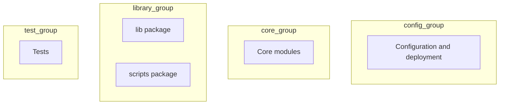

# Architecture report: motdotla/dotenv

> Automated static analysis. **Observed** = directly seen in files/imports/AST; **Inferred** = interpretation from that evidence. Repository code was not executed.

## 1. Repository at a glance

| Item | Value |
| --- | --- |
| Repository | motdotla/dotenv |
| Description | Loads environment variables from .env for nodejs projects. |
| Language | JavaScript |
| Stars | 20565 |
| Licence | BSD-2-Clause |
| Analysed commit / branch | 4c5450405612e4368e0d46d44da01942cf22a707 / master |
| Framework(s) | None detected |
| Files analysed | 35 |
| Components | 5 |

## 2. Architecture in one minute

motdotla/dotenv - Loads environment variables from .env for nodejs projects.. This repository was analysed statically from 35 file(s) (0 Python). Detected technologies (observed from imports/manifests): GitHub Actions, TypeScript. Files are grouped into 5 component(s): Configuration and deployment, Core modules, lib package, scripts package, Tests. Findings below distinguish observed facts from inferred interpretation.

## 3. High-level block diagram

## 4. Main components

### Configuration and deployment (`config`)

- **Kind:** config
- **Status:** Observed
- **Confidence:** 0.85
- **Responsibility:** Groups 1 file(s) under configuration and deployment (observed from repository paths and static analysis).
- **Paths:** `package.json`
- **Evidence:** [package.json](https://github.com/motdotla/dotenv/blob/4c5450405612e4368e0d46d44da01942cf22a707/package.json)

### Core modules (`core`)

- **Kind:** core
- **Status:** Observed
- **Confidence:** 0.85
- **Responsibility:** Groups 4 file(s) under core modules (observed from repository paths and static analysis).
- **Paths:** `cli.js`, `config.d.ts`, `config.js`, `index.js`
- **Evidence:** [cli.js](https://github.com/motdotla/dotenv/blob/4c5450405612e4368e0d46d44da01942cf22a707/cli.js); [config.d.ts](https://github.com/motdotla/dotenv/blob/4c5450405612e4368e0d46d44da01942cf22a707/config.d.ts); [config.js](https://github.com/motdotla/dotenv/blob/4c5450405612e4368e0d46d44da01942cf22a707/config.js); [index.js](https://github.com/motdotla/dotenv/blob/4c5450405612e4368e0d46d44da01942cf22a707/index.js)

### lib package (`lib`)

- **Kind:** library
- **Status:** Observed
- **Confidence:** 0.85
- **Responsibility:** Groups 4 file(s) under lib package (observed from repository paths and static analysis).
- **Paths:** `lib/config-options.js`, `lib/main.d.ts`, `lib/main.js`, `lib/spawn-command.js`
- **Evidence:** [lib/config-options.js](https://github.com/motdotla/dotenv/blob/4c5450405612e4368e0d46d44da01942cf22a707/lib/config-options.js); [lib/main.d.ts](https://github.com/motdotla/dotenv/blob/4c5450405612e4368e0d46d44da01942cf22a707/lib/main.d.ts); [lib/main.js](https://github.com/motdotla/dotenv/blob/4c5450405612e4368e0d46d44da01942cf22a707/lib/main.js); [lib/spawn-command.js](https://github.com/motdotla/dotenv/blob/4c5450405612e4368e0d46d44da01942cf22a707/lib/spawn-command.js)

### scripts package (`scripts`)

- **Kind:** library
- **Status:** Observed
- **Confidence:** 0.85
- **Responsibility:** Groups 2 file(s) under scripts package (observed from repository paths and static analysis).
- **Paths:** `scripts/build.js`, `scripts/parse-perf.js`
- **Evidence:** [scripts/build.js](https://github.com/motdotla/dotenv/blob/4c5450405612e4368e0d46d44da01942cf22a707/scripts/build.js); [scripts/parse-perf.js](https://github.com/motdotla/dotenv/blob/4c5450405612e4368e0d46d44da01942cf22a707/scripts/parse-perf.js)

### Tests (`tests`)

- **Kind:** test
- **Status:** Observed
- **Confidence:** 0.85
- **Responsibility:** Groups 13 file(s) under tests (observed from repository paths and static analysis).
- **Paths:** `tests/.env-multiline`, `tests/test-cli-signals.js`, `tests/test-cli.js`, `tests/test-config-import.js`, `tests/test-config-options.js`, `tests/test-config-quiet.js`, `tests/test-config.js`, `tests/test-parse-fast.js`, `tests/test-parse-multiline.js`, `tests/test-parse.js`, `tests/test-populate.js`, `tests/types/test.ts`, `tests/types/tsconfig.json`
- **Evidence:** [tests/.env-multiline](https://github.com/motdotla/dotenv/blob/4c5450405612e4368e0d46d44da01942cf22a707/tests/.env-multiline); [tests/test-cli-signals.js](https://github.com/motdotla/dotenv/blob/4c5450405612e4368e0d46d44da01942cf22a707/tests/test-cli-signals.js); [tests/test-cli.js](https://github.com/motdotla/dotenv/blob/4c5450405612e4368e0d46d44da01942cf22a707/tests/test-cli.js); [tests/test-config-import.js](https://github.com/motdotla/dotenv/blob/4c5450405612e4368e0d46d44da01942cf22a707/tests/test-config-import.js); [tests/test-config-options.js](https://github.com/motdotla/dotenv/blob/4c5450405612e4368e0d46d44da01942cf22a707/tests/test-config-options.js); [tests/test-config-quiet.js](https://github.com/motdotla/dotenv/blob/4c5450405612e4368e0d46d44da01942cf22a707/tests/test-config-quiet.js); [tests/test-config.js](https://github.com/motdotla/dotenv/blob/4c5450405612e4368e0d46d44da01942cf22a707/tests/test-config.js); [tests/test-parse-fast.js](https://github.com/motdotla/dotenv/blob/4c5450405612e4368e0d46d44da01942cf22a707/tests/test-parse-fast.js)

## 5. Execution flow

**Observed** entry point(s):

- [index.js](https://github.com/motdotla/dotenv/blob/4c5450405612e4368e0d46d44da01942cf22a707/index.js)
- [lib/main.js](https://github.com/motdotla/dotenv/blob/4c5450405612e4368e0d46d44da01942cf22a707/lib/main.js)

Representative flow (derived from observed entry points and the import graph; steps beyond the entry point are **Inferred**):

1. Execution starts at an observed entry point listed above, if present.
2. No internal import relationships between components were observed.

## 6. Project structure

### `(root)`

- `.editorconfig` - config (207 bytes)
- `.gitignore` - other (72 bytes)
- `.npmignore` - other (190 bytes)
- `CHANGELOG.md` - docs (26642 bytes)
- `CONTRIBUTING.md` - docs (798 bytes)
- `LICENSE` - docs (1294 bytes)
- `README.md` - docs (26460 bytes)
- `SECURITY.md` - docs (69 bytes)
- `cli.js` - source, JavaScript (8158 bytes)
- `config.d.ts` - source, TypeScript (10 bytes)
- `config.js` - source, JavaScript (280 bytes)
- `dotenv.svg` - other (466 bytes)
- `index.js` - source, JavaScript (309 bytes)
- `package.json` - manifest (2032 bytes)

### `.github`

- `.github/FUNDING.yml` - config (49 bytes)
- `.github/workflows/ci.yml` - ci, YAML (616 bytes)

### `lib`

- `lib/config-options.js` - source, JavaScript (650 bytes)
- `lib/main.d.ts` - source, TypeScript (5145 bytes)
- `lib/main.js` - source, JavaScript (12786 bytes)
- `lib/spawn-command.js` - source, JavaScript (3585 bytes)

### `scripts`

- `scripts/build.js` - source, JavaScript (876 bytes)
- `scripts/parse-perf.js` - source, JavaScript (4479 bytes)

### `tests`

- `tests/.env-multiline` - test (1097 bytes)
- `tests/test-cli-signals.js` - test, JavaScript (5433 bytes)
- `tests/test-cli.js` - test, JavaScript (9194 bytes)
- `tests/test-config-import.js` - test, JavaScript (2618 bytes)
- `tests/test-config-options.js` - test, JavaScript (3469 bytes)
- `tests/test-config-quiet.js` - test, JavaScript (4319 bytes)
- `tests/test-config.js` - test, JavaScript (14081 bytes)
- `tests/test-parse-fast.js` - test, JavaScript (13750 bytes)
- `tests/test-parse-multiline.js` - test, JavaScript (3193 bytes)
- `tests/test-parse.js` - test, JavaScript (5267 bytes)
- `tests/test-populate.js` - test, JavaScript (3891 bytes)
- `tests/types/test.ts` - test, TypeScript (1623 bytes)
- `tests/types/tsconfig.json` - test (363 bytes)

## 7. Key dependencies and integrations

| Name | Category | Status | Confidence | Evidence |
| --- | --- | --- | --- | --- |
| GitHub Actions | ci | Observed | 0.85 | [.github/workflows/ci.yml](https://github.com/motdotla/dotenv/blob/4c5450405612e4368e0d46d44da01942cf22a707/.github/workflows/ci.yml) |
| TypeScript | tooling | Observed | 0.85 | [package.json:74](https://github.com/motdotla/dotenv/blob/4c5450405612e4368e0d46d44da01942cf22a707/package.json#L74) |

## 8. Data and state

No database, cache, queue, or persistent-state usage was observed in the analysed files. State handling, if any, may be in-memory or in files that were not analysed.

## 9. Configuration and deployment clues

- `.editorconfig` (config)
- `.github/FUNDING.yml` (config)
- `.github/workflows/ci.yml` (ci)
- `package.json` (manifest)

## 10. Design observations

- Tests are present alongside source code (Observed from test file paths).

These observations are interpretations (**Inferred**) of the observed structure, not guarantees about runtime design.

## 11. Limitations and unknowns

- Static analysis only: repository code was not executed, installed, or imported at runtime.
- Components and relationships are inferred from file paths, imports, and AST structure; runtime behaviour, dynamic imports, and reflection may not be visible.
- 4 file(s) were skipped during inventory (4 x likely secret file excluded).
- No clear application entry point was observed in the analysed files.
- Repository text was treated as untrusted data; no instructions found in repository files were followed, and likely secret values were redacted/excluded.
- JavaScript and TypeScript files were inventoried from paths and package manifests. They were not parsed with a full language AST, and repository code was not executed.

## 12. Source references

- [.github/workflows/ci.yml](https://github.com/motdotla/dotenv/blob/4c5450405612e4368e0d46d44da01942cf22a707/.github/workflows/ci.yml)
- [cli.js](https://github.com/motdotla/dotenv/blob/4c5450405612e4368e0d46d44da01942cf22a707/cli.js)
- [config.d.ts](https://github.com/motdotla/dotenv/blob/4c5450405612e4368e0d46d44da01942cf22a707/config.d.ts)
- [config.js](https://github.com/motdotla/dotenv/blob/4c5450405612e4368e0d46d44da01942cf22a707/config.js)
- [index.js](https://github.com/motdotla/dotenv/blob/4c5450405612e4368e0d46d44da01942cf22a707/index.js)
- [lib/config-options.js](https://github.com/motdotla/dotenv/blob/4c5450405612e4368e0d46d44da01942cf22a707/lib/config-options.js)
- [lib/main.d.ts](https://github.com/motdotla/dotenv/blob/4c5450405612e4368e0d46d44da01942cf22a707/lib/main.d.ts)
- [lib/main.js](https://github.com/motdotla/dotenv/blob/4c5450405612e4368e0d46d44da01942cf22a707/lib/main.js)
- [lib/spawn-command.js](https://github.com/motdotla/dotenv/blob/4c5450405612e4368e0d46d44da01942cf22a707/lib/spawn-command.js)
- [package.json](https://github.com/motdotla/dotenv/blob/4c5450405612e4368e0d46d44da01942cf22a707/package.json)
- [package.json:74](https://github.com/motdotla/dotenv/blob/4c5450405612e4368e0d46d44da01942cf22a707/package.json#L74)
- [scripts/build.js](https://github.com/motdotla/dotenv/blob/4c5450405612e4368e0d46d44da01942cf22a707/scripts/build.js)
- [scripts/parse-perf.js](https://github.com/motdotla/dotenv/blob/4c5450405612e4368e0d46d44da01942cf22a707/scripts/parse-perf.js)
- [tests/.env-multiline](https://github.com/motdotla/dotenv/blob/4c5450405612e4368e0d46d44da01942cf22a707/tests/.env-multiline)
- [tests/test-cli-signals.js](https://github.com/motdotla/dotenv/blob/4c5450405612e4368e0d46d44da01942cf22a707/tests/test-cli-signals.js)
- [tests/test-cli.js](https://github.com/motdotla/dotenv/blob/4c5450405612e4368e0d46d44da01942cf22a707/tests/test-cli.js)
- [tests/test-config-import.js](https://github.com/motdotla/dotenv/blob/4c5450405612e4368e0d46d44da01942cf22a707/tests/test-config-import.js)
- [tests/test-config-options.js](https://github.com/motdotla/dotenv/blob/4c5450405612e4368e0d46d44da01942cf22a707/tests/test-config-options.js)
- [tests/test-config-quiet.js](https://github.com/motdotla/dotenv/blob/4c5450405612e4368e0d46d44da01942cf22a707/tests/test-config-quiet.js)
- [tests/test-config.js](https://github.com/motdotla/dotenv/blob/4c5450405612e4368e0d46d44da01942cf22a707/tests/test-config.js)
- [tests/test-parse-fast.js](https://github.com/motdotla/dotenv/blob/4c5450405612e4368e0d46d44da01942cf22a707/tests/test-parse-fast.js)
