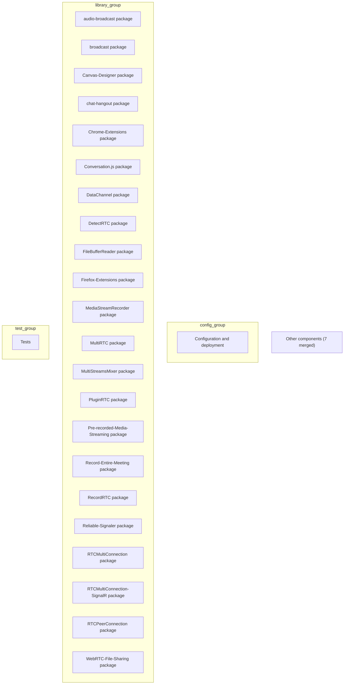

# Architecture report: muaz-khan/WebRTC-Experiment

> Automated static analysis. **Observed** = directly seen in files/imports/AST; **Inferred** = interpretation from that evidence. Repository code was not executed.

## 1. Repository at a glance

| Item | Value |
| --- | --- |
| Repository | muaz-khan/WebRTC-Experiment |
| Description | WebRTC, WebRTC and WebRTC. Everything here is all about WebRTC!! |
| Language | JavaScript |
| Stars | 12047 |
| Licence | MIT |
| Analysed commit / branch | bbcdbc13b3d7864369f0d09a7c089277dec946da / master |
| Framework(s) | None detected |
| Files analysed | 780 |
| Components | 31 |

## 2. Architecture in one minute

muaz-khan/WebRTC-Experiment - WebRTC, WebRTC and WebRTC. Everything here is all about WebRTC!!. This repository was analysed statically from 780 file(s) (0 Python). Detected technologies (observed from imports/manifests): no known frameworks/libraries. Files are grouped into 31 component(s): API layer, audio-broadcast package, broadcast package, Canvas-Designer package, chat-hangout package, Chrome-Extensions package, ConcatenateBlobs package, Configuration and deployment. Findings below distinguish observed facts from inferred interpretation.

## 3. High-level block diagram

## 4. Main components

### API layer (`api_layer`)

- **Kind:** api
- **Status:** Observed
- **Confidence:** 0.85
- **Responsibility:** Groups 1 file(s) under api layer (observed from repository paths and static analysis).
- **Paths:** `RecordRTC/RecordRTC-to-ASPNETMVC/RecordRTC_to_ASPNETMVC/Controllers/RecordRTCController.cs`
- **Evidence:** [RecordRTC/RecordRTC-to-ASPNETMVC/RecordRTC_to_ASPNETMVC/Controllers/RecordRTCController.cs](https://github.com/muaz-khan/WebRTC-Experiment/blob/bbcdbc13b3d7864369f0d09a7c089277dec946da/RecordRTC/RecordRTC-to-ASPNETMVC/RecordRTC_to_ASPNETMVC/Controllers/RecordRTCController.cs)

### audio-broadcast package (`audio_broadcast`)

- **Kind:** library
- **Status:** Observed
- **Confidence:** 0.85
- **Responsibility:** Groups 2 file(s) under audio-broadcast package (observed from repository paths and static analysis).
- **Paths:** `audio-broadcast/broadcast-ui.js`, `audio-broadcast/broadcast.js`
- **Evidence:** [audio-broadcast/broadcast-ui.js](https://github.com/muaz-khan/WebRTC-Experiment/blob/bbcdbc13b3d7864369f0d09a7c089277dec946da/audio-broadcast/broadcast-ui.js); [audio-broadcast/broadcast.js](https://github.com/muaz-khan/WebRTC-Experiment/blob/bbcdbc13b3d7864369f0d09a7c089277dec946da/audio-broadcast/broadcast.js)

### broadcast package (`broadcast`)

- **Kind:** library
- **Status:** Observed
- **Confidence:** 0.85
- **Responsibility:** Groups 2 file(s) under broadcast package (observed from repository paths and static analysis).
- **Paths:** `broadcast/broadcast-ui.js`, `broadcast/broadcast.js`
- **Evidence:** [broadcast/broadcast-ui.js](https://github.com/muaz-khan/WebRTC-Experiment/blob/bbcdbc13b3d7864369f0d09a7c089277dec946da/broadcast/broadcast-ui.js); [broadcast/broadcast.js](https://github.com/muaz-khan/WebRTC-Experiment/blob/bbcdbc13b3d7864369f0d09a7c089277dec946da/broadcast/broadcast.js)

### Canvas-Designer package (`canvas_designer`)

- **Kind:** library
- **Status:** Observed
- **Confidence:** 0.85
- **Responsibility:** Groups 28 file(s) under canvas-designer package (observed from repository paths and static analysis).
- **Paths:** `Canvas-Designer/Gruntfile.js`, `Canvas-Designer/canvas-designer-widget.js`, `Canvas-Designer/dev/amd.js`, `Canvas-Designer/dev/arc-handler.js`, `Canvas-Designer/dev/arrow-handler.js`, `Canvas-Designer/dev/bezier-handler.js`, `Canvas-Designer/dev/common.js`, `Canvas-Designer/dev/data-uris.js`, `Canvas-Designer/dev/decorator.js`, `Canvas-Designer/dev/drag-helper.js`, `Canvas-Designer/dev/draw-helper.js`, `Canvas-Designer/dev/eraser-handler.js`, `Canvas-Designer/dev/events-handler.js`, `Canvas-Designer/dev/file-selector.js`, `Canvas-Designer/dev/head.js`, `Canvas-Designer/dev/image-handler.js`, `Canvas-Designer/dev/line-handler.js`, `Canvas-Designer/dev/marker-handler.js`, `Canvas-Designer/dev/pdf-handler.js`, `Canvas-Designer/dev/pencil-handler.js`, `Canvas-Designer/dev/quadratic-handler.js`, `Canvas-Designer/dev/rect-handler.js`, `Canvas-Designer/dev/share-drawings.js`, `Canvas-Designer/dev/tail.js`, `Canvas-Designer/dev/text-handler.js`, `Canvas-Designer/dev/webrtc-handler.js`, `Canvas-Designer/dev/zoom-handler.js`, `Canvas-Designer/server.js`
- **Evidence:** [Canvas-Designer/Gruntfile.js](https://github.com/muaz-khan/WebRTC-Experiment/blob/bbcdbc13b3d7864369f0d09a7c089277dec946da/Canvas-Designer/Gruntfile.js); [Canvas-Designer/canvas-designer-widget.js](https://github.com/muaz-khan/WebRTC-Experiment/blob/bbcdbc13b3d7864369f0d09a7c089277dec946da/Canvas-Designer/canvas-designer-widget.js); [Canvas-Designer/dev/amd.js](https://github.com/muaz-khan/WebRTC-Experiment/blob/bbcdbc13b3d7864369f0d09a7c089277dec946da/Canvas-Designer/dev/amd.js); [Canvas-Designer/dev/arc-handler.js](https://github.com/muaz-khan/WebRTC-Experiment/blob/bbcdbc13b3d7864369f0d09a7c089277dec946da/Canvas-Designer/dev/arc-handler.js); [Canvas-Designer/dev/arrow-handler.js](https://github.com/muaz-khan/WebRTC-Experiment/blob/bbcdbc13b3d7864369f0d09a7c089277dec946da/Canvas-Designer/dev/arrow-handler.js); [Canvas-Designer/dev/bezier-handler.js](https://github.com/muaz-khan/WebRTC-Experiment/blob/bbcdbc13b3d7864369f0d09a7c089277dec946da/Canvas-Designer/dev/bezier-handler.js); [Canvas-Designer/dev/common.js](https://github.com/muaz-khan/WebRTC-Experiment/blob/bbcdbc13b3d7864369f0d09a7c089277dec946da/Canvas-Designer/dev/common.js); [Canvas-Designer/dev/data-uris.js](https://github.com/muaz-khan/WebRTC-Experiment/blob/bbcdbc13b3d7864369f0d09a7c089277dec946da/Canvas-Designer/dev/data-uris.js)

### chat-hangout package (`chat_hangout`)

- **Kind:** library
- **Status:** Observed
- **Confidence:** 0.85
- **Responsibility:** Groups 2 file(s) under chat-hangout package (observed from repository paths and static analysis).
- **Paths:** `chat-hangout/hangout-ui.js`, `chat-hangout/hangout.js`
- **Evidence:** [chat-hangout/hangout-ui.js](https://github.com/muaz-khan/WebRTC-Experiment/blob/bbcdbc13b3d7864369f0d09a7c089277dec946da/chat-hangout/hangout-ui.js); [chat-hangout/hangout.js](https://github.com/muaz-khan/WebRTC-Experiment/blob/bbcdbc13b3d7864369f0d09a7c089277dec946da/chat-hangout/hangout.js)

### Chrome-Extensions package (`chrome_extensions`)

- **Kind:** library
- **Status:** Observed
- **Confidence:** 0.85
- **Responsibility:** Groups 69 file(s) under chrome-extensions package (observed from repository paths and static analysis).
- **Paths:** `Chrome-Extensions/Screen-Capturing.js/Screen-Capturing.js`, `Chrome-Extensions/Screen-Capturing.js/server.js`, `Chrome-Extensions/desktopCapture-p2p/background/captureCamera.js`, `Chrome-Extensions/desktopCapture-p2p/background/captureDesktop.js`, `Chrome-Extensions/desktopCapture-p2p/background/captureTabUsingTabCapture.js`, `Chrome-Extensions/desktopCapture-p2p/background/common.js`, `Chrome-Extensions/desktopCapture-p2p/background/globals.js`, `Chrome-Extensions/desktopCapture-p2p/background/gotStream.js`, `Chrome-Extensions/desktopCapture-p2p/background/gotTabCaptureStream.js`, `Chrome-Extensions/desktopCapture-p2p/background/helpers/AntMediaWrapper.js`, `Chrome-Extensions/desktopCapture-p2p/background/helpers/CodecsHandler.js`, `Chrome-Extensions/desktopCapture-p2p/background/helpers/IceServersHandler.js`, `Chrome-Extensions/desktopCapture-p2p/background/helpers/MultiStreamsMixer.js`, `Chrome-Extensions/desktopCapture-p2p/background/helpers/getStats.js`, `Chrome-Extensions/desktopCapture-p2p/background/helpers/socket.io.js`, `Chrome-Extensions/desktopCapture-p2p/background/onAccessApproved.js`, `Chrome-Extensions/desktopCapture-p2p/background/online-offline.js`, `Chrome-Extensions/desktopCapture-p2p/background/runtimePort.js`, `Chrome-Extensions/desktopCapture-p2p/background/setDefaults.js`, `Chrome-Extensions/desktopCapture-p2p/background/setupWebRTCConnection.js`, `Chrome-Extensions/desktopCapture-p2p/background/shareStreamUsingAntMediaServer.js`, `Chrome-Extensions/desktopCapture-p2p/background/shareStreamUsingRTCMultiConnection.js`, `Chrome-Extensions/desktopCapture-p2p/extension-pages/camera-mic.js`, `Chrome-Extensions/desktopCapture-p2p/extension-pages/chat.js`, `Chrome-Extensions/desktopCapture-p2p/extension-pages/dropdown.js`, `Chrome-Extensions/desktopCapture-p2p/extension-pages/options.js`, `Chrome-Extensions/desktopCapture-p2p/extension-pages/video.js`, `Chrome-Extensions/desktopCapture-p2p/server.js`, `Chrome-Extensions/desktopCapture/background-script.js`, `Chrome-Extensions/desktopCapture/content-script.js`, `Chrome-Extensions/desktopCapture/different-api/background-script.js`, `Chrome-Extensions/file-sharing/background.js`, `Chrome-Extensions/file-sharing/options.js`, `Chrome-Extensions/file-sharing/popup.js`, `Chrome-Extensions/get-any-webrtc-peer-stream/RTCPeerConnection-override.js`, `Chrome-Extensions/get-any-webrtc-peer-stream/content-script.js`, `Chrome-Extensions/getUserMedia-on-http/background-script.js`, `Chrome-Extensions/getUserMedia-on-http/camera-mic.js`, `Chrome-Extensions/getUserMedia-on-http/content-script.js`, `Chrome-Extensions/getUserMedia-on-http/example/index.js`, `Chrome-Extensions/getUserMedia-on-http/webrtc-handler.js`, `Chrome-Extensions/screen-recording/RecordRTC/DiskStorage.js`, `Chrome-Extensions/screen-recording/RecordRTC/MediaStreamRecorder.js`, `Chrome-Extensions/screen-recording/RecordRTC/MultiStreamRecorder.js`, `Chrome-Extensions/screen-recording/RecordRTC/MultiStreamsMixer.js`, `Chrome-Extensions/screen-recording/RecordRTC/StereoAudioRecorder.js`, `Chrome-Extensions/screen-recording/RecordRTC/getAllAudioVideoDevices.js`, `Chrome-Extensions/screen-recording/background/background.badgeText.js`, `Chrome-Extensions/screen-recording/background/background.common.js`, `Chrome-Extensions/screen-recording/background/background.contentScript.js`, `Chrome-Extensions/screen-recording/background/background.desktopCapture.js`, `Chrome-Extensions/screen-recording/background/background.getUserMedia.js`, `Chrome-Extensions/screen-recording/background/background.js`, `Chrome-Extensions/screen-recording/background/background.messaging.js`, `Chrome-Extensions/screen-recording/background/background.players.js`, `Chrome-Extensions/screen-recording/background/background.tabCapture.js`, `Chrome-Extensions/screen-recording/camera-mic.js`, `Chrome-Extensions/screen-recording/dropdown.js`, `Chrome-Extensions/screen-recording/options.js`, `Chrome-Extensions/screen-recording/preview/preview.js`, `Chrome-Extensions/screen-recording/preview/preview.php.upload.js`, `Chrome-Extensions/screen-recording/preview/preview.youtube.upload.js`, `Chrome-Extensions/screen-recording/video.js`, `Chrome-Extensions/tabCapture/CodecsHandler.js`, `Chrome-Extensions/tabCapture/IceServersHandler.js`, `Chrome-Extensions/tabCapture/options.js`, `Chrome-Extensions/tabCapture/shareStreamUsingRTCMultiConnection.js`, `Chrome-Extensions/tabCapture/socket.io.js`, `Chrome-Extensions/tabCapture/tab-capturing.js`
- **Evidence:** [Chrome-Extensions/Screen-Capturing.js/Screen-Capturing.js](https://github.com/muaz-khan/WebRTC-Experiment/blob/bbcdbc13b3d7864369f0d09a7c089277dec946da/Chrome-Extensions/Screen-Capturing.js/Screen-Capturing.js); [Chrome-Extensions/Screen-Capturing.js/server.js](https://github.com/muaz-khan/WebRTC-Experiment/blob/bbcdbc13b3d7864369f0d09a7c089277dec946da/Chrome-Extensions/Screen-Capturing.js/server.js); [Chrome-Extensions/desktopCapture-p2p/background/captureCamera.js](https://github.com/muaz-khan/WebRTC-Experiment/blob/bbcdbc13b3d7864369f0d09a7c089277dec946da/Chrome-Extensions/desktopCapture-p2p/background/captureCamera.js); [Chrome-Extensions/desktopCapture-p2p/background/captureDesktop.js](https://github.com/muaz-khan/WebRTC-Experiment/blob/bbcdbc13b3d7864369f0d09a7c089277dec946da/Chrome-Extensions/desktopCapture-p2p/background/captureDesktop.js); [Chrome-Extensions/desktopCapture-p2p/background/captureTabUsingTabCapture.js](https://github.com/muaz-khan/WebRTC-Experiment/blob/bbcdbc13b3d7864369f0d09a7c089277dec946da/Chrome-Extensions/desktopCapture-p2p/background/captureTabUsingTabCapture.js); [Chrome-Extensions/desktopCapture-p2p/background/common.js](https://github.com/muaz-khan/WebRTC-Experiment/blob/bbcdbc13b3d7864369f0d09a7c089277dec946da/Chrome-Extensions/desktopCapture-p2p/background/common.js); [Chrome-Extensions/desktopCapture-p2p/background/globals.js](https://github.com/muaz-khan/WebRTC-Experiment/blob/bbcdbc13b3d7864369f0d09a7c089277dec946da/Chrome-Extensions/desktopCapture-p2p/background/globals.js); [Chrome-Extensions/desktopCapture-p2p/background/gotStream.js](https://github.com/muaz-khan/WebRTC-Experiment/blob/bbcdbc13b3d7864369f0d09a7c089277dec946da/Chrome-Extensions/desktopCapture-p2p/background/gotStream.js)

### ConcatenateBlobs package (`concatenateblobs`)

- **Kind:** library
- **Status:** Observed
- **Confidence:** 0.85
- **Responsibility:** Groups 1 file(s) under concatenateblobs package (observed from repository paths and static analysis).
- **Paths:** `ConcatenateBlobs/ConcatenateBlobs.js`
- **Evidence:** [ConcatenateBlobs/ConcatenateBlobs.js](https://github.com/muaz-khan/WebRTC-Experiment/blob/bbcdbc13b3d7864369f0d09a7c089277dec946da/ConcatenateBlobs/ConcatenateBlobs.js)

### Configuration and deployment (`config`)

- **Kind:** config
- **Status:** Observed
- **Confidence:** 0.85
- **Responsibility:** Groups 55 file(s) under configuration and deployment (observed from repository paths and static analysis).
- **Paths:** `Canvas-Designer/.travis.yml`, `Canvas-Designer/bower.json`, `Canvas-Designer/package.json`, `Chrome-Extensions/desktopCapture-p2p/manifest.json`, `Chrome-Extensions/desktopCapture/different-api/manifest.json`, `Chrome-Extensions/desktopCapture/manifest.json`, `Chrome-Extensions/file-sharing/manifest.json`, `Chrome-Extensions/get-any-webrtc-peer-stream/manifest.json`, `Chrome-Extensions/getUserMedia-on-http/manifest.json`, `Chrome-Extensions/screen-recording/manifest.json`, `Chrome-Extensions/tabCapture/manifest.json`, `ConcatenateBlobs/package.json`, `Conversation.js/AndroidRTC/manifest.json`, `Conversation.js/package.json`, `DataChannel/.travis.yml`, `DataChannel/bower.json`, `DataChannel/package.json`, `DetectRTC/.travis.yml`, `DetectRTC/bower.json`, `DetectRTC/package.json`, `FileBufferReader/.travis.yml`, `FileBufferReader/bower.json`, `FileBufferReader/fbr-client/package.json`, `FileBufferReader/package.json`, `Firefox-Extensions/enable-screen-capturing-old2/package.json`, `Firefox-Extensions/enable-screen-capturing/package.json`, `MediaStreamRecorder/.travis.yml`, `MediaStreamRecorder/bower.json`, `MediaStreamRecorder/package.json`, `MultiRTC/MultiRTC-firebase/package.json`, `MultiRTC/MultiRTC-socketio/package.json`, `MultiRTC/MultiRTC-websocket/package.json`, `MultiStreamsMixer/.travis.yml`, `MultiStreamsMixer/bower.json`, `MultiStreamsMixer/package.json`, `RTCMultiConnection-Server/bower.json`, `RTCMultiConnection-Server/config.json`, `RTCMultiConnection-Server/logs.json`, `RTCMultiConnection-Server/package.json`, `RTCMultiConnection/.travis.yml`, `RTCMultiConnection/bower.json`, `RTCMultiConnection/config.json`, `RTCMultiConnection/logs.json`, `RTCMultiConnection/package.json`, `Record-Entire-Meeting/package.json`, `RecordRTC/.travis.yml`, `RecordRTC/RecordRTC-over-Socketio/package.json`, `RecordRTC/RecordRTC-to-Nodejs/package.json`, `RecordRTC/bower.json`, `RecordRTC/package.json`, `Reliable-Signaler/datachannel-client/package.json`, `Reliable-Signaler/package.json`, `Reliable-Signaler/rtcmulticonnection-client/package.json`, `Reliable-Signaler/videoconferencing-client/package.json`, `WebRTC-Scalable-Broadcast/package.json`
- **Evidence:** [Canvas-Designer/.travis.yml](https://github.com/muaz-khan/WebRTC-Experiment/blob/bbcdbc13b3d7864369f0d09a7c089277dec946da/Canvas-Designer/.travis.yml); [Canvas-Designer/bower.json](https://github.com/muaz-khan/WebRTC-Experiment/blob/bbcdbc13b3d7864369f0d09a7c089277dec946da/Canvas-Designer/bower.json); [Canvas-Designer/package.json](https://github.com/muaz-khan/WebRTC-Experiment/blob/bbcdbc13b3d7864369f0d09a7c089277dec946da/Canvas-Designer/package.json); [Chrome-Extensions/desktopCapture-p2p/manifest.json](https://github.com/muaz-khan/WebRTC-Experiment/blob/bbcdbc13b3d7864369f0d09a7c089277dec946da/Chrome-Extensions/desktopCapture-p2p/manifest.json); [Chrome-Extensions/desktopCapture/different-api/manifest.json](https://github.com/muaz-khan/WebRTC-Experiment/blob/bbcdbc13b3d7864369f0d09a7c089277dec946da/Chrome-Extensions/desktopCapture/different-api/manifest.json); [Chrome-Extensions/desktopCapture/manifest.json](https://github.com/muaz-khan/WebRTC-Experiment/blob/bbcdbc13b3d7864369f0d09a7c089277dec946da/Chrome-Extensions/desktopCapture/manifest.json); [Chrome-Extensions/file-sharing/manifest.json](https://github.com/muaz-khan/WebRTC-Experiment/blob/bbcdbc13b3d7864369f0d09a7c089277dec946da/Chrome-Extensions/file-sharing/manifest.json); [Chrome-Extensions/get-any-webrtc-peer-stream/manifest.json](https://github.com/muaz-khan/WebRTC-Experiment/blob/bbcdbc13b3d7864369f0d09a7c089277dec946da/Chrome-Extensions/get-any-webrtc-peer-stream/manifest.json)

### Conversation.js package (`conversation_js`)

- **Kind:** library
- **Status:** Observed
- **Confidence:** 0.85
- **Responsibility:** Groups 7 file(s) under conversation.js package (observed from repository paths and static analysis).
- **Paths:** `Conversation.js/AndroidRTC/scripts/FileBufferReader.js`, `Conversation.js/AndroidRTC/scripts/common-signaling.js`, `Conversation.js/AndroidRTC/scripts/conversation.js`, `Conversation.js/AndroidRTC/scripts/ui-handler.js`, `Conversation.js/conversation.js`, `Conversation.js/demos/common-signaling.js`, `Conversation.js/server.js`
- **Evidence:** [Conversation.js/AndroidRTC/scripts/FileBufferReader.js](https://github.com/muaz-khan/WebRTC-Experiment/blob/bbcdbc13b3d7864369f0d09a7c089277dec946da/Conversation.js/AndroidRTC/scripts/FileBufferReader.js); [Conversation.js/AndroidRTC/scripts/common-signaling.js](https://github.com/muaz-khan/WebRTC-Experiment/blob/bbcdbc13b3d7864369f0d09a7c089277dec946da/Conversation.js/AndroidRTC/scripts/common-signaling.js); [Conversation.js/AndroidRTC/scripts/conversation.js](https://github.com/muaz-khan/WebRTC-Experiment/blob/bbcdbc13b3d7864369f0d09a7c089277dec946da/Conversation.js/AndroidRTC/scripts/conversation.js); [Conversation.js/AndroidRTC/scripts/ui-handler.js](https://github.com/muaz-khan/WebRTC-Experiment/blob/bbcdbc13b3d7864369f0d09a7c089277dec946da/Conversation.js/AndroidRTC/scripts/ui-handler.js); [Conversation.js/conversation.js](https://github.com/muaz-khan/WebRTC-Experiment/blob/bbcdbc13b3d7864369f0d09a7c089277dec946da/Conversation.js/conversation.js); [Conversation.js/demos/common-signaling.js](https://github.com/muaz-khan/WebRTC-Experiment/blob/bbcdbc13b3d7864369f0d09a7c089277dec946da/Conversation.js/demos/common-signaling.js); [Conversation.js/server.js](https://github.com/muaz-khan/WebRTC-Experiment/blob/bbcdbc13b3d7864369f0d09a7c089277dec946da/Conversation.js/server.js)

### DataChannel package (`datachannel`)

- **Kind:** library
- **Status:** Observed
- **Confidence:** 0.85
- **Responsibility:** Groups 18 file(s) under datachannel package (observed from repository paths and static analysis).
- **Paths:** `DataChannel/DataChannel.js`, `DataChannel/Gruntfile.js`, `DataChannel/dev/DataChannel.js`, `DataChannel/dev/DataConnector.js`, `DataChannel/dev/FileConverter.js`, `DataChannel/dev/FileReceiver.js`, `DataChannel/dev/FileSaver.js`, `DataChannel/dev/FileSender.js`, `DataChannel/dev/IceServersHandler.js`, `DataChannel/dev/RTCPeerConnection.js`, `DataChannel/dev/SocketConnector.js`, `DataChannel/dev/TextReceiver.js`, `DataChannel/dev/TextSender.js`, `DataChannel/dev/externalIceServers.js`, `DataChannel/dev/globals.js`, `DataChannel/dev/head.js`, `DataChannel/dev/tail.js`, `DataChannel/server.js`
- **Evidence:** [DataChannel/DataChannel.js](https://github.com/muaz-khan/WebRTC-Experiment/blob/bbcdbc13b3d7864369f0d09a7c089277dec946da/DataChannel/DataChannel.js); [DataChannel/Gruntfile.js](https://github.com/muaz-khan/WebRTC-Experiment/blob/bbcdbc13b3d7864369f0d09a7c089277dec946da/DataChannel/Gruntfile.js); [DataChannel/dev/DataChannel.js](https://github.com/muaz-khan/WebRTC-Experiment/blob/bbcdbc13b3d7864369f0d09a7c089277dec946da/DataChannel/dev/DataChannel.js); [DataChannel/dev/DataConnector.js](https://github.com/muaz-khan/WebRTC-Experiment/blob/bbcdbc13b3d7864369f0d09a7c089277dec946da/DataChannel/dev/DataConnector.js); [DataChannel/dev/FileConverter.js](https://github.com/muaz-khan/WebRTC-Experiment/blob/bbcdbc13b3d7864369f0d09a7c089277dec946da/DataChannel/dev/FileConverter.js); [DataChannel/dev/FileReceiver.js](https://github.com/muaz-khan/WebRTC-Experiment/blob/bbcdbc13b3d7864369f0d09a7c089277dec946da/DataChannel/dev/FileReceiver.js); [DataChannel/dev/FileSaver.js](https://github.com/muaz-khan/WebRTC-Experiment/blob/bbcdbc13b3d7864369f0d09a7c089277dec946da/DataChannel/dev/FileSaver.js); [DataChannel/dev/FileSender.js](https://github.com/muaz-khan/WebRTC-Experiment/blob/bbcdbc13b3d7864369f0d09a7c089277dec946da/DataChannel/dev/FileSender.js)

### DetectRTC package (`detectrtc`)

- **Kind:** library
- **Status:** Observed
- **Confidence:** 0.85
- **Responsibility:** Groups 17 file(s) under detectrtc package (observed from repository paths and static analysis).
- **Paths:** `DetectRTC/DetectRTC.js`, `DetectRTC/Gruntfile.js`, `DetectRTC/dev/CheckDeviceSupport.js`, `DetectRTC/dev/DetectLocalIPAddress.js`, `DetectRTC/dev/DetectRTC.js`, `DetectRTC/dev/Objects.js`, `DetectRTC/dev/common.js`, `DetectRTC/dev/detectCaptureStream.js`, `DetectRTC/dev/detectDesktopOS.js`, `DetectRTC/dev/detectOSName.js`, `DetectRTC/dev/detectPrivateBrowsing.js`, `DetectRTC/dev/getBrowserInfo.js`, `DetectRTC/dev/head.js`, `DetectRTC/dev/isMobile.js`, `DetectRTC/dev/tail.js`, `DetectRTC/npm-test.js`, `DetectRTC/server.js`
- **Evidence:** [DetectRTC/DetectRTC.js](https://github.com/muaz-khan/WebRTC-Experiment/blob/bbcdbc13b3d7864369f0d09a7c089277dec946da/DetectRTC/DetectRTC.js); [DetectRTC/Gruntfile.js](https://github.com/muaz-khan/WebRTC-Experiment/blob/bbcdbc13b3d7864369f0d09a7c089277dec946da/DetectRTC/Gruntfile.js); [DetectRTC/dev/CheckDeviceSupport.js](https://github.com/muaz-khan/WebRTC-Experiment/blob/bbcdbc13b3d7864369f0d09a7c089277dec946da/DetectRTC/dev/CheckDeviceSupport.js); [DetectRTC/dev/DetectLocalIPAddress.js](https://github.com/muaz-khan/WebRTC-Experiment/blob/bbcdbc13b3d7864369f0d09a7c089277dec946da/DetectRTC/dev/DetectLocalIPAddress.js); [DetectRTC/dev/DetectRTC.js](https://github.com/muaz-khan/WebRTC-Experiment/blob/bbcdbc13b3d7864369f0d09a7c089277dec946da/DetectRTC/dev/DetectRTC.js); [DetectRTC/dev/Objects.js](https://github.com/muaz-khan/WebRTC-Experiment/blob/bbcdbc13b3d7864369f0d09a7c089277dec946da/DetectRTC/dev/Objects.js); [DetectRTC/dev/common.js](https://github.com/muaz-khan/WebRTC-Experiment/blob/bbcdbc13b3d7864369f0d09a7c089277dec946da/DetectRTC/dev/common.js); [DetectRTC/dev/detectCaptureStream.js](https://github.com/muaz-khan/WebRTC-Experiment/blob/bbcdbc13b3d7864369f0d09a7c089277dec946da/DetectRTC/dev/detectCaptureStream.js)

### FileBufferReader package (`filebufferreader`)

- **Kind:** library
- **Status:** Observed
- **Confidence:** 0.85
- **Responsibility:** Groups 18 file(s) under filebufferreader package (observed from repository paths and static analysis).
- **Paths:** `FileBufferReader/FileBufferReader.js`, `FileBufferReader/Gruntfile.js`, `FileBufferReader/demo/IceServersHandler.js`, `FileBufferReader/demo/PeerConnection.js`, `FileBufferReader/demo/PeerUI.js`, `FileBufferReader/demo/adapter-latest.js`, `FileBufferReader/dev/FileBufferReader.js`, `FileBufferReader/dev/FileBufferReaderHelper.js`, `FileBufferReader/dev/FileBufferReceiver.js`, `FileBufferReader/dev/FileConverter.js`, `FileBufferReader/dev/FileSelector.js`, `FileBufferReader/dev/binarize.js`, `FileBufferReader/dev/common.js`, `FileBufferReader/dev/head.js`, `FileBufferReader/dev/tail.js`, `FileBufferReader/fbr-client/demo/ui.js`, `FileBufferReader/fbr-client/server.js`, `FileBufferReader/server.js`
- **Evidence:** [FileBufferReader/FileBufferReader.js](https://github.com/muaz-khan/WebRTC-Experiment/blob/bbcdbc13b3d7864369f0d09a7c089277dec946da/FileBufferReader/FileBufferReader.js); [FileBufferReader/Gruntfile.js](https://github.com/muaz-khan/WebRTC-Experiment/blob/bbcdbc13b3d7864369f0d09a7c089277dec946da/FileBufferReader/Gruntfile.js); [FileBufferReader/demo/IceServersHandler.js](https://github.com/muaz-khan/WebRTC-Experiment/blob/bbcdbc13b3d7864369f0d09a7c089277dec946da/FileBufferReader/demo/IceServersHandler.js); [FileBufferReader/demo/PeerConnection.js](https://github.com/muaz-khan/WebRTC-Experiment/blob/bbcdbc13b3d7864369f0d09a7c089277dec946da/FileBufferReader/demo/PeerConnection.js); [FileBufferReader/demo/PeerUI.js](https://github.com/muaz-khan/WebRTC-Experiment/blob/bbcdbc13b3d7864369f0d09a7c089277dec946da/FileBufferReader/demo/PeerUI.js); [FileBufferReader/demo/adapter-latest.js](https://github.com/muaz-khan/WebRTC-Experiment/blob/bbcdbc13b3d7864369f0d09a7c089277dec946da/FileBufferReader/demo/adapter-latest.js); [FileBufferReader/dev/FileBufferReader.js](https://github.com/muaz-khan/WebRTC-Experiment/blob/bbcdbc13b3d7864369f0d09a7c089277dec946da/FileBufferReader/dev/FileBufferReader.js); [FileBufferReader/dev/FileBufferReaderHelper.js](https://github.com/muaz-khan/WebRTC-Experiment/blob/bbcdbc13b3d7864369f0d09a7c089277dec946da/FileBufferReader/dev/FileBufferReaderHelper.js)

### Firefox-Extensions package (`firefox_extensions`)

- **Kind:** library
- **Status:** Observed
- **Confidence:** 0.85
- **Responsibility:** Groups 6 file(s) under firefox-extensions package (observed from repository paths and static analysis).
- **Paths:** `Firefox-Extensions/enable-screen-capturing-old/bootstrap.js`, `Firefox-Extensions/enable-screen-capturing-old2/FirefoxScreenAddon.js`, `Firefox-Extensions/enable-screen-capturing-old2/content-script.js`, `Firefox-Extensions/enable-screen-capturing-old2/index.js`, `Firefox-Extensions/enable-screen-capturing/content-script.js`, `Firefox-Extensions/enable-screen-capturing/index.js`
- **Evidence:** [Firefox-Extensions/enable-screen-capturing-old/bootstrap.js](https://github.com/muaz-khan/WebRTC-Experiment/blob/bbcdbc13b3d7864369f0d09a7c089277dec946da/Firefox-Extensions/enable-screen-capturing-old/bootstrap.js); [Firefox-Extensions/enable-screen-capturing-old2/FirefoxScreenAddon.js](https://github.com/muaz-khan/WebRTC-Experiment/blob/bbcdbc13b3d7864369f0d09a7c089277dec946da/Firefox-Extensions/enable-screen-capturing-old2/FirefoxScreenAddon.js); [Firefox-Extensions/enable-screen-capturing-old2/content-script.js](https://github.com/muaz-khan/WebRTC-Experiment/blob/bbcdbc13b3d7864369f0d09a7c089277dec946da/Firefox-Extensions/enable-screen-capturing-old2/content-script.js); [Firefox-Extensions/enable-screen-capturing-old2/index.js](https://github.com/muaz-khan/WebRTC-Experiment/blob/bbcdbc13b3d7864369f0d09a7c089277dec946da/Firefox-Extensions/enable-screen-capturing-old2/index.js); [Firefox-Extensions/enable-screen-capturing/content-script.js](https://github.com/muaz-khan/WebRTC-Experiment/blob/bbcdbc13b3d7864369f0d09a7c089277dec946da/Firefox-Extensions/enable-screen-capturing/content-script.js); [Firefox-Extensions/enable-screen-capturing/index.js](https://github.com/muaz-khan/WebRTC-Experiment/blob/bbcdbc13b3d7864369f0d09a7c089277dec946da/Firefox-Extensions/enable-screen-capturing/index.js)

### MediaStreamRecorder package (`mediastreamrecorder`)

- **Kind:** library
- **Status:** Observed
- **Confidence:** 0.85
- **Responsibility:** Groups 25 file(s) under mediastreamrecorder package (observed from repository paths and static analysis).
- **Paths:** `MediaStreamRecorder/AudioStreamRecorder/FlashAudioRecorder.js`, `MediaStreamRecorder/AudioStreamRecorder/MediaRecorderWrapper.js`, `MediaStreamRecorder/AudioStreamRecorder/StereoAudioRecorder.js`, `MediaStreamRecorder/AudioStreamRecorder/StereoAudioRecorderHelper.js`, `MediaStreamRecorder/AudioStreamRecorder/lib/recorder.js/recorder.js`, `MediaStreamRecorder/AudioStreamRecorder/lib/wavencoder/wavencoder.js`, `MediaStreamRecorder/FileSystem/FileReader.js`, `MediaStreamRecorder/FileSystem/FileWriter.js`, `MediaStreamRecorder/Gruntfile.js`, `MediaStreamRecorder/MediaStreamRecorder.js`, `MediaStreamRecorder/VideoStreamRecorder/GifRecorder.js`, `MediaStreamRecorder/VideoStreamRecorder/WhammyRecorder.js`, `MediaStreamRecorder/VideoStreamRecorder/WhammyRecorderHelper.js`, `MediaStreamRecorder/VideoStreamRecorder/lib/gif-encoder.js`, `MediaStreamRecorder/VideoStreamRecorder/lib/whammy.js`, `MediaStreamRecorder/common/ConcatenateBlobs.js`, `MediaStreamRecorder/common/Cross-Browser-Declarations.js`, `MediaStreamRecorder/common/MediaStreamRecorder.js`, `MediaStreamRecorder/common/MultiStreamRecorder.js`, `MediaStreamRecorder/common/MultiStreamsMixer.js`, `MediaStreamRecorder/common/OpentTokStreamRecorder.js`, `MediaStreamRecorder/common/amd.js`, `MediaStreamRecorder/lib/AjaxRequest/AjaxRequest.js`, `MediaStreamRecorder/npm-test.js`, `MediaStreamRecorder/server.js`
- **Evidence:** [MediaStreamRecorder/AudioStreamRecorder/FlashAudioRecorder.js](https://github.com/muaz-khan/WebRTC-Experiment/blob/bbcdbc13b3d7864369f0d09a7c089277dec946da/MediaStreamRecorder/AudioStreamRecorder/FlashAudioRecorder.js); [MediaStreamRecorder/AudioStreamRecorder/MediaRecorderWrapper.js](https://github.com/muaz-khan/WebRTC-Experiment/blob/bbcdbc13b3d7864369f0d09a7c089277dec946da/MediaStreamRecorder/AudioStreamRecorder/MediaRecorderWrapper.js); [MediaStreamRecorder/AudioStreamRecorder/StereoAudioRecorder.js](https://github.com/muaz-khan/WebRTC-Experiment/blob/bbcdbc13b3d7864369f0d09a7c089277dec946da/MediaStreamRecorder/AudioStreamRecorder/StereoAudioRecorder.js); [MediaStreamRecorder/AudioStreamRecorder/StereoAudioRecorderHelper.js](https://github.com/muaz-khan/WebRTC-Experiment/blob/bbcdbc13b3d7864369f0d09a7c089277dec946da/MediaStreamRecorder/AudioStreamRecorder/StereoAudioRecorderHelper.js); [MediaStreamRecorder/AudioStreamRecorder/lib/recorder.js/recorder.js](https://github.com/muaz-khan/WebRTC-Experiment/blob/bbcdbc13b3d7864369f0d09a7c089277dec946da/MediaStreamRecorder/AudioStreamRecorder/lib/recorder.js/recorder.js); [MediaStreamRecorder/AudioStreamRecorder/lib/wavencoder/wavencoder.js](https://github.com/muaz-khan/WebRTC-Experiment/blob/bbcdbc13b3d7864369f0d09a7c089277dec946da/MediaStreamRecorder/AudioStreamRecorder/lib/wavencoder/wavencoder.js); [MediaStreamRecorder/FileSystem/FileReader.js](https://github.com/muaz-khan/WebRTC-Experiment/blob/bbcdbc13b3d7864369f0d09a7c089277dec946da/MediaStreamRecorder/FileSystem/FileReader.js); [MediaStreamRecorder/FileSystem/FileWriter.js](https://github.com/muaz-khan/WebRTC-Experiment/blob/bbcdbc13b3d7864369f0d09a7c089277dec946da/MediaStreamRecorder/FileSystem/FileWriter.js)

### MultiRTC package (`multirtc`)

- **Kind:** library
- **Status:** Observed
- **Confidence:** 0.85
- **Responsibility:** Groups 23 file(s) under multirtc package (observed from repository paths and static analysis).
- **Paths:** `MultiRTC/MultiRTC-firebase/FileBufferReader.js`, `MultiRTC/MultiRTC-firebase/firebase.js`, `MultiRTC/MultiRTC-firebase/linkify.js`, `MultiRTC/MultiRTC-firebase/ui.main.js`, `MultiRTC/MultiRTC-firebase/ui.peer-connection.js`, `MultiRTC/MultiRTC-firebase/ui.settings.js`, `MultiRTC/MultiRTC-firebase/ui.share-files.js`, `MultiRTC/MultiRTC-firebase/ui.users-list.js`, `MultiRTC/MultiRTC-socketio/public/FileBufferReader.js`, `MultiRTC/MultiRTC-socketio/public/linkify.js`, `MultiRTC/MultiRTC-socketio/public/ui.main.js`, `MultiRTC/MultiRTC-socketio/public/ui.peer-connection.js`, `MultiRTC/MultiRTC-socketio/public/ui.settings.js`, `MultiRTC/MultiRTC-socketio/public/ui.share-files.js`, `MultiRTC/MultiRTC-socketio/public/ui.users-list.js`, `MultiRTC/MultiRTC-socketio/signaler.js`, `MultiRTC/MultiRTC-websocket/FileBufferReader.js`, `MultiRTC/MultiRTC-websocket/linkify.js`, `MultiRTC/MultiRTC-websocket/ui.main.js`, `MultiRTC/MultiRTC-websocket/ui.peer-connection.js`, `MultiRTC/MultiRTC-websocket/ui.settings.js`, `MultiRTC/MultiRTC-websocket/ui.share-files.js`, `MultiRTC/MultiRTC-websocket/ui.users-list.js`
- **Evidence:** [MultiRTC/MultiRTC-firebase/FileBufferReader.js](https://github.com/muaz-khan/WebRTC-Experiment/blob/bbcdbc13b3d7864369f0d09a7c089277dec946da/MultiRTC/MultiRTC-firebase/FileBufferReader.js); [MultiRTC/MultiRTC-firebase/firebase.js](https://github.com/muaz-khan/WebRTC-Experiment/blob/bbcdbc13b3d7864369f0d09a7c089277dec946da/MultiRTC/MultiRTC-firebase/firebase.js); [MultiRTC/MultiRTC-firebase/linkify.js](https://github.com/muaz-khan/WebRTC-Experiment/blob/bbcdbc13b3d7864369f0d09a7c089277dec946da/MultiRTC/MultiRTC-firebase/linkify.js); [MultiRTC/MultiRTC-firebase/ui.main.js](https://github.com/muaz-khan/WebRTC-Experiment/blob/bbcdbc13b3d7864369f0d09a7c089277dec946da/MultiRTC/MultiRTC-firebase/ui.main.js); [MultiRTC/MultiRTC-firebase/ui.peer-connection.js](https://github.com/muaz-khan/WebRTC-Experiment/blob/bbcdbc13b3d7864369f0d09a7c089277dec946da/MultiRTC/MultiRTC-firebase/ui.peer-connection.js); [MultiRTC/MultiRTC-firebase/ui.settings.js](https://github.com/muaz-khan/WebRTC-Experiment/blob/bbcdbc13b3d7864369f0d09a7c089277dec946da/MultiRTC/MultiRTC-firebase/ui.settings.js); [MultiRTC/MultiRTC-firebase/ui.share-files.js](https://github.com/muaz-khan/WebRTC-Experiment/blob/bbcdbc13b3d7864369f0d09a7c089277dec946da/MultiRTC/MultiRTC-firebase/ui.share-files.js); [MultiRTC/MultiRTC-firebase/ui.users-list.js](https://github.com/muaz-khan/WebRTC-Experiment/blob/bbcdbc13b3d7864369f0d09a7c089277dec946da/MultiRTC/MultiRTC-firebase/ui.users-list.js)

### MultiStreamsMixer package (`multistreamsmixer`)

- **Kind:** library
- **Status:** Observed
- **Confidence:** 0.85
- **Responsibility:** Groups 20 file(s) under multistreamsmixer package (observed from repository paths and static analysis).
- **Paths:** `MultiStreamsMixer/Gruntfile.js`, `MultiStreamsMixer/MultiStreamsMixer.js`, `MultiStreamsMixer/MultiStreamsMixer.ts`, `MultiStreamsMixer/dev/amd.js`, `MultiStreamsMixer/dev/append-streams.js`, `MultiStreamsMixer/dev/cross-browser-declarations.js`, `MultiStreamsMixer/dev/draw-videos-on-canvas.js`, `MultiStreamsMixer/dev/get-mixed-audio-stream.js`, `MultiStreamsMixer/dev/get-mixed-stream.js`, `MultiStreamsMixer/dev/get-mixed-video-stream.js`, `MultiStreamsMixer/dev/get-video-element.js`, `MultiStreamsMixer/dev/head.js`, `MultiStreamsMixer/dev/init.js`, `MultiStreamsMixer/dev/module.exports.js`, `MultiStreamsMixer/dev/release-streams.js`, `MultiStreamsMixer/dev/replace-streams.js`, `MultiStreamsMixer/dev/start-drawing-frames.js`, `MultiStreamsMixer/dev/tail.js`, `MultiStreamsMixer/npm-test.js`, `MultiStreamsMixer/server.js`
- **Evidence:** [MultiStreamsMixer/Gruntfile.js](https://github.com/muaz-khan/WebRTC-Experiment/blob/bbcdbc13b3d7864369f0d09a7c089277dec946da/MultiStreamsMixer/Gruntfile.js); [MultiStreamsMixer/MultiStreamsMixer.js](https://github.com/muaz-khan/WebRTC-Experiment/blob/bbcdbc13b3d7864369f0d09a7c089277dec946da/MultiStreamsMixer/MultiStreamsMixer.js); [MultiStreamsMixer/MultiStreamsMixer.ts](https://github.com/muaz-khan/WebRTC-Experiment/blob/bbcdbc13b3d7864369f0d09a7c089277dec946da/MultiStreamsMixer/MultiStreamsMixer.ts); [MultiStreamsMixer/dev/amd.js](https://github.com/muaz-khan/WebRTC-Experiment/blob/bbcdbc13b3d7864369f0d09a7c089277dec946da/MultiStreamsMixer/dev/amd.js); [MultiStreamsMixer/dev/append-streams.js](https://github.com/muaz-khan/WebRTC-Experiment/blob/bbcdbc13b3d7864369f0d09a7c089277dec946da/MultiStreamsMixer/dev/append-streams.js); [MultiStreamsMixer/dev/cross-browser-declarations.js](https://github.com/muaz-khan/WebRTC-Experiment/blob/bbcdbc13b3d7864369f0d09a7c089277dec946da/MultiStreamsMixer/dev/cross-browser-declarations.js); [MultiStreamsMixer/dev/draw-videos-on-canvas.js](https://github.com/muaz-khan/WebRTC-Experiment/blob/bbcdbc13b3d7864369f0d09a7c089277dec946da/MultiStreamsMixer/dev/draw-videos-on-canvas.js); [MultiStreamsMixer/dev/get-mixed-audio-stream.js](https://github.com/muaz-khan/WebRTC-Experiment/blob/bbcdbc13b3d7864369f0d09a7c089277dec946da/MultiStreamsMixer/dev/get-mixed-audio-stream.js)

### Pluginfree-Screen-Sharing package (`pluginfree_screen_sharing`)

- **Kind:** library
- **Status:** Observed
- **Confidence:** 0.85
- **Responsibility:** Groups 1 file(s) under pluginfree-screen-sharing package (observed from repository paths and static analysis).
- **Paths:** `Pluginfree-Screen-Sharing/conference.js`
- **Evidence:** [Pluginfree-Screen-Sharing/conference.js](https://github.com/muaz-khan/WebRTC-Experiment/blob/bbcdbc13b3d7864369f0d09a7c089277dec946da/Pluginfree-Screen-Sharing/conference.js)

### PluginRTC package (`pluginrtc`)

- **Kind:** library
- **Status:** Observed
- **Confidence:** 0.85
- **Responsibility:** Groups 2 file(s) under pluginrtc package (observed from repository paths and static analysis).
- **Paths:** `PluginRTC/Plugin.EveryWhere.js`, `PluginRTC/Plugin.Temasys.js`
- **Evidence:** [PluginRTC/Plugin.EveryWhere.js](https://github.com/muaz-khan/WebRTC-Experiment/blob/bbcdbc13b3d7864369f0d09a7c089277dec946da/PluginRTC/Plugin.EveryWhere.js); [PluginRTC/Plugin.Temasys.js](https://github.com/muaz-khan/WebRTC-Experiment/blob/bbcdbc13b3d7864369f0d09a7c089277dec946da/PluginRTC/Plugin.Temasys.js)

### Pre-recorded-Media-Streaming package (`pre_recorded_media_streaming`)

- **Kind:** library
- **Status:** Observed
- **Confidence:** 0.85
- **Responsibility:** Groups 2 file(s) under pre-recorded-media-streaming package (observed from repository paths and static analysis).
- **Paths:** `Pre-recorded-Media-Streaming/MediaStreamer.js`, `Pre-recorded-Media-Streaming/streamer.js`
- **Evidence:** [Pre-recorded-Media-Streaming/MediaStreamer.js](https://github.com/muaz-khan/WebRTC-Experiment/blob/bbcdbc13b3d7864369f0d09a7c089277dec946da/Pre-recorded-Media-Streaming/MediaStreamer.js); [Pre-recorded-Media-Streaming/streamer.js](https://github.com/muaz-khan/WebRTC-Experiment/blob/bbcdbc13b3d7864369f0d09a7c089277dec946da/Pre-recorded-Media-Streaming/streamer.js)

### Record-Entire-Meeting package (`record_entire_meeting`)

- **Kind:** library
- **Status:** Observed
- **Confidence:** 0.85
- **Responsibility:** Groups 6 file(s) under record-entire-meeting package (observed from repository paths and static analysis).
- **Paths:** `Record-Entire-Meeting/Browser-Recording-Helper.js`, `Record-Entire-Meeting/Concatenate-Recordings.js`, `Record-Entire-Meeting/MediaStreamRecorder.js`, `Record-Entire-Meeting/Nodejs-Recording-Handler.js`, `Record-Entire-Meeting/Write-Recordings-To-Disk.js`, `Record-Entire-Meeting/server.js`
- **Evidence:** [Record-Entire-Meeting/Browser-Recording-Helper.js](https://github.com/muaz-khan/WebRTC-Experiment/blob/bbcdbc13b3d7864369f0d09a7c089277dec946da/Record-Entire-Meeting/Browser-Recording-Helper.js); [Record-Entire-Meeting/Concatenate-Recordings.js](https://github.com/muaz-khan/WebRTC-Experiment/blob/bbcdbc13b3d7864369f0d09a7c089277dec946da/Record-Entire-Meeting/Concatenate-Recordings.js); [Record-Entire-Meeting/MediaStreamRecorder.js](https://github.com/muaz-khan/WebRTC-Experiment/blob/bbcdbc13b3d7864369f0d09a7c089277dec946da/Record-Entire-Meeting/MediaStreamRecorder.js); [Record-Entire-Meeting/Nodejs-Recording-Handler.js](https://github.com/muaz-khan/WebRTC-Experiment/blob/bbcdbc13b3d7864369f0d09a7c089277dec946da/Record-Entire-Meeting/Nodejs-Recording-Handler.js); [Record-Entire-Meeting/Write-Recordings-To-Disk.js](https://github.com/muaz-khan/WebRTC-Experiment/blob/bbcdbc13b3d7864369f0d09a7c089277dec946da/Record-Entire-Meeting/Write-Recordings-To-Disk.js); [Record-Entire-Meeting/server.js](https://github.com/muaz-khan/WebRTC-Experiment/blob/bbcdbc13b3d7864369f0d09a7c089277dec946da/Record-Entire-Meeting/server.js)

### RecordRTC package (`recordrtc`)

- **Kind:** library
- **Status:** Observed
- **Confidence:** 0.85
- **Responsibility:** Groups 37 file(s) under recordrtc package (observed from repository paths and static analysis).
- **Paths:** `RecordRTC/Canvas-Recording/canvas-designer.js`, `RecordRTC/Gruntfile.js`, `RecordRTC/PHP-and-FFmpeg/save.php`, `RecordRTC/RecordRTC-over-Socketio/server.js`, `RecordRTC/RecordRTC-to-ASPNETMVC/RecordRTC_to_ASPNETMVC/Global.asax.cs`, `RecordRTC/RecordRTC-to-ASPNETMVC/RecordRTC_to_ASPNETMVC/Properties/AssemblyInfo.cs`, `RecordRTC/RecordRTC-to-Nodejs/server.js`, `RecordRTC/RecordRTC-to-PHP/delete.php`, `RecordRTC/RecordRTC-to-PHP/save.php`, `RecordRTC/RecordRTC.js`, `RecordRTC/WebGL-Recording/logic.js`, `RecordRTC/WebGL-Recording/view.js`, `RecordRTC/dev/CanvasRecorder.js`, `RecordRTC/dev/Cross-Browser-Declarations.js`, `RecordRTC/dev/DiskStorage.js`, `RecordRTC/dev/GetRecorderType.js`, `RecordRTC/dev/GifRecorder.js`, `RecordRTC/dev/MRecordRTC.js`, `RecordRTC/dev/MediaStreamRecorder.js`, `RecordRTC/dev/MultiStreamRecorder.js`, `RecordRTC/dev/MultiStreamsMixer.js`, `RecordRTC/dev/RecordRTC-Configuration.js`, `RecordRTC/dev/RecordRTC.IndexedDB.js`, `RecordRTC/dev/RecordRTC.js`, `RecordRTC/dev/RecordRTC.promises.js`, `RecordRTC/dev/StereoAudioRecorder.js`, `RecordRTC/dev/Storage.js`, `RecordRTC/dev/WebAssemblyRecorder.js`, `RecordRTC/dev/Whammy.js`, `RecordRTC/dev/WhammyRecorder.js`, `RecordRTC/dev/amd.js`, `RecordRTC/dev/isMediaRecorderCompatible.js`, `RecordRTC/libs/gif-recorder.js`, `RecordRTC/libs/webm-wasm.js`, `RecordRTC/libs/webm-worker.js`, `RecordRTC/npm-test.js`, `RecordRTC/server.js`
- **Evidence:** [RecordRTC/Canvas-Recording/canvas-designer.js](https://github.com/muaz-khan/WebRTC-Experiment/blob/bbcdbc13b3d7864369f0d09a7c089277dec946da/RecordRTC/Canvas-Recording/canvas-designer.js); [RecordRTC/Gruntfile.js](https://github.com/muaz-khan/WebRTC-Experiment/blob/bbcdbc13b3d7864369f0d09a7c089277dec946da/RecordRTC/Gruntfile.js); [RecordRTC/PHP-and-FFmpeg/save.php](https://github.com/muaz-khan/WebRTC-Experiment/blob/bbcdbc13b3d7864369f0d09a7c089277dec946da/RecordRTC/PHP-and-FFmpeg/save.php); [RecordRTC/RecordRTC-over-Socketio/server.js](https://github.com/muaz-khan/WebRTC-Experiment/blob/bbcdbc13b3d7864369f0d09a7c089277dec946da/RecordRTC/RecordRTC-over-Socketio/server.js); [RecordRTC/RecordRTC-to-ASPNETMVC/RecordRTC_to_ASPNETMVC/Global.asax.cs](https://github.com/muaz-khan/WebRTC-Experiment/blob/bbcdbc13b3d7864369f0d09a7c089277dec946da/RecordRTC/RecordRTC-to-ASPNETMVC/RecordRTC_to_ASPNETMVC/Global.asax.cs); [RecordRTC/RecordRTC-to-ASPNETMVC/RecordRTC_to_ASPNETMVC/Properties/AssemblyInfo.cs](https://github.com/muaz-khan/WebRTC-Experiment/blob/bbcdbc13b3d7864369f0d09a7c089277dec946da/RecordRTC/RecordRTC-to-ASPNETMVC/RecordRTC_to_ASPNETMVC/Properties/AssemblyInfo.cs); [RecordRTC/RecordRTC-to-Nodejs/server.js](https://github.com/muaz-khan/WebRTC-Experiment/blob/bbcdbc13b3d7864369f0d09a7c089277dec946da/RecordRTC/RecordRTC-to-Nodejs/server.js); [RecordRTC/RecordRTC-to-PHP/delete.php](https://github.com/muaz-khan/WebRTC-Experiment/blob/bbcdbc13b3d7864369f0d09a7c089277dec946da/RecordRTC/RecordRTC-to-PHP/delete.php)

### Reliable-Signaler package (`reliable_signaler`)

- **Kind:** library
- **Status:** Observed
- **Confidence:** 0.85
- **Responsibility:** Groups 8 file(s) under reliable-signaler package (observed from repository paths and static analysis).
- **Paths:** `Reliable-Signaler/datachannel-client/server.js`, `Reliable-Signaler/index.js`, `Reliable-Signaler/reliable-signaler.js`, `Reliable-Signaler/rtcmulticonnection-client/server.js`, `Reliable-Signaler/signaler.js`, `Reliable-Signaler/videoconferencing-client/RTCPeerConnection-v1.5.js`, `Reliable-Signaler/videoconferencing-client/conference.js`, `Reliable-Signaler/videoconferencing-client/server.js`
- **Evidence:** [Reliable-Signaler/datachannel-client/server.js](https://github.com/muaz-khan/WebRTC-Experiment/blob/bbcdbc13b3d7864369f0d09a7c089277dec946da/Reliable-Signaler/datachannel-client/server.js); [Reliable-Signaler/index.js](https://github.com/muaz-khan/WebRTC-Experiment/blob/bbcdbc13b3d7864369f0d09a7c089277dec946da/Reliable-Signaler/index.js); [Reliable-Signaler/reliable-signaler.js](https://github.com/muaz-khan/WebRTC-Experiment/blob/bbcdbc13b3d7864369f0d09a7c089277dec946da/Reliable-Signaler/reliable-signaler.js); [Reliable-Signaler/rtcmulticonnection-client/server.js](https://github.com/muaz-khan/WebRTC-Experiment/blob/bbcdbc13b3d7864369f0d09a7c089277dec946da/Reliable-Signaler/rtcmulticonnection-client/server.js); [Reliable-Signaler/signaler.js](https://github.com/muaz-khan/WebRTC-Experiment/blob/bbcdbc13b3d7864369f0d09a7c089277dec946da/Reliable-Signaler/signaler.js); [Reliable-Signaler/videoconferencing-client/RTCPeerConnection-v1.5.js](https://github.com/muaz-khan/WebRTC-Experiment/blob/bbcdbc13b3d7864369f0d09a7c089277dec946da/Reliable-Signaler/videoconferencing-client/RTCPeerConnection-v1.5.js); [Reliable-Signaler/videoconferencing-client/conference.js](https://github.com/muaz-khan/WebRTC-Experiment/blob/bbcdbc13b3d7864369f0d09a7c089277dec946da/Reliable-Signaler/videoconferencing-client/conference.js); [Reliable-Signaler/videoconferencing-client/server.js](https://github.com/muaz-khan/WebRTC-Experiment/blob/bbcdbc13b3d7864369f0d09a7c089277dec946da/Reliable-Signaler/videoconferencing-client/server.js)

### RTCall package (`rtcall`)

- **Kind:** library
- **Status:** Observed
- **Confidence:** 0.85
- **Responsibility:** Groups 1 file(s) under rtcall package (observed from repository paths and static analysis).
- **Paths:** `RTCall/RTCall.js`
- **Evidence:** [RTCall/RTCall.js](https://github.com/muaz-khan/WebRTC-Experiment/blob/bbcdbc13b3d7864369f0d09a7c089277dec946da/RTCall/RTCall.js)

### RTCMultiConnection package (`rtcmulticonnection`)

- **Kind:** library
- **Status:** Observed
- **Confidence:** 0.85
- **Responsibility:** Groups 47 file(s) under rtcmulticonnection package (observed from repository paths and static analysis).
- **Paths:** `RTCMultiConnection/Gruntfile.js`, `RTCMultiConnection/admin/admin-ui.js`, `RTCMultiConnection/demos/SSEConnection/SSE.php`, `RTCMultiConnection/demos/SSEConnection/checkPresence.php`, `RTCMultiConnection/demos/SSEConnection/enableCORS.php`, `RTCMultiConnection/demos/SSEConnection/get-param.php`, `RTCMultiConnection/demos/SSEConnection/publish.php`, `RTCMultiConnection/demos/SSEConnection/write-json.php`, `RTCMultiConnection/demos/menu.js`, `RTCMultiConnection/dev/BandwidthHandler.js`, `RTCMultiConnection/dev/BluetoothConnection.js`, `RTCMultiConnection/dev/CodecsHandler.js`, `RTCMultiConnection/dev/FileProgressBarHandler.js`, `RTCMultiConnection/dev/FileSelector.js`, `RTCMultiConnection/dev/FirebaseConnection.js`, `RTCMultiConnection/dev/IceServersHandler.js`, `RTCMultiConnection/dev/MediaStreamRecorder.js`, `RTCMultiConnection/dev/MultiPeersHandler.js`, `RTCMultiConnection/dev/MultiStreamsMixer.js`, `RTCMultiConnection/dev/OnIceCandidateHandler.js`, `RTCMultiConnection/dev/Plugin.EveryWhere.js`, `RTCMultiConnection/dev/PubNubConnection.js`, `RTCMultiConnection/dev/RTCMultiConnection.js`, `RTCMultiConnection/dev/RTCPeerConnection.js`, `RTCMultiConnection/dev/RecordingHandler.js`, `RTCMultiConnection/dev/SSEConnection.js`, `RTCMultiConnection/dev/SignalRConnection.js`, `RTCMultiConnection/dev/SipConnection.js`, `RTCMultiConnection/dev/SocketConnection.js`, `RTCMultiConnection/dev/StreamHasData.js`, `RTCMultiConnection/dev/StreamsHandler.js`, `RTCMultiConnection/dev/TextSenderReceiver.js`, `RTCMultiConnection/dev/TranslationHandler.js`, `RTCMultiConnection/dev/WebSocketConnection.js`, `RTCMultiConnection/dev/WebSyncConnection.js`, `RTCMultiConnection/dev/XHRConnection.js`, `RTCMultiConnection/dev/amd.js`, `RTCMultiConnection/dev/enableV2Api.js`, `RTCMultiConnection/dev/getHTMLMediaElement.js`, `RTCMultiConnection/dev/getUserMedia.js`, `RTCMultiConnection/dev/globals.js`, `RTCMultiConnection/dev/gumadapter.js`, `RTCMultiConnection/dev/head.js`, `RTCMultiConnection/dev/ios-hacks.js`, `RTCMultiConnection/dev/tail.js`, `RTCMultiConnection/npm-test.js`, `RTCMultiConnection/server.js`
- **Evidence:** [RTCMultiConnection/Gruntfile.js](https://github.com/muaz-khan/WebRTC-Experiment/blob/bbcdbc13b3d7864369f0d09a7c089277dec946da/RTCMultiConnection/Gruntfile.js); [RTCMultiConnection/admin/admin-ui.js](https://github.com/muaz-khan/WebRTC-Experiment/blob/bbcdbc13b3d7864369f0d09a7c089277dec946da/RTCMultiConnection/admin/admin-ui.js); [RTCMultiConnection/demos/SSEConnection/SSE.php](https://github.com/muaz-khan/WebRTC-Experiment/blob/bbcdbc13b3d7864369f0d09a7c089277dec946da/RTCMultiConnection/demos/SSEConnection/SSE.php); [RTCMultiConnection/demos/SSEConnection/checkPresence.php](https://github.com/muaz-khan/WebRTC-Experiment/blob/bbcdbc13b3d7864369f0d09a7c089277dec946da/RTCMultiConnection/demos/SSEConnection/checkPresence.php); [RTCMultiConnection/demos/SSEConnection/enableCORS.php](https://github.com/muaz-khan/WebRTC-Experiment/blob/bbcdbc13b3d7864369f0d09a7c089277dec946da/RTCMultiConnection/demos/SSEConnection/enableCORS.php); [RTCMultiConnection/demos/SSEConnection/get-param.php](https://github.com/muaz-khan/WebRTC-Experiment/blob/bbcdbc13b3d7864369f0d09a7c089277dec946da/RTCMultiConnection/demos/SSEConnection/get-param.php); [RTCMultiConnection/demos/SSEConnection/publish.php](https://github.com/muaz-khan/WebRTC-Experiment/blob/bbcdbc13b3d7864369f0d09a7c089277dec946da/RTCMultiConnection/demos/SSEConnection/publish.php); [RTCMultiConnection/demos/SSEConnection/write-json.php](https://github.com/muaz-khan/WebRTC-Experiment/blob/bbcdbc13b3d7864369f0d09a7c089277dec946da/RTCMultiConnection/demos/SSEConnection/write-json.php)

### RTCMultiConnection-Server package (`rtcmulticonnection_server`)

- **Kind:** library
- **Status:** Observed
- **Confidence:** 0.85
- **Responsibility:** Groups 1 file(s) under rtcmulticonnection-server package (observed from repository paths and static analysis).
- **Paths:** `RTCMultiConnection-Server/server.js`
- **Evidence:** [RTCMultiConnection-Server/server.js](https://github.com/muaz-khan/WebRTC-Experiment/blob/bbcdbc13b3d7864369f0d09a7c089277dec946da/RTCMultiConnection-Server/server.js)

### RTCMultiConnection-SignalR package (`rtcmulticonnection_signalr`)

- **Kind:** library
- **Status:** Observed
- **Confidence:** 0.85
- **Responsibility:** Groups 6 file(s) under rtcmulticonnection-signalr package (observed from repository paths and static analysis).
- **Paths:** `RTCMultiConnection-SignalR/RTCMultiConnection/Properties/AssemblyInfo.cs`, `RTCMultiConnection-SignalR/RTCMultiConnection/RTCMultiConnectionHub.cs`, `RTCMultiConnection-SignalR/RTCMultiConnection/RTCMultiConnectionSignaling.cs`, `RTCMultiConnection-SignalR/RTCMultiConnection/Scripts/jquery-1.10.2.intellisense.js`, `RTCMultiConnection-SignalR/RTCMultiConnection/Scripts/jquery.signalR-2.1.2.js`, `RTCMultiConnection-SignalR/RTCMultiConnection/SignalRConnection.js`
- **Evidence:** [RTCMultiConnection-SignalR/RTCMultiConnection/Properties/AssemblyInfo.cs](https://github.com/muaz-khan/WebRTC-Experiment/blob/bbcdbc13b3d7864369f0d09a7c089277dec946da/RTCMultiConnection-SignalR/RTCMultiConnection/Properties/AssemblyInfo.cs); [RTCMultiConnection-SignalR/RTCMultiConnection/RTCMultiConnectionHub.cs](https://github.com/muaz-khan/WebRTC-Experiment/blob/bbcdbc13b3d7864369f0d09a7c089277dec946da/RTCMultiConnection-SignalR/RTCMultiConnection/RTCMultiConnectionHub.cs); [RTCMultiConnection-SignalR/RTCMultiConnection/RTCMultiConnectionSignaling.cs](https://github.com/muaz-khan/WebRTC-Experiment/blob/bbcdbc13b3d7864369f0d09a7c089277dec946da/RTCMultiConnection-SignalR/RTCMultiConnection/RTCMultiConnectionSignaling.cs); [RTCMultiConnection-SignalR/RTCMultiConnection/Scripts/jquery-1.10.2.intellisense.js](https://github.com/muaz-khan/WebRTC-Experiment/blob/bbcdbc13b3d7864369f0d09a7c089277dec946da/RTCMultiConnection-SignalR/RTCMultiConnection/Scripts/jquery-1.10.2.intellisense.js); [RTCMultiConnection-SignalR/RTCMultiConnection/Scripts/jquery.signalR-2.1.2.js](https://github.com/muaz-khan/WebRTC-Experiment/blob/bbcdbc13b3d7864369f0d09a7c089277dec946da/RTCMultiConnection-SignalR/RTCMultiConnection/Scripts/jquery.signalR-2.1.2.js); [RTCMultiConnection-SignalR/RTCMultiConnection/SignalRConnection.js](https://github.com/muaz-khan/WebRTC-Experiment/blob/bbcdbc13b3d7864369f0d09a7c089277dec946da/RTCMultiConnection-SignalR/RTCMultiConnection/SignalRConnection.js)

### RTCPeerConnection package (`rtcpeerconnection`)

- **Kind:** library
- **Status:** Observed
- **Confidence:** 0.85
- **Responsibility:** Groups 8 file(s) under rtcpeerconnection package (observed from repository paths and static analysis).
- **Paths:** `RTCPeerConnection/RTCPeerConnection-Helpers.js`, `RTCPeerConnection/RTCPeerConnection-v1.1.js`, `RTCPeerConnection/RTCPeerConnection-v1.2.js`, `RTCPeerConnection/RTCPeerConnection-v1.3.js`, `RTCPeerConnection/RTCPeerConnection-v1.4.js`, `RTCPeerConnection/RTCPeerConnection-v1.5.js`, `RTCPeerConnection/RTCPeerConnection-v1.6.js`, `RTCPeerConnection/RTCPeerConnection.js`
- **Evidence:** [RTCPeerConnection/RTCPeerConnection-Helpers.js](https://github.com/muaz-khan/WebRTC-Experiment/blob/bbcdbc13b3d7864369f0d09a7c089277dec946da/RTCPeerConnection/RTCPeerConnection-Helpers.js); [RTCPeerConnection/RTCPeerConnection-v1.1.js](https://github.com/muaz-khan/WebRTC-Experiment/blob/bbcdbc13b3d7864369f0d09a7c089277dec946da/RTCPeerConnection/RTCPeerConnection-v1.1.js); [RTCPeerConnection/RTCPeerConnection-v1.2.js](https://github.com/muaz-khan/WebRTC-Experiment/blob/bbcdbc13b3d7864369f0d09a7c089277dec946da/RTCPeerConnection/RTCPeerConnection-v1.2.js); [RTCPeerConnection/RTCPeerConnection-v1.3.js](https://github.com/muaz-khan/WebRTC-Experiment/blob/bbcdbc13b3d7864369f0d09a7c089277dec946da/RTCPeerConnection/RTCPeerConnection-v1.3.js); [RTCPeerConnection/RTCPeerConnection-v1.4.js](https://github.com/muaz-khan/WebRTC-Experiment/blob/bbcdbc13b3d7864369f0d09a7c089277dec946da/RTCPeerConnection/RTCPeerConnection-v1.4.js); [RTCPeerConnection/RTCPeerConnection-v1.5.js](https://github.com/muaz-khan/WebRTC-Experiment/blob/bbcdbc13b3d7864369f0d09a7c089277dec946da/RTCPeerConnection/RTCPeerConnection-v1.5.js); [RTCPeerConnection/RTCPeerConnection-v1.6.js](https://github.com/muaz-khan/WebRTC-Experiment/blob/bbcdbc13b3d7864369f0d09a7c089277dec946da/RTCPeerConnection/RTCPeerConnection-v1.6.js); [RTCPeerConnection/RTCPeerConnection.js](https://github.com/muaz-khan/WebRTC-Experiment/blob/bbcdbc13b3d7864369f0d09a7c089277dec946da/RTCPeerConnection/RTCPeerConnection.js)

### Tests (`tests`)

- **Kind:** test
- **Status:** Observed
- **Confidence:** 0.85
- **Responsibility:** Groups 25 file(s) under tests (observed from repository paths and static analysis).
- **Paths:** `DetectRTC/test/CheckDeviceSupport.js`, `DetectRTC/test/DetectRTC.js`, `DetectRTC/test/browserstack.config.js`, `DetectRTC/test/detectOSName.js`, `DetectRTC/test/getBrowserInfo.js`, `DetectRTC/test/html-test-files/CheckDeviceSupport.html`, `DetectRTC/test/html-test-files/DetectRTC.html`, `DetectRTC/test/html-test-files/detectOSName.html`, `DetectRTC/test/html-test-files/getBrowserInfo.html`, `Firefox-Extensions/enable-screen-capturing-old2/test/test-index.js`, `Firefox-Extensions/enable-screen-capturing/test/test-index.js`, `MediaStreamRecorder/tests/flash-audio-recorder-memory-usage.html`, `RecordRTC/test/README.md`, `RecordRTC/test/audio-recording-using-StereoAudioRecorder.js`, `RecordRTC/test/audio-recording.js`, `RecordRTC/test/browserstack.config.js`, `RecordRTC/test/canvas-recording.js`, `RecordRTC/test/html-test-files/README.md`, `RecordRTC/test/html-test-files/audio-recording-using-StereoAudioRecorder.html`, `RecordRTC/test/html-test-files/audio-recording.html`, `RecordRTC/test/html-test-files/canvas-recording.html`, `RecordRTC/test/html-test-files/video-recording-using-WhammyRecorder.html`, `RecordRTC/test/html-test-files/video-recording.html`, `RecordRTC/test/video-recording-using-WhammyRecorder.js`, `RecordRTC/test/video-recording.js`
- **Evidence:** [DetectRTC/test/CheckDeviceSupport.js](https://github.com/muaz-khan/WebRTC-Experiment/blob/bbcdbc13b3d7864369f0d09a7c089277dec946da/DetectRTC/test/CheckDeviceSupport.js); [DetectRTC/test/DetectRTC.js](https://github.com/muaz-khan/WebRTC-Experiment/blob/bbcdbc13b3d7864369f0d09a7c089277dec946da/DetectRTC/test/DetectRTC.js); [DetectRTC/test/browserstack.config.js](https://github.com/muaz-khan/WebRTC-Experiment/blob/bbcdbc13b3d7864369f0d09a7c089277dec946da/DetectRTC/test/browserstack.config.js); [DetectRTC/test/detectOSName.js](https://github.com/muaz-khan/WebRTC-Experiment/blob/bbcdbc13b3d7864369f0d09a7c089277dec946da/DetectRTC/test/detectOSName.js); [DetectRTC/test/getBrowserInfo.js](https://github.com/muaz-khan/WebRTC-Experiment/blob/bbcdbc13b3d7864369f0d09a7c089277dec946da/DetectRTC/test/getBrowserInfo.js); [DetectRTC/test/html-test-files/CheckDeviceSupport.html](https://github.com/muaz-khan/WebRTC-Experiment/blob/bbcdbc13b3d7864369f0d09a7c089277dec946da/DetectRTC/test/html-test-files/CheckDeviceSupport.html); [DetectRTC/test/html-test-files/DetectRTC.html](https://github.com/muaz-khan/WebRTC-Experiment/blob/bbcdbc13b3d7864369f0d09a7c089277dec946da/DetectRTC/test/html-test-files/DetectRTC.html); [DetectRTC/test/html-test-files/detectOSName.html](https://github.com/muaz-khan/WebRTC-Experiment/blob/bbcdbc13b3d7864369f0d09a7c089277dec946da/DetectRTC/test/html-test-files/detectOSName.html)

### Translator.js package (`translator_js`)

- **Kind:** library
- **Status:** Observed
- **Confidence:** 0.85
- **Responsibility:** Groups 1 file(s) under translator.js package (observed from repository paths and static analysis).
- **Paths:** `Translator.js/Translator.js`
- **Evidence:** [Translator.js/Translator.js](https://github.com/muaz-khan/WebRTC-Experiment/blob/bbcdbc13b3d7864369f0d09a7c089277dec946da/Translator.js/Translator.js)

### WebRTC-File-Sharing package (`webrtc_file_sharing`)

- **Kind:** library
- **Status:** Observed
- **Confidence:** 0.85
- **Responsibility:** Groups 2 file(s) under webrtc-file-sharing package (observed from repository paths and static analysis).
- **Paths:** `WebRTC-File-Sharing/File.js`, `WebRTC-File-Sharing/PeerConnection.js`
- **Evidence:** [WebRTC-File-Sharing/File.js](https://github.com/muaz-khan/WebRTC-Experiment/blob/bbcdbc13b3d7864369f0d09a7c089277dec946da/WebRTC-File-Sharing/File.js); [WebRTC-File-Sharing/PeerConnection.js](https://github.com/muaz-khan/WebRTC-Experiment/blob/bbcdbc13b3d7864369f0d09a7c089277dec946da/WebRTC-File-Sharing/PeerConnection.js)

### WebRTC-Scalable-Broadcast package (`webrtc_scalable_broadcast`)

- **Kind:** library
- **Status:** Observed
- **Confidence:** 0.85
- **Responsibility:** Groups 2 file(s) under webrtc-scalable-broadcast package (observed from repository paths and static analysis).
- **Paths:** `WebRTC-Scalable-Broadcast/WebRTC-Scalable-Broadcast.js`, `WebRTC-Scalable-Broadcast/server.js`
- **Evidence:** [WebRTC-Scalable-Broadcast/WebRTC-Scalable-Broadcast.js](https://github.com/muaz-khan/WebRTC-Experiment/blob/bbcdbc13b3d7864369f0d09a7c089277dec946da/WebRTC-Scalable-Broadcast/WebRTC-Scalable-Broadcast.js); [WebRTC-Scalable-Broadcast/server.js](https://github.com/muaz-khan/WebRTC-Experiment/blob/bbcdbc13b3d7864369f0d09a7c089277dec946da/WebRTC-Scalable-Broadcast/server.js)

## 5. Execution flow

**Observed** entry point(s):

- [Canvas-Designer/server.js](https://github.com/muaz-khan/WebRTC-Experiment/blob/bbcdbc13b3d7864369f0d09a7c089277dec946da/Canvas-Designer/server.js)
- [ConcatenateBlobs/ConcatenateBlobs.js](https://github.com/muaz-khan/WebRTC-Experiment/blob/bbcdbc13b3d7864369f0d09a7c089277dec946da/ConcatenateBlobs/ConcatenateBlobs.js)
- [Conversation.js/conversation.js](https://github.com/muaz-khan/WebRTC-Experiment/blob/bbcdbc13b3d7864369f0d09a7c089277dec946da/Conversation.js/conversation.js)
- [DataChannel/DataChannel.js](https://github.com/muaz-khan/WebRTC-Experiment/blob/bbcdbc13b3d7864369f0d09a7c089277dec946da/DataChannel/DataChannel.js)
- [DetectRTC/DetectRTC.js](https://github.com/muaz-khan/WebRTC-Experiment/blob/bbcdbc13b3d7864369f0d09a7c089277dec946da/DetectRTC/DetectRTC.js)
- [FileBufferReader/FileBufferReader.js](https://github.com/muaz-khan/WebRTC-Experiment/blob/bbcdbc13b3d7864369f0d09a7c089277dec946da/FileBufferReader/FileBufferReader.js)
- [FileBufferReader/fbr-client/server.js](https://github.com/muaz-khan/WebRTC-Experiment/blob/bbcdbc13b3d7864369f0d09a7c089277dec946da/FileBufferReader/fbr-client/server.js)
- [Firefox-Extensions/enable-screen-capturing-old2/index.js](https://github.com/muaz-khan/WebRTC-Experiment/blob/bbcdbc13b3d7864369f0d09a7c089277dec946da/Firefox-Extensions/enable-screen-capturing-old2/index.js)
- [Firefox-Extensions/enable-screen-capturing/index.js](https://github.com/muaz-khan/WebRTC-Experiment/blob/bbcdbc13b3d7864369f0d09a7c089277dec946da/Firefox-Extensions/enable-screen-capturing/index.js)
- [MediaStreamRecorder/MediaStreamRecorder.js](https://github.com/muaz-khan/WebRTC-Experiment/blob/bbcdbc13b3d7864369f0d09a7c089277dec946da/MediaStreamRecorder/MediaStreamRecorder.js)
- [MultiRTC/MultiRTC-socketio/signaler.js](https://github.com/muaz-khan/WebRTC-Experiment/blob/bbcdbc13b3d7864369f0d09a7c089277dec946da/MultiRTC/MultiRTC-socketio/signaler.js)
- [MultiStreamsMixer/MultiStreamsMixer.js](https://github.com/muaz-khan/WebRTC-Experiment/blob/bbcdbc13b3d7864369f0d09a7c089277dec946da/MultiStreamsMixer/MultiStreamsMixer.js)

Representative flow (derived from observed entry points and the import graph; steps beyond the entry point are **Inferred**):

1. Execution starts at an observed entry point listed above, if present.
2. No internal import relationships between components were observed.

## 6. Project structure

### `(root)`

- `.gitignore` - other (162 bytes)
- `LICENSE` - docs (1113 bytes)
- `README.md` - docs (7425 bytes)
- `Signaling.md` - docs (19034 bytes)

### `Canvas-Designer`

- `Canvas-Designer/.gitignore` - other (164 bytes)
- `Canvas-Designer/.npmignore` - other (209 bytes)
- `Canvas-Designer/.travis.yml` - ci, YAML (223 bytes)
- `Canvas-Designer/Gruntfile.js` - source, JavaScript (4475 bytes)
- `Canvas-Designer/Help/index.html` - other (16003 bytes)
- `Canvas-Designer/LICENSE` - docs (1108 bytes)
- `Canvas-Designer/README.md` - docs (20280 bytes)
- `Canvas-Designer/bower.json` - config (1161 bytes)
- `Canvas-Designer/canvas-designer-widget.js` - source, JavaScript (6143 bytes)
- `Canvas-Designer/dev/amd.js` - source, JavaScript (1557 bytes)
- `Canvas-Designer/dev/arc-handler.js` - source, JavaScript (5137 bytes)
- `Canvas-Designer/dev/arrow-handler.js` - source, JavaScript (959 bytes)
- `Canvas-Designer/dev/bezier-handler.js` - source, JavaScript (2630 bytes)
- `Canvas-Designer/dev/common.js` - source, JavaScript (23553 bytes)
- `Canvas-Designer/dev/data-uris.js` - source, JavaScript (117891 bytes)
- `Canvas-Designer/dev/decorator.js` - source, JavaScript (27581 bytes)
- `Canvas-Designer/dev/drag-helper.js` - source, JavaScript (26454 bytes)
- `Canvas-Designer/dev/draw-helper.js` - source, JavaScript (5764 bytes)
- `Canvas-Designer/dev/eraser-handler.js` - source, JavaScript (1055 bytes)
- `Canvas-Designer/dev/events-handler.js` - source, JavaScript (7487 bytes)
- `Canvas-Designer/dev/file-selector.js` - source, JavaScript (1422 bytes)
- `Canvas-Designer/dev/head.js` - source, JavaScript (117 bytes)
- `Canvas-Designer/dev/image-handler.js` - source, JavaScript (1501 bytes)
- `Canvas-Designer/dev/line-handler.js` - source, JavaScript (937 bytes)
- `Canvas-Designer/dev/marker-handler.js` - source, JavaScript (1593 bytes)
- `Canvas-Designer/dev/pdf-handler.js` - source, JavaScript (6459 bytes)
- `Canvas-Designer/dev/pencil-handler.js` - source, JavaScript (2011 bytes)
- `Canvas-Designer/dev/quadratic-handler.js` - source, JavaScript (1838 bytes)
- `Canvas-Designer/dev/rect-handler.js` - source, JavaScript (977 bytes)
- `Canvas-Designer/dev/share-drawings.js` - source, JavaScript (4578 bytes)
- `Canvas-Designer/dev/tail.js` - source, JavaScript (6 bytes)
- `Canvas-Designer/dev/text-handler.js` - source, JavaScript (6741 bytes)
- `Canvas-Designer/dev/webrtc-handler.js` - source, JavaScript (2299 bytes)
- `Canvas-Designer/dev/zoom-handler.js` - source, JavaScript (846 bytes)
- `Canvas-Designer/index.html` - other (19869 bytes)
- `Canvas-Designer/multiple.html` - other (17571 bytes)
- `Canvas-Designer/package.json` - manifest (1194 bytes)
- `Canvas-Designer/server.js` - source, JavaScript (1716 bytes)
- `Canvas-Designer/simple.html` - other (15346 bytes)
- `Canvas-Designer/widget.html` - other (27203 bytes)

### `Chrome-Extensions`

- `Chrome-Extensions/.gitignore` - other (76 bytes)
- `Chrome-Extensions/LICENSE` - docs (1108 bytes)
- `Chrome-Extensions/README.md` - docs (978 bytes)
- `Chrome-Extensions/Screen-Capturing.js/README.md` - docs (8028 bytes)
- `Chrome-Extensions/Screen-Capturing.js/Screen-Capturing.js` - source, JavaScript (6810 bytes)
- `Chrome-Extensions/Screen-Capturing.js/index.html` - other (16899 bytes)
- `Chrome-Extensions/Screen-Capturing.js/server.js` - source, JavaScript (2369 bytes)
- `Chrome-Extensions/desktopCapture-p2p/README.md` - docs (4013 bytes)
- `Chrome-Extensions/desktopCapture-p2p/background/captureCamera.js` - source, JavaScript (1779 bytes)
- `Chrome-Extensions/desktopCapture-p2p/background/captureDesktop.js` - source, JavaScript (4991 bytes)
- `Chrome-Extensions/desktopCapture-p2p/background/captureTabUsingTabCapture.js` - source, JavaScript (1575 bytes)
- `Chrome-Extensions/desktopCapture-p2p/background/common.js` - source, JavaScript (2417 bytes)
- `Chrome-Extensions/desktopCapture-p2p/background/globals.js` - source, JavaScript (459 bytes)
- `Chrome-Extensions/desktopCapture-p2p/background/gotStream.js` - source, JavaScript (1363 bytes)
- `Chrome-Extensions/desktopCapture-p2p/background/gotTabCaptureStream.js` - source, JavaScript (520 bytes)
- `Chrome-Extensions/desktopCapture-p2p/background/helpers/AntMediaWrapper.js` - source, JavaScript (12137 bytes)
- `Chrome-Extensions/desktopCapture-p2p/background/helpers/CodecsHandler.js` - source, JavaScript (11943 bytes)
- `Chrome-Extensions/desktopCapture-p2p/background/helpers/IceServersHandler.js` - source, JavaScript (1104 bytes)
- `Chrome-Extensions/desktopCapture-p2p/background/helpers/MultiStreamsMixer.js` - source, JavaScript (12242 bytes)
- `Chrome-Extensions/desktopCapture-p2p/background/helpers/getStats.js` - source, JavaScript (21121 bytes)
- `Chrome-Extensions/desktopCapture-p2p/background/helpers/socket.io.js` - source, JavaScript (62395 bytes)
- `Chrome-Extensions/desktopCapture-p2p/background/onAccessApproved.js` - source, JavaScript (3880 bytes)
- `Chrome-Extensions/desktopCapture-p2p/background/online-offline.js` - source, JavaScript (321 bytes)
- `Chrome-Extensions/desktopCapture-p2p/background/runtimePort.js` - source, JavaScript (898 bytes)
- `Chrome-Extensions/desktopCapture-p2p/background/setDefaults.js` - source, JavaScript (1157 bytes)
- `Chrome-Extensions/desktopCapture-p2p/background/setupWebRTCConnection.js` - source, JavaScript (437 bytes)
- `Chrome-Extensions/desktopCapture-p2p/background/shareStreamUsingAntMediaServer.js` - source, JavaScript (2092 bytes)
- `Chrome-Extensions/desktopCapture-p2p/background/shareStreamUsingRTCMultiConnection.js` - source, JavaScript (6518 bytes)
- `Chrome-Extensions/desktopCapture-p2p/extension-pages/camera-mic.html` - other (144 bytes)
- `Chrome-Extensions/desktopCapture-p2p/extension-pages/camera-mic.js` - source, JavaScript (1251 bytes)
- `Chrome-Extensions/desktopCapture-p2p/extension-pages/chat.html` - other (1966 bytes)
- `Chrome-Extensions/desktopCapture-p2p/extension-pages/chat.js` - source, JavaScript (1751 bytes)
- `Chrome-Extensions/desktopCapture-p2p/extension-pages/dropdown.html` - other (3193 bytes)
- `Chrome-Extensions/desktopCapture-p2p/extension-pages/dropdown.js` - source, JavaScript (5824 bytes)
- `Chrome-Extensions/desktopCapture-p2p/extension-pages/options.html` - other (4741 bytes)
- `Chrome-Extensions/desktopCapture-p2p/extension-pages/options.js` - source, JavaScript (5729 bytes)
- `Chrome-Extensions/desktopCapture-p2p/extension-pages/video.html` - other (614 bytes)
- `Chrome-Extensions/desktopCapture-p2p/extension-pages/video.js` - source, JavaScript (295 bytes)
- `Chrome-Extensions/desktopCapture-p2p/index.html` - other (13726 bytes)
- `Chrome-Extensions/desktopCapture-p2p/manifest.json` - config (2111 bytes)
- `Chrome-Extensions/desktopCapture-p2p/screen-receivers/ant/index.html` - other (2786 bytes)
- `Chrome-Extensions/desktopCapture-p2p/server.js` - source, JavaScript (2048 bytes)
- `Chrome-Extensions/desktopCapture/README.md` - docs (5241 bytes)
- `Chrome-Extensions/desktopCapture/background-script.js` - source, JavaScript (1602 bytes)
- `Chrome-Extensions/desktopCapture/content-script.js` - source, JavaScript (1653 bytes)
- `Chrome-Extensions/desktopCapture/different-api/background-script.js` - source, JavaScript (1410 bytes)
- `Chrome-Extensions/desktopCapture/different-api/manifest.json` - config (723 bytes)
- `Chrome-Extensions/desktopCapture/manifest.json` - config (796 bytes)
- `Chrome-Extensions/file-sharing/README.md` - docs (412 bytes)
- `Chrome-Extensions/file-sharing/background.js` - source, JavaScript (1169 bytes)
- `Chrome-Extensions/file-sharing/info.html` - other (11327 bytes)
- `Chrome-Extensions/file-sharing/manifest.json` - config (974 bytes)
- `Chrome-Extensions/file-sharing/options.html` - other (1201 bytes)
- `Chrome-Extensions/file-sharing/options.js` - source, JavaScript (754 bytes)
- `Chrome-Extensions/file-sharing/popup.html` - other (7107 bytes)
- `Chrome-Extensions/file-sharing/popup.js` - source, JavaScript (91676 bytes)
- `Chrome-Extensions/get-any-webrtc-peer-stream/RTCPeerConnection-override.js` - source, JavaScript (2574 bytes)
- `Chrome-Extensions/get-any-webrtc-peer-stream/content-script.js` - source, JavaScript (1189 bytes)
- `Chrome-Extensions/get-any-webrtc-peer-stream/manifest.json` - config (673 bytes)
- `Chrome-Extensions/getUserMedia-on-http/README.md` - docs (3203 bytes)
- `Chrome-Extensions/getUserMedia-on-http/background-script.js` - source, JavaScript (7545 bytes)
- `Chrome-Extensions/getUserMedia-on-http/camera-mic.html` - other (68 bytes)
- `Chrome-Extensions/getUserMedia-on-http/camera-mic.js` - source, JavaScript (1558 bytes)
- `Chrome-Extensions/getUserMedia-on-http/content-script.js` - source, JavaScript (4039 bytes)
- `Chrome-Extensions/getUserMedia-on-http/example/index.html` - other (893 bytes)
- `Chrome-Extensions/getUserMedia-on-http/example/index.js` - source, JavaScript (2602 bytes)
- `Chrome-Extensions/getUserMedia-on-http/manifest.json` - config (968 bytes)
- `Chrome-Extensions/getUserMedia-on-http/webrtc-handler.js` - source, JavaScript (3254 bytes)
- `Chrome-Extensions/screen-recording/README.md` - docs (3249 bytes)
- `Chrome-Extensions/screen-recording/RecordRTC/DiskStorage.js` - source, JavaScript (10243 bytes)
- `Chrome-Extensions/screen-recording/RecordRTC/MediaStreamRecorder.js` - source, JavaScript (16726 bytes)
- `Chrome-Extensions/screen-recording/RecordRTC/MultiStreamRecorder.js` - source, JavaScript (5730 bytes)
- `Chrome-Extensions/screen-recording/RecordRTC/MultiStreamsMixer.js` - source, JavaScript (12242 bytes)
- `Chrome-Extensions/screen-recording/RecordRTC/StereoAudioRecorder.js` - source, JavaScript (23094 bytes)
- `Chrome-Extensions/screen-recording/RecordRTC/getAllAudioVideoDevices.js` - source, JavaScript (3339 bytes)
- `Chrome-Extensions/screen-recording/background/background.badgeText.js` - source, JavaScript (2391 bytes)
- `Chrome-Extensions/screen-recording/background/background.common.js` - source, JavaScript (5495 bytes)
- `Chrome-Extensions/screen-recording/background/background.contentScript.js` - source, JavaScript (5198 bytes)
- `Chrome-Extensions/screen-recording/background/background.desktopCapture.js` - source, JavaScript (3308 bytes)
- `Chrome-Extensions/screen-recording/background/background.getUserMedia.js` - source, JavaScript (3080 bytes)
- `Chrome-Extensions/screen-recording/background/background.js` - source, JavaScript (12705 bytes)
- `Chrome-Extensions/screen-recording/background/background.messaging.js` - source, JavaScript (3165 bytes)
- `Chrome-Extensions/screen-recording/background/background.players.js` - source, JavaScript (283 bytes)
- `Chrome-Extensions/screen-recording/background/background.tabCapture.js` - source, JavaScript (2296 bytes)
- `Chrome-Extensions/screen-recording/camera-mic.html` - other (65 bytes)
- `Chrome-Extensions/screen-recording/camera-mic.js` - source, JavaScript (2232 bytes)
- `Chrome-Extensions/screen-recording/dropdown.html` - other (3854 bytes)
- `Chrome-Extensions/screen-recording/dropdown.js` - source, JavaScript (7860 bytes)
- `Chrome-Extensions/screen-recording/manifest.json` - config (2403 bytes)
- `Chrome-Extensions/screen-recording/options.html` - other (5221 bytes)
- `Chrome-Extensions/screen-recording/options.js` - source, JavaScript (7235 bytes)
- `Chrome-Extensions/screen-recording/preview.html` - other (3661 bytes)
- `Chrome-Extensions/screen-recording/preview/preview.js` - source, JavaScript (9746 bytes)
- `Chrome-Extensions/screen-recording/preview/preview.php.upload.js` - source, JavaScript (4081 bytes)
- `Chrome-Extensions/screen-recording/preview/preview.youtube.upload.js` - source, JavaScript (11794 bytes)
- `Chrome-Extensions/screen-recording/video.html` - other (602 bytes)
- `Chrome-Extensions/screen-recording/video.js` - source, JavaScript (2179 bytes)
- `Chrome-Extensions/tabCapture/CodecsHandler.js` - source, JavaScript (11943 bytes)
- `Chrome-Extensions/tabCapture/IceServersHandler.js` - source, JavaScript (1104 bytes)
- `Chrome-Extensions/tabCapture/README.md` - docs (1595 bytes)
- `Chrome-Extensions/tabCapture/index.html` - other (9951 bytes)
- `Chrome-Extensions/tabCapture/manifest.json` - config (1040 bytes)
- `Chrome-Extensions/tabCapture/options.html` - other (1541 bytes)
- `Chrome-Extensions/tabCapture/options.js` - source, JavaScript (3115 bytes)
- `Chrome-Extensions/tabCapture/shareStreamUsingRTCMultiConnection.js` - source, JavaScript (5260 bytes)
- `Chrome-Extensions/tabCapture/socket.io.js` - source, JavaScript (62395 bytes)
- `Chrome-Extensions/tabCapture/tab-capturing.js` - source, JavaScript (6538 bytes)

### `ConcatenateBlobs`

- `ConcatenateBlobs/ConcatenateBlobs.js` - source, JavaScript (2123 bytes)
- `ConcatenateBlobs/README.md` - docs (1626 bytes)
- `ConcatenateBlobs/index.html` - other (5985 bytes)
- `ConcatenateBlobs/package.json` - manifest (1149 bytes)

### `Conversation.js`

- `Conversation.js/AndroidRTC/index.html` - other (17071 bytes)
- `Conversation.js/AndroidRTC/manifest.json` - config (1006 bytes)
- `Conversation.js/AndroidRTC/scripts/FileBufferReader.js` - source, JavaScript (35961 bytes)
- `Conversation.js/AndroidRTC/scripts/common-signaling.js` - source, JavaScript (666 bytes)
- `Conversation.js/AndroidRTC/scripts/conversation.js` - source, JavaScript (26323 bytes)
- `Conversation.js/AndroidRTC/scripts/ui-handler.js` - source, JavaScript (10039 bytes)
- `Conversation.js/AndroidRTC/styles/ui-styles.css` - other (5638 bytes)
- `Conversation.js/README.md` - docs (8806 bytes)
- `Conversation.js/conversation.js` - source, JavaScript (26323 bytes)
- `Conversation.js/demos/common-signaling.js` - source, JavaScript (666 bytes)
- `Conversation.js/demos/common-styles.css` - other (1638 bytes)
- `Conversation.js/demos/cross-language-chat.html` - other (22004 bytes)
- `Conversation.js/demos/search-user.html` - other (21865 bytes)
- `Conversation.js/package.json` - manifest (1314 bytes)
- `Conversation.js/server.js` - source, JavaScript (2048 bytes)

### `DataChannel`

- `DataChannel/.gitignore` - other (46 bytes)
- `DataChannel/.jshintrc` - other (238 bytes)
- `DataChannel/.npmignore` - other (34 bytes)
- `DataChannel/.travis.yml` - ci, YAML (160 bytes)
- `DataChannel/DataChannel.js` - source, JavaScript (43896 bytes)
- `DataChannel/Gruntfile.js` - source, JavaScript (4888 bytes)
- `DataChannel/README.md` - docs (12140 bytes)
- `DataChannel/auto-session-establishment.html` - other (15702 bytes)
- `DataChannel/bower.json` - config (985 bytes)
- `DataChannel/dev/DataChannel.js` - source, JavaScript (9420 bytes)
- `DataChannel/dev/DataConnector.js` - source, JavaScript (12634 bytes)
- `DataChannel/dev/FileConverter.js` - source, JavaScript (1369 bytes)
- `DataChannel/dev/FileReceiver.js` - source, JavaScript (1587 bytes)
- `DataChannel/dev/FileSaver.js` - source, JavaScript (513 bytes)
- `DataChannel/dev/FileSender.js` - source, JavaScript (3426 bytes)
- `DataChannel/dev/IceServersHandler.js` - source, JavaScript (1934 bytes)
- `DataChannel/dev/RTCPeerConnection.js` - source, JavaScript (4416 bytes)
- `DataChannel/dev/SocketConnector.js` - source, JavaScript (513 bytes)
- `DataChannel/dev/TextReceiver.js` - source, JavaScript (770 bytes)
- `DataChannel/dev/TextSender.js` - source, JavaScript (1540 bytes)
- `DataChannel/dev/externalIceServers.js` - source, JavaScript (1036 bytes)
- `DataChannel/dev/globals.js` - source, JavaScript (1039 bytes)
- `DataChannel/dev/head.js` - source, JavaScript (14 bytes)
- `DataChannel/dev/tail.js` - source, JavaScript (6 bytes)
- `DataChannel/index.html` - other (14627 bytes)
- `DataChannel/package.json` - manifest (1490 bytes)
- `DataChannel/server.js` - source, JavaScript (2066 bytes)
- `DataChannel/simple.html` - other (14618 bytes)

### `DetectRTC`

- `DetectRTC/.gitignore` - other (71 bytes)
- `DetectRTC/.jshintrc` - other (220 bytes)
- `DetectRTC/.npmignore` - other (141 bytes)
- `DetectRTC/.travis.yml` - ci, YAML (306 bytes)
- `DetectRTC/DetectRTC.js` - source, JavaScript (40230 bytes)
- `DetectRTC/Gruntfile.js` - source, JavaScript (5183 bytes)
- `DetectRTC/LICENSE` - docs (1108 bytes)
- `DetectRTC/README.md` - docs (9366 bytes)
- `DetectRTC/bower.json` - config (905 bytes)
- `DetectRTC/dev/CheckDeviceSupport.js` - source, JavaScript (6419 bytes)
- `DetectRTC/dev/DetectLocalIPAddress.js` - source, JavaScript (3893 bytes)
- `DetectRTC/dev/DetectRTC.js` - source, JavaScript (9709 bytes)
- `DetectRTC/dev/Objects.js` - source, JavaScript (866 bytes)
- `DetectRTC/dev/common.js` - source, JavaScript (1805 bytes)
- `DetectRTC/dev/detectCaptureStream.js` - source, JavaScript (575 bytes)
- `DetectRTC/dev/detectDesktopOS.js` - source, JavaScript (3046 bytes)
- `DetectRTC/dev/detectOSName.js` - source, JavaScript (781 bytes)
- `DetectRTC/dev/detectPrivateBrowsing.js` - source, JavaScript (2988 bytes)
- `DetectRTC/dev/getBrowserInfo.js` - source, JavaScript (4522 bytes)
- `DetectRTC/dev/head.js` - source, JavaScript (14 bytes)
- `DetectRTC/dev/isMobile.js` - source, JavaScript (1100 bytes)
- `DetectRTC/dev/tail.js` - source, JavaScript (262 bytes)
- `DetectRTC/index.html` - other (25791 bytes)
- `DetectRTC/npm-test.js` - source, JavaScript (385 bytes)
- `DetectRTC/package.json` - manifest (1771 bytes)
- `DetectRTC/server.js` - source, JavaScript (1656 bytes)
- `DetectRTC/simple-demos/select-cameras.html` - other (2201 bytes)
- `DetectRTC/simple-demos/simple-demo.html` - other (1034 bytes)
- `DetectRTC/test/CheckDeviceSupport.js` - test, JavaScript (1320 bytes)
- `DetectRTC/test/DetectRTC.js` - test, JavaScript (2507 bytes)
- `DetectRTC/test/browserstack.config.js` - test, JavaScript (1048 bytes)
- `DetectRTC/test/detectOSName.js` - test, JavaScript (1412 bytes)
- `DetectRTC/test/getBrowserInfo.js` - test, JavaScript (4084 bytes)
- `DetectRTC/test/html-test-files/CheckDeviceSupport.html` - test (634 bytes)
- `DetectRTC/test/html-test-files/DetectRTC.html` - test (1105 bytes)
- `DetectRTC/test/html-test-files/detectOSName.html` - test (423 bytes)
- `DetectRTC/test/html-test-files/getBrowserInfo.html` - test (860 bytes)

### `FileBufferReader`

- `FileBufferReader/.gitignore` - other (175 bytes)
- `FileBufferReader/.npmignore` - other (130 bytes)
- `FileBufferReader/.travis.yml` - ci, YAML (212 bytes)
- `FileBufferReader/FileBufferReader.js` - source, JavaScript (40925 bytes)
- `FileBufferReader/Gruntfile.js` - source, JavaScript (4045 bytes)
- `FileBufferReader/LICENSE` - docs (1108 bytes)
- `FileBufferReader/README.md` - docs (17131 bytes)
- `FileBufferReader/bower.json` - config (1644 bytes)
- `FileBufferReader/demo/IceServersHandler.js` - source, JavaScript (1387 bytes)
- `FileBufferReader/demo/PeerConnection.js` - source, JavaScript (13536 bytes)
- `FileBufferReader/demo/PeerUI.js` - source, JavaScript (25628 bytes)
- `FileBufferReader/demo/adapter-latest.js` - source, JavaScript (189334 bytes)
- `FileBufferReader/demo/index.html` - other (12094 bytes)
- `FileBufferReader/dev/FileBufferReader.js` - source, JavaScript (4554 bytes)
- `FileBufferReader/dev/FileBufferReaderHelper.js` - source, JavaScript (5479 bytes)
- `FileBufferReader/dev/FileBufferReceiver.js` - source, JavaScript (2252 bytes)
- `FileBufferReader/dev/FileConverter.js` - source, JavaScript (288 bytes)
- `FileBufferReader/dev/FileSelector.js` - source, JavaScript (3490 bytes)
- `FileBufferReader/dev/binarize.js` - source, JavaScript (20663 bytes)
- `FileBufferReader/dev/common.js` - source, JavaScript (242 bytes)
- `FileBufferReader/dev/head.js` - source, JavaScript (14 bytes)
- `FileBufferReader/dev/tail.js` - source, JavaScript (124 bytes)
- `FileBufferReader/fbr-client/.gitignore` - other (175 bytes)
- `FileBufferReader/fbr-client/.npmignore` - other (34 bytes)
- `FileBufferReader/fbr-client/README.md` - docs (1079 bytes)
- `FileBufferReader/fbr-client/demo/circular-progress-bar.css` - other (27237 bytes)
- `FileBufferReader/fbr-client/demo/style.css` - other (22426 bytes)
- `FileBufferReader/fbr-client/demo/ui.js` - source, JavaScript (13849 bytes)
- `FileBufferReader/fbr-client/index.html` - other (3725 bytes)
- `FileBufferReader/fbr-client/package.json` - manifest (1207 bytes)
- `FileBufferReader/fbr-client/server.js` - source, JavaScript (4779 bytes)
- `FileBufferReader/index.html` - other (21087 bytes)
- `FileBufferReader/package.json` - manifest (1583 bytes)
- `FileBufferReader/server.js` - source, JavaScript (2048 bytes)

### `Firefox-Extensions`

- `Firefox-Extensions/README.md` - docs (2262 bytes)
- `Firefox-Extensions/enable-screen-capturing-old/README.md` - docs (1365 bytes)
- `Firefox-Extensions/enable-screen-capturing-old/bootstrap.js` - source, JavaScript (1821 bytes)
- `Firefox-Extensions/enable-screen-capturing-old/install.rdf` - other (952 bytes)
- `Firefox-Extensions/enable-screen-capturing-old2/FirefoxScreenAddon.js` - source, JavaScript (2056 bytes)
- `Firefox-Extensions/enable-screen-capturing-old2/README.md` - docs (3145 bytes)
- `Firefox-Extensions/enable-screen-capturing-old2/content-script.js` - source, JavaScript (1796 bytes)
- `Firefox-Extensions/enable-screen-capturing-old2/index.js` - source, JavaScript (4107 bytes)
- `Firefox-Extensions/enable-screen-capturing-old2/package.json` - manifest (485 bytes)
- `Firefox-Extensions/enable-screen-capturing-old2/test/test-index.js` - test, JavaScript (256 bytes)
- `Firefox-Extensions/enable-screen-capturing/README.md` - docs (3492 bytes)
- `Firefox-Extensions/enable-screen-capturing/content-script.js` - source, JavaScript (857 bytes)
- `Firefox-Extensions/enable-screen-capturing/index.js` - source, JavaScript (4318 bytes)
- `Firefox-Extensions/enable-screen-capturing/package.json` - manifest (485 bytes)
- `Firefox-Extensions/enable-screen-capturing/test/test-index.js` - test, JavaScript (256 bytes)

### `MediaStreamRecorder`

- `MediaStreamRecorder/.gitignore` - other (61 bytes)
- `MediaStreamRecorder/.npmignore` - other (52 bytes)
- `MediaStreamRecorder/.travis.yml` - ci, YAML (212 bytes)
- `MediaStreamRecorder/AudioStreamRecorder/FlashAudioRecorder.js` - source, JavaScript (7237 bytes)
- `MediaStreamRecorder/AudioStreamRecorder/FlashAudioRecorder.md` - docs (6115 bytes)
- `MediaStreamRecorder/AudioStreamRecorder/MediaRecorderWrapper.js` - source, JavaScript (11832 bytes)
- `MediaStreamRecorder/AudioStreamRecorder/README.md` - docs (455 bytes)
- `MediaStreamRecorder/AudioStreamRecorder/StereoAudioRecorder.js` - source, JavaScript (1206 bytes)
- `MediaStreamRecorder/AudioStreamRecorder/StereoAudioRecorderHelper.js` - source, JavaScript (8288 bytes)
- `MediaStreamRecorder/AudioStreamRecorder/lib/recorder.js/recorder.js` - source, JavaScript (19297 bytes)
- `MediaStreamRecorder/AudioStreamRecorder/lib/wavencoder/wavencoder.js` - source, JavaScript (7774 bytes)
- `MediaStreamRecorder/FileSystem/FileReader.js` - source, JavaScript (331 bytes)
- `MediaStreamRecorder/FileSystem/FileWriter.js` - source, JavaScript (331 bytes)
- `MediaStreamRecorder/FileSystem/README.md` - docs (444 bytes)
- `MediaStreamRecorder/Gruntfile.js` - source, JavaScript (4991 bytes)
- `MediaStreamRecorder/LICENSE` - docs (1077 bytes)
- `MediaStreamRecorder/MediaStreamRecorder.js` - source, JavaScript (81564 bytes)
- `MediaStreamRecorder/README.md` - docs (14799 bytes)
- `MediaStreamRecorder/VideoStreamRecorder/GifRecorder.js` - source, JavaScript (4121 bytes)
- `MediaStreamRecorder/VideoStreamRecorder/README.md` - docs (453 bytes)
- `MediaStreamRecorder/VideoStreamRecorder/WhammyRecorder.js` - source, JavaScript (1480 bytes)
- `MediaStreamRecorder/VideoStreamRecorder/WhammyRecorderHelper.js` - source, JavaScript (9749 bytes)
- `MediaStreamRecorder/VideoStreamRecorder/lib/gif-encoder.js` - source, JavaScript (32737 bytes)
- `MediaStreamRecorder/VideoStreamRecorder/lib/whammy.js` - source, JavaScript (14483 bytes)
- `MediaStreamRecorder/bower.json` - config (1793 bytes)
- `MediaStreamRecorder/common/ConcatenateBlobs.js` - source, JavaScript (1930 bytes)
- `MediaStreamRecorder/common/Cross-Browser-Declarations.js` - source, JavaScript (8580 bytes)
- `MediaStreamRecorder/common/MediaStreamRecorder.js` - source, JavaScript (81564 bytes)
- `MediaStreamRecorder/common/MultiStreamRecorder.js` - source, JavaScript (3818 bytes)
- `MediaStreamRecorder/common/MultiStreamsMixer.js` - source, JavaScript (11748 bytes)
- `MediaStreamRecorder/common/OpentTokStreamRecorder.js` - source, JavaScript (10471 bytes)
- `MediaStreamRecorder/common/amd.js` - source, JavaScript (318 bytes)
- `MediaStreamRecorder/demos/MultiStreamRecorder.html` - other (10462 bytes)
- `MediaStreamRecorder/demos/README.md` - docs (1443 bytes)
- `MediaStreamRecorder/demos/audio-recorder.html` - other (11865 bytes)
- `MediaStreamRecorder/demos/flash-audio-recorder-upload.html` - other (1074 bytes)
- `MediaStreamRecorder/demos/flash-audio-recorder.html` - other (949 bytes)
- `MediaStreamRecorder/demos/gif-recorder.html` - other (10049 bytes)
- `MediaStreamRecorder/demos/index.html` - other (1180 bytes)
- `MediaStreamRecorder/demos/opentok-stream-recorder.html` - other (1163 bytes)
- `MediaStreamRecorder/demos/video-recorder.html` - other (12129 bytes)
- `MediaStreamRecorder/lib/AjaxRequest/AjaxRequest.js` - source, JavaScript (18005 bytes)
- `MediaStreamRecorder/npm-test.js` - source, JavaScript (415 bytes)
- `MediaStreamRecorder/package.json` - manifest (1772 bytes)
- `MediaStreamRecorder/server.js` - source, JavaScript (2739 bytes)
- `MediaStreamRecorder/tests/flash-audio-recorder-memory-usage.html` - test (2508 bytes)

### `MultiRTC`

- `MultiRTC/.gitignore` - other (174 bytes)
- `MultiRTC/MultiRTC-firebase/FileBufferReader.js` - source, JavaScript (38628 bytes)
- `MultiRTC/MultiRTC-firebase/README.md` - docs (3869 bytes)
- `MultiRTC/MultiRTC-firebase/firebase.js` - source, JavaScript (64976 bytes)
- `MultiRTC/MultiRTC-firebase/index.html` - other (31030 bytes)
- `MultiRTC/MultiRTC-firebase/linkify.js` - source, JavaScript (10755 bytes)
- `MultiRTC/MultiRTC-firebase/package.json` - manifest (1799 bytes)
- `MultiRTC/MultiRTC-firebase/scrol-bars.css` - other (1851 bytes)
- `MultiRTC/MultiRTC-firebase/style.css` - other (6325 bytes)
- `MultiRTC/MultiRTC-firebase/ui.main.js` - source, JavaScript (7649 bytes)
- `MultiRTC/MultiRTC-firebase/ui.peer-connection.js` - source, JavaScript (9830 bytes)
- `MultiRTC/MultiRTC-firebase/ui.settings.js` - source, JavaScript (2951 bytes)
- `MultiRTC/MultiRTC-firebase/ui.share-files.js` - source, JavaScript (2616 bytes)
- `MultiRTC/MultiRTC-firebase/ui.users-list.js` - source, JavaScript (673 bytes)
- `MultiRTC/MultiRTC-socketio/README.md` - docs (3912 bytes)
- `MultiRTC/MultiRTC-socketio/package.json` - manifest (1868 bytes)
- `MultiRTC/MultiRTC-socketio/public/FileBufferReader.js` - source, JavaScript (38628 bytes)
- `MultiRTC/MultiRTC-socketio/public/index.html` - other (30344 bytes)
- `MultiRTC/MultiRTC-socketio/public/linkify.js` - source, JavaScript (10755 bytes)
- `MultiRTC/MultiRTC-socketio/public/scrol-bars.css` - other (1851 bytes)
- `MultiRTC/MultiRTC-socketio/public/style.css` - other (6269 bytes)
- `MultiRTC/MultiRTC-socketio/public/ui.main.js` - source, JavaScript (7344 bytes)
- `MultiRTC/MultiRTC-socketio/public/ui.peer-connection.js` - source, JavaScript (10130 bytes)
- `MultiRTC/MultiRTC-socketio/public/ui.settings.js` - source, JavaScript (2951 bytes)
- `MultiRTC/MultiRTC-socketio/public/ui.share-files.js` - source, JavaScript (2616 bytes)
- `MultiRTC/MultiRTC-socketio/public/ui.users-list.js` - source, JavaScript (673 bytes)
- `MultiRTC/MultiRTC-socketio/signaler.js` - source, JavaScript (3417 bytes)
- `MultiRTC/MultiRTC-websocket/FileBufferReader.js` - source, JavaScript (38628 bytes)
- `MultiRTC/MultiRTC-websocket/README.md` - docs (3869 bytes)
- `MultiRTC/MultiRTC-websocket/index.html` - other (30990 bytes)
- `MultiRTC/MultiRTC-websocket/linkify.js` - source, JavaScript (10755 bytes)
- `MultiRTC/MultiRTC-websocket/package.json` - manifest (1800 bytes)
- `MultiRTC/MultiRTC-websocket/scrol-bars.css` - other (1851 bytes)
- `MultiRTC/MultiRTC-websocket/style.css` - other (6325 bytes)
- `MultiRTC/MultiRTC-websocket/ui.main.js` - source, JavaScript (7599 bytes)
- `MultiRTC/MultiRTC-websocket/ui.peer-connection.js` - source, JavaScript (9852 bytes)
- `MultiRTC/MultiRTC-websocket/ui.settings.js` - source, JavaScript (2951 bytes)
- `MultiRTC/MultiRTC-websocket/ui.share-files.js` - source, JavaScript (2616 bytes)
- `MultiRTC/MultiRTC-websocket/ui.users-list.js` - source, JavaScript (673 bytes)
- `MultiRTC/README.md` - docs (3869 bytes)

### `MultiStreamsMixer`

- `MultiStreamsMixer/.gitignore` - other (89 bytes)
- `MultiStreamsMixer/.npmignore` - other (178 bytes)
- `MultiStreamsMixer/.travis.yml` - ci, YAML (273 bytes)
- `MultiStreamsMixer/Gruntfile.js` - source, JavaScript (4675 bytes)
- `MultiStreamsMixer/LICENSE` - docs (1108 bytes)
- `MultiStreamsMixer/MultiStreamsMixer.js` - source, JavaScript (16026 bytes)
- `MultiStreamsMixer/MultiStreamsMixer.ts` - source, TypeScript (9864 bytes)
- `MultiStreamsMixer/README.md` - docs (4627 bytes)
- `MultiStreamsMixer/bower.json` - config (910 bytes)
- `MultiStreamsMixer/dev/README.md` - docs (496 bytes)
- `MultiStreamsMixer/dev/amd.js` - source, JavaScript (2321 bytes)
- `MultiStreamsMixer/dev/append-streams.js` - source, JavaScript (1214 bytes)
- `MultiStreamsMixer/dev/cross-browser-declarations.js` - source, JavaScript (1970 bytes)
- `MultiStreamsMixer/dev/draw-videos-on-canvas.js` - source, JavaScript (2751 bytes)
- `MultiStreamsMixer/dev/get-mixed-audio-stream.js` - source, JavaScript (1213 bytes)
- `MultiStreamsMixer/dev/get-mixed-stream.js` - source, JavaScript (786 bytes)
- `MultiStreamsMixer/dev/get-mixed-video-stream.js` - source, JavaScript (720 bytes)
- `MultiStreamsMixer/dev/get-video-element.js` - source, JavaScript (345 bytes)
- `MultiStreamsMixer/dev/head.js` - source, JavaScript (64 bytes)
- `MultiStreamsMixer/dev/init.js` - source, JavaScript (678 bytes)
- `MultiStreamsMixer/dev/module.exports.js` - source, JavaScript (105 bytes)
- `MultiStreamsMixer/dev/release-streams.js` - source, JavaScript (733 bytes)
- `MultiStreamsMixer/dev/replace-streams.js` - source, JavaScript (591 bytes)
- `MultiStreamsMixer/dev/start-drawing-frames.js` - source, JavaScript (68 bytes)
- `MultiStreamsMixer/dev/tail.js` - source, JavaScript (470 bytes)
- `MultiStreamsMixer/index.html` - other (23876 bytes)
- `MultiStreamsMixer/npm-test.js` - source, JavaScript (338 bytes)
- `MultiStreamsMixer/package.json` - manifest (1347 bytes)
- `MultiStreamsMixer/server.js` - source, JavaScript (2048 bytes)

### `PluginRTC`

- `PluginRTC/Plugin.EveryWhere.js` - source, JavaScript (8518 bytes)
- `PluginRTC/Plugin.Temasys.js` - source, JavaScript (9560 bytes)
- `PluginRTC/README.md` - docs (4209 bytes)

### `Pluginfree-Screen-Sharing`

- `Pluginfree-Screen-Sharing/README.md` - docs (11583 bytes)
- `Pluginfree-Screen-Sharing/conference.js` - source, JavaScript (18817 bytes)
- `Pluginfree-Screen-Sharing/index.html` - other (17409 bytes)

### `Pre-recorded-Media-Streaming`

- `Pre-recorded-Media-Streaming/MediaStreamer.js` - source, JavaScript (9014 bytes)
- `Pre-recorded-Media-Streaming/README.md` - docs (4489 bytes)
- `Pre-recorded-Media-Streaming/index-2.html` - other (12621 bytes)
- `Pre-recorded-Media-Streaming/index-old.html` - other (13054 bytes)
- `Pre-recorded-Media-Streaming/index.html` - other (25536 bytes)
- `Pre-recorded-Media-Streaming/streamer.js` - source, JavaScript (3322 bytes)

### `RTCMultiConnection`

- `RTCMultiConnection/.gitignore` - other (302 bytes)
- `RTCMultiConnection/.jshintrc` - other (395 bytes)
- `RTCMultiConnection/.npmignore` - other (201 bytes)
- `RTCMultiConnection/.travis.yml` - ci, YAML (680 bytes)
- `RTCMultiConnection/CONTRIBUTING.md` - docs (1681 bytes)
- `RTCMultiConnection/Gruntfile.js` - source, JavaScript (6088 bytes)
- `RTCMultiConnection/LICENSE.md` - docs (1137 bytes)
- `RTCMultiConnection/README.md` - docs (2401 bytes)
- `RTCMultiConnection/admin/admin-ui.js` - source, JavaScript (16711 bytes)
- `RTCMultiConnection/admin/index.html` - other (13019 bytes)
- `RTCMultiConnection/bower.json` - config (1178 bytes)
- `RTCMultiConnection/config.json` - config (491 bytes)
- `RTCMultiConnection/demos/Audio-Conferencing.html` - other (7725 bytes)
- `RTCMultiConnection/demos/Call-By-UserName.html` - other (8543 bytes)
- `RTCMultiConnection/demos/One-to-One.html` - other (11556 bytes)
- `RTCMultiConnection/demos/README.md` - docs (325 bytes)
- `RTCMultiConnection/demos/SSEConnection.html` - other (7076 bytes)
- `RTCMultiConnection/demos/SSEConnection/README.md` - docs (992 bytes)
- `RTCMultiConnection/demos/SSEConnection/SSE.php` - source, PHP (782 bytes)
- `RTCMultiConnection/demos/SSEConnection/checkPresence.php` - source, PHP (623 bytes)
- `RTCMultiConnection/demos/SSEConnection/enableCORS.php` - source, PHP (1133 bytes)
- `RTCMultiConnection/demos/SSEConnection/get-param.php` - source, PHP (590 bytes)
- `RTCMultiConnection/demos/SSEConnection/publish.php` - source, PHP (516 bytes)
- `RTCMultiConnection/demos/SSEConnection/rooms/README.md` - docs (1067 bytes)
- `RTCMultiConnection/demos/SSEConnection/write-json.php` - source, PHP (2309 bytes)
- `RTCMultiConnection/demos/Scalable-Broadcast.html` - other (14170 bytes)
- `RTCMultiConnection/demos/Video-Conferencing.html` - other (14433 bytes)
- `RTCMultiConnection/demos/camera-zoom.html` - other (13878 bytes)
- `RTCMultiConnection/demos/dashboard/canvas-designer-old.html` - other (23522 bytes)
- `RTCMultiConnection/demos/dashboard/canvas-designer.html` - other (23513 bytes)
- `RTCMultiConnection/demos/dashboard/index-old.html` - other (23381 bytes)
- `RTCMultiConnection/demos/dashboard/index.html` - other (23182 bytes)
- `RTCMultiConnection/demos/file-sharing.html` - other (28089 bytes)
- `RTCMultiConnection/demos/getStats.html` - other (10757 bytes)
- `RTCMultiConnection/demos/index.html` - other (9180 bytes)
- `RTCMultiConnection/demos/menu.js` - source, JavaScript (524 bytes)
- `RTCMultiConnection/demos/screen-sharing.html` - other (10171 bytes)
- `RTCMultiConnection/demos/stylesheet.css` - other (26154 bytes)
- `RTCMultiConnection/demos/text-chat-file-sharing.html` - other (12292 bytes)
- `RTCMultiConnection/demos/translate-text-chat.html` - other (16015 bytes)
- `RTCMultiConnection/demos/video-and-screen-sharing.html` - other (13186 bytes)
- `RTCMultiConnection/demos/video-broadcasting.html` - other (10255 bytes)
- `RTCMultiConnection/demos/video-conference/index.html` - other (22668 bytes)
- `RTCMultiConnection/demos/video-conference/video-conference.html` - other (8595 bytes)
- `RTCMultiConnection/demos/video-conferencing-chat-filesharing.html` - other (11628 bytes)
- `RTCMultiConnection/demos/vuejs-video-conferencing.html` - other (8002 bytes)
- `RTCMultiConnection/dev/BandwidthHandler.js` - source, JavaScript (6629 bytes)
- `RTCMultiConnection/dev/BluetoothConnection.js` - source, JavaScript (9949 bytes)
- `RTCMultiConnection/dev/CodecsHandler.js` - source, JavaScript (11994 bytes)
- `RTCMultiConnection/dev/FileProgressBarHandler.js` - source, JavaScript (3651 bytes)
- `RTCMultiConnection/dev/FileSelector.js` - source, JavaScript (3490 bytes)
- `RTCMultiConnection/dev/FirebaseConnection.js` - source, JavaScript (9307 bytes)
- `RTCMultiConnection/dev/IceServersHandler.js` - source, JavaScript (543 bytes)
- `RTCMultiConnection/dev/MediaStreamRecorder.js` - source, JavaScript (81564 bytes)
- `RTCMultiConnection/dev/MultiPeersHandler.js` - source, JavaScript (17394 bytes)
- `RTCMultiConnection/dev/MultiStreamsMixer.js` - source, JavaScript (12489 bytes)
- `RTCMultiConnection/dev/OnIceCandidateHandler.js` - source, JavaScript (1354 bytes)
- `RTCMultiConnection/dev/Plugin.EveryWhere.js` - source, JavaScript (9980 bytes)
- `RTCMultiConnection/dev/PubNubConnection.js` - source, JavaScript (10272 bytes)
- `RTCMultiConnection/dev/README.md` - docs (256 bytes)
- `RTCMultiConnection/dev/RTCMultiConnection.js` - source, JavaScript (63422 bytes)
- `RTCMultiConnection/dev/RTCPeerConnection.js` - source, JavaScript (18509 bytes)
- `RTCMultiConnection/dev/RecordingHandler.js` - source, JavaScript (545 bytes)
- `RTCMultiConnection/dev/SSEConnection.js` - source, JavaScript (11676 bytes)
- `RTCMultiConnection/dev/SignalRConnection.js` - source, JavaScript (10059 bytes)
- `RTCMultiConnection/dev/SipConnection.js` - source, JavaScript (10549 bytes)
- `RTCMultiConnection/dev/SocketConnection.js` - source, JavaScript (12084 bytes)
- `RTCMultiConnection/dev/StreamHasData.js` - source, JavaScript (1537 bytes)
- `RTCMultiConnection/dev/StreamsHandler.js` - source, JavaScript (4850 bytes)
- `RTCMultiConnection/dev/TextSenderReceiver.js` - source, JavaScript (2871 bytes)
- `RTCMultiConnection/dev/TranslationHandler.js` - source, JavaScript (3164 bytes)
- `RTCMultiConnection/dev/WebSocketConnection.js` - source, JavaScript (9994 bytes)
- `RTCMultiConnection/dev/WebSyncConnection.js` - source, JavaScript (10235 bytes)
- `RTCMultiConnection/dev/XHRConnection.js` - source, JavaScript (11103 bytes)
- `RTCMultiConnection/dev/amd.js` - source, JavaScript (2931 bytes)
- `RTCMultiConnection/dev/enableV2Api.js` - source, JavaScript (12546 bytes)
- `RTCMultiConnection/dev/getHTMLMediaElement.css` - other (16449 bytes)
- `RTCMultiConnection/dev/getHTMLMediaElement.js` - source, JavaScript (19983 bytes)
- `RTCMultiConnection/dev/getUserMedia.js` - source, JavaScript (6757 bytes)
- `RTCMultiConnection/dev/globals.js` - source, JavaScript (10008 bytes)
- `RTCMultiConnection/dev/gumadapter.js` - source, JavaScript (12697 bytes)
- `RTCMultiConnection/dev/head.js` - source, JavaScript (58 bytes)
- `RTCMultiConnection/dev/ios-hacks.js` - source, JavaScript (957 bytes)
- `RTCMultiConnection/dev/tail.js` - source, JavaScript (266 bytes)
- `RTCMultiConnection/docs/README.md` - docs (3172 bytes)
- `RTCMultiConnection/docs/api.md` - docs (42251 bytes)
- `RTCMultiConnection/docs/getting-started.md` - docs (3670 bytes)
- `RTCMultiConnection/docs/how-to-use.md` - docs (3488 bytes)
- `RTCMultiConnection/docs/installation-guide.md` - docs (4467 bytes)
- `RTCMultiConnection/docs/ios-android.md` - docs (10234 bytes)
- `RTCMultiConnection/docs/tips-tricks.md` - docs (11962 bytes)
- `RTCMultiConnection/docs/upgrade.md` - docs (2765 bytes)
- `RTCMultiConnection/logs.json` - config (2 bytes)
- `RTCMultiConnection/npm-test.js` - source, JavaScript (732 bytes)
- `RTCMultiConnection/package.json` - manifest (2492 bytes)
- `RTCMultiConnection/server.js` - source, JavaScript (9897 bytes)

### `RTCMultiConnection-Server`

- `RTCMultiConnection-Server/.gitignore` - other (174 bytes)
- `RTCMultiConnection-Server/.npmignore` - other (181 bytes)
- `RTCMultiConnection-Server/LICENSE` - docs (1066 bytes)
- `RTCMultiConnection-Server/README.md` - docs (1975 bytes)
- `RTCMultiConnection-Server/bower.json` - config (1082 bytes)
- `RTCMultiConnection-Server/config.json` - config (492 bytes)
- `RTCMultiConnection-Server/logs.json` - config (2 bytes)
- `RTCMultiConnection-Server/package.json` - manifest (1208 bytes)
- `RTCMultiConnection-Server/server.js` - source, JavaScript (3436 bytes)

### `RTCMultiConnection-SignalR`

- `RTCMultiConnection-SignalR/LICENSE` - docs (1066 bytes)
- `RTCMultiConnection-SignalR/README.md` - docs (638 bytes)
- `RTCMultiConnection-SignalR/RTCMultiConnection.sln` - other (1128 bytes)
- `RTCMultiConnection-SignalR/RTCMultiConnection/Properties/AssemblyInfo.cs` - source, C# (1372 bytes)
- `RTCMultiConnection-SignalR/RTCMultiConnection/RTCMultiConnection.csproj` - other (9475 bytes)
- `RTCMultiConnection-SignalR/RTCMultiConnection/RTCMultiConnectionHub.cs` - source, C# (409 bytes)
- `RTCMultiConnection-SignalR/RTCMultiConnection/RTCMultiConnectionSignaling.cs` - source, C# (481 bytes)
- `RTCMultiConnection-SignalR/RTCMultiConnection/Scripts/jquery-1.10.2.intellisense.js` - source, JavaScript (159733 bytes)
- `RTCMultiConnection-SignalR/RTCMultiConnection/Scripts/jquery.signalR-2.1.2.js` - source, JavaScript (120087 bytes)
- `RTCMultiConnection-SignalR/RTCMultiConnection/SignalRConnection.js` - source, JavaScript (8244 bytes)
- `RTCMultiConnection-SignalR/RTCMultiConnection/Web.Debug.config` - other (1271 bytes)
- `RTCMultiConnection-SignalR/RTCMultiConnection/Web.Release.config` - other (1331 bytes)
- `RTCMultiConnection-SignalR/RTCMultiConnection/Web.config` - other (1726 bytes)
- `RTCMultiConnection-SignalR/RTCMultiConnection/index.html` - other (5168 bytes)
- `RTCMultiConnection-SignalR/RTCMultiConnection/packages.config` - other (1193 bytes)
- `RTCMultiConnection-SignalR/packages/README.md` - docs (8 bytes)

### `RTCPeerConnection`

- `RTCPeerConnection/README.md` - docs (9737 bytes)
- `RTCPeerConnection/RTCPeerConnection-Helpers.js` - source, JavaScript (3677 bytes)
- `RTCPeerConnection/RTCPeerConnection-v1.1.js` - source, JavaScript (3397 bytes)
- `RTCPeerConnection/RTCPeerConnection-v1.2.js` - source, JavaScript (5073 bytes)
- `RTCPeerConnection/RTCPeerConnection-v1.3.js` - source, JavaScript (5837 bytes)
- `RTCPeerConnection/RTCPeerConnection-v1.4.js` - source, JavaScript (8082 bytes)
- `RTCPeerConnection/RTCPeerConnection-v1.5.js` - source, JavaScript (10249 bytes)
- `RTCPeerConnection/RTCPeerConnection-v1.6.js` - source, JavaScript (9152 bytes)
- `RTCPeerConnection/RTCPeerConnection.js` - source, JavaScript (3362 bytes)

### `RTCall`

- `RTCall/README.md` - docs (3182 bytes)
- `RTCall/RTCall.js` - source, JavaScript (12418 bytes)
- `RTCall/index.html` - other (15313 bytes)

### `Record-Entire-Meeting`

- `Record-Entire-Meeting/.gitignore` - other (89 bytes)
- `Record-Entire-Meeting/.npmignore` - other (55 bytes)
- `Record-Entire-Meeting/Browser-Recording-Helper.js` - source, JavaScript (5959 bytes)
- `Record-Entire-Meeting/Concatenate-Recordings.js` - source, JavaScript (3138 bytes)
- `Record-Entire-Meeting/MediaStreamRecorder.js` - source, JavaScript (6648 bytes)
- `Record-Entire-Meeting/Nodejs-Recording-Handler.js` - source, JavaScript (2995 bytes)
- `Record-Entire-Meeting/README.md` - docs (1566 bytes)
- `Record-Entire-Meeting/Write-Recordings-To-Disk.js` - source, JavaScript (1067 bytes)
- `Record-Entire-Meeting/index.html` - other (3713 bytes)
- `Record-Entire-Meeting/package.json` - manifest (1124 bytes)
- `Record-Entire-Meeting/server.js` - source, JavaScript (2115 bytes)
- `Record-Entire-Meeting/uploads/README.md` - docs (301 bytes)

### `RecordRTC`

- `RecordRTC/.gitignore` - other (111 bytes)
- `RecordRTC/.jshintrc` - other (715 bytes)
- `RecordRTC/.npmignore` - other (141 bytes)
- `RecordRTC/.travis.yml` - ci, YAML (308 bytes)
- `RecordRTC/CONTRIBUTING.md` - docs (725 bytes)
- `RecordRTC/Canvas-Recording/Canvas-Animation-Recording-Plus-Microphone-Plus-Mp3.html` - other (16687 bytes)
- `RecordRTC/Canvas-Recording/Canvas-Animation-Recording-Plus-Microphone.html` - other (12944 bytes)
- `RecordRTC/Canvas-Recording/Canvas-Animation-Recording-Plus-Mp3.html` - other (14527 bytes)
- `RecordRTC/Canvas-Recording/Canvas-Animation-Recording.html` - other (12129 bytes)
- `RecordRTC/Canvas-Recording/README.md` - docs (2618 bytes)
- `RecordRTC/Canvas-Recording/canvas-designer.js` - source, JavaScript (126346 bytes)
- `RecordRTC/Canvas-Recording/index.html` - other (12458 bytes)
- `RecordRTC/Canvas-Recording/record-canvas-drawings.html` - other (30456 bytes)
- `RecordRTC/Canvas-Recording/webpage-recording.html` - other (10230 bytes)
- `RecordRTC/Gruntfile.js` - source, JavaScript (8276 bytes)
- `RecordRTC/LICENSE` - docs (1113 bytes)
- `RecordRTC/MRecordRTC/README.md` - docs (5246 bytes)
- `RecordRTC/MRecordRTC/index.html` - other (12794 bytes)
- `RecordRTC/PHP-and-FFmpeg/.htaccess` - other (192 bytes)
- `RecordRTC/PHP-and-FFmpeg/README.md` - docs (271 bytes)
- `RecordRTC/PHP-and-FFmpeg/index.html` - other (5431 bytes)
- `RecordRTC/PHP-and-FFmpeg/save.php` - source, PHP (3602 bytes)
- `RecordRTC/PHP-and-FFmpeg/uploads/README.md` - docs (65 bytes)
- `RecordRTC/README.md` - docs (11039 bytes)
- `RecordRTC/RecordRTC-over-Socketio/.gitignore` - other (14 bytes)
- `RecordRTC/RecordRTC-over-Socketio/README.md` - docs (3927 bytes)
- `RecordRTC/RecordRTC-over-Socketio/ffmpeg-output/README.md` - docs (162 bytes)
- `RecordRTC/RecordRTC-over-Socketio/index.html` - other (6935 bytes)
- `RecordRTC/RecordRTC-over-Socketio/package.json` - manifest (1480 bytes)
- `RecordRTC/RecordRTC-over-Socketio/server.js` - source, JavaScript (3752 bytes)
- `RecordRTC/RecordRTC-over-Socketio/uploads/README.md` - docs (53 bytes)
- `RecordRTC/RecordRTC-to-ASPNETMVC/README.md` - docs (1562 bytes)
- `RecordRTC/RecordRTC-to-ASPNETMVC/RecordRTC_to_ASPNETMVC.sln` - other (936 bytes)
- `RecordRTC/RecordRTC-to-ASPNETMVC/RecordRTC_to_ASPNETMVC/Controllers/README.md` - docs (1684 bytes)
- `RecordRTC/RecordRTC-to-ASPNETMVC/RecordRTC_to_ASPNETMVC/Controllers/RecordRTCController.cs` - source, C# (1168 bytes)
- `RecordRTC/RecordRTC-to-ASPNETMVC/RecordRTC_to_ASPNETMVC/Global.asax` - other (113 bytes)
- `RecordRTC/RecordRTC-to-ASPNETMVC/RecordRTC_to_ASPNETMVC/Global.asax.cs` - source, C# (1165 bytes)
- `RecordRTC/RecordRTC-to-ASPNETMVC/RecordRTC_to_ASPNETMVC/Properties/AssemblyInfo.cs` - source, C# (1415 bytes)
- `RecordRTC/RecordRTC-to-ASPNETMVC/RecordRTC_to_ASPNETMVC/RecordRTC_to_ASPNETMVC.csproj` - other (5109 bytes)
- `RecordRTC/RecordRTC-to-ASPNETMVC/RecordRTC_to_ASPNETMVC/RecordRTC_to_ASPNETMVC.csproj.user` - other (1141 bytes)
- `RecordRTC/RecordRTC-to-ASPNETMVC/RecordRTC_to_ASPNETMVC/Views/RecordRTC/Index.cshtml` - other (11322 bytes)
- `RecordRTC/RecordRTC-to-ASPNETMVC/RecordRTC_to_ASPNETMVC/Views/Web.config` - other (2815 bytes)
- `RecordRTC/RecordRTC-to-ASPNETMVC/RecordRTC_to_ASPNETMVC/Views/_ViewStart.cshtml` - other (26 bytes)
- `RecordRTC/RecordRTC-to-ASPNETMVC/RecordRTC_to_ASPNETMVC/Web.Debug.config` - other (1256 bytes)
- `RecordRTC/RecordRTC-to-ASPNETMVC/RecordRTC_to_ASPNETMVC/Web.Release.config` - other (1316 bytes)
- `RecordRTC/RecordRTC-to-ASPNETMVC/RecordRTC_to_ASPNETMVC/Web.config` - other (2013 bytes)
- `RecordRTC/RecordRTC-to-ASPNETMVC/RecordRTC_to_ASPNETMVC/uploads/README.md` - docs (71 bytes)
- `RecordRTC/RecordRTC-to-Nodejs/.gitignore` - other (14 bytes)
- `RecordRTC/RecordRTC-to-Nodejs/README.md` - docs (1811 bytes)
- `RecordRTC/RecordRTC-to-Nodejs/index.html` - other (7577 bytes)
- `RecordRTC/RecordRTC-to-Nodejs/package.json` - manifest (1419 bytes)
- `RecordRTC/RecordRTC-to-Nodejs/server.js` - source, JavaScript (3999 bytes)
- `RecordRTC/RecordRTC-to-PHP/.htaccess` - other (202 bytes)
- `RecordRTC/RecordRTC-to-PHP/README.md` - docs (4924 bytes)
- `RecordRTC/RecordRTC-to-PHP/delete.php` - source, PHP (975 bytes)
- `RecordRTC/RecordRTC-to-PHP/index.html` - other (36035 bytes)
- `RecordRTC/RecordRTC-to-PHP/save.php` - source, PHP (4308 bytes)
- `RecordRTC/RecordRTC-to-PHP/uploads/README.md` - docs (125 bytes)
- `RecordRTC/RecordRTC.js` - source, JavaScript (192649 bytes)
- `RecordRTC/WebGL-Recording/README.md` - docs (976 bytes)
- `RecordRTC/WebGL-Recording/assets/scene.xml` - other (3089 bytes)
- `RecordRTC/WebGL-Recording/assets/target.dae` - other (37125 bytes)
- `RecordRTC/WebGL-Recording/index.html` - other (3515 bytes)
- `RecordRTC/WebGL-Recording/logic.js` - source, JavaScript (6193 bytes)
- `RecordRTC/WebGL-Recording/plotly.html` - other (4554 bytes)
- `RecordRTC/WebGL-Recording/style.css` - other (2333 bytes)
- `RecordRTC/WebGL-Recording/view.js` - source, JavaScript (10264 bytes)
- `RecordRTC/bower.json` - config (752 bytes)
- `RecordRTC/dev/CanvasRecorder.js` - source, JavaScript (10153 bytes)
- `RecordRTC/dev/Cross-Browser-Declarations.js` - source, JavaScript (9231 bytes)
- `RecordRTC/dev/DiskStorage.js` - source, JavaScript (5452 bytes)
- `RecordRTC/dev/GetRecorderType.js` - source, JavaScript (3314 bytes)
- `RecordRTC/dev/GifRecorder.js` - source, JavaScript (8314 bytes)
- `RecordRTC/dev/MRecordRTC.js` - source, JavaScript (16300 bytes)
- `RecordRTC/dev/MediaStreamRecorder.js` - source, JavaScript (16741 bytes)
- `RecordRTC/dev/MultiStreamRecorder.js` - source, JavaScript (6246 bytes)
- `RecordRTC/dev/MultiStreamsMixer.js` - source, JavaScript (16212 bytes)
- `RecordRTC/dev/README.md` - docs (1451 bytes)
- `RecordRTC/dev/RecordRTC-Configuration.js` - source, JavaScript (2943 bytes)
- `RecordRTC/dev/RecordRTC.IndexedDB.js` - source, JavaScript (3428 bytes)
- `RecordRTC/dev/RecordRTC.js` - source, JavaScript (24272 bytes)
- `RecordRTC/dev/RecordRTC.promises.js` - source, JavaScript (8487 bytes)
- `RecordRTC/dev/StereoAudioRecorder.js` - source, JavaScript (23223 bytes)
- `RecordRTC/dev/Storage.js` - source, JavaScript (853 bytes)
- `RecordRTC/dev/WebAssemblyRecorder.js` - source, JavaScript (7183 bytes)
- `RecordRTC/dev/Whammy.js` - source, JavaScript (14594 bytes)
- `RecordRTC/dev/WhammyRecorder.js` - source, JavaScript (12511 bytes)
- `RecordRTC/dev/amd.js` - source, JavaScript (2254 bytes)
- `RecordRTC/dev/isMediaRecorderCompatible.js` - source, JavaScript (1000 bytes)
- `RecordRTC/index.html` - other (83346 bytes)
- `RecordRTC/libs/gif-recorder.js` - source, JavaScript (7295 bytes)
- `RecordRTC/libs/webm-wasm.js` - source, JavaScript (70504 bytes)
- `RecordRTC/libs/webm-worker.js` - source, JavaScript (40803 bytes)
- `RecordRTC/npm-test.js` - source, JavaScript (354 bytes)
- `RecordRTC/package.json` - manifest (1532 bytes)
- `RecordRTC/server.js` - source, JavaScript (2048 bytes)
- `RecordRTC/simple-demos/16khz-audio-recording.html` - other (1776 bytes)
- `RecordRTC/simple-demos/README.md` - docs (7085 bytes)
- `RecordRTC/simple-demos/Record-Mp3-or-Wav.html` - other (11831 bytes)
- `RecordRTC/simple-demos/RecordRTCPromisesHandler.html` - other (2033 bytes)
- `RecordRTC/simple-demos/RecordRTC_Extension.html` - other (2583 bytes)
- `RecordRTC/simple-demos/WebAssemblyRecorder.html` - other (1878 bytes)
- `RecordRTC/simple-demos/audio-recording.html` - other (7409 bytes)
- `RecordRTC/simple-demos/auto-stop-on-silence.html` - other (3288 bytes)
- `RecordRTC/simple-demos/bitsPerSecond.html` - other (1778 bytes)
- `RecordRTC/simple-demos/calculate-recording-duration.html` - other (2723 bytes)
- `RecordRTC/simple-demos/destroy.html` - other (2784 bytes)
- `RecordRTC/simple-demos/edge-audio-recording.html` - other (2205 bytes)
- `RecordRTC/simple-demos/embedded-iframes.html` - other (417 bytes)
- `RecordRTC/simple-demos/gif-recording.html` - other (2245 bytes)
- `RecordRTC/simple-demos/index.html` - other (33594 bytes)
- `RecordRTC/simple-demos/isTypeSupported.html` - other (2787 bytes)
- `RecordRTC/simple-demos/multi-audios-recording.html` - other (2718 bytes)
- `RecordRTC/simple-demos/multi-cameras-recording.html` - other (6415 bytes)
- `RecordRTC/simple-demos/onStateChanged.html` - other (2555 bytes)
- `RecordRTC/simple-demos/onTimeStamp.html` - other (2720 bytes)
- `RecordRTC/simple-demos/ondataavailable-StereoAudioRecorder.html` - other (2581 bytes)
- `RecordRTC/simple-demos/ondataavailable.html` - other (2409 bytes)
- `RecordRTC/simple-demos/pass-getUserMedia-constraints.html` - other (1655 bytes)
- `RecordRTC/simple-demos/php-upload-jquery.html` - other (5958 bytes)
- `RecordRTC/simple-demos/php-upload-simple-javascript.html` - other (6979 bytes)
- `RecordRTC/simple-demos/preview-blob-size-during-recording.html` - other (2985 bytes)
- `RecordRTC/simple-demos/raw-pcm.html` - other (10256 bytes)
- `RecordRTC/simple-demos/record-cropped-screen.html` - other (7098 bytes)
- `RecordRTC/simple-demos/recording-html-element.html` - other (3318 bytes)
- `RecordRTC/simple-demos/reuse-same-instance.html` - other (2023 bytes)
- `RecordRTC/simple-demos/screen-recording.html` - other (4377 bytes)
- `RecordRTC/simple-demos/seeking-workaround.html` - other (3234 bytes)
- `RecordRTC/simple-demos/setRecordingDuration.html` - other (2690 bytes)
- `RecordRTC/simple-demos/show-animated-bar-on-video.html` - other (2761 bytes)
- `RecordRTC/simple-demos/show-logo-on-recorded-video.html` - other (19947 bytes)
- `RecordRTC/simple-demos/video-mirror-recording.html` - other (3117 bytes)
- `RecordRTC/simple-demos/video-plus-screen-recording.html` - other (4986 bytes)
- `RecordRTC/simple-demos/video-recording.html` - other (1871 bytes)
- `RecordRTC/test/README.md` - test (1053 bytes)
- `RecordRTC/test/audio-recording-using-StereoAudioRecorder.js` - test, JavaScript (3289 bytes)
- `RecordRTC/test/audio-recording.js` - test, JavaScript (3133 bytes)
- `RecordRTC/test/browserstack.config.js` - test, JavaScript (1534 bytes)
- `RecordRTC/test/canvas-recording.js` - test, JavaScript (3139 bytes)
- `RecordRTC/test/html-test-files/README.md` - test (1467 bytes)
- `RecordRTC/test/html-test-files/audio-recording-using-StereoAudioRecorder.html` - test (1918 bytes)
- `RecordRTC/test/html-test-files/audio-recording.html` - test (1875 bytes)
- `RecordRTC/test/html-test-files/canvas-recording.html` - test (7342 bytes)
- `RecordRTC/test/html-test-files/video-recording-using-WhammyRecorder.html` - test (1913 bytes)
- `RecordRTC/test/html-test-files/video-recording.html` - test (1888 bytes)
- `RecordRTC/test/video-recording-using-WhammyRecorder.js` - test, JavaScript (3259 bytes)
- `RecordRTC/test/video-recording.js` - test, JavaScript (3133 bytes)

### `Reliable-Signaler`

- `Reliable-Signaler/README.md` - docs (8193 bytes)
- `Reliable-Signaler/datachannel-client/README.md` - docs (1604 bytes)
- `Reliable-Signaler/datachannel-client/index.html` - other (2734 bytes)
- `Reliable-Signaler/datachannel-client/package.json` - manifest (968 bytes)
- `Reliable-Signaler/datachannel-client/server.js` - source, JavaScript (1317 bytes)
- `Reliable-Signaler/datachannel-client/style.css` - other (1162 bytes)
- `Reliable-Signaler/index.js` - source, JavaScript (4916 bytes)
- `Reliable-Signaler/package.json` - manifest (962 bytes)
- `Reliable-Signaler/reliable-signaler.js` - source, JavaScript (1636 bytes)
- `Reliable-Signaler/rtcmulticonnection-client/README.md` - docs (1806 bytes)
- `Reliable-Signaler/rtcmulticonnection-client/index.html` - other (4109 bytes)
- `Reliable-Signaler/rtcmulticonnection-client/package.json` - manifest (959 bytes)
- `Reliable-Signaler/rtcmulticonnection-client/server.js` - source, JavaScript (1317 bytes)
- `Reliable-Signaler/rtcmulticonnection-client/style.css` - other (1189 bytes)
- `Reliable-Signaler/signaler.js` - source, JavaScript (3545 bytes)
- `Reliable-Signaler/videoconferencing-client/README.md` - docs (1954 bytes)
- `Reliable-Signaler/videoconferencing-client/RTCPeerConnection-v1.5.js` - source, JavaScript (9687 bytes)
- `Reliable-Signaler/videoconferencing-client/conference.js` - source, JavaScript (8842 bytes)
- `Reliable-Signaler/videoconferencing-client/index.html` - other (4227 bytes)
- `Reliable-Signaler/videoconferencing-client/package.json` - manifest (1016 bytes)
- `Reliable-Signaler/videoconferencing-client/server.js` - source, JavaScript (1365 bytes)
- `Reliable-Signaler/videoconferencing-client/style.css` - other (1110 bytes)

### `Translator.js`

- `Translator.js/README.md` - docs (6013 bytes)
- `Translator.js/Translator.js` - source, JavaScript (9426 bytes)
- `Translator.js/index.html` - other (17233 bytes)

### `WebRTC-File-Sharing`

- `WebRTC-File-Sharing/File.js` - source, JavaScript (7078 bytes)
- `WebRTC-File-Sharing/PeerConnection.js` - source, JavaScript (13767 bytes)
- `WebRTC-File-Sharing/README.md` - docs (3675 bytes)
- `WebRTC-File-Sharing/index.html` - other (18387 bytes)

### `WebRTC-Scalable-Broadcast`

- `WebRTC-Scalable-Broadcast/.gitignore` - other (46 bytes)
- `WebRTC-Scalable-Broadcast/.npmignore` - other (34 bytes)
- `WebRTC-Scalable-Broadcast/README.md` - docs (8285 bytes)
- `WebRTC-Scalable-Broadcast/WebRTC-Scalable-Broadcast.js` - source, JavaScript (3386 bytes)
- `WebRTC-Scalable-Broadcast/index.html` - other (7978 bytes)
- `WebRTC-Scalable-Broadcast/package.json` - manifest (1053 bytes)
- `WebRTC-Scalable-Broadcast/server.js` - source, JavaScript (1558 bytes)
- `WebRTC-Scalable-Broadcast/share-files.html` - other (12515 bytes)

### `audio-broadcast`

- `audio-broadcast/README.md` - docs (2642 bytes)
- `audio-broadcast/broadcast-ui.js` - source, JavaScript (4564 bytes)
- `audio-broadcast/broadcast.js` - source, JavaScript (7288 bytes)
- `audio-broadcast/index.html` - other (7267 bytes)

### `broadcast`

- `broadcast/README.md` - docs (2809 bytes)
- `broadcast/broadcast-ui.js` - source, JavaScript (4386 bytes)
- `broadcast/broadcast.js` - source, JavaScript (7247 bytes)
- `broadcast/index.html` - other (7537 bytes)

### `chat-hangout`

- `chat-hangout/README.md` - docs (3472 bytes)
- `chat-hangout/hangout-ui.js` - source, JavaScript (4263 bytes)
- `chat-hangout/hangout.js` - source, JavaScript (7779 bytes)
- `chat-hangout/index.html` - other (8152 bytes)

### `demos`

- `demos/MediaStreamTrack.getSources.html` - other (12544 bytes)
- `demos/README.md` - docs (10209 bytes)
- `demos/audio-only-streaming.html` - other (2895 bytes)
- `demos/client-side-datachannel.html` - other (14082 bytes)
- `demos/client-side-socket-io.html` - other (8649 bytes)
- `demos/client-side-websocket.html` - other (8616 bytes)
- `demos/client-side.html` - other (10504 bytes)
- `demos/remote-stream-recording.html` - other (9190 bytes)
- `demos/screen-and-video-from-single-peer.html` - other (15851 bytes)
- `demos/switch-streams.html` - other (10553 bytes)

### `desktop-sharing`

- `desktop-sharing/README.md` - docs (1968 bytes)
- `desktop-sharing/index.html` - other (9650 bytes)
- `desktop-sharing/old.html` - other (9962 bytes)

### `docs`

- `docs/How-to-Broadcast-Screen-using-WebRTC.html` - docs (10792 bytes)
- `docs/README.md` - docs (2608 bytes)
- `docs/RTP-usage.html` - docs (10966 bytes)
- `docs/STUN-or-TURN.html` - docs (10655 bytes)
- `docs/Share-Files-using-Filejs.html` - docs (9865 bytes)
- `docs/TURN-server-installation-guide.html` - docs (37355 bytes)
- `docs/WebRTC-PeerConnection.html` - docs (26225 bytes)
- `docs/WebRTC-Signaling-Concepts.html` - docs (17994 bytes)
- `docs/echo-cancellation.html` - docs (9068 bytes)
- `docs/how-file-broadcast-works.html` - docs (11019 bytes)
- `docs/how-to-WebRTC-video-conferencing.html` - docs (12804 bytes)
- `docs/how-to-broadcast-video-using-RTCWeb-APIs.html` - docs (370 bytes)
- `docs/how-to-install-tabCapture-extension.html` - docs (4665 bytes)
- `docs/how-to-share-audio-only-streams.html` - docs (5723 bytes)
- `docs/how-to-switch-streams.html` - docs (7517 bytes)

## 7. Key dependencies and integrations

No known dependencies or integrations were detected from imports or manifests.

## 8. Data and state

No database, cache, queue, or persistent-state usage was observed in the analysed files. State handling, if any, may be in-memory or in files that were not analysed.

## 9. Configuration and deployment clues

- `Canvas-Designer/.travis.yml` (ci)
- `Canvas-Designer/bower.json` (config)
- `Canvas-Designer/package.json` (manifest)
- `Chrome-Extensions/desktopCapture-p2p/manifest.json` (config)
- `Chrome-Extensions/desktopCapture/different-api/manifest.json` (config)
- `Chrome-Extensions/desktopCapture/manifest.json` (config)
- `Chrome-Extensions/file-sharing/manifest.json` (config)
- `Chrome-Extensions/get-any-webrtc-peer-stream/manifest.json` (config)
- `Chrome-Extensions/getUserMedia-on-http/manifest.json` (config)
- `Chrome-Extensions/screen-recording/manifest.json` (config)
- `Chrome-Extensions/tabCapture/manifest.json` (config)
- `ConcatenateBlobs/package.json` (manifest)
- `Conversation.js/AndroidRTC/manifest.json` (config)
- `Conversation.js/package.json` (manifest)
- `DataChannel/.travis.yml` (ci)
- `DataChannel/bower.json` (config)
- `DataChannel/package.json` (manifest)
- `DetectRTC/.travis.yml` (ci)
- `DetectRTC/bower.json` (config)
- `DetectRTC/package.json` (manifest)
- `FileBufferReader/.travis.yml` (ci)
- `FileBufferReader/bower.json` (config)
- `FileBufferReader/fbr-client/package.json` (manifest)
- `FileBufferReader/package.json` (manifest)
- `Firefox-Extensions/enable-screen-capturing-old2/package.json` (manifest)
- `Firefox-Extensions/enable-screen-capturing/package.json` (manifest)
- `MediaStreamRecorder/.travis.yml` (ci)
- `MediaStreamRecorder/bower.json` (config)
- `MediaStreamRecorder/package.json` (manifest)
- `MultiRTC/MultiRTC-firebase/package.json` (manifest)
- `MultiRTC/MultiRTC-socketio/package.json` (manifest)
- `MultiRTC/MultiRTC-websocket/package.json` (manifest)
- `MultiStreamsMixer/.travis.yml` (ci)
- `MultiStreamsMixer/bower.json` (config)
- `MultiStreamsMixer/package.json` (manifest)
- `RTCMultiConnection-Server/bower.json` (config)
- `RTCMultiConnection-Server/config.json` (config)
- `RTCMultiConnection-Server/logs.json` (config)
- `RTCMultiConnection-Server/package.json` (manifest)
- `RTCMultiConnection/.travis.yml` (ci)
- `RTCMultiConnection/bower.json` (config)
- `RTCMultiConnection/config.json` (config)
- `RTCMultiConnection/logs.json` (config)
- `RTCMultiConnection/package.json` (manifest)
- `Record-Entire-Meeting/package.json` (manifest)
- `RecordRTC/.travis.yml` (ci)
- `RecordRTC/RecordRTC-over-Socketio/package.json` (manifest)
- `RecordRTC/RecordRTC-to-Nodejs/package.json` (manifest)
- `RecordRTC/bower.json` (config)
- `RecordRTC/package.json` (manifest)
- `Reliable-Signaler/datachannel-client/package.json` (manifest)
- `Reliable-Signaler/package.json` (manifest)
- `Reliable-Signaler/rtcmulticonnection-client/package.json` (manifest)
- `Reliable-Signaler/videoconferencing-client/package.json` (manifest)
- `WebRTC-Scalable-Broadcast/package.json` (manifest)

## 10. Design observations

- An entry/API layer is separated from other code (Inferred from paths and decorators).
- Tests are present alongside source code (Observed from test file paths).

These observations are interpretations (**Inferred**) of the observed structure, not guarantees about runtime design.

## 11. Limitations and unknowns

- Static analysis only: repository code was not executed, installed, or imported at runtime.
- Components and relationships are inferred from file paths, imports, and AST structure; runtime behaviour, dynamic imports, and reflection may not be visible.
- 20 file(s) were skipped during inventory (2 x generated/minified file excluded; 10 x likely secret file excluded; 2 x lockfile excluded; 6 x vendored/generated directory excluded).
- No clear application entry point was observed in the analysed files.
- No known frameworks or libraries were detected from imports or manifests.
- Repository text was treated as untrusted data; no instructions found in repository files were followed, and likely secret values were redacted/excluded.
- JavaScript and TypeScript files were inventoried from paths and package manifests. They were not parsed with a full language AST, and repository code was not executed.

## 12. Source references

- [Canvas-Designer/.travis.yml](https://github.com/muaz-khan/WebRTC-Experiment/blob/bbcdbc13b3d7864369f0d09a7c089277dec946da/Canvas-Designer/.travis.yml)
- [Canvas-Designer/Gruntfile.js](https://github.com/muaz-khan/WebRTC-Experiment/blob/bbcdbc13b3d7864369f0d09a7c089277dec946da/Canvas-Designer/Gruntfile.js)
- [Canvas-Designer/bower.json](https://github.com/muaz-khan/WebRTC-Experiment/blob/bbcdbc13b3d7864369f0d09a7c089277dec946da/Canvas-Designer/bower.json)
- [Canvas-Designer/canvas-designer-widget.js](https://github.com/muaz-khan/WebRTC-Experiment/blob/bbcdbc13b3d7864369f0d09a7c089277dec946da/Canvas-Designer/canvas-designer-widget.js)
- [Canvas-Designer/dev/amd.js](https://github.com/muaz-khan/WebRTC-Experiment/blob/bbcdbc13b3d7864369f0d09a7c089277dec946da/Canvas-Designer/dev/amd.js)
- [Canvas-Designer/dev/arc-handler.js](https://github.com/muaz-khan/WebRTC-Experiment/blob/bbcdbc13b3d7864369f0d09a7c089277dec946da/Canvas-Designer/dev/arc-handler.js)
- [Canvas-Designer/dev/arrow-handler.js](https://github.com/muaz-khan/WebRTC-Experiment/blob/bbcdbc13b3d7864369f0d09a7c089277dec946da/Canvas-Designer/dev/arrow-handler.js)
- [Canvas-Designer/dev/bezier-handler.js](https://github.com/muaz-khan/WebRTC-Experiment/blob/bbcdbc13b3d7864369f0d09a7c089277dec946da/Canvas-Designer/dev/bezier-handler.js)
- [Canvas-Designer/dev/common.js](https://github.com/muaz-khan/WebRTC-Experiment/blob/bbcdbc13b3d7864369f0d09a7c089277dec946da/Canvas-Designer/dev/common.js)
- [Canvas-Designer/dev/data-uris.js](https://github.com/muaz-khan/WebRTC-Experiment/blob/bbcdbc13b3d7864369f0d09a7c089277dec946da/Canvas-Designer/dev/data-uris.js)
- [Canvas-Designer/package.json](https://github.com/muaz-khan/WebRTC-Experiment/blob/bbcdbc13b3d7864369f0d09a7c089277dec946da/Canvas-Designer/package.json)
- [Canvas-Designer/server.js](https://github.com/muaz-khan/WebRTC-Experiment/blob/bbcdbc13b3d7864369f0d09a7c089277dec946da/Canvas-Designer/server.js)
- [Chrome-Extensions/Screen-Capturing.js/Screen-Capturing.js](https://github.com/muaz-khan/WebRTC-Experiment/blob/bbcdbc13b3d7864369f0d09a7c089277dec946da/Chrome-Extensions/Screen-Capturing.js/Screen-Capturing.js)
- [Chrome-Extensions/Screen-Capturing.js/server.js](https://github.com/muaz-khan/WebRTC-Experiment/blob/bbcdbc13b3d7864369f0d09a7c089277dec946da/Chrome-Extensions/Screen-Capturing.js/server.js)
- [Chrome-Extensions/desktopCapture-p2p/background/captureCamera.js](https://github.com/muaz-khan/WebRTC-Experiment/blob/bbcdbc13b3d7864369f0d09a7c089277dec946da/Chrome-Extensions/desktopCapture-p2p/background/captureCamera.js)
- [Chrome-Extensions/desktopCapture-p2p/background/captureDesktop.js](https://github.com/muaz-khan/WebRTC-Experiment/blob/bbcdbc13b3d7864369f0d09a7c089277dec946da/Chrome-Extensions/desktopCapture-p2p/background/captureDesktop.js)
- [Chrome-Extensions/desktopCapture-p2p/background/captureTabUsingTabCapture.js](https://github.com/muaz-khan/WebRTC-Experiment/blob/bbcdbc13b3d7864369f0d09a7c089277dec946da/Chrome-Extensions/desktopCapture-p2p/background/captureTabUsingTabCapture.js)
- [Chrome-Extensions/desktopCapture-p2p/background/common.js](https://github.com/muaz-khan/WebRTC-Experiment/blob/bbcdbc13b3d7864369f0d09a7c089277dec946da/Chrome-Extensions/desktopCapture-p2p/background/common.js)
- [Chrome-Extensions/desktopCapture-p2p/background/globals.js](https://github.com/muaz-khan/WebRTC-Experiment/blob/bbcdbc13b3d7864369f0d09a7c089277dec946da/Chrome-Extensions/desktopCapture-p2p/background/globals.js)
- [Chrome-Extensions/desktopCapture-p2p/background/gotStream.js](https://github.com/muaz-khan/WebRTC-Experiment/blob/bbcdbc13b3d7864369f0d09a7c089277dec946da/Chrome-Extensions/desktopCapture-p2p/background/gotStream.js)
- [Chrome-Extensions/desktopCapture-p2p/manifest.json](https://github.com/muaz-khan/WebRTC-Experiment/blob/bbcdbc13b3d7864369f0d09a7c089277dec946da/Chrome-Extensions/desktopCapture-p2p/manifest.json)
- [Chrome-Extensions/desktopCapture/different-api/manifest.json](https://github.com/muaz-khan/WebRTC-Experiment/blob/bbcdbc13b3d7864369f0d09a7c089277dec946da/Chrome-Extensions/desktopCapture/different-api/manifest.json)
- [Chrome-Extensions/desktopCapture/manifest.json](https://github.com/muaz-khan/WebRTC-Experiment/blob/bbcdbc13b3d7864369f0d09a7c089277dec946da/Chrome-Extensions/desktopCapture/manifest.json)
- [Chrome-Extensions/file-sharing/manifest.json](https://github.com/muaz-khan/WebRTC-Experiment/blob/bbcdbc13b3d7864369f0d09a7c089277dec946da/Chrome-Extensions/file-sharing/manifest.json)
- [Chrome-Extensions/get-any-webrtc-peer-stream/manifest.json](https://github.com/muaz-khan/WebRTC-Experiment/blob/bbcdbc13b3d7864369f0d09a7c089277dec946da/Chrome-Extensions/get-any-webrtc-peer-stream/manifest.json)
- [ConcatenateBlobs/ConcatenateBlobs.js](https://github.com/muaz-khan/WebRTC-Experiment/blob/bbcdbc13b3d7864369f0d09a7c089277dec946da/ConcatenateBlobs/ConcatenateBlobs.js)
- [Conversation.js/AndroidRTC/scripts/FileBufferReader.js](https://github.com/muaz-khan/WebRTC-Experiment/blob/bbcdbc13b3d7864369f0d09a7c089277dec946da/Conversation.js/AndroidRTC/scripts/FileBufferReader.js)
- [Conversation.js/AndroidRTC/scripts/common-signaling.js](https://github.com/muaz-khan/WebRTC-Experiment/blob/bbcdbc13b3d7864369f0d09a7c089277dec946da/Conversation.js/AndroidRTC/scripts/common-signaling.js)
- [Conversation.js/AndroidRTC/scripts/conversation.js](https://github.com/muaz-khan/WebRTC-Experiment/blob/bbcdbc13b3d7864369f0d09a7c089277dec946da/Conversation.js/AndroidRTC/scripts/conversation.js)
- [Conversation.js/AndroidRTC/scripts/ui-handler.js](https://github.com/muaz-khan/WebRTC-Experiment/blob/bbcdbc13b3d7864369f0d09a7c089277dec946da/Conversation.js/AndroidRTC/scripts/ui-handler.js)
- [Conversation.js/conversation.js](https://github.com/muaz-khan/WebRTC-Experiment/blob/bbcdbc13b3d7864369f0d09a7c089277dec946da/Conversation.js/conversation.js)
- [Conversation.js/demos/common-signaling.js](https://github.com/muaz-khan/WebRTC-Experiment/blob/bbcdbc13b3d7864369f0d09a7c089277dec946da/Conversation.js/demos/common-signaling.js)
- [Conversation.js/server.js](https://github.com/muaz-khan/WebRTC-Experiment/blob/bbcdbc13b3d7864369f0d09a7c089277dec946da/Conversation.js/server.js)
- [DataChannel/DataChannel.js](https://github.com/muaz-khan/WebRTC-Experiment/blob/bbcdbc13b3d7864369f0d09a7c089277dec946da/DataChannel/DataChannel.js)
- [DataChannel/Gruntfile.js](https://github.com/muaz-khan/WebRTC-Experiment/blob/bbcdbc13b3d7864369f0d09a7c089277dec946da/DataChannel/Gruntfile.js)
- [DataChannel/dev/DataChannel.js](https://github.com/muaz-khan/WebRTC-Experiment/blob/bbcdbc13b3d7864369f0d09a7c089277dec946da/DataChannel/dev/DataChannel.js)
- [DataChannel/dev/DataConnector.js](https://github.com/muaz-khan/WebRTC-Experiment/blob/bbcdbc13b3d7864369f0d09a7c089277dec946da/DataChannel/dev/DataConnector.js)
- [DataChannel/dev/FileConverter.js](https://github.com/muaz-khan/WebRTC-Experiment/blob/bbcdbc13b3d7864369f0d09a7c089277dec946da/DataChannel/dev/FileConverter.js)
- [DataChannel/dev/FileReceiver.js](https://github.com/muaz-khan/WebRTC-Experiment/blob/bbcdbc13b3d7864369f0d09a7c089277dec946da/DataChannel/dev/FileReceiver.js)
- [DataChannel/dev/FileSaver.js](https://github.com/muaz-khan/WebRTC-Experiment/blob/bbcdbc13b3d7864369f0d09a7c089277dec946da/DataChannel/dev/FileSaver.js)
- [DataChannel/dev/FileSender.js](https://github.com/muaz-khan/WebRTC-Experiment/blob/bbcdbc13b3d7864369f0d09a7c089277dec946da/DataChannel/dev/FileSender.js)
- [DetectRTC/DetectRTC.js](https://github.com/muaz-khan/WebRTC-Experiment/blob/bbcdbc13b3d7864369f0d09a7c089277dec946da/DetectRTC/DetectRTC.js)
- [DetectRTC/Gruntfile.js](https://github.com/muaz-khan/WebRTC-Experiment/blob/bbcdbc13b3d7864369f0d09a7c089277dec946da/DetectRTC/Gruntfile.js)
- [DetectRTC/dev/CheckDeviceSupport.js](https://github.com/muaz-khan/WebRTC-Experiment/blob/bbcdbc13b3d7864369f0d09a7c089277dec946da/DetectRTC/dev/CheckDeviceSupport.js)
- [DetectRTC/dev/DetectLocalIPAddress.js](https://github.com/muaz-khan/WebRTC-Experiment/blob/bbcdbc13b3d7864369f0d09a7c089277dec946da/DetectRTC/dev/DetectLocalIPAddress.js)
- [DetectRTC/dev/DetectRTC.js](https://github.com/muaz-khan/WebRTC-Experiment/blob/bbcdbc13b3d7864369f0d09a7c089277dec946da/DetectRTC/dev/DetectRTC.js)
- [DetectRTC/dev/Objects.js](https://github.com/muaz-khan/WebRTC-Experiment/blob/bbcdbc13b3d7864369f0d09a7c089277dec946da/DetectRTC/dev/Objects.js)
- [DetectRTC/dev/common.js](https://github.com/muaz-khan/WebRTC-Experiment/blob/bbcdbc13b3d7864369f0d09a7c089277dec946da/DetectRTC/dev/common.js)
- [DetectRTC/dev/detectCaptureStream.js](https://github.com/muaz-khan/WebRTC-Experiment/blob/bbcdbc13b3d7864369f0d09a7c089277dec946da/DetectRTC/dev/detectCaptureStream.js)
- [DetectRTC/test/CheckDeviceSupport.js](https://github.com/muaz-khan/WebRTC-Experiment/blob/bbcdbc13b3d7864369f0d09a7c089277dec946da/DetectRTC/test/CheckDeviceSupport.js)
- [DetectRTC/test/DetectRTC.js](https://github.com/muaz-khan/WebRTC-Experiment/blob/bbcdbc13b3d7864369f0d09a7c089277dec946da/DetectRTC/test/DetectRTC.js)
- [DetectRTC/test/browserstack.config.js](https://github.com/muaz-khan/WebRTC-Experiment/blob/bbcdbc13b3d7864369f0d09a7c089277dec946da/DetectRTC/test/browserstack.config.js)
- [DetectRTC/test/detectOSName.js](https://github.com/muaz-khan/WebRTC-Experiment/blob/bbcdbc13b3d7864369f0d09a7c089277dec946da/DetectRTC/test/detectOSName.js)
- [DetectRTC/test/getBrowserInfo.js](https://github.com/muaz-khan/WebRTC-Experiment/blob/bbcdbc13b3d7864369f0d09a7c089277dec946da/DetectRTC/test/getBrowserInfo.js)
- [DetectRTC/test/html-test-files/CheckDeviceSupport.html](https://github.com/muaz-khan/WebRTC-Experiment/blob/bbcdbc13b3d7864369f0d09a7c089277dec946da/DetectRTC/test/html-test-files/CheckDeviceSupport.html)
- [DetectRTC/test/html-test-files/DetectRTC.html](https://github.com/muaz-khan/WebRTC-Experiment/blob/bbcdbc13b3d7864369f0d09a7c089277dec946da/DetectRTC/test/html-test-files/DetectRTC.html)
- [DetectRTC/test/html-test-files/detectOSName.html](https://github.com/muaz-khan/WebRTC-Experiment/blob/bbcdbc13b3d7864369f0d09a7c089277dec946da/DetectRTC/test/html-test-files/detectOSName.html)
- [FileBufferReader/FileBufferReader.js](https://github.com/muaz-khan/WebRTC-Experiment/blob/bbcdbc13b3d7864369f0d09a7c089277dec946da/FileBufferReader/FileBufferReader.js)
- [FileBufferReader/Gruntfile.js](https://github.com/muaz-khan/WebRTC-Experiment/blob/bbcdbc13b3d7864369f0d09a7c089277dec946da/FileBufferReader/Gruntfile.js)
- [FileBufferReader/demo/IceServersHandler.js](https://github.com/muaz-khan/WebRTC-Experiment/blob/bbcdbc13b3d7864369f0d09a7c089277dec946da/FileBufferReader/demo/IceServersHandler.js)
- [FileBufferReader/demo/PeerConnection.js](https://github.com/muaz-khan/WebRTC-Experiment/blob/bbcdbc13b3d7864369f0d09a7c089277dec946da/FileBufferReader/demo/PeerConnection.js)
- [FileBufferReader/demo/PeerUI.js](https://github.com/muaz-khan/WebRTC-Experiment/blob/bbcdbc13b3d7864369f0d09a7c089277dec946da/FileBufferReader/demo/PeerUI.js)
- [FileBufferReader/demo/adapter-latest.js](https://github.com/muaz-khan/WebRTC-Experiment/blob/bbcdbc13b3d7864369f0d09a7c089277dec946da/FileBufferReader/demo/adapter-latest.js)
- [FileBufferReader/dev/FileBufferReader.js](https://github.com/muaz-khan/WebRTC-Experiment/blob/bbcdbc13b3d7864369f0d09a7c089277dec946da/FileBufferReader/dev/FileBufferReader.js)
- [FileBufferReader/dev/FileBufferReaderHelper.js](https://github.com/muaz-khan/WebRTC-Experiment/blob/bbcdbc13b3d7864369f0d09a7c089277dec946da/FileBufferReader/dev/FileBufferReaderHelper.js)
- [FileBufferReader/fbr-client/server.js](https://github.com/muaz-khan/WebRTC-Experiment/blob/bbcdbc13b3d7864369f0d09a7c089277dec946da/FileBufferReader/fbr-client/server.js)
- [Firefox-Extensions/enable-screen-capturing-old/bootstrap.js](https://github.com/muaz-khan/WebRTC-Experiment/blob/bbcdbc13b3d7864369f0d09a7c089277dec946da/Firefox-Extensions/enable-screen-capturing-old/bootstrap.js)
- [Firefox-Extensions/enable-screen-capturing-old2/FirefoxScreenAddon.js](https://github.com/muaz-khan/WebRTC-Experiment/blob/bbcdbc13b3d7864369f0d09a7c089277dec946da/Firefox-Extensions/enable-screen-capturing-old2/FirefoxScreenAddon.js)
- [Firefox-Extensions/enable-screen-capturing-old2/content-script.js](https://github.com/muaz-khan/WebRTC-Experiment/blob/bbcdbc13b3d7864369f0d09a7c089277dec946da/Firefox-Extensions/enable-screen-capturing-old2/content-script.js)
- [Firefox-Extensions/enable-screen-capturing-old2/index.js](https://github.com/muaz-khan/WebRTC-Experiment/blob/bbcdbc13b3d7864369f0d09a7c089277dec946da/Firefox-Extensions/enable-screen-capturing-old2/index.js)
- [Firefox-Extensions/enable-screen-capturing/content-script.js](https://github.com/muaz-khan/WebRTC-Experiment/blob/bbcdbc13b3d7864369f0d09a7c089277dec946da/Firefox-Extensions/enable-screen-capturing/content-script.js)
- [Firefox-Extensions/enable-screen-capturing/index.js](https://github.com/muaz-khan/WebRTC-Experiment/blob/bbcdbc13b3d7864369f0d09a7c089277dec946da/Firefox-Extensions/enable-screen-capturing/index.js)
- [MediaStreamRecorder/AudioStreamRecorder/FlashAudioRecorder.js](https://github.com/muaz-khan/WebRTC-Experiment/blob/bbcdbc13b3d7864369f0d09a7c089277dec946da/MediaStreamRecorder/AudioStreamRecorder/FlashAudioRecorder.js)
- [MediaStreamRecorder/AudioStreamRecorder/MediaRecorderWrapper.js](https://github.com/muaz-khan/WebRTC-Experiment/blob/bbcdbc13b3d7864369f0d09a7c089277dec946da/MediaStreamRecorder/AudioStreamRecorder/MediaRecorderWrapper.js)
- [MediaStreamRecorder/AudioStreamRecorder/StereoAudioRecorder.js](https://github.com/muaz-khan/WebRTC-Experiment/blob/bbcdbc13b3d7864369f0d09a7c089277dec946da/MediaStreamRecorder/AudioStreamRecorder/StereoAudioRecorder.js)
- [MediaStreamRecorder/AudioStreamRecorder/StereoAudioRecorderHelper.js](https://github.com/muaz-khan/WebRTC-Experiment/blob/bbcdbc13b3d7864369f0d09a7c089277dec946da/MediaStreamRecorder/AudioStreamRecorder/StereoAudioRecorderHelper.js)
- [MediaStreamRecorder/AudioStreamRecorder/lib/recorder.js/recorder.js](https://github.com/muaz-khan/WebRTC-Experiment/blob/bbcdbc13b3d7864369f0d09a7c089277dec946da/MediaStreamRecorder/AudioStreamRecorder/lib/recorder.js/recorder.js)
- [MediaStreamRecorder/AudioStreamRecorder/lib/wavencoder/wavencoder.js](https://github.com/muaz-khan/WebRTC-Experiment/blob/bbcdbc13b3d7864369f0d09a7c089277dec946da/MediaStreamRecorder/AudioStreamRecorder/lib/wavencoder/wavencoder.js)
- [MediaStreamRecorder/FileSystem/FileReader.js](https://github.com/muaz-khan/WebRTC-Experiment/blob/bbcdbc13b3d7864369f0d09a7c089277dec946da/MediaStreamRecorder/FileSystem/FileReader.js)
- [MediaStreamRecorder/FileSystem/FileWriter.js](https://github.com/muaz-khan/WebRTC-Experiment/blob/bbcdbc13b3d7864369f0d09a7c089277dec946da/MediaStreamRecorder/FileSystem/FileWriter.js)
- [MediaStreamRecorder/MediaStreamRecorder.js](https://github.com/muaz-khan/WebRTC-Experiment/blob/bbcdbc13b3d7864369f0d09a7c089277dec946da/MediaStreamRecorder/MediaStreamRecorder.js)
- [MultiRTC/MultiRTC-firebase/FileBufferReader.js](https://github.com/muaz-khan/WebRTC-Experiment/blob/bbcdbc13b3d7864369f0d09a7c089277dec946da/MultiRTC/MultiRTC-firebase/FileBufferReader.js)
- [MultiRTC/MultiRTC-firebase/firebase.js](https://github.com/muaz-khan/WebRTC-Experiment/blob/bbcdbc13b3d7864369f0d09a7c089277dec946da/MultiRTC/MultiRTC-firebase/firebase.js)
- [MultiRTC/MultiRTC-firebase/linkify.js](https://github.com/muaz-khan/WebRTC-Experiment/blob/bbcdbc13b3d7864369f0d09a7c089277dec946da/MultiRTC/MultiRTC-firebase/linkify.js)
- [MultiRTC/MultiRTC-firebase/ui.main.js](https://github.com/muaz-khan/WebRTC-Experiment/blob/bbcdbc13b3d7864369f0d09a7c089277dec946da/MultiRTC/MultiRTC-firebase/ui.main.js)
- [MultiRTC/MultiRTC-firebase/ui.peer-connection.js](https://github.com/muaz-khan/WebRTC-Experiment/blob/bbcdbc13b3d7864369f0d09a7c089277dec946da/MultiRTC/MultiRTC-firebase/ui.peer-connection.js)
- [MultiRTC/MultiRTC-firebase/ui.settings.js](https://github.com/muaz-khan/WebRTC-Experiment/blob/bbcdbc13b3d7864369f0d09a7c089277dec946da/MultiRTC/MultiRTC-firebase/ui.settings.js)
- [MultiRTC/MultiRTC-firebase/ui.share-files.js](https://github.com/muaz-khan/WebRTC-Experiment/blob/bbcdbc13b3d7864369f0d09a7c089277dec946da/MultiRTC/MultiRTC-firebase/ui.share-files.js)
- [MultiRTC/MultiRTC-firebase/ui.users-list.js](https://github.com/muaz-khan/WebRTC-Experiment/blob/bbcdbc13b3d7864369f0d09a7c089277dec946da/MultiRTC/MultiRTC-firebase/ui.users-list.js)
- [MultiRTC/MultiRTC-socketio/signaler.js](https://github.com/muaz-khan/WebRTC-Experiment/blob/bbcdbc13b3d7864369f0d09a7c089277dec946da/MultiRTC/MultiRTC-socketio/signaler.js)
- [MultiStreamsMixer/Gruntfile.js](https://github.com/muaz-khan/WebRTC-Experiment/blob/bbcdbc13b3d7864369f0d09a7c089277dec946da/MultiStreamsMixer/Gruntfile.js)
- [MultiStreamsMixer/MultiStreamsMixer.js](https://github.com/muaz-khan/WebRTC-Experiment/blob/bbcdbc13b3d7864369f0d09a7c089277dec946da/MultiStreamsMixer/MultiStreamsMixer.js)
- [MultiStreamsMixer/MultiStreamsMixer.ts](https://github.com/muaz-khan/WebRTC-Experiment/blob/bbcdbc13b3d7864369f0d09a7c089277dec946da/MultiStreamsMixer/MultiStreamsMixer.ts)
- [MultiStreamsMixer/dev/amd.js](https://github.com/muaz-khan/WebRTC-Experiment/blob/bbcdbc13b3d7864369f0d09a7c089277dec946da/MultiStreamsMixer/dev/amd.js)
- [MultiStreamsMixer/dev/append-streams.js](https://github.com/muaz-khan/WebRTC-Experiment/blob/bbcdbc13b3d7864369f0d09a7c089277dec946da/MultiStreamsMixer/dev/append-streams.js)
- [MultiStreamsMixer/dev/cross-browser-declarations.js](https://github.com/muaz-khan/WebRTC-Experiment/blob/bbcdbc13b3d7864369f0d09a7c089277dec946da/MultiStreamsMixer/dev/cross-browser-declarations.js)
- [MultiStreamsMixer/dev/draw-videos-on-canvas.js](https://github.com/muaz-khan/WebRTC-Experiment/blob/bbcdbc13b3d7864369f0d09a7c089277dec946da/MultiStreamsMixer/dev/draw-videos-on-canvas.js)
- [MultiStreamsMixer/dev/get-mixed-audio-stream.js](https://github.com/muaz-khan/WebRTC-Experiment/blob/bbcdbc13b3d7864369f0d09a7c089277dec946da/MultiStreamsMixer/dev/get-mixed-audio-stream.js)
- [PluginRTC/Plugin.EveryWhere.js](https://github.com/muaz-khan/WebRTC-Experiment/blob/bbcdbc13b3d7864369f0d09a7c089277dec946da/PluginRTC/Plugin.EveryWhere.js)
- [PluginRTC/Plugin.Temasys.js](https://github.com/muaz-khan/WebRTC-Experiment/blob/bbcdbc13b3d7864369f0d09a7c089277dec946da/PluginRTC/Plugin.Temasys.js)
- [Pluginfree-Screen-Sharing/conference.js](https://github.com/muaz-khan/WebRTC-Experiment/blob/bbcdbc13b3d7864369f0d09a7c089277dec946da/Pluginfree-Screen-Sharing/conference.js)
- [Pre-recorded-Media-Streaming/MediaStreamer.js](https://github.com/muaz-khan/WebRTC-Experiment/blob/bbcdbc13b3d7864369f0d09a7c089277dec946da/Pre-recorded-Media-Streaming/MediaStreamer.js)
- [Pre-recorded-Media-Streaming/streamer.js](https://github.com/muaz-khan/WebRTC-Experiment/blob/bbcdbc13b3d7864369f0d09a7c089277dec946da/Pre-recorded-Media-Streaming/streamer.js)
- [RTCMultiConnection-Server/server.js](https://github.com/muaz-khan/WebRTC-Experiment/blob/bbcdbc13b3d7864369f0d09a7c089277dec946da/RTCMultiConnection-Server/server.js)
- [RTCMultiConnection-SignalR/RTCMultiConnection/Properties/AssemblyInfo.cs](https://github.com/muaz-khan/WebRTC-Experiment/blob/bbcdbc13b3d7864369f0d09a7c089277dec946da/RTCMultiConnection-SignalR/RTCMultiConnection/Properties/AssemblyInfo.cs)
- [RTCMultiConnection-SignalR/RTCMultiConnection/RTCMultiConnectionHub.cs](https://github.com/muaz-khan/WebRTC-Experiment/blob/bbcdbc13b3d7864369f0d09a7c089277dec946da/RTCMultiConnection-SignalR/RTCMultiConnection/RTCMultiConnectionHub.cs)
- [RTCMultiConnection-SignalR/RTCMultiConnection/RTCMultiConnectionSignaling.cs](https://github.com/muaz-khan/WebRTC-Experiment/blob/bbcdbc13b3d7864369f0d09a7c089277dec946da/RTCMultiConnection-SignalR/RTCMultiConnection/RTCMultiConnectionSignaling.cs)
- [RTCMultiConnection-SignalR/RTCMultiConnection/Scripts/jquery-1.10.2.intellisense.js](https://github.com/muaz-khan/WebRTC-Experiment/blob/bbcdbc13b3d7864369f0d09a7c089277dec946da/RTCMultiConnection-SignalR/RTCMultiConnection/Scripts/jquery-1.10.2.intellisense.js)
- [RTCMultiConnection-SignalR/RTCMultiConnection/Scripts/jquery.signalR-2.1.2.js](https://github.com/muaz-khan/WebRTC-Experiment/blob/bbcdbc13b3d7864369f0d09a7c089277dec946da/RTCMultiConnection-SignalR/RTCMultiConnection/Scripts/jquery.signalR-2.1.2.js)
- [RTCMultiConnection-SignalR/RTCMultiConnection/SignalRConnection.js](https://github.com/muaz-khan/WebRTC-Experiment/blob/bbcdbc13b3d7864369f0d09a7c089277dec946da/RTCMultiConnection-SignalR/RTCMultiConnection/SignalRConnection.js)
- [RTCMultiConnection/Gruntfile.js](https://github.com/muaz-khan/WebRTC-Experiment/blob/bbcdbc13b3d7864369f0d09a7c089277dec946da/RTCMultiConnection/Gruntfile.js)
- [RTCMultiConnection/admin/admin-ui.js](https://github.com/muaz-khan/WebRTC-Experiment/blob/bbcdbc13b3d7864369f0d09a7c089277dec946da/RTCMultiConnection/admin/admin-ui.js)
- [RTCMultiConnection/demos/SSEConnection/SSE.php](https://github.com/muaz-khan/WebRTC-Experiment/blob/bbcdbc13b3d7864369f0d09a7c089277dec946da/RTCMultiConnection/demos/SSEConnection/SSE.php)
- [RTCMultiConnection/demos/SSEConnection/checkPresence.php](https://github.com/muaz-khan/WebRTC-Experiment/blob/bbcdbc13b3d7864369f0d09a7c089277dec946da/RTCMultiConnection/demos/SSEConnection/checkPresence.php)
- [RTCMultiConnection/demos/SSEConnection/enableCORS.php](https://github.com/muaz-khan/WebRTC-Experiment/blob/bbcdbc13b3d7864369f0d09a7c089277dec946da/RTCMultiConnection/demos/SSEConnection/enableCORS.php)
- [RTCMultiConnection/demos/SSEConnection/get-param.php](https://github.com/muaz-khan/WebRTC-Experiment/blob/bbcdbc13b3d7864369f0d09a7c089277dec946da/RTCMultiConnection/demos/SSEConnection/get-param.php)
- [RTCMultiConnection/demos/SSEConnection/publish.php](https://github.com/muaz-khan/WebRTC-Experiment/blob/bbcdbc13b3d7864369f0d09a7c089277dec946da/RTCMultiConnection/demos/SSEConnection/publish.php)
- [RTCMultiConnection/demos/SSEConnection/write-json.php](https://github.com/muaz-khan/WebRTC-Experiment/blob/bbcdbc13b3d7864369f0d09a7c089277dec946da/RTCMultiConnection/demos/SSEConnection/write-json.php)
- [RTCPeerConnection/RTCPeerConnection-Helpers.js](https://github.com/muaz-khan/WebRTC-Experiment/blob/bbcdbc13b3d7864369f0d09a7c089277dec946da/RTCPeerConnection/RTCPeerConnection-Helpers.js)
- [RTCPeerConnection/RTCPeerConnection-v1.1.js](https://github.com/muaz-khan/WebRTC-Experiment/blob/bbcdbc13b3d7864369f0d09a7c089277dec946da/RTCPeerConnection/RTCPeerConnection-v1.1.js)
- [RTCPeerConnection/RTCPeerConnection-v1.2.js](https://github.com/muaz-khan/WebRTC-Experiment/blob/bbcdbc13b3d7864369f0d09a7c089277dec946da/RTCPeerConnection/RTCPeerConnection-v1.2.js)
- [RTCPeerConnection/RTCPeerConnection-v1.3.js](https://github.com/muaz-khan/WebRTC-Experiment/blob/bbcdbc13b3d7864369f0d09a7c089277dec946da/RTCPeerConnection/RTCPeerConnection-v1.3.js)
- [RTCPeerConnection/RTCPeerConnection-v1.4.js](https://github.com/muaz-khan/WebRTC-Experiment/blob/bbcdbc13b3d7864369f0d09a7c089277dec946da/RTCPeerConnection/RTCPeerConnection-v1.4.js)
- [RTCPeerConnection/RTCPeerConnection-v1.5.js](https://github.com/muaz-khan/WebRTC-Experiment/blob/bbcdbc13b3d7864369f0d09a7c089277dec946da/RTCPeerConnection/RTCPeerConnection-v1.5.js)
- [RTCPeerConnection/RTCPeerConnection-v1.6.js](https://github.com/muaz-khan/WebRTC-Experiment/blob/bbcdbc13b3d7864369f0d09a7c089277dec946da/RTCPeerConnection/RTCPeerConnection-v1.6.js)
- [RTCPeerConnection/RTCPeerConnection.js](https://github.com/muaz-khan/WebRTC-Experiment/blob/bbcdbc13b3d7864369f0d09a7c089277dec946da/RTCPeerConnection/RTCPeerConnection.js)
- [RTCall/RTCall.js](https://github.com/muaz-khan/WebRTC-Experiment/blob/bbcdbc13b3d7864369f0d09a7c089277dec946da/RTCall/RTCall.js)
- [Record-Entire-Meeting/Browser-Recording-Helper.js](https://github.com/muaz-khan/WebRTC-Experiment/blob/bbcdbc13b3d7864369f0d09a7c089277dec946da/Record-Entire-Meeting/Browser-Recording-Helper.js)
- [Record-Entire-Meeting/Concatenate-Recordings.js](https://github.com/muaz-khan/WebRTC-Experiment/blob/bbcdbc13b3d7864369f0d09a7c089277dec946da/Record-Entire-Meeting/Concatenate-Recordings.js)
- [Record-Entire-Meeting/MediaStreamRecorder.js](https://github.com/muaz-khan/WebRTC-Experiment/blob/bbcdbc13b3d7864369f0d09a7c089277dec946da/Record-Entire-Meeting/MediaStreamRecorder.js)
- [Record-Entire-Meeting/Nodejs-Recording-Handler.js](https://github.com/muaz-khan/WebRTC-Experiment/blob/bbcdbc13b3d7864369f0d09a7c089277dec946da/Record-Entire-Meeting/Nodejs-Recording-Handler.js)
- [Record-Entire-Meeting/Write-Recordings-To-Disk.js](https://github.com/muaz-khan/WebRTC-Experiment/blob/bbcdbc13b3d7864369f0d09a7c089277dec946da/Record-Entire-Meeting/Write-Recordings-To-Disk.js)
- [Record-Entire-Meeting/server.js](https://github.com/muaz-khan/WebRTC-Experiment/blob/bbcdbc13b3d7864369f0d09a7c089277dec946da/Record-Entire-Meeting/server.js)
- [RecordRTC/Canvas-Recording/canvas-designer.js](https://github.com/muaz-khan/WebRTC-Experiment/blob/bbcdbc13b3d7864369f0d09a7c089277dec946da/RecordRTC/Canvas-Recording/canvas-designer.js)
- [RecordRTC/Gruntfile.js](https://github.com/muaz-khan/WebRTC-Experiment/blob/bbcdbc13b3d7864369f0d09a7c089277dec946da/RecordRTC/Gruntfile.js)
- [RecordRTC/PHP-and-FFmpeg/save.php](https://github.com/muaz-khan/WebRTC-Experiment/blob/bbcdbc13b3d7864369f0d09a7c089277dec946da/RecordRTC/PHP-and-FFmpeg/save.php)
- [RecordRTC/RecordRTC-over-Socketio/server.js](https://github.com/muaz-khan/WebRTC-Experiment/blob/bbcdbc13b3d7864369f0d09a7c089277dec946da/RecordRTC/RecordRTC-over-Socketio/server.js)
- [RecordRTC/RecordRTC-to-ASPNETMVC/RecordRTC_to_ASPNETMVC/Controllers/RecordRTCController.cs](https://github.com/muaz-khan/WebRTC-Experiment/blob/bbcdbc13b3d7864369f0d09a7c089277dec946da/RecordRTC/RecordRTC-to-ASPNETMVC/RecordRTC_to_ASPNETMVC/Controllers/RecordRTCController.cs)
- [RecordRTC/RecordRTC-to-ASPNETMVC/RecordRTC_to_ASPNETMVC/Global.asax.cs](https://github.com/muaz-khan/WebRTC-Experiment/blob/bbcdbc13b3d7864369f0d09a7c089277dec946da/RecordRTC/RecordRTC-to-ASPNETMVC/RecordRTC_to_ASPNETMVC/Global.asax.cs)
- [RecordRTC/RecordRTC-to-ASPNETMVC/RecordRTC_to_ASPNETMVC/Properties/AssemblyInfo.cs](https://github.com/muaz-khan/WebRTC-Experiment/blob/bbcdbc13b3d7864369f0d09a7c089277dec946da/RecordRTC/RecordRTC-to-ASPNETMVC/RecordRTC_to_ASPNETMVC/Properties/AssemblyInfo.cs)
- [RecordRTC/RecordRTC-to-Nodejs/server.js](https://github.com/muaz-khan/WebRTC-Experiment/blob/bbcdbc13b3d7864369f0d09a7c089277dec946da/RecordRTC/RecordRTC-to-Nodejs/server.js)
- [RecordRTC/RecordRTC-to-PHP/delete.php](https://github.com/muaz-khan/WebRTC-Experiment/blob/bbcdbc13b3d7864369f0d09a7c089277dec946da/RecordRTC/RecordRTC-to-PHP/delete.php)
- [Reliable-Signaler/datachannel-client/server.js](https://github.com/muaz-khan/WebRTC-Experiment/blob/bbcdbc13b3d7864369f0d09a7c089277dec946da/Reliable-Signaler/datachannel-client/server.js)
- [Reliable-Signaler/index.js](https://github.com/muaz-khan/WebRTC-Experiment/blob/bbcdbc13b3d7864369f0d09a7c089277dec946da/Reliable-Signaler/index.js)
- [Reliable-Signaler/reliable-signaler.js](https://github.com/muaz-khan/WebRTC-Experiment/blob/bbcdbc13b3d7864369f0d09a7c089277dec946da/Reliable-Signaler/reliable-signaler.js)
- [Reliable-Signaler/rtcmulticonnection-client/server.js](https://github.com/muaz-khan/WebRTC-Experiment/blob/bbcdbc13b3d7864369f0d09a7c089277dec946da/Reliable-Signaler/rtcmulticonnection-client/server.js)
- [Reliable-Signaler/signaler.js](https://github.com/muaz-khan/WebRTC-Experiment/blob/bbcdbc13b3d7864369f0d09a7c089277dec946da/Reliable-Signaler/signaler.js)
- [Reliable-Signaler/videoconferencing-client/RTCPeerConnection-v1.5.js](https://github.com/muaz-khan/WebRTC-Experiment/blob/bbcdbc13b3d7864369f0d09a7c089277dec946da/Reliable-Signaler/videoconferencing-client/RTCPeerConnection-v1.5.js)
- [Reliable-Signaler/videoconferencing-client/conference.js](https://github.com/muaz-khan/WebRTC-Experiment/blob/bbcdbc13b3d7864369f0d09a7c089277dec946da/Reliable-Signaler/videoconferencing-client/conference.js)
- [Reliable-Signaler/videoconferencing-client/server.js](https://github.com/muaz-khan/WebRTC-Experiment/blob/bbcdbc13b3d7864369f0d09a7c089277dec946da/Reliable-Signaler/videoconferencing-client/server.js)
- [Translator.js/Translator.js](https://github.com/muaz-khan/WebRTC-Experiment/blob/bbcdbc13b3d7864369f0d09a7c089277dec946da/Translator.js/Translator.js)
- [WebRTC-File-Sharing/File.js](https://github.com/muaz-khan/WebRTC-Experiment/blob/bbcdbc13b3d7864369f0d09a7c089277dec946da/WebRTC-File-Sharing/File.js)
- [WebRTC-File-Sharing/PeerConnection.js](https://github.com/muaz-khan/WebRTC-Experiment/blob/bbcdbc13b3d7864369f0d09a7c089277dec946da/WebRTC-File-Sharing/PeerConnection.js)
- [WebRTC-Scalable-Broadcast/WebRTC-Scalable-Broadcast.js](https://github.com/muaz-khan/WebRTC-Experiment/blob/bbcdbc13b3d7864369f0d09a7c089277dec946da/WebRTC-Scalable-Broadcast/WebRTC-Scalable-Broadcast.js)
- [WebRTC-Scalable-Broadcast/server.js](https://github.com/muaz-khan/WebRTC-Experiment/blob/bbcdbc13b3d7864369f0d09a7c089277dec946da/WebRTC-Scalable-Broadcast/server.js)
- [audio-broadcast/broadcast-ui.js](https://github.com/muaz-khan/WebRTC-Experiment/blob/bbcdbc13b3d7864369f0d09a7c089277dec946da/audio-broadcast/broadcast-ui.js)
- [audio-broadcast/broadcast.js](https://github.com/muaz-khan/WebRTC-Experiment/blob/bbcdbc13b3d7864369f0d09a7c089277dec946da/audio-broadcast/broadcast.js)
- [broadcast/broadcast-ui.js](https://github.com/muaz-khan/WebRTC-Experiment/blob/bbcdbc13b3d7864369f0d09a7c089277dec946da/broadcast/broadcast-ui.js)
- [broadcast/broadcast.js](https://github.com/muaz-khan/WebRTC-Experiment/blob/bbcdbc13b3d7864369f0d09a7c089277dec946da/broadcast/broadcast.js)
- [chat-hangout/hangout-ui.js](https://github.com/muaz-khan/WebRTC-Experiment/blob/bbcdbc13b3d7864369f0d09a7c089277dec946da/chat-hangout/hangout-ui.js)
- [chat-hangout/hangout.js](https://github.com/muaz-khan/WebRTC-Experiment/blob/bbcdbc13b3d7864369f0d09a7c089277dec946da/chat-hangout/hangout.js)
