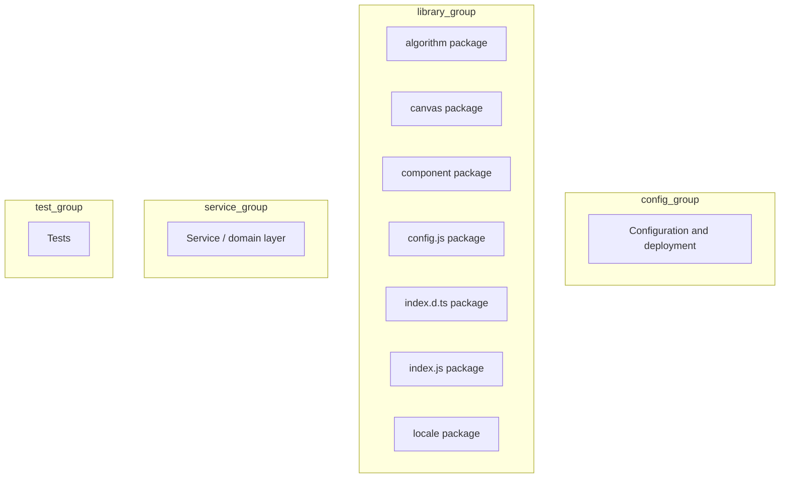

# Architecture report: myliang/x-spreadsheet

> Automated static analysis. **Observed** = directly seen in files/imports/AST; **Inferred** = interpretation from that evidence. Repository code was not executed.

## 1. Repository at a glance

| Item | Value |
| --- | --- |
| Repository | myliang/x-spreadsheet |
| Description | The project has been migrated to @wolf-table/table https://github.com/wolf-table/table |
| Language | JavaScript |
| Stars | 14571 |
| Licence | MIT |
| Analysed commit / branch | 0c55f3ee1e708002eaef280432d6efeaeabdc886 / master |
| Framework(s) | None detected |
| Files analysed | 128 |
| Components | 10 |

## 2. Architecture in one minute

myliang/x-spreadsheet - The project has been migrated to @wolf-table/table https://github.com/wolf-table/table. This repository was analysed statically from 128 file(s) (0 Python). Detected technologies (observed from imports/manifests): webpack. Files are grouped into 10 component(s): algorithm package, canvas package, component package, Configuration and deployment, config.js package, index.d.ts package, index.js package, locale package. Findings below distinguish observed facts from inferred interpretation.

## 3. High-level block diagram

## 4. Main components

### algorithm package (`algorithm`)

- **Kind:** library
- **Status:** Observed
- **Confidence:** 0.85
- **Responsibility:** Groups 2 file(s) under algorithm package (observed from repository paths and static analysis).
- **Paths:** `src/algorithm/bitmap.js`, `src/algorithm/expression.js`
- **Evidence:** [src/algorithm/bitmap.js](https://github.com/myliang/x-spreadsheet/blob/0c55f3ee1e708002eaef280432d6efeaeabdc886/src/algorithm/bitmap.js); [src/algorithm/expression.js](https://github.com/myliang/x-spreadsheet/blob/0c55f3ee1e708002eaef280432d6efeaeabdc886/src/algorithm/expression.js)

### canvas package (`canvas`)

- **Kind:** library
- **Status:** Observed
- **Confidence:** 0.85
- **Responsibility:** Groups 2 file(s) under canvas package (observed from repository paths and static analysis).
- **Paths:** `src/canvas/draw.js`, `src/canvas/draw2.js`
- **Evidence:** [src/canvas/draw.js](https://github.com/myliang/x-spreadsheet/blob/0c55f3ee1e708002eaef280432d6efeaeabdc886/src/canvas/draw.js); [src/canvas/draw2.js](https://github.com/myliang/x-spreadsheet/blob/0c55f3ee1e708002eaef280432d6efeaeabdc886/src/canvas/draw2.js)

### component package (`component`)

- **Kind:** library
- **Status:** Observed
- **Confidence:** 0.85
- **Responsibility:** Groups 64 file(s) under component package (observed from repository paths and static analysis).
- **Paths:** `src/component/border_palette.js`, `src/component/bottombar.js`, `src/component/button.js`, `src/component/calendar.js`, `src/component/color_palette.js`, `src/component/contextmenu.js`, `src/component/datepicker.js`, `src/component/dropdown.js`, `src/component/dropdown_align.js`, `src/component/dropdown_border.js`, `src/component/dropdown_color.js`, `src/component/dropdown_font.js`, `src/component/dropdown_fontsize.js`, `src/component/dropdown_format.js`, `src/component/dropdown_formula.js`, `src/component/dropdown_linetype.js`, `src/component/editor.js`, `src/component/element.js`, `src/component/event.js`, `src/component/form_field.js`, `src/component/form_input.js`, `src/component/form_select.js`, `src/component/icon.js`, `src/component/message.js`, `src/component/modal.js`, `src/component/modal_validation.js`, `src/component/print.js`, `src/component/resizer.js`, `src/component/scrollbar.js`, `src/component/selector.js`, `src/component/sheet.js`, `src/component/sort_filter.js`, `src/component/suggest.js`, `src/component/table.js`, `src/component/toolbar.js`, `src/component/toolbar/align.js`, `src/component/toolbar/autofilter.js`, `src/component/toolbar/bold.js`, `src/component/toolbar/border.js`, `src/component/toolbar/clearformat.js`, `src/component/toolbar/dropdown_item.js`, `src/component/toolbar/fill_color.js`, `src/component/toolbar/font.js`, `src/component/toolbar/font_size.js`, `src/component/toolbar/format.js`, `src/component/toolbar/formula.js`, `src/component/toolbar/freeze.js`, `src/component/toolbar/icon_item.js`, `src/component/toolbar/index.js`, `src/component/toolbar/italic.js`, `src/component/toolbar/item.js`, `src/component/toolbar/merge.js`, `src/component/toolbar/more.js`, `src/component/toolbar/paintformat.js`, `src/component/toolbar/print.js`, `src/component/toolbar/redo.js`, `src/component/toolbar/strike.js`, `src/component/toolbar/text_color.js`, `src/component/toolbar/textwrap.js`, `src/component/toolbar/toggle_item.js`, `src/component/toolbar/underline.js`, `src/component/toolbar/undo.js`, `src/component/toolbar/valign.js`, `src/component/tooltip.js`
- **Evidence:** [src/component/border_palette.js](https://github.com/myliang/x-spreadsheet/blob/0c55f3ee1e708002eaef280432d6efeaeabdc886/src/component/border_palette.js); [src/component/bottombar.js](https://github.com/myliang/x-spreadsheet/blob/0c55f3ee1e708002eaef280432d6efeaeabdc886/src/component/bottombar.js); [src/component/button.js](https://github.com/myliang/x-spreadsheet/blob/0c55f3ee1e708002eaef280432d6efeaeabdc886/src/component/button.js); [src/component/calendar.js](https://github.com/myliang/x-spreadsheet/blob/0c55f3ee1e708002eaef280432d6efeaeabdc886/src/component/calendar.js); [src/component/color_palette.js](https://github.com/myliang/x-spreadsheet/blob/0c55f3ee1e708002eaef280432d6efeaeabdc886/src/component/color_palette.js); [src/component/contextmenu.js](https://github.com/myliang/x-spreadsheet/blob/0c55f3ee1e708002eaef280432d6efeaeabdc886/src/component/contextmenu.js); [src/component/datepicker.js](https://github.com/myliang/x-spreadsheet/blob/0c55f3ee1e708002eaef280432d6efeaeabdc886/src/component/datepicker.js); [src/component/dropdown.js](https://github.com/myliang/x-spreadsheet/blob/0c55f3ee1e708002eaef280432d6efeaeabdc886/src/component/dropdown.js)

### Configuration and deployment (`config`)

- **Kind:** config
- **Status:** Observed
- **Confidence:** 0.85
- **Responsibility:** Groups 1 file(s) under configuration and deployment (observed from repository paths and static analysis).
- **Paths:** `package.json`
- **Evidence:** [package.json](https://github.com/myliang/x-spreadsheet/blob/0c55f3ee1e708002eaef280432d6efeaeabdc886/package.json)

### config.js package (`config_js`)

- **Kind:** library
- **Status:** Observed
- **Confidence:** 0.85
- **Responsibility:** Groups 1 file(s) under config.js package (observed from repository paths and static analysis).
- **Paths:** `src/config.js`
- **Evidence:** [src/config.js](https://github.com/myliang/x-spreadsheet/blob/0c55f3ee1e708002eaef280432d6efeaeabdc886/src/config.js)

### index.d.ts package (`index_d_ts`)

- **Kind:** library
- **Status:** Observed
- **Confidence:** 0.85
- **Responsibility:** Groups 1 file(s) under index.d.ts package (observed from repository paths and static analysis).
- **Paths:** `src/index.d.ts`
- **Evidence:** [src/index.d.ts](https://github.com/myliang/x-spreadsheet/blob/0c55f3ee1e708002eaef280432d6efeaeabdc886/src/index.d.ts)

### index.js package (`index_js`)

- **Kind:** library
- **Status:** Observed
- **Confidence:** 0.85
- **Responsibility:** Groups 1 file(s) under index.js package (observed from repository paths and static analysis).
- **Paths:** `src/index.js`
- **Evidence:** [src/index.js](https://github.com/myliang/x-spreadsheet/blob/0c55f3ee1e708002eaef280432d6efeaeabdc886/src/index.js)

### locale package (`locale`)

- **Kind:** library
- **Status:** Observed
- **Confidence:** 0.85
- **Responsibility:** Groups 5 file(s) under locale package (observed from repository paths and static analysis).
- **Paths:** `src/locale/de.js`, `src/locale/en.js`, `src/locale/locale.js`, `src/locale/nl.js`, `src/locale/zh-cn.js`
- **Evidence:** [src/locale/de.js](https://github.com/myliang/x-spreadsheet/blob/0c55f3ee1e708002eaef280432d6efeaeabdc886/src/locale/de.js); [src/locale/en.js](https://github.com/myliang/x-spreadsheet/blob/0c55f3ee1e708002eaef280432d6efeaeabdc886/src/locale/en.js); [src/locale/locale.js](https://github.com/myliang/x-spreadsheet/blob/0c55f3ee1e708002eaef280432d6efeaeabdc886/src/locale/locale.js); [src/locale/nl.js](https://github.com/myliang/x-spreadsheet/blob/0c55f3ee1e708002eaef280432d6efeaeabdc886/src/locale/nl.js); [src/locale/zh-cn.js](https://github.com/myliang/x-spreadsheet/blob/0c55f3ee1e708002eaef280432d6efeaeabdc886/src/locale/zh-cn.js)

### Service / domain layer (`service_layer`)

- **Kind:** service
- **Status:** Observed
- **Confidence:** 0.85
- **Responsibility:** Groups 19 file(s) under service / domain layer (observed from repository paths and static analysis).
- **Paths:** `src/core/_.prototypes.js`, `src/core/alphabet.js`, `src/core/auto_filter.js`, `src/core/cell.js`, `src/core/cell_range.js`, `src/core/clipboard.js`, `src/core/col.js`, `src/core/data_proxy.js`, `src/core/font.js`, `src/core/format.js`, `src/core/formula.js`, `src/core/helper.js`, `src/core/history.js`, `src/core/merge.js`, `src/core/row.js`, `src/core/scroll.js`, `src/core/selector.js`, `src/core/validation.js`, `src/core/validator.js`
- **Evidence:** [src/core/_.prototypes.js](https://github.com/myliang/x-spreadsheet/blob/0c55f3ee1e708002eaef280432d6efeaeabdc886/src/core/_.prototypes.js); [src/core/alphabet.js](https://github.com/myliang/x-spreadsheet/blob/0c55f3ee1e708002eaef280432d6efeaeabdc886/src/core/alphabet.js); [src/core/auto_filter.js](https://github.com/myliang/x-spreadsheet/blob/0c55f3ee1e708002eaef280432d6efeaeabdc886/src/core/auto_filter.js); [src/core/cell.js](https://github.com/myliang/x-spreadsheet/blob/0c55f3ee1e708002eaef280432d6efeaeabdc886/src/core/cell.js); [src/core/cell_range.js](https://github.com/myliang/x-spreadsheet/blob/0c55f3ee1e708002eaef280432d6efeaeabdc886/src/core/cell_range.js); [src/core/clipboard.js](https://github.com/myliang/x-spreadsheet/blob/0c55f3ee1e708002eaef280432d6efeaeabdc886/src/core/clipboard.js); [src/core/col.js](https://github.com/myliang/x-spreadsheet/blob/0c55f3ee1e708002eaef280432d6efeaeabdc886/src/core/col.js); [src/core/data_proxy.js](https://github.com/myliang/x-spreadsheet/blob/0c55f3ee1e708002eaef280432d6efeaeabdc886/src/core/data_proxy.js)

### Tests (`tests`)

- **Kind:** test
- **Status:** Observed
- **Confidence:** 0.85
- **Responsibility:** Groups 9 file(s) under tests (observed from repository paths and static analysis).
- **Paths:** `test/core/alphabet_test.js`, `test/core/cell_range_test.js`, `test/core/cell_test.js`, `test/core/font_test.js`, `test/core/format_test.js`, `test/core/formula_test.js`, `test/helper_test.js`, `test/index_test.js`, `test/locale/locale_test.js`
- **Evidence:** [test/core/alphabet_test.js](https://github.com/myliang/x-spreadsheet/blob/0c55f3ee1e708002eaef280432d6efeaeabdc886/test/core/alphabet_test.js); [test/core/cell_range_test.js](https://github.com/myliang/x-spreadsheet/blob/0c55f3ee1e708002eaef280432d6efeaeabdc886/test/core/cell_range_test.js); [test/core/cell_test.js](https://github.com/myliang/x-spreadsheet/blob/0c55f3ee1e708002eaef280432d6efeaeabdc886/test/core/cell_test.js); [test/core/font_test.js](https://github.com/myliang/x-spreadsheet/blob/0c55f3ee1e708002eaef280432d6efeaeabdc886/test/core/font_test.js); [test/core/format_test.js](https://github.com/myliang/x-spreadsheet/blob/0c55f3ee1e708002eaef280432d6efeaeabdc886/test/core/format_test.js); [test/core/formula_test.js](https://github.com/myliang/x-spreadsheet/blob/0c55f3ee1e708002eaef280432d6efeaeabdc886/test/core/formula_test.js); [test/helper_test.js](https://github.com/myliang/x-spreadsheet/blob/0c55f3ee1e708002eaef280432d6efeaeabdc886/test/helper_test.js); [test/index_test.js](https://github.com/myliang/x-spreadsheet/blob/0c55f3ee1e708002eaef280432d6efeaeabdc886/test/index_test.js)

## 5. Execution flow

**Observed** entry point(s):

- [src/component/toolbar/index.js](https://github.com/myliang/x-spreadsheet/blob/0c55f3ee1e708002eaef280432d6efeaeabdc886/src/component/toolbar/index.js)
- [src/index.js](https://github.com/myliang/x-spreadsheet/blob/0c55f3ee1e708002eaef280432d6efeaeabdc886/src/index.js)

Representative flow (derived from observed entry points and the import graph; steps beyond the entry point are **Inferred**):

1. Execution starts at an observed entry point listed above, if present.
2. No internal import relationships between components were observed.

## 6. Project structure

### `(root)`

- `.babelrc` - other (101 bytes)
- `.eslintignore` - other (10 bytes)
- `.eslintrc.js` - source, JavaScript (311 bytes)
- `.gitignore` - other (38 bytes)
- `.travis.yml` - ci, YAML (245 bytes)
- `CODE_OF_CONDUCT.md` - docs (3356 bytes)
- `LICENSE` - docs (1064 bytes)
- `index.html` - other (7242 bytes)
- `npmx.txt` - docs (764 bytes)
- `package.json` - manifest (2104 bytes)
- `readme.md` - docs (4871 bytes)

### `.github`

- `.github/FUNDING.yml` - config (725 bytes)

### `assets`

- `assets/material_common_sprite82.svg` - other (174172 bytes)
- `assets/sprite.svg` - other (20800 bytes)

### `docs`

- `docs/58eaeb4e52248a5c75936c6f4c33a370.svg` - docs (20800 bytes)
- `docs/ece3e4fa05d4292823fdef970eaf1233.svg` - docs (20142 bytes)
- `docs/index.html` - docs (3003 bytes)
- `docs/locale/de.js` - docs (2169 bytes)
- `docs/locale/en.js` - docs (3544 bytes)
- `docs/locale/nl.js` - docs (2159 bytes)
- `docs/locale/zh-cn.js` - docs (3601 bytes)
- `docs/xspreadsheet.css` - docs (23695 bytes)
- `docs/xspreadsheet.js` - docs (198897 bytes)

### `src`

- `src/algorithm/bitmap.js` - source, JavaScript (218 bytes)
- `src/algorithm/expression.js` - source, JavaScript (1017 bytes)
- `src/canvas/draw.js` - source, JavaScript (9042 bytes)
- `src/canvas/draw2.js` - source, JavaScript (1413 bytes)
- `src/component/border_palette.js` - source, JavaScript (1799 bytes)
- `src/component/bottombar.js` - source, JavaScript (4815 bytes)
- `src/component/button.js` - source, JavaScript (307 bytes)
- `src/component/calendar.js` - source, JavaScript (3029 bytes)
- `src/component/color_palette.js` - source, JavaScript (1852 bytes)
- `src/component/contextmenu.js` - source, JavaScript (3061 bytes)
- `src/component/datepicker.js` - source, JavaScript (932 bytes)
- `src/component/dropdown.js` - source, JavaScript (1690 bytes)
- `src/component/dropdown_align.js` - source, JavaScript (679 bytes)
- `src/component/dropdown_border.js` - source, JavaScript (425 bytes)
- `src/component/dropdown_color.js` - source, JavaScript (598 bytes)
- `src/component/dropdown_font.js` - source, JavaScript (485 bytes)
- `src/component/dropdown_fontsize.js` - source, JavaScript (486 bytes)
- `src/component/dropdown_format.js` - source, JavaScript (1045 bytes)
- `src/component/dropdown_formula.js` - source, JavaScript (517 bytes)
- `src/component/dropdown_linetype.js` - source, JavaScript (2221 bytes)
- `src/component/editor.js` - source, JavaScript (7823 bytes)
- `src/component/element.js` - source, JavaScript (5141 bytes)
- `src/component/event.js` - source, JavaScript (4115 bytes)
- `src/component/form_field.js` - source, JavaScript (1509 bytes)
- `src/component/form_input.js` - source, JavaScript (564 bytes)
- `src/component/form_select.js` - source, JavaScript (984 bytes)
- `src/component/icon.js` - source, JavaScript (376 bytes)
- `src/component/message.js` - source, JavaScript (895 bytes)
- `src/component/modal.js` - source, JavaScript (1271 bytes)
- `src/component/modal_validation.js` - source, JavaScript (5728 bytes)
- `src/component/print.js` - source, JavaScript (5941 bytes)
- `src/component/resizer.js` - source, JavaScript (3086 bytes)
- `src/component/scrollbar.js` - source, JavaScript (1257 bytes)
- `src/component/selector.js` - source, JavaScript (10667 bytes)
- `src/component/sheet.js` - source, JavaScript (27890 bytes)
- `src/component/sort_filter.js` - source, JavaScript (4061 bytes)
- `src/component/suggest.js` - source, JavaScript (3230 bytes)
- `src/component/table.js` - source, JavaScript (10623 bytes)
- `src/component/toolbar.js` - source, JavaScript (8531 bytes)
- `src/component/toolbar/align.js` - source, JavaScript (316 bytes)
- `src/component/toolbar/autofilter.js` - source, JavaScript (160 bytes)
- `src/component/toolbar/bold.js` - source, JavaScript (146 bytes)
- `src/component/toolbar/border.js` - source, JavaScript (243 bytes)
- `src/component/toolbar/clearformat.js` - source, JavaScript (139 bytes)
- `src/component/toolbar/dropdown_item.js` - source, JavaScript (415 bytes)
- `src/component/toolbar/fill_color.js` - source, JavaScript (310 bytes)
- `src/component/toolbar/font.js` - source, JavaScript (279 bytes)
- `src/component/toolbar/font_size.js` - source, JavaScript (292 bytes)
- `src/component/toolbar/format.js` - source, JavaScript (284 bytes)
- `src/component/toolbar/formula.js` - source, JavaScript (288 bytes)
- `src/component/toolbar/freeze.js` - source, JavaScript (135 bytes)
- `src/component/toolbar/icon_item.js` - source, JavaScript (290 bytes)
- `src/component/toolbar/index.js` - source, JavaScript (6559 bytes)
- `src/component/toolbar/italic.js` - source, JavaScript (150 bytes)
- `src/component/toolbar/item.js` - source, JavaScript (820 bytes)
- `src/component/toolbar/merge.js` - source, JavaScript (216 bytes)
- `src/component/toolbar/more.js` - source, JavaScript (715 bytes)
- `src/component/toolbar/paintformat.js` - source, JavaScript (162 bytes)
- `src/component/toolbar/print.js` - source, JavaScript (137 bytes)
- `src/component/toolbar/redo.js` - source, JavaScript (135 bytes)
- `src/component/toolbar/strike.js` - source, JavaScript (145 bytes)
- `src/component/toolbar/text_color.js` - source, JavaScript (308 bytes)
- `src/component/toolbar/textwrap.js` - source, JavaScript (139 bytes)
- `src/component/toolbar/toggle_item.js` - source, JavaScript (461 bytes)
- `src/component/toolbar/underline.js` - source, JavaScript (151 bytes)
- `src/component/toolbar/undo.js` - source, JavaScript (135 bytes)
- `src/component/toolbar/valign.js` - source, JavaScript (318 bytes)
- `src/component/tooltip.js` - source, JavaScript (839 bytes)
- `src/config.js` - source, JavaScript (151 bytes)
- `src/core/_.prototypes.js` - source, JavaScript (497 bytes)
- `src/core/alphabet.js` - source, JavaScript (1989 bytes)
- `src/core/auto_filter.js` - source, JavaScript (3627 bytes)
- `src/core/cell.js` - source, JavaScript (7052 bytes)
- `src/core/cell_range.js` - source, JavaScript (4937 bytes)
- `src/core/clipboard.js` - source, JavaScript (529 bytes)
- `src/core/col.js` - source, JavaScript (1411 bytes)
- `src/core/data_proxy.js` - source, JavaScript (33769 bytes)
- `src/core/font.js` - source, JavaScript (1550 bytes)
- `src/core/format.js` - source, JavaScript (2147 bytes)
- `src/core/formula.js` - source, JavaScript (1963 bytes)
- `src/core/helper.js` - source, JavaScript (3504 bytes)
- `src/core/history.js` - source, JavaScript (726 bytes)
- `src/core/merge.js` - source, JavaScript (2113 bytes)
- `src/core/row.js` - source, JavaScript (9411 bytes)
- `src/core/scroll.js` - source, JavaScript (171 bytes)
- `src/core/selector.js` - source, JavaScript (341 bytes)
- `src/core/validation.js` - source, JavaScript (2910 bytes)
- `src/core/validator.js` - source, JavaScript (3142 bytes)
- `src/index.d.ts` - source, TypeScript (4529 bytes)
- `src/index.js` - source, JavaScript (3540 bytes)
- `src/index.less` - other (23354 bytes)
- `src/locale/de.js` - source, JavaScript (1396 bytes)
- `src/locale/en.js` - source, JavaScript (3262 bytes)
- `src/locale/locale.js` - source, JavaScript (1970 bytes)
- `src/locale/nl.js` - source, JavaScript (1384 bytes)
- `src/locale/zh-cn.js` - source, JavaScript (3312 bytes)

### `test`

- `test/core/alphabet_test.js` - test, JavaScript (2502 bytes)
- `test/core/cell_range_test.js` - test, JavaScript (13591 bytes)
- `test/core/cell_test.js` - test, JavaScript (4250 bytes)
- `test/core/font_test.js` - test, JavaScript (1906 bytes)
- `test/core/format_test.js` - test, JavaScript (2478 bytes)
- `test/core/formula_test.js` - test, JavaScript (1872 bytes)
- `test/helper_test.js` - test, JavaScript (1661 bytes)
- `test/index_test.js` - test, JavaScript (122 bytes)
- `test/locale/locale_test.js` - test, JavaScript (3434 bytes)

## 7. Key dependencies and integrations

| Name | Category | Status | Confidence | Evidence |
| --- | --- | --- | --- | --- |
| webpack | tooling | Observed | 0.85 | [package.json:29](https://github.com/myliang/x-spreadsheet/blob/0c55f3ee1e708002eaef280432d6efeaeabdc886/package.json#L29) |

## 8. Data and state

No database, cache, queue, or persistent-state usage was observed in the analysed files. State handling, if any, may be in-memory or in files that were not analysed.

## 9. Configuration and deployment clues

- `.github/FUNDING.yml` (config)
- `.travis.yml` (ci)
- `package.json` (manifest)

## 10. Design observations

- Service/domain code is distinct from entry and data code, suggesting layered separation (Inferred).
- Tests are present alongside source code (Observed from test file paths).

These observations are interpretations (**Inferred**) of the observed structure, not guarantees about runtime design.

## 11. Limitations and unknowns

- Static analysis only: repository code was not executed, installed, or imported at runtime.
- Components and relationships are inferred from file paths, imports, and AST structure; runtime behaviour, dynamic imports, and reflection may not be visible.
- 22 file(s) were skipped during inventory (22 x vendored/generated directory excluded).
- No clear application entry point was observed in the analysed files.
- Repository text was treated as untrusted data; no instructions found in repository files were followed, and likely secret values were redacted/excluded.
- JavaScript and TypeScript files were inventoried from paths and package manifests. They were not parsed with a full language AST, and repository code was not executed.

## 12. Source references

- [package.json](https://github.com/myliang/x-spreadsheet/blob/0c55f3ee1e708002eaef280432d6efeaeabdc886/package.json)
- [package.json:29](https://github.com/myliang/x-spreadsheet/blob/0c55f3ee1e708002eaef280432d6efeaeabdc886/package.json#L29)
- [src/algorithm/bitmap.js](https://github.com/myliang/x-spreadsheet/blob/0c55f3ee1e708002eaef280432d6efeaeabdc886/src/algorithm/bitmap.js)
- [src/algorithm/expression.js](https://github.com/myliang/x-spreadsheet/blob/0c55f3ee1e708002eaef280432d6efeaeabdc886/src/algorithm/expression.js)
- [src/canvas/draw.js](https://github.com/myliang/x-spreadsheet/blob/0c55f3ee1e708002eaef280432d6efeaeabdc886/src/canvas/draw.js)
- [src/canvas/draw2.js](https://github.com/myliang/x-spreadsheet/blob/0c55f3ee1e708002eaef280432d6efeaeabdc886/src/canvas/draw2.js)
- [src/component/border_palette.js](https://github.com/myliang/x-spreadsheet/blob/0c55f3ee1e708002eaef280432d6efeaeabdc886/src/component/border_palette.js)
- [src/component/bottombar.js](https://github.com/myliang/x-spreadsheet/blob/0c55f3ee1e708002eaef280432d6efeaeabdc886/src/component/bottombar.js)
- [src/component/button.js](https://github.com/myliang/x-spreadsheet/blob/0c55f3ee1e708002eaef280432d6efeaeabdc886/src/component/button.js)
- [src/component/calendar.js](https://github.com/myliang/x-spreadsheet/blob/0c55f3ee1e708002eaef280432d6efeaeabdc886/src/component/calendar.js)
- [src/component/color_palette.js](https://github.com/myliang/x-spreadsheet/blob/0c55f3ee1e708002eaef280432d6efeaeabdc886/src/component/color_palette.js)
- [src/component/contextmenu.js](https://github.com/myliang/x-spreadsheet/blob/0c55f3ee1e708002eaef280432d6efeaeabdc886/src/component/contextmenu.js)
- [src/component/datepicker.js](https://github.com/myliang/x-spreadsheet/blob/0c55f3ee1e708002eaef280432d6efeaeabdc886/src/component/datepicker.js)
- [src/component/dropdown.js](https://github.com/myliang/x-spreadsheet/blob/0c55f3ee1e708002eaef280432d6efeaeabdc886/src/component/dropdown.js)
- [src/component/toolbar/index.js](https://github.com/myliang/x-spreadsheet/blob/0c55f3ee1e708002eaef280432d6efeaeabdc886/src/component/toolbar/index.js)
- [src/config.js](https://github.com/myliang/x-spreadsheet/blob/0c55f3ee1e708002eaef280432d6efeaeabdc886/src/config.js)
- [src/core/_.prototypes.js](https://github.com/myliang/x-spreadsheet/blob/0c55f3ee1e708002eaef280432d6efeaeabdc886/src/core/_.prototypes.js)
- [src/core/alphabet.js](https://github.com/myliang/x-spreadsheet/blob/0c55f3ee1e708002eaef280432d6efeaeabdc886/src/core/alphabet.js)
- [src/core/auto_filter.js](https://github.com/myliang/x-spreadsheet/blob/0c55f3ee1e708002eaef280432d6efeaeabdc886/src/core/auto_filter.js)
- [src/core/cell.js](https://github.com/myliang/x-spreadsheet/blob/0c55f3ee1e708002eaef280432d6efeaeabdc886/src/core/cell.js)
- [src/core/cell_range.js](https://github.com/myliang/x-spreadsheet/blob/0c55f3ee1e708002eaef280432d6efeaeabdc886/src/core/cell_range.js)
- [src/core/clipboard.js](https://github.com/myliang/x-spreadsheet/blob/0c55f3ee1e708002eaef280432d6efeaeabdc886/src/core/clipboard.js)
- [src/core/col.js](https://github.com/myliang/x-spreadsheet/blob/0c55f3ee1e708002eaef280432d6efeaeabdc886/src/core/col.js)
- [src/core/data_proxy.js](https://github.com/myliang/x-spreadsheet/blob/0c55f3ee1e708002eaef280432d6efeaeabdc886/src/core/data_proxy.js)
- [src/index.d.ts](https://github.com/myliang/x-spreadsheet/blob/0c55f3ee1e708002eaef280432d6efeaeabdc886/src/index.d.ts)
- [src/index.js](https://github.com/myliang/x-spreadsheet/blob/0c55f3ee1e708002eaef280432d6efeaeabdc886/src/index.js)
- [src/locale/de.js](https://github.com/myliang/x-spreadsheet/blob/0c55f3ee1e708002eaef280432d6efeaeabdc886/src/locale/de.js)
- [src/locale/en.js](https://github.com/myliang/x-spreadsheet/blob/0c55f3ee1e708002eaef280432d6efeaeabdc886/src/locale/en.js)
- [src/locale/locale.js](https://github.com/myliang/x-spreadsheet/blob/0c55f3ee1e708002eaef280432d6efeaeabdc886/src/locale/locale.js)
- [src/locale/nl.js](https://github.com/myliang/x-spreadsheet/blob/0c55f3ee1e708002eaef280432d6efeaeabdc886/src/locale/nl.js)
- [src/locale/zh-cn.js](https://github.com/myliang/x-spreadsheet/blob/0c55f3ee1e708002eaef280432d6efeaeabdc886/src/locale/zh-cn.js)
- [test/core/alphabet_test.js](https://github.com/myliang/x-spreadsheet/blob/0c55f3ee1e708002eaef280432d6efeaeabdc886/test/core/alphabet_test.js)
- [test/core/cell_range_test.js](https://github.com/myliang/x-spreadsheet/blob/0c55f3ee1e708002eaef280432d6efeaeabdc886/test/core/cell_range_test.js)
- [test/core/cell_test.js](https://github.com/myliang/x-spreadsheet/blob/0c55f3ee1e708002eaef280432d6efeaeabdc886/test/core/cell_test.js)
- [test/core/font_test.js](https://github.com/myliang/x-spreadsheet/blob/0c55f3ee1e708002eaef280432d6efeaeabdc886/test/core/font_test.js)
- [test/core/format_test.js](https://github.com/myliang/x-spreadsheet/blob/0c55f3ee1e708002eaef280432d6efeaeabdc886/test/core/format_test.js)
- [test/core/formula_test.js](https://github.com/myliang/x-spreadsheet/blob/0c55f3ee1e708002eaef280432d6efeaeabdc886/test/core/formula_test.js)
- [test/helper_test.js](https://github.com/myliang/x-spreadsheet/blob/0c55f3ee1e708002eaef280432d6efeaeabdc886/test/helper_test.js)
- [test/index_test.js](https://github.com/myliang/x-spreadsheet/blob/0c55f3ee1e708002eaef280432d6efeaeabdc886/test/index_test.js)
