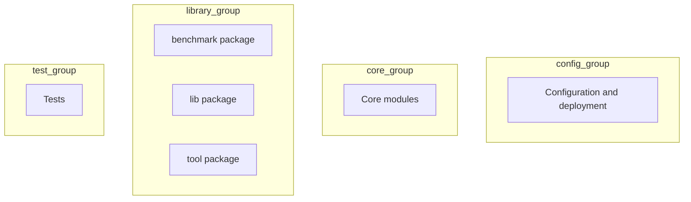

# Architecture report: mysqljs/mysql

> Automated static analysis. **Observed** = directly seen in files/imports/AST; **Inferred** = interpretation from that evidence. Repository code was not executed.

## 1. Repository at a glance

| Item | Value |
| --- | --- |
| Repository | mysqljs/mysql |
| Description | A pure node.js JavaScript Client implementing the MySQL protocol. |
| Language | JavaScript |
| Stars | 18606 |
| Licence | MIT |
| Analysed commit / branch | dc9c152a87ec51a1f647447268917243d2eab1fd / master |
| Framework(s) | None detected |
| Files analysed | 280 |
| Components | 6 |

## 2. Architecture in one minute

mysqljs/mysql - A pure node.js JavaScript Client implementing the MySQL protocol.. This repository was analysed statically from 280 file(s) (0 Python). Detected technologies (observed from imports/manifests): GitHub Actions, Docker. Files are grouped into 6 component(s): benchmark package, Configuration and deployment, Core modules, lib package, Tests, tool package. Findings below distinguish observed facts from inferred interpretation.

## 3. High-level block diagram

## 4. Main components

### benchmark package (`benchmark`)

- **Kind:** library
- **Status:** Observed
- **Confidence:** 0.85
- **Responsibility:** Groups 3 file(s) under benchmark package (observed from repository paths and static analysis).
- **Paths:** `benchmark/analyze.js`, `benchmark/parse-100k-blog-rows.js`, `benchmark/select-100k-blog-rows.js`
- **Evidence:** [benchmark/analyze.js](https://github.com/mysqljs/mysql/blob/dc9c152a87ec51a1f647447268917243d2eab1fd/benchmark/analyze.js); [benchmark/parse-100k-blog-rows.js](https://github.com/mysqljs/mysql/blob/dc9c152a87ec51a1f647447268917243d2eab1fd/benchmark/parse-100k-blog-rows.js); [benchmark/select-100k-blog-rows.js](https://github.com/mysqljs/mysql/blob/dc9c152a87ec51a1f647447268917243d2eab1fd/benchmark/select-100k-blog-rows.js)

### Configuration and deployment (`config`)

- **Kind:** config
- **Status:** Observed
- **Confidence:** 0.85
- **Responsibility:** Groups 2 file(s) under configuration and deployment (observed from repository paths and static analysis).
- **Paths:** `appveyor.yml`, `package.json`
- **Evidence:** [appveyor.yml](https://github.com/mysqljs/mysql/blob/dc9c152a87ec51a1f647447268917243d2eab1fd/appveyor.yml); [package.json](https://github.com/mysqljs/mysql/blob/dc9c152a87ec51a1f647447268917243d2eab1fd/package.json)

### Core modules (`core`)

- **Kind:** core
- **Status:** Observed
- **Confidence:** 0.85
- **Responsibility:** Groups 1 file(s) under core modules (observed from repository paths and static analysis).
- **Paths:** `index.js`
- **Evidence:** [index.js](https://github.com/mysqljs/mysql/blob/dc9c152a87ec51a1f647447268917243d2eab1fd/index.js)

### lib package (`lib`)

- **Kind:** library
- **Status:** Observed
- **Confidence:** 0.85
- **Responsibility:** Groups 56 file(s) under lib package (observed from repository paths and static analysis).
- **Paths:** `lib/Connection.js`, `lib/ConnectionConfig.js`, `lib/Pool.js`, `lib/PoolCluster.js`, `lib/PoolConfig.js`, `lib/PoolConnection.js`, `lib/PoolNamespace.js`, `lib/PoolSelector.js`, `lib/protocol/Auth.js`, `lib/protocol/BufferList.js`, `lib/protocol/PacketHeader.js`, `lib/protocol/PacketWriter.js`, `lib/protocol/Parser.js`, `lib/protocol/Protocol.js`, `lib/protocol/ResultSet.js`, `lib/protocol/SqlString.js`, `lib/protocol/Timer.js`, `lib/protocol/constants/charsets.js`, `lib/protocol/constants/client.js`, `lib/protocol/constants/errors.js`, `lib/protocol/constants/field_flags.js`, `lib/protocol/constants/server_status.js`, `lib/protocol/constants/ssl_profiles.js`, `lib/protocol/constants/types.js`, `lib/protocol/packets/AuthSwitchRequestPacket.js`, `lib/protocol/packets/AuthSwitchResponsePacket.js`, `lib/protocol/packets/ClientAuthenticationPacket.js`, `lib/protocol/packets/ComChangeUserPacket.js`, `lib/protocol/packets/ComPingPacket.js`, `lib/protocol/packets/ComQueryPacket.js`, `lib/protocol/packets/ComQuitPacket.js`, `lib/protocol/packets/ComStatisticsPacket.js`, `lib/protocol/packets/EmptyPacket.js`, `lib/protocol/packets/EofPacket.js`, `lib/protocol/packets/ErrorPacket.js`, `lib/protocol/packets/Field.js`, `lib/protocol/packets/FieldPacket.js`, `lib/protocol/packets/HandshakeInitializationPacket.js`, `lib/protocol/packets/LocalDataFilePacket.js`, `lib/protocol/packets/LocalInfileRequestPacket.js`, `lib/protocol/packets/OkPacket.js`, `lib/protocol/packets/OldPasswordPacket.js`, `lib/protocol/packets/ResultSetHeaderPacket.js`, `lib/protocol/packets/RowDataPacket.js`, `lib/protocol/packets/SSLRequestPacket.js`, `lib/protocol/packets/StatisticsPacket.js`, `lib/protocol/packets/UseOldPasswordPacket.js`, `lib/protocol/packets/index.js`, `lib/protocol/sequences/ChangeUser.js`, `lib/protocol/sequences/Handshake.js`, `lib/protocol/sequences/Ping.js`, `lib/protocol/sequences/Query.js`, `lib/protocol/sequences/Quit.js`, `lib/protocol/sequences/Sequence.js`, `lib/protocol/sequences/Statistics.js`, `lib/protocol/sequences/index.js`
- **Evidence:** [lib/Connection.js](https://github.com/mysqljs/mysql/blob/dc9c152a87ec51a1f647447268917243d2eab1fd/lib/Connection.js); [lib/ConnectionConfig.js](https://github.com/mysqljs/mysql/blob/dc9c152a87ec51a1f647447268917243d2eab1fd/lib/ConnectionConfig.js); [lib/Pool.js](https://github.com/mysqljs/mysql/blob/dc9c152a87ec51a1f647447268917243d2eab1fd/lib/Pool.js); [lib/PoolCluster.js](https://github.com/mysqljs/mysql/blob/dc9c152a87ec51a1f647447268917243d2eab1fd/lib/PoolCluster.js); [lib/PoolConfig.js](https://github.com/mysqljs/mysql/blob/dc9c152a87ec51a1f647447268917243d2eab1fd/lib/PoolConfig.js); [lib/PoolConnection.js](https://github.com/mysqljs/mysql/blob/dc9c152a87ec51a1f647447268917243d2eab1fd/lib/PoolConnection.js); [lib/PoolNamespace.js](https://github.com/mysqljs/mysql/blob/dc9c152a87ec51a1f647447268917243d2eab1fd/lib/PoolNamespace.js); [lib/PoolSelector.js](https://github.com/mysqljs/mysql/blob/dc9c152a87ec51a1f647447268917243d2eab1fd/lib/PoolSelector.js)

### Tests (`tests`)

- **Kind:** test
- **Status:** Observed
- **Confidence:** 0.85
- **Responsibility:** Groups 203 file(s) under tests (observed from repository paths and static analysis).
- **Paths:** `test/FakeServer.js`, `test/common.js`, `test/fixtures/data.csv`, `test/fixtures/server.crt`, `test/integration/connection/test-bad-credentials.js`, `test/integration/connection/test-bulk-insert.js`, `test/integration/connection/test-change-user-charset.js`, `test/integration/connection/test-change-user-reset.js`, `test/integration/connection/test-connection-config-flags-affected-rows.js`, `test/integration/connection/test-connection-destroy.js`, `test/integration/connection/test-connection-thread-id.js`, `test/integration/connection/test-error-sqlmessage.js`, `test/integration/connection/test-insert-results.js`, `test/integration/connection/test-load-data-infile-disable.js`, `test/integration/connection/test-load-data-infile.js`, `test/integration/connection/test-multiple-statements-load-data-infile.js`, `test/integration/connection/test-multiple-statements-streaming.js`, `test/integration/connection/test-multiple-statements-with-error.js`, `test/integration/connection/test-multiple-statements.js`, `test/integration/connection/test-nested-tables-query.js`, `test/integration/connection/test-ping.js`, `test/integration/connection/test-procedure-with-multiple-selects.js`, `test/integration/connection/test-procedure-with-single-select.js`, `test/integration/connection/test-query-changed-rows.js`, `test/integration/connection/test-query-empty.js`, `test/integration/connection/test-query-escape-id.js`, `test/integration/connection/test-query-escaping.js`, `test/integration/connection/test-query.js`, `test/integration/connection/test-select-empty-string.js`, `test/integration/connection/test-send-and-receive-large-packets.js`, `test/integration/connection/test-send-and-receive-large-text.js`, `test/integration/connection/test-server-timeout-disconnect.js`, `test/integration/connection/test-statistics.js`, `test/integration/connection/test-timezones.js`, `test/integration/connection/test-transaction-commit.js`, `test/integration/connection/test-transaction-rollback.js`, `test/integration/connection/test-type-cast-null-fields.js`, `test/integration/connection/test-type-cast-query.js`, `test/integration/connection/test-type-casting.js`, `test/integration/connection/test-zerofill-results.js`, `test/run.js`, `test/unit/connection/test-auth-no-old-password.js`, `test/unit/connection/test-auth-no-password.js`, `test/unit/connection/test-auth-old-password.js`, `test/unit/connection/test-auth-password.js`, `test/unit/connection/test-auth-switch-native.js`, `test/unit/connection/test-auth-switch-unknown.js`, `test/unit/connection/test-callback-errors-are-not-caught.js`, `test/unit/connection/test-callback-primitive-errors-are-not-caught.js`, `test/unit/connection/test-change-database-fatal-error.js`, `test/unit/connection/test-change-user-auth-switch-unknown.js`, `test/unit/connection/test-change-user-auth-switch.js`, `test/unit/connection/test-change-user-before-connect.js`, `test/unit/connection/test-change-user-empty-queue.js`, `test/unit/connection/test-change-user-fatal-error.js`, `test/unit/connection/test-change-user-timeout.js`, `test/unit/connection/test-change-user.js`, `test/unit/connection/test-connect-domain.js`, `test/unit/connection/test-connect-error-event.js`, `test/unit/connection/test-connect-event.js`, `test/unit/connection/test-connect-no-domain.js`, `test/unit/connection/test-connect-timeout-only.js`, `test/unit/connection/test-connect-timeout.js`, `test/unit/connection/test-connection-error.js`, `test/unit/connection/test-connection-ssl-ciphers-unknown.js`, `test/unit/connection/test-connection-ssl-ciphers.js`, `test/unit/connection/test-connection-ssl-denied.js`, `test/unit/connection/test-connection-ssl-ignore.js`, `test/unit/connection/test-connection-ssl-max-version-accept.js`, `test/unit/connection/test-connection-ssl-max-version-reject.js`, `test/unit/connection/test-connection-ssl-min-version-accept.js`, `test/unit/connection/test-connection-ssl-min-version-reject.js`, `test/unit/connection/test-connection-ssl-reject.js`, `test/unit/connection/test-connection-ssl.js`, `test/unit/connection/test-connection-thread-id-error.js`, `test/unit/connection/test-connection-thread-id.js`, `test/unit/connection/test-custom-query-format.js`, `test/unit/connection/test-custom-type-cast.js`, `test/unit/connection/test-date-type-cast.js`, `test/unit/connection/test-datetime-type-cast.js`, `test/unit/connection/test-debug-exclude.js`, `test/unit/connection/test-debug-parser-error.js`, `test/unit/connection/test-debug.js`, `test/unit/connection/test-domain-implicit.js`, `test/unit/connection/test-domains.js`, `test/unit/connection/test-double-connect.js`, `test/unit/connection/test-drain-event.js`, `test/unit/connection/test-end-event.js`, `test/unit/connection/test-enqueue-event.js`, `test/unit/connection/test-error-event.js`, `test/unit/connection/test-error-trace-bad-stack.js`, `test/unit/connection/test-error-trace-no-stack.js`, `test/unit/connection/test-error-trace.js`, `test/unit/connection/test-exception-safety.js`, `test/unit/connection/test-fatal-connect-error.js`, `test/unit/connection/test-fatal-network-error-going-to-all-callbacks.js`, `test/unit/connection/test-fatal-network-error-without-handlers.js`, `test/unit/connection/test-host-denied-error.js`, `test/unit/connection/test-implicit-connect.js`, `test/unit/connection/test-incorrect-packet-sequence.js`, `test/unit/connection/test-insecure-auth-error.js`, `test/unit/connection/test-large-blobs.js`, `test/unit/connection/test-load-data-infile-disable.js`, `test/unit/connection/test-long-stack-traces-disabled.js`, `test/unit/connection/test-long-stack-traces-for-connection-errors.js`, `test/unit/connection/test-long-stack-traces.js`, `test/unit/connection/test-packet-out-of-order.js`, `test/unit/connection/test-parser-error.js`, `test/unit/connection/test-protocol-stray-packet.js`, `test/unit/connection/test-query-after-destroy.js`, `test/unit/connection/test-query-after-end-without-callback.js`, `test/unit/connection/test-query-after-end.js`, `test/unit/connection/test-query-timeout.js`, `test/unit/connection/test-quit-ok-packet.js`, `test/unit/connection/test-server-unexpected-disconnect.js`, `test/unit/connection/test-timestamp-type-cast.js`, `test/unit/connection/test-unix-domain-socket.js`, `test/unit/pool-cluster/test-add-after-end.js`, `test/unit/pool-cluster/test-add-same-id.js`, `test/unit/pool-cluster/test-connection-default-selector.js`, `test/unit/pool-cluster/test-connection-error-remove.js`, `test/unit/pool-cluster/test-connection-error.js`, `test/unit/pool-cluster/test-connection-fatal-error-remove.js`, `test/unit/pool-cluster/test-connection-no-retry.js`, `test/unit/pool-cluster/test-connection-order-fatal.js`, `test/unit/pool-cluster/test-connection-order.js`, `test/unit/pool-cluster/test-connection-random.js`, `test/unit/pool-cluster/test-connection-retry-fatal-end.js`, `test/unit/pool-cluster/test-connection-retry.js`, `test/unit/pool-cluster/test-connection-rr-error.js`, `test/unit/pool-cluster/test-connection-rr.js`, `test/unit/pool-cluster/test-end-empty.js`, `test/unit/pool-cluster/test-internals.js`, `test/unit/pool-cluster/test-pattern.js`, `test/unit/pool-cluster/test-query-connection-error.js`, `test/unit/pool-cluster/test-query-pool-error.js`, `test/unit/pool-cluster/test-query-restore.js`, `test/unit/pool-cluster/test-query.js`, `test/unit/pool-cluster/test-remove-by-name.js`, `test/unit/pool-cluster/test-remove-by-pattern.js`, `test/unit/pool-cluster/test-remove-fatal-end.js`, `test/unit/pool-cluster/test-restore-events.js`, `test/unit/pool-cluster/test-restore.js`, `test/unit/pool/test-acquire-after-end.js`, `test/unit/pool/test-acquire-event.js`, `test/unit/pool/test-acquire-timeout-existing.js`, `test/unit/pool/test-acquire-timeout-new.js`, `test/unit/pool/test-change-user-config.js`, `test/unit/pool/test-change-user-restore.js`, `test/unit/pool/test-connection-bad.js`, `test/unit/pool/test-connection-destroy.js`, `test/unit/pool/test-connection-domain.js`, `test/unit/pool/test-connection-event.js`, `test/unit/pool/test-connection-fatal-end.js`, `test/unit/pool/test-connection-limit-no-wait.js`, `test/unit/pool/test-connection-limit.js`, `test/unit/pool/test-connection-no-domain.js`, `test/unit/pool/test-connection-release-after-error.js`, `test/unit/pool/test-connection-reset.js`, `test/unit/pool/test-custom-type-cast.js`, `test/unit/pool/test-debug.js`, `test/unit/pool/test-destroy-connection.js`, `test/unit/pool/test-domain-implicit.js`, `test/unit/pool/test-domains.js`, `test/unit/pool/test-double-release.js`, `test/unit/pool/test-end-empty.js`, `test/unit/pool/test-end-ping.js`, `test/unit/pool/test-end-queued.js`, `test/unit/pool/test-enqueue-event.js`, `test/unit/pool/test-escape-id.js`, `test/unit/pool/test-escape.js`, `test/unit/pool/test-get-connection.js`, `test/unit/pool/test-long-stack-traces.js`, `test/unit/pool/test-pool-connection.js`, `test/unit/pool/test-protocol-stray-packet.js`, `test/unit/pool/test-query-connection-error.js`, `test/unit/pool/test-query-end-after-error.js`, `test/unit/pool/test-query-error.js`, `test/unit/pool/test-query-events.js`, `test/unit/pool/test-query-stream-connection-error.js`, `test/unit/pool/test-query-streaming-rows.js`, `test/unit/pool/test-query.js`, `test/unit/pool/test-queue-limit.js`, `test/unit/pool/test-release-event.js`, `test/unit/protocol/test-Parser.js`, `test/unit/protocol/test-SqlString.js`, `test/unit/query/test-args-query-bad-callback.js`, `test/unit/query/test-args-query-like-object-values.js`, `test/unit/query/test-args-query-like-object.js`, `test/unit/query/test-error-event-fatal.js`, `test/unit/query/test-error-event.js`, `test/unit/query/test-query-end-after-error.js`, `test/unit/query/test-query-events.js`, `test/unit/query/test-result-rows-enumerate.js`, `test/unit/query/test-stream-before-queue.js`, `test/unit/query/test-stream-emits-close-after-end.js`, `test/unit/query/test-stream-emits-close.js`, `test/unit/query/test-streaming-destroy.js`, `test/unit/query/test-streaming-quick-pause-resume.js`, `test/unit/query/test-streaming-rows.js`, `test/unit/test-ConnectionConfig.js`, `test/unit/test-Mysql.js`, `test/unit/test-PoolConfig.js`
- **Evidence:** [test/FakeServer.js](https://github.com/mysqljs/mysql/blob/dc9c152a87ec51a1f647447268917243d2eab1fd/test/FakeServer.js); [test/common.js](https://github.com/mysqljs/mysql/blob/dc9c152a87ec51a1f647447268917243d2eab1fd/test/common.js); [test/fixtures/data.csv](https://github.com/mysqljs/mysql/blob/dc9c152a87ec51a1f647447268917243d2eab1fd/test/fixtures/data.csv); [test/fixtures/server.crt](https://github.com/mysqljs/mysql/blob/dc9c152a87ec51a1f647447268917243d2eab1fd/test/fixtures/server.crt); [test/integration/connection/test-bad-credentials.js](https://github.com/mysqljs/mysql/blob/dc9c152a87ec51a1f647447268917243d2eab1fd/test/integration/connection/test-bad-credentials.js); [test/integration/connection/test-bulk-insert.js](https://github.com/mysqljs/mysql/blob/dc9c152a87ec51a1f647447268917243d2eab1fd/test/integration/connection/test-bulk-insert.js); [test/integration/connection/test-change-user-charset.js](https://github.com/mysqljs/mysql/blob/dc9c152a87ec51a1f647447268917243d2eab1fd/test/integration/connection/test-change-user-charset.js); [test/integration/connection/test-change-user-reset.js](https://github.com/mysqljs/mysql/blob/dc9c152a87ec51a1f647447268917243d2eab1fd/test/integration/connection/test-change-user-reset.js)

### tool package (`tool`)

- **Kind:** library
- **Status:** Observed
- **Confidence:** 0.85
- **Responsibility:** Groups 8 file(s) under tool package (observed from repository paths and static analysis).
- **Paths:** `tool/free-port.js`, `tool/generate-error-constants.js`, `tool/generate-type-constants.js`, `tool/install-nyc.js`, `tool/lint-readme.js`, `tool/mysql-version.js`, `tool/version-changes.js`, `tool/wait-mysql.js`
- **Evidence:** [tool/free-port.js](https://github.com/mysqljs/mysql/blob/dc9c152a87ec51a1f647447268917243d2eab1fd/tool/free-port.js); [tool/generate-error-constants.js](https://github.com/mysqljs/mysql/blob/dc9c152a87ec51a1f647447268917243d2eab1fd/tool/generate-error-constants.js); [tool/generate-type-constants.js](https://github.com/mysqljs/mysql/blob/dc9c152a87ec51a1f647447268917243d2eab1fd/tool/generate-type-constants.js); [tool/install-nyc.js](https://github.com/mysqljs/mysql/blob/dc9c152a87ec51a1f647447268917243d2eab1fd/tool/install-nyc.js); [tool/lint-readme.js](https://github.com/mysqljs/mysql/blob/dc9c152a87ec51a1f647447268917243d2eab1fd/tool/lint-readme.js); [tool/mysql-version.js](https://github.com/mysqljs/mysql/blob/dc9c152a87ec51a1f647447268917243d2eab1fd/tool/mysql-version.js); [tool/version-changes.js](https://github.com/mysqljs/mysql/blob/dc9c152a87ec51a1f647447268917243d2eab1fd/tool/version-changes.js); [tool/wait-mysql.js](https://github.com/mysqljs/mysql/blob/dc9c152a87ec51a1f647447268917243d2eab1fd/tool/wait-mysql.js)

## 5. Execution flow

**Observed** entry point(s):

- [index.js](https://github.com/mysqljs/mysql/blob/dc9c152a87ec51a1f647447268917243d2eab1fd/index.js)
- [lib/protocol/packets/index.js](https://github.com/mysqljs/mysql/blob/dc9c152a87ec51a1f647447268917243d2eab1fd/lib/protocol/packets/index.js)
- [lib/protocol/sequences/index.js](https://github.com/mysqljs/mysql/blob/dc9c152a87ec51a1f647447268917243d2eab1fd/lib/protocol/sequences/index.js)

Representative flow (derived from observed entry points and the import graph; steps beyond the entry point are **Inferred**):

1. Execution starts at an observed entry point listed above, if present.
2. No internal import relationships between components were observed.

## 6. Project structure

### `(root)`

- `.eslintignore` - other (9 bytes)
- `.eslintrc` - other (1426 bytes)
- `.gitignore` - other (68 bytes)
- `Changes.md` - docs (21474 bytes)
- `License` - docs (1118 bytes)
- `Readme.md` - docs (60114 bytes)
- `appveyor.yml` - config (1540 bytes)
- `index.js` - source, JavaScript (4533 bytes)
- `package.json` - manifest (1362 bytes)

### `.github`

- `.github/workflows/ci.yml` - ci, YAML (8614 bytes)

### `benchmark`

- `benchmark/analyze.js` - source, JavaScript (1877 bytes)
- `benchmark/parse-100k-blog-rows.js` - source, JavaScript (3266 bytes)
- `benchmark/select-100k-blog-rows.js` - source, JavaScript (835 bytes)

### `lib`

- `lib/Connection.js` - source, JavaScript (13931 bytes)
- `lib/ConnectionConfig.js` - source, JavaScript (6614 bytes)
- `lib/Pool.js` - source, JavaScript (7586 bytes)
- `lib/PoolCluster.js` - source, JavaScript (6470 bytes)
- `lib/PoolConfig.js` - source, JavaScript (1057 bytes)
- `lib/PoolConnection.js` - source, JavaScript (1697 bytes)
- `lib/PoolNamespace.js` - source, JavaScript (3220 bytes)
- `lib/PoolSelector.js` - source, JavaScript (588 bytes)
- `lib/protocol/Auth.js` - source, JavaScript (4292 bytes)
- `lib/protocol/BufferList.js` - source, JavaScript (385 bytes)
- `lib/protocol/PacketHeader.js` - source, JavaScript (121 bytes)
- `lib/protocol/PacketWriter.js` - source, JavaScript (5372 bytes)
- `lib/protocol/Parser.js` - source, JavaScript (13406 bytes)
- `lib/protocol/Protocol.js` - source, JavaScript (11657 bytes)
- `lib/protocol/ResultSet.js` - source, JavaScript (233 bytes)
- `lib/protocol/SqlString.js` - source, JavaScript (39 bytes)
- `lib/protocol/Timer.js` - source, JavaScript (699 bytes)
- `lib/protocol/constants/charsets.js` - source, JavaScript (11398 bytes)
- `lib/protocol/constants/client.js` - source, JavaScript (1629 bytes)
- `lib/protocol/constants/errors.js` - source, JavaScript (176038 bytes)
- `lib/protocol/constants/field_flags.js` - source, JavaScript (1066 bytes)
- `lib/protocol/constants/server_status.js` - source, JavaScript (1449 bytes)
- `lib/protocol/constants/ssl_profiles.js` - source, JavaScript (82511 bytes)
- `lib/protocol/constants/types.js` - source, JavaScript (1763 bytes)
- `lib/protocol/packets/AuthSwitchRequestPacket.js` - source, JavaScript (707 bytes)
- `lib/protocol/packets/AuthSwitchResponsePacket.js` - source, JavaScript (375 bytes)
- `lib/protocol/packets/ClientAuthenticationPacket.js` - source, JavaScript (2080 bytes)
- `lib/protocol/packets/ComChangeUserPacket.js` - source, JavaScript (960 bytes)
- `lib/protocol/packets/ComPingPacket.js` - source, JavaScript (289 bytes)
- `lib/protocol/packets/ComQueryPacket.js` - source, JavaScript (405 bytes)
- `lib/protocol/packets/ComQuitPacket.js` - source, JavaScript (301 bytes)
- `lib/protocol/packets/ComStatisticsPacket.js` - source, JavaScript (313 bytes)
- `lib/protocol/packets/EmptyPacket.js` - source, JavaScript (163 bytes)
- `lib/protocol/packets/EofPacket.js` - source, JavaScript (721 bytes)
- `lib/protocol/packets/ErrorPacket.js` - source, JavaScript (1007 bytes)
- `lib/protocol/packets/Field.js` - source, JavaScript (649 bytes)
- `lib/protocol/packets/FieldPacket.js` - source, JavaScript (3264 bytes)
- `lib/protocol/packets/HandshakeInitializationPacket.js` - source, JavaScript (3958 bytes)
- `lib/protocol/packets/LocalDataFilePacket.js` - source, JavaScript (319 bytes)
- `lib/protocol/packets/LocalInfileRequestPacket.js` - source, JavaScript (609 bytes)
- `lib/protocol/packets/OkPacket.js` - source, JavaScript (1414 bytes)
- `lib/protocol/packets/OldPasswordPacket.js` - source, JavaScript (367 bytes)
- `lib/protocol/packets/ResultSetHeaderPacket.js` - source, JavaScript (381 bytes)
- `lib/protocol/packets/RowDataPacket.js` - source, JavaScript (4088 bytes)
- `lib/protocol/packets/SSLRequestPacket.js` - source, JavaScript (983 bytes)
- `lib/protocol/packets/StatisticsPacket.js` - source, JavaScript (544 bytes)
- `lib/protocol/packets/UseOldPasswordPacket.js` - source, JavaScript (379 bytes)
- `lib/protocol/packets/index.js` - source, JavaScript (1360 bytes)
- `lib/protocol/sequences/ChangeUser.js` - source, JavaScript (2071 bytes)
- `lib/protocol/sequences/Handshake.js` - source, JavaScript (3723 bytes)
- `lib/protocol/sequences/Ping.js` - source, JavaScript (434 bytes)
- `lib/protocol/sequences/Query.js` - source, JavaScript (5705 bytes)
- `lib/protocol/sequences/Quit.js` - source, JavaScript (861 bytes)
- `lib/protocol/sequences/Sequence.js` - source, JavaScript (3231 bytes)
- `lib/protocol/sequences/Statistics.js` - source, JavaScript (727 bytes)
- `lib/protocol/sequences/index.js` - source, JavaScript (282 bytes)

### `test`

- `test/FakeServer.js` - test, JavaScript (13901 bytes)
- `test/common.js` - test, JavaScript (4519 bytes)
- `test/fixtures/data.csv` - test (401 bytes)
- `test/fixtures/server.crt` - test (709 bytes)
- `test/integration/connection/test-bad-credentials.js` - test, JavaScript (395 bytes)
- `test/integration/connection/test-bulk-insert.js` - test, JavaScript (950 bytes)
- `test/integration/connection/test-change-user-charset.js` - test, JavaScript (470 bytes)
- `test/integration/connection/test-change-user-reset.js` - test, JavaScript (574 bytes)
- `test/integration/connection/test-connection-config-flags-affected-rows.js` - test, JavaScript (1623 bytes)
- `test/integration/connection/test-connection-destroy.js` - test, JavaScript (176 bytes)
- `test/integration/connection/test-connection-thread-id.js` - test, JavaScript (424 bytes)
- `test/integration/connection/test-error-sqlmessage.js` - test, JavaScript (1909 bytes)
- `test/integration/connection/test-insert-results.js` - test, JavaScript (671 bytes)
- `test/integration/connection/test-load-data-infile-disable.js` - test, JavaScript (1063 bytes)
- `test/integration/connection/test-load-data-infile.js` - test, JavaScript (1884 bytes)
- `test/integration/connection/test-multiple-statements-load-data-infile.js` - test, JavaScript (1877 bytes)
- `test/integration/connection/test-multiple-statements-streaming.js` - test, JavaScript (571 bytes)
- `test/integration/connection/test-multiple-statements-with-error.js` - test, JavaScript (451 bytes)
- `test/integration/connection/test-multiple-statements.js` - test, JavaScript (495 bytes)
- `test/integration/connection/test-nested-tables-query.js` - test, JavaScript (1121 bytes)
- `test/integration/connection/test-ping.js` - test, JavaScript (255 bytes)
- `test/integration/connection/test-procedure-with-multiple-selects.js` - test, JavaScript (782 bytes)
- `test/integration/connection/test-procedure-with-single-select.js` - test, JavaScript (686 bytes)
- `test/integration/connection/test-query-changed-rows.js` - test, JavaScript (917 bytes)
- `test/integration/connection/test-query-empty.js` - test, JavaScript (297 bytes)
- `test/integration/connection/test-query-escape-id.js` - test, JavaScript (821 bytes)
- `test/integration/connection/test-query-escaping.js` - test, JavaScript (968 bytes)
- `test/integration/connection/test-query.js` - test, JavaScript (545 bytes)
- `test/integration/connection/test-select-empty-string.js` - test, JavaScript (315 bytes)
- `test/integration/connection/test-send-and-receive-large-packets.js` - test, JavaScript (2883 bytes)
- `test/integration/connection/test-send-and-receive-large-text.js` - test, JavaScript (2884 bytes)
- `test/integration/connection/test-server-timeout-disconnect.js` - test, JavaScript (725 bytes)
- `test/integration/connection/test-statistics.js` - test, JavaScript (765 bytes)
- `test/integration/connection/test-timezones.js` - test, JavaScript (4387 bytes)
- `test/integration/connection/test-transaction-commit.js` - test, JavaScript (1011 bytes)
- `test/integration/connection/test-transaction-rollback.js` - test, JavaScript (1013 bytes)
- `test/integration/connection/test-type-cast-null-fields.js` - test, JavaScript (827 bytes)
- `test/integration/connection/test-type-cast-query.js` - test, JavaScript (1047 bytes)
- `test/integration/connection/test-type-casting.js` - test, JavaScript (5816 bytes)
- `test/integration/connection/test-zerofill-results.js` - test, JavaScript (1175 bytes)
- `test/run.js` - test, JavaScript (301 bytes)
- `test/unit/connection/test-auth-no-old-password.js` - test, JavaScript (852 bytes)
- `test/unit/connection/test-auth-no-password.js` - test, JavaScript (684 bytes)
- `test/unit/connection/test-auth-old-password.js` - test, JavaScript (1144 bytes)
- `test/unit/connection/test-auth-password.js` - test, JavaScript (997 bytes)
- `test/unit/connection/test-auth-switch-native.js` - test, JavaScript (1180 bytes)
- `test/unit/connection/test-auth-switch-unknown.js` - test, JavaScript (872 bytes)
- `test/unit/connection/test-callback-errors-are-not-caught.js` - test, JavaScript (670 bytes)
- `test/unit/connection/test-callback-primitive-errors-are-not-caught.js` - test, JavaScript (648 bytes)
- `test/unit/connection/test-change-database-fatal-error.js` - test, JavaScript (724 bytes)
- `test/unit/connection/test-change-user-auth-switch-unknown.js` - test, JavaScript (1114 bytes)
- `test/unit/connection/test-change-user-auth-switch.js` - test, JavaScript (1285 bytes)
- `test/unit/connection/test-change-user-before-connect.js` - test, JavaScript (647 bytes)
- `test/unit/connection/test-change-user-empty-queue.js` - test, JavaScript (612 bytes)
- `test/unit/connection/test-change-user-fatal-error.js` - test, JavaScript (755 bytes)
- `test/unit/connection/test-change-user-timeout.js` - test, JavaScript (973 bytes)
- `test/unit/connection/test-change-user.js` - test, JavaScript (788 bytes)
- `test/unit/connection/test-connect-domain.js` - test, JavaScript (1134 bytes)
- `test/unit/connection/test-connect-error-event.js` - test, JavaScript (480 bytes)
- `test/unit/connection/test-connect-event.js` - test, JavaScript (376 bytes)
- `test/unit/connection/test-connect-no-domain.js` - test, JavaScript (1063 bytes)
- `test/unit/connection/test-connect-timeout-only.js` - test, JavaScript (559 bytes)
- `test/unit/connection/test-connect-timeout.js` - test, JavaScript (847 bytes)
- `test/unit/connection/test-connection-error.js` - test, JavaScript (1356 bytes)
- `test/unit/connection/test-connection-ssl-ciphers-unknown.js` - test, JavaScript (702 bytes)
- `test/unit/connection/test-connection-ssl-ciphers.js` - test, JavaScript (901 bytes)
- `test/unit/connection/test-connection-ssl-denied.js` - test, JavaScript (533 bytes)
- `test/unit/connection/test-connection-ssl-ignore.js` - test, JavaScript (621 bytes)
- `test/unit/connection/test-connection-ssl-max-version-accept.js` - test, JavaScript (1010 bytes)
- `test/unit/connection/test-connection-ssl-max-version-reject.js` - test, JavaScript (1103 bytes)
- `test/unit/connection/test-connection-ssl-min-version-accept.js` - test, JavaScript (1010 bytes)
- `test/unit/connection/test-connection-ssl-min-version-reject.js` - test, JavaScript (1103 bytes)
- `test/unit/connection/test-connection-ssl-reject.js` - test, JavaScript (629 bytes)
- `test/unit/connection/test-connection-ssl.js` - test, JavaScript (577 bytes)
- `test/unit/connection/test-connection-thread-id-error.js` - test, JavaScript (682 bytes)
- `test/unit/connection/test-connection-thread-id.js` - test, JavaScript (671 bytes)
- `test/unit/connection/test-custom-query-format.js` - test, JavaScript (839 bytes)
- `test/unit/connection/test-custom-type-cast.js` - test, JavaScript (2045 bytes)
- `test/unit/connection/test-date-type-cast.js` - test, JavaScript (3866 bytes)
- `test/unit/connection/test-datetime-type-cast.js` - test, JavaScript (5578 bytes)
- `test/unit/connection/test-debug-exclude.js` - test, JavaScript (903 bytes)
- `test/unit/connection/test-debug-parser-error.js` - test, JavaScript (1529 bytes)
- `test/unit/connection/test-debug.js` - test, JavaScript (950 bytes)
- `test/unit/connection/test-domain-implicit.js` - test, JavaScript (936 bytes)
- `test/unit/connection/test-domains.js` - test, JavaScript (1670 bytes)
- `test/unit/connection/test-double-connect.js` - test, JavaScript (807 bytes)
- `test/unit/connection/test-drain-event.js` - test, JavaScript (385 bytes)
- `test/unit/connection/test-end-event.js` - test, JavaScript (343 bytes)
- `test/unit/connection/test-enqueue-event.js` - test, JavaScript (531 bytes)
- `test/unit/connection/test-error-event.js` - test, JavaScript (448 bytes)
- `test/unit/connection/test-error-trace-bad-stack.js` - test, JavaScript (571 bytes)
- `test/unit/connection/test-error-trace-no-stack.js` - test, JavaScript (543 bytes)
- `test/unit/connection/test-error-trace.js` - test, JavaScript (554 bytes)
- `test/unit/connection/test-exception-safety.js` - test, JavaScript (2424 bytes)
- `test/unit/connection/test-fatal-connect-error.js` - test, JavaScript (1003 bytes)
- `test/unit/connection/test-fatal-network-error-going-to-all-callbacks.js` - test, JavaScript (664 bytes)
- `test/unit/connection/test-fatal-network-error-without-handlers.js` - test, JavaScript (464 bytes)
- `test/unit/connection/test-host-denied-error.js` - test, JavaScript (669 bytes)
- `test/unit/connection/test-implicit-connect.js` - test, JavaScript (414 bytes)
- `test/unit/connection/test-incorrect-packet-sequence.js` - test, JavaScript (679 bytes)
- `test/unit/connection/test-insecure-auth-error.js` - test, JavaScript (710 bytes)
- `test/unit/connection/test-large-blobs.js` - test, JavaScript (2659 bytes)
- `test/unit/connection/test-load-data-infile-disable.js` - test, JavaScript (1201 bytes)
- `test/unit/connection/test-long-stack-traces-disabled.js` - test, JavaScript (459 bytes)
- `test/unit/connection/test-long-stack-traces-for-connection-errors.js` - test, JavaScript (266 bytes)
- `test/unit/connection/test-long-stack-traces.js` - test, JavaScript (431 bytes)
- `test/unit/connection/test-packet-out-of-order.js` - test, JavaScript (737 bytes)
- `test/unit/connection/test-parser-error.js` - test, JavaScript (1080 bytes)
- `test/unit/connection/test-protocol-stray-packet.js` - test, JavaScript (932 bytes)
- `test/unit/connection/test-query-after-destroy.js` - test, JavaScript (525 bytes)
- `test/unit/connection/test-query-after-end-without-callback.js` - test, JavaScript (663 bytes)
- `test/unit/connection/test-query-after-end.js` - test, JavaScript (636 bytes)
- `test/unit/connection/test-query-timeout.js` - test, JavaScript (832 bytes)
- `test/unit/connection/test-quit-ok-packet.js` - test, JavaScript (449 bytes)
- `test/unit/connection/test-server-unexpected-disconnect.js` - test, JavaScript (807 bytes)
- `test/unit/connection/test-timestamp-type-cast.js` - test, JavaScript (5579 bytes)
- `test/unit/connection/test-unix-domain-socket.js` - test, JavaScript (904 bytes)
- `test/unit/pool-cluster/test-add-after-end.js` - test, JavaScript (474 bytes)
- `test/unit/pool-cluster/test-add-same-id.js` - test, JavaScript (353 bytes)
- `test/unit/pool-cluster/test-connection-default-selector.js` - test, JavaScript (833 bytes)
- `test/unit/pool-cluster/test-connection-error-remove.js` - test, JavaScript (1250 bytes)
- `test/unit/pool-cluster/test-connection-error.js` - test, JavaScript (798 bytes)
- `test/unit/pool-cluster/test-connection-fatal-error-remove.js` - test, JavaScript (730 bytes)
- `test/unit/pool-cluster/test-connection-no-retry.js` - test, JavaScript (728 bytes)
- `test/unit/pool-cluster/test-connection-order-fatal.js` - test, JavaScript (939 bytes)
- `test/unit/pool-cluster/test-connection-order.js` - test, JavaScript (814 bytes)
- `test/unit/pool-cluster/test-connection-random.js` - test, JavaScript (1105 bytes)
- `test/unit/pool-cluster/test-connection-retry-fatal-end.js` - test, JavaScript (837 bytes)
- `test/unit/pool-cluster/test-connection-retry.js` - test, JavaScript (845 bytes)
- `test/unit/pool-cluster/test-connection-rr-error.js` - test, JavaScript (1106 bytes)
- `test/unit/pool-cluster/test-connection-rr.js` - test, JavaScript (939 bytes)
- `test/unit/pool-cluster/test-end-empty.js` - test, JavaScript (295 bytes)
- `test/unit/pool-cluster/test-internals.js` - test, JavaScript (1343 bytes)
- `test/unit/pool-cluster/test-pattern.js` - test, JavaScript (654 bytes)
- `test/unit/pool-cluster/test-query-connection-error.js` - test, JavaScript (583 bytes)
- `test/unit/pool-cluster/test-query-pool-error.js` - test, JavaScript (409 bytes)
- `test/unit/pool-cluster/test-query-restore.js` - test, JavaScript (1212 bytes)
- `test/unit/pool-cluster/test-query.js` - test, JavaScript (642 bytes)
- `test/unit/pool-cluster/test-remove-by-name.js` - test, JavaScript (1107 bytes)
- `test/unit/pool-cluster/test-remove-by-pattern.js` - test, JavaScript (847 bytes)
- `test/unit/pool-cluster/test-remove-fatal-end.js` - test, JavaScript (652 bytes)
- `test/unit/pool-cluster/test-restore-events.js` - test, JavaScript (1560 bytes)
- `test/unit/pool-cluster/test-restore.js` - test, JavaScript (1227 bytes)
- `test/unit/pool/test-acquire-after-end.js` - test, JavaScript (677 bytes)
- `test/unit/pool/test-acquire-event.js` - test, JavaScript (929 bytes)
- `test/unit/pool/test-acquire-timeout-existing.js` - test, JavaScript (1201 bytes)
- `test/unit/pool/test-acquire-timeout-new.js` - test, JavaScript (624 bytes)
- `test/unit/pool/test-change-user-config.js` - test, JavaScript (716 bytes)
- `test/unit/pool/test-change-user-restore.js` - test, JavaScript (2096 bytes)
- `test/unit/pool/test-connection-bad.js` - test, JavaScript (1230 bytes)
- `test/unit/pool/test-connection-destroy.js` - test, JavaScript (667 bytes)
- `test/unit/pool/test-connection-domain.js` - test, JavaScript (1448 bytes)
- `test/unit/pool/test-connection-event.js` - test, JavaScript (633 bytes)
- `test/unit/pool/test-connection-fatal-end.js` - test, JavaScript (352 bytes)
- `test/unit/pool/test-connection-limit-no-wait.js` - test, JavaScript (655 bytes)
- `test/unit/pool/test-connection-limit.js` - test, JavaScript (694 bytes)
- `test/unit/pool/test-connection-no-domain.js` - test, JavaScript (1395 bytes)
- `test/unit/pool/test-connection-release-after-error.js` - test, JavaScript (616 bytes)
- `test/unit/pool/test-connection-reset.js` - test, JavaScript (1128 bytes)
- `test/unit/pool/test-custom-type-cast.js` - test, JavaScript (2069 bytes)
- `test/unit/pool/test-debug.js` - test, JavaScript (2002 bytes)
- `test/unit/pool/test-destroy-connection.js` - test, JavaScript (578 bytes)
- `test/unit/pool/test-domain-implicit.js` - test, JavaScript (1730 bytes)
- `test/unit/pool/test-domains.js` - test, JavaScript (1815 bytes)
- `test/unit/pool/test-double-release.js` - test, JavaScript (483 bytes)
- `test/unit/pool/test-end-empty.js` - test, JavaScript (311 bytes)
- `test/unit/pool/test-end-ping.js` - test, JavaScript (859 bytes)
- `test/unit/pool/test-end-queued.js` - test, JavaScript (1050 bytes)
- `test/unit/pool/test-enqueue-event.js` - test, JavaScript (990 bytes)
- `test/unit/pool/test-escape-id.js` - test, JavaScript (357 bytes)
- `test/unit/pool/test-escape.js` - test, JavaScript (678 bytes)
- `test/unit/pool/test-get-connection.js` - test, JavaScript (453 bytes)
- `test/unit/pool/test-long-stack-traces.js` - test, JavaScript (632 bytes)
- `test/unit/pool/test-pool-connection.js` - test, JavaScript (658 bytes)
- `test/unit/pool/test-protocol-stray-packet.js` - test, JavaScript (1280 bytes)
- `test/unit/pool/test-query-connection-error.js` - test, JavaScript (484 bytes)
- `test/unit/pool/test-query-end-after-error.js` - test, JavaScript (504 bytes)
- `test/unit/pool/test-query-error.js` - test, JavaScript (736 bytes)
- `test/unit/pool/test-query-events.js` - test, JavaScript (1781 bytes)
- `test/unit/pool/test-query-stream-connection-error.js` - test, JavaScript (518 bytes)
- `test/unit/pool/test-query-streaming-rows.js` - test, JavaScript (1058 bytes)
- `test/unit/pool/test-query.js` - test, JavaScript (537 bytes)
- `test/unit/pool/test-queue-limit.js` - test, JavaScript (940 bytes)
- `test/unit/pool/test-release-event.js` - test, JavaScript (985 bytes)
- `test/unit/protocol/test-Parser.js` - test, JavaScript (4356 bytes)
- `test/unit/protocol/test-SqlString.js` - test, JavaScript (6234 bytes)
- `test/unit/query/test-args-query-bad-callback.js` - test, JavaScript (593 bytes)
- `test/unit/query/test-args-query-like-object-values.js` - test, JavaScript (679 bytes)
- `test/unit/query/test-args-query-like-object.js` - test, JavaScript (673 bytes)
- `test/unit/query/test-error-event-fatal.js` - test, JavaScript (335 bytes)
- `test/unit/query/test-error-event.js` - test, JavaScript (529 bytes)
- `test/unit/query/test-query-end-after-error.js` - test, JavaScript (528 bytes)
- `test/unit/query/test-query-events.js` - test, JavaScript (702 bytes)
- `test/unit/query/test-result-rows-enumerate.js` - test, JavaScript (689 bytes)
- `test/unit/query/test-stream-before-queue.js` - test, JavaScript (260 bytes)
- `test/unit/query/test-stream-emits-close-after-end.js` - test, JavaScript (791 bytes)
- `test/unit/query/test-stream-emits-close.js` - test, JavaScript (585 bytes)
- `test/unit/query/test-streaming-destroy.js` - test, JavaScript (501 bytes)
- `test/unit/query/test-streaming-quick-pause-resume.js` - test, JavaScript (673 bytes)
- `test/unit/query/test-streaming-rows.js` - test, JavaScript (877 bytes)
- `test/unit/test-ConnectionConfig.js` - test, JavaScript (8763 bytes)
- `test/unit/test-Mysql.js` - test, JavaScript (1718 bytes)
- `test/unit/test-PoolConfig.js` - test, JavaScript (2193 bytes)

### `tool`

- `tool/free-port.js` - source, JavaScript (961 bytes)
- `tool/generate-error-constants.js` - source, JavaScript (4396 bytes)
- `tool/generate-type-constants.js` - source, JavaScript (2793 bytes)
- `tool/install-nyc.js` - source, JavaScript (2160 bytes)
- `tool/lint-readme.js` - source, JavaScript (1982 bytes)
- `tool/mysql-version.js` - source, JavaScript (393 bytes)
- `tool/version-changes.js` - source, JavaScript (936 bytes)
- `tool/wait-mysql.js` - source, JavaScript (1026 bytes)

## 7. Key dependencies and integrations

| Name | Category | Status | Confidence | Evidence |
| --- | --- | --- | --- | --- |
| GitHub Actions | ci | Observed | 0.85 | [.github/workflows/ci.yml](https://github.com/mysqljs/mysql/blob/dc9c152a87ec51a1f647447268917243d2eab1fd/.github/workflows/ci.yml) |
| Docker | tooling | Observed | 0.70 | [.github/workflows/ci.yml:49](https://github.com/mysqljs/mysql/blob/dc9c152a87ec51a1f647447268917243d2eab1fd/.github/workflows/ci.yml#L49) |

## 8. Data and state

No database, cache, queue, or persistent-state usage was observed in the analysed files. State handling, if any, may be in-memory or in files that were not analysed.

## 9. Configuration and deployment clues

- `.github/workflows/ci.yml` (ci)
- `appveyor.yml` (config)
- `package.json` (manifest)

## 10. Design observations

- Tests are present alongside source code (Observed from test file paths).

These observations are interpretations (**Inferred**) of the observed structure, not guarantees about runtime design.

## 11. Limitations and unknowns

- Static analysis only: repository code was not executed, installed, or imported at runtime.
- Components and relationships are inferred from file paths, imports, and AST structure; runtime behaviour, dynamic imports, and reflection may not be visible.
- 1 file(s) were skipped during inventory (1 x likely secret file excluded).
- No clear application entry point was observed in the analysed files.
- Repository text was treated as untrusted data; no instructions found in repository files were followed, and likely secret values were redacted/excluded.
- JavaScript and TypeScript files were inventoried from paths and package manifests. They were not parsed with a full language AST, and repository code was not executed.

## 12. Source references

- [.github/workflows/ci.yml](https://github.com/mysqljs/mysql/blob/dc9c152a87ec51a1f647447268917243d2eab1fd/.github/workflows/ci.yml)
- [.github/workflows/ci.yml:49](https://github.com/mysqljs/mysql/blob/dc9c152a87ec51a1f647447268917243d2eab1fd/.github/workflows/ci.yml#L49)
- [appveyor.yml](https://github.com/mysqljs/mysql/blob/dc9c152a87ec51a1f647447268917243d2eab1fd/appveyor.yml)
- [benchmark/analyze.js](https://github.com/mysqljs/mysql/blob/dc9c152a87ec51a1f647447268917243d2eab1fd/benchmark/analyze.js)
- [benchmark/parse-100k-blog-rows.js](https://github.com/mysqljs/mysql/blob/dc9c152a87ec51a1f647447268917243d2eab1fd/benchmark/parse-100k-blog-rows.js)
- [benchmark/select-100k-blog-rows.js](https://github.com/mysqljs/mysql/blob/dc9c152a87ec51a1f647447268917243d2eab1fd/benchmark/select-100k-blog-rows.js)
- [index.js](https://github.com/mysqljs/mysql/blob/dc9c152a87ec51a1f647447268917243d2eab1fd/index.js)
- [lib/Connection.js](https://github.com/mysqljs/mysql/blob/dc9c152a87ec51a1f647447268917243d2eab1fd/lib/Connection.js)
- [lib/ConnectionConfig.js](https://github.com/mysqljs/mysql/blob/dc9c152a87ec51a1f647447268917243d2eab1fd/lib/ConnectionConfig.js)
- [lib/Pool.js](https://github.com/mysqljs/mysql/blob/dc9c152a87ec51a1f647447268917243d2eab1fd/lib/Pool.js)
- [lib/PoolCluster.js](https://github.com/mysqljs/mysql/blob/dc9c152a87ec51a1f647447268917243d2eab1fd/lib/PoolCluster.js)
- [lib/PoolConfig.js](https://github.com/mysqljs/mysql/blob/dc9c152a87ec51a1f647447268917243d2eab1fd/lib/PoolConfig.js)
- [lib/PoolConnection.js](https://github.com/mysqljs/mysql/blob/dc9c152a87ec51a1f647447268917243d2eab1fd/lib/PoolConnection.js)
- [lib/PoolNamespace.js](https://github.com/mysqljs/mysql/blob/dc9c152a87ec51a1f647447268917243d2eab1fd/lib/PoolNamespace.js)
- [lib/PoolSelector.js](https://github.com/mysqljs/mysql/blob/dc9c152a87ec51a1f647447268917243d2eab1fd/lib/PoolSelector.js)
- [lib/protocol/packets/index.js](https://github.com/mysqljs/mysql/blob/dc9c152a87ec51a1f647447268917243d2eab1fd/lib/protocol/packets/index.js)
- [lib/protocol/sequences/index.js](https://github.com/mysqljs/mysql/blob/dc9c152a87ec51a1f647447268917243d2eab1fd/lib/protocol/sequences/index.js)
- [package.json](https://github.com/mysqljs/mysql/blob/dc9c152a87ec51a1f647447268917243d2eab1fd/package.json)
- [test/FakeServer.js](https://github.com/mysqljs/mysql/blob/dc9c152a87ec51a1f647447268917243d2eab1fd/test/FakeServer.js)
- [test/common.js](https://github.com/mysqljs/mysql/blob/dc9c152a87ec51a1f647447268917243d2eab1fd/test/common.js)
- [test/fixtures/data.csv](https://github.com/mysqljs/mysql/blob/dc9c152a87ec51a1f647447268917243d2eab1fd/test/fixtures/data.csv)
- [test/fixtures/server.crt](https://github.com/mysqljs/mysql/blob/dc9c152a87ec51a1f647447268917243d2eab1fd/test/fixtures/server.crt)
- [test/integration/connection/test-bad-credentials.js](https://github.com/mysqljs/mysql/blob/dc9c152a87ec51a1f647447268917243d2eab1fd/test/integration/connection/test-bad-credentials.js)
- [test/integration/connection/test-bulk-insert.js](https://github.com/mysqljs/mysql/blob/dc9c152a87ec51a1f647447268917243d2eab1fd/test/integration/connection/test-bulk-insert.js)
- [test/integration/connection/test-change-user-charset.js](https://github.com/mysqljs/mysql/blob/dc9c152a87ec51a1f647447268917243d2eab1fd/test/integration/connection/test-change-user-charset.js)
- [test/integration/connection/test-change-user-reset.js](https://github.com/mysqljs/mysql/blob/dc9c152a87ec51a1f647447268917243d2eab1fd/test/integration/connection/test-change-user-reset.js)
- [tool/free-port.js](https://github.com/mysqljs/mysql/blob/dc9c152a87ec51a1f647447268917243d2eab1fd/tool/free-port.js)
- [tool/generate-error-constants.js](https://github.com/mysqljs/mysql/blob/dc9c152a87ec51a1f647447268917243d2eab1fd/tool/generate-error-constants.js)
- [tool/generate-type-constants.js](https://github.com/mysqljs/mysql/blob/dc9c152a87ec51a1f647447268917243d2eab1fd/tool/generate-type-constants.js)
- [tool/install-nyc.js](https://github.com/mysqljs/mysql/blob/dc9c152a87ec51a1f647447268917243d2eab1fd/tool/install-nyc.js)
- [tool/lint-readme.js](https://github.com/mysqljs/mysql/blob/dc9c152a87ec51a1f647447268917243d2eab1fd/tool/lint-readme.js)
- [tool/mysql-version.js](https://github.com/mysqljs/mysql/blob/dc9c152a87ec51a1f647447268917243d2eab1fd/tool/mysql-version.js)
- [tool/version-changes.js](https://github.com/mysqljs/mysql/blob/dc9c152a87ec51a1f647447268917243d2eab1fd/tool/version-changes.js)
- [tool/wait-mysql.js](https://github.com/mysqljs/mysql/blob/dc9c152a87ec51a1f647447268917243d2eab1fd/tool/wait-mysql.js)
