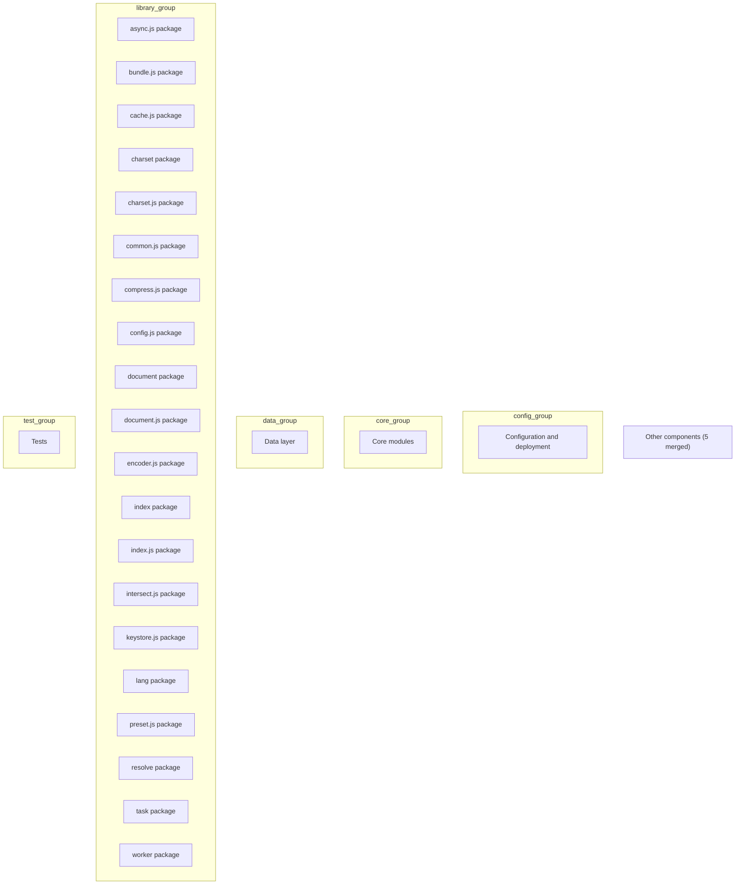

# Architecture report: nextapps-de/flexsearch

> Automated static analysis. **Observed** = directly seen in files/imports/AST; **Inferred** = interpretation from that evidence. Repository code was not executed.

## 1. Repository at a glance

| Item | Value |
| --- | --- |
| Repository | nextapps-de/flexsearch |
| Description | Next-generation full-text search library for Browser and Node.js |
| Language | JavaScript |
| Stars | 13821 |
| Licence | Apache-2.0 |
| Analysed commit / branch | f7ed963096a0792da7b2fd63bb7114b3fbac55ed / master |
| Framework(s) | None detected |
| Files analysed | 279 |
| Components | 29 |

## 2. Architecture in one minute

nextapps-de/flexsearch - Next-generation full-text search library for Browser and Node.js. This repository was analysed statically from 279 file(s) (0 Python). Detected technologies (observed from imports/manifests): GitHub Actions, MongoDB, PostgreSQL, Redis, SQLite, Docker. Files are grouped into 29 component(s): async.js package, bundle.js package, cache.js package, charset package, charset.js package, common.js package, compress.js package, Configuration and deployment. Findings below distinguish observed facts from inferred interpretation.

## 3. High-level block diagram

## 4. Main components

### async.js package (`async_js`)

- **Kind:** library
- **Status:** Observed
- **Confidence:** 0.85
- **Responsibility:** Groups 1 file(s) under async.js package (observed from repository paths and static analysis).
- **Paths:** `src/async.js`
- **Evidence:** [src/async.js](https://github.com/nextapps-de/flexsearch/blob/f7ed963096a0792da7b2fd63bb7114b3fbac55ed/src/async.js)

### bundle.js package (`bundle_js`)

- **Kind:** library
- **Status:** Observed
- **Confidence:** 0.85
- **Responsibility:** Groups 1 file(s) under bundle.js package (observed from repository paths and static analysis).
- **Paths:** `src/bundle.js`
- **Evidence:** [src/bundle.js](https://github.com/nextapps-de/flexsearch/blob/f7ed963096a0792da7b2fd63bb7114b3fbac55ed/src/bundle.js)

### cache.js package (`cache_js`)

- **Kind:** library
- **Status:** Observed
- **Confidence:** 0.85
- **Responsibility:** Groups 1 file(s) under cache.js package (observed from repository paths and static analysis).
- **Paths:** `src/cache.js`
- **Evidence:** [src/cache.js](https://github.com/nextapps-de/flexsearch/blob/f7ed963096a0792da7b2fd63bb7114b3fbac55ed/src/cache.js)

### charset package (`charset`)

- **Kind:** library
- **Status:** Observed
- **Confidence:** 0.85
- **Responsibility:** Groups 8 file(s) under charset package (observed from repository paths and static analysis).
- **Paths:** `src/charset/cjk.js`, `src/charset/exact.js`, `src/charset/latin/advanced.js`, `src/charset/latin/balance.js`, `src/charset/latin/extra.js`, `src/charset/latin/soundex.js`, `src/charset/normalize.js`, `src/charset/polyfill.js`
- **Evidence:** [src/charset/cjk.js](https://github.com/nextapps-de/flexsearch/blob/f7ed963096a0792da7b2fd63bb7114b3fbac55ed/src/charset/cjk.js); [src/charset/exact.js](https://github.com/nextapps-de/flexsearch/blob/f7ed963096a0792da7b2fd63bb7114b3fbac55ed/src/charset/exact.js); [src/charset/latin/advanced.js](https://github.com/nextapps-de/flexsearch/blob/f7ed963096a0792da7b2fd63bb7114b3fbac55ed/src/charset/latin/advanced.js); [src/charset/latin/balance.js](https://github.com/nextapps-de/flexsearch/blob/f7ed963096a0792da7b2fd63bb7114b3fbac55ed/src/charset/latin/balance.js); [src/charset/latin/extra.js](https://github.com/nextapps-de/flexsearch/blob/f7ed963096a0792da7b2fd63bb7114b3fbac55ed/src/charset/latin/extra.js); [src/charset/latin/soundex.js](https://github.com/nextapps-de/flexsearch/blob/f7ed963096a0792da7b2fd63bb7114b3fbac55ed/src/charset/latin/soundex.js); [src/charset/normalize.js](https://github.com/nextapps-de/flexsearch/blob/f7ed963096a0792da7b2fd63bb7114b3fbac55ed/src/charset/normalize.js); [src/charset/polyfill.js](https://github.com/nextapps-de/flexsearch/blob/f7ed963096a0792da7b2fd63bb7114b3fbac55ed/src/charset/polyfill.js)

### charset.js package (`charset_js`)

- **Kind:** library
- **Status:** Observed
- **Confidence:** 0.85
- **Responsibility:** Groups 1 file(s) under charset.js package (observed from repository paths and static analysis).
- **Paths:** `src/charset.js`
- **Evidence:** [src/charset.js](https://github.com/nextapps-de/flexsearch/blob/f7ed963096a0792da7b2fd63bb7114b3fbac55ed/src/charset.js)

### common.js package (`common_js`)

- **Kind:** library
- **Status:** Observed
- **Confidence:** 0.85
- **Responsibility:** Groups 1 file(s) under common.js package (observed from repository paths and static analysis).
- **Paths:** `src/common.js`
- **Evidence:** [src/common.js](https://github.com/nextapps-de/flexsearch/blob/f7ed963096a0792da7b2fd63bb7114b3fbac55ed/src/common.js)

### compress.js package (`compress_js`)

- **Kind:** library
- **Status:** Observed
- **Confidence:** 0.85
- **Responsibility:** Groups 1 file(s) under compress.js package (observed from repository paths and static analysis).
- **Paths:** `src/compress.js`
- **Evidence:** [src/compress.js](https://github.com/nextapps-de/flexsearch/blob/f7ed963096a0792da7b2fd63bb7114b3fbac55ed/src/compress.js)

### Configuration and deployment (`config`)

- **Kind:** config
- **Status:** Observed
- **Confidence:** 0.85
- **Responsibility:** Groups 10 file(s) under configuration and deployment (observed from repository paths and static analysis).
- **Paths:** `docker-compose.yml`, `package.json`, `src/db/clickhouse/package.json`, `src/db/mongodb/package.json`, `src/db/postgres/package.json`, `src/db/redis/package.json`, `src/db/sqlite/package.json`, `task/babel.bundle.json`, `task/babel.debug.json`, `task/babel.min.json`
- **Evidence:** [docker-compose.yml](https://github.com/nextapps-de/flexsearch/blob/f7ed963096a0792da7b2fd63bb7114b3fbac55ed/docker-compose.yml); [package.json](https://github.com/nextapps-de/flexsearch/blob/f7ed963096a0792da7b2fd63bb7114b3fbac55ed/package.json); [src/db/clickhouse/package.json](https://github.com/nextapps-de/flexsearch/blob/f7ed963096a0792da7b2fd63bb7114b3fbac55ed/src/db/clickhouse/package.json); [src/db/mongodb/package.json](https://github.com/nextapps-de/flexsearch/blob/f7ed963096a0792da7b2fd63bb7114b3fbac55ed/src/db/mongodb/package.json); [src/db/postgres/package.json](https://github.com/nextapps-de/flexsearch/blob/f7ed963096a0792da7b2fd63bb7114b3fbac55ed/src/db/postgres/package.json); [src/db/redis/package.json](https://github.com/nextapps-de/flexsearch/blob/f7ed963096a0792da7b2fd63bb7114b3fbac55ed/src/db/redis/package.json); [src/db/sqlite/package.json](https://github.com/nextapps-de/flexsearch/blob/f7ed963096a0792da7b2fd63bb7114b3fbac55ed/src/db/sqlite/package.json); [task/babel.bundle.json](https://github.com/nextapps-de/flexsearch/blob/f7ed963096a0792da7b2fd63bb7114b3fbac55ed/task/babel.bundle.json)

### config.js package (`config_js`)

- **Kind:** library
- **Status:** Observed
- **Confidence:** 0.85
- **Responsibility:** Groups 1 file(s) under config.js package (observed from repository paths and static analysis).
- **Paths:** `src/config.js`
- **Evidence:** [src/config.js](https://github.com/nextapps-de/flexsearch/blob/f7ed963096a0792da7b2fd63bb7114b3fbac55ed/src/config.js)

### Core modules (`core`)

- **Kind:** core
- **Status:** Observed
- **Confidence:** 0.85
- **Responsibility:** Groups 1 file(s) under core modules (observed from repository paths and static analysis).
- **Paths:** `index.d.ts`
- **Evidence:** [index.d.ts](https://github.com/nextapps-de/flexsearch/blob/f7ed963096a0792da7b2fd63bb7114b3fbac55ed/index.d.ts)

### Data layer (`data_layer`)

- **Kind:** data
- **Status:** Observed
- **Confidence:** 0.85
- **Responsibility:** Groups 7 file(s) under data layer (observed from repository paths and static analysis).
- **Paths:** `src/db/clickhouse/index.js`, `src/db/indexeddb/index.js`, `src/db/interface.js`, `src/db/mongodb/index.js`, `src/db/postgres/index.js`, `src/db/redis/index.js`, `src/db/sqlite/index.js`
- **Evidence:** [src/db/clickhouse/index.js](https://github.com/nextapps-de/flexsearch/blob/f7ed963096a0792da7b2fd63bb7114b3fbac55ed/src/db/clickhouse/index.js); [src/db/indexeddb/index.js](https://github.com/nextapps-de/flexsearch/blob/f7ed963096a0792da7b2fd63bb7114b3fbac55ed/src/db/indexeddb/index.js); [src/db/interface.js](https://github.com/nextapps-de/flexsearch/blob/f7ed963096a0792da7b2fd63bb7114b3fbac55ed/src/db/interface.js); [src/db/mongodb/index.js](https://github.com/nextapps-de/flexsearch/blob/f7ed963096a0792da7b2fd63bb7114b3fbac55ed/src/db/mongodb/index.js); [src/db/postgres/index.js](https://github.com/nextapps-de/flexsearch/blob/f7ed963096a0792da7b2fd63bb7114b3fbac55ed/src/db/postgres/index.js); [src/db/redis/index.js](https://github.com/nextapps-de/flexsearch/blob/f7ed963096a0792da7b2fd63bb7114b3fbac55ed/src/db/redis/index.js); [src/db/sqlite/index.js](https://github.com/nextapps-de/flexsearch/blob/f7ed963096a0792da7b2fd63bb7114b3fbac55ed/src/db/sqlite/index.js)

### document package (`document`)

- **Kind:** library
- **Status:** Observed
- **Confidence:** 0.85
- **Responsibility:** Groups 3 file(s) under document package (observed from repository paths and static analysis).
- **Paths:** `src/document/add.js`, `src/document/highlight.js`, `src/document/search.js`
- **Evidence:** [src/document/add.js](https://github.com/nextapps-de/flexsearch/blob/f7ed963096a0792da7b2fd63bb7114b3fbac55ed/src/document/add.js); [src/document/highlight.js](https://github.com/nextapps-de/flexsearch/blob/f7ed963096a0792da7b2fd63bb7114b3fbac55ed/src/document/highlight.js); [src/document/search.js](https://github.com/nextapps-de/flexsearch/blob/f7ed963096a0792da7b2fd63bb7114b3fbac55ed/src/document/search.js)

### document.js package (`document_js`)

- **Kind:** library
- **Status:** Observed
- **Confidence:** 0.85
- **Responsibility:** Groups 1 file(s) under document.js package (observed from repository paths and static analysis).
- **Paths:** `src/document.js`
- **Evidence:** [src/document.js](https://github.com/nextapps-de/flexsearch/blob/f7ed963096a0792da7b2fd63bb7114b3fbac55ed/src/document.js)

### encoder.js package (`encoder_js`)

- **Kind:** library
- **Status:** Observed
- **Confidence:** 0.85
- **Responsibility:** Groups 1 file(s) under encoder.js package (observed from repository paths and static analysis).
- **Paths:** `src/encoder.js`
- **Evidence:** [src/encoder.js](https://github.com/nextapps-de/flexsearch/blob/f7ed963096a0792da7b2fd63bb7114b3fbac55ed/src/encoder.js)

### index package (`index`)

- **Kind:** library
- **Status:** Observed
- **Confidence:** 0.85
- **Responsibility:** Groups 3 file(s) under index package (observed from repository paths and static analysis).
- **Paths:** `src/index/add.js`, `src/index/remove.js`, `src/index/search.js`
- **Evidence:** [src/index/add.js](https://github.com/nextapps-de/flexsearch/blob/f7ed963096a0792da7b2fd63bb7114b3fbac55ed/src/index/add.js); [src/index/remove.js](https://github.com/nextapps-de/flexsearch/blob/f7ed963096a0792da7b2fd63bb7114b3fbac55ed/src/index/remove.js); [src/index/search.js](https://github.com/nextapps-de/flexsearch/blob/f7ed963096a0792da7b2fd63bb7114b3fbac55ed/src/index/search.js)

### index.js package (`index_js`)

- **Kind:** library
- **Status:** Observed
- **Confidence:** 0.85
- **Responsibility:** Groups 1 file(s) under index.js package (observed from repository paths and static analysis).
- **Paths:** `src/index.js`
- **Evidence:** [src/index.js](https://github.com/nextapps-de/flexsearch/blob/f7ed963096a0792da7b2fd63bb7114b3fbac55ed/src/index.js)

### intersect.js package (`intersect_js`)

- **Kind:** library
- **Status:** Observed
- **Confidence:** 0.85
- **Responsibility:** Groups 1 file(s) under intersect.js package (observed from repository paths and static analysis).
- **Paths:** `src/intersect.js`
- **Evidence:** [src/intersect.js](https://github.com/nextapps-de/flexsearch/blob/f7ed963096a0792da7b2fd63bb7114b3fbac55ed/src/intersect.js)

### keystore.js package (`keystore_js`)

- **Kind:** library
- **Status:** Observed
- **Confidence:** 0.85
- **Responsibility:** Groups 1 file(s) under keystore.js package (observed from repository paths and static analysis).
- **Paths:** `src/keystore.js`
- **Evidence:** [src/keystore.js](https://github.com/nextapps-de/flexsearch/blob/f7ed963096a0792da7b2fd63bb7114b3fbac55ed/src/keystore.js)

### lang package (`lang`)

- **Kind:** library
- **Status:** Observed
- **Confidence:** 0.85
- **Responsibility:** Groups 3 file(s) under lang package (observed from repository paths and static analysis).
- **Paths:** `src/lang/de.js`, `src/lang/en.js`, `src/lang/fr.js`
- **Evidence:** [src/lang/de.js](https://github.com/nextapps-de/flexsearch/blob/f7ed963096a0792da7b2fd63bb7114b3fbac55ed/src/lang/de.js); [src/lang/en.js](https://github.com/nextapps-de/flexsearch/blob/f7ed963096a0792da7b2fd63bb7114b3fbac55ed/src/lang/en.js); [src/lang/fr.js](https://github.com/nextapps-de/flexsearch/blob/f7ed963096a0792da7b2fd63bb7114b3fbac55ed/src/lang/fr.js)

### preset.js package (`preset_js`)

- **Kind:** library
- **Status:** Observed
- **Confidence:** 0.85
- **Responsibility:** Groups 1 file(s) under preset.js package (observed from repository paths and static analysis).
- **Paths:** `src/preset.js`
- **Evidence:** [src/preset.js](https://github.com/nextapps-de/flexsearch/blob/f7ed963096a0792da7b2fd63bb7114b3fbac55ed/src/preset.js)

### profiler.js package (`profiler_js`)

- **Kind:** library
- **Status:** Observed
- **Confidence:** 0.85
- **Responsibility:** Groups 1 file(s) under profiler.js package (observed from repository paths and static analysis).
- **Paths:** `src/profiler.js`
- **Evidence:** [src/profiler.js](https://github.com/nextapps-de/flexsearch/blob/f7ed963096a0792da7b2fd63bb7114b3fbac55ed/src/profiler.js)

### resolve package (`resolve`)

- **Kind:** library
- **Status:** Observed
- **Confidence:** 0.85
- **Responsibility:** Groups 6 file(s) under resolve package (observed from repository paths and static analysis).
- **Paths:** `src/resolve/and.js`, `src/resolve/default.js`, `src/resolve/handler.js`, `src/resolve/not.js`, `src/resolve/or.js`, `src/resolve/xor.js`
- **Evidence:** [src/resolve/and.js](https://github.com/nextapps-de/flexsearch/blob/f7ed963096a0792da7b2fd63bb7114b3fbac55ed/src/resolve/and.js); [src/resolve/default.js](https://github.com/nextapps-de/flexsearch/blob/f7ed963096a0792da7b2fd63bb7114b3fbac55ed/src/resolve/default.js); [src/resolve/handler.js](https://github.com/nextapps-de/flexsearch/blob/f7ed963096a0792da7b2fd63bb7114b3fbac55ed/src/resolve/handler.js); [src/resolve/not.js](https://github.com/nextapps-de/flexsearch/blob/f7ed963096a0792da7b2fd63bb7114b3fbac55ed/src/resolve/not.js); [src/resolve/or.js](https://github.com/nextapps-de/flexsearch/blob/f7ed963096a0792da7b2fd63bb7114b3fbac55ed/src/resolve/or.js); [src/resolve/xor.js](https://github.com/nextapps-de/flexsearch/blob/f7ed963096a0792da7b2fd63bb7114b3fbac55ed/src/resolve/xor.js)

### resolver.js package (`resolver_js`)

- **Kind:** library
- **Status:** Observed
- **Confidence:** 0.85
- **Responsibility:** Groups 1 file(s) under resolver.js package (observed from repository paths and static analysis).
- **Paths:** `src/resolver.js`
- **Evidence:** [src/resolver.js](https://github.com/nextapps-de/flexsearch/blob/f7ed963096a0792da7b2fd63bb7114b3fbac55ed/src/resolver.js)

### serialize.js package (`serialize_js`)

- **Kind:** library
- **Status:** Observed
- **Confidence:** 0.85
- **Responsibility:** Groups 1 file(s) under serialize.js package (observed from repository paths and static analysis).
- **Paths:** `src/serialize.js`
- **Evidence:** [src/serialize.js](https://github.com/nextapps-de/flexsearch/blob/f7ed963096a0792da7b2fd63bb7114b3fbac55ed/src/serialize.js)

### task package (`task`)

- **Kind:** library
- **Status:** Observed
- **Confidence:** 0.85
- **Responsibility:** Groups 2 file(s) under task package (observed from repository paths and static analysis).
- **Paths:** `task/babel.js`, `task/build.js`
- **Evidence:** [task/babel.js](https://github.com/nextapps-de/flexsearch/blob/f7ed963096a0792da7b2fd63bb7114b3fbac55ed/task/babel.js); [task/build.js](https://github.com/nextapps-de/flexsearch/blob/f7ed963096a0792da7b2fd63bb7114b3fbac55ed/task/build.js)

### Tests (`tests`)

- **Kind:** test
- **Status:** Observed
- **Confidence:** 0.85
- **Responsibility:** Groups 27 file(s) under tests (observed from repository paths and static analysis).
- **Paths:** `test/.c8rc.json`, `test/async.js`, `test/basic.js`, `test/cache.js`, `test/context.js`, `test/debug.js`, `test/document.js`, `test/document.tag.js`, `test/encoder.js`, `test/highlight.js`, `test/issues.js`, `test/keystore.js`, `test/misc/reporter.js`, `test/misc/runner.js`, `test/package.json`, `test/persistent.clickhouse.js`, `test/persistent.js`, `test/persistent.mongo.js`, `test/persistent.postgres.js`, `test/persistent.redis.js`, `test/persistent.sqlite.js`, `test/resolver.js`, `test/scoring.js`, `test/serialize.js`, `test/tokenize.js`, `test/types.ts`, `test/worker.js`
- **Evidence:** [test/.c8rc.json](https://github.com/nextapps-de/flexsearch/blob/f7ed963096a0792da7b2fd63bb7114b3fbac55ed/test/.c8rc.json); [test/async.js](https://github.com/nextapps-de/flexsearch/blob/f7ed963096a0792da7b2fd63bb7114b3fbac55ed/test/async.js); [test/basic.js](https://github.com/nextapps-de/flexsearch/blob/f7ed963096a0792da7b2fd63bb7114b3fbac55ed/test/basic.js); [test/cache.js](https://github.com/nextapps-de/flexsearch/blob/f7ed963096a0792da7b2fd63bb7114b3fbac55ed/test/cache.js); [test/context.js](https://github.com/nextapps-de/flexsearch/blob/f7ed963096a0792da7b2fd63bb7114b3fbac55ed/test/context.js); [test/debug.js](https://github.com/nextapps-de/flexsearch/blob/f7ed963096a0792da7b2fd63bb7114b3fbac55ed/test/debug.js); [test/document.js](https://github.com/nextapps-de/flexsearch/blob/f7ed963096a0792da7b2fd63bb7114b3fbac55ed/test/document.js); [test/document.tag.js](https://github.com/nextapps-de/flexsearch/blob/f7ed963096a0792da7b2fd63bb7114b3fbac55ed/test/document.tag.js)

### type.js package (`type_js`)

- **Kind:** library
- **Status:** Observed
- **Confidence:** 0.85
- **Responsibility:** Groups 1 file(s) under type.js package (observed from repository paths and static analysis).
- **Paths:** `src/type.js`
- **Evidence:** [src/type.js](https://github.com/nextapps-de/flexsearch/blob/f7ed963096a0792da7b2fd63bb7114b3fbac55ed/src/type.js)

### worker package (`worker`)

- **Kind:** library
- **Status:** Observed
- **Confidence:** 0.85
- **Responsibility:** Groups 4 file(s) under worker package (observed from repository paths and static analysis).
- **Paths:** `src/worker/handler.js`, `src/worker/node.js`, `src/worker/node.mjs`, `src/worker/worker.js`
- **Evidence:** [src/worker/handler.js](https://github.com/nextapps-de/flexsearch/blob/f7ed963096a0792da7b2fd63bb7114b3fbac55ed/src/worker/handler.js); [src/worker/node.js](https://github.com/nextapps-de/flexsearch/blob/f7ed963096a0792da7b2fd63bb7114b3fbac55ed/src/worker/node.js); [src/worker/node.mjs](https://github.com/nextapps-de/flexsearch/blob/f7ed963096a0792da7b2fd63bb7114b3fbac55ed/src/worker/node.mjs); [src/worker/worker.js](https://github.com/nextapps-de/flexsearch/blob/f7ed963096a0792da7b2fd63bb7114b3fbac55ed/src/worker/worker.js)

### worker.js package (`worker_js`)

- **Kind:** library
- **Status:** Observed
- **Confidence:** 0.85
- **Responsibility:** Groups 1 file(s) under worker.js package (observed from repository paths and static analysis).
- **Paths:** `src/worker.js`
- **Evidence:** [src/worker.js](https://github.com/nextapps-de/flexsearch/blob/f7ed963096a0792da7b2fd63bb7114b3fbac55ed/src/worker.js)

## 5. Execution flow

**Observed** entry point(s):

- [src/db/clickhouse/index.js](https://github.com/nextapps-de/flexsearch/blob/f7ed963096a0792da7b2fd63bb7114b3fbac55ed/src/db/clickhouse/index.js)
- [src/db/indexeddb/index.js](https://github.com/nextapps-de/flexsearch/blob/f7ed963096a0792da7b2fd63bb7114b3fbac55ed/src/db/indexeddb/index.js)
- [src/db/mongodb/index.js](https://github.com/nextapps-de/flexsearch/blob/f7ed963096a0792da7b2fd63bb7114b3fbac55ed/src/db/mongodb/index.js)
- [src/db/postgres/index.js](https://github.com/nextapps-de/flexsearch/blob/f7ed963096a0792da7b2fd63bb7114b3fbac55ed/src/db/postgres/index.js)
- [src/db/redis/index.js](https://github.com/nextapps-de/flexsearch/blob/f7ed963096a0792da7b2fd63bb7114b3fbac55ed/src/db/redis/index.js)
- [src/db/sqlite/index.js](https://github.com/nextapps-de/flexsearch/blob/f7ed963096a0792da7b2fd63bb7114b3fbac55ed/src/db/sqlite/index.js)
- [src/index.js](https://github.com/nextapps-de/flexsearch/blob/f7ed963096a0792da7b2fd63bb7114b3fbac55ed/src/index.js)

Representative flow (derived from observed entry points and the import graph; steps beyond the entry point are **Inferred**):

1. Execution starts at an observed entry point listed above, if present.
2. No internal import relationships between components were observed.

## 6. Project structure

### `(root)`

- `.gitattributes` - other (206 bytes)
- `.gitignore` - other (83 bytes)
- `CHANGELOG.md` - docs (8438 bytes)
- `LICENSE` - docs (11357 bytes)
- `README.md` - docs (64500 bytes)
- `SECURITY.md` - docs (493 bytes)
- `docker-compose.yml` - container (1096 bytes)
- `index.d.ts` - source, TypeScript (39777 bytes)
- `package.json` - manifest (12923 bytes)

### `.github`

- `.github/FUNDING.yml` - config (264 bytes)
- `.github/workflows/node.js.yml` - ci, YAML (2059 bytes)

### `demo`

- `demo/autocomplete.html` - other (8569 bytes)

### `doc`

- `doc/antithesis_logo.svg` - other (9098 bytes)
- `doc/async.md` - docs (2504 bytes)
- `doc/bountysource.svg` - other (10405 bytes)
- `doc/context-index.svg` - other (7591 bytes)
- `doc/custom-builds.md` - docs (4936 bytes)
- `doc/customization.md` - docs (1776 bytes)
- `doc/document-search.md` - docs (26710 bytes)
- `doc/encoder-workflow.svg` - other (26422 bytes)
- `doc/encoder.md` - docs (20321 bytes)
- `doc/export-import.md` - docs (5682 bytes)
- `doc/flexsearch-logo-glass-animated.svg` - other (12636 bytes)
- `doc/flexsearch-logo-glass.svg` - other (9832 bytes)
- `doc/flexsearch-logo.svg` - other (8558 bytes)
- `doc/keystore.md` - docs (861 bytes)
- `doc/liberapay.svg` - other (1457 bytes)
- `doc/memory-comparison.svg` - other (33694 bytes)
- `doc/persistent-clickhouse.md` - docs (3403 bytes)
- `doc/persistent-indexeddb.md` - docs (1525 bytes)
- `doc/persistent-mongodb.md` - docs (2272 bytes)
- `doc/persistent-postgres.md` - docs (3340 bytes)
- `doc/persistent-redis.md` - docs (2862 bytes)
- `doc/persistent-sqlite.md` - docs (3126 bytes)
- `doc/persistent.md` - docs (8422 bytes)
- `doc/pipeline.svg` - other (48083 bytes)
- `doc/resolver-consecutive.svg` - other (19904 bytes)
- `doc/resolver-parallel.svg` - other (20021 bytes)
- `doc/resolver.md` - docs (10424 bytes)
- `doc/result-highlighting.md` - docs (7928 bytes)
- `doc/worker.md` - docs (12603 bytes)

### `example`

- `example/browser-legacy/basic-persistent/index.html` - other (1441 bytes)
- `example/browser-legacy/basic-resolver/index.html` - other (1379 bytes)
- `example/browser-legacy/basic-suggestion/index.html` - other (1183 bytes)
- `example/browser-legacy/basic-worker/index.html` - other (1187 bytes)
- `example/browser-legacy/basic/index.html` - other (1238 bytes)
- `example/browser-legacy/document-highlighting/index.html` - other (1353 bytes)
- `example/browser-legacy/document-persistent/index.html` - other (3194 bytes)
- `example/browser-legacy/document-resolver/index.html` - other (2191 bytes)
- `example/browser-legacy/document-worker/index.html` - other (3003 bytes)
- `example/browser-legacy/document/index.html` - other (2910 bytes)
- `example/browser-legacy/language-pack/index.html` - other (1517 bytes)
- `example/browser-module/basic-persistent/index.html` - other (1430 bytes)
- `example/browser-module/basic-resolver/index.html` - other (1392 bytes)
- `example/browser-module/basic-suggestion/index.html` - other (1197 bytes)
- `example/browser-module/basic-worker-extern-config/config.js` - source, JavaScript (282 bytes)
- `example/browser-module/basic-worker-extern-config/index.html` - other (1294 bytes)
- `example/browser-module/basic-worker/index.html` - other (1212 bytes)
- `example/browser-module/basic/index.html` - other (1991 bytes)
- `example/browser-module/document-highlighting/index.html` - other (1354 bytes)
- `example/browser-module/document-persistent/index.html` - other (3001 bytes)
- `example/browser-module/document-resolver/index.html` - other (2194 bytes)
- `example/browser-module/document-worker-extern-config/config.originalTitle.js` - source, JavaScript (536 bytes)
- `example/browser-module/document-worker-extern-config/config.primaryTitle.js` - source, JavaScript (536 bytes)
- `example/browser-module/document-worker-extern-config/index.html` - other (2886 bytes)
- `example/browser-module/document-worker/index.html` - other (2778 bytes)
- `example/browser-module/document/index.html` - other (2757 bytes)
- `example/browser-module/language-pack/index.html` - other (1474 bytes)
- `example/nodejs-commonjs/.document-worker-persistent/config.originalTitle.js` - source, JavaScript (405 bytes)
- `example/nodejs-commonjs/.document-worker-persistent/config.primaryTitle.js` - source, JavaScript (405 bytes)
- `example/nodejs-commonjs/.document-worker-persistent/data.json` - config (2953 bytes)
- `example/nodejs-commonjs/.document-worker-persistent/index.js` - source, JavaScript (1693 bytes)
- `example/nodejs-commonjs/.document-worker-persistent/package.json` - manifest (120 bytes)
- `example/nodejs-commonjs/basic-export-import/README.md` - docs (50 bytes)
- `example/nodejs-commonjs/basic-export-import/index.js` - source, JavaScript (1871 bytes)
- `example/nodejs-commonjs/basic-export-import/package.json` - manifest (106 bytes)
- `example/nodejs-commonjs/basic-persistent/README.md` - docs (87 bytes)
- `example/nodejs-commonjs/basic-persistent/index.js` - source, JavaScript (1306 bytes)
- `example/nodejs-commonjs/basic-persistent/package.json` - manifest (128 bytes)
- `example/nodejs-commonjs/basic-resolver/README.md` - docs (50 bytes)
- `example/nodejs-commonjs/basic-resolver/index.js` - source, JavaScript (855 bytes)
- `example/nodejs-commonjs/basic-resolver/package.json` - manifest (101 bytes)
- `example/nodejs-commonjs/basic-suggestion/README.md` - docs (50 bytes)
- `example/nodejs-commonjs/basic-suggestion/index.js` - source, JavaScript (675 bytes)
- `example/nodejs-commonjs/basic-suggestion/package.json` - manifest (103 bytes)
- `example/nodejs-commonjs/basic-worker-export-import/config.js` - source, JavaScript (735 bytes)
- `example/nodejs-commonjs/basic-worker-export-import/index.js` - source, JavaScript (1650 bytes)
- `example/nodejs-commonjs/basic-worker-export-import/package.json` - manifest (134 bytes)
- `example/nodejs-commonjs/basic-worker-extern-config/config.js` - source, JavaScript (206 bytes)
- `example/nodejs-commonjs/basic-worker-extern-config/index.js` - source, JavaScript (887 bytes)
- `example/nodejs-commonjs/basic-worker-extern-config/package.json` - manifest (113 bytes)
- `example/nodejs-commonjs/basic-worker/README.md` - docs (50 bytes)
- `example/nodejs-commonjs/basic-worker/index.js` - source, JavaScript (799 bytes)
- `example/nodejs-commonjs/basic-worker/package.json` - manifest (99 bytes)
- `example/nodejs-commonjs/basic/README.md` - docs (50 bytes)
- `example/nodejs-commonjs/basic/index.js` - source, JavaScript (729 bytes)
- `example/nodejs-commonjs/basic/package.json` - manifest (92 bytes)
- `example/nodejs-commonjs/document-export-import/README.md` - docs (50 bytes)
- `example/nodejs-commonjs/document-export-import/data.json` - config (2953 bytes)
- `example/nodejs-commonjs/document-export-import/index.js` - source, JavaScript (2531 bytes)
- `example/nodejs-commonjs/document-export-import/package.json` - manifest (109 bytes)
- `example/nodejs-commonjs/document-persistent/README.md` - docs (87 bytes)
- `example/nodejs-commonjs/document-persistent/data.json` - config (2953 bytes)
- `example/nodejs-commonjs/document-persistent/index.js` - source, JavaScript (1706 bytes)
- `example/nodejs-commonjs/document-persistent/package.json` - manifest (131 bytes)
- `example/nodejs-commonjs/document-resolver/README.md` - docs (50 bytes)
- `example/nodejs-commonjs/document-resolver/index.js` - source, JavaScript (1644 bytes)
- `example/nodejs-commonjs/document-resolver/package.json` - manifest (104 bytes)
- `example/nodejs-commonjs/document-worker-export-import/README.md` - docs (50 bytes)
- `example/nodejs-commonjs/document-worker-export-import/config.originalTitle.js` - source, JavaScript (726 bytes)
- `example/nodejs-commonjs/document-worker-export-import/config.primaryTitle.js` - source, JavaScript (726 bytes)
- `example/nodejs-commonjs/document-worker-export-import/data.json` - config (2953 bytes)
- `example/nodejs-commonjs/document-worker-export-import/index.js` - source, JavaScript (2511 bytes)
- `example/nodejs-commonjs/document-worker-export-import/package.json` - manifest (116 bytes)
- `example/nodejs-commonjs/document-worker-extern-config/README.md` - docs (50 bytes)
- `example/nodejs-commonjs/document-worker-extern-config/config.originalTitle.js` - source, JavaScript (405 bytes)
- `example/nodejs-commonjs/document-worker-extern-config/config.primaryTitle.js` - source, JavaScript (405 bytes)
- `example/nodejs-commonjs/document-worker-extern-config/data.json` - config (2953 bytes)
- `example/nodejs-commonjs/document-worker-extern-config/index.js` - source, JavaScript (1188 bytes)
- `example/nodejs-commonjs/document-worker-extern-config/package.json` - manifest (116 bytes)
- `example/nodejs-commonjs/document-worker/README.md` - docs (50 bytes)
- `example/nodejs-commonjs/document-worker/data.json` - config (2953 bytes)
- `example/nodejs-commonjs/document-worker/index.js` - source, JavaScript (1177 bytes)
- `example/nodejs-commonjs/document-worker/package.json` - manifest (102 bytes)
- `example/nodejs-commonjs/document/README.md` - docs (50 bytes)
- `example/nodejs-commonjs/document/data.json` - config (2953 bytes)
- `example/nodejs-commonjs/document/index.js` - source, JavaScript (976 bytes)
- `example/nodejs-commonjs/document/package.json` - manifest (95 bytes)
- `example/nodejs-commonjs/language-pack/README.md` - docs (50 bytes)
- `example/nodejs-commonjs/language-pack/index.js` - source, JavaScript (865 bytes)
- `example/nodejs-commonjs/language-pack/package.json` - manifest (100 bytes)
- `example/nodejs-esm/basic-export-import/README.md` - docs (50 bytes)
- `example/nodejs-esm/basic-export-import/index.js` - source, JavaScript (1622 bytes)
- `example/nodejs-esm/basic-export-import/package.json` - manifest (121 bytes)
- `example/nodejs-esm/basic-persistent/README.md` - docs (87 bytes)
- `example/nodejs-esm/basic-persistent/index.js` - source, JavaScript (1236 bytes)
- `example/nodejs-esm/basic-persistent/package.json` - manifest (143 bytes)
- `example/nodejs-esm/basic-resolver/README.md` - docs (50 bytes)
- `example/nodejs-esm/basic-resolver/index.js` - source, JavaScript (850 bytes)
- `example/nodejs-esm/basic-resolver/package.json` - manifest (116 bytes)
- `example/nodejs-esm/basic-suggestion/README.md` - docs (50 bytes)
- `example/nodejs-esm/basic-suggestion/index.js` - source, JavaScript (670 bytes)
- `example/nodejs-esm/basic-suggestion/package.json` - manifest (118 bytes)
- `example/nodejs-esm/basic-worker-export-import/config.js` - source, JavaScript (730 bytes)
- `example/nodejs-esm/basic-worker-export-import/index.js` - source, JavaScript (1682 bytes)
- `example/nodejs-esm/basic-worker-export-import/package.json` - manifest (149 bytes)
- `example/nodejs-esm/basic-worker-extern-config/README.md` - docs (50 bytes)
- `example/nodejs-esm/basic-worker-extern-config/config.js` - source, JavaScript (199 bytes)
- `example/nodejs-esm/basic-worker-extern-config/index.js` - source, JavaScript (919 bytes)
- `example/nodejs-esm/basic-worker-extern-config/package.json` - manifest (128 bytes)
- `example/nodejs-esm/basic-worker/README.md` - docs (50 bytes)
- `example/nodejs-esm/basic-worker/index.js` - source, JavaScript (796 bytes)
- `example/nodejs-esm/basic-worker/package.json` - manifest (114 bytes)
- `example/nodejs-esm/basic/README.md` - docs (50 bytes)
- `example/nodejs-esm/basic/index.js` - source, JavaScript (724 bytes)
- `example/nodejs-esm/basic/package.json` - manifest (107 bytes)
- `example/nodejs-esm/document-export-import/README.md` - docs (50 bytes)
- `example/nodejs-esm/document-export-import/data.json` - config (2953 bytes)
- `example/nodejs-esm/document-export-import/index.js` - source, JavaScript (2207 bytes)
- `example/nodejs-esm/document-export-import/package.json` - manifest (124 bytes)
- `example/nodejs-esm/document-persistent/README.md` - docs (87 bytes)
- `example/nodejs-esm/document-persistent/data.json` - config (2953 bytes)
- `example/nodejs-esm/document-persistent/index.js` - source, JavaScript (1747 bytes)
- `example/nodejs-esm/document-persistent/package.json` - manifest (146 bytes)
- `example/nodejs-esm/document-resolver/README.md` - docs (50 bytes)
- `example/nodejs-esm/document-resolver/index.js` - source, JavaScript (1639 bytes)
- `example/nodejs-esm/document-resolver/package.json` - manifest (119 bytes)
- `example/nodejs-esm/document-worker-export-import/README.md` - docs (50 bytes)
- `example/nodejs-esm/document-worker-export-import/config.originalTitle.js` - source, JavaScript (715 bytes)
- `example/nodejs-esm/document-worker-export-import/config.primaryTitle.js` - source, JavaScript (715 bytes)
- `example/nodejs-esm/document-worker-export-import/data.json` - config (2953 bytes)
- `example/nodejs-esm/document-worker-export-import/index.js` - source, JavaScript (2605 bytes)
- `example/nodejs-esm/document-worker-export-import/package.json` - manifest (131 bytes)
- `example/nodejs-esm/document-worker-extern-config/README.md` - docs (50 bytes)
- `example/nodejs-esm/document-worker-extern-config/config.originalTitle.js` - source, JavaScript (392 bytes)
- `example/nodejs-esm/document-worker-extern-config/config.primaryTitle.js` - source, JavaScript (392 bytes)
- `example/nodejs-esm/document-worker-extern-config/data.json` - config (2953 bytes)
- `example/nodejs-esm/document-worker-extern-config/index.js` - source, JavaScript (1310 bytes)
- `example/nodejs-esm/document-worker-extern-config/package.json` - manifest (131 bytes)
- `example/nodejs-esm/document-worker/README.md` - docs (50 bytes)
- `example/nodejs-esm/document-worker/data.json` - config (2953 bytes)
- `example/nodejs-esm/document-worker/index.js` - source, JavaScript (1310 bytes)
- `example/nodejs-esm/document-worker/package.json` - manifest (138 bytes)
- `example/nodejs-esm/document/README.md` - docs (87 bytes)
- `example/nodejs-esm/document/data.json` - config (2953 bytes)
- `example/nodejs-esm/document/index.js` - source, JavaScript (1055 bytes)
- `example/nodejs-esm/document/package.json` - manifest (110 bytes)
- `example/nodejs-esm/language-pack/README.md` - docs (50 bytes)
- `example/nodejs-esm/language-pack/index.js` - source, JavaScript (855 bytes)
- `example/nodejs-esm/language-pack/package.json` - manifest (95 bytes)

### `src`

- `src/async.js` - source, JavaScript (2056 bytes)
- `src/bundle.js` - source, JavaScript (13120 bytes)
- `src/cache.js` - source, JavaScript (2920 bytes)
- `src/charset.js` - source, JavaScript (1427 bytes)
- `src/charset/cjk.js` - source, JavaScript (304 bytes)
- `src/charset/exact.js` - source, JavaScript (241 bytes)
- `src/charset/latin/advanced.js` - source, JavaScript (779 bytes)
- `src/charset/latin/balance.js` - source, JavaScript (671 bytes)
- `src/charset/latin/extra.js` - source, JavaScript (424 bytes)
- `src/charset/latin/soundex.js` - source, JavaScript (1521 bytes)
- `src/charset/normalize.js` - source, JavaScript (241 bytes)
- `src/charset/polyfill.js` - source, JavaScript (3808 bytes)
- `src/common.js` - source, JavaScript (3507 bytes)
- `src/compress.js` - source, JavaScript (1654 bytes)
- `src/config.js` - source, JavaScript (1193 bytes)
- `src/db/clickhouse/index.js` - source, JavaScript (22984 bytes)
- `src/db/clickhouse/package.json` - manifest (177 bytes)
- `src/db/indexeddb/index.js` - source, JavaScript (21991 bytes)
- `src/db/interface.js` - source, JavaScript (1988 bytes)
- `src/db/mongodb/index.js` - source, JavaScript (19433 bytes)
- `src/db/mongodb/package.json` - manifest (172 bytes)
- `src/db/postgres/index.js` - source, JavaScript (36642 bytes)
- `src/db/postgres/package.json` - manifest (177 bytes)
- `src/db/redis/index.js` - source, JavaScript (19237 bytes)
- `src/db/redis/package.json` - manifest (167 bytes)
- `src/db/sqlite/index.js` - source, JavaScript (27666 bytes)
- `src/db/sqlite/package.json` - manifest (170 bytes)
- `src/document.js` - source, JavaScript (16598 bytes)
- `src/document/add.js` - source, JavaScript (8032 bytes)
- `src/document/highlight.js` - source, JavaScript (35790 bytes)
- `src/document/search.js` - source, JavaScript (22983 bytes)
- `src/encoder.js` - source, JavaScript (19759 bytes)
- `src/index.js` - source, JavaScript (7870 bytes)
- `src/index/add.js` - source, JavaScript (12470 bytes)
- `src/index/remove.js` - source, JavaScript (5655 bytes)
- `src/index/search.js` - source, JavaScript (12190 bytes)
- `src/intersect.js` - source, JavaScript (20564 bytes)
- `src/keystore.js` - source, JavaScript (11160 bytes)
- `src/lang/de.js` - source, JavaScript (3735 bytes)
- `src/lang/en.js` - source, JavaScript (5257 bytes)
- `src/lang/fr.js` - source, JavaScript (3394 bytes)
- `src/preset.js` - source, JavaScript (1185 bytes)
- `src/profiler.js` - source, JavaScript (549 bytes)
- `src/resolve/and.js` - source, JavaScript (2696 bytes)
- `src/resolve/default.js` - source, JavaScript (2368 bytes)
- `src/resolve/handler.js` - source, JavaScript (9230 bytes)
- `src/resolve/not.js` - source, JavaScript (2604 bytes)
- `src/resolve/or.js` - source, JavaScript (1713 bytes)
- `src/resolve/xor.js` - source, JavaScript (3688 bytes)
- `src/resolver.js` - source, JavaScript (8905 bytes)
- `src/serialize.js` - source, JavaScript (12679 bytes)
- `src/type.js` - source, JavaScript (8558 bytes)
- `src/worker.js` - source, JavaScript (6102 bytes)
- `src/worker/handler.js` - source, JavaScript (3163 bytes)
- `src/worker/node.js` - source, JavaScript (2713 bytes)
- `src/worker/node.mjs` - source, JavaScript (2819 bytes)
- `src/worker/worker.js` - source, JavaScript (57 bytes)

### `task`

- `task/babel.bundle.json` - config (1434 bytes)
- `task/babel.debug.json` - config (1433 bytes)
- `task/babel.js` - source, JavaScript (6945 bytes)
- `task/babel.min.json` - config (1509 bytes)
- `task/build.js` - source, JavaScript (21270 bytes)

### `test`

- `test/.c8rc.json` - test (397 bytes)
- `test/async.js` - test, JavaScript (2873 bytes)
- `test/basic.js` - test, JavaScript (19675 bytes)
- `test/cache.js` - test, JavaScript (3509 bytes)
- `test/context.js` - test, JavaScript (5835 bytes)
- `test/debug.js` - test, JavaScript (715 bytes)
- `test/document.js` - test, JavaScript (14145 bytes)
- `test/document.tag.js` - test, JavaScript (8275 bytes)
- `test/encoder.js` - test, JavaScript (18146 bytes)
- `test/highlight.js` - test, JavaScript (36646 bytes)
- `test/issues.js` - test, JavaScript (21923 bytes)
- `test/keystore.js` - test, JavaScript (3283 bytes)
- `test/misc/reporter.js` - test, JavaScript (656 bytes)
- `test/misc/runner.js` - test, JavaScript (0 bytes)
- `test/package.json` - test (1858 bytes)
- `test/persistent.clickhouse.js` - test, JavaScript (856 bytes)
- `test/persistent.js` - test, JavaScript (34598 bytes)
- `test/persistent.mongo.js` - test, JavaScript (846 bytes)
- `test/persistent.postgres.js` - test, JavaScript (852 bytes)
- `test/persistent.redis.js` - test, JavaScript (846 bytes)
- `test/persistent.sqlite.js` - test, JavaScript (848 bytes)
- `test/resolver.js` - test, JavaScript (38068 bytes)
- `test/scoring.js` - test, JavaScript (5235 bytes)
- `test/serialize.js` - test, JavaScript (7712 bytes)
- `test/tokenize.js` - test, JavaScript (2703 bytes)
- `test/types.ts` - test, TypeScript (31850 bytes)
- `test/worker.js` - test, JavaScript (11696 bytes)

## 7. Key dependencies and integrations

| Name | Category | Status | Confidence | Evidence |
| --- | --- | --- | --- | --- |
| GitHub Actions | ci | Observed | 0.85 | [.github/workflows/node.js.yml](https://github.com/nextapps-de/flexsearch/blob/f7ed963096a0792da7b2fd63bb7114b3fbac55ed/.github/workflows/node.js.yml) |
| MongoDB | database | Observed | 0.80 | [docker-compose.yml:35](https://github.com/nextapps-de/flexsearch/blob/f7ed963096a0792da7b2fd63bb7114b3fbac55ed/docker-compose.yml#L35) |
| PostgreSQL | database | Observed | 0.80 | [docker-compose.yml:3](https://github.com/nextapps-de/flexsearch/blob/f7ed963096a0792da7b2fd63bb7114b3fbac55ed/docker-compose.yml#L3) |
| Redis | database | Observed | 0.90 | [docker-compose.yml:27](https://github.com/nextapps-de/flexsearch/blob/f7ed963096a0792da7b2fd63bb7114b3fbac55ed/docker-compose.yml#L27); [package.json:63](https://github.com/nextapps-de/flexsearch/blob/f7ed963096a0792da7b2fd63bb7114b3fbac55ed/package.json#L63); [src/db/redis/package.json:4](https://github.com/nextapps-de/flexsearch/blob/f7ed963096a0792da7b2fd63bb7114b3fbac55ed/src/db/redis/package.json#L4); [test/package.json:21](https://github.com/nextapps-de/flexsearch/blob/f7ed963096a0792da7b2fd63bb7114b3fbac55ed/test/package.json#L21) |
| SQLite | database | Observed | 0.90 | [example/nodejs-commonjs/.document-worker-persistent/package.json:5](https://github.com/nextapps-de/flexsearch/blob/f7ed963096a0792da7b2fd63bb7114b3fbac55ed/example/nodejs-commonjs/.document-worker-persistent/package.json#L5); [example/nodejs-commonjs/basic-persistent/package.json:5](https://github.com/nextapps-de/flexsearch/blob/f7ed963096a0792da7b2fd63bb7114b3fbac55ed/example/nodejs-commonjs/basic-persistent/package.json#L5); [example/nodejs-commonjs/document-persistent/package.json:5](https://github.com/nextapps-de/flexsearch/blob/f7ed963096a0792da7b2fd63bb7114b3fbac55ed/example/nodejs-commonjs/document-persistent/package.json#L5); [example/nodejs-esm/basic-persistent/package.json:6](https://github.com/nextapps-de/flexsearch/blob/f7ed963096a0792da7b2fd63bb7114b3fbac55ed/example/nodejs-esm/basic-persistent/package.json#L6) |
| Docker | tooling | Observed | 0.70 | [.github/workflows/node.js.yml:23](https://github.com/nextapps-de/flexsearch/blob/f7ed963096a0792da7b2fd63bb7114b3fbac55ed/.github/workflows/node.js.yml#L23) |
| Docker Compose | tooling | Observed | 0.85 | [docker-compose.yml](https://github.com/nextapps-de/flexsearch/blob/f7ed963096a0792da7b2fd63bb7114b3fbac55ed/docker-compose.yml) |
| TypeScript | tooling | Observed | 0.85 | [test/package.json:24](https://github.com/nextapps-de/flexsearch/blob/f7ed963096a0792da7b2fd63bb7114b3fbac55ed/test/package.json#L24) |

## 8. Data and state

- **MongoDB** (Observed, confidence 0.80) - evidence: [docker-compose.yml:35](https://github.com/nextapps-de/flexsearch/blob/f7ed963096a0792da7b2fd63bb7114b3fbac55ed/docker-compose.yml#L35)
- **PostgreSQL** (Observed, confidence 0.80) - evidence: [docker-compose.yml:3](https://github.com/nextapps-de/flexsearch/blob/f7ed963096a0792da7b2fd63bb7114b3fbac55ed/docker-compose.yml#L3)
- **Redis** (Observed, confidence 0.90) - evidence: [docker-compose.yml:27](https://github.com/nextapps-de/flexsearch/blob/f7ed963096a0792da7b2fd63bb7114b3fbac55ed/docker-compose.yml#L27); [package.json:63](https://github.com/nextapps-de/flexsearch/blob/f7ed963096a0792da7b2fd63bb7114b3fbac55ed/package.json#L63); [src/db/redis/package.json:4](https://github.com/nextapps-de/flexsearch/blob/f7ed963096a0792da7b2fd63bb7114b3fbac55ed/src/db/redis/package.json#L4); [test/package.json:21](https://github.com/nextapps-de/flexsearch/blob/f7ed963096a0792da7b2fd63bb7114b3fbac55ed/test/package.json#L21)
- **SQLite** (Observed, confidence 0.90) - evidence: [example/nodejs-commonjs/.document-worker-persistent/package.json:5](https://github.com/nextapps-de/flexsearch/blob/f7ed963096a0792da7b2fd63bb7114b3fbac55ed/example/nodejs-commonjs/.document-worker-persistent/package.json#L5); [example/nodejs-commonjs/basic-persistent/package.json:5](https://github.com/nextapps-de/flexsearch/blob/f7ed963096a0792da7b2fd63bb7114b3fbac55ed/example/nodejs-commonjs/basic-persistent/package.json#L5); [example/nodejs-commonjs/document-persistent/package.json:5](https://github.com/nextapps-de/flexsearch/blob/f7ed963096a0792da7b2fd63bb7114b3fbac55ed/example/nodejs-commonjs/document-persistent/package.json#L5); [example/nodejs-esm/basic-persistent/package.json:6](https://github.com/nextapps-de/flexsearch/blob/f7ed963096a0792da7b2fd63bb7114b3fbac55ed/example/nodejs-esm/basic-persistent/package.json#L6)
- Data component `data_layer` (Observed): Groups 7 file(s) under data layer (observed from repository paths and static analysis).

## 9. Configuration and deployment clues

- `.github/FUNDING.yml` (config)
- `.github/workflows/node.js.yml` (ci)
- `docker-compose.yml` (container)
- `example/nodejs-commonjs/.document-worker-persistent/data.json` (config)
- `example/nodejs-commonjs/.document-worker-persistent/package.json` (manifest)
- `example/nodejs-commonjs/basic-export-import/package.json` (manifest)
- `example/nodejs-commonjs/basic-persistent/package.json` (manifest)
- `example/nodejs-commonjs/basic-resolver/package.json` (manifest)
- `example/nodejs-commonjs/basic-suggestion/package.json` (manifest)
- `example/nodejs-commonjs/basic-worker-export-import/package.json` (manifest)
- `example/nodejs-commonjs/basic-worker-extern-config/package.json` (manifest)
- `example/nodejs-commonjs/basic-worker/package.json` (manifest)
- `example/nodejs-commonjs/basic/package.json` (manifest)
- `example/nodejs-commonjs/document-export-import/data.json` (config)
- `example/nodejs-commonjs/document-export-import/package.json` (manifest)
- `example/nodejs-commonjs/document-persistent/data.json` (config)
- `example/nodejs-commonjs/document-persistent/package.json` (manifest)
- `example/nodejs-commonjs/document-resolver/package.json` (manifest)
- `example/nodejs-commonjs/document-worker-export-import/data.json` (config)
- `example/nodejs-commonjs/document-worker-export-import/package.json` (manifest)
- `example/nodejs-commonjs/document-worker-extern-config/data.json` (config)
- `example/nodejs-commonjs/document-worker-extern-config/package.json` (manifest)
- `example/nodejs-commonjs/document-worker/data.json` (config)
- `example/nodejs-commonjs/document-worker/package.json` (manifest)
- `example/nodejs-commonjs/document/data.json` (config)
- `example/nodejs-commonjs/document/package.json` (manifest)
- `example/nodejs-commonjs/language-pack/package.json` (manifest)
- `example/nodejs-esm/basic-export-import/package.json` (manifest)
- `example/nodejs-esm/basic-persistent/package.json` (manifest)
- `example/nodejs-esm/basic-resolver/package.json` (manifest)
- `example/nodejs-esm/basic-suggestion/package.json` (manifest)
- `example/nodejs-esm/basic-worker-export-import/package.json` (manifest)
- `example/nodejs-esm/basic-worker-extern-config/package.json` (manifest)
- `example/nodejs-esm/basic-worker/package.json` (manifest)
- `example/nodejs-esm/basic/package.json` (manifest)
- `example/nodejs-esm/document-export-import/data.json` (config)
- `example/nodejs-esm/document-export-import/package.json` (manifest)
- `example/nodejs-esm/document-persistent/data.json` (config)
- `example/nodejs-esm/document-persistent/package.json` (manifest)
- `example/nodejs-esm/document-resolver/package.json` (manifest)
- `example/nodejs-esm/document-worker-export-import/data.json` (config)
- `example/nodejs-esm/document-worker-export-import/package.json` (manifest)
- `example/nodejs-esm/document-worker-extern-config/data.json` (config)
- `example/nodejs-esm/document-worker-extern-config/package.json` (manifest)
- `example/nodejs-esm/document-worker/data.json` (config)
- `example/nodejs-esm/document-worker/package.json` (manifest)
- `example/nodejs-esm/document/data.json` (config)
- `example/nodejs-esm/document/package.json` (manifest)
- `example/nodejs-esm/language-pack/package.json` (manifest)
- `package.json` (manifest)
- `src/db/clickhouse/package.json` (manifest)
- `src/db/mongodb/package.json` (manifest)
- `src/db/postgres/package.json` (manifest)
- `src/db/redis/package.json` (manifest)
- `src/db/sqlite/package.json` (manifest)
- `task/babel.bundle.json` (config)
- `task/babel.debug.json` (config)
- `task/babel.min.json` (config)

## 10. Design observations

- Data-related code is grouped separately, suggesting a data-layer boundary (Inferred).
- Tests are present alongside source code (Observed from test file paths).

These observations are interpretations (**Inferred**) of the observed structure, not guarantees about runtime design.

## 11. Limitations and unknowns

- Static analysis only: repository code was not executed, installed, or imported at runtime.
- Components and relationships are inferred from file paths, imports, and AST structure; runtime behaviour, dynamic imports, and reflection may not be visible.
- 168 file(s) were skipped during inventory (1 x lockfile excluded; 167 x vendored/generated directory excluded).
- No clear application entry point was observed in the analysed files.
- Repository text was treated as untrusted data; no instructions found in repository files were followed, and likely secret values were redacted/excluded.
- JavaScript and TypeScript files were inventoried from paths and package manifests. They were not parsed with a full language AST, and repository code was not executed.

## 12. Source references

- [.github/workflows/node.js.yml](https://github.com/nextapps-de/flexsearch/blob/f7ed963096a0792da7b2fd63bb7114b3fbac55ed/.github/workflows/node.js.yml)
- [.github/workflows/node.js.yml:23](https://github.com/nextapps-de/flexsearch/blob/f7ed963096a0792da7b2fd63bb7114b3fbac55ed/.github/workflows/node.js.yml#L23)
- [docker-compose.yml](https://github.com/nextapps-de/flexsearch/blob/f7ed963096a0792da7b2fd63bb7114b3fbac55ed/docker-compose.yml)
- [docker-compose.yml:3](https://github.com/nextapps-de/flexsearch/blob/f7ed963096a0792da7b2fd63bb7114b3fbac55ed/docker-compose.yml#L3)
- [docker-compose.yml:27](https://github.com/nextapps-de/flexsearch/blob/f7ed963096a0792da7b2fd63bb7114b3fbac55ed/docker-compose.yml#L27)
- [docker-compose.yml:35](https://github.com/nextapps-de/flexsearch/blob/f7ed963096a0792da7b2fd63bb7114b3fbac55ed/docker-compose.yml#L35)
- [example/nodejs-commonjs/.document-worker-persistent/package.json:5](https://github.com/nextapps-de/flexsearch/blob/f7ed963096a0792da7b2fd63bb7114b3fbac55ed/example/nodejs-commonjs/.document-worker-persistent/package.json#L5)
- [example/nodejs-commonjs/basic-persistent/package.json:5](https://github.com/nextapps-de/flexsearch/blob/f7ed963096a0792da7b2fd63bb7114b3fbac55ed/example/nodejs-commonjs/basic-persistent/package.json#L5)
- [example/nodejs-commonjs/document-persistent/package.json:5](https://github.com/nextapps-de/flexsearch/blob/f7ed963096a0792da7b2fd63bb7114b3fbac55ed/example/nodejs-commonjs/document-persistent/package.json#L5)
- [example/nodejs-esm/basic-persistent/package.json:6](https://github.com/nextapps-de/flexsearch/blob/f7ed963096a0792da7b2fd63bb7114b3fbac55ed/example/nodejs-esm/basic-persistent/package.json#L6)
- [example/nodejs-esm/document-persistent/package.json:6](https://github.com/nextapps-de/flexsearch/blob/f7ed963096a0792da7b2fd63bb7114b3fbac55ed/example/nodejs-esm/document-persistent/package.json#L6)
- [index.d.ts](https://github.com/nextapps-de/flexsearch/blob/f7ed963096a0792da7b2fd63bb7114b3fbac55ed/index.d.ts)
- [package.json](https://github.com/nextapps-de/flexsearch/blob/f7ed963096a0792da7b2fd63bb7114b3fbac55ed/package.json)
- [package.json:63](https://github.com/nextapps-de/flexsearch/blob/f7ed963096a0792da7b2fd63bb7114b3fbac55ed/package.json#L63)
- [package.json:64](https://github.com/nextapps-de/flexsearch/blob/f7ed963096a0792da7b2fd63bb7114b3fbac55ed/package.json#L64)
- [src/async.js](https://github.com/nextapps-de/flexsearch/blob/f7ed963096a0792da7b2fd63bb7114b3fbac55ed/src/async.js)
- [src/bundle.js](https://github.com/nextapps-de/flexsearch/blob/f7ed963096a0792da7b2fd63bb7114b3fbac55ed/src/bundle.js)
- [src/cache.js](https://github.com/nextapps-de/flexsearch/blob/f7ed963096a0792da7b2fd63bb7114b3fbac55ed/src/cache.js)
- [src/charset.js](https://github.com/nextapps-de/flexsearch/blob/f7ed963096a0792da7b2fd63bb7114b3fbac55ed/src/charset.js)
- [src/charset/cjk.js](https://github.com/nextapps-de/flexsearch/blob/f7ed963096a0792da7b2fd63bb7114b3fbac55ed/src/charset/cjk.js)
- [src/charset/exact.js](https://github.com/nextapps-de/flexsearch/blob/f7ed963096a0792da7b2fd63bb7114b3fbac55ed/src/charset/exact.js)
- [src/charset/latin/advanced.js](https://github.com/nextapps-de/flexsearch/blob/f7ed963096a0792da7b2fd63bb7114b3fbac55ed/src/charset/latin/advanced.js)
- [src/charset/latin/balance.js](https://github.com/nextapps-de/flexsearch/blob/f7ed963096a0792da7b2fd63bb7114b3fbac55ed/src/charset/latin/balance.js)
- [src/charset/latin/extra.js](https://github.com/nextapps-de/flexsearch/blob/f7ed963096a0792da7b2fd63bb7114b3fbac55ed/src/charset/latin/extra.js)
- [src/charset/latin/soundex.js](https://github.com/nextapps-de/flexsearch/blob/f7ed963096a0792da7b2fd63bb7114b3fbac55ed/src/charset/latin/soundex.js)
- [src/charset/normalize.js](https://github.com/nextapps-de/flexsearch/blob/f7ed963096a0792da7b2fd63bb7114b3fbac55ed/src/charset/normalize.js)
- [src/charset/polyfill.js](https://github.com/nextapps-de/flexsearch/blob/f7ed963096a0792da7b2fd63bb7114b3fbac55ed/src/charset/polyfill.js)
- [src/common.js](https://github.com/nextapps-de/flexsearch/blob/f7ed963096a0792da7b2fd63bb7114b3fbac55ed/src/common.js)
- [src/compress.js](https://github.com/nextapps-de/flexsearch/blob/f7ed963096a0792da7b2fd63bb7114b3fbac55ed/src/compress.js)
- [src/config.js](https://github.com/nextapps-de/flexsearch/blob/f7ed963096a0792da7b2fd63bb7114b3fbac55ed/src/config.js)
- [src/db/clickhouse/index.js](https://github.com/nextapps-de/flexsearch/blob/f7ed963096a0792da7b2fd63bb7114b3fbac55ed/src/db/clickhouse/index.js)
- [src/db/clickhouse/package.json](https://github.com/nextapps-de/flexsearch/blob/f7ed963096a0792da7b2fd63bb7114b3fbac55ed/src/db/clickhouse/package.json)
- [src/db/indexeddb/index.js](https://github.com/nextapps-de/flexsearch/blob/f7ed963096a0792da7b2fd63bb7114b3fbac55ed/src/db/indexeddb/index.js)
- [src/db/interface.js](https://github.com/nextapps-de/flexsearch/blob/f7ed963096a0792da7b2fd63bb7114b3fbac55ed/src/db/interface.js)
- [src/db/mongodb/index.js](https://github.com/nextapps-de/flexsearch/blob/f7ed963096a0792da7b2fd63bb7114b3fbac55ed/src/db/mongodb/index.js)
- [src/db/mongodb/package.json](https://github.com/nextapps-de/flexsearch/blob/f7ed963096a0792da7b2fd63bb7114b3fbac55ed/src/db/mongodb/package.json)
- [src/db/postgres/index.js](https://github.com/nextapps-de/flexsearch/blob/f7ed963096a0792da7b2fd63bb7114b3fbac55ed/src/db/postgres/index.js)
- [src/db/postgres/package.json](https://github.com/nextapps-de/flexsearch/blob/f7ed963096a0792da7b2fd63bb7114b3fbac55ed/src/db/postgres/package.json)
- [src/db/redis/index.js](https://github.com/nextapps-de/flexsearch/blob/f7ed963096a0792da7b2fd63bb7114b3fbac55ed/src/db/redis/index.js)
- [src/db/redis/package.json](https://github.com/nextapps-de/flexsearch/blob/f7ed963096a0792da7b2fd63bb7114b3fbac55ed/src/db/redis/package.json)
- [src/db/redis/package.json:4](https://github.com/nextapps-de/flexsearch/blob/f7ed963096a0792da7b2fd63bb7114b3fbac55ed/src/db/redis/package.json#L4)
- [src/db/sqlite/index.js](https://github.com/nextapps-de/flexsearch/blob/f7ed963096a0792da7b2fd63bb7114b3fbac55ed/src/db/sqlite/index.js)
- [src/db/sqlite/package.json](https://github.com/nextapps-de/flexsearch/blob/f7ed963096a0792da7b2fd63bb7114b3fbac55ed/src/db/sqlite/package.json)
- [src/db/sqlite/package.json:8](https://github.com/nextapps-de/flexsearch/blob/f7ed963096a0792da7b2fd63bb7114b3fbac55ed/src/db/sqlite/package.json#L8)
- [src/document.js](https://github.com/nextapps-de/flexsearch/blob/f7ed963096a0792da7b2fd63bb7114b3fbac55ed/src/document.js)
- [src/document/add.js](https://github.com/nextapps-de/flexsearch/blob/f7ed963096a0792da7b2fd63bb7114b3fbac55ed/src/document/add.js)
- [src/document/highlight.js](https://github.com/nextapps-de/flexsearch/blob/f7ed963096a0792da7b2fd63bb7114b3fbac55ed/src/document/highlight.js)
- [src/document/search.js](https://github.com/nextapps-de/flexsearch/blob/f7ed963096a0792da7b2fd63bb7114b3fbac55ed/src/document/search.js)
- [src/encoder.js](https://github.com/nextapps-de/flexsearch/blob/f7ed963096a0792da7b2fd63bb7114b3fbac55ed/src/encoder.js)
- [src/index.js](https://github.com/nextapps-de/flexsearch/blob/f7ed963096a0792da7b2fd63bb7114b3fbac55ed/src/index.js)
- [src/index/add.js](https://github.com/nextapps-de/flexsearch/blob/f7ed963096a0792da7b2fd63bb7114b3fbac55ed/src/index/add.js)
- [src/index/remove.js](https://github.com/nextapps-de/flexsearch/blob/f7ed963096a0792da7b2fd63bb7114b3fbac55ed/src/index/remove.js)
- [src/index/search.js](https://github.com/nextapps-de/flexsearch/blob/f7ed963096a0792da7b2fd63bb7114b3fbac55ed/src/index/search.js)
- [src/intersect.js](https://github.com/nextapps-de/flexsearch/blob/f7ed963096a0792da7b2fd63bb7114b3fbac55ed/src/intersect.js)
- [src/keystore.js](https://github.com/nextapps-de/flexsearch/blob/f7ed963096a0792da7b2fd63bb7114b3fbac55ed/src/keystore.js)
- [src/lang/de.js](https://github.com/nextapps-de/flexsearch/blob/f7ed963096a0792da7b2fd63bb7114b3fbac55ed/src/lang/de.js)
- [src/lang/en.js](https://github.com/nextapps-de/flexsearch/blob/f7ed963096a0792da7b2fd63bb7114b3fbac55ed/src/lang/en.js)
- [src/lang/fr.js](https://github.com/nextapps-de/flexsearch/blob/f7ed963096a0792da7b2fd63bb7114b3fbac55ed/src/lang/fr.js)
- [src/preset.js](https://github.com/nextapps-de/flexsearch/blob/f7ed963096a0792da7b2fd63bb7114b3fbac55ed/src/preset.js)
- [src/profiler.js](https://github.com/nextapps-de/flexsearch/blob/f7ed963096a0792da7b2fd63bb7114b3fbac55ed/src/profiler.js)
- [src/resolve/and.js](https://github.com/nextapps-de/flexsearch/blob/f7ed963096a0792da7b2fd63bb7114b3fbac55ed/src/resolve/and.js)
- [src/resolve/default.js](https://github.com/nextapps-de/flexsearch/blob/f7ed963096a0792da7b2fd63bb7114b3fbac55ed/src/resolve/default.js)
- [src/resolve/handler.js](https://github.com/nextapps-de/flexsearch/blob/f7ed963096a0792da7b2fd63bb7114b3fbac55ed/src/resolve/handler.js)
- [src/resolve/not.js](https://github.com/nextapps-de/flexsearch/blob/f7ed963096a0792da7b2fd63bb7114b3fbac55ed/src/resolve/not.js)
- [src/resolve/or.js](https://github.com/nextapps-de/flexsearch/blob/f7ed963096a0792da7b2fd63bb7114b3fbac55ed/src/resolve/or.js)
- [src/resolve/xor.js](https://github.com/nextapps-de/flexsearch/blob/f7ed963096a0792da7b2fd63bb7114b3fbac55ed/src/resolve/xor.js)
- [src/resolver.js](https://github.com/nextapps-de/flexsearch/blob/f7ed963096a0792da7b2fd63bb7114b3fbac55ed/src/resolver.js)
- [src/serialize.js](https://github.com/nextapps-de/flexsearch/blob/f7ed963096a0792da7b2fd63bb7114b3fbac55ed/src/serialize.js)
- [src/type.js](https://github.com/nextapps-de/flexsearch/blob/f7ed963096a0792da7b2fd63bb7114b3fbac55ed/src/type.js)
- [src/worker.js](https://github.com/nextapps-de/flexsearch/blob/f7ed963096a0792da7b2fd63bb7114b3fbac55ed/src/worker.js)
- [src/worker/handler.js](https://github.com/nextapps-de/flexsearch/blob/f7ed963096a0792da7b2fd63bb7114b3fbac55ed/src/worker/handler.js)
- [src/worker/node.js](https://github.com/nextapps-de/flexsearch/blob/f7ed963096a0792da7b2fd63bb7114b3fbac55ed/src/worker/node.js)
- [src/worker/node.mjs](https://github.com/nextapps-de/flexsearch/blob/f7ed963096a0792da7b2fd63bb7114b3fbac55ed/src/worker/node.mjs)
- [src/worker/worker.js](https://github.com/nextapps-de/flexsearch/blob/f7ed963096a0792da7b2fd63bb7114b3fbac55ed/src/worker/worker.js)
- [task/babel.bundle.json](https://github.com/nextapps-de/flexsearch/blob/f7ed963096a0792da7b2fd63bb7114b3fbac55ed/task/babel.bundle.json)
- [task/babel.js](https://github.com/nextapps-de/flexsearch/blob/f7ed963096a0792da7b2fd63bb7114b3fbac55ed/task/babel.js)
- [task/build.js](https://github.com/nextapps-de/flexsearch/blob/f7ed963096a0792da7b2fd63bb7114b3fbac55ed/task/build.js)
- [test/.c8rc.json](https://github.com/nextapps-de/flexsearch/blob/f7ed963096a0792da7b2fd63bb7114b3fbac55ed/test/.c8rc.json)
- [test/async.js](https://github.com/nextapps-de/flexsearch/blob/f7ed963096a0792da7b2fd63bb7114b3fbac55ed/test/async.js)
- [test/basic.js](https://github.com/nextapps-de/flexsearch/blob/f7ed963096a0792da7b2fd63bb7114b3fbac55ed/test/basic.js)
- [test/cache.js](https://github.com/nextapps-de/flexsearch/blob/f7ed963096a0792da7b2fd63bb7114b3fbac55ed/test/cache.js)
- [test/context.js](https://github.com/nextapps-de/flexsearch/blob/f7ed963096a0792da7b2fd63bb7114b3fbac55ed/test/context.js)
- [test/debug.js](https://github.com/nextapps-de/flexsearch/blob/f7ed963096a0792da7b2fd63bb7114b3fbac55ed/test/debug.js)
- [test/document.js](https://github.com/nextapps-de/flexsearch/blob/f7ed963096a0792da7b2fd63bb7114b3fbac55ed/test/document.js)
- [test/document.tag.js](https://github.com/nextapps-de/flexsearch/blob/f7ed963096a0792da7b2fd63bb7114b3fbac55ed/test/document.tag.js)
- [test/package.json:21](https://github.com/nextapps-de/flexsearch/blob/f7ed963096a0792da7b2fd63bb7114b3fbac55ed/test/package.json#L21)
- [test/package.json:23](https://github.com/nextapps-de/flexsearch/blob/f7ed963096a0792da7b2fd63bb7114b3fbac55ed/test/package.json#L23)
- [test/package.json:24](https://github.com/nextapps-de/flexsearch/blob/f7ed963096a0792da7b2fd63bb7114b3fbac55ed/test/package.json#L24)
