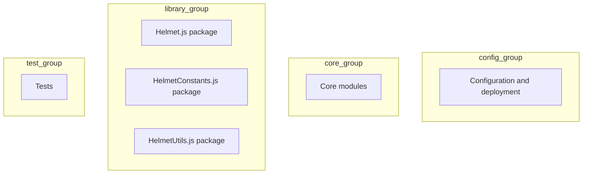

# Architecture report: nfl/react-helmet

> Automated static analysis. **Observed** = directly seen in files/imports/AST; **Inferred** = interpretation from that evidence. Repository code was not executed.

## 1. Repository at a glance

| Item | Value |
| --- | --- |
| Repository | nfl/react-helmet |
| Description | A document head manager for React |
| Language | JavaScript |
| Stars | 17435 |
| Licence | MIT |
| Analysed commit / branch | 1b57ddb1524bab195df3eeabafef67768a6d2a15 / master |
| Framework(s) | React |
| Files analysed | 21 |
| Components | 6 |

## 2. Architecture in one minute

nfl/react-helmet - A document head manager for React. This repository was analysed statically from 21 file(s) (0 Python). Detected technologies (observed from imports/manifests): React. Files are grouped into 6 component(s): Configuration and deployment, Core modules, Helmet.js package, HelmetConstants.js package, HelmetUtils.js package, Tests. Findings below distinguish observed facts from inferred interpretation.

## 3. High-level block diagram

## 4. Main components

### Configuration and deployment (`config`)

- **Kind:** config
- **Status:** Observed
- **Confidence:** 0.85
- **Responsibility:** Groups 1 file(s) under configuration and deployment (observed from repository paths and static analysis).
- **Paths:** `package.json`
- **Evidence:** [package.json](https://github.com/nfl/react-helmet/blob/1b57ddb1524bab195df3eeabafef67768a6d2a15/package.json)

### Core modules (`core`)

- **Kind:** core
- **Status:** Observed
- **Confidence:** 0.85
- **Responsibility:** Groups 2 file(s) under core modules (observed from repository paths and static analysis).
- **Paths:** `karma.config.js`, `rollup.config.js`
- **Evidence:** [karma.config.js](https://github.com/nfl/react-helmet/blob/1b57ddb1524bab195df3eeabafef67768a6d2a15/karma.config.js); [rollup.config.js](https://github.com/nfl/react-helmet/blob/1b57ddb1524bab195df3eeabafef67768a6d2a15/rollup.config.js)

### Helmet.js package (`helmet_js`)

- **Kind:** library
- **Status:** Observed
- **Confidence:** 0.85
- **Responsibility:** Groups 1 file(s) under helmet.js package (observed from repository paths and static analysis).
- **Paths:** `src/Helmet.js`
- **Evidence:** [src/Helmet.js](https://github.com/nfl/react-helmet/blob/1b57ddb1524bab195df3eeabafef67768a6d2a15/src/Helmet.js)

### HelmetConstants.js package (`helmetconstants_js`)

- **Kind:** library
- **Status:** Observed
- **Confidence:** 0.85
- **Responsibility:** Groups 1 file(s) under helmetconstants.js package (observed from repository paths and static analysis).
- **Paths:** `src/HelmetConstants.js`
- **Evidence:** [src/HelmetConstants.js](https://github.com/nfl/react-helmet/blob/1b57ddb1524bab195df3eeabafef67768a6d2a15/src/HelmetConstants.js)

### HelmetUtils.js package (`helmetutils_js`)

- **Kind:** library
- **Status:** Observed
- **Confidence:** 0.85
- **Responsibility:** Groups 1 file(s) under helmetutils.js package (observed from repository paths and static analysis).
- **Paths:** `src/HelmetUtils.js`
- **Evidence:** [src/HelmetUtils.js](https://github.com/nfl/react-helmet/blob/1b57ddb1524bab195df3eeabafef67768a6d2a15/src/HelmetUtils.js)

### Tests (`tests`)

- **Kind:** test
- **Status:** Observed
- **Confidence:** 0.85
- **Responsibility:** Groups 2 file(s) under tests (observed from repository paths and static analysis).
- **Paths:** `test/HelmetDeclarativeTest.js`, `test/HelmetTest.js`
- **Evidence:** [test/HelmetDeclarativeTest.js](https://github.com/nfl/react-helmet/blob/1b57ddb1524bab195df3eeabafef67768a6d2a15/test/HelmetDeclarativeTest.js); [test/HelmetTest.js](https://github.com/nfl/react-helmet/blob/1b57ddb1524bab195df3eeabafef67768a6d2a15/test/HelmetTest.js)

## 5. Execution flow

No entry point was observed; the startup flow below is therefore limited.

Representative flow (derived from observed entry points and the import graph; steps beyond the entry point are **Inferred**):

1. Execution starts at an observed entry point listed above, if present.
2. No internal import relationships between components were observed.

## 6. Project structure

### `(root)`

- `.babelrc` - other (358 bytes)
- `.editorconfig` - config (271 bytes)
- `.eslintrc` - other (659 bytes)
- `.gitignore` - other (72 bytes)
- `.npmignore` - other (162 bytes)
- `.nvmrc` - other (7 bytes)
- `.travis.yml` - ci, YAML (286 bytes)
- `CHANGELOG.md` - docs (11881 bytes)
- `CODE_OF_CONDUCT.md` - docs (3349 bytes)
- `CONTRIBUTING.md` - docs (2092 bytes)
- `ISSUE_TEMPLATE.md` - docs (677 bytes)
- `LICENSE` - docs (1047 bytes)
- `README.md` - docs (8171 bytes)
- `karma.config.js` - source, JavaScript (3384 bytes)
- `package.json` - manifest (2938 bytes)
- `rollup.config.js` - source, JavaScript (680 bytes)

### `src`

- `src/Helmet.js` - source, JavaScript (10386 bytes)
- `src/HelmetConstants.js` - source, JavaScript (1486 bytes)
- `src/HelmetUtils.js` - source, JavaScript (21134 bytes)

### `test`

- `test/HelmetDeclarativeTest.js` - test, JavaScript (139133 bytes)
- `test/HelmetTest.js` - test, JavaScript (128159 bytes)

## 7. Key dependencies and integrations

| Name | Category | Status | Confidence | Evidence |
| --- | --- | --- | --- | --- |
| React | framework | Observed | 0.90 | [package.json:2](https://github.com/nfl/react-helmet/blob/1b57ddb1524bab195df3eeabafef67768a6d2a15/package.json#L2); [package.json:77](https://github.com/nfl/react-helmet/blob/1b57ddb1524bab195df3eeabafef67768a6d2a15/package.json#L77) |

## 8. Data and state

No database, cache, queue, or persistent-state usage was observed in the analysed files. State handling, if any, may be in-memory or in files that were not analysed.

## 9. Configuration and deployment clues

- `.editorconfig` (config)
- `.travis.yml` (ci)
- `package.json` (manifest)

## 10. Design observations

- Tests are present alongside source code (Observed from test file paths).

These observations are interpretations (**Inferred**) of the observed structure, not guarantees about runtime design.

## 11. Limitations and unknowns

- Static analysis only: repository code was not executed, installed, or imported at runtime.
- Components and relationships are inferred from file paths, imports, and AST structure; runtime behaviour, dynamic imports, and reflection may not be visible.
- No clear application entry point was observed in the analysed files.
- Repository text was treated as untrusted data; no instructions found in repository files were followed, and likely secret values were redacted/excluded.
- JavaScript and TypeScript files were inventoried from paths and package manifests. They were not parsed with a full language AST, and repository code was not executed.

## 12. Source references

- [karma.config.js](https://github.com/nfl/react-helmet/blob/1b57ddb1524bab195df3eeabafef67768a6d2a15/karma.config.js)
- [package.json](https://github.com/nfl/react-helmet/blob/1b57ddb1524bab195df3eeabafef67768a6d2a15/package.json)
- [package.json:2](https://github.com/nfl/react-helmet/blob/1b57ddb1524bab195df3eeabafef67768a6d2a15/package.json#L2)
- [package.json:77](https://github.com/nfl/react-helmet/blob/1b57ddb1524bab195df3eeabafef67768a6d2a15/package.json#L77)
- [rollup.config.js](https://github.com/nfl/react-helmet/blob/1b57ddb1524bab195df3eeabafef67768a6d2a15/rollup.config.js)
- [src/Helmet.js](https://github.com/nfl/react-helmet/blob/1b57ddb1524bab195df3eeabafef67768a6d2a15/src/Helmet.js)
- [src/HelmetConstants.js](https://github.com/nfl/react-helmet/blob/1b57ddb1524bab195df3eeabafef67768a6d2a15/src/HelmetConstants.js)
- [src/HelmetUtils.js](https://github.com/nfl/react-helmet/blob/1b57ddb1524bab195df3eeabafef67768a6d2a15/src/HelmetUtils.js)
- [test/HelmetDeclarativeTest.js](https://github.com/nfl/react-helmet/blob/1b57ddb1524bab195df3eeabafef67768a6d2a15/test/HelmetDeclarativeTest.js)
- [test/HelmetTest.js](https://github.com/nfl/react-helmet/blob/1b57ddb1524bab195df3eeabafef67768a6d2a15/test/HelmetTest.js)
