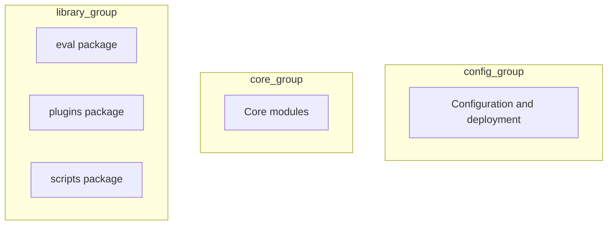

# Architecture report: nicobailon/visual-explainer

> Automated static analysis. **Observed** = directly seen in files/imports/AST; **Inferred** = interpretation from that evidence. Repository code was not executed.

## 1. Repository at a glance

| Item | Value |
| --- | --- |
| Repository | nicobailon/visual-explainer |
| Description | Agent skill that generates rich HTML pages or slide decks for diagrams, diff reviews, plan audits, data tables, and project recaps |
| Language | JavaScript |
| Stars | 11090 |
| Licence | MIT |
| Analysed commit / branch | 9d5f880b7e8e0a9a80c890b8e1bb6918b68481ad / main |
| Framework(s) | None detected |
| Files analysed | 93 |
| Components | 5 |

## 2. Architecture in one minute

nicobailon/visual-explainer - Agent skill that generates rich HTML pages or slide decks for diagrams, diff reviews, plan audits, data tables, and project recaps. This repository was analysed statically from 93 file(s) (0 Python). Detected technologies (observed from imports/manifests): no known frameworks/libraries. Files are grouped into 5 component(s): Configuration and deployment, Core modules, eval package, plugins package, scripts package. Findings below distinguish observed facts from inferred interpretation.

## 3. High-level block diagram

## 4. Main components

### Configuration and deployment (`config`)

- **Kind:** config
- **Status:** Observed
- **Confidence:** 0.85
- **Responsibility:** Groups 3 file(s) under configuration and deployment (observed from repository paths and static analysis).
- **Paths:** `package.json`, `plugin.json`, `plugins/visual-explainer/.claude-plugin/plugin.json`
- **Evidence:** [package.json](https://github.com/nicobailon/visual-explainer/blob/9d5f880b7e8e0a9a80c890b8e1bb6918b68481ad/package.json); [plugin.json](https://github.com/nicobailon/visual-explainer/blob/9d5f880b7e8e0a9a80c890b8e1bb6918b68481ad/plugin.json); [plugins/visual-explainer/.claude-plugin/plugin.json](https://github.com/nicobailon/visual-explainer/blob/9d5f880b7e8e0a9a80c890b8e1bb6918b68481ad/plugins/visual-explainer/.claude-plugin/plugin.json)

### Core modules (`core`)

- **Kind:** core
- **Status:** Observed
- **Confidence:** 0.85
- **Responsibility:** Groups 1 file(s) under core modules (observed from repository paths and static analysis).
- **Paths:** `install-pi.sh`
- **Evidence:** [install-pi.sh](https://github.com/nicobailon/visual-explainer/blob/9d5f880b7e8e0a9a80c890b8e1bb6918b68481ad/install-pi.sh)

### eval package (`eval`)

- **Kind:** library
- **Status:** Observed
- **Confidence:** 0.85
- **Responsibility:** Groups 1 file(s) under eval package (observed from repository paths and static analysis).
- **Paths:** `eval/score.mjs`
- **Evidence:** [eval/score.mjs](https://github.com/nicobailon/visual-explainer/blob/9d5f880b7e8e0a9a80c890b8e1bb6918b68481ad/eval/score.mjs)

### plugins package (`plugins`)

- **Kind:** library
- **Status:** Observed
- **Confidence:** 0.85
- **Responsibility:** Groups 19 file(s) under plugins package (observed from repository paths and static analysis).
- **Paths:** `plugins/visual-explainer/extension.ts`, `plugins/visual-explainer/kit/ask.js`, `plugins/visual-explainer/kit/ask.mjs`, `plugins/visual-explainer/kit/files.mjs`, `plugins/visual-explainer/kit/flow.mjs`, `plugins/visual-explainer/kit/html.mjs`, `plugins/visual-explainer/kit/kit.js`, `plugins/visual-explainer/kit/look.mjs`, `plugins/visual-explainer/kit/machine.mjs`, `plugins/visual-explainer/kit/render.mjs`, `plugins/visual-explainer/kit/reply.js`, `plugins/visual-explainer/kit/tags.mjs`, `plugins/visual-explainer/mcp/server.mjs`, `plugins/visual-explainer/plan/plan.js`, `plugins/visual-explainer/plan/render.mjs`, `plugins/visual-explainer/pptx/export.mjs`, `plugins/visual-explainer/video/driver.js`, `plugins/visual-explainer/video/media.mjs`, `plugins/visual-explainer/video/render.mjs`
- **Evidence:** [plugins/visual-explainer/extension.ts](https://github.com/nicobailon/visual-explainer/blob/9d5f880b7e8e0a9a80c890b8e1bb6918b68481ad/plugins/visual-explainer/extension.ts); [plugins/visual-explainer/kit/ask.js](https://github.com/nicobailon/visual-explainer/blob/9d5f880b7e8e0a9a80c890b8e1bb6918b68481ad/plugins/visual-explainer/kit/ask.js); [plugins/visual-explainer/kit/ask.mjs](https://github.com/nicobailon/visual-explainer/blob/9d5f880b7e8e0a9a80c890b8e1bb6918b68481ad/plugins/visual-explainer/kit/ask.mjs); [plugins/visual-explainer/kit/files.mjs](https://github.com/nicobailon/visual-explainer/blob/9d5f880b7e8e0a9a80c890b8e1bb6918b68481ad/plugins/visual-explainer/kit/files.mjs); [plugins/visual-explainer/kit/flow.mjs](https://github.com/nicobailon/visual-explainer/blob/9d5f880b7e8e0a9a80c890b8e1bb6918b68481ad/plugins/visual-explainer/kit/flow.mjs); [plugins/visual-explainer/kit/html.mjs](https://github.com/nicobailon/visual-explainer/blob/9d5f880b7e8e0a9a80c890b8e1bb6918b68481ad/plugins/visual-explainer/kit/html.mjs); [plugins/visual-explainer/kit/kit.js](https://github.com/nicobailon/visual-explainer/blob/9d5f880b7e8e0a9a80c890b8e1bb6918b68481ad/plugins/visual-explainer/kit/kit.js); [plugins/visual-explainer/kit/look.mjs](https://github.com/nicobailon/visual-explainer/blob/9d5f880b7e8e0a9a80c890b8e1bb6918b68481ad/plugins/visual-explainer/kit/look.mjs)

### scripts package (`scripts`)

- **Kind:** library
- **Status:** Observed
- **Confidence:** 0.85
- **Responsibility:** Groups 13 file(s) under scripts package (observed from repository paths and static analysis).
- **Paths:** `scripts/check-ask.mjs`, `scripts/check-kit.mjs`, `scripts/check-machine.mjs`, `scripts/check-versions.mjs`, `scripts/fixtures/machines/outside.ts`, `scripts/fixtures/machines/repo/src/bump.ts`, `scripts/fixtures/machines/repo/src/counter.ts`, `scripts/fixtures/machines/repo/src/door.ts`, `scripts/fixtures/machines/repo/src/elevator.ts`, `scripts/fixtures/machines/repo/src/mixer.ts`, `scripts/fixtures/machines/repo/src/player.ts`, `scripts/fixtures/machines/repo/src/stereo.ts`, `scripts/fixtures/machines/repo/src/volume.ts`
- **Evidence:** [scripts/check-ask.mjs](https://github.com/nicobailon/visual-explainer/blob/9d5f880b7e8e0a9a80c890b8e1bb6918b68481ad/scripts/check-ask.mjs); [scripts/check-kit.mjs](https://github.com/nicobailon/visual-explainer/blob/9d5f880b7e8e0a9a80c890b8e1bb6918b68481ad/scripts/check-kit.mjs); [scripts/check-machine.mjs](https://github.com/nicobailon/visual-explainer/blob/9d5f880b7e8e0a9a80c890b8e1bb6918b68481ad/scripts/check-machine.mjs); [scripts/check-versions.mjs](https://github.com/nicobailon/visual-explainer/blob/9d5f880b7e8e0a9a80c890b8e1bb6918b68481ad/scripts/check-versions.mjs); [scripts/fixtures/machines/outside.ts](https://github.com/nicobailon/visual-explainer/blob/9d5f880b7e8e0a9a80c890b8e1bb6918b68481ad/scripts/fixtures/machines/outside.ts); [scripts/fixtures/machines/repo/src/bump.ts](https://github.com/nicobailon/visual-explainer/blob/9d5f880b7e8e0a9a80c890b8e1bb6918b68481ad/scripts/fixtures/machines/repo/src/bump.ts); [scripts/fixtures/machines/repo/src/counter.ts](https://github.com/nicobailon/visual-explainer/blob/9d5f880b7e8e0a9a80c890b8e1bb6918b68481ad/scripts/fixtures/machines/repo/src/counter.ts); [scripts/fixtures/machines/repo/src/door.ts](https://github.com/nicobailon/visual-explainer/blob/9d5f880b7e8e0a9a80c890b8e1bb6918b68481ad/scripts/fixtures/machines/repo/src/door.ts)

## 5. Execution flow

**Observed** entry point(s):

- [plugins/visual-explainer/mcp/server.mjs](https://github.com/nicobailon/visual-explainer/blob/9d5f880b7e8e0a9a80c890b8e1bb6918b68481ad/plugins/visual-explainer/mcp/server.mjs)
- [plugins/visual-explainer/pptx/export.mjs](https://github.com/nicobailon/visual-explainer/blob/9d5f880b7e8e0a9a80c890b8e1bb6918b68481ad/plugins/visual-explainer/pptx/export.mjs)
- [plugins/visual-explainer/video/render.mjs](https://github.com/nicobailon/visual-explainer/blob/9d5f880b7e8e0a9a80c890b8e1bb6918b68481ad/plugins/visual-explainer/video/render.mjs)

Representative flow (derived from observed entry points and the import graph; steps beyond the entry point are **Inferred**):

1. Execution starts at an observed entry point listed above, if present.
2. No internal import relationships between components were observed.

## 6. Project structure

### `(root)`

- `.gitignore` - other (47 bytes)
- `CHANGELOG.md` - docs (45258 bytes)
- `LICENSE` - docs (1068 bytes)
- `README.md` - docs (30659 bytes)
- `install-pi.sh` - source, Shell (1281 bytes)
- `package.json` - manifest (2178 bytes)
- `plugin.json` - config (455 bytes)

### `.claude-plugin`

- `.claude-plugin/marketplace.json` - config (912 bytes)
- `.claude-plugin/plugin.json` - config (129 bytes)

### `configs`

- `configs/antigravity/AGENTS.md` - docs (1477 bytes)
- `configs/codex/AGENTS.md` - docs (705 bytes)
- `configs/copilot/AGENTS.md` - docs (999 bytes)
- `configs/cursor/visual-explainer.mdc` - other (1061 bytes)
- `configs/openclaw/AGENTS.md` - docs (586 bytes)
- `configs/opencode/AGENTS.md` - docs (677 bytes)
- `configs/pi/AGENTS.md` - docs (1926 bytes)

### `eval`

- `eval/README.md` - docs (974 bytes)
- `eval/judge.md` - docs (2939 bytes)
- `eval/prompts.md` - docs (4833 bytes)
- `eval/score.mjs` - source, JavaScript (3852 bytes)

### `examples`

- `examples/replay-job-queue.html` - other (18979 bytes)

### `plugins`

- `plugins/visual-explainer/.claude-plugin/plugin.json` - config (302 bytes)
- `plugins/visual-explainer/SKILL.md` - docs (8611 bytes)
- `plugins/visual-explainer/commands/compare.md` - docs (1287 bytes)
- `plugins/visual-explainer/commands/diff-review.md` - docs (1944 bytes)
- `plugins/visual-explainer/commands/fact-check.md` - docs (1105 bytes)
- `plugins/visual-explainer/commands/generate-slides.md` - docs (340 bytes)
- `plugins/visual-explainer/commands/generate-video.md` - docs (334 bytes)
- `plugins/visual-explainer/commands/generate-visual-plan.md` - docs (964 bytes)
- `plugins/visual-explainer/commands/generate-web-diagram.md` - docs (316 bytes)
- `plugins/visual-explainer/commands/plan-review.md` - docs (1682 bytes)
- `plugins/visual-explainer/commands/project-recap.md` - docs (1300 bytes)
- `plugins/visual-explainer/commands/state-machine.md` - docs (1492 bytes)
- `plugins/visual-explainer/extension.ts` - source, TypeScript (23375 bytes)
- `plugins/visual-explainer/kit/ask.css` - other (1572 bytes)
- `plugins/visual-explainer/kit/ask.js` - source, JavaScript (3281 bytes)
- `plugins/visual-explainer/kit/ask.mjs` - source, JavaScript (4124 bytes)
- `plugins/visual-explainer/kit/defs.svg` - other (831 bytes)
- `plugins/visual-explainer/kit/files.mjs` - source, JavaScript (2537 bytes)
- `plugins/visual-explainer/kit/flow.mjs` - source, JavaScript (12497 bytes)
- `plugins/visual-explainer/kit/html.mjs` - source, JavaScript (3782 bytes)
- `plugins/visual-explainer/kit/kit.css` - other (26343 bytes)
- `plugins/visual-explainer/kit/kit.js` - source, JavaScript (7110 bytes)
- `plugins/visual-explainer/kit/look.mjs` - source, JavaScript (25695 bytes)
- `plugins/visual-explainer/kit/machine.mjs` - source, JavaScript (28778 bytes)
- `plugins/visual-explainer/kit/mermaid.css` - other (1869 bytes)
- `plugins/visual-explainer/kit/render.mjs` - source, JavaScript (20045 bytes)
- `plugins/visual-explainer/kit/reply.js` - source, JavaScript (16281 bytes)
- `plugins/visual-explainer/kit/tags.mjs` - source, JavaScript (6635 bytes)
- `plugins/visual-explainer/mcp/README.md` - docs (3033 bytes)
- `plugins/visual-explainer/mcp/server.mjs` - source, JavaScript (18704 bytes)
- `plugins/visual-explainer/plan/plan.css` - other (27868 bytes)
- `plugins/visual-explainer/plan/plan.js` - source, JavaScript (21633 bytes)
- `plugins/visual-explainer/plan/render.mjs` - source, JavaScript (41098 bytes)
- `plugins/visual-explainer/pptx/README.md` - docs (1164 bytes)
- `plugins/visual-explainer/pptx/export.mjs` - source, JavaScript (10552 bytes)
- `plugins/visual-explainer/references/diagrams.md` - docs (5797 bytes)
- `plugins/visual-explainer/references/extras.md` - docs (1234 bytes)
- `plugins/visual-explainer/references/kit.md` - docs (6458 bytes)
- `plugins/visual-explainer/references/machines.md` - docs (9652 bytes)
- `plugins/visual-explainer/references/motion.md` - docs (5263 bytes)
- `plugins/visual-explainer/references/plans.md` - docs (7162 bytes)
- `plugins/visual-explainer/references/slides.md` - docs (2841 bytes)
- `plugins/visual-explainer/references/style-guide.md` - docs (7574 bytes)
- `plugins/visual-explainer/references/themes.md` - docs (3763 bytes)
- `plugins/visual-explainer/references/video.md` - docs (6663 bytes)
- `plugins/visual-explainer/templates/page.html` - other (13080 bytes)
- `plugins/visual-explainer/templates/plan.html` - other (7349 bytes)
- `plugins/visual-explainer/templates/slide-deck.html` - other (20180 bytes)
- `plugins/visual-explainer/video/driver.js` - source, JavaScript (5915 bytes)
- `plugins/visual-explainer/video/media.mjs` - source, JavaScript (4222 bytes)
- `plugins/visual-explainer/video/render.mjs` - source, JavaScript (8468 bytes)

### `scripts`

- `scripts/check-ask.mjs` - source, JavaScript (2027 bytes)
- `scripts/check-kit.mjs` - source, JavaScript (2193 bytes)
- `scripts/check-machine.mjs` - source, JavaScript (21304 bytes)
- `scripts/check-versions.mjs` - source, JavaScript (2371 bytes)
- `scripts/fixtures/machines/auto.src.html` - other (1250 bytes)
- `scripts/fixtures/machines/counter.model` - other (216 bytes)
- `scripts/fixtures/machines/door.model` - other (415 bytes)
- `scripts/fixtures/machines/hand-bad.model` - other (234 bytes)
- `scripts/fixtures/machines/hand.model` - other (365 bytes)
- `scripts/fixtures/machines/outside.ts` - source, TypeScript (20 bytes)
- `scripts/fixtures/machines/player.model` - other (548 bytes)
- `scripts/fixtures/machines/player.src.html` - other (1657 bytes)
- `scripts/fixtures/machines/regions.src.html` - other (1887 bytes)
- `scripts/fixtures/machines/repo/src/bump.ts` - source, TypeScript (189 bytes)
- `scripts/fixtures/machines/repo/src/counter.ts` - source, TypeScript (151 bytes)
- `scripts/fixtures/machines/repo/src/door.ts` - source, TypeScript (542 bytes)
- `scripts/fixtures/machines/repo/src/elevator.ts` - source, TypeScript (547 bytes)
- `scripts/fixtures/machines/repo/src/mixer.ts` - source, TypeScript (64 bytes)
- `scripts/fixtures/machines/repo/src/player.ts` - source, TypeScript (653 bytes)
- `scripts/fixtures/machines/repo/src/stereo.ts` - source, TypeScript (759 bytes)
- `scripts/fixtures/machines/repo/src/volume.ts` - source, TypeScript (95 bytes)

## 7. Key dependencies and integrations

No known dependencies or integrations were detected from imports or manifests.

## 8. Data and state

No database, cache, queue, or persistent-state usage was observed in the analysed files. State handling, if any, may be in-memory or in files that were not analysed.

## 9. Configuration and deployment clues

- `.claude-plugin/marketplace.json` (config)
- `.claude-plugin/plugin.json` (config)
- `package.json` (manifest)
- `plugin.json` (config)
- `plugins/visual-explainer/.claude-plugin/plugin.json` (config)

## 10. Design observations

- No strong design patterns could be established from the available evidence.

These observations are interpretations (**Inferred**) of the observed structure, not guarantees about runtime design.

## 11. Limitations and unknowns

- Static analysis only: repository code was not executed, installed, or imported at runtime.
- Components and relationships are inferred from file paths, imports, and AST structure; runtime behaviour, dynamic imports, and reflection may not be visible.
- 1 file(s) were skipped during inventory (1 x vendored/generated directory excluded).
- No clear application entry point was observed in the analysed files.
- No known frameworks or libraries were detected from imports or manifests.
- Repository text was treated as untrusted data; no instructions found in repository files were followed, and likely secret values were redacted/excluded.
- JavaScript and TypeScript files were inventoried from paths and package manifests. They were not parsed with a full language AST, and repository code was not executed.

## 12. Source references

- [eval/score.mjs](https://github.com/nicobailon/visual-explainer/blob/9d5f880b7e8e0a9a80c890b8e1bb6918b68481ad/eval/score.mjs)
- [install-pi.sh](https://github.com/nicobailon/visual-explainer/blob/9d5f880b7e8e0a9a80c890b8e1bb6918b68481ad/install-pi.sh)
- [package.json](https://github.com/nicobailon/visual-explainer/blob/9d5f880b7e8e0a9a80c890b8e1bb6918b68481ad/package.json)
- [plugin.json](https://github.com/nicobailon/visual-explainer/blob/9d5f880b7e8e0a9a80c890b8e1bb6918b68481ad/plugin.json)
- [plugins/visual-explainer/.claude-plugin/plugin.json](https://github.com/nicobailon/visual-explainer/blob/9d5f880b7e8e0a9a80c890b8e1bb6918b68481ad/plugins/visual-explainer/.claude-plugin/plugin.json)
- [plugins/visual-explainer/extension.ts](https://github.com/nicobailon/visual-explainer/blob/9d5f880b7e8e0a9a80c890b8e1bb6918b68481ad/plugins/visual-explainer/extension.ts)
- [plugins/visual-explainer/kit/ask.js](https://github.com/nicobailon/visual-explainer/blob/9d5f880b7e8e0a9a80c890b8e1bb6918b68481ad/plugins/visual-explainer/kit/ask.js)
- [plugins/visual-explainer/kit/ask.mjs](https://github.com/nicobailon/visual-explainer/blob/9d5f880b7e8e0a9a80c890b8e1bb6918b68481ad/plugins/visual-explainer/kit/ask.mjs)
- [plugins/visual-explainer/kit/files.mjs](https://github.com/nicobailon/visual-explainer/blob/9d5f880b7e8e0a9a80c890b8e1bb6918b68481ad/plugins/visual-explainer/kit/files.mjs)
- [plugins/visual-explainer/kit/flow.mjs](https://github.com/nicobailon/visual-explainer/blob/9d5f880b7e8e0a9a80c890b8e1bb6918b68481ad/plugins/visual-explainer/kit/flow.mjs)
- [plugins/visual-explainer/kit/html.mjs](https://github.com/nicobailon/visual-explainer/blob/9d5f880b7e8e0a9a80c890b8e1bb6918b68481ad/plugins/visual-explainer/kit/html.mjs)
- [plugins/visual-explainer/kit/kit.js](https://github.com/nicobailon/visual-explainer/blob/9d5f880b7e8e0a9a80c890b8e1bb6918b68481ad/plugins/visual-explainer/kit/kit.js)
- [plugins/visual-explainer/kit/look.mjs](https://github.com/nicobailon/visual-explainer/blob/9d5f880b7e8e0a9a80c890b8e1bb6918b68481ad/plugins/visual-explainer/kit/look.mjs)
- [plugins/visual-explainer/mcp/server.mjs](https://github.com/nicobailon/visual-explainer/blob/9d5f880b7e8e0a9a80c890b8e1bb6918b68481ad/plugins/visual-explainer/mcp/server.mjs)
- [plugins/visual-explainer/pptx/export.mjs](https://github.com/nicobailon/visual-explainer/blob/9d5f880b7e8e0a9a80c890b8e1bb6918b68481ad/plugins/visual-explainer/pptx/export.mjs)
- [plugins/visual-explainer/video/render.mjs](https://github.com/nicobailon/visual-explainer/blob/9d5f880b7e8e0a9a80c890b8e1bb6918b68481ad/plugins/visual-explainer/video/render.mjs)
- [scripts/check-ask.mjs](https://github.com/nicobailon/visual-explainer/blob/9d5f880b7e8e0a9a80c890b8e1bb6918b68481ad/scripts/check-ask.mjs)
- [scripts/check-kit.mjs](https://github.com/nicobailon/visual-explainer/blob/9d5f880b7e8e0a9a80c890b8e1bb6918b68481ad/scripts/check-kit.mjs)
- [scripts/check-machine.mjs](https://github.com/nicobailon/visual-explainer/blob/9d5f880b7e8e0a9a80c890b8e1bb6918b68481ad/scripts/check-machine.mjs)
- [scripts/check-versions.mjs](https://github.com/nicobailon/visual-explainer/blob/9d5f880b7e8e0a9a80c890b8e1bb6918b68481ad/scripts/check-versions.mjs)
- [scripts/fixtures/machines/outside.ts](https://github.com/nicobailon/visual-explainer/blob/9d5f880b7e8e0a9a80c890b8e1bb6918b68481ad/scripts/fixtures/machines/outside.ts)
- [scripts/fixtures/machines/repo/src/bump.ts](https://github.com/nicobailon/visual-explainer/blob/9d5f880b7e8e0a9a80c890b8e1bb6918b68481ad/scripts/fixtures/machines/repo/src/bump.ts)
- [scripts/fixtures/machines/repo/src/counter.ts](https://github.com/nicobailon/visual-explainer/blob/9d5f880b7e8e0a9a80c890b8e1bb6918b68481ad/scripts/fixtures/machines/repo/src/counter.ts)
- [scripts/fixtures/machines/repo/src/door.ts](https://github.com/nicobailon/visual-explainer/blob/9d5f880b7e8e0a9a80c890b8e1bb6918b68481ad/scripts/fixtures/machines/repo/src/door.ts)
