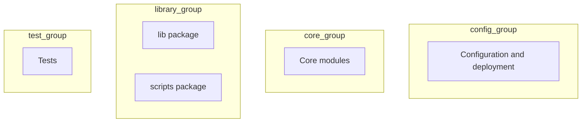

# Architecture report: nock/nock

> Automated static analysis. **Observed** = directly seen in files/imports/AST; **Inferred** = interpretation from that evidence. Repository code was not executed.

## 1. Repository at a glance

| Item | Value |
| --- | --- |
| Repository | nock/nock |
| Description | HTTP server mocking and expectations library for Node.js |
| Language | JavaScript |
| Stars | 13141 |
| Licence | MIT |
| Analysed commit / branch | 3e817ab5415606cc44eab247691d4035c037c322 / main |
| Framework(s) | None detected |
| Files analysed | 121 |
| Components | 5 |

## 2. Architecture in one minute

nock/nock - HTTP server mocking and expectations library for Node.js. This repository was analysed statically from 121 file(s) (0 Python). Detected technologies (observed from imports/manifests): GitHub Actions, TypeScript. Files are grouped into 5 component(s): Configuration and deployment, Core modules, lib package, scripts package, Tests. Findings below distinguish observed facts from inferred interpretation.

## 3. High-level block diagram

## 4. Main components

### Configuration and deployment (`config`)

- **Kind:** config
- **Status:** Observed
- **Confidence:** 0.85
- **Responsibility:** Groups 3 file(s) under configuration and deployment (observed from repository paths and static analysis).
- **Paths:** `package.json`, `tsconfig.build.json`, `tsconfig.json`
- **Evidence:** [package.json](https://github.com/nock/nock/blob/3e817ab5415606cc44eab247691d4035c037c322/package.json); [tsconfig.build.json](https://github.com/nock/nock/blob/3e817ab5415606cc44eab247691d4035c037c322/tsconfig.build.json); [tsconfig.json](https://github.com/nock/nock/blob/3e817ab5415606cc44eab247691d4035c037c322/tsconfig.json)

### Core modules (`core`)

- **Kind:** core
- **Status:** Observed
- **Confidence:** 0.85
- **Responsibility:** Groups 2 file(s) under core modules (observed from repository paths and static analysis).
- **Paths:** `eslint.config.mjs`, `index.ts`
- **Evidence:** [eslint.config.mjs](https://github.com/nock/nock/blob/3e817ab5415606cc44eab247691d4035c037c322/eslint.config.mjs); [index.ts](https://github.com/nock/nock/blob/3e817ab5415606cc44eab247691d4035c037c322/index.ts)

### lib package (`lib`)

- **Kind:** library
- **Status:** Observed
- **Confidence:** 0.85
- **Responsibility:** Groups 14 file(s) under lib package (observed from repository paths and static analysis).
- **Paths:** `lib/back.ts`, `lib/common.ts`, `lib/debug.ts`, `lib/global_emitter.ts`, `lib/handle-request.ts`, `lib/intercept.ts`, `lib/interceptor.ts`, `lib/interceptors/builtin.ts`, `lib/match_body.ts`, `lib/playback_interceptor.ts`, `lib/recorder.ts`, `lib/scope.ts`, `lib/stringify.ts`, `lib/utils/node/index.ts`
- **Evidence:** [lib/back.ts](https://github.com/nock/nock/blob/3e817ab5415606cc44eab247691d4035c037c322/lib/back.ts); [lib/common.ts](https://github.com/nock/nock/blob/3e817ab5415606cc44eab247691d4035c037c322/lib/common.ts); [lib/debug.ts](https://github.com/nock/nock/blob/3e817ab5415606cc44eab247691d4035c037c322/lib/debug.ts); [lib/global_emitter.ts](https://github.com/nock/nock/blob/3e817ab5415606cc44eab247691d4035c037c322/lib/global_emitter.ts); [lib/handle-request.ts](https://github.com/nock/nock/blob/3e817ab5415606cc44eab247691d4035c037c322/lib/handle-request.ts); [lib/intercept.ts](https://github.com/nock/nock/blob/3e817ab5415606cc44eab247691d4035c037c322/lib/intercept.ts); [lib/interceptor.ts](https://github.com/nock/nock/blob/3e817ab5415606cc44eab247691d4035c037c322/lib/interceptor.ts); [lib/interceptors/builtin.ts](https://github.com/nock/nock/blob/3e817ab5415606cc44eab247691d4035c037c322/lib/interceptors/builtin.ts)

### scripts package (`scripts`)

- **Kind:** library
- **Status:** Observed
- **Confidence:** 0.85
- **Responsibility:** Groups 3 file(s) under scripts package (observed from repository paths and static analysis).
- **Paths:** `scripts/build.js`, `scripts/test-build.js`, `scripts/test-leak.js`
- **Evidence:** [scripts/build.js](https://github.com/nock/nock/blob/3e817ab5415606cc44eab247691d4035c037c322/scripts/build.js); [scripts/test-build.js](https://github.com/nock/nock/blob/3e817ab5415606cc44eab247691d4035c037c322/scripts/test-build.js); [scripts/test-leak.js](https://github.com/nock/nock/blob/3e817ab5415606cc44eab247691d4035c037c322/scripts/test-leak.js)

### Tests (`tests`)

- **Kind:** test
- **Status:** Observed
- **Confidence:** 0.85
- **Responsibility:** Groups 60 file(s) under tests (observed from repository paths and static analysis).
- **Paths:** `tests/assets/reply_file_1.txt`, `tests/fixtures/content_length_test.json`, `tests/fixtures/good_request.json`, `tests/fixtures/wrong_uri.json`, `tests/got/fixtures/logging.mjs`, `tests/got/got_client.js`, `tests/got/test_allow_unmocked.js`, `tests/got/test_allow_unmocked_https.js`, `tests/got/test_back_filters.js`, `tests/got/test_basic_auth.js`, `tests/got/test_body_match.js`, `tests/got/test_content_encoding.js`, `tests/got/test_default_reply_headers.js`, `tests/got/test_define.js`, `tests/got/test_delay.js`, `tests/got/test_dynamic_mock.js`, `tests/got/test_events.js`, `tests/got/test_fake_timer.js`, `tests/got/test_header_matching.js`, `tests/got/test_intercept.js`, `tests/got/test_intercept_parallel.js`, `tests/got/test_logging.js`, `tests/got/test_net_connect.js`, `tests/got/test_nock_lifecycle.js`, `tests/got/test_nock_off.js`, `tests/got/test_passthrough.js`, `tests/got/test_persist_optionally.js`, `tests/got/test_query.js`, `tests/got/test_query_complex.js`, `tests/got/test_recorder.js`, `tests/got/test_redirects.js`, `tests/got/test_remove_interceptor.js`, `tests/got/test_repeating.js`, `tests/got/test_reply_body.js`, `tests/got/test_reply_function_async.js`, `tests/got/test_reply_function_sync.js`, `tests/got/test_reply_headers.js`, `tests/got/test_reply_with_file.js`, `tests/got/test_request_overrider.js`, `tests/got/test_scope.js`, `tests/got/test_stream.js`, `tests/got/test_url_encoding.js`, `tests/servers/ca.crt`, `tests/servers/index.js`, `tests/servers/localhost.crt`, `tests/setup.js`, `tests/test_abort.js`, `tests/test_abort_signal.js`, `tests/test_back.js`, `tests/test_client_request.js`, `tests/test_common.js`, `tests/test_destroy.js`, `tests/test_fetch.js`, `tests/test_gzip_request.js`, `tests/test_ipv6.js`, `tests/test_reply_with_error.js`, `tests/test_socket.js`, `tests/test_stringify.js`, `tests/test_undici.js`, `tests/test_unix_socket.js`
- **Evidence:** [tests/assets/reply_file_1.txt](https://github.com/nock/nock/blob/3e817ab5415606cc44eab247691d4035c037c322/tests/assets/reply_file_1.txt); [tests/fixtures/content_length_test.json](https://github.com/nock/nock/blob/3e817ab5415606cc44eab247691d4035c037c322/tests/fixtures/content_length_test.json); [tests/fixtures/good_request.json](https://github.com/nock/nock/blob/3e817ab5415606cc44eab247691d4035c037c322/tests/fixtures/good_request.json); [tests/fixtures/wrong_uri.json](https://github.com/nock/nock/blob/3e817ab5415606cc44eab247691d4035c037c322/tests/fixtures/wrong_uri.json); [tests/got/fixtures/logging.mjs](https://github.com/nock/nock/blob/3e817ab5415606cc44eab247691d4035c037c322/tests/got/fixtures/logging.mjs); [tests/got/got_client.js](https://github.com/nock/nock/blob/3e817ab5415606cc44eab247691d4035c037c322/tests/got/got_client.js); [tests/got/test_allow_unmocked.js](https://github.com/nock/nock/blob/3e817ab5415606cc44eab247691d4035c037c322/tests/got/test_allow_unmocked.js); [tests/got/test_allow_unmocked_https.js](https://github.com/nock/nock/blob/3e817ab5415606cc44eab247691d4035c037c322/tests/got/test_allow_unmocked_https.js)

## 5. Execution flow

**Observed** entry point(s):

- [index.ts](https://github.com/nock/nock/blob/3e817ab5415606cc44eab247691d4035c037c322/index.ts)
- [lib/utils/node/index.ts](https://github.com/nock/nock/blob/3e817ab5415606cc44eab247691d4035c037c322/lib/utils/node/index.ts)

Representative flow (derived from observed entry points and the import graph; steps beyond the entry point are **Inferred**):

1. Execution starts at an observed entry point listed above, if present.
2. No internal import relationships between components were observed.

## 6. Project structure

### `(root)`

- `.all-contributorsrc` - other (4485 bytes)
- `.gitignore` - other (73 bytes)
- `.mocharc.json` - config (56 bytes)
- `.npmignore` - other (67 bytes)
- `.nycrc.yml` - config (117 bytes)
- `.prettierignore` - other (84 bytes)
- `.prettierrc.yml` - config (72 bytes)
- `CHANGELOG.md` - docs (613 bytes)
- `CODE_OF_CONDUCT.md` - docs (3244 bytes)
- `CONTRIBUTING.md` - docs (11440 bytes)
- `CONTRIBUTORS.md` - docs (50940 bytes)
- `LICENSE` - docs (1099 bytes)
- `README.md` - docs (62212 bytes)
- `eslint.config.mjs` - source, JavaScript (1663 bytes)
- `index.ts` - source, TypeScript (3064 bytes)
- `package.json` - manifest (2481 bytes)
- `tsconfig.build.json` - config (338 bytes)
- `tsconfig.json` - config (391 bytes)

### `.github`

- `.github/ISSUE_TEMPLATE/01_bug_report.yml` - config (2494 bytes)
- `.github/ISSUE_TEMPLATE/02_feature_request.yml` - config (1214 bytes)
- `.github/ISSUE_TEMPLATE/config.yml` - config (177 bytes)
- `.github/dependabot.yml` - config (279 bytes)
- `.github/lock.yml` - config (744 bytes)
- `.github/stale.yml` - config (1026 bytes)
- `.github/toc.yml` - config (13 bytes)
- `.github/workflows/continuous-delivery.yaml` - ci, YAML (861 bytes)
- `.github/workflows/continuous-integration.yaml` - ci, YAML (2466 bytes)
- `.github/workflows/fix-formatting.yaml` - ci, YAML (1084 bytes)

### `examples`

- `examples/.eslintrc.yml` - config (43 bytes)
- `examples/_log.js` - source, JavaScript (277 bytes)
- `examples/binary-reply.js` - source, JavaScript (890 bytes)
- `examples/delay-response.js` - source, JavaScript (355 bytes)
- `examples/net-connect-default-no-mock.js` - source, JavaScript (434 bytes)
- `examples/net-connect-default-other-mock.js` - source, JavaScript (524 bytes)
- `examples/net-connect-disabled-different-host.js` - source, JavaScript (500 bytes)
- `examples/net-connect-mock-same-host-different-path.js` - source, JavaScript (486 bytes)
- `examples/socket-delay-abort.js` - source, JavaScript (434 bytes)
- `examples/socket-delay-no-abort.js` - source, JavaScript (381 bytes)

### `lib`

- `lib/back.ts` - source, TypeScript (9184 bytes)
- `lib/common.ts` - source, TypeScript (14321 bytes)
- `lib/debug.ts` - source, TypeScript (731 bytes)
- `lib/global_emitter.ts` - source, TypeScript (329 bytes)
- `lib/handle-request.ts` - source, TypeScript (3518 bytes)
- `lib/intercept.ts` - source, TypeScript (7287 bytes)
- `lib/interceptor.ts` - source, TypeScript (19787 bytes)
- `lib/interceptors/builtin.ts` - source, TypeScript (1896 bytes)
- `lib/match_body.ts` - source, TypeScript (2340 bytes)
- `lib/playback_interceptor.ts` - source, TypeScript (8874 bytes)
- `lib/recorder.ts` - source, TypeScript (10240 bytes)
- `lib/scope.ts` - source, TypeScript (12842 bytes)
- `lib/stringify.ts` - source, TypeScript (1808 bytes)
- `lib/utils/node/index.ts` - source, TypeScript (517 bytes)

### `migration_guides`

- `migration_guides/migrating_to_10.md` - docs (287 bytes)
- `migration_guides/migrating_to_11.md` - docs (8146 bytes)
- `migration_guides/migrating_to_12.md` - docs (1257 bytes)
- `migration_guides/migrating_to_13.md` - docs (2823 bytes)
- `migration_guides/migrating_to_15.md` - docs (5087 bytes)

### `rfcs`

- `rfcs/rfc-001.md` - docs (4768 bytes)

### `scripts`

- `scripts/build.js` - source, JavaScript (721 bytes)
- `scripts/test-build.js` - source, JavaScript (816 bytes)
- `scripts/test-leak.js` - source, JavaScript (675 bytes)

### `tests`

- `tests/assets/reply_file_1.txt` - test (20 bytes)
- `tests/fixtures/content_length_test.json` - test (304 bytes)
- `tests/fixtures/good_request.json` - test (54508 bytes)
- `tests/fixtures/wrong_uri.json` - test (109083 bytes)
- `tests/got/fixtures/logging.mjs` - test, JavaScript (259 bytes)
- `tests/got/got_client.js` - test, JavaScript (107 bytes)
- `tests/got/test_allow_unmocked.js` - test, JavaScript (8320 bytes)
- `tests/got/test_allow_unmocked_https.js` - test, JavaScript (3036 bytes)
- `tests/got/test_back_filters.js` - test, JavaScript (3146 bytes)
- `tests/got/test_basic_auth.js` - test, JavaScript (1656 bytes)
- `tests/got/test_body_match.js` - test, JavaScript (10298 bytes)
- `tests/got/test_content_encoding.js` - test, JavaScript (1173 bytes)
- `tests/got/test_default_reply_headers.js` - test, JavaScript (5383 bytes)
- `tests/got/test_define.js` - test, JavaScript (6666 bytes)
- `tests/got/test_delay.js` - test, JavaScript (4352 bytes)
- `tests/got/test_dynamic_mock.js` - test, JavaScript (1904 bytes)
- `tests/got/test_events.js` - test, JavaScript (8656 bytes)
- `tests/got/test_fake_timer.js` - test, JavaScript (412 bytes)
- `tests/got/test_header_matching.js` - test, JavaScript (18353 bytes)
- `tests/got/test_intercept.js` - test, JavaScript (33540 bytes)
- `tests/got/test_intercept_parallel.js` - test, JavaScript (1646 bytes)
- `tests/got/test_logging.js` - test, JavaScript (4948 bytes)
- `tests/got/test_net_connect.js` - test, JavaScript (4545 bytes)
- `tests/got/test_nock_lifecycle.js` - test, JavaScript (5778 bytes)
- `tests/got/test_nock_off.js` - test, JavaScript (1232 bytes)
- `tests/got/test_passthrough.js` - test, JavaScript (7669 bytes)
- `tests/got/test_persist_optionally.js` - test, JavaScript (6148 bytes)
- `tests/got/test_query.js` - test, JavaScript (12953 bytes)
- `tests/got/test_query_complex.js` - test, JavaScript (3979 bytes)
- `tests/got/test_recorder.js` - test, JavaScript (33319 bytes)
- `tests/got/test_redirects.js` - test, JavaScript (530 bytes)
- `tests/got/test_remove_interceptor.js` - test, JavaScript (6066 bytes)
- `tests/got/test_repeating.js` - test, JavaScript (3382 bytes)
- `tests/got/test_reply_body.js` - test, JavaScript (4893 bytes)
- `tests/got/test_reply_function_async.js` - test, JavaScript (5534 bytes)
- `tests/got/test_reply_function_sync.js` - test, JavaScript (13026 bytes)
- `tests/got/test_reply_headers.js` - test, JavaScript (12940 bytes)
- `tests/got/test_reply_with_file.js` - test, JavaScript (2630 bytes)
- `tests/got/test_request_overrider.js` - test, JavaScript (22922 bytes)
- `tests/got/test_scope.js` - test, JavaScript (5843 bytes)
- `tests/got/test_stream.js` - test, JavaScript (5955 bytes)
- `tests/got/test_url_encoding.js` - test, JavaScript (328 bytes)
- `tests/servers/ca.crt` - test (1184 bytes)
- `tests/servers/index.js` - test, JavaScript (1871 bytes)
- `tests/servers/localhost.crt` - test (1184 bytes)
- `tests/setup.js` - test, JavaScript (565 bytes)
- `tests/test_abort.js` - test, JavaScript (6675 bytes)
- `tests/test_abort_signal.js` - test, JavaScript (5345 bytes)
- `tests/test_back.js` - test, JavaScript (23170 bytes)
- `tests/test_client_request.js` - test, JavaScript (3002 bytes)
- `tests/test_common.js` - test, JavaScript (16603 bytes)
- `tests/test_destroy.js` - test, JavaScript (1384 bytes)
- `tests/test_fetch.js` - test, JavaScript (20967 bytes)
- `tests/test_gzip_request.js` - test, JavaScript (2381 bytes)
- `tests/test_ipv6.js` - test, JavaScript (1630 bytes)
- `tests/test_reply_with_error.js` - test, JavaScript (1336 bytes)
- `tests/test_socket.js` - test, JavaScript (2574 bytes)
- `tests/test_stringify.js` - test, JavaScript (2620 bytes)
- `tests/test_undici.js` - test, JavaScript (2195 bytes)
- `tests/test_unix_socket.js` - test, JavaScript (2108 bytes)

## 7. Key dependencies and integrations

| Name | Category | Status | Confidence | Evidence |
| --- | --- | --- | --- | --- |
| GitHub Actions | ci | Observed | 0.90 | [.github/workflows/continuous-delivery.yaml](https://github.com/nock/nock/blob/3e817ab5415606cc44eab247691d4035c037c322/.github/workflows/continuous-delivery.yaml); [.github/workflows/continuous-integration.yaml](https://github.com/nock/nock/blob/3e817ab5415606cc44eab247691d4035c037c322/.github/workflows/continuous-integration.yaml); [.github/workflows/fix-formatting.yaml](https://github.com/nock/nock/blob/3e817ab5415606cc44eab247691d4035c037c322/.github/workflows/fix-formatting.yaml) |
| TypeScript | tooling | Observed | 0.85 | [package.json:56](https://github.com/nock/nock/blob/3e817ab5415606cc44eab247691d4035c037c322/package.json#L56) |

## 8. Data and state

No database, cache, queue, or persistent-state usage was observed in the analysed files. State handling, if any, may be in-memory or in files that were not analysed.

## 9. Configuration and deployment clues

- `.github/ISSUE_TEMPLATE/01_bug_report.yml` (config)
- `.github/ISSUE_TEMPLATE/02_feature_request.yml` (config)
- `.github/ISSUE_TEMPLATE/config.yml` (config)
- `.github/dependabot.yml` (config)
- `.github/lock.yml` (config)
- `.github/stale.yml` (config)
- `.github/toc.yml` (config)
- `.github/workflows/continuous-delivery.yaml` (ci)
- `.github/workflows/continuous-integration.yaml` (ci)
- `.github/workflows/fix-formatting.yaml` (ci)
- `.mocharc.json` (config)
- `.nycrc.yml` (config)
- `.prettierrc.yml` (config)
- `examples/.eslintrc.yml` (config)
- `package.json` (manifest)
- `tsconfig.build.json` (config)
- `tsconfig.json` (config)

## 10. Design observations

- Tests are present alongside source code (Observed from test file paths).

These observations are interpretations (**Inferred**) of the observed structure, not guarantees about runtime design.

## 11. Limitations and unknowns

- Static analysis only: repository code was not executed, installed, or imported at runtime.
- Components and relationships are inferred from file paths, imports, and AST structure; runtime behaviour, dynamic imports, and reflection may not be visible.
- 2 file(s) were skipped during inventory (2 x likely secret file excluded).
- No clear application entry point was observed in the analysed files.
- Repository text was treated as untrusted data; no instructions found in repository files were followed, and likely secret values were redacted/excluded.
- JavaScript and TypeScript files were inventoried from paths and package manifests. They were not parsed with a full language AST, and repository code was not executed.

## 12. Source references

- [.github/workflows/continuous-delivery.yaml](https://github.com/nock/nock/blob/3e817ab5415606cc44eab247691d4035c037c322/.github/workflows/continuous-delivery.yaml)
- [.github/workflows/continuous-integration.yaml](https://github.com/nock/nock/blob/3e817ab5415606cc44eab247691d4035c037c322/.github/workflows/continuous-integration.yaml)
- [.github/workflows/fix-formatting.yaml](https://github.com/nock/nock/blob/3e817ab5415606cc44eab247691d4035c037c322/.github/workflows/fix-formatting.yaml)
- [eslint.config.mjs](https://github.com/nock/nock/blob/3e817ab5415606cc44eab247691d4035c037c322/eslint.config.mjs)
- [index.ts](https://github.com/nock/nock/blob/3e817ab5415606cc44eab247691d4035c037c322/index.ts)
- [lib/back.ts](https://github.com/nock/nock/blob/3e817ab5415606cc44eab247691d4035c037c322/lib/back.ts)
- [lib/common.ts](https://github.com/nock/nock/blob/3e817ab5415606cc44eab247691d4035c037c322/lib/common.ts)
- [lib/debug.ts](https://github.com/nock/nock/blob/3e817ab5415606cc44eab247691d4035c037c322/lib/debug.ts)
- [lib/global_emitter.ts](https://github.com/nock/nock/blob/3e817ab5415606cc44eab247691d4035c037c322/lib/global_emitter.ts)
- [lib/handle-request.ts](https://github.com/nock/nock/blob/3e817ab5415606cc44eab247691d4035c037c322/lib/handle-request.ts)
- [lib/intercept.ts](https://github.com/nock/nock/blob/3e817ab5415606cc44eab247691d4035c037c322/lib/intercept.ts)
- [lib/interceptor.ts](https://github.com/nock/nock/blob/3e817ab5415606cc44eab247691d4035c037c322/lib/interceptor.ts)
- [lib/interceptors/builtin.ts](https://github.com/nock/nock/blob/3e817ab5415606cc44eab247691d4035c037c322/lib/interceptors/builtin.ts)
- [lib/utils/node/index.ts](https://github.com/nock/nock/blob/3e817ab5415606cc44eab247691d4035c037c322/lib/utils/node/index.ts)
- [package.json](https://github.com/nock/nock/blob/3e817ab5415606cc44eab247691d4035c037c322/package.json)
- [package.json:56](https://github.com/nock/nock/blob/3e817ab5415606cc44eab247691d4035c037c322/package.json#L56)
- [scripts/build.js](https://github.com/nock/nock/blob/3e817ab5415606cc44eab247691d4035c037c322/scripts/build.js)
- [scripts/test-build.js](https://github.com/nock/nock/blob/3e817ab5415606cc44eab247691d4035c037c322/scripts/test-build.js)
- [scripts/test-leak.js](https://github.com/nock/nock/blob/3e817ab5415606cc44eab247691d4035c037c322/scripts/test-leak.js)
- [tests/assets/reply_file_1.txt](https://github.com/nock/nock/blob/3e817ab5415606cc44eab247691d4035c037c322/tests/assets/reply_file_1.txt)
- [tests/fixtures/content_length_test.json](https://github.com/nock/nock/blob/3e817ab5415606cc44eab247691d4035c037c322/tests/fixtures/content_length_test.json)
- [tests/fixtures/good_request.json](https://github.com/nock/nock/blob/3e817ab5415606cc44eab247691d4035c037c322/tests/fixtures/good_request.json)
- [tests/fixtures/wrong_uri.json](https://github.com/nock/nock/blob/3e817ab5415606cc44eab247691d4035c037c322/tests/fixtures/wrong_uri.json)
- [tests/got/fixtures/logging.mjs](https://github.com/nock/nock/blob/3e817ab5415606cc44eab247691d4035c037c322/tests/got/fixtures/logging.mjs)
- [tests/got/got_client.js](https://github.com/nock/nock/blob/3e817ab5415606cc44eab247691d4035c037c322/tests/got/got_client.js)
- [tests/got/test_allow_unmocked.js](https://github.com/nock/nock/blob/3e817ab5415606cc44eab247691d4035c037c322/tests/got/test_allow_unmocked.js)
- [tests/got/test_allow_unmocked_https.js](https://github.com/nock/nock/blob/3e817ab5415606cc44eab247691d4035c037c322/tests/got/test_allow_unmocked_https.js)
- [tsconfig.build.json](https://github.com/nock/nock/blob/3e817ab5415606cc44eab247691d4035c037c322/tsconfig.build.json)
- [tsconfig.json](https://github.com/nock/nock/blob/3e817ab5415606cc44eab247691d4035c037c322/tsconfig.json)
