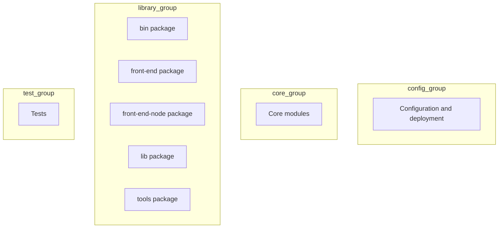

# Architecture report: node-inspector/node-inspector

> Automated static analysis. **Observed** = directly seen in files/imports/AST; **Inferred** = interpretation from that evidence. Repository code was not executed.

## 1. Repository at a glance

| Item | Value |
| --- | --- |
| Repository | node-inspector/node-inspector |
| Description | Node.js debugger based on Blink Developer Tools |
| Language | JavaScript |
| Stars | 12637 |
| Licence | BSD-2-Clause |
| Analysed commit / branch | 79e01c049286374f86dd560742a614019c02402f / master |
| Framework(s) | Express |
| Files analysed | 545 |
| Components | 8 |

## 2. Architecture in one minute

node-inspector/node-inspector - Node.js debugger based on Blink Developer Tools. This repository was analysed statically from 545 file(s) (1 Python). Detected technologies (observed from imports/manifests): Express. Files are grouped into 8 component(s): bin package, Configuration and deployment, Core modules, front-end package, front-end-node package, lib package, Tests, tools package. Findings below distinguish observed facts from inferred interpretation.

## 3. High-level block diagram

## 4. Main components

### bin package (`bin`)

- **Kind:** library
- **Status:** Observed
- **Confidence:** 0.85
- **Responsibility:** Groups 3 file(s) under bin package (observed from repository paths and static analysis).
- **Paths:** `bin/inspector.js`, `bin/node-debug.js`, `bin/run-repl.js`
- **Evidence:** [bin/inspector.js](https://github.com/node-inspector/node-inspector/blob/79e01c049286374f86dd560742a614019c02402f/bin/inspector.js); [bin/node-debug.js](https://github.com/node-inspector/node-inspector/blob/79e01c049286374f86dd560742a614019c02402f/bin/node-debug.js); [bin/run-repl.js](https://github.com/node-inspector/node-inspector/blob/79e01c049286374f86dd560742a614019c02402f/bin/run-repl.js)

### Configuration and deployment (`config`)

- **Kind:** config
- **Status:** Observed
- **Confidence:** 0.85
- **Responsibility:** Groups 48 file(s) under configuration and deployment (observed from repository paths and static analysis).
- **Paths:** `front-end-node/console/module.json`, `front-end-node/inspector.json`, `front-end-node/main/module.json`, `front-end-node/module.json`, `front-end-node/network/module.json`, `front-end-node/profiler/module.json`, `front-end-node/protocol.json`, `front-end-node/settings/SettingsScreenOverrides.js`, `front-end-node/settings/module.json`, `front-end-node/sources/module.json`, `front-end/audits/module.json`, `front-end/bindings/module.json`, `front-end/common/module.json`, `front-end/components/module.json`, `front-end/console/module.json`, `front-end/devices/module.json`, `front-end/devtools.json`, `front-end/devtools_app/module.json`, `front-end/documentation/module.json`, `front-end/elements/module.json`, `front-end/extensions/module.json`, `front-end/heap_snapshot_worker/module.json`, `front-end/host/module.json`, `front-end/inspector.json`, `front-end/layers/module.json`, `front-end/main/module.json`, `front-end/network/module.json`, `front-end/platform/module.json`, `front-end/profiler/module.json`, `front-end/promises/module.json`, `front-end/resources/module.json`, `front-end/screencast/module.json`, `front-end/script_formatter_worker/module.json`, `front-end/sdk/module.json`, `front-end/settings/EditFileSystemDialog.js`, `front-end/settings/FrameworkBlackboxDialog.js`, `front-end/settings/SettingsScreen.js`, `front-end/settings/module.json`, `front-end/source_frame/module.json`, `front-end/sources/module.json`, `front-end/temp_storage_shared_worker/module.json`, `front-end/timeline/module.json`, `front-end/toolbox.json`, `front-end/toolbox/module.json`, `front-end/toolbox_bootstrap/module.json`, `front-end/ui/module.json`, `front-end/workspace/module.json`, `package.json`
- **Evidence:** [front-end-node/console/module.json](https://github.com/node-inspector/node-inspector/blob/79e01c049286374f86dd560742a614019c02402f/front-end-node/console/module.json); [front-end-node/inspector.json](https://github.com/node-inspector/node-inspector/blob/79e01c049286374f86dd560742a614019c02402f/front-end-node/inspector.json); [front-end-node/main/module.json](https://github.com/node-inspector/node-inspector/blob/79e01c049286374f86dd560742a614019c02402f/front-end-node/main/module.json); [front-end-node/module.json](https://github.com/node-inspector/node-inspector/blob/79e01c049286374f86dd560742a614019c02402f/front-end-node/module.json); [front-end-node/network/module.json](https://github.com/node-inspector/node-inspector/blob/79e01c049286374f86dd560742a614019c02402f/front-end-node/network/module.json); [front-end-node/profiler/module.json](https://github.com/node-inspector/node-inspector/blob/79e01c049286374f86dd560742a614019c02402f/front-end-node/profiler/module.json); [front-end-node/protocol.json](https://github.com/node-inspector/node-inspector/blob/79e01c049286374f86dd560742a614019c02402f/front-end-node/protocol.json); [front-end-node/settings/SettingsScreenOverrides.js](https://github.com/node-inspector/node-inspector/blob/79e01c049286374f86dd560742a614019c02402f/front-end-node/settings/SettingsScreenOverrides.js)

### Core modules (`core`)

- **Kind:** core
- **Status:** Observed
- **Confidence:** 0.85
- **Responsibility:** Groups 1 file(s) under core modules (observed from repository paths and static analysis).
- **Paths:** `index.js`
- **Evidence:** [index.js](https://github.com/node-inspector/node-inspector/blob/79e01c049286374f86dd560742a614019c02402f/index.js)

### front-end package (`front_end`)

- **Kind:** library
- **Status:** Observed
- **Confidence:** 0.85
- **Responsibility:** Groups 343 file(s) under front-end package (observed from repository paths and static analysis). Observed top-level functions: CheckChangeOnUpload, _CheckCodeMirrorChanges.
- **Paths:** `front-end/Runtime.js`, `front-end/UglifyJS/parse-js.js`, `front-end/audits/AuditCategories.js`, `front-end/audits/AuditCategory.js`, `front-end/audits/AuditController.js`, `front-end/audits/AuditExtensionCategory.js`, `front-end/audits/AuditFormatters.js`, `front-end/audits/AuditLauncherView.js`, `front-end/audits/AuditResultView.js`, `front-end/audits/AuditRules.js`, `front-end/audits/AuditsPanel.js`, `front-end/bindings/BreakpointManager.js`, `front-end/bindings/CSSWorkspaceBinding.js`, `front-end/bindings/CompilerScriptMapping.js`, `front-end/bindings/ContentProviderBasedProjectDelegate.js`, `front-end/bindings/ContentScriptProjectDecorator.js`, `front-end/bindings/DebuggerWorkspaceBinding.js`, `front-end/bindings/DefaultScriptMapping.js`, `front-end/bindings/FileUtils.js`, `front-end/bindings/Linkifier.js`, `front-end/bindings/LiveLocation.js`, `front-end/bindings/NetworkUISourceCodeProvider.js`, `front-end/bindings/NetworkWorkspaceBinding.js`, `front-end/bindings/PresentationConsoleMessageHelper.js`, `front-end/bindings/ResourceScriptMapping.js`, `front-end/bindings/ResourceUtils.js`, `front-end/bindings/SASSSourceMapping.js`, `front-end/bindings/ScriptSnippetModel.js`, `front-end/bindings/StylesSourceMapping.js`, `front-end/bindings/TempFile.js`, `front-end/bindings/WorkspaceController.js`, `front-end/cm/PRESUBMIT.py`, `front-end/cm/clike.js`, `front-end/cm/closebrackets.js`, `front-end/cm/coffeescript.js`, `front-end/cm/comment.js`, `front-end/cm/css.js`, `front-end/cm/headlesscodemirror.js`, `front-end/cm/htmlembedded.js`, `front-end/cm/htmlmixed.js`, `front-end/cm/javascript.js`, `front-end/cm/markselection.js`, `front-end/cm/matchbrackets.js`, `front-end/cm/overlay.js`, `front-end/cm/php.js`, `front-end/cm/python.js`, `front-end/cm/shell.js`, `front-end/cm/xml.js`, `front-end/common/Color.js`, `front-end/common/Console.js`, `front-end/common/ContentProvider.js`, `front-end/common/Geometry.js`, `front-end/common/Lock.js`, `front-end/common/ModuleExtensionInterfaces.js`, `front-end/common/NotificationService.js`, `front-end/common/Object.js`, `front-end/common/ParsedURL.js`, `front-end/common/Progress.js`, `front-end/common/ResourceType.js`, `front-end/common/Settings.js`, `front-end/common/StaticContentProvider.js`, `front-end/common/TextRange.js`, `front-end/common/TextUtils.js`, `front-end/common/Throttler.js`, `front-end/common/UIString.js`, `front-end/common/WebInspector.js`, `front-end/common/WorkerRuntime.js`, `front-end/components/CookiesTable.js`, `front-end/components/DOMBreakpointsSidebarPane.js`, `front-end/components/DOMPresentationUtils.js`, `front-end/components/DockController.js`, `front-end/components/Drawer.js`, `front-end/components/ExecutionContextSelector.js`, `front-end/components/HandlerRegistry.js`, `front-end/components/InspectElementModeController.js`, `front-end/components/InspectorView.js`, `front-end/components/NativeBreakpointsSidebarPane.js`, `front-end/components/ObjectPopoverHelper.js`, `front-end/components/ObjectPropertiesSection.js`, `front-end/components/ShortcutsScreen.js`, `front-end/components/TargetsComboBoxController.js`, `front-end/console/ConsolePanel.js`, `front-end/console/ConsoleView.js`, `front-end/console/ConsoleViewMessage.js`, `front-end/devices/DevicesView.js`, `front-end/devtools.js`, `front-end/devtools_app/DevToolsAPI.js`, `front-end/devtools_app/DevToolsApp.js`, `front-end/devtools_app/InspectorFrontendHostImpl.js`, `front-end/devtools_app/UITests.js`, `front-end/documentation/DocumentationCatalog.js`, `front-end/documentation/DocumentationView.js`, `front-end/documentation/JSArticle.js`, `front-end/documentation/WikiParser.js`, `front-end/elements/AnimationsSidebarPane.js`, `front-end/elements/ElementsBreadcrumbs.js`, `front-end/elements/ElementsPanel.js`, `front-end/elements/ElementsSidebarPane.js`, `front-end/elements/ElementsTreeOutline.js`, `front-end/elements/EventListenersSidebarPane.js`, `front-end/elements/MetricsSidebarPane.js`, `front-end/elements/PlatformFontsSidebarPane.js`, `front-end/elements/PropertiesSidebarPane.js`, `front-end/elements/Spectrum.js`, `front-end/elements/StylesSectionModel.js`, `front-end/elements/StylesSidebarPane.js`, `front-end/extensions/ExtensionAPI.js`, `front-end/extensions/ExtensionAuditCategory.js`, `front-end/extensions/ExtensionPanel.js`, `front-end/extensions/ExtensionRegistryStub.js`, `front-end/extensions/ExtensionServer.js`, `front-end/extensions/ExtensionView.js`, `front-end/externs.js`, `front-end/heap_snapshot_worker/AllocationProfile.js`, `front-end/heap_snapshot_worker/HeapSnapshot.js`, `front-end/heap_snapshot_worker/HeapSnapshotLoader.js`, `front-end/heap_snapshot_worker/HeapSnapshotWorker.js`, `front-end/heap_snapshot_worker/HeapSnapshotWorkerDispatcher.js`, `front-end/heap_snapshot_worker/JSHeapSnapshot.js`, `front-end/host/InspectorFrontendHost.js`, `front-end/host/Platform.js`, `front-end/host/UserMetrics.js`, `front-end/inspector.js`, `front-end/layers/LayerPaintProfilerView.js`, `front-end/layers/LayersPanel.js`, `front-end/main/AdvancedApp.js`, `front-end/main/App.js`, `front-end/main/HelpScreenUntilReload.js`, `front-end/main/Main.js`, `front-end/main/OverridesView.js`, `front-end/main/RenderingOptions.js`, `front-end/main/ScreencastApp.js`, `front-end/main/SimpleApp.js`, `front-end/main/TestController.js`, `front-end/main/Tests.js`, `front-end/network/FilterSuggestionBuilder.js`, `front-end/network/HARWriter.js`, `front-end/network/NetworkDataGridNode.js`, `front-end/network/NetworkItemView.js`, `front-end/network/NetworkLogView.js`, `front-end/network/NetworkPanel.js`, `front-end/network/NetworkTimeCalculator.js`, `front-end/network/RequestCookiesView.js`, `front-end/network/RequestHTMLView.js`, `front-end/network/RequestHeadersView.js`, `front-end/network/RequestJSONView.js`, `front-end/network/RequestPreviewView.js`, `front-end/network/RequestResponseView.js`, `front-end/network/RequestTimingView.js`, `front-end/network/RequestView.js`, `front-end/network/ResourceWebSocketFrameView.js`, `front-end/platform/DOMExtension.js`, `front-end/platform/Promise.js`, `front-end/platform/utilities.js`, `front-end/profiler/CPUProfileBottomUpDataGrid.js`, `front-end/profiler/CPUProfileDataGrid.js`, `front-end/profiler/CPUProfileFlameChart.js`, `front-end/profiler/CPUProfileTopDownDataGrid.js`, `front-end/profiler/CPUProfileView.js`, `front-end/profiler/CanvasProfileView.js`, `front-end/profiler/CanvasReplayStateView.js`, `front-end/profiler/HeapSnapshotCommon.js`, `front-end/profiler/HeapSnapshotDataGrids.js`, `front-end/profiler/HeapSnapshotGridNodes.js`, `front-end/profiler/HeapSnapshotProxy.js`, `front-end/profiler/HeapSnapshotView.js`, `front-end/profiler/ProfileLauncherView.js`, `front-end/profiler/ProfileTypeRegistry.js`, `front-end/profiler/ProfilesPanel.js`, `front-end/promises/PromisePane.js`, `front-end/resources/ApplicationCacheItemsView.js`, `front-end/resources/CookieItemsView.js`, `front-end/resources/DOMStorageItemsView.js`, `front-end/resources/DatabaseQueryView.js`, `front-end/resources/DatabaseTableView.js`, `front-end/resources/DirectoryContentView.js`, `front-end/resources/FileContentView.js`, `front-end/resources/FileSystemView.js`, `front-end/resources/IndexedDBViews.js`, `front-end/resources/ResourcesPanel.js`, `front-end/screencast/ScreencastView.js`, `front-end/script_formatter_worker/CSSFormatter.js`, `front-end/script_formatter_worker/JavaScriptFormatter.js`, `front-end/script_formatter_worker/ScriptFormatterWorker.js`, `front-end/sdk/AnimationModel.js`, `front-end/sdk/ApplicationCacheModel.js`, `front-end/sdk/BlackboxSupport.js`, `front-end/sdk/CPUProfileDataModel.js`, `front-end/sdk/CPUProfilerModel.js`, `front-end/sdk/CSSMetadata.js`, `front-end/sdk/CSSParser.js`, `front-end/sdk/CSSStyleModel.js`, `front-end/sdk/ConsoleModel.js`, `front-end/sdk/ContentProviders.js`, `front-end/sdk/CookieParser.js`, `front-end/sdk/DOMModel.js`, `front-end/sdk/DOMStorage.js`, `front-end/sdk/Database.js`, `front-end/sdk/DebuggerModel.js`, `front-end/sdk/FileSystemModel.js`, `front-end/sdk/HAREntry.js`, `front-end/sdk/HeapProfilerModel.js`, `front-end/sdk/IndexedDBModel.js`, `front-end/sdk/InspectorBackend.js`, `front-end/sdk/LayerTreeModel.js`, `front-end/sdk/NetworkLog.js`, `front-end/sdk/NetworkManager.js`, `front-end/sdk/NetworkRequest.js`, `front-end/sdk/OverridesSupport.js`, `front-end/sdk/PaintProfiler.js`, `front-end/sdk/PowerProfiler.js`, `front-end/sdk/RemoteObject.js`, `front-end/sdk/Resource.js`, `front-end/sdk/ResourceTreeModel.js`, `front-end/sdk/RuntimeModel.js`, `front-end/sdk/Script.js`, `front-end/sdk/SnippetStorage.js`, `front-end/sdk/SourceMap.js`, `front-end/sdk/Target.js`, `front-end/sdk/TracingManager.js`, `front-end/sdk/WorkerManager.js`, `front-end/sdk/WorkerTargetManager.js`, `front-end/source_frame/CodeMirrorTextEditor.js`, `front-end/source_frame/CodeMirrorUtils.js`, `front-end/source_frame/FontView.js`, `front-end/source_frame/GoToLineDialog.js`, `front-end/source_frame/ImageView.js`, `front-end/source_frame/ResourceSourceFrame.js`, `front-end/source_frame/SourceFrame.js`, `front-end/sources/AddSourceMapURLDialog.js`, `front-end/sources/AdvancedSearchView.js`, `front-end/sources/BreakpointsSidebarPane.js`, `front-end/sources/CSSSourceFrame.js`, `front-end/sources/CallStackSidebarPane.js`, `front-end/sources/EditingLocationHistoryManager.js`, `front-end/sources/FileBasedSearchResultsPane.js`, `front-end/sources/FilePathScoreFunction.js`, `front-end/sources/FilteredItemSelectionDialog.js`, `front-end/sources/InplaceFormatterEditorAction.js`, `front-end/sources/JavaScriptSourceFrame.js`, `front-end/sources/NavigatorView.js`, `front-end/sources/Placard.js`, `front-end/sources/RevisionHistoryView.js`, `front-end/sources/ScopeChainSidebarPane.js`, `front-end/sources/ScriptFormatter.js`, `front-end/sources/ScriptFormatterEditorAction.js`, `front-end/sources/SimpleHistoryManager.js`, `front-end/sources/SourcesNavigator.js`, `front-end/sources/SourcesPanel.js`, `front-end/sources/SourcesSearchScope.js`, `front-end/sources/SourcesView.js`, `front-end/sources/StyleSheetOutlineDialog.js`, `front-end/sources/TabbedEditorContainer.js`, `front-end/sources/ThreadsSidebarPane.js`, `front-end/sources/UISourceCodeFrame.js`, `front-end/sources/WatchExpressionsSidebarPane.js`, `front-end/sources/WorkspaceMappingTip.js`, `front-end/sources/jsdifflib.js`, `front-end/temp_storage_shared_worker/TempStorageSharedWorker.js`, `front-end/timeline/CountersGraph.js`, `front-end/timeline/LayerDetailsView.js`, `front-end/timeline/LayerTreeOutline.js`, `front-end/timeline/Layers3DView.js`, `front-end/timeline/MemoryCountersGraph.js`, `front-end/timeline/PaintProfilerView.js`, `front-end/timeline/TimelineEventOverview.js`, `front-end/timeline/TimelineFlameChart.js`, `front-end/timeline/TimelineFrameModel.js`, `front-end/timeline/TimelineFrameOverview.js`, `front-end/timeline/TimelineJSProfile.js`, `front-end/timeline/TimelineLayersView.js`, `front-end/timeline/TimelineMemoryOverview.js`, `front-end/timeline/TimelineModel.js`, `front-end/timeline/TimelineOverviewPane.js`, `front-end/timeline/TimelinePaintProfilerView.js`, `front-end/timeline/TimelinePanel.js`, `front-end/timeline/TimelinePowerGraph.js`, `front-end/timeline/TimelinePowerOverview.js`, `front-end/timeline/TimelinePresentationModel.js`, `front-end/timeline/TimelineUIUtils.js`, `front-end/timeline/TimelineView.js`, `front-end/timeline/TracingModel.js`, `front-end/timeline/TransformController.js`, `front-end/toolbox.js`, `front-end/toolbox/InspectedPagePlaceholder.js`, `front-end/toolbox/MediaQueryInspector.js`, `front-end/toolbox/OverridesUI.js`, `front-end/toolbox/ResponsiveDesignView.js`, `front-end/toolbox_bootstrap/Toolbox.js`, `front-end/treeoutline.js`, `front-end/ui/ActionRegistry.js`, `front-end/ui/CompletionDictionary.js`, `front-end/ui/Context.js`, `front-end/ui/ContextMenu.js`, `front-end/ui/DOMSyntaxHighlighter.js`, `front-end/ui/DataGrid.js`, `front-end/ui/Dialog.js`, `front-end/ui/DropDownMenu.js`, `front-end/ui/EmptyView.js`, `front-end/ui/FilterBar.js`, `front-end/ui/FlameChart.js`, `front-end/ui/ForwardedInputEventHandler.js`, `front-end/ui/HelpScreen.js`, `front-end/ui/InplaceEditor.js`, `front-end/ui/KeyboardShortcut.js`, `front-end/ui/OverviewGrid.js`, `front-end/ui/Panel.js`, `front-end/ui/PieChart.js`, `front-end/ui/Popover.js`, `front-end/ui/ProgressIndicator.js`, `front-end/ui/ResizerWidget.js`, `front-end/ui/RootView.js`, `front-end/ui/SearchableView.js`, `front-end/ui/Section.js`, `front-end/ui/SettingsUI.js`, `front-end/ui/ShortcutRegistry.js`, `front-end/ui/ShowMoreDataGridNode.js`, `front-end/ui/SidebarPane.js`, `front-end/ui/SidebarTreeElement.js`, `front-end/ui/SoftContextMenu.js`, `front-end/ui/SortableDataGrid.js`, `front-end/ui/SplitView.js`, `front-end/ui/StackView.js`, `front-end/ui/StatusBar.js`, `front-end/ui/SuggestBox.js`, `front-end/ui/TabbedPane.js`, `front-end/ui/TextEditor.js`, `front-end/ui/TextPrompt.js`, `front-end/ui/TimelineGrid.js`, `front-end/ui/UIUtils.js`, `front-end/ui/View.js`, `front-end/ui/ViewportControl.js`, `front-end/ui/ViewportDataGrid.js`, `front-end/ui/ZoomManager.js`, `front-end/ui/treeoutline.js`, `front-end/workspace/FileManager.js`, `front-end/workspace/FileSystemMapping.js`, `front-end/workspace/FileSystemWorkspaceBinding.js`, `front-end/workspace/IsolatedFileSystem.js`, `front-end/workspace/IsolatedFileSystemManager.js`, `front-end/workspace/SearchConfig.js`, `front-end/workspace/UISourceCode.js`, `front-end/workspace/Workspace.js`
- **Evidence:** [front-end/Runtime.js](https://github.com/node-inspector/node-inspector/blob/79e01c049286374f86dd560742a614019c02402f/front-end/Runtime.js); [front-end/UglifyJS/parse-js.js](https://github.com/node-inspector/node-inspector/blob/79e01c049286374f86dd560742a614019c02402f/front-end/UglifyJS/parse-js.js); [front-end/audits/AuditCategories.js](https://github.com/node-inspector/node-inspector/blob/79e01c049286374f86dd560742a614019c02402f/front-end/audits/AuditCategories.js); [front-end/audits/AuditCategory.js](https://github.com/node-inspector/node-inspector/blob/79e01c049286374f86dd560742a614019c02402f/front-end/audits/AuditCategory.js); [front-end/audits/AuditController.js](https://github.com/node-inspector/node-inspector/blob/79e01c049286374f86dd560742a614019c02402f/front-end/audits/AuditController.js); [front-end/audits/AuditExtensionCategory.js](https://github.com/node-inspector/node-inspector/blob/79e01c049286374f86dd560742a614019c02402f/front-end/audits/AuditExtensionCategory.js); [front-end/audits/AuditFormatters.js](https://github.com/node-inspector/node-inspector/blob/79e01c049286374f86dd560742a614019c02402f/front-end/audits/AuditFormatters.js); [front-end/audits/AuditLauncherView.js](https://github.com/node-inspector/node-inspector/blob/79e01c049286374f86dd560742a614019c02402f/front-end/audits/AuditLauncherView.js)

### front-end-node package (`front_end_node`)

- **Kind:** library
- **Status:** Observed
- **Confidence:** 0.85
- **Responsibility:** Groups 6 file(s) under front-end-node package (observed from repository paths and static analysis).
- **Paths:** `front-end-node/NodeInspectorOverrides.js`, `front-end-node/console/ConsoleExtentions.js`, `front-end-node/main/MainOverrides.js`, `front-end-node/network/NetworkPanel.js`, `front-end-node/profiler/SaveOverrides.js`, `front-end-node/sources/SourcesOverrides.js`
- **Evidence:** [front-end-node/NodeInspectorOverrides.js](https://github.com/node-inspector/node-inspector/blob/79e01c049286374f86dd560742a614019c02402f/front-end-node/NodeInspectorOverrides.js); [front-end-node/console/ConsoleExtentions.js](https://github.com/node-inspector/node-inspector/blob/79e01c049286374f86dd560742a614019c02402f/front-end-node/console/ConsoleExtentions.js); [front-end-node/main/MainOverrides.js](https://github.com/node-inspector/node-inspector/blob/79e01c049286374f86dd560742a614019c02402f/front-end-node/main/MainOverrides.js); [front-end-node/network/NetworkPanel.js](https://github.com/node-inspector/node-inspector/blob/79e01c049286374f86dd560742a614019c02402f/front-end-node/network/NetworkPanel.js); [front-end-node/profiler/SaveOverrides.js](https://github.com/node-inspector/node-inspector/blob/79e01c049286374f86dd560742a614019c02402f/front-end-node/profiler/SaveOverrides.js); [front-end-node/sources/SourcesOverrides.js](https://github.com/node-inspector/node-inspector/blob/79e01c049286374f86dd560742a614019c02402f/front-end-node/sources/SourcesOverrides.js)

### lib package (`lib`)

- **Kind:** library
- **Status:** Observed
- **Confidence:** 0.85
- **Responsibility:** Groups 29 file(s) under lib package (observed from repository paths and static analysis).
- **Paths:** `lib/BreakEventHandler.js`, `lib/CallFramesProvider.js`, `lib/ConsoleAgent.js`, `lib/ConsoleClient.js`, `lib/DebuggerAgent.js`, `lib/DebuggerClient.js`, `lib/FrontendClient.js`, `lib/FrontendCommandHandler.js`, `lib/HeapProfilerAgent.js`, `lib/HeapProfilerClient.js`, `lib/Injections/ConsoleAgent.js`, `lib/Injections/HeapProfilerAgent.js`, `lib/Injections/NetworkAgent.js`, `lib/Injections/ProfilerAgent.js`, `lib/InjectorClient.js`, `lib/InjectorServer.js`, `lib/NetworkAgent.js`, `lib/PageAgent.js`, `lib/ProfilerAgent.js`, `lib/RuntimeAgent.js`, `lib/ScriptFileStorage.js`, `lib/ScriptManager.js`, `lib/callback.js`, `lib/config.js`, `lib/convert.js`, `lib/debug-server.js`, `lib/debugger.js`, `lib/plugins.js`, `lib/session.js`
- **Evidence:** [lib/BreakEventHandler.js](https://github.com/node-inspector/node-inspector/blob/79e01c049286374f86dd560742a614019c02402f/lib/BreakEventHandler.js); [lib/CallFramesProvider.js](https://github.com/node-inspector/node-inspector/blob/79e01c049286374f86dd560742a614019c02402f/lib/CallFramesProvider.js); [lib/ConsoleAgent.js](https://github.com/node-inspector/node-inspector/blob/79e01c049286374f86dd560742a614019c02402f/lib/ConsoleAgent.js); [lib/ConsoleClient.js](https://github.com/node-inspector/node-inspector/blob/79e01c049286374f86dd560742a614019c02402f/lib/ConsoleClient.js); [lib/DebuggerAgent.js](https://github.com/node-inspector/node-inspector/blob/79e01c049286374f86dd560742a614019c02402f/lib/DebuggerAgent.js); [lib/DebuggerClient.js](https://github.com/node-inspector/node-inspector/blob/79e01c049286374f86dd560742a614019c02402f/lib/DebuggerClient.js); [lib/FrontendClient.js](https://github.com/node-inspector/node-inspector/blob/79e01c049286374f86dd560742a614019c02402f/lib/FrontendClient.js); [lib/FrontendCommandHandler.js](https://github.com/node-inspector/node-inspector/blob/79e01c049286374f86dd560742a614019c02402f/lib/FrontendCommandHandler.js)

### Tests (`tests`)

- **Kind:** test
- **Status:** Observed
- **Confidence:** 0.85
- **Responsibility:** Groups 28 file(s) under tests (observed from repository paths and static analysis).
- **Paths:** `test/CallFramesProvider.js`, `test/ConsoleAgent.js`, `test/DebuggerAgent.js`, `test/DebuggerClient.js`, `test/FrontendCommandHandler.test.js`, `test/HeapProfilerAgent.js`, `test/InjectorClient.js`, `test/NetworkAgent.js`, `test/PageAgent.js`, `test/ProfilerAgent.js`, `test/RuntimeAgent.js`, `test/ScriptFileStorage.js`, `test/ScriptManager.js`, `test/config.js`, `test/convert.js`, `test/fixtures/BreakInFunction.js`, `test/fixtures/Commandlet.js`, `test/fixtures/InspectObject.js`, `test/fixtures/LiveEdit.js`, `test/fixtures/PeriodicConsoleLog.js`, `test/fixtures/ssl_cert_and_key.txt`, `test/helpers/SessionStub.js`, `test/helpers/launcher.js`, `test/helpers/wsmock.js`, `test/index.js`, `test/mocha.opts`, `test/node-debug.test.js`, `test/plugins.js`
- **Evidence:** [test/CallFramesProvider.js](https://github.com/node-inspector/node-inspector/blob/79e01c049286374f86dd560742a614019c02402f/test/CallFramesProvider.js); [test/ConsoleAgent.js](https://github.com/node-inspector/node-inspector/blob/79e01c049286374f86dd560742a614019c02402f/test/ConsoleAgent.js); [test/DebuggerAgent.js](https://github.com/node-inspector/node-inspector/blob/79e01c049286374f86dd560742a614019c02402f/test/DebuggerAgent.js); [test/DebuggerClient.js](https://github.com/node-inspector/node-inspector/blob/79e01c049286374f86dd560742a614019c02402f/test/DebuggerClient.js); [test/FrontendCommandHandler.test.js](https://github.com/node-inspector/node-inspector/blob/79e01c049286374f86dd560742a614019c02402f/test/FrontendCommandHandler.test.js); [test/HeapProfilerAgent.js](https://github.com/node-inspector/node-inspector/blob/79e01c049286374f86dd560742a614019c02402f/test/HeapProfilerAgent.js); [test/InjectorClient.js](https://github.com/node-inspector/node-inspector/blob/79e01c049286374f86dd560742a614019c02402f/test/InjectorClient.js); [test/NetworkAgent.js](https://github.com/node-inspector/node-inspector/blob/79e01c049286374f86dd560742a614019c02402f/test/NetworkAgent.js)

### tools package (`tools`)

- **Kind:** library
- **Status:** Observed
- **Confidence:** 0.85
- **Responsibility:** Groups 3 file(s) under tools package (observed from repository paths and static analysis).
- **Paths:** `tools/git-changelog.sh`, `tools/release.sh`, `tools/update-front-end.sh`
- **Evidence:** [tools/git-changelog.sh](https://github.com/node-inspector/node-inspector/blob/79e01c049286374f86dd560742a614019c02402f/tools/git-changelog.sh); [tools/release.sh](https://github.com/node-inspector/node-inspector/blob/79e01c049286374f86dd560742a614019c02402f/tools/release.sh); [tools/update-front-end.sh](https://github.com/node-inspector/node-inspector/blob/79e01c049286374f86dd560742a614019c02402f/tools/update-front-end.sh)

## 5. Execution flow

**Observed** entry point(s):

- [bin/inspector.js](https://github.com/node-inspector/node-inspector/blob/79e01c049286374f86dd560742a614019c02402f/bin/inspector.js)
- [bin/node-debug.js](https://github.com/node-inspector/node-inspector/blob/79e01c049286374f86dd560742a614019c02402f/bin/node-debug.js)
- [front-end/main/App.js](https://github.com/node-inspector/node-inspector/blob/79e01c049286374f86dd560742a614019c02402f/front-end/main/App.js)
- [front-end/main/Main.js](https://github.com/node-inspector/node-inspector/blob/79e01c049286374f86dd560742a614019c02402f/front-end/main/Main.js)
- [index.js](https://github.com/node-inspector/node-inspector/blob/79e01c049286374f86dd560742a614019c02402f/index.js)

Representative flow (derived from observed entry points and the import graph; steps beyond the entry point are **Inferred**):

1. Execution starts at an observed entry point listed above, if present.
2. No internal import relationships between components were observed.

## 6. Project structure

### `(root)`

- `.gitattributes` - other (71 bytes)
- `.gitignore` - other (106 bytes)
- `.jshintignore` - other (32 bytes)
- `.jshintrc` - other (288 bytes)
- `.npmignore` - other (106 bytes)
- `.travis.yml` - ci, YAML (93 bytes)
- `CONTRIBUTING.md` - docs (1148 bytes)
- `ChangeLog.md` - docs (26373 bytes)
- `LICENSE` - docs (1282 bytes)
- `MAINTAINERS.md` - docs (669 bytes)
- `README.md` - docs (15379 bytes)
- `index.js` - source, JavaScript (1796 bytes)
- `package.json` - manifest (1343 bytes)

### `bin`

- `bin/inspector.js` - source, JavaScript (1453 bytes)
- `bin/node-debug.js` - source, JavaScript (5300 bytes)
- `bin/run-repl.js` - source, JavaScript (1887 bytes)

### `docs`

- `docs/embedding.md` - docs (1986 bytes)

### `front-end`

- `front-end/Images/src/breakpoint.svg` - other (518 bytes)
- `front-end/Images/src/breakpointConditional.svg` - other (518 bytes)
- `front-end/Images/src/errorWave.svg` - other (2243 bytes)
- `front-end/Images/src/optimize_png.hashes` - other (385 bytes)
- `front-end/Images/src/responsiveDesign.svg` - other (1823 bytes)
- `front-end/Images/src/settingsListRemove.svg` - other (1148 bytes)
- `front-end/Images/src/statusbarButtonGlyphs.svg` - other (31259 bytes)
- `front-end/Images/src/svg2png.hashes` - other (385 bytes)
- `front-end/OWNERS` - other (163 bytes)
- `front-end/Runtime.js` - source, JavaScript (28314 bytes)
- `front-end/UglifyJS/parse-js.js` - source, JavaScript (41899 bytes)
- `front-end/audits/AuditCategories.js` - source, JavaScript (4215 bytes)
- `front-end/audits/AuditCategory.js` - source, JavaScript (2011 bytes)
- `front-end/audits/AuditController.js` - source, JavaScript (6060 bytes)
- `front-end/audits/AuditExtensionCategory.js` - source, JavaScript (7906 bytes)
- `front-end/audits/AuditFormatters.js` - source, JavaScript (4590 bytes)
- `front-end/audits/AuditLauncherView.js` - source, JavaScript (13457 bytes)
- `front-end/audits/AuditResultView.js` - source, JavaScript (5206 bytes)
- `front-end/audits/AuditRules.js` - source, JavaScript (60168 bytes)
- `front-end/audits/AuditsPanel.js` - source, JavaScript (15949 bytes)
- `front-end/audits/auditsPanel.css` - other (5783 bytes)
- `front-end/audits/module.json` - config (661 bytes)
- `front-end/bindings/BreakpointManager.js` - source, JavaScript (38289 bytes)
- `front-end/bindings/CSSWorkspaceBinding.js` - source, JavaScript (14332 bytes)
- `front-end/bindings/CompilerScriptMapping.js` - source, JavaScript (14125 bytes)
- `front-end/bindings/ContentProviderBasedProjectDelegate.js` - source, JavaScript (10002 bytes)
- `front-end/bindings/ContentScriptProjectDecorator.js` - source, JavaScript (2661 bytes)
- `front-end/bindings/DebuggerWorkspaceBinding.js` - source, JavaScript (17709 bytes)
- `front-end/bindings/DefaultScriptMapping.js` - source, JavaScript (7168 bytes)
- `front-end/bindings/FileUtils.js` - source, JavaScript (7404 bytes)
- `front-end/bindings/Linkifier.js` - source, JavaScript (12416 bytes)
- `front-end/bindings/LiveLocation.js` - source, JavaScript (820 bytes)
- `front-end/bindings/NetworkUISourceCodeProvider.js` - source, JavaScript (9870 bytes)
- `front-end/bindings/NetworkWorkspaceBinding.js` - source, JavaScript (5967 bytes)
- `front-end/bindings/PresentationConsoleMessageHelper.js` - source, JavaScript (12129 bytes)
- `front-end/bindings/ResourceScriptMapping.js` - source, JavaScript (14690 bytes)
- `front-end/bindings/ResourceUtils.js` - source, JavaScript (7926 bytes)
- `front-end/bindings/SASSSourceMapping.js` - source, JavaScript (23698 bytes)
- `front-end/bindings/ScriptSnippetModel.js` - source, JavaScript (23414 bytes)
- `front-end/bindings/StylesSourceMapping.js` - source, JavaScript (13380 bytes)
- `front-end/bindings/TempFile.js` - source, JavaScript (12351 bytes)
- `front-end/bindings/WorkspaceController.js` - source, JavaScript (2599 bytes)
- `front-end/bindings/module.json` - config (772 bytes)
- `front-end/cm/LICENSE` - docs (1094 bytes)
- `front-end/cm/LICENSE_python` - other (1075 bytes)
- `front-end/cm/PRESUBMIT.py` - source, Python (2368 bytes)
- `front-end/cm/clike.js` - source, JavaScript (17288 bytes)
- `front-end/cm/closebrackets.js` - source, JavaScript (5646 bytes)
- `front-end/cm/codemirror.css` - other (7067 bytes)
- `front-end/cm/coffeescript.js` - source, JavaScript (10108 bytes)
- `front-end/cm/comment.js` - source, JavaScript (8008 bytes)
- `front-end/cm/css.js` - source, JavaScript (31653 bytes)
- `front-end/cm/headlesscodemirror.js` - source, JavaScript (5333 bytes)
- `front-end/cm/htmlembedded.js` - source, JavaScript (3116 bytes)
- `front-end/cm/htmlmixed.js` - source, JavaScript (5038 bytes)
- `front-end/cm/javascript.js` - source, JavaScript (25875 bytes)
- `front-end/cm/markselection.js` - source, JavaScript (3781 bytes)
- `front-end/cm/matchbrackets.js` - source, JavaScript (5268 bytes)
- `front-end/cm/overlay.js` - source, JavaScript (3045 bytes)
- `front-end/cm/php.js` - source, JavaScript (15852 bytes)
- `front-end/cm/python.js` - source, JavaScript (12283 bytes)
- `front-end/cm/shell.js` - source, JavaScript (3751 bytes)
- `front-end/cm/xml.js` - source, JavaScript (12357 bytes)
- `front-end/common/Color.js` - source, JavaScript (21135 bytes)
- `front-end/common/Console.js` - source, JavaScript (2800 bytes)
- `front-end/common/ContentProvider.js` - source, JavaScript (3176 bytes)
- `front-end/common/Geometry.js` - source, JavaScript (9632 bytes)
- `front-end/common/Lock.js` - source, JavaScript (1066 bytes)
- `front-end/common/ModuleExtensionInterfaces.js` - source, JavaScript (2022 bytes)
- `front-end/common/NotificationService.js` - source, JavaScript (608 bytes)
- `front-end/common/Object.js` - source, JavaScript (5232 bytes)
- `front-end/common/ParsedURL.js` - source, JavaScript (9034 bytes)
- `front-end/common/Progress.js` - source, JavaScript (5620 bytes)
- `front-end/common/ResourceType.js` - source, JavaScript (5522 bytes)
- `front-end/common/Settings.js` - source, JavaScript (24387 bytes)
- `front-end/common/StaticContentProvider.js` - source, JavaScript (1949 bytes)
- `front-end/common/TextRange.js` - source, JavaScript (7408 bytes)
- `front-end/common/TextUtils.js` - source, JavaScript (5675 bytes)
- `front-end/common/Throttler.js` - source, JavaScript (2720 bytes)
- `front-end/common/UIString.js` - source, JavaScript (2897 bytes)
- `front-end/common/WebInspector.js` - source, JavaScript (196 bytes)
- `front-end/common/WorkerRuntime.js` - source, JavaScript (7888 bytes)
- `front-end/common/module.json` - config (566 bytes)
- `front-end/components/CookiesTable.js` - source, JavaScript (11419 bytes)
- `front-end/components/DOMBreakpointsSidebarPane.js` - source, JavaScript (17548 bytes)
- `front-end/components/DOMPresentationUtils.js` - source, JavaScript (17405 bytes)
- `front-end/components/DockController.js` - source, JavaScript (7350 bytes)
- `front-end/components/Drawer.js` - source, JavaScript (6759 bytes)
- `front-end/components/ExecutionContextSelector.js` - source, JavaScript (5840 bytes)
- `front-end/components/HandlerRegistry.js` - source, JavaScript (10710 bytes)
- `front-end/components/InspectElementModeController.js` - source, JavaScript (4489 bytes)
- `front-end/components/InspectorView.js` - source, JavaScript (17802 bytes)
- `front-end/components/NativeBreakpointsSidebarPane.js` - source, JavaScript (3387 bytes)
- `front-end/components/ObjectPopoverHelper.js` - source, JavaScript (8466 bytes)
- `front-end/components/ObjectPropertiesSection.js` - source, JavaScript (39891 bytes)
- `front-end/components/ShortcutsScreen.js` - source, JavaScript (25273 bytes)
- `front-end/components/TargetsComboBoxController.js` - source, JavaScript (2720 bytes)
- `front-end/components/breakpointsList.css` - other (3333 bytes)
- `front-end/components/module.json` - config (643 bytes)
- `front-end/console/ConsolePanel.js` - source, JavaScript (4949 bytes)
- `front-end/console/ConsoleView.js` - source, JavaScript (48252 bytes)
- `front-end/console/ConsoleViewMessage.js` - source, JavaScript (52706 bytes)
- `front-end/console/consoleView.css` - other (9203 bytes)
- `front-end/console/module.json` - config (2066 bytes)
- `front-end/devices/DevicesView.js` - source, JavaScript (7173 bytes)
- `front-end/devices/devicesView.css` - other (869 bytes)
- `front-end/devices/module.json` - config (425 bytes)
- `front-end/devtools.css` - other (244 bytes)
- `front-end/devtools.html` - other (1053 bytes)
- `front-end/devtools.js` - source, JavaScript (204 bytes)
- `front-end/devtools.json` - config (197 bytes)
- `front-end/devtools_app/DevToolsAPI.js` - source, JavaScript (8442 bytes)
- `front-end/devtools_app/DevToolsApp.js` - source, JavaScript (764 bytes)
- `front-end/devtools_app/InspectorFrontendHostImpl.js` - source, JavaScript (8526 bytes)
- `front-end/devtools_app/UITests.js` - source, JavaScript (764 bytes)
- `front-end/devtools_app/module.json` - config (276 bytes)
- `front-end/dialog.css` - other (1158 bytes)
- `front-end/documentation/DocumentationCatalog.js` - source, JavaScript (6724 bytes)
- `front-end/documentation/DocumentationView.js` - source, JavaScript (17385 bytes)
- `front-end/documentation/JSArticle.js` - source, JavaScript (5062 bytes)
- `front-end/documentation/WikiParser.js` - source, JavaScript (38233 bytes)
- `front-end/documentation/documentationView.css` - other (2429 bytes)
- `front-end/documentation/module.json` - config (526 bytes)
- `front-end/elements/AnimationsSidebarPane.js` - source, JavaScript (17260 bytes)
- `front-end/elements/ElementsBreadcrumbs.js` - source, JavaScript (14763 bytes)
- `front-end/elements/ElementsPanel.js` - source, JavaScript (38249 bytes)
- `front-end/elements/ElementsSidebarPane.js` - source, JavaScript (1695 bytes)
- `front-end/elements/ElementsTreeOutline.js` - source, JavaScript (113635 bytes)
- `front-end/elements/EventListenersSidebarPane.js` - source, JavaScript (10594 bytes)
- `front-end/elements/MetricsSidebarPane.js` - source, JavaScript (20233 bytes)
- `front-end/elements/PlatformFontsSidebarPane.js` - source, JavaScript (6361 bytes)
- `front-end/elements/PropertiesSidebarPane.js` - source, JavaScript (6316 bytes)
- `front-end/elements/Spectrum.js` - source, JavaScript (15342 bytes)
- `front-end/elements/StylesSectionModel.js` - source, JavaScript (10310 bytes)
- `front-end/elements/StylesSidebarPane.js` - source, JavaScript (134494 bytes)
- `front-end/elements/breadcrumbs.css` - other (839 bytes)
- `front-end/elements/elementsPanel.css` - other (16097 bytes)
- `front-end/elements/elementsTreeOutline.css` - other (6747 bytes)
- `front-end/elements/module.json` - config (3172 bytes)
- `front-end/elements/spectrum.css` - other (1978 bytes)
- `front-end/extensions/ExtensionAPI.js` - source, JavaScript (30140 bytes)
- `front-end/extensions/ExtensionAuditCategory.js` - source, JavaScript (2484 bytes)
- `front-end/extensions/ExtensionPanel.js` - source, JavaScript (9351 bytes)
- `front-end/extensions/ExtensionRegistryStub.js` - source, JavaScript (1888 bytes)
- `front-end/extensions/ExtensionServer.js` - source, JavaScript (43045 bytes)
- `front-end/extensions/ExtensionView.js` - source, JavaScript (3469 bytes)
- `front-end/extensions/module.json` - config (263 bytes)
- `front-end/externs.js` - source, JavaScript (16968 bytes)
- `front-end/heap_snapshot_worker/AllocationProfile.js` - source, JavaScript (13974 bytes)
- `front-end/heap_snapshot_worker/HeapSnapshot.js` - source, JavaScript (81673 bytes)
- `front-end/heap_snapshot_worker/HeapSnapshotLoader.js` - source, JavaScript (11133 bytes)
- `front-end/heap_snapshot_worker/HeapSnapshotWorker.js` - source, JavaScript (1984 bytes)
- `front-end/heap_snapshot_worker/HeapSnapshotWorkerDispatcher.js` - source, JavaScript (4268 bytes)
- `front-end/heap_snapshot_worker/JSHeapSnapshot.js` - source, JavaScript (28383 bytes)
- `front-end/heap_snapshot_worker/module.json` - config (442 bytes)
- `front-end/host/InspectorFrontendHost.js` - source, JavaScript (17149 bytes)
- `front-end/host/Platform.js` - source, JavaScript (3429 bytes)
- `front-end/host/UserMetrics.js` - source, JavaScript (3648 bytes)
- `front-end/host/module.json` - config (177 bytes)
- `front-end/inspector.css` - other (590 bytes)
- `front-end/inspector.html` - other (651 bytes)
- `front-end/inspector.js` - source, JavaScript (205 bytes)
- `front-end/inspector.json` - config (1153 bytes)
- `front-end/inspectorCommon.css` - other (2725 bytes)
- `front-end/inspectorStyle.css` - other (40595 bytes)
- `front-end/inspectorSyntaxHighlight.css` - other (4816 bytes)
- `front-end/layers/LayerPaintProfilerView.js` - source, JavaScript (2329 bytes)
- `front-end/layers/LayersPanel.js` - source, JavaScript (10241 bytes)
- `front-end/layers/module.json` - config (598 bytes)
- `front-end/main/AdvancedApp.js` - source, JavaScript (11372 bytes)
- `front-end/main/App.js` - source, JavaScript (413 bytes)
- `front-end/main/HelpScreenUntilReload.js` - source, JavaScript (2398 bytes)
- `front-end/main/Main.js` - source, JavaScript (34044 bytes)
- `front-end/main/OverridesView.js` - source, JavaScript (32105 bytes)
- `front-end/main/RenderingOptions.js` - source, JavaScript (4918 bytes)
- `front-end/main/ScreencastApp.js` - source, JavaScript (4229 bytes)
- `front-end/main/SimpleApp.js` - source, JavaScript (705 bytes)
- `front-end/main/TestController.js` - source, JavaScript (1978 bytes)
- `front-end/main/Tests.js` - source, JavaScript (28855 bytes)
- `front-end/main/accelerometer.css` - other (3366 bytes)
- `front-end/main/module.json` - config (8482 bytes)
- `front-end/main/overrides.css` - other (6853 bytes)
- `front-end/network/FilterSuggestionBuilder.js` - source, JavaScript (6878 bytes)
- `front-end/network/HARWriter.js` - source, JavaScript (4971 bytes)
- `front-end/network/NetworkDataGridNode.js` - source, JavaScript (22592 bytes)
- `front-end/network/NetworkItemView.js` - source, JavaScript (5603 bytes)
- `front-end/network/NetworkLogView.js` - source, JavaScript (72592 bytes)
- `front-end/network/NetworkPanel.js` - source, JavaScript (13963 bytes)
- `front-end/network/NetworkTimeCalculator.js` - source, JavaScript (10456 bytes)
- `front-end/network/RequestCookiesView.js` - source, JavaScript (3801 bytes)
- `front-end/network/RequestHTMLView.js` - source, JavaScript (2595 bytes)
- `front-end/network/RequestHeadersView.js` - source, JavaScript (20904 bytes)
- `front-end/network/RequestJSONView.js` - source, JavaScript (7288 bytes)
- `front-end/network/RequestPreviewView.js` - source, JavaScript (5170 bytes)
- `front-end/network/RequestResponseView.js` - source, JavaScript (5351 bytes)
- `front-end/network/RequestTimingView.js` - source, JavaScript (7366 bytes)
- `front-end/network/RequestView.js` - source, JavaScript (2800 bytes)
- `front-end/network/ResourceWebSocketFrameView.js` - source, JavaScript (8222 bytes)
- `front-end/network/module.json` - config (1469 bytes)
- `front-end/network/networkLogView.css` - other (12242 bytes)
- `front-end/network/networkPanel.css` - other (4367 bytes)
- `front-end/network/requestCookiesView.css` - other (575 bytes)
- `front-end/network/requestHeadersView.css` - other (1898 bytes)
- `front-end/network/webSocketFrameView.css` - other (927 bytes)
- `front-end/platform/DOMExtension.js` - source, JavaScript (20594 bytes)
- `front-end/platform/Promise.js` - source, JavaScript (1057 bytes)
- `front-end/platform/module.json` - config (128 bytes)
- `front-end/platform/utilities.js` - source, JavaScript (36965 bytes)
- `front-end/popover.css` - other (1203 bytes)
- `front-end/profiler/CPUProfileBottomUpDataGrid.js` - source, JavaScript (10967 bytes)
- `front-end/profiler/CPUProfileDataGrid.js` - source, JavaScript (21223 bytes)
- `front-end/profiler/CPUProfileFlameChart.js` - source, JavaScript (22894 bytes)
- `front-end/profiler/CPUProfileTopDownDataGrid.js` - source, JavaScript (5027 bytes)
- `front-end/profiler/CPUProfileView.js` - source, JavaScript (26091 bytes)
- `front-end/profiler/CanvasProfileView.js` - source, JavaScript (47183 bytes)
- `front-end/profiler/CanvasReplayStateView.js` - source, JavaScript (20235 bytes)
- `front-end/profiler/HeapSnapshotCommon.js` - source, JavaScript (9724 bytes)
- `front-end/profiler/HeapSnapshotDataGrids.js` - source, JavaScript (35647 bytes)
- `front-end/profiler/HeapSnapshotGridNodes.js` - source, JavaScript (51204 bytes)
- `front-end/profiler/HeapSnapshotProxy.js` - source, JavaScript (17062 bytes)
- `front-end/profiler/HeapSnapshotView.js` - source, JavaScript (73810 bytes)
- `front-end/profiler/ProfileLauncherView.js` - source, JavaScript (9664 bytes)
- `front-end/profiler/ProfileTypeRegistry.js` - source, JavaScript (1353 bytes)
- `front-end/profiler/ProfilesPanel.js` - source, JavaScript (38273 bytes)
- `front-end/profiler/canvasProfiler.css` - other (4343 bytes)
- `front-end/profiler/heapProfiler.css` - other (5015 bytes)
- `front-end/profiler/module.json` - config (1895 bytes)
- `front-end/profiler/profilesPanel.css` - other (6196 bytes)
- `front-end/promises/PromisePane.js` - source, JavaScript (7742 bytes)
- `front-end/promises/module.json` - config (450 bytes)
- `front-end/promises/promisePane.css` - other (1025 bytes)
- `front-end/resources/ApplicationCacheItemsView.js` - source, JavaScript (10505 bytes)
- `front-end/resources/CookieItemsView.js` - source, JavaScript (6789 bytes)
- `front-end/resources/DOMStorageItemsView.js` - source, JavaScript (8786 bytes)
- `front-end/resources/DatabaseQueryView.js` - source, JavaScript (7162 bytes)
- `front-end/resources/DatabaseTableView.js` - source, JavaScript (3558 bytes)
- `front-end/resources/DirectoryContentView.js` - source, JavaScript (6566 bytes)
- `front-end/resources/FileContentView.js` - source, JavaScript (5493 bytes)
- `front-end/resources/FileSystemView.js` - source, JavaScript (8038 bytes)
- `front-end/resources/IndexedDBViews.js` - source, JavaScript (15131 bytes)
- `front-end/resources/ResourcesPanel.js` - source, JavaScript (72493 bytes)
- `front-end/resources/indexedDBViews.css` - other (3226 bytes)
- `front-end/resources/module.json` - config (915 bytes)
- `front-end/resources/resourcesPanel.css` - other (8741 bytes)
- `front-end/screencast/ScreencastView.js` - source, JavaScript (32785 bytes)
- `front-end/screencast/module.json` - config (162 bytes)
- `front-end/screencast/screencastView.css` - other (4392 bytes)
- `front-end/script_formatter_worker/CSSFormatter.js` - source, JavaScript (9271 bytes)
- `front-end/script_formatter_worker/JavaScriptFormatter.js` - source, JavaScript (41680 bytes)
- `front-end/script_formatter_worker/ScriptFormatterWorker.js` - source, JavaScript (17394 bytes)
- `front-end/script_formatter_worker/module.json` - config (591 bytes)
- `front-end/sdk/AnimationModel.js` - source, JavaScript (11099 bytes)
- `front-end/sdk/ApplicationCacheModel.js` - source, JavaScript (7932 bytes)
- `front-end/sdk/BlackboxSupport.js` - source, JavaScript (3512 bytes)
- `front-end/sdk/CPUProfileDataModel.js` - source, JavaScript (11353 bytes)
- `front-end/sdk/CPUProfilerModel.js` - source, JavaScript (5353 bytes)
- `front-end/sdk/CSSMetadata.js` - source, JavaScript (34100 bytes)
- `front-end/sdk/CSSParser.js` - source, JavaScript (3195 bytes)
- `front-end/sdk/CSSStyleModel.js` - source, JavaScript (54745 bytes)
- `front-end/sdk/ConsoleModel.js` - source, JavaScript (17821 bytes)
- `front-end/sdk/ContentProviders.js` - source, JavaScript (8930 bytes)
- `front-end/sdk/CookieParser.js` - source, JavaScript (12348 bytes)
- `front-end/sdk/DOMModel.js` - source, JavaScript (56743 bytes)
- `front-end/sdk/DOMStorage.js` - source, JavaScript (10104 bytes)
- `front-end/sdk/Database.js` - source, JavaScript (5916 bytes)
- `front-end/sdk/DebuggerModel.js` - source, JavaScript (37435 bytes)
- `front-end/sdk/FileSystemModel.js` - source, JavaScript (16454 bytes)
- `front-end/sdk/HAREntry.js` - source, JavaScript (11090 bytes)
- `front-end/sdk/HeapProfilerModel.js` - source, JavaScript (3295 bytes)
- `front-end/sdk/IndexedDBModel.js` - source, JavaScript (17864 bytes)
- `front-end/sdk/InspectorBackend.js` - source, JavaScript (32799 bytes)
- `front-end/sdk/LayerTreeModel.js` - source, JavaScript (29295 bytes)
- `front-end/sdk/NetworkLog.js` - source, JavaScript (5260 bytes)
- `front-end/sdk/NetworkManager.js` - source, JavaScript (22837 bytes)
- `front-end/sdk/NetworkRequest.js` - source, JavaScript (26676 bytes)
- `front-end/sdk/OverridesSupport.js` - source, JavaScript (30996 bytes)
- `front-end/sdk/PaintProfiler.js` - source, JavaScript (6416 bytes)
- `front-end/sdk/PowerProfiler.js` - source, JavaScript (1797 bytes)
- `front-end/sdk/RemoteObject.js` - source, JavaScript (34025 bytes)
- `front-end/sdk/Resource.js` - source, JavaScript (11032 bytes)
- `front-end/sdk/ResourceTreeModel.js` - source, JavaScript (26065 bytes)
- `front-end/sdk/RuntimeModel.js` - source, JavaScript (16808 bytes)
- `front-end/sdk/Script.js` - source, JavaScript (8315 bytes)
- `front-end/sdk/SnippetStorage.js` - source, JavaScript (5831 bytes)
- `front-end/sdk/SourceMap.js` - source, JavaScript (12413 bytes)
- `front-end/sdk/Target.js` - source, JavaScript (17173 bytes)
- `front-end/sdk/TracingManager.js` - source, JavaScript (4692 bytes)
- `front-end/sdk/WorkerManager.js` - source, JavaScript (5371 bytes)
- `front-end/sdk/WorkerTargetManager.js` - source, JavaScript (7558 bytes)
- `front-end/sdk/module.json` - config (1365 bytes)
- `front-end/settings/EditFileSystemDialog.js` - source, JavaScript (15098 bytes)
- `front-end/settings/FrameworkBlackboxDialog.js` - source, JavaScript (7976 bytes)
- `front-end/settings/SettingsScreen.js` - source, JavaScript (40903 bytes)
- `front-end/settings/module.json` - config (1021 bytes)
- `front-end/sidebarPane.css` - other (5851 bytes)
- `front-end/source_frame/CodeMirrorTextEditor.js` - source, JavaScript (87385 bytes)
- `front-end/source_frame/CodeMirrorUtils.js` - source, JavaScript (6615 bytes)
- `front-end/source_frame/FontView.js` - source, JavaScript (5321 bytes)
- `front-end/source_frame/GoToLineDialog.js` - source, JavaScript (3989 bytes)
- `front-end/source_frame/ImageView.js` - source, JavaScript (5782 bytes)
- `front-end/source_frame/ResourceSourceFrame.js` - source, JavaScript (3045 bytes)
- `front-end/source_frame/SourceFrame.js` - source, JavaScript (32835 bytes)
- `front-end/source_frame/cmdevtools.css` - other (6257 bytes)
- `front-end/source_frame/fontView.css` - other (310 bytes)
- `front-end/source_frame/imageView.css` - other (1146 bytes)
- `front-end/source_frame/module.json` - config (2131 bytes)
- `front-end/source_frame/resourceSourceFrame.css` - other (346 bytes)
- `front-end/sources/AddSourceMapURLDialog.js` - source, JavaScript (1610 bytes)
- `front-end/sources/AdvancedSearchView.js` - source, JavaScript (13679 bytes)
- `front-end/sources/BreakpointsSidebarPane.js` - source, JavaScript (36457 bytes)
- `front-end/sources/CSSSourceFrame.js` - source, JavaScript (4390 bytes)
- `front-end/sources/CallStackSidebarPane.js` - source, JavaScript (16083 bytes)
- `front-end/sources/EditingLocationHistoryManager.js` - source, JavaScript (6653 bytes)
- `front-end/sources/FileBasedSearchResultsPane.js` - source, JavaScript (8386 bytes)
- `front-end/sources/FilePathScoreFunction.js` - source, JavaScript (6960 bytes)
- `front-end/sources/FilteredItemSelectionDialog.js` - source, JavaScript (30243 bytes)
- `front-end/sources/InplaceFormatterEditorAction.js` - source, JavaScript (4045 bytes)
- `front-end/sources/JavaScriptSourceFrame.js` - source, JavaScript (40669 bytes)
- `front-end/sources/NavigatorView.js` - source, JavaScript (43729 bytes)
- `front-end/sources/Placard.js` - source, JavaScript (3375 bytes)
- `front-end/sources/RevisionHistoryView.js` - source, JavaScript (12932 bytes)
- `front-end/sources/ScopeChainSidebarPane.js` - source, JavaScript (7392 bytes)
- `front-end/sources/ScriptFormatter.js` - source, JavaScript (8688 bytes)
- `front-end/sources/ScriptFormatterEditorAction.js` - source, JavaScript (16564 bytes)
- `front-end/sources/SimpleHistoryManager.js` - source, JavaScript (4789 bytes)
- `front-end/sources/SourcesNavigator.js` - source, JavaScript (6879 bytes)
- `front-end/sources/SourcesPanel.js` - source, JavaScript (53417 bytes)
- `front-end/sources/SourcesSearchScope.js` - source, JavaScript (11582 bytes)
- `front-end/sources/SourcesView.js` - source, JavaScript (27075 bytes)
- `front-end/sources/StyleSheetOutlineDialog.js` - source, JavaScript (4180 bytes)
- `front-end/sources/TabbedEditorContainer.js` - source, JavaScript (23261 bytes)
- `front-end/sources/ThreadsSidebarPane.js` - source, JavaScript (3687 bytes)
- `front-end/sources/UISourceCodeFrame.js` - source, JavaScript (9928 bytes)
- `front-end/sources/WatchExpressionsSidebarPane.js` - source, JavaScript (18689 bytes)
- `front-end/sources/WorkspaceMappingTip.js` - source, JavaScript (7397 bytes)
- `front-end/sources/filteredItemSelectionDialog.css` - other (1217 bytes)
- `front-end/sources/jsdifflib.js` - source, JavaScript (14662 bytes)
- `front-end/sources/module.json` - config (7645 bytes)
- `front-end/sources/navigatorView.css` - other (3177 bytes)
- `front-end/sources/revisionHistory.css` - other (2878 bytes)
- `front-end/sources/sourcesPanel.css` - other (4210 bytes)
- `front-end/sources/sourcesView.css` - other (4342 bytes)
- `front-end/suggestBox.css` - other (3295 bytes)
- `front-end/tabbedPane.css` - other (3848 bytes)
- `front-end/temp_storage_shared_worker/TempStorageSharedWorker.js` - source, JavaScript (4097 bytes)
- `front-end/temp_storage_shared_worker/module.json` - config (50 bytes)
- `front-end/timeline/CountersGraph.js` - source, JavaScript (17975 bytes)
- `front-end/timeline/LayerDetailsView.js` - source, JavaScript (10930 bytes)
- `front-end/timeline/LayerTreeOutline.js` - source, JavaScript (8180 bytes)
- `front-end/timeline/Layers3DView.js` - source, JavaScript (43034 bytes)
- `front-end/timeline/MemoryCountersGraph.js` - source, JavaScript (4228 bytes)
- `front-end/timeline/PaintProfilerView.js` - source, JavaScript (21772 bytes)
- `front-end/timeline/TimelineEventOverview.js` - source, JavaScript (6901 bytes)
- `front-end/timeline/TimelineFlameChart.js` - source, JavaScript (27420 bytes)
- `front-end/timeline/TimelineFrameModel.js` - source, JavaScript (15552 bytes)
- `front-end/timeline/TimelineFrameOverview.js` - source, JavaScript (14879 bytes)
- `front-end/timeline/TimelineJSProfile.js` - source, JavaScript (4936 bytes)
- `front-end/timeline/TimelineLayersView.js` - source, JavaScript (7561 bytes)
- `front-end/timeline/TimelineMemoryOverview.js` - source, JavaScript (5441 bytes)
- `front-end/timeline/TimelineModel.js` - source, JavaScript (59407 bytes)
- `front-end/timeline/TimelineOverviewPane.js` - source, JavaScript (11882 bytes)
- `front-end/timeline/TimelinePaintProfilerView.js` - source, JavaScript (5792 bytes)
- `front-end/timeline/TimelinePanel.js` - source, JavaScript (54229 bytes)
- `front-end/timeline/TimelinePowerGraph.js` - source, JavaScript (1692 bytes)
- `front-end/timeline/TimelinePowerOverview.js` - source, JavaScript (7290 bytes)
- `front-end/timeline/TimelinePresentationModel.js` - source, JavaScript (16807 bytes)
- `front-end/timeline/TimelineUIUtils.js` - source, JavaScript (63218 bytes)
- `front-end/timeline/TimelineView.js` - source, JavaScript (49035 bytes)
- `front-end/timeline/TracingModel.js` - source, JavaScript (28074 bytes)
- `front-end/timeline/TransformController.js` - source, JavaScript (10502 bytes)
- `front-end/timeline/module.json` - config (1403 bytes)
- `front-end/timeline/timelinePanel.css` - other (18482 bytes)
- `front-end/toolbox.css` - other (244 bytes)
- `front-end/toolbox.html` - other (641 bytes)
- `front-end/toolbox.js` - source, JavaScript (203 bytes)
- `front-end/toolbox.json` - config (151 bytes)
- `front-end/toolbox/InspectedPagePlaceholder.js` - source, JavaScript (4422 bytes)
- `front-end/toolbox/MediaQueryInspector.js` - source, JavaScript (19010 bytes)
- `front-end/toolbox/OverridesUI.js` - source, JavaScript (30211 bytes)
- `front-end/toolbox/ResponsiveDesignView.js` - source, JavaScript (36054 bytes)
- `front-end/toolbox/module.json` - config (305 bytes)
- `front-end/toolbox/responsiveDesignView.css` - other (12209 bytes)
- `front-end/toolbox_bootstrap/Toolbox.js` - source, JavaScript (397 bytes)
- `front-end/toolbox_bootstrap/module.json` - config (96 bytes)
- `front-end/treeoutline.js` - source, JavaScript (29645 bytes)
- `front-end/ui/ActionRegistry.js` - source, JavaScript (2594 bytes)
- `front-end/ui/CompletionDictionary.js` - source, JavaScript (3545 bytes)
- `front-end/ui/Context.js` - source, JavaScript (3410 bytes)
- `front-end/ui/ContextMenu.js` - source, JavaScript (11178 bytes)
- `front-end/ui/DOMSyntaxHighlighter.js` - source, JavaScript (4146 bytes)
- `front-end/ui/DataGrid.js` - source, JavaScript (57825 bytes)
- `front-end/ui/Dialog.js` - source, JavaScript (6446 bytes)
- `front-end/ui/DropDownMenu.js` - source, JavaScript (1853 bytes)
- `front-end/ui/EmptyView.js` - source, JavaScript (2082 bytes)
- `front-end/ui/FilterBar.js` - source, JavaScript (21634 bytes)
- `front-end/ui/FlameChart.js` - source, JavaScript (45770 bytes)
- `front-end/ui/ForwardedInputEventHandler.js` - source, JavaScript (1390 bytes)
- `front-end/ui/HelpScreen.js` - source, JavaScript (4086 bytes)
- `front-end/ui/InplaceEditor.js` - source, JavaScript (9346 bytes)
- `front-end/ui/KeyboardShortcut.js` - source, JavaScript (11455 bytes)
- `front-end/ui/OverviewGrid.js` - source, JavaScript (16224 bytes)
- `front-end/ui/Panel.js` - source, JavaScript (6988 bytes)
- `front-end/ui/PieChart.js` - source, JavaScript (5079 bytes)
- `front-end/ui/Popover.js` - source, JavaScript (15615 bytes)
- `front-end/ui/ProgressIndicator.js` - source, JavaScript (3898 bytes)
- `front-end/ui/ResizerWidget.js` - source, JavaScript (4178 bytes)
- `front-end/ui/RootView.js` - source, JavaScript (1331 bytes)
- `front-end/ui/SearchableView.js` - source, JavaScript (25133 bytes)
- `front-end/ui/Section.js` - source, JavaScript (6621 bytes)
- `front-end/ui/SettingsUI.js` - source, JavaScript (8380 bytes)
- `front-end/ui/ShortcutRegistry.js` - source, JavaScript (6742 bytes)
- `front-end/ui/ShowMoreDataGridNode.js` - source, JavaScript (4979 bytes)
- `front-end/ui/SidebarPane.js` - source, JavaScript (6233 bytes)
- `front-end/ui/SidebarTreeElement.js` - source, JavaScript (5439 bytes)
- `front-end/ui/SoftContextMenu.js` - source, JavaScript (13706 bytes)
- `front-end/ui/SortableDataGrid.js` - source, JavaScript (5929 bytes)
- `front-end/ui/SplitView.js` - source, JavaScript (31951 bytes)
- `front-end/ui/StackView.js` - source, JavaScript (2679 bytes)
- `front-end/ui/StatusBar.js` - source, JavaScript (24433 bytes)
- `front-end/ui/SuggestBox.js` - source, JavaScript (13491 bytes)
- `front-end/ui/TabbedPane.js` - source, JavaScript (37180 bytes)
- `front-end/ui/TextEditor.js` - source, JavaScript (8909 bytes)
- `front-end/ui/TextPrompt.js` - source, JavaScript (29135 bytes)
- `front-end/ui/TimelineGrid.js` - source, JavaScript (13050 bytes)
- `front-end/ui/UIUtils.js` - source, JavaScript (40619 bytes)
- `front-end/ui/View.js` - source, JavaScript (19228 bytes)
- `front-end/ui/ViewportControl.js` - source, JavaScript (21248 bytes)
- `front-end/ui/ViewportDataGrid.js` - source, JavaScript (10198 bytes)
- `front-end/ui/ZoomManager.js` - source, JavaScript (1216 bytes)
- `front-end/ui/dataGrid.css` - other (4762 bytes)
- `front-end/ui/filter.css` - other (4008 bytes)
- `front-end/ui/flameChart.css` - other (1249 bytes)
- `front-end/ui/helpScreen.css` - other (13177 bytes)
- `front-end/ui/module.json` - config (1636 bytes)
- `front-end/ui/overviewGrid.css` - other (1280 bytes)
- `front-end/ui/panelEnablerView.css` - other (3513 bytes)
- `front-end/ui/pieChart.css` - other (490 bytes)
- `front-end/ui/progressIndicator.css` - other (626 bytes)
- `front-end/ui/searchableView.css` - other (2815 bytes)
- `front-end/ui/splitView.css` - other (4920 bytes)
- `front-end/ui/statusBar.css` - other (9980 bytes)
- `front-end/ui/treeoutline.js` - source, JavaScript (31248 bytes)
- `front-end/workspace/FileManager.js` - source, JavaScript (4717 bytes)
- `front-end/workspace/FileSystemMapping.js` - source, JavaScript (15114 bytes)
- `front-end/workspace/FileSystemWorkspaceBinding.js` - source, JavaScript (19514 bytes)
- `front-end/workspace/IsolatedFileSystem.js` - source, JavaScript (17820 bytes)
- `front-end/workspace/IsolatedFileSystemManager.js` - source, JavaScript (7461 bytes)
- `front-end/workspace/SearchConfig.js` - source, JavaScript (5491 bytes)
- `front-end/workspace/UISourceCode.js` - source, JavaScript (19356 bytes)
- `front-end/workspace/Workspace.js` - source, JavaScript (24524 bytes)
- `front-end/workspace/module.json` - config (328 bytes)

### `front-end-node`

- `front-end-node/NodeInspectorOverrides.js` - source, JavaScript (8263 bytes)
- `front-end-node/console/ConsoleExtentions.js` - source, JavaScript (1215 bytes)
- `front-end-node/console/module.json` - config (105 bytes)
- `front-end-node/inspector.json` - config (526 bytes)
- `front-end-node/main/MainOverrides.js` - source, JavaScript (3319 bytes)
- `front-end-node/main/module.json` - config (98 bytes)
- `front-end-node/module.json` - config (106 bytes)
- `front-end-node/network/NetworkPanel.js` - source, JavaScript (830 bytes)
- `front-end-node/network/module.json` - config (100 bytes)
- `front-end-node/profiler/SaveOverrides.js` - source, JavaScript (821 bytes)
- `front-end-node/profiler/module.json` - config (102 bytes)
- `front-end-node/protocol.json` - config (830 bytes)
- `front-end-node/settings/SettingsScreenOverrides.css` - other (212 bytes)
- `front-end-node/settings/SettingsScreenOverrides.js` - source, JavaScript (967 bytes)
- `front-end-node/settings/module.json` - config (178 bytes)
- `front-end-node/sources/SourcesOverrides.js` - source, JavaScript (2263 bytes)
- `front-end-node/sources/module.json` - config (104 bytes)

### `lib`

- `lib/BreakEventHandler.js` - source, JavaScript (6152 bytes)
- `lib/CallFramesProvider.js` - source, JavaScript (2546 bytes)
- `lib/ConsoleAgent.js` - source, JavaScript (2370 bytes)
- `lib/ConsoleClient.js` - source, JavaScript (1143 bytes)
- `lib/DebuggerAgent.js` - source, JavaScript (13993 bytes)
- `lib/DebuggerClient.js` - source, JavaScript (4898 bytes)
- `lib/FrontendClient.js` - source, JavaScript (4656 bytes)
- `lib/FrontendCommandHandler.js` - source, JavaScript (6618 bytes)
- `lib/HeapProfilerAgent.js` - source, JavaScript (2655 bytes)
- `lib/HeapProfilerClient.js` - source, JavaScript (990 bytes)
- `lib/Injections/ConsoleAgent.js` - source, JavaScript (4424 bytes)
- `lib/Injections/HeapProfilerAgent.js` - source, JavaScript (4304 bytes)
- `lib/Injections/NetworkAgent.js` - source, JavaScript (12658 bytes)
- `lib/Injections/ProfilerAgent.js` - source, JavaScript (737 bytes)
- `lib/InjectorClient.js` - source, JavaScript (5440 bytes)
- `lib/InjectorServer.js` - source, JavaScript (2178 bytes)
- `lib/NetworkAgent.js` - source, JavaScript (5958 bytes)
- `lib/PageAgent.js` - source, JavaScript (5473 bytes)
- `lib/ProfilerAgent.js` - source, JavaScript (2996 bytes)
- `lib/RuntimeAgent.js` - source, JavaScript (7960 bytes)
- `lib/ScriptFileStorage.js` - source, JavaScript (7842 bytes)
- `lib/ScriptManager.js` - source, JavaScript (10581 bytes)
- `lib/callback.js` - source, JavaScript (760 bytes)
- `lib/config.js` - source, JavaScript (16139 bytes)
- `lib/convert.js` - source, JavaScript (6674 bytes)
- `lib/debug-server.js` - source, JavaScript (5649 bytes)
- `lib/debugger.js` - source, JavaScript (3858 bytes)
- `lib/plugins.js` - source, JavaScript (6911 bytes)
- `lib/session.js` - source, JavaScript (2312 bytes)

### `test`

- `test/CallFramesProvider.js` - test, JavaScript (4120 bytes)
- `test/ConsoleAgent.js` - test, JavaScript (4740 bytes)
- `test/DebuggerAgent.js` - test, JavaScript (6544 bytes)
- `test/DebuggerClient.js` - test, JavaScript (2958 bytes)
- `test/FrontendCommandHandler.test.js` - test, JavaScript (2571 bytes)
- `test/HeapProfilerAgent.js` - test, JavaScript (4001 bytes)
- `test/InjectorClient.js` - test, JavaScript (5403 bytes)
- `test/NetworkAgent.js` - test, JavaScript (9134 bytes)
- `test/PageAgent.js` - test, JavaScript (760 bytes)
- `test/ProfilerAgent.js` - test, JavaScript (2144 bytes)
- `test/RuntimeAgent.js` - test, JavaScript (11344 bytes)
- `test/ScriptFileStorage.js` - test, JavaScript (10619 bytes)
- `test/ScriptManager.js` - test, JavaScript (4871 bytes)
- `test/config.js` - test, JavaScript (7807 bytes)
- `test/convert.js` - test, JavaScript (6742 bytes)
- `test/fixtures/BreakInFunction.js` - test, JavaScript (369 bytes)
- `test/fixtures/Commandlet.js` - test, JavaScript (3464 bytes)
- `test/fixtures/InspectObject.js` - test, JavaScript (351 bytes)
- `test/fixtures/LiveEdit.js` - test, JavaScript (79 bytes)
- `test/fixtures/PeriodicConsoleLog.js` - test, JavaScript (81 bytes)
- `test/fixtures/ssl_cert_and_key.txt` - test (172 bytes)
- `test/helpers/SessionStub.js` - test, JavaScript (860 bytes)
- `test/helpers/launcher.js` - test, JavaScript (5518 bytes)
- `test/helpers/wsmock.js` - test, JavaScript (435 bytes)
- `test/index.js` - test, JavaScript (1198 bytes)
- `test/mocha.opts` - test (14 bytes)
- `test/node-debug.test.js` - test, JavaScript (3506 bytes)
- `test/plugins.js` - test, JavaScript (7003 bytes)

### `tools`

- `tools/git-changelog.sh` - source, Shell (1224 bytes)
- `tools/release.sh` - source, Shell (1007 bytes)
- `tools/update-front-end.sh` - source, Shell (671 bytes)

## 7. Key dependencies and integrations

| Name | Category | Status | Confidence | Evidence |
| --- | --- | --- | --- | --- |
| Express | framework | Observed | 0.85 | [package.json:28](https://github.com/node-inspector/node-inspector/blob/79e01c049286374f86dd560742a614019c02402f/package.json#L28) |

## 8. Data and state

No database, cache, queue, or persistent-state usage was observed in the analysed files. State handling, if any, may be in-memory or in files that were not analysed.

## 9. Configuration and deployment clues

- `.travis.yml` (ci)
- `front-end-node/console/module.json` (config)
- `front-end-node/inspector.json` (config)
- `front-end-node/main/module.json` (config)
- `front-end-node/module.json` (config)
- `front-end-node/network/module.json` (config)
- `front-end-node/profiler/module.json` (config)
- `front-end-node/protocol.json` (config)
- `front-end-node/settings/module.json` (config)
- `front-end-node/sources/module.json` (config)
- `front-end/audits/module.json` (config)
- `front-end/bindings/module.json` (config)
- `front-end/common/module.json` (config)
- `front-end/components/module.json` (config)
- `front-end/console/module.json` (config)
- `front-end/devices/module.json` (config)
- `front-end/devtools.json` (config)
- `front-end/devtools_app/module.json` (config)
- `front-end/documentation/module.json` (config)
- `front-end/elements/module.json` (config)
- `front-end/extensions/module.json` (config)
- `front-end/heap_snapshot_worker/module.json` (config)
- `front-end/host/module.json` (config)
- `front-end/inspector.json` (config)
- `front-end/layers/module.json` (config)
- `front-end/main/module.json` (config)
- `front-end/network/module.json` (config)
- `front-end/platform/module.json` (config)
- `front-end/profiler/module.json` (config)
- `front-end/promises/module.json` (config)
- `front-end/resources/module.json` (config)
- `front-end/screencast/module.json` (config)
- `front-end/script_formatter_worker/module.json` (config)
- `front-end/sdk/module.json` (config)
- `front-end/settings/module.json` (config)
- `front-end/source_frame/module.json` (config)
- `front-end/sources/module.json` (config)
- `front-end/temp_storage_shared_worker/module.json` (config)
- `front-end/timeline/module.json` (config)
- `front-end/toolbox.json` (config)
- `front-end/toolbox/module.json` (config)
- `front-end/toolbox_bootstrap/module.json` (config)
- `front-end/ui/module.json` (config)
- `front-end/workspace/module.json` (config)
- `package.json` (manifest)

## 10. Design observations

- Tests are present alongside source code (Observed from test file paths).

These observations are interpretations (**Inferred**) of the observed structure, not guarantees about runtime design.

## 11. Limitations and unknowns

- Static analysis only: repository code was not executed, installed, or imported at runtime.
- Components and relationships are inferred from file paths, imports, and AST structure; runtime behaviour, dynamic imports, and reflection may not be visible.
- No clear application entry point was observed in the analysed files.
- Repository text was treated as untrusted data; no instructions found in repository files were followed, and likely secret values were redacted/excluded.

## 12. Source references

- [bin/inspector.js](https://github.com/node-inspector/node-inspector/blob/79e01c049286374f86dd560742a614019c02402f/bin/inspector.js)
- [bin/node-debug.js](https://github.com/node-inspector/node-inspector/blob/79e01c049286374f86dd560742a614019c02402f/bin/node-debug.js)
- [bin/run-repl.js](https://github.com/node-inspector/node-inspector/blob/79e01c049286374f86dd560742a614019c02402f/bin/run-repl.js)
- [front-end-node/NodeInspectorOverrides.js](https://github.com/node-inspector/node-inspector/blob/79e01c049286374f86dd560742a614019c02402f/front-end-node/NodeInspectorOverrides.js)
- [front-end-node/console/ConsoleExtentions.js](https://github.com/node-inspector/node-inspector/blob/79e01c049286374f86dd560742a614019c02402f/front-end-node/console/ConsoleExtentions.js)
- [front-end-node/console/module.json](https://github.com/node-inspector/node-inspector/blob/79e01c049286374f86dd560742a614019c02402f/front-end-node/console/module.json)
- [front-end-node/inspector.json](https://github.com/node-inspector/node-inspector/blob/79e01c049286374f86dd560742a614019c02402f/front-end-node/inspector.json)
- [front-end-node/main/MainOverrides.js](https://github.com/node-inspector/node-inspector/blob/79e01c049286374f86dd560742a614019c02402f/front-end-node/main/MainOverrides.js)
- [front-end-node/main/module.json](https://github.com/node-inspector/node-inspector/blob/79e01c049286374f86dd560742a614019c02402f/front-end-node/main/module.json)
- [front-end-node/module.json](https://github.com/node-inspector/node-inspector/blob/79e01c049286374f86dd560742a614019c02402f/front-end-node/module.json)
- [front-end-node/network/NetworkPanel.js](https://github.com/node-inspector/node-inspector/blob/79e01c049286374f86dd560742a614019c02402f/front-end-node/network/NetworkPanel.js)
- [front-end-node/network/module.json](https://github.com/node-inspector/node-inspector/blob/79e01c049286374f86dd560742a614019c02402f/front-end-node/network/module.json)
- [front-end-node/profiler/SaveOverrides.js](https://github.com/node-inspector/node-inspector/blob/79e01c049286374f86dd560742a614019c02402f/front-end-node/profiler/SaveOverrides.js)
- [front-end-node/profiler/module.json](https://github.com/node-inspector/node-inspector/blob/79e01c049286374f86dd560742a614019c02402f/front-end-node/profiler/module.json)
- [front-end-node/protocol.json](https://github.com/node-inspector/node-inspector/blob/79e01c049286374f86dd560742a614019c02402f/front-end-node/protocol.json)
- [front-end-node/settings/SettingsScreenOverrides.js](https://github.com/node-inspector/node-inspector/blob/79e01c049286374f86dd560742a614019c02402f/front-end-node/settings/SettingsScreenOverrides.js)
- [front-end-node/sources/SourcesOverrides.js](https://github.com/node-inspector/node-inspector/blob/79e01c049286374f86dd560742a614019c02402f/front-end-node/sources/SourcesOverrides.js)
- [front-end/Runtime.js](https://github.com/node-inspector/node-inspector/blob/79e01c049286374f86dd560742a614019c02402f/front-end/Runtime.js)
- [front-end/UglifyJS/parse-js.js](https://github.com/node-inspector/node-inspector/blob/79e01c049286374f86dd560742a614019c02402f/front-end/UglifyJS/parse-js.js)
- [front-end/audits/AuditCategories.js](https://github.com/node-inspector/node-inspector/blob/79e01c049286374f86dd560742a614019c02402f/front-end/audits/AuditCategories.js)
- [front-end/audits/AuditCategory.js](https://github.com/node-inspector/node-inspector/blob/79e01c049286374f86dd560742a614019c02402f/front-end/audits/AuditCategory.js)
- [front-end/audits/AuditController.js](https://github.com/node-inspector/node-inspector/blob/79e01c049286374f86dd560742a614019c02402f/front-end/audits/AuditController.js)
- [front-end/audits/AuditExtensionCategory.js](https://github.com/node-inspector/node-inspector/blob/79e01c049286374f86dd560742a614019c02402f/front-end/audits/AuditExtensionCategory.js)
- [front-end/audits/AuditFormatters.js](https://github.com/node-inspector/node-inspector/blob/79e01c049286374f86dd560742a614019c02402f/front-end/audits/AuditFormatters.js)
- [front-end/audits/AuditLauncherView.js](https://github.com/node-inspector/node-inspector/blob/79e01c049286374f86dd560742a614019c02402f/front-end/audits/AuditLauncherView.js)
- [front-end/main/App.js](https://github.com/node-inspector/node-inspector/blob/79e01c049286374f86dd560742a614019c02402f/front-end/main/App.js)
- [front-end/main/Main.js](https://github.com/node-inspector/node-inspector/blob/79e01c049286374f86dd560742a614019c02402f/front-end/main/Main.js)
- [index.js](https://github.com/node-inspector/node-inspector/blob/79e01c049286374f86dd560742a614019c02402f/index.js)
- [lib/BreakEventHandler.js](https://github.com/node-inspector/node-inspector/blob/79e01c049286374f86dd560742a614019c02402f/lib/BreakEventHandler.js)
- [lib/CallFramesProvider.js](https://github.com/node-inspector/node-inspector/blob/79e01c049286374f86dd560742a614019c02402f/lib/CallFramesProvider.js)
- [lib/ConsoleAgent.js](https://github.com/node-inspector/node-inspector/blob/79e01c049286374f86dd560742a614019c02402f/lib/ConsoleAgent.js)
- [lib/ConsoleClient.js](https://github.com/node-inspector/node-inspector/blob/79e01c049286374f86dd560742a614019c02402f/lib/ConsoleClient.js)
- [lib/DebuggerAgent.js](https://github.com/node-inspector/node-inspector/blob/79e01c049286374f86dd560742a614019c02402f/lib/DebuggerAgent.js)
- [lib/DebuggerClient.js](https://github.com/node-inspector/node-inspector/blob/79e01c049286374f86dd560742a614019c02402f/lib/DebuggerClient.js)
- [lib/FrontendClient.js](https://github.com/node-inspector/node-inspector/blob/79e01c049286374f86dd560742a614019c02402f/lib/FrontendClient.js)
- [lib/FrontendCommandHandler.js](https://github.com/node-inspector/node-inspector/blob/79e01c049286374f86dd560742a614019c02402f/lib/FrontendCommandHandler.js)
- [package.json:28](https://github.com/node-inspector/node-inspector/blob/79e01c049286374f86dd560742a614019c02402f/package.json#L28)
- [test/CallFramesProvider.js](https://github.com/node-inspector/node-inspector/blob/79e01c049286374f86dd560742a614019c02402f/test/CallFramesProvider.js)
- [test/ConsoleAgent.js](https://github.com/node-inspector/node-inspector/blob/79e01c049286374f86dd560742a614019c02402f/test/ConsoleAgent.js)
- [test/DebuggerAgent.js](https://github.com/node-inspector/node-inspector/blob/79e01c049286374f86dd560742a614019c02402f/test/DebuggerAgent.js)
- [test/DebuggerClient.js](https://github.com/node-inspector/node-inspector/blob/79e01c049286374f86dd560742a614019c02402f/test/DebuggerClient.js)
- [test/FrontendCommandHandler.test.js](https://github.com/node-inspector/node-inspector/blob/79e01c049286374f86dd560742a614019c02402f/test/FrontendCommandHandler.test.js)
- [test/HeapProfilerAgent.js](https://github.com/node-inspector/node-inspector/blob/79e01c049286374f86dd560742a614019c02402f/test/HeapProfilerAgent.js)
- [test/InjectorClient.js](https://github.com/node-inspector/node-inspector/blob/79e01c049286374f86dd560742a614019c02402f/test/InjectorClient.js)
- [test/NetworkAgent.js](https://github.com/node-inspector/node-inspector/blob/79e01c049286374f86dd560742a614019c02402f/test/NetworkAgent.js)
- [tools/git-changelog.sh](https://github.com/node-inspector/node-inspector/blob/79e01c049286374f86dd560742a614019c02402f/tools/git-changelog.sh)
- [tools/release.sh](https://github.com/node-inspector/node-inspector/blob/79e01c049286374f86dd560742a614019c02402f/tools/release.sh)
- [tools/update-front-end.sh](https://github.com/node-inspector/node-inspector/blob/79e01c049286374f86dd560742a614019c02402f/tools/update-front-end.sh)
