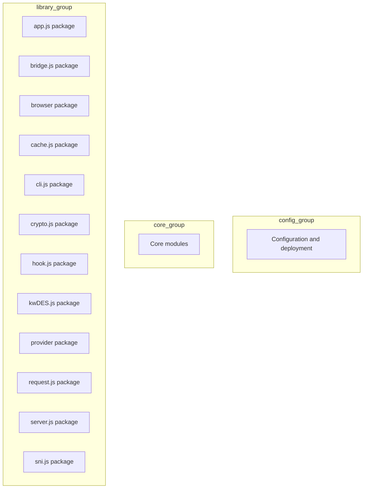

# Architecture report: nondanee/UnblockNeteaseMusic

> Automated static analysis. **Observed** = directly seen in files/imports/AST; **Inferred** = interpretation from that evidence. Repository code was not executed.

## 1. Repository at a glance

| Item | Value |
| --- | --- |
| Repository | nondanee/UnblockNeteaseMusic |
| Description | Revive unavailable songs for Netease Cloud Music |
| Language | JavaScript |
| Stars | 17326 |
| Licence | MIT |
| Analysed commit / branch | b8d5f4b4fe59cef9c021b99f3cf2606d99fa4790 / master |
| Framework(s) | None detected |
| Files analysed | 46 |
| Components | 14 |

## 2. Architecture in one minute

nondanee/UnblockNeteaseMusic - Revive unavailable songs for Netease Cloud Music. This repository was analysed statically from 46 file(s) (0 Python). Detected technologies (observed from imports/manifests): GitHub Actions, Docker, Docker Compose. Files are grouped into 14 component(s): app.js package, bridge.js package, browser package, cache.js package, cli.js package, Configuration and deployment, Core modules, crypto.js package. Findings below distinguish observed facts from inferred interpretation.

## 3. High-level block diagram

## 4. Main components

### app.js package (`app_js`)

- **Kind:** library
- **Status:** Observed
- **Confidence:** 0.85
- **Responsibility:** Groups 1 file(s) under app.js package (observed from repository paths and static analysis).
- **Paths:** `src/app.js`
- **Evidence:** [src/app.js](https://github.com/nondanee/UnblockNeteaseMusic/blob/b8d5f4b4fe59cef9c021b99f3cf2606d99fa4790/src/app.js)

### bridge.js package (`bridge_js`)

- **Kind:** library
- **Status:** Observed
- **Confidence:** 0.85
- **Responsibility:** Groups 1 file(s) under bridge.js package (observed from repository paths and static analysis).
- **Paths:** `src/bridge.js`
- **Evidence:** [src/bridge.js](https://github.com/nondanee/UnblockNeteaseMusic/blob/b8d5f4b4fe59cef9c021b99f3cf2606d99fa4790/src/bridge.js)

### browser package (`browser`)

- **Kind:** library
- **Status:** Observed
- **Confidence:** 0.85
- **Responsibility:** Groups 6 file(s) under browser package (observed from repository paths and static analysis).
- **Paths:** `src/browser/background.js`, `src/browser/convert.js`, `src/browser/crypto.js`, `src/browser/inject.js`, `src/browser/request.js`, `src/browser/script.js`
- **Evidence:** [src/browser/background.js](https://github.com/nondanee/UnblockNeteaseMusic/blob/b8d5f4b4fe59cef9c021b99f3cf2606d99fa4790/src/browser/background.js); [src/browser/convert.js](https://github.com/nondanee/UnblockNeteaseMusic/blob/b8d5f4b4fe59cef9c021b99f3cf2606d99fa4790/src/browser/convert.js); [src/browser/crypto.js](https://github.com/nondanee/UnblockNeteaseMusic/blob/b8d5f4b4fe59cef9c021b99f3cf2606d99fa4790/src/browser/crypto.js); [src/browser/inject.js](https://github.com/nondanee/UnblockNeteaseMusic/blob/b8d5f4b4fe59cef9c021b99f3cf2606d99fa4790/src/browser/inject.js); [src/browser/request.js](https://github.com/nondanee/UnblockNeteaseMusic/blob/b8d5f4b4fe59cef9c021b99f3cf2606d99fa4790/src/browser/request.js); [src/browser/script.js](https://github.com/nondanee/UnblockNeteaseMusic/blob/b8d5f4b4fe59cef9c021b99f3cf2606d99fa4790/src/browser/script.js)

### cache.js package (`cache_js`)

- **Kind:** library
- **Status:** Observed
- **Confidence:** 0.85
- **Responsibility:** Groups 1 file(s) under cache.js package (observed from repository paths and static analysis).
- **Paths:** `src/cache.js`
- **Evidence:** [src/cache.js](https://github.com/nondanee/UnblockNeteaseMusic/blob/b8d5f4b4fe59cef9c021b99f3cf2606d99fa4790/src/cache.js)

### cli.js package (`cli_js`)

- **Kind:** library
- **Status:** Observed
- **Confidence:** 0.85
- **Responsibility:** Groups 1 file(s) under cli.js package (observed from repository paths and static analysis).
- **Paths:** `src/cli.js`
- **Evidence:** [src/cli.js](https://github.com/nondanee/UnblockNeteaseMusic/blob/b8d5f4b4fe59cef9c021b99f3cf2606d99fa4790/src/cli.js)

### Configuration and deployment (`config`)

- **Kind:** config
- **Status:** Observed
- **Confidence:** 0.85
- **Responsibility:** Groups 4 file(s) under configuration and deployment (observed from repository paths and static analysis).
- **Paths:** `Dockerfile`, `docker-compose.yml`, `package.json`, `src/browser/manifest.json`
- **Evidence:** [Dockerfile](https://github.com/nondanee/UnblockNeteaseMusic/blob/b8d5f4b4fe59cef9c021b99f3cf2606d99fa4790/Dockerfile); [docker-compose.yml](https://github.com/nondanee/UnblockNeteaseMusic/blob/b8d5f4b4fe59cef9c021b99f3cf2606d99fa4790/docker-compose.yml); [package.json](https://github.com/nondanee/UnblockNeteaseMusic/blob/b8d5f4b4fe59cef9c021b99f3cf2606d99fa4790/package.json); [src/browser/manifest.json](https://github.com/nondanee/UnblockNeteaseMusic/blob/b8d5f4b4fe59cef9c021b99f3cf2606d99fa4790/src/browser/manifest.json)

### Core modules (`core`)

- **Kind:** core
- **Status:** Observed
- **Confidence:** 0.85
- **Responsibility:** Groups 3 file(s) under core modules (observed from repository paths and static analysis).
- **Paths:** `app.js`, `bridge.js`, `endpoint.worker.js`
- **Evidence:** [app.js](https://github.com/nondanee/UnblockNeteaseMusic/blob/b8d5f4b4fe59cef9c021b99f3cf2606d99fa4790/app.js); [bridge.js](https://github.com/nondanee/UnblockNeteaseMusic/blob/b8d5f4b4fe59cef9c021b99f3cf2606d99fa4790/bridge.js); [endpoint.worker.js](https://github.com/nondanee/UnblockNeteaseMusic/blob/b8d5f4b4fe59cef9c021b99f3cf2606d99fa4790/endpoint.worker.js)

### crypto.js package (`crypto_js`)

- **Kind:** library
- **Status:** Observed
- **Confidence:** 0.85
- **Responsibility:** Groups 1 file(s) under crypto.js package (observed from repository paths and static analysis).
- **Paths:** `src/crypto.js`
- **Evidence:** [src/crypto.js](https://github.com/nondanee/UnblockNeteaseMusic/blob/b8d5f4b4fe59cef9c021b99f3cf2606d99fa4790/src/crypto.js)

### hook.js package (`hook_js`)

- **Kind:** library
- **Status:** Observed
- **Confidence:** 0.85
- **Responsibility:** Groups 1 file(s) under hook.js package (observed from repository paths and static analysis).
- **Paths:** `src/hook.js`
- **Evidence:** [src/hook.js](https://github.com/nondanee/UnblockNeteaseMusic/blob/b8d5f4b4fe59cef9c021b99f3cf2606d99fa4790/src/hook.js)

### kwDES.js package (`kwdes_js`)

- **Kind:** library
- **Status:** Observed
- **Confidence:** 0.85
- **Responsibility:** Groups 1 file(s) under kwdes.js package (observed from repository paths and static analysis).
- **Paths:** `src/kwDES.js`
- **Evidence:** [src/kwDES.js](https://github.com/nondanee/UnblockNeteaseMusic/blob/b8d5f4b4fe59cef9c021b99f3cf2606d99fa4790/src/kwDES.js)

### provider package (`provider`)

- **Kind:** library
- **Status:** Observed
- **Confidence:** 0.85
- **Responsibility:** Groups 13 file(s) under provider package (observed from repository paths and static analysis).
- **Paths:** `src/provider/baidu.js`, `src/provider/find.js`, `src/provider/insure.js`, `src/provider/joox.js`, `src/provider/kugou.js`, `src/provider/kuwo.js`, `src/provider/match.js`, `src/provider/migu.js`, `src/provider/netease.js`, `src/provider/qq.js`, `src/provider/select.js`, `src/provider/xiami.js`, `src/provider/youtube.js`
- **Evidence:** [src/provider/baidu.js](https://github.com/nondanee/UnblockNeteaseMusic/blob/b8d5f4b4fe59cef9c021b99f3cf2606d99fa4790/src/provider/baidu.js); [src/provider/find.js](https://github.com/nondanee/UnblockNeteaseMusic/blob/b8d5f4b4fe59cef9c021b99f3cf2606d99fa4790/src/provider/find.js); [src/provider/insure.js](https://github.com/nondanee/UnblockNeteaseMusic/blob/b8d5f4b4fe59cef9c021b99f3cf2606d99fa4790/src/provider/insure.js); [src/provider/joox.js](https://github.com/nondanee/UnblockNeteaseMusic/blob/b8d5f4b4fe59cef9c021b99f3cf2606d99fa4790/src/provider/joox.js); [src/provider/kugou.js](https://github.com/nondanee/UnblockNeteaseMusic/blob/b8d5f4b4fe59cef9c021b99f3cf2606d99fa4790/src/provider/kugou.js); [src/provider/kuwo.js](https://github.com/nondanee/UnblockNeteaseMusic/blob/b8d5f4b4fe59cef9c021b99f3cf2606d99fa4790/src/provider/kuwo.js); [src/provider/match.js](https://github.com/nondanee/UnblockNeteaseMusic/blob/b8d5f4b4fe59cef9c021b99f3cf2606d99fa4790/src/provider/match.js); [src/provider/migu.js](https://github.com/nondanee/UnblockNeteaseMusic/blob/b8d5f4b4fe59cef9c021b99f3cf2606d99fa4790/src/provider/migu.js)

### request.js package (`request_js`)

- **Kind:** library
- **Status:** Observed
- **Confidence:** 0.85
- **Responsibility:** Groups 1 file(s) under request.js package (observed from repository paths and static analysis).
- **Paths:** `src/request.js`
- **Evidence:** [src/request.js](https://github.com/nondanee/UnblockNeteaseMusic/blob/b8d5f4b4fe59cef9c021b99f3cf2606d99fa4790/src/request.js)

### server.js package (`server_js`)

- **Kind:** library
- **Status:** Observed
- **Confidence:** 0.85
- **Responsibility:** Groups 1 file(s) under server.js package (observed from repository paths and static analysis).
- **Paths:** `src/server.js`
- **Evidence:** [src/server.js](https://github.com/nondanee/UnblockNeteaseMusic/blob/b8d5f4b4fe59cef9c021b99f3cf2606d99fa4790/src/server.js)

### sni.js package (`sni_js`)

- **Kind:** library
- **Status:** Observed
- **Confidence:** 0.85
- **Responsibility:** Groups 1 file(s) under sni.js package (observed from repository paths and static analysis).
- **Paths:** `src/sni.js`
- **Evidence:** [src/sni.js](https://github.com/nondanee/UnblockNeteaseMusic/blob/b8d5f4b4fe59cef9c021b99f3cf2606d99fa4790/src/sni.js)

## 5. Execution flow

**Observed** entry point(s):

- [app.js](https://github.com/nondanee/UnblockNeteaseMusic/blob/b8d5f4b4fe59cef9c021b99f3cf2606d99fa4790/app.js)
- [src/app.js](https://github.com/nondanee/UnblockNeteaseMusic/blob/b8d5f4b4fe59cef9c021b99f3cf2606d99fa4790/src/app.js)
- [src/provider/match.js](https://github.com/nondanee/UnblockNeteaseMusic/blob/b8d5f4b4fe59cef9c021b99f3cf2606d99fa4790/src/provider/match.js)
- [src/server.js](https://github.com/nondanee/UnblockNeteaseMusic/blob/b8d5f4b4fe59cef9c021b99f3cf2606d99fa4790/src/server.js)

Representative flow (derived from observed entry points and the import graph; steps beyond the entry point are **Inferred**):

1. Execution starts at an observed entry point listed above, if present.
2. No internal import relationships between components were observed.

## 6. Project structure

### `(root)`

- `.dockerignore` - container (132 bytes)
- `.gitignore` - other (1026 bytes)
- `.npmignore` - other (85 bytes)
- `Dockerfile` - container (269 bytes)
- `LICENSE` - docs (1061 bytes)
- `README.md` - docs (7323 bytes)
- `app.js` - source, JavaScript (40 bytes)
- `bridge.js` - source, JavaScript (43 bytes)
- `ca.crt` - other (1261 bytes)
- `docker-compose.yml` - container (160 bytes)
- `endpoint.worker.js` - source, JavaScript (735 bytes)
- `package.json` - manifest (580 bytes)
- `server.crt` - other (1298 bytes)

### `.github`

- `.github/workflows/publish.yml` - ci, YAML (1636 bytes)

### `src`

- `src/app.js` - source, JavaScript (4469 bytes)
- `src/bridge.js` - source, JavaScript (1176 bytes)
- `src/browser/README.md` - docs (899 bytes)
- `src/browser/background.html` - other (215 bytes)
- `src/browser/background.js` - source, JavaScript (1479 bytes)
- `src/browser/convert.js` - source, JavaScript (1633 bytes)
- `src/browser/crypto.js` - source, JavaScript (1481 bytes)
- `src/browser/inject.js` - source, JavaScript (2283 bytes)
- `src/browser/manifest.json` - config (561 bytes)
- `src/browser/request.js` - source, JavaScript (1098 bytes)
- `src/browser/script.js` - source, JavaScript (223 bytes)
- `src/cache.js` - source, JavaScript (994 bytes)
- `src/cli.js` - source, JavaScript (6292 bytes)
- `src/crypto.js` - source, JavaScript (4050 bytes)
- `src/hook.js` - source, JavaScript (11850 bytes)
- `src/kwDES.js` - source, JavaScript (8354 bytes)
- `src/provider/baidu.js` - source, JavaScript (1376 bytes)
- `src/provider/find.js` - source, JavaScript (1360 bytes)
- `src/provider/insure.js` - source, JavaScript (672 bytes)
- `src/provider/joox.js` - source, JavaScript (1830 bytes)
- `src/provider/kugou.js` - source, JavaScript (1514 bytes)
- `src/provider/kuwo.js` - source, JavaScript (2948 bytes)
- `src/provider/match.js` - source, JavaScript (3204 bytes)
- `src/provider/migu.js` - source, JavaScript (1710 bytes)
- `src/provider/netease.js` - source, JavaScript (771 bytes)
- `src/provider/qq.js` - source, JavaScript (5553 bytes)
- `src/provider/select.js` - source, JavaScript (119 bytes)
- `src/provider/xiami.js` - source, JavaScript (3812 bytes)
- `src/provider/youtube.js` - source, JavaScript (3006 bytes)
- `src/request.js` - source, JavaScript (3435 bytes)
- `src/server.js` - source, JavaScript (6098 bytes)
- `src/sni.js` - source, JavaScript (1413 bytes)

## 7. Key dependencies and integrations

| Name | Category | Status | Confidence | Evidence |
| --- | --- | --- | --- | --- |
| GitHub Actions | ci | Observed | 0.85 | [.github/workflows/publish.yml](https://github.com/nondanee/UnblockNeteaseMusic/blob/b8d5f4b4fe59cef9c021b99f3cf2606d99fa4790/.github/workflows/publish.yml) |
| Docker | tooling | Observed | 0.90 | [.github/workflows/publish.yml:9](https://github.com/nondanee/UnblockNeteaseMusic/blob/b8d5f4b4fe59cef9c021b99f3cf2606d99fa4790/.github/workflows/publish.yml#L9); [Dockerfile](https://github.com/nondanee/UnblockNeteaseMusic/blob/b8d5f4b4fe59cef9c021b99f3cf2606d99fa4790/Dockerfile) |
| Docker Compose | tooling | Observed | 0.85 | [docker-compose.yml](https://github.com/nondanee/UnblockNeteaseMusic/blob/b8d5f4b4fe59cef9c021b99f3cf2606d99fa4790/docker-compose.yml) |

## 8. Data and state

No database, cache, queue, or persistent-state usage was observed in the analysed files. State handling, if any, may be in-memory or in files that were not analysed.

## 9. Configuration and deployment clues

- `.dockerignore` (container)
- `.github/workflows/publish.yml` (ci)
- `Dockerfile` (container)
- `docker-compose.yml` (container)
- `package.json` (manifest)
- `src/browser/manifest.json` (config)

## 10. Design observations

- No strong design patterns could be established from the available evidence.

These observations are interpretations (**Inferred**) of the observed structure, not guarantees about runtime design.

## 11. Limitations and unknowns

- Static analysis only: repository code was not executed, installed, or imported at runtime.
- Components and relationships are inferred from file paths, imports, and AST structure; runtime behaviour, dynamic imports, and reflection may not be visible.
- 1 file(s) were skipped during inventory (1 x likely secret file excluded).
- No clear application entry point was observed in the analysed files.
- Repository text was treated as untrusted data; no instructions found in repository files were followed, and likely secret values were redacted/excluded.
- JavaScript and TypeScript files were inventoried from paths and package manifests. They were not parsed with a full language AST, and repository code was not executed.

## 12. Source references

- [.github/workflows/publish.yml](https://github.com/nondanee/UnblockNeteaseMusic/blob/b8d5f4b4fe59cef9c021b99f3cf2606d99fa4790/.github/workflows/publish.yml)
- [.github/workflows/publish.yml:9](https://github.com/nondanee/UnblockNeteaseMusic/blob/b8d5f4b4fe59cef9c021b99f3cf2606d99fa4790/.github/workflows/publish.yml#L9)
- [Dockerfile](https://github.com/nondanee/UnblockNeteaseMusic/blob/b8d5f4b4fe59cef9c021b99f3cf2606d99fa4790/Dockerfile)
- [app.js](https://github.com/nondanee/UnblockNeteaseMusic/blob/b8d5f4b4fe59cef9c021b99f3cf2606d99fa4790/app.js)
- [bridge.js](https://github.com/nondanee/UnblockNeteaseMusic/blob/b8d5f4b4fe59cef9c021b99f3cf2606d99fa4790/bridge.js)
- [docker-compose.yml](https://github.com/nondanee/UnblockNeteaseMusic/blob/b8d5f4b4fe59cef9c021b99f3cf2606d99fa4790/docker-compose.yml)
- [endpoint.worker.js](https://github.com/nondanee/UnblockNeteaseMusic/blob/b8d5f4b4fe59cef9c021b99f3cf2606d99fa4790/endpoint.worker.js)
- [package.json](https://github.com/nondanee/UnblockNeteaseMusic/blob/b8d5f4b4fe59cef9c021b99f3cf2606d99fa4790/package.json)
- [src/app.js](https://github.com/nondanee/UnblockNeteaseMusic/blob/b8d5f4b4fe59cef9c021b99f3cf2606d99fa4790/src/app.js)
- [src/bridge.js](https://github.com/nondanee/UnblockNeteaseMusic/blob/b8d5f4b4fe59cef9c021b99f3cf2606d99fa4790/src/bridge.js)
- [src/browser/background.js](https://github.com/nondanee/UnblockNeteaseMusic/blob/b8d5f4b4fe59cef9c021b99f3cf2606d99fa4790/src/browser/background.js)
- [src/browser/convert.js](https://github.com/nondanee/UnblockNeteaseMusic/blob/b8d5f4b4fe59cef9c021b99f3cf2606d99fa4790/src/browser/convert.js)
- [src/browser/crypto.js](https://github.com/nondanee/UnblockNeteaseMusic/blob/b8d5f4b4fe59cef9c021b99f3cf2606d99fa4790/src/browser/crypto.js)
- [src/browser/inject.js](https://github.com/nondanee/UnblockNeteaseMusic/blob/b8d5f4b4fe59cef9c021b99f3cf2606d99fa4790/src/browser/inject.js)
- [src/browser/manifest.json](https://github.com/nondanee/UnblockNeteaseMusic/blob/b8d5f4b4fe59cef9c021b99f3cf2606d99fa4790/src/browser/manifest.json)
- [src/browser/request.js](https://github.com/nondanee/UnblockNeteaseMusic/blob/b8d5f4b4fe59cef9c021b99f3cf2606d99fa4790/src/browser/request.js)
- [src/browser/script.js](https://github.com/nondanee/UnblockNeteaseMusic/blob/b8d5f4b4fe59cef9c021b99f3cf2606d99fa4790/src/browser/script.js)
- [src/cache.js](https://github.com/nondanee/UnblockNeteaseMusic/blob/b8d5f4b4fe59cef9c021b99f3cf2606d99fa4790/src/cache.js)
- [src/cli.js](https://github.com/nondanee/UnblockNeteaseMusic/blob/b8d5f4b4fe59cef9c021b99f3cf2606d99fa4790/src/cli.js)
- [src/crypto.js](https://github.com/nondanee/UnblockNeteaseMusic/blob/b8d5f4b4fe59cef9c021b99f3cf2606d99fa4790/src/crypto.js)
- [src/hook.js](https://github.com/nondanee/UnblockNeteaseMusic/blob/b8d5f4b4fe59cef9c021b99f3cf2606d99fa4790/src/hook.js)
- [src/kwDES.js](https://github.com/nondanee/UnblockNeteaseMusic/blob/b8d5f4b4fe59cef9c021b99f3cf2606d99fa4790/src/kwDES.js)
- [src/provider/baidu.js](https://github.com/nondanee/UnblockNeteaseMusic/blob/b8d5f4b4fe59cef9c021b99f3cf2606d99fa4790/src/provider/baidu.js)
- [src/provider/find.js](https://github.com/nondanee/UnblockNeteaseMusic/blob/b8d5f4b4fe59cef9c021b99f3cf2606d99fa4790/src/provider/find.js)
- [src/provider/insure.js](https://github.com/nondanee/UnblockNeteaseMusic/blob/b8d5f4b4fe59cef9c021b99f3cf2606d99fa4790/src/provider/insure.js)
- [src/provider/joox.js](https://github.com/nondanee/UnblockNeteaseMusic/blob/b8d5f4b4fe59cef9c021b99f3cf2606d99fa4790/src/provider/joox.js)
- [src/provider/kugou.js](https://github.com/nondanee/UnblockNeteaseMusic/blob/b8d5f4b4fe59cef9c021b99f3cf2606d99fa4790/src/provider/kugou.js)
- [src/provider/kuwo.js](https://github.com/nondanee/UnblockNeteaseMusic/blob/b8d5f4b4fe59cef9c021b99f3cf2606d99fa4790/src/provider/kuwo.js)
- [src/provider/match.js](https://github.com/nondanee/UnblockNeteaseMusic/blob/b8d5f4b4fe59cef9c021b99f3cf2606d99fa4790/src/provider/match.js)
- [src/provider/migu.js](https://github.com/nondanee/UnblockNeteaseMusic/blob/b8d5f4b4fe59cef9c021b99f3cf2606d99fa4790/src/provider/migu.js)
- [src/request.js](https://github.com/nondanee/UnblockNeteaseMusic/blob/b8d5f4b4fe59cef9c021b99f3cf2606d99fa4790/src/request.js)
- [src/server.js](https://github.com/nondanee/UnblockNeteaseMusic/blob/b8d5f4b4fe59cef9c021b99f3cf2606d99fa4790/src/server.js)
- [src/sni.js](https://github.com/nondanee/UnblockNeteaseMusic/blob/b8d5f4b4fe59cef9c021b99f3cf2606d99fa4790/src/sni.js)
