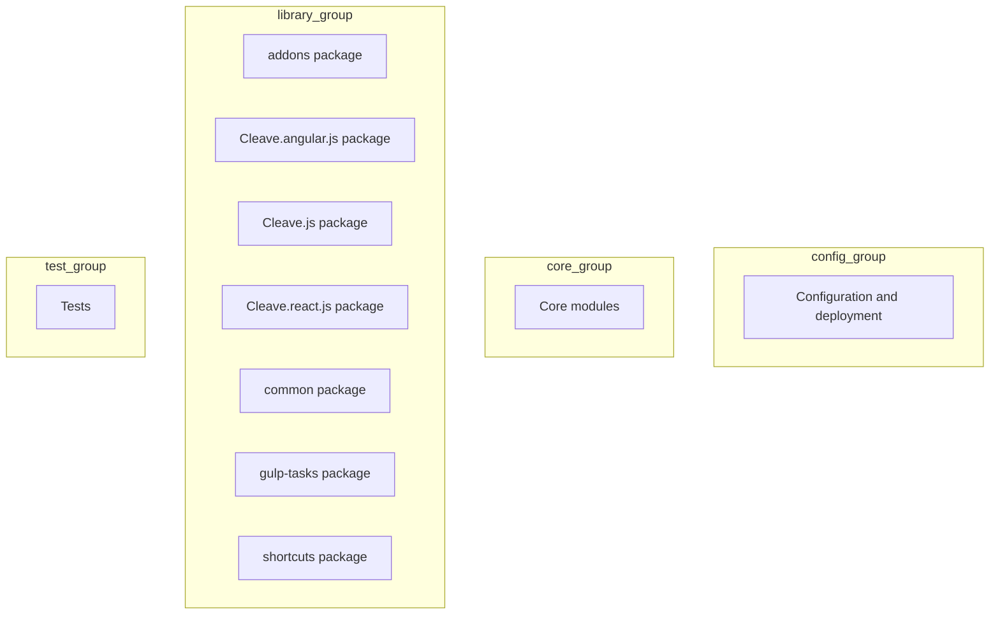

# Architecture report: nosir/cleave.js

> Automated static analysis. **Observed** = directly seen in files/imports/AST; **Inferred** = interpretation from that evidence. Repository code was not executed.

## 1. Repository at a glance

| Item | Value |
| --- | --- |
| Repository | nosir/cleave.js |
| Description | Format input text content when you are typing... |
| Language | JavaScript |
| Stars | 17835 |
| Licence | Apache-2.0 |
| Analysed commit / branch | a966c95cf5193f223485a10eec8405bb32b8f6dd / master |
| Framework(s) | React |
| Files analysed | 232 |
| Components | 10 |

## 2. Architecture in one minute

nosir/cleave.js - Format input text content when you are typing.... This repository was analysed statically from 232 file(s) (0 Python). Detected technologies (observed from imports/manifests): React, webpack. Files are grouped into 10 component(s): addons package, Cleave.angular.js package, Cleave.js package, Cleave.react.js package, common package, Configuration and deployment, Core modules, gulp-tasks package. Findings below distinguish observed facts from inferred interpretation.

## 3. High-level block diagram

## 4. Main components

### addons package (`addons`)

- **Kind:** library
- **Status:** Observed
- **Confidence:** 0.85
- **Responsibility:** Groups 197 file(s) under addons package (observed from repository paths and static analysis).
- **Paths:** `src/addons/phone-type-formatter.ac.js`, `src/addons/phone-type-formatter.ad.js`, `src/addons/phone-type-formatter.ae.js`, `src/addons/phone-type-formatter.af.js`, `src/addons/phone-type-formatter.ag.js`, `src/addons/phone-type-formatter.ai.js`, `src/addons/phone-type-formatter.al.js`, `src/addons/phone-type-formatter.am.js`, `src/addons/phone-type-formatter.ao.js`, `src/addons/phone-type-formatter.ar.js`, `src/addons/phone-type-formatter.as.js`, `src/addons/phone-type-formatter.at.js`, `src/addons/phone-type-formatter.au-cn.js`, `src/addons/phone-type-formatter.au.js`, `src/addons/phone-type-formatter.aw.js`, `src/addons/phone-type-formatter.ax.js`, `src/addons/phone-type-formatter.az.js`, `src/addons/phone-type-formatter.ba.js`, `src/addons/phone-type-formatter.bb.js`, `src/addons/phone-type-formatter.bd.js`, `src/addons/phone-type-formatter.be.js`, `src/addons/phone-type-formatter.bf.js`, `src/addons/phone-type-formatter.bg.js`, `src/addons/phone-type-formatter.bh.js`, `src/addons/phone-type-formatter.bi.js`, `src/addons/phone-type-formatter.bj.js`, `src/addons/phone-type-formatter.bl.js`, `src/addons/phone-type-formatter.bm.js`, `src/addons/phone-type-formatter.bn.js`, `src/addons/phone-type-formatter.bo.js`, `src/addons/phone-type-formatter.bq.js`, `src/addons/phone-type-formatter.br.js`, `src/addons/phone-type-formatter.bs.js`, `src/addons/phone-type-formatter.bt.js`, `src/addons/phone-type-formatter.bw.js`, `src/addons/phone-type-formatter.by.js`, `src/addons/phone-type-formatter.bz.js`, `src/addons/phone-type-formatter.ca.js`, `src/addons/phone-type-formatter.cc.js`, `src/addons/phone-type-formatter.cd.js`, `src/addons/phone-type-formatter.cf.js`, `src/addons/phone-type-formatter.cg.js`, `src/addons/phone-type-formatter.ch.js`, `src/addons/phone-type-formatter.ci.js`, `src/addons/phone-type-formatter.ck.js`, `src/addons/phone-type-formatter.cl.js`, `src/addons/phone-type-formatter.cm.js`, `src/addons/phone-type-formatter.cn.js`, `src/addons/phone-type-formatter.co.js`, `src/addons/phone-type-formatter.cr.js`, `src/addons/phone-type-formatter.cu.js`, `src/addons/phone-type-formatter.cv.js`, `src/addons/phone-type-formatter.cw.js`, `src/addons/phone-type-formatter.cx.js`, `src/addons/phone-type-formatter.cy.js`, `src/addons/phone-type-formatter.cz.js`, `src/addons/phone-type-formatter.de.js`, `src/addons/phone-type-formatter.dj.js`, `src/addons/phone-type-formatter.dk.js`, `src/addons/phone-type-formatter.dm.js`, `src/addons/phone-type-formatter.do.js`, `src/addons/phone-type-formatter.dz.js`, `src/addons/phone-type-formatter.ec.js`, `src/addons/phone-type-formatter.ee.js`, `src/addons/phone-type-formatter.eg.js`, `src/addons/phone-type-formatter.eh.js`, `src/addons/phone-type-formatter.er.js`, `src/addons/phone-type-formatter.es.js`, `src/addons/phone-type-formatter.et.js`, `src/addons/phone-type-formatter.fi.js`, `src/addons/phone-type-formatter.fj.js`, `src/addons/phone-type-formatter.fk.js`, `src/addons/phone-type-formatter.fm.js`, `src/addons/phone-type-formatter.fo.js`, `src/addons/phone-type-formatter.fr.js`, `src/addons/phone-type-formatter.ga.js`, `src/addons/phone-type-formatter.gb.js`, `src/addons/phone-type-formatter.gd.js`, `src/addons/phone-type-formatter.ge.js`, `src/addons/phone-type-formatter.gf.js`, `src/addons/phone-type-formatter.gg.js`, `src/addons/phone-type-formatter.gh.js`, `src/addons/phone-type-formatter.gi.js`, `src/addons/phone-type-formatter.gl.js`, `src/addons/phone-type-formatter.gm.js`, `src/addons/phone-type-formatter.gn.js`, `src/addons/phone-type-formatter.gp.js`, `src/addons/phone-type-formatter.gq.js`, `src/addons/phone-type-formatter.gr.js`, `src/addons/phone-type-formatter.gt.js`, `src/addons/phone-type-formatter.gu.js`, `src/addons/phone-type-formatter.gw.js`, `src/addons/phone-type-formatter.gy.js`, `src/addons/phone-type-formatter.hk.js`, `src/addons/phone-type-formatter.hn.js`, `src/addons/phone-type-formatter.hr.js`, `src/addons/phone-type-formatter.ht.js`, `src/addons/phone-type-formatter.hu.js`, `src/addons/phone-type-formatter.id.js`, `src/addons/phone-type-formatter.ie.js`, `src/addons/phone-type-formatter.il.js`, `src/addons/phone-type-formatter.im.js`, `src/addons/phone-type-formatter.in.js`, `src/addons/phone-type-formatter.io.js`, `src/addons/phone-type-formatter.iq.js`, `src/addons/phone-type-formatter.ir.js`, `src/addons/phone-type-formatter.is.js`, `src/addons/phone-type-formatter.it.js`, `src/addons/phone-type-formatter.je.js`, `src/addons/phone-type-formatter.jm.js`, `src/addons/phone-type-formatter.jo.js`, `src/addons/phone-type-formatter.jp.js`, `src/addons/phone-type-formatter.ke.js`, `src/addons/phone-type-formatter.kg.js`, `src/addons/phone-type-formatter.kh.js`, `src/addons/phone-type-formatter.ki.js`, `src/addons/phone-type-formatter.km.js`, `src/addons/phone-type-formatter.kn.js`, `src/addons/phone-type-formatter.kp.js`, `src/addons/phone-type-formatter.kr.js`, `src/addons/phone-type-formatter.kw.js`, `src/addons/phone-type-formatter.ky.js`, `src/addons/phone-type-formatter.kz.js`, `src/addons/phone-type-formatter.la.js`, `src/addons/phone-type-formatter.lb.js`, `src/addons/phone-type-formatter.lc.js`, `src/addons/phone-type-formatter.li.js`, `src/addons/phone-type-formatter.lk.js`, `src/addons/phone-type-formatter.lr.js`, `src/addons/phone-type-formatter.ls.js`, `src/addons/phone-type-formatter.lt.js`, `src/addons/phone-type-formatter.lu.js`, `src/addons/phone-type-formatter.lv.js`, `src/addons/phone-type-formatter.ly.js`, `src/addons/phone-type-formatter.ma.js`, `src/addons/phone-type-formatter.mc.js`, `src/addons/phone-type-formatter.md.js`, `src/addons/phone-type-formatter.me.js`, `src/addons/phone-type-formatter.mf.js`, `src/addons/phone-type-formatter.mg.js`, `src/addons/phone-type-formatter.mh.js`, `src/addons/phone-type-formatter.mk.js`, `src/addons/phone-type-formatter.ml.js`, `src/addons/phone-type-formatter.mm.js`, `src/addons/phone-type-formatter.mn.js`, `src/addons/phone-type-formatter.mo.js`, `src/addons/phone-type-formatter.mp.js`, `src/addons/phone-type-formatter.mq.js`, `src/addons/phone-type-formatter.mr.js`, `src/addons/phone-type-formatter.ms.js`, `src/addons/phone-type-formatter.mt.js`, `src/addons/phone-type-formatter.mu.js`, `src/addons/phone-type-formatter.mv.js`, `src/addons/phone-type-formatter.mw.js`, `src/addons/phone-type-formatter.mx.js`, `src/addons/phone-type-formatter.my.js`, `src/addons/phone-type-formatter.mz.js`, `src/addons/phone-type-formatter.na.js`, `src/addons/phone-type-formatter.nc.js`, `src/addons/phone-type-formatter.ne.js`, `src/addons/phone-type-formatter.nf.js`, `src/addons/phone-type-formatter.ng.js`, `src/addons/phone-type-formatter.ni.js`, `src/addons/phone-type-formatter.nl.js`, `src/addons/phone-type-formatter.no.js`, `src/addons/phone-type-formatter.np.js`, `src/addons/phone-type-formatter.nr.js`, `src/addons/phone-type-formatter.nu.js`, `src/addons/phone-type-formatter.nz.js`, `src/addons/phone-type-formatter.om.js`, `src/addons/phone-type-formatter.pa.js`, `src/addons/phone-type-formatter.pe.js`, `src/addons/phone-type-formatter.pf.js`, `src/addons/phone-type-formatter.pg.js`, `src/addons/phone-type-formatter.ph.js`, `src/addons/phone-type-formatter.pk.js`, `src/addons/phone-type-formatter.pl.js`, `src/addons/phone-type-formatter.pm.js`, `src/addons/phone-type-formatter.pr.js`, `src/addons/phone-type-formatter.ps.js`, `src/addons/phone-type-formatter.pt.js`, `src/addons/phone-type-formatter.pw.js`, `src/addons/phone-type-formatter.py.js`, `src/addons/phone-type-formatter.qa.js`, `src/addons/phone-type-formatter.re.js`, `src/addons/phone-type-formatter.ro.js`, `src/addons/phone-type-formatter.rs.js`, `src/addons/phone-type-formatter.ru.js`, `src/addons/phone-type-formatter.rw.js`, `src/addons/phone-type-formatter.sa.js`, `src/addons/phone-type-formatter.sb.js`, `src/addons/phone-type-formatter.sc.js`, `src/addons/phone-type-formatter.sd.js`, `src/addons/phone-type-formatter.se.js`, `src/addons/phone-type-formatter.sg.js`, `src/addons/phone-type-formatter.sh.js`, `src/addons/phone-type-formatter.si.js`
- **Evidence:** [src/addons/phone-type-formatter.ac.js](https://github.com/nosir/cleave.js/blob/a966c95cf5193f223485a10eec8405bb32b8f6dd/src/addons/phone-type-formatter.ac.js); [src/addons/phone-type-formatter.ad.js](https://github.com/nosir/cleave.js/blob/a966c95cf5193f223485a10eec8405bb32b8f6dd/src/addons/phone-type-formatter.ad.js); [src/addons/phone-type-formatter.ae.js](https://github.com/nosir/cleave.js/blob/a966c95cf5193f223485a10eec8405bb32b8f6dd/src/addons/phone-type-formatter.ae.js); [src/addons/phone-type-formatter.af.js](https://github.com/nosir/cleave.js/blob/a966c95cf5193f223485a10eec8405bb32b8f6dd/src/addons/phone-type-formatter.af.js); [src/addons/phone-type-formatter.ag.js](https://github.com/nosir/cleave.js/blob/a966c95cf5193f223485a10eec8405bb32b8f6dd/src/addons/phone-type-formatter.ag.js); [src/addons/phone-type-formatter.ai.js](https://github.com/nosir/cleave.js/blob/a966c95cf5193f223485a10eec8405bb32b8f6dd/src/addons/phone-type-formatter.ai.js); [src/addons/phone-type-formatter.al.js](https://github.com/nosir/cleave.js/blob/a966c95cf5193f223485a10eec8405bb32b8f6dd/src/addons/phone-type-formatter.al.js); [src/addons/phone-type-formatter.am.js](https://github.com/nosir/cleave.js/blob/a966c95cf5193f223485a10eec8405bb32b8f6dd/src/addons/phone-type-formatter.am.js)

### Cleave.angular.js package (`cleave_angular_js`)

- **Kind:** library
- **Status:** Observed
- **Confidence:** 0.85
- **Responsibility:** Groups 1 file(s) under cleave.angular.js package (observed from repository paths and static analysis).
- **Paths:** `src/Cleave.angular.js`
- **Evidence:** [src/Cleave.angular.js](https://github.com/nosir/cleave.js/blob/a966c95cf5193f223485a10eec8405bb32b8f6dd/src/Cleave.angular.js)

### Cleave.js package (`cleave_js`)

- **Kind:** library
- **Status:** Observed
- **Confidence:** 0.85
- **Responsibility:** Groups 1 file(s) under cleave.js package (observed from repository paths and static analysis).
- **Paths:** `src/Cleave.js`
- **Evidence:** [src/Cleave.js](https://github.com/nosir/cleave.js/blob/a966c95cf5193f223485a10eec8405bb32b8f6dd/src/Cleave.js)

### Cleave.react.js package (`cleave_react_js`)

- **Kind:** library
- **Status:** Observed
- **Confidence:** 0.85
- **Responsibility:** Groups 1 file(s) under cleave.react.js package (observed from repository paths and static analysis).
- **Paths:** `src/Cleave.react.js`
- **Evidence:** [src/Cleave.react.js](https://github.com/nosir/cleave.js/blob/a966c95cf5193f223485a10eec8405bb32b8f6dd/src/Cleave.react.js)

### common package (`common`)

- **Kind:** library
- **Status:** Observed
- **Confidence:** 0.85
- **Responsibility:** Groups 1 file(s) under common package (observed from repository paths and static analysis).
- **Paths:** `src/common/DefaultProperties.js`
- **Evidence:** [src/common/DefaultProperties.js](https://github.com/nosir/cleave.js/blob/a966c95cf5193f223485a10eec8405bb32b8f6dd/src/common/DefaultProperties.js)

### Configuration and deployment (`config`)

- **Kind:** config
- **Status:** Observed
- **Confidence:** 0.85
- **Responsibility:** Groups 3 file(s) under configuration and deployment (observed from repository paths and static analysis).
- **Paths:** `bower.json`, `codacy.json`, `package.json`
- **Evidence:** [bower.json](https://github.com/nosir/cleave.js/blob/a966c95cf5193f223485a10eec8405bb32b8f6dd/bower.json); [codacy.json](https://github.com/nosir/cleave.js/blob/a966c95cf5193f223485a10eec8405bb32b8f6dd/codacy.json); [package.json](https://github.com/nosir/cleave.js/blob/a966c95cf5193f223485a10eec8405bb32b8f6dd/package.json)

### Core modules (`core`)

- **Kind:** core
- **Status:** Observed
- **Confidence:** 0.85
- **Responsibility:** Groups 2 file(s) under core modules (observed from repository paths and static analysis).
- **Paths:** `gulpfile.js`, `react.js`
- **Evidence:** [gulpfile.js](https://github.com/nosir/cleave.js/blob/a966c95cf5193f223485a10eec8405bb32b8f6dd/gulpfile.js); [react.js](https://github.com/nosir/cleave.js/blob/a966c95cf5193f223485a10eec8405bb32b8f6dd/react.js)

### gulp-tasks package (`gulp_tasks`)

- **Kind:** library
- **Status:** Observed
- **Confidence:** 0.85
- **Responsibility:** Groups 6 file(s) under gulp-tasks package (observed from repository paths and static analysis).
- **Paths:** `gulp-tasks/addon.js`, `gulp-tasks/browserify.js`, `gulp-tasks/build.js`, `gulp-tasks/rollup.js`, `gulp-tasks/test.js`, `gulp-tasks/webpack.js`
- **Evidence:** [gulp-tasks/addon.js](https://github.com/nosir/cleave.js/blob/a966c95cf5193f223485a10eec8405bb32b8f6dd/gulp-tasks/addon.js); [gulp-tasks/browserify.js](https://github.com/nosir/cleave.js/blob/a966c95cf5193f223485a10eec8405bb32b8f6dd/gulp-tasks/browserify.js); [gulp-tasks/build.js](https://github.com/nosir/cleave.js/blob/a966c95cf5193f223485a10eec8405bb32b8f6dd/gulp-tasks/build.js); [gulp-tasks/rollup.js](https://github.com/nosir/cleave.js/blob/a966c95cf5193f223485a10eec8405bb32b8f6dd/gulp-tasks/rollup.js); [gulp-tasks/test.js](https://github.com/nosir/cleave.js/blob/a966c95cf5193f223485a10eec8405bb32b8f6dd/gulp-tasks/test.js); [gulp-tasks/webpack.js](https://github.com/nosir/cleave.js/blob/a966c95cf5193f223485a10eec8405bb32b8f6dd/gulp-tasks/webpack.js)

### shortcuts package (`shortcuts`)

- **Kind:** library
- **Status:** Observed
- **Confidence:** 0.85
- **Responsibility:** Groups 2 file(s) under shortcuts package (observed from repository paths and static analysis).
- **Paths:** `src/shortcuts/CreditCardDetector.js`, `src/shortcuts/PhoneFormatter.js`
- **Evidence:** [src/shortcuts/CreditCardDetector.js](https://github.com/nosir/cleave.js/blob/a966c95cf5193f223485a10eec8405bb32b8f6dd/src/shortcuts/CreditCardDetector.js); [src/shortcuts/PhoneFormatter.js](https://github.com/nosir/cleave.js/blob/a966c95cf5193f223485a10eec8405bb32b8f6dd/src/shortcuts/PhoneFormatter.js)

### Tests (`tests`)

- **Kind:** test
- **Status:** Observed
- **Confidence:** 0.85
- **Responsibility:** Groups 1 file(s) under tests (observed from repository paths and static analysis).
- **Paths:** `test/browser/phone.js`
- **Evidence:** [test/browser/phone.js](https://github.com/nosir/cleave.js/blob/a966c95cf5193f223485a10eec8405bb32b8f6dd/test/browser/phone.js)

## 5. Execution flow

No entry point was observed; the startup flow below is therefore limited.

Representative flow (derived from observed entry points and the import graph; steps beyond the entry point are **Inferred**):

1. Execution starts at an observed entry point listed above, if present.
2. No internal import relationships between components were observed.

## 6. Project structure

### `(root)`

- `.eslintignore` - other (70 bytes)
- `.eslintrc.js` - source, JavaScript (464 bytes)
- `.gitignore` - other (60 bytes)
- `.travis.yml` - ci, YAML (86 bytes)
- `ISSUE_TEMPLATE` - other (313 bytes)
- `LICENSE` - docs (10173 bytes)
- `README.md` - docs (9420 bytes)
- `bower.json` - config (743 bytes)
- `codacy.json` - config (23892 bytes)
- `gulpfile.js` - source, JavaScript (70 bytes)
- `package.json` - manifest (2056 bytes)
- `react.js` - source, JavaScript (57 bytes)

### `doc`

- `doc/angularjs-directive-usage.md` - docs (2905 bytes)
- `doc/constructor.md` - docs (705 bytes)
- `doc/doc.md` - docs (677 bytes)
- `doc/js-api.md` - docs (368 bytes)
- `doc/not-in-the-plan.md` - docs (777 bytes)
- `doc/options.md` - docs (12400 bytes)
- `doc/phone-lib-addon.md` - docs (2489 bytes)
- `doc/public-methods.md` - docs (1492 bytes)
- `doc/reactjs-component-usage.md` - docs (10975 bytes)
- `doc/vue.md` - docs (1692 bytes)

### `gulp-tasks`

- `gulp-tasks/addon.js` - source, JavaScript (902 bytes)
- `gulp-tasks/browserify.js` - source, JavaScript (1599 bytes)
- `gulp-tasks/build.js` - source, JavaScript (1959 bytes)
- `gulp-tasks/rollup.js` - source, JavaScript (808 bytes)
- `gulp-tasks/test.js` - source, JavaScript (1711 bytes)
- `gulp-tasks/webpack.js` - source, JavaScript (2555 bytes)

### `src`

- `src/Cleave.angular.js` - source, JavaScript (2061 bytes)
- `src/Cleave.js` - source, JavaScript (15618 bytes)
- `src/Cleave.react.js` - source, JavaScript (14989 bytes)
- `src/addons/phone-type-formatter.ac.js` - source, JavaScript (13924 bytes)
- `src/addons/phone-type-formatter.ad.js` - source, JavaScript (14098 bytes)
- `src/addons/phone-type-formatter.ae.js` - source, JavaScript (14259 bytes)
- `src/addons/phone-type-formatter.af.js` - source, JavaScript (14106 bytes)
- `src/addons/phone-type-formatter.ag.js` - source, JavaScript (39672 bytes)
- `src/addons/phone-type-formatter.ai.js` - source, JavaScript (39672 bytes)
- `src/addons/phone-type-formatter.al.js` - source, JavaScript (14391 bytes)
- `src/addons/phone-type-formatter.am.js` - source, JavaScript (14277 bytes)
- `src/addons/phone-type-formatter.ao.js` - source, JavaScript (13952 bytes)
- `src/addons/phone-type-formatter.ar.js` - source, JavaScript (18732 bytes)
- `src/addons/phone-type-formatter.as.js` - source, JavaScript (39672 bytes)
- `src/addons/phone-type-formatter.at.js` - source, JavaScript (15159 bytes)
- `src/addons/phone-type-formatter.au-cn.js` - source, JavaScript (22315 bytes)
- `src/addons/phone-type-formatter.au.js` - source, JavaScript (17519 bytes)
- `src/addons/phone-type-formatter.aw.js` - source, JavaScript (14018 bytes)
- `src/addons/phone-type-formatter.ax.js` - source, JavaScript (15842 bytes)
- `src/addons/phone-type-formatter.az.js` - source, JavaScript (14617 bytes)
- `src/addons/phone-type-formatter.ba.js` - source, JavaScript (14602 bytes)
- `src/addons/phone-type-formatter.bb.js` - source, JavaScript (39672 bytes)
- `src/addons/phone-type-formatter.bd.js` - source, JavaScript (15735 bytes)
- `src/addons/phone-type-formatter.be.js` - source, JavaScript (14536 bytes)
- `src/addons/phone-type-formatter.bf.js` - source, JavaScript (14037 bytes)
- `src/addons/phone-type-formatter.bg.js` - source, JavaScript (14643 bytes)
- `src/addons/phone-type-formatter.bh.js` - source, JavaScript (14132 bytes)
- `src/addons/phone-type-formatter.bi.js` - source, JavaScript (13978 bytes)
- `src/addons/phone-type-formatter.bj.js` - source, JavaScript (13969 bytes)
- `src/addons/phone-type-formatter.bl.js` - source, JavaScript (15629 bytes)
- `src/addons/phone-type-formatter.bm.js` - source, JavaScript (39672 bytes)
- `src/addons/phone-type-formatter.bn.js` - source, JavaScript (13965 bytes)
- `src/addons/phone-type-formatter.bo.js` - source, JavaScript (14325 bytes)
- `src/addons/phone-type-formatter.bq.js` - source, JavaScript (14957 bytes)
- `src/addons/phone-type-formatter.br.js` - source, JavaScript (15126 bytes)
- `src/addons/phone-type-formatter.bs.js` - source, JavaScript (39672 bytes)
- `src/addons/phone-type-formatter.bt.js` - source, JavaScript (14105 bytes)
- `src/addons/phone-type-formatter.bw.js` - source, JavaScript (14291 bytes)
- `src/addons/phone-type-formatter.by.js` - source, JavaScript (14846 bytes)
- `src/addons/phone-type-formatter.bz.js` - source, JavaScript (14079 bytes)
- `src/addons/phone-type-formatter.ca.js` - source, JavaScript (39672 bytes)
- `src/addons/phone-type-formatter.cc.js` - source, JavaScript (17519 bytes)
- `src/addons/phone-type-formatter.cd.js` - source, JavaScript (14153 bytes)
- `src/addons/phone-type-formatter.cf.js` - source, JavaScript (13951 bytes)
- `src/addons/phone-type-formatter.cg.js` - source, JavaScript (14079 bytes)
- `src/addons/phone-type-formatter.ch.js` - source, JavaScript (14284 bytes)
- `src/addons/phone-type-formatter.ci.js` - source, JavaScript (14047 bytes)
- `src/addons/phone-type-formatter.ck.js` - source, JavaScript (13926 bytes)
- `src/addons/phone-type-formatter.cl.js` - source, JavaScript (15366 bytes)
- `src/addons/phone-type-formatter.cm.js` - source, JavaScript (14073 bytes)
- `src/addons/phone-type-formatter.cn.js` - source, JavaScript (17936 bytes)
- `src/addons/phone-type-formatter.co.js` - source, JavaScript (14462 bytes)
- `src/addons/phone-type-formatter.cr.js` - source, JavaScript (14262 bytes)
- `src/addons/phone-type-formatter.cu.js` - source, JavaScript (14158 bytes)
- `src/addons/phone-type-formatter.cv.js` - source, JavaScript (13991 bytes)
- `src/addons/phone-type-formatter.cw.js` - source, JavaScript (14957 bytes)
- `src/addons/phone-type-formatter.cx.js` - source, JavaScript (17519 bytes)
- `src/addons/phone-type-formatter.cy.js` - source, JavaScript (13935 bytes)
- `src/addons/phone-type-formatter.cz.js` - source, JavaScript (14310 bytes)
- `src/addons/phone-type-formatter.de.js` - source, JavaScript (17120 bytes)
- `src/addons/phone-type-formatter.dj.js` - source, JavaScript (13950 bytes)
- `src/addons/phone-type-formatter.dk.js` - source, JavaScript (13977 bytes)
- `src/addons/phone-type-formatter.dm.js` - source, JavaScript (39672 bytes)
- `src/addons/phone-type-formatter.do.js` - source, JavaScript (39672 bytes)
- `src/addons/phone-type-formatter.dz.js` - source, JavaScript (14264 bytes)
- `src/addons/phone-type-formatter.ec.js` - source, JavaScript (14399 bytes)
- `src/addons/phone-type-formatter.ee.js` - source, JavaScript (14477 bytes)
- `src/addons/phone-type-formatter.eg.js` - source, JavaScript (14318 bytes)
- `src/addons/phone-type-formatter.eh.js` - source, JavaScript (15168 bytes)
- `src/addons/phone-type-formatter.er.js` - source, JavaScript (13997 bytes)
- `src/addons/phone-type-formatter.es.js` - source, JavaScript (14294 bytes)
- `src/addons/phone-type-formatter.et.js` - source, JavaScript (14611 bytes)
- `src/addons/phone-type-formatter.fi.js` - source, JavaScript (15842 bytes)
- `src/addons/phone-type-formatter.fj.js` - source, JavaScript (14112 bytes)
- `src/addons/phone-type-formatter.fk.js` - source, JavaScript (13867 bytes)
- `src/addons/phone-type-formatter.fm.js` - source, JavaScript (13994 bytes)
- `src/addons/phone-type-formatter.fo.js` - source, JavaScript (14000 bytes)
- `src/addons/phone-type-formatter.fr.js` - source, JavaScript (14234 bytes)
- `src/addons/phone-type-formatter.ga.js` - source, JavaScript (14034 bytes)
- `src/addons/phone-type-formatter.gb.js` - source, JavaScript (19832 bytes)
- `src/addons/phone-type-formatter.gd.js` - source, JavaScript (39672 bytes)
- `src/addons/phone-type-formatter.ge.js` - source, JavaScript (14193 bytes)
- `src/addons/phone-type-formatter.gf.js` - source, JavaScript (14010 bytes)
- `src/addons/phone-type-formatter.gg.js` - source, JavaScript (19832 bytes)
- `src/addons/phone-type-formatter.gh.js` - source, JavaScript (14395 bytes)
- `src/addons/phone-type-formatter.gi.js` - source, JavaScript (13988 bytes)
- `src/addons/phone-type-formatter.gl.js` - source, JavaScript (13977 bytes)
- `src/addons/phone-type-formatter.gm.js` - source, JavaScript (14009 bytes)
- `src/addons/phone-type-formatter.gn.js` - source, JavaScript (14103 bytes)
- `src/addons/phone-type-formatter.gp.js` - source, JavaScript (15629 bytes)
- `src/addons/phone-type-formatter.gq.js` - source, JavaScript (14058 bytes)
- `src/addons/phone-type-formatter.gr.js` - source, JavaScript (14428 bytes)
- `src/addons/phone-type-formatter.gt.js` - source, JavaScript (14047 bytes)
- `src/addons/phone-type-formatter.gu.js` - source, JavaScript (39672 bytes)
- `src/addons/phone-type-formatter.gw.js` - source, JavaScript (14026 bytes)
- `src/addons/phone-type-formatter.gy.js` - source, JavaScript (14045 bytes)
- `src/addons/phone-type-formatter.hk.js` - source, JavaScript (15018 bytes)
- `src/addons/phone-type-formatter.hn.js` - source, JavaScript (14177 bytes)
- `src/addons/phone-type-formatter.hr.js` - source, JavaScript (14562 bytes)
- `src/addons/phone-type-formatter.ht.js` - source, JavaScript (13969 bytes)
- `src/addons/phone-type-formatter.hu.js` - source, JavaScript (14178 bytes)
- `src/addons/phone-type-formatter.id.js` - source, JavaScript (15101 bytes)
- `src/addons/phone-type-formatter.ie.js` - source, JavaScript (14925 bytes)
- `src/addons/phone-type-formatter.il.js` - source, JavaScript (14746 bytes)
- `src/addons/phone-type-formatter.im.js` - source, JavaScript (19832 bytes)
- `src/addons/phone-type-formatter.in.js` - source, JavaScript (23829 bytes)
- `src/addons/phone-type-formatter.io.js` - source, JavaScript (13898 bytes)
- `src/addons/phone-type-formatter.iq.js` - source, JavaScript (14157 bytes)
- `src/addons/phone-type-formatter.ir.js` - source, JavaScript (14753 bytes)
- `src/addons/phone-type-formatter.is.js` - source, JavaScript (14383 bytes)
- `src/addons/phone-type-formatter.it.js` - source, JavaScript (16347 bytes)
- `src/addons/phone-type-formatter.je.js` - source, JavaScript (19832 bytes)
- `src/addons/phone-type-formatter.jm.js` - source, JavaScript (39672 bytes)
- `src/addons/phone-type-formatter.jo.js` - source, JavaScript (14722 bytes)
- `src/addons/phone-type-formatter.jp.js` - source, JavaScript (22826 bytes)
- `src/addons/phone-type-formatter.ke.js` - source, JavaScript (14255 bytes)
- `src/addons/phone-type-formatter.kg.js` - source, JavaScript (14363 bytes)
- `src/addons/phone-type-formatter.kh.js` - source, JavaScript (14438 bytes)
- `src/addons/phone-type-formatter.ki.js` - source, JavaScript (14133 bytes)
- `src/addons/phone-type-formatter.km.js` - source, JavaScript (13920 bytes)
- `src/addons/phone-type-formatter.kn.js` - source, JavaScript (39672 bytes)
- `src/addons/phone-type-formatter.kp.js` - source, JavaScript (14155 bytes)
- `src/addons/phone-type-formatter.kr.js` - source, JavaScript (16140 bytes)
- `src/addons/phone-type-formatter.kw.js` - source, JavaScript (14311 bytes)
- `src/addons/phone-type-formatter.ky.js` - source, JavaScript (39672 bytes)
- `src/addons/phone-type-formatter.kz.js` - source, JavaScript (15627 bytes)
- `src/addons/phone-type-formatter.la.js` - source, JavaScript (14224 bytes)
- `src/addons/phone-type-formatter.lb.js` - source, JavaScript (14177 bytes)
- `src/addons/phone-type-formatter.lc.js` - source, JavaScript (39672 bytes)
- `src/addons/phone-type-formatter.li.js` - source, JavaScript (14380 bytes)
- `src/addons/phone-type-formatter.lk.js` - source, JavaScript (14078 bytes)
- `src/addons/phone-type-formatter.lr.js` - source, JavaScript (14200 bytes)
- `src/addons/phone-type-formatter.ls.js` - source, JavaScript (13927 bytes)
- `src/addons/phone-type-formatter.lt.js` - source, JavaScript (14182 bytes)
- `src/addons/phone-type-formatter.lu.js` - source, JavaScript (15178 bytes)
- `src/addons/phone-type-formatter.lv.js` - source, JavaScript (13924 bytes)
- `src/addons/phone-type-formatter.ly.js` - source, JavaScript (13983 bytes)
- `src/addons/phone-type-formatter.ma.js` - source, JavaScript (15168 bytes)
- `src/addons/phone-type-formatter.mc.js` - source, JavaScript (14417 bytes)
- `src/addons/phone-type-formatter.md.js` - source, JavaScript (14124 bytes)
- `src/addons/phone-type-formatter.me.js` - source, JavaScript (14166 bytes)
- `src/addons/phone-type-formatter.mf.js` - source, JavaScript (15629 bytes)
- `src/addons/phone-type-formatter.mg.js` - source, JavaScript (14029 bytes)
- `src/addons/phone-type-formatter.mh.js` - source, JavaScript (13959 bytes)
- `src/addons/phone-type-formatter.mk.js` - source, JavaScript (14252 bytes)
- `src/addons/phone-type-formatter.ml.js` - source, JavaScript (14199 bytes)
- `src/addons/phone-type-formatter.mm.js` - source, JavaScript (15693 bytes)
- `src/addons/phone-type-formatter.mn.js` - source, JavaScript (14397 bytes)
- `src/addons/phone-type-formatter.mo.js` - source, JavaScript (14000 bytes)
- `src/addons/phone-type-formatter.mp.js` - source, JavaScript (39672 bytes)
- `src/addons/phone-type-formatter.mq.js` - source, JavaScript (14042 bytes)
- `src/addons/phone-type-formatter.mr.js` - source, JavaScript (13976 bytes)
- `src/addons/phone-type-formatter.ms.js` - source, JavaScript (39672 bytes)
- `src/addons/phone-type-formatter.mt.js` - source, JavaScript (14100 bytes)
- `src/addons/phone-type-formatter.mu.js` - source, JavaScript (14238 bytes)
- `src/addons/phone-type-formatter.mv.js` - source, JavaScript (14181 bytes)
- `src/addons/phone-type-formatter.mw.js` - source, JavaScript (14207 bytes)
- `src/addons/phone-type-formatter.mx.js` - source, JavaScript (15408 bytes)
- `src/addons/phone-type-formatter.my.js` - source, JavaScript (14997 bytes)
- `src/addons/phone-type-formatter.mz.js` - source, JavaScript (14059 bytes)
- `src/addons/phone-type-formatter.na.js` - source, JavaScript (14508 bytes)
- `src/addons/phone-type-formatter.nc.js` - source, JavaScript (13979 bytes)
- `src/addons/phone-type-formatter.ne.js` - source, JavaScript (14091 bytes)
- `src/addons/phone-type-formatter.nf.js` - source, JavaScript (14009 bytes)
- `src/addons/phone-type-formatter.ng.js` - source, JavaScript (15032 bytes)
- `src/addons/phone-type-formatter.ni.js` - source, JavaScript (14009 bytes)
- `src/addons/phone-type-formatter.nl.js` - source, JavaScript (15210 bytes)
- `src/addons/phone-type-formatter.no.js` - source, JavaScript (15168 bytes)
- `src/addons/phone-type-formatter.np.js` - source, JavaScript (14192 bytes)
- `src/addons/phone-type-formatter.nr.js` - source, JavaScript (13932 bytes)
- `src/addons/phone-type-formatter.nu.js` - source, JavaScript (13947 bytes)
- `src/addons/phone-type-formatter.nz.js` - source, JavaScript (14414 bytes)
- `src/addons/phone-type-formatter.om.js` - source, JavaScript (14106 bytes)
- `src/addons/phone-type-formatter.pa.js` - source, JavaScript (14517 bytes)
- `src/addons/phone-type-formatter.pe.js` - source, JavaScript (14233 bytes)
- `src/addons/phone-type-formatter.pf.js` - source, JavaScript (14031 bytes)
- `src/addons/phone-type-formatter.pg.js` - source, JavaScript (14157 bytes)
- `src/addons/phone-type-formatter.ph.js` - source, JavaScript (14983 bytes)
- `src/addons/phone-type-formatter.pk.js` - source, JavaScript (15651 bytes)
- `src/addons/phone-type-formatter.pl.js` - source, JavaScript (14716 bytes)
- `src/addons/phone-type-formatter.pm.js` - source, JavaScript (13943 bytes)
- `src/addons/phone-type-formatter.pr.js` - source, JavaScript (39672 bytes)
- `src/addons/phone-type-formatter.ps.js` - source, JavaScript (14167 bytes)
- `src/addons/phone-type-formatter.pt.js` - source, JavaScript (14154 bytes)
- `src/addons/phone-type-formatter.pw.js` - source, JavaScript (14036 bytes)
- `src/addons/phone-type-formatter.py.js` - source, JavaScript (14774 bytes)
- `src/addons/phone-type-formatter.qa.js` - source, JavaScript (14049 bytes)
- `src/addons/phone-type-formatter.re.js` - source, JavaScript (14879 bytes)
- `src/addons/phone-type-formatter.ro.js` - source, JavaScript (14294 bytes)
- `src/addons/phone-type-formatter.rs.js` - source, JavaScript (14331 bytes)
- `src/addons/phone-type-formatter.ru.js` - source, JavaScript (15627 bytes)
- `src/addons/phone-type-formatter.rw.js` - source, JavaScript (14117 bytes)
- `src/addons/phone-type-formatter.sa.js` - source, JavaScript (14315 bytes)
- `src/addons/phone-type-formatter.sb.js` - source, JavaScript (14177 bytes)
- `src/addons/phone-type-formatter.sc.js` - source, JavaScript (13971 bytes)
- `src/addons/phone-type-formatter.sd.js` - source, JavaScript (13956 bytes)
- `src/addons/phone-type-formatter.se.js` - source, JavaScript (16758 bytes)
- `src/addons/phone-type-formatter.sg.js` - source, JavaScript (14236 bytes)
- `src/addons/phone-type-formatter.sh.js` - source, JavaScript (14632 bytes)
- `src/addons/phone-type-formatter.si.js` - source, JavaScript (14419 bytes)
- `src/common/DefaultProperties.js` - source, JavaScript (3482 bytes)
- `src/shortcuts/CreditCardDetector.js` - source, JavaScript (2940 bytes)
- `src/shortcuts/PhoneFormatter.js` - source, JavaScript (1697 bytes)

### `test`

- `test/browser/phone.js` - test, JavaScript (1026 bytes)

## 7. Key dependencies and integrations

| Name | Category | Status | Confidence | Evidence |
| --- | --- | --- | --- | --- |
| React | framework | Observed | 0.90 | [package.json:17](https://github.com/nosir/cleave.js/blob/a966c95cf5193f223485a10eec8405bb32b8f6dd/package.json#L17); [package.json:70](https://github.com/nosir/cleave.js/blob/a966c95cf5193f223485a10eec8405bb32b8f6dd/package.json#L70) |
| webpack | tooling | Observed | 0.85 | [package.json:79](https://github.com/nosir/cleave.js/blob/a966c95cf5193f223485a10eec8405bb32b8f6dd/package.json#L79) |

## 8. Data and state

No database, cache, queue, or persistent-state usage was observed in the analysed files. State handling, if any, may be in-memory or in files that were not analysed.

## 9. Configuration and deployment clues

- `.travis.yml` (ci)
- `bower.json` (config)
- `codacy.json` (config)
- `package.json` (manifest)

## 10. Design observations

- Tests are present alongside source code (Observed from test file paths).

These observations are interpretations (**Inferred**) of the observed structure, not guarantees about runtime design.

## 11. Limitations and unknowns

- Static analysis only: repository code was not executed, installed, or imported at runtime.
- Components and relationships are inferred from file paths, imports, and AST structure; runtime behaviour, dynamic imports, and reflection may not be visible.
- 252 file(s) were skipped during inventory (252 x vendored/generated directory excluded).
- No clear application entry point was observed in the analysed files.
- Repository text was treated as untrusted data; no instructions found in repository files were followed, and likely secret values were redacted/excluded.
- JavaScript and TypeScript files were inventoried from paths and package manifests. They were not parsed with a full language AST, and repository code was not executed.

## 12. Source references

- [bower.json](https://github.com/nosir/cleave.js/blob/a966c95cf5193f223485a10eec8405bb32b8f6dd/bower.json)
- [codacy.json](https://github.com/nosir/cleave.js/blob/a966c95cf5193f223485a10eec8405bb32b8f6dd/codacy.json)
- [gulp-tasks/addon.js](https://github.com/nosir/cleave.js/blob/a966c95cf5193f223485a10eec8405bb32b8f6dd/gulp-tasks/addon.js)
- [gulp-tasks/browserify.js](https://github.com/nosir/cleave.js/blob/a966c95cf5193f223485a10eec8405bb32b8f6dd/gulp-tasks/browserify.js)
- [gulp-tasks/build.js](https://github.com/nosir/cleave.js/blob/a966c95cf5193f223485a10eec8405bb32b8f6dd/gulp-tasks/build.js)
- [gulp-tasks/rollup.js](https://github.com/nosir/cleave.js/blob/a966c95cf5193f223485a10eec8405bb32b8f6dd/gulp-tasks/rollup.js)
- [gulp-tasks/test.js](https://github.com/nosir/cleave.js/blob/a966c95cf5193f223485a10eec8405bb32b8f6dd/gulp-tasks/test.js)
- [gulp-tasks/webpack.js](https://github.com/nosir/cleave.js/blob/a966c95cf5193f223485a10eec8405bb32b8f6dd/gulp-tasks/webpack.js)
- [gulpfile.js](https://github.com/nosir/cleave.js/blob/a966c95cf5193f223485a10eec8405bb32b8f6dd/gulpfile.js)
- [package.json](https://github.com/nosir/cleave.js/blob/a966c95cf5193f223485a10eec8405bb32b8f6dd/package.json)
- [package.json:17](https://github.com/nosir/cleave.js/blob/a966c95cf5193f223485a10eec8405bb32b8f6dd/package.json#L17)
- [package.json:70](https://github.com/nosir/cleave.js/blob/a966c95cf5193f223485a10eec8405bb32b8f6dd/package.json#L70)
- [package.json:79](https://github.com/nosir/cleave.js/blob/a966c95cf5193f223485a10eec8405bb32b8f6dd/package.json#L79)
- [react.js](https://github.com/nosir/cleave.js/blob/a966c95cf5193f223485a10eec8405bb32b8f6dd/react.js)
- [src/Cleave.angular.js](https://github.com/nosir/cleave.js/blob/a966c95cf5193f223485a10eec8405bb32b8f6dd/src/Cleave.angular.js)
- [src/Cleave.js](https://github.com/nosir/cleave.js/blob/a966c95cf5193f223485a10eec8405bb32b8f6dd/src/Cleave.js)
- [src/Cleave.react.js](https://github.com/nosir/cleave.js/blob/a966c95cf5193f223485a10eec8405bb32b8f6dd/src/Cleave.react.js)
- [src/addons/phone-type-formatter.ac.js](https://github.com/nosir/cleave.js/blob/a966c95cf5193f223485a10eec8405bb32b8f6dd/src/addons/phone-type-formatter.ac.js)
- [src/addons/phone-type-formatter.ad.js](https://github.com/nosir/cleave.js/blob/a966c95cf5193f223485a10eec8405bb32b8f6dd/src/addons/phone-type-formatter.ad.js)
- [src/addons/phone-type-formatter.ae.js](https://github.com/nosir/cleave.js/blob/a966c95cf5193f223485a10eec8405bb32b8f6dd/src/addons/phone-type-formatter.ae.js)
- [src/addons/phone-type-formatter.af.js](https://github.com/nosir/cleave.js/blob/a966c95cf5193f223485a10eec8405bb32b8f6dd/src/addons/phone-type-formatter.af.js)
- [src/addons/phone-type-formatter.ag.js](https://github.com/nosir/cleave.js/blob/a966c95cf5193f223485a10eec8405bb32b8f6dd/src/addons/phone-type-formatter.ag.js)
- [src/addons/phone-type-formatter.ai.js](https://github.com/nosir/cleave.js/blob/a966c95cf5193f223485a10eec8405bb32b8f6dd/src/addons/phone-type-formatter.ai.js)
- [src/addons/phone-type-formatter.al.js](https://github.com/nosir/cleave.js/blob/a966c95cf5193f223485a10eec8405bb32b8f6dd/src/addons/phone-type-formatter.al.js)
- [src/addons/phone-type-formatter.am.js](https://github.com/nosir/cleave.js/blob/a966c95cf5193f223485a10eec8405bb32b8f6dd/src/addons/phone-type-formatter.am.js)
- [src/common/DefaultProperties.js](https://github.com/nosir/cleave.js/blob/a966c95cf5193f223485a10eec8405bb32b8f6dd/src/common/DefaultProperties.js)
- [src/shortcuts/CreditCardDetector.js](https://github.com/nosir/cleave.js/blob/a966c95cf5193f223485a10eec8405bb32b8f6dd/src/shortcuts/CreditCardDetector.js)
- [src/shortcuts/PhoneFormatter.js](https://github.com/nosir/cleave.js/blob/a966c95cf5193f223485a10eec8405bb32b8f6dd/src/shortcuts/PhoneFormatter.js)
- [test/browser/phone.js](https://github.com/nosir/cleave.js/blob/a966c95cf5193f223485a10eec8405bb32b8f6dd/test/browser/phone.js)
