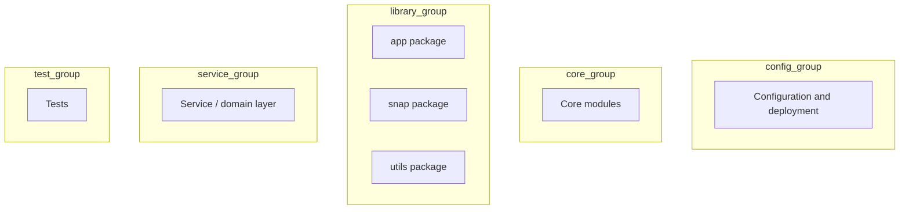

# Architecture report: novnc/noVNC

> Automated static analysis. **Observed** = directly seen in files/imports/AST; **Inferred** = interpretation from that evidence. Repository code was not executed.

## 1. Repository at a glance

| Item | Value |
| --- | --- |
| Repository | novnc/noVNC |
| Description | VNC client web application |
| Language | JavaScript |
| Stars | 14206 |
| Licence | Other |
| Analysed commit / branch | e8b5024d4603587b29ffede4fbd28b1fa2939829 / master |
| Framework(s) | None detected |
| Files analysed | 192 |
| Components | 7 |

## 2. Architecture in one minute

novnc/noVNC - VNC client web application. This repository was analysed statically from 192 file(s) (0 Python). Detected technologies (observed from imports/manifests): GitHub Actions. Files are grouped into 7 component(s): app package, Configuration and deployment, Core modules, Service / domain layer, snap package, Tests, utils package. Findings below distinguish observed facts from inferred interpretation.

## 3. High-level block diagram

## 4. Main components

### app package (`app`)

- **Kind:** library
- **Status:** Observed
- **Confidence:** 0.85
- **Responsibility:** Groups 5 file(s) under app package (observed from repository paths and static analysis).
- **Paths:** `app/error-handler.js`, `app/localization.js`, `app/ui.js`, `app/wakelock.js`, `app/webutil.js`
- **Evidence:** [app/error-handler.js](https://github.com/novnc/noVNC/blob/e8b5024d4603587b29ffede4fbd28b1fa2939829/app/error-handler.js); [app/localization.js](https://github.com/novnc/noVNC/blob/e8b5024d4603587b29ffede4fbd28b1fa2939829/app/localization.js); [app/ui.js](https://github.com/novnc/noVNC/blob/e8b5024d4603587b29ffede4fbd28b1fa2939829/app/ui.js); [app/wakelock.js](https://github.com/novnc/noVNC/blob/e8b5024d4603587b29ffede4fbd28b1fa2939829/app/wakelock.js); [app/webutil.js](https://github.com/novnc/noVNC/blob/e8b5024d4603587b29ffede4fbd28b1fa2939829/app/webutil.js)

### Configuration and deployment (`config`)

- **Kind:** config
- **Status:** Observed
- **Confidence:** 0.85
- **Responsibility:** Groups 22 file(s) under configuration and deployment (observed from repository paths and static analysis).
- **Paths:** `app/locale/cs.json`, `app/locale/de.json`, `app/locale/el.json`, `app/locale/es.json`, `app/locale/fr.json`, `app/locale/hu.json`, `app/locale/it.json`, `app/locale/ja.json`, `app/locale/ko.json`, `app/locale/nl.json`, `app/locale/pl.json`, `app/locale/pt_BR.json`, `app/locale/ru.json`, `app/locale/sv.json`, `app/locale/tr.json`, `app/locale/uk.json`, `app/locale/zh_CN.json`, `app/locale/zh_TW.json`, `defaults.json`, `mandatory.json`, `package.json`, `snap/snapcraft.yaml`
- **Evidence:** [app/locale/cs.json](https://github.com/novnc/noVNC/blob/e8b5024d4603587b29ffede4fbd28b1fa2939829/app/locale/cs.json); [app/locale/de.json](https://github.com/novnc/noVNC/blob/e8b5024d4603587b29ffede4fbd28b1fa2939829/app/locale/de.json); [app/locale/el.json](https://github.com/novnc/noVNC/blob/e8b5024d4603587b29ffede4fbd28b1fa2939829/app/locale/el.json); [app/locale/es.json](https://github.com/novnc/noVNC/blob/e8b5024d4603587b29ffede4fbd28b1fa2939829/app/locale/es.json); [app/locale/fr.json](https://github.com/novnc/noVNC/blob/e8b5024d4603587b29ffede4fbd28b1fa2939829/app/locale/fr.json); [app/locale/hu.json](https://github.com/novnc/noVNC/blob/e8b5024d4603587b29ffede4fbd28b1fa2939829/app/locale/hu.json); [app/locale/it.json](https://github.com/novnc/noVNC/blob/e8b5024d4603587b29ffede4fbd28b1fa2939829/app/locale/it.json); [app/locale/ja.json](https://github.com/novnc/noVNC/blob/e8b5024d4603587b29ffede4fbd28b1fa2939829/app/locale/ja.json)

### Core modules (`core`)

- **Kind:** core
- **Status:** Observed
- **Confidence:** 0.85
- **Responsibility:** Groups 2 file(s) under core modules (observed from repository paths and static analysis).
- **Paths:** `eslint.config.mjs`, `karma.conf.cjs`
- **Evidence:** [eslint.config.mjs](https://github.com/novnc/noVNC/blob/e8b5024d4603587b29ffede4fbd28b1fa2939829/eslint.config.mjs); [karma.conf.cjs](https://github.com/novnc/noVNC/blob/e8b5024d4603587b29ffede4fbd28b1fa2939829/karma.conf.cjs)

### Service / domain layer (`service_layer`)

- **Kind:** service
- **Status:** Observed
- **Confidence:** 0.85
- **Responsibility:** Groups 43 file(s) under service / domain layer (observed from repository paths and static analysis).
- **Paths:** `core/base64.js`, `core/clipboard.js`, `core/crypto/aes.js`, `core/crypto/bigint.js`, `core/crypto/crypto.js`, `core/crypto/des.js`, `core/crypto/dh.js`, `core/crypto/md5.js`, `core/crypto/rsa.js`, `core/decoders/copyrect.js`, `core/decoders/h264.js`, `core/decoders/hextile.js`, `core/decoders/jpeg.js`, `core/decoders/raw.js`, `core/decoders/rre.js`, `core/decoders/tight.js`, `core/decoders/tightpng.js`, `core/decoders/zlib.js`, `core/decoders/zrle.js`, `core/deflator.js`, `core/display.js`, `core/encodings.js`, `core/inflator.js`, `core/input/domkeytable.js`, `core/input/fixedkeys.js`, `core/input/gesturehandler.js`, `core/input/keyboard.js`, `core/input/keysym.js`, `core/input/keysymdef.js`, `core/input/util.js`, `core/input/vkeys.js`, `core/input/xtscancodes.js`, `core/ra2.js`, `core/rfb.js`, `core/util/browser.js`, `core/util/cursor.js`, `core/util/element.js`, `core/util/events.js`, `core/util/eventtarget.js`, `core/util/int.js`, `core/util/logging.js`, `core/util/strings.js`, `core/websock.js`
- **Evidence:** [core/base64.js](https://github.com/novnc/noVNC/blob/e8b5024d4603587b29ffede4fbd28b1fa2939829/core/base64.js); [core/clipboard.js](https://github.com/novnc/noVNC/blob/e8b5024d4603587b29ffede4fbd28b1fa2939829/core/clipboard.js); [core/crypto/aes.js](https://github.com/novnc/noVNC/blob/e8b5024d4603587b29ffede4fbd28b1fa2939829/core/crypto/aes.js); [core/crypto/bigint.js](https://github.com/novnc/noVNC/blob/e8b5024d4603587b29ffede4fbd28b1fa2939829/core/crypto/bigint.js); [core/crypto/crypto.js](https://github.com/novnc/noVNC/blob/e8b5024d4603587b29ffede4fbd28b1fa2939829/core/crypto/crypto.js); [core/crypto/des.js](https://github.com/novnc/noVNC/blob/e8b5024d4603587b29ffede4fbd28b1fa2939829/core/crypto/des.js); [core/crypto/dh.js](https://github.com/novnc/noVNC/blob/e8b5024d4603587b29ffede4fbd28b1fa2939829/core/crypto/dh.js); [core/crypto/md5.js](https://github.com/novnc/noVNC/blob/e8b5024d4603587b29ffede4fbd28b1fa2939829/core/crypto/md5.js)

### snap package (`snap`)

- **Kind:** library
- **Status:** Observed
- **Confidence:** 0.85
- **Responsibility:** Groups 1 file(s) under snap package (observed from repository paths and static analysis).
- **Paths:** `snap/local/svc_wrapper.sh`
- **Evidence:** [snap/local/svc_wrapper.sh](https://github.com/novnc/noVNC/blob/e8b5024d4603587b29ffede4fbd28b1fa2939829/snap/local/svc_wrapper.sh)

### Tests (`tests`)

- **Kind:** test
- **Status:** Observed
- **Confidence:** 0.85
- **Responsibility:** Groups 30 file(s) under tests (observed from repository paths and static analysis).
- **Paths:** `tests/assertions.js`, `tests/fake.websocket.js`, `tests/playback-ui.js`, `tests/playback.js`, `tests/test.base64.js`, `tests/test.browser.js`, `tests/test.clipboard.js`, `tests/test.copyrect.js`, `tests/test.deflator.js`, `tests/test.display.js`, `tests/test.gesturehandler.js`, `tests/test.h264.js`, `tests/test.helper.js`, `tests/test.hextile.js`, `tests/test.inflator.js`, `tests/test.int.js`, `tests/test.jpeg.js`, `tests/test.keyboard.js`, `tests/test.localization.js`, `tests/test.raw.js`, `tests/test.rre.js`, `tests/test.tight.js`, `tests/test.tightpng.js`, `tests/test.util.js`, `tests/test.wakelock.js`, `tests/test.websock.js`, `tests/test.webutil.js`, `tests/test.zlib.js`, `tests/test.zrle.js`, `tests/vnc_playback.html`
- **Evidence:** [tests/assertions.js](https://github.com/novnc/noVNC/blob/e8b5024d4603587b29ffede4fbd28b1fa2939829/tests/assertions.js); [tests/fake.websocket.js](https://github.com/novnc/noVNC/blob/e8b5024d4603587b29ffede4fbd28b1fa2939829/tests/fake.websocket.js); [tests/playback-ui.js](https://github.com/novnc/noVNC/blob/e8b5024d4603587b29ffede4fbd28b1fa2939829/tests/playback-ui.js); [tests/playback.js](https://github.com/novnc/noVNC/blob/e8b5024d4603587b29ffede4fbd28b1fa2939829/tests/playback.js); [tests/test.base64.js](https://github.com/novnc/noVNC/blob/e8b5024d4603587b29ffede4fbd28b1fa2939829/tests/test.base64.js); [tests/test.browser.js](https://github.com/novnc/noVNC/blob/e8b5024d4603587b29ffede4fbd28b1fa2939829/tests/test.browser.js); [tests/test.clipboard.js](https://github.com/novnc/noVNC/blob/e8b5024d4603587b29ffede4fbd28b1fa2939829/tests/test.clipboard.js); [tests/test.copyrect.js](https://github.com/novnc/noVNC/blob/e8b5024d4603587b29ffede4fbd28b1fa2939829/tests/test.copyrect.js)

### utils package (`utils`)

- **Kind:** library
- **Status:** Observed
- **Confidence:** 0.85
- **Responsibility:** Groups 1 file(s) under utils package (observed from repository paths and static analysis).
- **Paths:** `utils/genkeysymdef.js`
- **Evidence:** [utils/genkeysymdef.js](https://github.com/novnc/noVNC/blob/e8b5024d4603587b29ffede4fbd28b1fa2939829/utils/genkeysymdef.js)

## 5. Execution flow

No entry point was observed; the startup flow below is therefore limited.

Representative flow (derived from observed entry points and the import graph; steps beyond the entry point are **Inferred**):

1. Execution starts at an observed entry point listed above, if present.
2. No internal import relationships between components were observed.

## 6. Project structure

### `(root)`

- `.gitignore` - other (117 bytes)
- `.gitmodules` - other (0 bytes)
- `AI_POLICY.md` - docs (2501 bytes)
- `AUTHORS` - other (358 bytes)
- `LICENSE.txt` - docs (2163 bytes)
- `README.md` - docs (8650 bytes)
- `defaults.json` - config (3 bytes)
- `eslint.config.mjs` - source, JavaScript (3797 bytes)
- `karma.conf.cjs` - source, JavaScript (2737 bytes)
- `mandatory.json` - config (3 bytes)
- `package.json` - manifest (1764 bytes)
- `vnc.html` - other (18586 bytes)
- `vnc_lite.html` - other (6471 bytes)

### `.github`

- `.github/ISSUE_TEMPLATE/bug_report.md` - docs (819 bytes)
- `.github/ISSUE_TEMPLATE/config.yml` - config (190 bytes)
- `.github/ISSUE_TEMPLATE/feature_request.md` - docs (560 bytes)
- `.github/workflows/deploy.yml` - ci, YAML (3229 bytes)
- `.github/workflows/lint.yml` - ci, YAML (449 bytes)
- `.github/workflows/test.yml` - ci, YAML (604 bytes)
- `.github/workflows/translate.yml` - ci, YAML (339 bytes)

### `app`

- `app/error-handler.js` - source, JavaScript (3079 bytes)
- `app/images/alt.svg` - other (3553 bytes)
- `app/images/clipboard.svg` - other (3980 bytes)
- `app/images/connect.svg` - other (3430 bytes)
- `app/images/ctrl.svg` - other (4381 bytes)
- `app/images/ctrlaltdel.svg` - other (3237 bytes)
- `app/images/disconnect.svg` - other (5062 bytes)
- `app/images/drag.svg` - other (4684 bytes)
- `app/images/error.svg` - other (3106 bytes)
- `app/images/esc.svg` - other (4522 bytes)
- `app/images/expander.svg` - other (3066 bytes)
- `app/images/fullscreen.svg` - other (3139 bytes)
- `app/images/handle.svg` - other (2559 bytes)
- `app/images/handle_bg.svg` - other (6386 bytes)
- `app/images/icons/Makefile` - other (1331 bytes)
- `app/images/icons/novnc-icon-35x21.svg` - other (9056 bytes)
- `app/images/icons/novnc-icon-sm.svg` - other (11685 bytes)
- `app/images/icons/novnc-icon.svg` - other (11549 bytes)
- `app/images/icons/novnc-ios-icon.svg` - other (12096 bytes)
- `app/images/info.svg` - other (3204 bytes)
- `app/images/keyboard.svg` - other (6404 bytes)
- `app/images/power.svg` - other (3985 bytes)
- `app/images/settings.svg` - other (3082 bytes)
- `app/images/tab.svg` - other (2953 bytes)
- `app/images/toggleextrakeys.svg` - other (4441 bytes)
- `app/images/warning.svg` - other (3869 bytes)
- `app/images/windows.svg` - other (2411 bytes)
- `app/locale/README` - other (92 bytes)
- `app/locale/cs.json` - config (2885 bytes)
- `app/locale/de.json` - config (3219 bytes)
- `app/locale/el.json` - config (6450 bytes)
- `app/locale/es.json` - config (2691 bytes)
- `app/locale/fr.json` - config (3908 bytes)
- `app/locale/hu.json` - config (3905 bytes)
- `app/locale/it.json` - config (2777 bytes)
- `app/locale/ja.json` - config (4205 bytes)
- `app/locale/ko.json` - config (2961 bytes)
- `app/locale/nl.json` - config (4601 bytes)
- `app/locale/pl.json` - config (3359 bytes)
- `app/locale/pt_BR.json` - config (2879 bytes)
- `app/locale/ru.json` - config (3741 bytes)
- `app/locale/sv.json` - config (3728 bytes)
- `app/locale/tr.json` - config (2811 bytes)
- `app/locale/uk.json` - config (4823 bytes)
- `app/locale/zh_CN.json` - config (3955 bytes)
- `app/locale/zh_TW.json` - config (2606 bytes)
- `app/localization.js` - source, JavaScript (6677 bytes)
- `app/sounds/CREDITS` - other (157 bytes)
- `app/styles/base.css` - other (23972 bytes)
- `app/styles/constants.css` - other (776 bytes)
- `app/styles/input.css` - other (20948 bytes)
- `app/ui.js` - source, JavaScript (67392 bytes)
- `app/wakelock.js` - source, JavaScript (7186 bytes)
- `app/webutil.js` - source, JavaScript (6662 bytes)

### `core`

- `core/base64.js` - source, JavaScript (4182 bytes)
- `core/clipboard.js` - source, JavaScript (1954 bytes)
- `core/crypto/aes.js` - source, JavaScript (5965 bytes)
- `core/crypto/bigint.js` - source, JavaScript (825 bytes)
- `core/crypto/crypto.js` - source, JavaScript (3042 bytes)
- `core/crypto/des.js` - source, JavaScript (12704 bytes)
- `core/crypto/dh.js` - source, JavaScript (1612 bytes)
- `core/crypto/md5.js` - source, JavaScript (4686 bytes)
- `core/crypto/rsa.js` - source, JavaScript (4493 bytes)
- `core/decoders/copyrect.js` - source, JavaScript (616 bytes)
- `core/decoders/h264.js` - source, JavaScript (9322 bytes)
- `core/decoders/hextile.js` - source, JavaScript (6060 bytes)
- `core/decoders/jpeg.js` - source, JavaScript (4557 bytes)
- `core/decoders/raw.js` - source, JavaScript (1622 bytes)
- `core/decoders/rre.js` - source, JavaScript (1114 bytes)
- `core/decoders/tight.js` - source, JavaScript (11982 bytes)
- `core/decoders/tightpng.js` - source, JavaScript (687 bytes)
- `core/decoders/zlib.js` - source, JavaScript (1211 bytes)
- `core/decoders/zrle.js` - source, JavaScript (6480 bytes)
- `core/deflator.js` - source, JavaScript (2589 bytes)
- `core/display.js` - source, JavaScript (18387 bytes)
- `core/encodings.js` - source, JavaScript (1819 bytes)
- `core/inflator.js` - source, JavaScript (1913 bytes)
- `core/input/domkeytable.js` - source, JavaScript (11478 bytes)
- `core/input/fixedkeys.js` - source, JavaScript (3804 bytes)
- `core/input/gesturehandler.js` - source, JavaScript (18260 bytes)
- `core/input/keyboard.js` - source, JavaScript (10849 bytes)
- `core/input/keysym.js` - source, JavaScript (34609 bytes)
- `core/input/keysymdef.js` - source, JavaScript (25374 bytes)
- `core/input/util.js` - source, JavaScript (6069 bytes)
- `core/input/vkeys.js` - source, JavaScript (2509 bytes)
- `core/input/xtscancodes.js` - source, JavaScript (14400 bytes)
- `core/ra2.js` - source, JavaScript (12474 bytes)
- `core/rfb.js` - source, JavaScript (122792 bytes)
- `core/util/browser.js` - source, JavaScript (9399 bytes)
- `core/util/cursor.js` - source, JavaScript (8347 bytes)
- `core/util/element.js` - source, JavaScript (729 bytes)
- `core/util/events.js` - source, JavaScript (4327 bytes)
- `core/util/eventtarget.js` - source, JavaScript (896 bytes)
- `core/util/int.js` - source, JavaScript (326 bytes)
- `core/util/logging.js` - source, JavaScript (1351 bytes)
- `core/util/strings.js` - source, JavaScript (745 bytes)
- `core/websock.js` - source, JavaScript (11258 bytes)

### `docs`

- `docs/API-internal.md` - docs (4579 bytes)
- `docs/API.md` - docs (15849 bytes)
- `docs/EMBEDDING.md` - docs (4474 bytes)
- `docs/LIBRARY.md` - docs (1093 bytes)
- `docs/LICENSE.BSD-2-Clause` - docs (1304 bytes)
- `docs/LICENSE.BSD-3-Clause` - docs (1507 bytes)
- `docs/LICENSE.MPL-2.0` - docs (16726 bytes)
- `docs/LICENSE.OFL-1.1` - docs (4302 bytes)
- `docs/flash_policy.txt` - docs (197 bytes)
- `docs/links` - docs (2268 bytes)
- `docs/notes` - docs (146 bytes)
- `docs/novnc_proxy.1` - docs (1451 bytes)
- `docs/rfb_notes` - docs (3473 bytes)

### `po`

- `po/Makefile` - other (967 bytes)
- `po/cs.po` - other (5487 bytes)
- `po/de.po` - other (5898 bytes)
- `po/el.po` - other (9567 bytes)
- `po/es.po` - other (5335 bytes)
- `po/fr.po` - other (6864 bytes)
- `po/hr.po` - other (6559 bytes)
- `po/hu.po` - other (6675 bytes)
- `po/it.po` - other (5498 bytes)
- `po/ja.po` - other (7099 bytes)
- `po/ko.po` - other (5484 bytes)
- `po/nl.po` - other (7864 bytes)
- `po/noVNC.pot` - other (5032 bytes)
- `po/pl.po` - other (6182 bytes)
- `po/po2js` - other (1400 bytes)
- `po/pt_BR.po` - other (5473 bytes)
- `po/ru.po` - other (6510 bytes)
- `po/sv.po` - other (7168 bytes)
- `po/tr.po` - other (5456 bytes)
- `po/uk.po` - other (7742 bytes)
- `po/xgettext-html` - other (3681 bytes)
- `po/zh_CN.po` - other (6927 bytes)
- `po/zh_TW.po` - other (5177 bytes)

### `snap`

- `snap/hooks/configure` - other (45 bytes)
- `snap/local/svc_wrapper.sh` - source, Shell (1203 bytes)
- `snap/snapcraft.yaml` - config (1428 bytes)

### `tests`

- `tests/assertions.js` - test, JavaScript (3931 bytes)
- `tests/fake.websocket.js` - test, JavaScript (2895 bytes)
- `tests/playback-ui.js` - test, JavaScript (6508 bytes)
- `tests/playback.js` - test, JavaScript (4634 bytes)
- `tests/test.base64.js` - test, JavaScript (1234 bytes)
- `tests/test.browser.js` - test, JavaScript (11407 bytes)
- `tests/test.clipboard.js` - test, JavaScript (3550 bytes)
- `tests/test.copyrect.js` - test, JavaScript (3301 bytes)
- `tests/test.deflator.js` - test, JavaScript (2385 bytes)
- `tests/test.display.js` - test, JavaScript (16221 bytes)
- `tests/test.gesturehandler.js` - test, JavaScript (35932 bytes)
- `tests/test.h264.js` - test, JavaScript (8349 bytes)
- `tests/test.helper.js` - test, JavaScript (12081 bytes)
- `tests/test.hextile.js` - test, JavaScript (9197 bytes)
- `tests/test.inflator.js` - test, JavaScript (3272 bytes)
- `tests/test.int.js` - test, JavaScript (426 bytes)
- `tests/test.jpeg.js` - test, JavaScript (14364 bytes)
- `tests/test.keyboard.js` - test, JavaScript (29905 bytes)
- `tests/test.localization.js` - test, JavaScript (6180 bytes)
- `tests/test.raw.js` - test, JavaScript (6194 bytes)
- `tests/test.rre.js` - test, JavaScript (3831 bytes)
- `tests/test.tight.js` - test, JavaScript (22725 bytes)
- `tests/test.tightpng.js` - test, JavaScript (6485 bytes)
- `tests/test.util.js` - test, JavaScript (3309 bytes)
- `tests/test.wakelock.js` - test, JavaScript (6626 bytes)
- `tests/test.websock.js` - test, JavaScript (25136 bytes)
- `tests/test.webutil.js` - test, JavaScript (10501 bytes)
- `tests/test.zlib.js` - test, JavaScript (3057 bytes)
- `tests/test.zrle.js` - test, JavaScript (6315 bytes)
- `tests/vnc_playback.html` - test (673 bytes)

### `utils`

- `utils/README.md` - docs (538 bytes)
- `utils/b64-to-binary.pl` - other (396 bytes)
- `utils/genkeysymdef.js` - source, JavaScript (3155 bytes)
- `utils/novnc_proxy` - other (7583 bytes)
- `utils/u2x11` - other (911 bytes)
- `utils/validate` - other (1960 bytes)

## 7. Key dependencies and integrations

| Name | Category | Status | Confidence | Evidence |
| --- | --- | --- | --- | --- |
| GitHub Actions | ci | Observed | 0.90 | [.github/workflows/deploy.yml](https://github.com/novnc/noVNC/blob/e8b5024d4603587b29ffede4fbd28b1fa2939829/.github/workflows/deploy.yml); [.github/workflows/lint.yml](https://github.com/novnc/noVNC/blob/e8b5024d4603587b29ffede4fbd28b1fa2939829/.github/workflows/lint.yml); [.github/workflows/test.yml](https://github.com/novnc/noVNC/blob/e8b5024d4603587b29ffede4fbd28b1fa2939829/.github/workflows/test.yml); [.github/workflows/translate.yml](https://github.com/novnc/noVNC/blob/e8b5024d4603587b29ffede4fbd28b1fa2939829/.github/workflows/translate.yml) |

## 8. Data and state

No database, cache, queue, or persistent-state usage was observed in the analysed files. State handling, if any, may be in-memory or in files that were not analysed.

## 9. Configuration and deployment clues

- `.github/ISSUE_TEMPLATE/config.yml` (config)
- `.github/workflows/deploy.yml` (ci)
- `.github/workflows/lint.yml` (ci)
- `.github/workflows/test.yml` (ci)
- `.github/workflows/translate.yml` (ci)
- `app/locale/cs.json` (config)
- `app/locale/de.json` (config)
- `app/locale/el.json` (config)
- `app/locale/es.json` (config)
- `app/locale/fr.json` (config)
- `app/locale/hu.json` (config)
- `app/locale/it.json` (config)
- `app/locale/ja.json` (config)
- `app/locale/ko.json` (config)
- `app/locale/nl.json` (config)
- `app/locale/pl.json` (config)
- `app/locale/pt_BR.json` (config)
- `app/locale/ru.json` (config)
- `app/locale/sv.json` (config)
- `app/locale/tr.json` (config)
- `app/locale/uk.json` (config)
- `app/locale/zh_CN.json` (config)
- `app/locale/zh_TW.json` (config)
- `defaults.json` (config)
- `mandatory.json` (config)
- `package.json` (manifest)
- `snap/snapcraft.yaml` (config)

## 10. Design observations

- Service/domain code is distinct from entry and data code, suggesting layered separation (Inferred).
- Tests are present alongside source code (Observed from test file paths).

These observations are interpretations (**Inferred**) of the observed structure, not guarantees about runtime design.

## 11. Limitations and unknowns

- Static analysis only: repository code was not executed, installed, or imported at runtime.
- Components and relationships are inferred from file paths, imports, and AST structure; runtime behaviour, dynamic imports, and reflection may not be visible.
- 14 file(s) were skipped during inventory (14 x vendored/generated directory excluded).
- No clear application entry point was observed in the analysed files.
- Repository text was treated as untrusted data; no instructions found in repository files were followed, and likely secret values were redacted/excluded.
- JavaScript and TypeScript files were inventoried from paths and package manifests. They were not parsed with a full language AST, and repository code was not executed.

## 12. Source references

- [.github/workflows/deploy.yml](https://github.com/novnc/noVNC/blob/e8b5024d4603587b29ffede4fbd28b1fa2939829/.github/workflows/deploy.yml)
- [.github/workflows/lint.yml](https://github.com/novnc/noVNC/blob/e8b5024d4603587b29ffede4fbd28b1fa2939829/.github/workflows/lint.yml)
- [.github/workflows/test.yml](https://github.com/novnc/noVNC/blob/e8b5024d4603587b29ffede4fbd28b1fa2939829/.github/workflows/test.yml)
- [.github/workflows/translate.yml](https://github.com/novnc/noVNC/blob/e8b5024d4603587b29ffede4fbd28b1fa2939829/.github/workflows/translate.yml)
- [app/error-handler.js](https://github.com/novnc/noVNC/blob/e8b5024d4603587b29ffede4fbd28b1fa2939829/app/error-handler.js)
- [app/locale/cs.json](https://github.com/novnc/noVNC/blob/e8b5024d4603587b29ffede4fbd28b1fa2939829/app/locale/cs.json)
- [app/locale/de.json](https://github.com/novnc/noVNC/blob/e8b5024d4603587b29ffede4fbd28b1fa2939829/app/locale/de.json)
- [app/locale/el.json](https://github.com/novnc/noVNC/blob/e8b5024d4603587b29ffede4fbd28b1fa2939829/app/locale/el.json)
- [app/locale/es.json](https://github.com/novnc/noVNC/blob/e8b5024d4603587b29ffede4fbd28b1fa2939829/app/locale/es.json)
- [app/locale/fr.json](https://github.com/novnc/noVNC/blob/e8b5024d4603587b29ffede4fbd28b1fa2939829/app/locale/fr.json)
- [app/locale/hu.json](https://github.com/novnc/noVNC/blob/e8b5024d4603587b29ffede4fbd28b1fa2939829/app/locale/hu.json)
- [app/locale/it.json](https://github.com/novnc/noVNC/blob/e8b5024d4603587b29ffede4fbd28b1fa2939829/app/locale/it.json)
- [app/locale/ja.json](https://github.com/novnc/noVNC/blob/e8b5024d4603587b29ffede4fbd28b1fa2939829/app/locale/ja.json)
- [app/localization.js](https://github.com/novnc/noVNC/blob/e8b5024d4603587b29ffede4fbd28b1fa2939829/app/localization.js)
- [app/ui.js](https://github.com/novnc/noVNC/blob/e8b5024d4603587b29ffede4fbd28b1fa2939829/app/ui.js)
- [app/wakelock.js](https://github.com/novnc/noVNC/blob/e8b5024d4603587b29ffede4fbd28b1fa2939829/app/wakelock.js)
- [app/webutil.js](https://github.com/novnc/noVNC/blob/e8b5024d4603587b29ffede4fbd28b1fa2939829/app/webutil.js)
- [core/base64.js](https://github.com/novnc/noVNC/blob/e8b5024d4603587b29ffede4fbd28b1fa2939829/core/base64.js)
- [core/clipboard.js](https://github.com/novnc/noVNC/blob/e8b5024d4603587b29ffede4fbd28b1fa2939829/core/clipboard.js)
- [core/crypto/aes.js](https://github.com/novnc/noVNC/blob/e8b5024d4603587b29ffede4fbd28b1fa2939829/core/crypto/aes.js)
- [core/crypto/bigint.js](https://github.com/novnc/noVNC/blob/e8b5024d4603587b29ffede4fbd28b1fa2939829/core/crypto/bigint.js)
- [core/crypto/crypto.js](https://github.com/novnc/noVNC/blob/e8b5024d4603587b29ffede4fbd28b1fa2939829/core/crypto/crypto.js)
- [core/crypto/des.js](https://github.com/novnc/noVNC/blob/e8b5024d4603587b29ffede4fbd28b1fa2939829/core/crypto/des.js)
- [core/crypto/dh.js](https://github.com/novnc/noVNC/blob/e8b5024d4603587b29ffede4fbd28b1fa2939829/core/crypto/dh.js)
- [core/crypto/md5.js](https://github.com/novnc/noVNC/blob/e8b5024d4603587b29ffede4fbd28b1fa2939829/core/crypto/md5.js)
- [eslint.config.mjs](https://github.com/novnc/noVNC/blob/e8b5024d4603587b29ffede4fbd28b1fa2939829/eslint.config.mjs)
- [karma.conf.cjs](https://github.com/novnc/noVNC/blob/e8b5024d4603587b29ffede4fbd28b1fa2939829/karma.conf.cjs)
- [snap/local/svc_wrapper.sh](https://github.com/novnc/noVNC/blob/e8b5024d4603587b29ffede4fbd28b1fa2939829/snap/local/svc_wrapper.sh)
- [tests/assertions.js](https://github.com/novnc/noVNC/blob/e8b5024d4603587b29ffede4fbd28b1fa2939829/tests/assertions.js)
- [tests/fake.websocket.js](https://github.com/novnc/noVNC/blob/e8b5024d4603587b29ffede4fbd28b1fa2939829/tests/fake.websocket.js)
- [tests/playback-ui.js](https://github.com/novnc/noVNC/blob/e8b5024d4603587b29ffede4fbd28b1fa2939829/tests/playback-ui.js)
- [tests/playback.js](https://github.com/novnc/noVNC/blob/e8b5024d4603587b29ffede4fbd28b1fa2939829/tests/playback.js)
- [tests/test.base64.js](https://github.com/novnc/noVNC/blob/e8b5024d4603587b29ffede4fbd28b1fa2939829/tests/test.base64.js)
- [tests/test.browser.js](https://github.com/novnc/noVNC/blob/e8b5024d4603587b29ffede4fbd28b1fa2939829/tests/test.browser.js)
- [tests/test.clipboard.js](https://github.com/novnc/noVNC/blob/e8b5024d4603587b29ffede4fbd28b1fa2939829/tests/test.clipboard.js)
- [tests/test.copyrect.js](https://github.com/novnc/noVNC/blob/e8b5024d4603587b29ffede4fbd28b1fa2939829/tests/test.copyrect.js)
- [utils/genkeysymdef.js](https://github.com/novnc/noVNC/blob/e8b5024d4603587b29ffede4fbd28b1fa2939829/utils/genkeysymdef.js)
