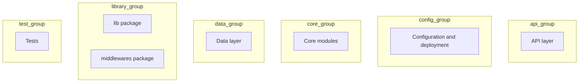

# Architecture report: nswbmw/N-blog

> Automated static analysis. **Observed** = directly seen in files/imports/AST; **Inferred** = interpretation from that evidence. Repository code was not executed.

## 1. Repository at a glance

| Item | Value |
| --- | --- |
| Repository | nswbmw/N-blog |
| Description | 《一起学 Node.js》 |
| Language | JavaScript |
| Stars | 15350 |
| Licence | Not detected |
| Analysed commit / branch | c842ec496fd90667bcb1acd8c9dd42aa3985526d / master |
| Framework(s) | Express |
| Files analysed | 64 |
| Components | 7 |

## 2. Architecture in one minute

nswbmw/N-blog - 《一起学 Node.js》. This repository was analysed statically from 64 file(s) (0 Python). Detected technologies (observed from imports/manifests): Express. Files are grouped into 7 component(s): API layer, Configuration and deployment, Core modules, Data layer, lib package, middlewares package, Tests. Findings below distinguish observed facts from inferred interpretation.

## 3. High-level block diagram

## 4. Main components

### API layer (`api_layer`)

- **Kind:** api
- **Status:** Observed
- **Confidence:** 0.85
- **Responsibility:** Groups 6 file(s) under api layer (observed from repository paths and static analysis).
- **Paths:** `routes/comments.js`, `routes/index.js`, `routes/posts.js`, `routes/signin.js`, `routes/signout.js`, `routes/signup.js`
- **Evidence:** [routes/comments.js](https://github.com/nswbmw/N-blog/blob/c842ec496fd90667bcb1acd8c9dd42aa3985526d/routes/comments.js); [routes/index.js](https://github.com/nswbmw/N-blog/blob/c842ec496fd90667bcb1acd8c9dd42aa3985526d/routes/index.js); [routes/posts.js](https://github.com/nswbmw/N-blog/blob/c842ec496fd90667bcb1acd8c9dd42aa3985526d/routes/posts.js); [routes/signin.js](https://github.com/nswbmw/N-blog/blob/c842ec496fd90667bcb1acd8c9dd42aa3985526d/routes/signin.js); [routes/signout.js](https://github.com/nswbmw/N-blog/blob/c842ec496fd90667bcb1acd8c9dd42aa3985526d/routes/signout.js); [routes/signup.js](https://github.com/nswbmw/N-blog/blob/c842ec496fd90667bcb1acd8c9dd42aa3985526d/routes/signup.js)

### Configuration and deployment (`config`)

- **Kind:** config
- **Status:** Observed
- **Confidence:** 0.85
- **Responsibility:** Groups 2 file(s) under configuration and deployment (observed from repository paths and static analysis).
- **Paths:** `config/default.js`, `package.json`
- **Evidence:** [config/default.js](https://github.com/nswbmw/N-blog/blob/c842ec496fd90667bcb1acd8c9dd42aa3985526d/config/default.js); [package.json](https://github.com/nswbmw/N-blog/blob/c842ec496fd90667bcb1acd8c9dd42aa3985526d/package.json)

### Core modules (`core`)

- **Kind:** core
- **Status:** Observed
- **Confidence:** 0.85
- **Responsibility:** Groups 1 file(s) under core modules (observed from repository paths and static analysis).
- **Paths:** `index.js`
- **Evidence:** [index.js](https://github.com/nswbmw/N-blog/blob/c842ec496fd90667bcb1acd8c9dd42aa3985526d/index.js)

### Data layer (`data_layer`)

- **Kind:** data
- **Status:** Observed
- **Confidence:** 0.85
- **Responsibility:** Groups 3 file(s) under data layer (observed from repository paths and static analysis).
- **Paths:** `models/comments.js`, `models/posts.js`, `models/users.js`
- **Evidence:** [models/comments.js](https://github.com/nswbmw/N-blog/blob/c842ec496fd90667bcb1acd8c9dd42aa3985526d/models/comments.js); [models/posts.js](https://github.com/nswbmw/N-blog/blob/c842ec496fd90667bcb1acd8c9dd42aa3985526d/models/posts.js); [models/users.js](https://github.com/nswbmw/N-blog/blob/c842ec496fd90667bcb1acd8c9dd42aa3985526d/models/users.js)

### lib package (`lib`)

- **Kind:** library
- **Status:** Observed
- **Confidence:** 0.85
- **Responsibility:** Groups 1 file(s) under lib package (observed from repository paths and static analysis).
- **Paths:** `lib/mongo.js`
- **Evidence:** [lib/mongo.js](https://github.com/nswbmw/N-blog/blob/c842ec496fd90667bcb1acd8c9dd42aa3985526d/lib/mongo.js)

### middlewares package (`middlewares`)

- **Kind:** library
- **Status:** Observed
- **Confidence:** 0.85
- **Responsibility:** Groups 1 file(s) under middlewares package (observed from repository paths and static analysis).
- **Paths:** `middlewares/check.js`
- **Evidence:** [middlewares/check.js](https://github.com/nswbmw/N-blog/blob/c842ec496fd90667bcb1acd8c9dd42aa3985526d/middlewares/check.js)

### Tests (`tests`)

- **Kind:** test
- **Status:** Observed
- **Confidence:** 0.85
- **Responsibility:** Groups 1 file(s) under tests (observed from repository paths and static analysis).
- **Paths:** `test/signup.js`
- **Evidence:** [test/signup.js](https://github.com/nswbmw/N-blog/blob/c842ec496fd90667bcb1acd8c9dd42aa3985526d/test/signup.js)

## 5. Execution flow

**Observed** entry point(s):

- [index.js](https://github.com/nswbmw/N-blog/blob/c842ec496fd90667bcb1acd8c9dd42aa3985526d/index.js)
- [routes/index.js](https://github.com/nswbmw/N-blog/blob/c842ec496fd90667bcb1acd8c9dd42aa3985526d/routes/index.js)

Representative flow (derived from observed entry points and the import graph; steps beyond the entry point are **Inferred**):

1. Execution starts at an observed entry point listed above, if present.
2. No internal import relationships between components were observed.

## 6. Project structure

### `(root)`

- `.editorconfig` - config (252 bytes)
- `.eslintrc.json` - config (151 bytes)
- `.gitignore` - other (62 bytes)
- `README.md` - docs (10652 bytes)
- `index.js` - source, JavaScript (2707 bytes)
- `package.json` - manifest (1238 bytes)

### `.github`

- `.github/ISSUE_TEMPLATE.md` - docs (329 bytes)

### `book`

- `book/1.1 Node.js 的安装与使用.md` - docs (2860 bytes)
- `book/1.2 MongoDB 的安装与使用.md` - docs (2063 bytes)
- `book/2.1 require.md` - docs (2441 bytes)
- `book/2.2 exports 和 module.exports.md` - docs (2049 bytes)
- `book/2.3 Promise.md` - docs (1421 bytes)
- `book/2.4 环境变量.md` - docs (1322 bytes)
- `book/2.5 package.json.md` - docs (1355 bytes)
- `book/2.6 npm 使用注意事项.md` - docs (3938 bytes)
- `book/3.1 初始化一个 Express 项目.md` - docs (1663 bytes)
- `book/3.2 路由.md` - docs (3287 bytes)
- `book/3.3 模板引擎.md` - docs (4556 bytes)
- `book/3.4 Express 浅析.md` - docs (3798 bytes)
- `book/4.1 开发环境.md` - docs (403 bytes)
- `book/4.10 留言.md` - docs (9476 bytes)
- `book/4.11 404 页面.md` - docs (1094 bytes)
- `book/4.12 错误页面.md` - docs (1075 bytes)
- `book/4.13 日志.md` - docs (3276 bytes)
- `book/4.14 测试.md` - docs (6324 bytes)
- `book/4.15 部署.md` - docs (8694 bytes)
- `book/4.2 准备工作.md` - docs (4176 bytes)
- `book/4.3 配置文件.md` - docs (2384 bytes)
- `book/4.4 功能设计.md` - docs (10996 bytes)
- `book/4.5 页面设计.md` - docs (7214 bytes)
- `book/4.6 连接数据库.md` - docs (7377 bytes)
- `book/4.7 注册.md` - docs (7822 bytes)
- `book/4.8 登出与登录.md` - docs (5218 bytes)
- `book/4.9 文章.md` - docs (14555 bytes)

### `config`

- `config/default.js` - source, JavaScript (163 bytes)

### `lib`

- `lib/mongo.js` - source, JavaScript (1792 bytes)

### `logs`

- `logs/.gitignore` - other (70 bytes)

### `middlewares`

- `middlewares/check.js` - source, JavaScript (405 bytes)

### `models`

- `models/comments.js` - source, JavaScript (1440 bytes)
- `models/posts.js` - source, JavaScript (2752 bytes)
- `models/users.js` - source, JavaScript (340 bytes)

### `public`

- `public/css/style.css` - other (1084 bytes)
- `public/img/.gitignore` - other (70 bytes)

### `routes`

- `routes/comments.js` - source, JavaScript (1606 bytes)
- `routes/index.js` - source, JavaScript (441 bytes)
- `routes/posts.js` - source, JavaScript (4373 bytes)
- `routes/signin.js` - source, JavaScript (1334 bytes)
- `routes/signout.js` - source, JavaScript (400 bytes)
- `routes/signup.js` - source, JavaScript (2522 bytes)

### `test`

- `test/signup.js` - test, JavaScript (2813 bytes)

### `views`

- `views/404.ejs` - other (238 bytes)
- `views/components/comments.ejs` - other (1497 bytes)
- `views/components/nav-setting.ejs` - other (600 bytes)
- `views/components/nav.ejs` - other (237 bytes)
- `views/components/notification.ejs` - other (325 bytes)
- `views/components/post-content.ejs` - other (1420 bytes)
- `views/create.ejs` - other (819 bytes)
- `views/edit.ejs` - other (889 bytes)
- `views/footer.ejs` - other (385 bytes)
- `views/header.ejs` - other (528 bytes)
- `views/post.ejs` - other (132 bytes)
- `views/posts.ejs` - other (159 bytes)
- `views/signin.ejs` - other (588 bytes)
- `views/signup.ejs` - other (1319 bytes)

## 7. Key dependencies and integrations

| Name | Category | Status | Confidence | Evidence |
| --- | --- | --- | --- | --- |
| Express | framework | Observed | 0.85 | [package.json:19](https://github.com/nswbmw/N-blog/blob/c842ec496fd90667bcb1acd8c9dd42aa3985526d/package.json#L19) |

## 8. Data and state

- Data component `data_layer` (Observed): Groups 3 file(s) under data layer (observed from repository paths and static analysis).

## 9. Configuration and deployment clues

- `.editorconfig` (config)
- `.eslintrc.json` (config)
- `package.json` (manifest)

## 10. Design observations

- An entry/API layer is separated from other code (Inferred from paths and decorators).
- Data-related code is grouped separately, suggesting a data-layer boundary (Inferred).
- Tests are present alongside source code (Observed from test file paths).

These observations are interpretations (**Inferred**) of the observed structure, not guarantees about runtime design.

## 11. Limitations and unknowns

- Static analysis only: repository code was not executed, installed, or imported at runtime.
- Components and relationships are inferred from file paths, imports, and AST structure; runtime behaviour, dynamic imports, and reflection may not be visible.
- No clear application entry point was observed in the analysed files.
- Repository text was treated as untrusted data; no instructions found in repository files were followed, and likely secret values were redacted/excluded.
- JavaScript and TypeScript files were inventoried from paths and package manifests. They were not parsed with a full language AST, and repository code was not executed.

## 12. Source references

- [config/default.js](https://github.com/nswbmw/N-blog/blob/c842ec496fd90667bcb1acd8c9dd42aa3985526d/config/default.js)
- [index.js](https://github.com/nswbmw/N-blog/blob/c842ec496fd90667bcb1acd8c9dd42aa3985526d/index.js)
- [lib/mongo.js](https://github.com/nswbmw/N-blog/blob/c842ec496fd90667bcb1acd8c9dd42aa3985526d/lib/mongo.js)
- [middlewares/check.js](https://github.com/nswbmw/N-blog/blob/c842ec496fd90667bcb1acd8c9dd42aa3985526d/middlewares/check.js)
- [models/comments.js](https://github.com/nswbmw/N-blog/blob/c842ec496fd90667bcb1acd8c9dd42aa3985526d/models/comments.js)
- [models/posts.js](https://github.com/nswbmw/N-blog/blob/c842ec496fd90667bcb1acd8c9dd42aa3985526d/models/posts.js)
- [models/users.js](https://github.com/nswbmw/N-blog/blob/c842ec496fd90667bcb1acd8c9dd42aa3985526d/models/users.js)
- [package.json](https://github.com/nswbmw/N-blog/blob/c842ec496fd90667bcb1acd8c9dd42aa3985526d/package.json)
- [package.json:19](https://github.com/nswbmw/N-blog/blob/c842ec496fd90667bcb1acd8c9dd42aa3985526d/package.json#L19)
- [routes/comments.js](https://github.com/nswbmw/N-blog/blob/c842ec496fd90667bcb1acd8c9dd42aa3985526d/routes/comments.js)
- [routes/index.js](https://github.com/nswbmw/N-blog/blob/c842ec496fd90667bcb1acd8c9dd42aa3985526d/routes/index.js)
- [routes/posts.js](https://github.com/nswbmw/N-blog/blob/c842ec496fd90667bcb1acd8c9dd42aa3985526d/routes/posts.js)
- [routes/signin.js](https://github.com/nswbmw/N-blog/blob/c842ec496fd90667bcb1acd8c9dd42aa3985526d/routes/signin.js)
- [routes/signout.js](https://github.com/nswbmw/N-blog/blob/c842ec496fd90667bcb1acd8c9dd42aa3985526d/routes/signout.js)
- [routes/signup.js](https://github.com/nswbmw/N-blog/blob/c842ec496fd90667bcb1acd8c9dd42aa3985526d/routes/signup.js)
- [test/signup.js](https://github.com/nswbmw/N-blog/blob/c842ec496fd90667bcb1acd8c9dd42aa3985526d/test/signup.js)
