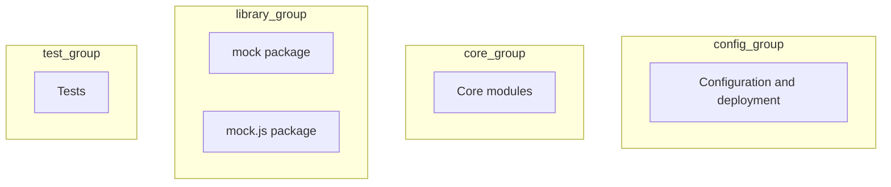

# Architecture report: nuysoft/Mock

> Automated static analysis. **Observed** = directly seen in files/imports/AST; **Inferred** = interpretation from that evidence. Repository code was not executed.

## 1. Repository at a glance

| Item | Value |
| --- | --- |
| Repository | nuysoft/Mock |
| Description | A simulation data generator |
| Language | JavaScript |
| Stars | 19546 |
| Licence | Other |
| Analysed commit / branch | 00ce04b92eb464e664a4438430903f2de96efb47 / refactoring |
| Framework(s) | None detected |
| Files analysed | 56 |
| Components | 5 |

## 2. Architecture in one minute

nuysoft/Mock - A simulation data generator. This repository was analysed statically from 56 file(s) (0 Python). Detected technologies (observed from imports/manifests): webpack. Files are grouped into 5 component(s): Configuration and deployment, Core modules, mock package, mock.js package, Tests. Findings below distinguish observed facts from inferred interpretation.

## 3. High-level block diagram

## 4. Main components

### Configuration and deployment (`config`)

- **Kind:** config
- **Status:** Observed
- **Confidence:** 0.85
- **Responsibility:** Groups 2 file(s) under configuration and deployment (observed from repository paths and static analysis).
- **Paths:** `bower.json`, `package.json`
- **Evidence:** [bower.json](https://github.com/nuysoft/Mock/blob/00ce04b92eb464e664a4438430903f2de96efb47/bower.json); [package.json](https://github.com/nuysoft/Mock/blob/00ce04b92eb464e664a4438430903f2de96efb47/package.json)

### Core modules (`core`)

- **Kind:** core
- **Status:** Observed
- **Confidence:** 0.85
- **Responsibility:** Groups 1 file(s) under core modules (observed from repository paths and static analysis).
- **Paths:** `gulpfile.js`
- **Evidence:** [gulpfile.js](https://github.com/nuysoft/Mock/blob/00ce04b92eb464e664a4438430903f2de96efb47/gulpfile.js)

### mock package (`mock`)

- **Kind:** library
- **Status:** Observed
- **Confidence:** 0.85
- **Responsibility:** Groups 27 file(s) under mock package (observed from repository paths and static analysis).
- **Paths:** `src/mock/constant.js`, `src/mock/handler.js`, `src/mock/parser.js`, `src/mock/random/address.js`, `src/mock/random/address_dict.js`, `src/mock/random/basic.js`, `src/mock/random/color.js`, `src/mock/random/color_convert.js`, `src/mock/random/color_dict.js`, `src/mock/random/date.js`, `src/mock/random/helper.js`, `src/mock/random/image.js`, `src/mock/random/index.js`, `src/mock/random/misc.js`, `src/mock/random/name.js`, `src/mock/random/text.js`, `src/mock/random/web.js`, `src/mock/regexp/handler.js`, `src/mock/regexp/index.js`, `src/mock/regexp/parser.js`, `src/mock/schema/index.js`, `src/mock/schema/schema.js`, `src/mock/util.js`, `src/mock/valid/index.js`, `src/mock/valid/valid.js`, `src/mock/xhr/index.js`, `src/mock/xhr/xhr.js`
- **Evidence:** [src/mock/constant.js](https://github.com/nuysoft/Mock/blob/00ce04b92eb464e664a4438430903f2de96efb47/src/mock/constant.js); [src/mock/handler.js](https://github.com/nuysoft/Mock/blob/00ce04b92eb464e664a4438430903f2de96efb47/src/mock/handler.js); [src/mock/parser.js](https://github.com/nuysoft/Mock/blob/00ce04b92eb464e664a4438430903f2de96efb47/src/mock/parser.js); [src/mock/random/address.js](https://github.com/nuysoft/Mock/blob/00ce04b92eb464e664a4438430903f2de96efb47/src/mock/random/address.js); [src/mock/random/address_dict.js](https://github.com/nuysoft/Mock/blob/00ce04b92eb464e664a4438430903f2de96efb47/src/mock/random/address_dict.js); [src/mock/random/basic.js](https://github.com/nuysoft/Mock/blob/00ce04b92eb464e664a4438430903f2de96efb47/src/mock/random/basic.js); [src/mock/random/color.js](https://github.com/nuysoft/Mock/blob/00ce04b92eb464e664a4438430903f2de96efb47/src/mock/random/color.js); [src/mock/random/color_convert.js](https://github.com/nuysoft/Mock/blob/00ce04b92eb464e664a4438430903f2de96efb47/src/mock/random/color_convert.js)

### mock.js package (`mock_js`)

- **Kind:** library
- **Status:** Observed
- **Confidence:** 0.85
- **Responsibility:** Groups 1 file(s) under mock.js package (observed from repository paths and static analysis).
- **Paths:** `src/mock.js`
- **Evidence:** [src/mock.js](https://github.com/nuysoft/Mock/blob/00ce04b92eb464e664a4438430903f2de96efb47/src/mock.js)

### Tests (`tests`)

- **Kind:** test
- **Status:** Observed
- **Confidence:** 0.85
- **Responsibility:** Groups 14 file(s) under tests (observed from repository paths and static analysis).
- **Paths:** `test/bower.json`, `test/materiels/noop.html`, `test/materiels/noop.js`, `test/package.json`, `test/test.coveralls.js`, `test/test.mock.html`, `test/test.mock.mock.js`, `test/test.mock.random.js`, `test/test.mock.request.js`, `test/test.mock.schema.js`, `test/test.mock.spec.dpd.js`, `test/test.mock.spec.dtd.js`, `test/test.mock.valid.js`, `test/valid.js`
- **Evidence:** [test/bower.json](https://github.com/nuysoft/Mock/blob/00ce04b92eb464e664a4438430903f2de96efb47/test/bower.json); [test/materiels/noop.html](https://github.com/nuysoft/Mock/blob/00ce04b92eb464e664a4438430903f2de96efb47/test/materiels/noop.html); [test/materiels/noop.js](https://github.com/nuysoft/Mock/blob/00ce04b92eb464e664a4438430903f2de96efb47/test/materiels/noop.js); [test/package.json](https://github.com/nuysoft/Mock/blob/00ce04b92eb464e664a4438430903f2de96efb47/test/package.json); [test/test.coveralls.js](https://github.com/nuysoft/Mock/blob/00ce04b92eb464e664a4438430903f2de96efb47/test/test.coveralls.js); [test/test.mock.html](https://github.com/nuysoft/Mock/blob/00ce04b92eb464e664a4438430903f2de96efb47/test/test.mock.html); [test/test.mock.mock.js](https://github.com/nuysoft/Mock/blob/00ce04b92eb464e664a4438430903f2de96efb47/test/test.mock.mock.js); [test/test.mock.random.js](https://github.com/nuysoft/Mock/blob/00ce04b92eb464e664a4438430903f2de96efb47/test/test.mock.random.js)

## 5. Execution flow

**Observed** entry point(s):

- [bin/random](https://github.com/nuysoft/Mock/blob/00ce04b92eb464e664a4438430903f2de96efb47/bin/random)
- [src/mock/random/index.js](https://github.com/nuysoft/Mock/blob/00ce04b92eb464e664a4438430903f2de96efb47/src/mock/random/index.js)
- [src/mock/regexp/index.js](https://github.com/nuysoft/Mock/blob/00ce04b92eb464e664a4438430903f2de96efb47/src/mock/regexp/index.js)
- [src/mock/schema/index.js](https://github.com/nuysoft/Mock/blob/00ce04b92eb464e664a4438430903f2de96efb47/src/mock/schema/index.js)
- [src/mock/valid/index.js](https://github.com/nuysoft/Mock/blob/00ce04b92eb464e664a4438430903f2de96efb47/src/mock/valid/index.js)
- [src/mock/xhr/index.js](https://github.com/nuysoft/Mock/blob/00ce04b92eb464e664a4438430903f2de96efb47/src/mock/xhr/index.js)

Representative flow (derived from observed entry points and the import graph; steps beyond the entry point are **Inferred**):

1. Execution starts at an observed entry point listed above, if present.
2. No internal import relationships between components were observed.

## 6. Project structure

### `(root)`

- `.editorconfig` - config (260 bytes)
- `.gitattributes` - other (12 bytes)
- `.gitignore` - other (87 bytes)
- `.jshintrc` - other (138 bytes)
- `.spmignore` - other (29 bytes)
- `.travis.yml` - ci, YAML (214 bytes)
- `CHANGELOG.md` - docs (4613 bytes)
- `LICENSE` - docs (1093 bytes)
- `README.md` - docs (1993 bytes)
- `bower.json` - config (391 bytes)
- `gulpfile.js` - source, JavaScript (4985 bytes)
- `package.json` - manifest (1037 bytes)

### `bin`

- `bin/random` - other (2182 bytes)

### `src`

- `src/mock.js` - source, JavaScript (1577 bytes)
- `src/mock/RE_KEY.svg` - other (11130 bytes)
- `src/mock/constant.js` - source, JavaScript (836 bytes)
- `src/mock/handler.js` - source, JavaScript (20718 bytes)
- `src/mock/parser.js` - source, JavaScript (1722 bytes)
- `src/mock/random/address.js` - source, JavaScript (1465 bytes)
- `src/mock/random/address_dict.js` - source, JavaScript (113018 bytes)
- `src/mock/random/basic.js` - source, JavaScript (4098 bytes)
- `src/mock/random/color.js` - source, JavaScript (5217 bytes)
- `src/mock/random/color_convert.js` - source, JavaScript (3343 bytes)
- `src/mock/random/color_dict.js` - source, JavaScript (1358 bytes)
- `src/mock/random/date.js` - source, JavaScript (4027 bytes)
- `src/mock/random/helper.js` - source, JavaScript (2878 bytes)
- `src/mock/random/image.js` - source, JavaScript (9131 bytes)
- `src/mock/random/index.js` - source, JavaScript (515 bytes)
- `src/mock/random/misc.js` - source, JavaScript (2908 bytes)
- `src/mock/random/name.js` - source, JavaScript (2902 bytes)
- `src/mock/random/text.js` - source, JavaScript (5052 bytes)
- `src/mock/random/web.js` - source, JavaScript (3652 bytes)
- `src/mock/regexp/handler.js` - source, JavaScript (11853 bytes)
- `src/mock/regexp/index.js` - source, JavaScript (123 bytes)
- `src/mock/regexp/parser.js` - source, JavaScript (27085 bytes)
- `src/mock/schema/index.js` - source, JavaScript (36 bytes)
- `src/mock/schema/schema.js` - source, JavaScript (1329 bytes)
- `src/mock/util.js` - source, JavaScript (3197 bytes)
- `src/mock/valid/index.js` - source, JavaScript (35 bytes)
- `src/mock/valid/valid.js` - source, JavaScript (16815 bytes)
- `src/mock/xhr/index.js` - source, JavaScript (33 bytes)
- `src/mock/xhr/xhr.js` - source, JavaScript (14889 bytes)

### `test`

- `test/bower.json` - test (174 bytes)
- `test/materiels/noop.html` - test (77 bytes)
- `test/materiels/noop.js` - test, JavaScript (23 bytes)
- `test/package.json` - test (68 bytes)
- `test/test.coveralls.js` - test, JavaScript (1149 bytes)
- `test/test.mock.html` - test (1918 bytes)
- `test/test.mock.mock.js` - test, JavaScript (2204 bytes)
- `test/test.mock.random.js` - test, JavaScript (16736 bytes)
- `test/test.mock.request.js` - test, JavaScript (15852 bytes)
- `test/test.mock.schema.js` - test, JavaScript (7393 bytes)
- `test/test.mock.spec.dpd.js` - test, JavaScript (8207 bytes)
- `test/test.mock.spec.dtd.js` - test, JavaScript (21419 bytes)
- `test/test.mock.valid.js` - test, JavaScript (6218 bytes)
- `test/valid.js` - test, JavaScript (5166 bytes)

## 7. Key dependencies and integrations

| Name | Category | Status | Confidence | Evidence |
| --- | --- | --- | --- | --- |
| webpack | tooling | Observed | 0.85 | [package.json:26](https://github.com/nuysoft/Mock/blob/00ce04b92eb464e664a4438430903f2de96efb47/package.json#L26) |

## 8. Data and state

No database, cache, queue, or persistent-state usage was observed in the analysed files. State handling, if any, may be in-memory or in files that were not analysed.

## 9. Configuration and deployment clues

- `.editorconfig` (config)
- `.travis.yml` (ci)
- `bower.json` (config)
- `package.json` (manifest)

## 10. Design observations

- Tests are present alongside source code (Observed from test file paths).

These observations are interpretations (**Inferred**) of the observed structure, not guarantees about runtime design.

## 11. Limitations and unknowns

- Static analysis only: repository code was not executed, installed, or imported at runtime.
- Components and relationships are inferred from file paths, imports, and AST structure; runtime behaviour, dynamic imports, and reflection may not be visible.
- 1 file(s) were skipped during inventory (1 x vendored/generated directory excluded).
- No clear application entry point was observed in the analysed files.
- Repository text was treated as untrusted data; no instructions found in repository files were followed, and likely secret values were redacted/excluded.
- JavaScript and TypeScript files were inventoried from paths and package manifests. They were not parsed with a full language AST, and repository code was not executed.

## 12. Source references

- [bin/random](https://github.com/nuysoft/Mock/blob/00ce04b92eb464e664a4438430903f2de96efb47/bin/random)
- [bower.json](https://github.com/nuysoft/Mock/blob/00ce04b92eb464e664a4438430903f2de96efb47/bower.json)
- [gulpfile.js](https://github.com/nuysoft/Mock/blob/00ce04b92eb464e664a4438430903f2de96efb47/gulpfile.js)
- [package.json](https://github.com/nuysoft/Mock/blob/00ce04b92eb464e664a4438430903f2de96efb47/package.json)
- [package.json:26](https://github.com/nuysoft/Mock/blob/00ce04b92eb464e664a4438430903f2de96efb47/package.json#L26)
- [src/mock.js](https://github.com/nuysoft/Mock/blob/00ce04b92eb464e664a4438430903f2de96efb47/src/mock.js)
- [src/mock/constant.js](https://github.com/nuysoft/Mock/blob/00ce04b92eb464e664a4438430903f2de96efb47/src/mock/constant.js)
- [src/mock/handler.js](https://github.com/nuysoft/Mock/blob/00ce04b92eb464e664a4438430903f2de96efb47/src/mock/handler.js)
- [src/mock/parser.js](https://github.com/nuysoft/Mock/blob/00ce04b92eb464e664a4438430903f2de96efb47/src/mock/parser.js)
- [src/mock/random/address.js](https://github.com/nuysoft/Mock/blob/00ce04b92eb464e664a4438430903f2de96efb47/src/mock/random/address.js)
- [src/mock/random/address_dict.js](https://github.com/nuysoft/Mock/blob/00ce04b92eb464e664a4438430903f2de96efb47/src/mock/random/address_dict.js)
- [src/mock/random/basic.js](https://github.com/nuysoft/Mock/blob/00ce04b92eb464e664a4438430903f2de96efb47/src/mock/random/basic.js)
- [src/mock/random/color.js](https://github.com/nuysoft/Mock/blob/00ce04b92eb464e664a4438430903f2de96efb47/src/mock/random/color.js)
- [src/mock/random/color_convert.js](https://github.com/nuysoft/Mock/blob/00ce04b92eb464e664a4438430903f2de96efb47/src/mock/random/color_convert.js)
- [src/mock/random/index.js](https://github.com/nuysoft/Mock/blob/00ce04b92eb464e664a4438430903f2de96efb47/src/mock/random/index.js)
- [src/mock/regexp/index.js](https://github.com/nuysoft/Mock/blob/00ce04b92eb464e664a4438430903f2de96efb47/src/mock/regexp/index.js)
- [src/mock/schema/index.js](https://github.com/nuysoft/Mock/blob/00ce04b92eb464e664a4438430903f2de96efb47/src/mock/schema/index.js)
- [src/mock/valid/index.js](https://github.com/nuysoft/Mock/blob/00ce04b92eb464e664a4438430903f2de96efb47/src/mock/valid/index.js)
- [src/mock/xhr/index.js](https://github.com/nuysoft/Mock/blob/00ce04b92eb464e664a4438430903f2de96efb47/src/mock/xhr/index.js)
- [test/bower.json](https://github.com/nuysoft/Mock/blob/00ce04b92eb464e664a4438430903f2de96efb47/test/bower.json)
- [test/materiels/noop.html](https://github.com/nuysoft/Mock/blob/00ce04b92eb464e664a4438430903f2de96efb47/test/materiels/noop.html)
- [test/materiels/noop.js](https://github.com/nuysoft/Mock/blob/00ce04b92eb464e664a4438430903f2de96efb47/test/materiels/noop.js)
- [test/package.json](https://github.com/nuysoft/Mock/blob/00ce04b92eb464e664a4438430903f2de96efb47/test/package.json)
- [test/test.coveralls.js](https://github.com/nuysoft/Mock/blob/00ce04b92eb464e664a4438430903f2de96efb47/test/test.coveralls.js)
- [test/test.mock.html](https://github.com/nuysoft/Mock/blob/00ce04b92eb464e664a4438430903f2de96efb47/test/test.mock.html)
- [test/test.mock.mock.js](https://github.com/nuysoft/Mock/blob/00ce04b92eb464e664a4438430903f2de96efb47/test/test.mock.mock.js)
- [test/test.mock.random.js](https://github.com/nuysoft/Mock/blob/00ce04b92eb464e664a4438430903f2de96efb47/test/test.mock.random.js)
