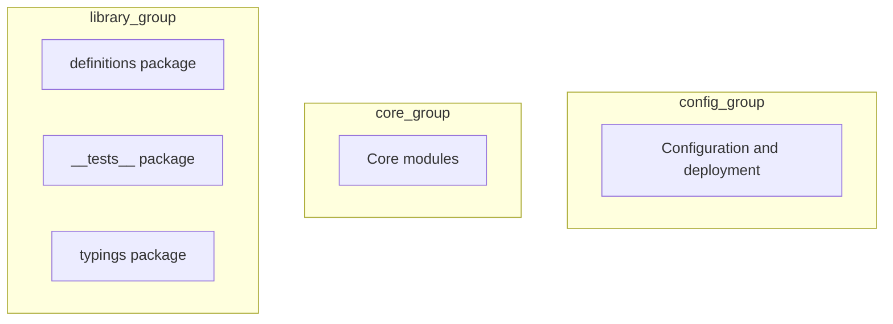

# Architecture report: oblador/react-native-animatable

> Automated static analysis. **Observed** = directly seen in files/imports/AST; **Inferred** = interpretation from that evidence. Repository code was not executed.

## 1. Repository at a glance

| Item | Value |
| --- | --- |
| Repository | oblador/react-native-animatable |
| Description | Standard set of easy to use animations and declarative transitions for React Native |
| Language | JavaScript |
| Stars | 9924 |
| Licence | MIT |
| Analysed commit / branch | dfd7413734eb693358defcac536b0b32e9dc0b8c / master |
| Framework(s) | React |
| Files analysed | 137 |
| Components | 5 |

## 2. Architecture in one minute

oblador/react-native-animatable - Standard set of easy to use animations and declarative transitions for React Native. This repository was analysed statically from 137 file(s) (0 Python). Detected technologies (observed from imports/manifests): GitHub Actions, React, Jest, TypeScript. Files are grouped into 5 component(s): Configuration and deployment, Core modules, definitions package, __tests__ package, typings package. Findings below distinguish observed facts from inferred interpretation.

## 3. High-level block diagram

## 4. Main components

### Configuration and deployment (`config`)

- **Kind:** config
- **Status:** Observed
- **Confidence:** 0.85
- **Responsibility:** Groups 1 file(s) under configuration and deployment (observed from repository paths and static analysis).
- **Paths:** `package.json`
- **Evidence:** [package.json](https://github.com/oblador/react-native-animatable/blob/dfd7413734eb693358defcac536b0b32e9dc0b8c/package.json)

### Core modules (`core`)

- **Kind:** core
- **Status:** Observed
- **Confidence:** 0.85
- **Responsibility:** Groups 10 file(s) under core modules (observed from repository paths and static analysis).
- **Paths:** `babel.config.js`, `createAnimatableComponent.js`, `createAnimation.js`, `easing.js`, `flattenStyle.js`, `getDefaultStyleValue.js`, `getStyleValues.js`, `index.js`, `registry.js`, `wrapStyleTransforms.js`
- **Evidence:** [babel.config.js](https://github.com/oblador/react-native-animatable/blob/dfd7413734eb693358defcac536b0b32e9dc0b8c/babel.config.js); [createAnimatableComponent.js](https://github.com/oblador/react-native-animatable/blob/dfd7413734eb693358defcac536b0b32e9dc0b8c/createAnimatableComponent.js); [createAnimation.js](https://github.com/oblador/react-native-animatable/blob/dfd7413734eb693358defcac536b0b32e9dc0b8c/createAnimation.js); [easing.js](https://github.com/oblador/react-native-animatable/blob/dfd7413734eb693358defcac536b0b32e9dc0b8c/easing.js); [flattenStyle.js](https://github.com/oblador/react-native-animatable/blob/dfd7413734eb693358defcac536b0b32e9dc0b8c/flattenStyle.js); [getDefaultStyleValue.js](https://github.com/oblador/react-native-animatable/blob/dfd7413734eb693358defcac536b0b32e9dc0b8c/getDefaultStyleValue.js); [getStyleValues.js](https://github.com/oblador/react-native-animatable/blob/dfd7413734eb693358defcac536b0b32e9dc0b8c/getStyleValues.js); [index.js](https://github.com/oblador/react-native-animatable/blob/dfd7413734eb693358defcac536b0b32e9dc0b8c/index.js)

### definitions package (`definitions`)

- **Kind:** library
- **Status:** Observed
- **Confidence:** 0.85
- **Responsibility:** Groups 12 file(s) under definitions package (observed from repository paths and static analysis).
- **Paths:** `definitions/attention-seekers.js`, `definitions/bouncing-entrances.js`, `definitions/bouncing-exits.js`, `definitions/fading-entrances.js`, `definitions/fading-exits.js`, `definitions/flippers.js`, `definitions/index.js`, `definitions/lightspeed.js`, `definitions/sliding-entrances.js`, `definitions/sliding-exits.js`, `definitions/zooming-entrances.js`, `definitions/zooming-exits.js`
- **Evidence:** [definitions/attention-seekers.js](https://github.com/oblador/react-native-animatable/blob/dfd7413734eb693358defcac536b0b32e9dc0b8c/definitions/attention-seekers.js); [definitions/bouncing-entrances.js](https://github.com/oblador/react-native-animatable/blob/dfd7413734eb693358defcac536b0b32e9dc0b8c/definitions/bouncing-entrances.js); [definitions/bouncing-exits.js](https://github.com/oblador/react-native-animatable/blob/dfd7413734eb693358defcac536b0b32e9dc0b8c/definitions/bouncing-exits.js); [definitions/fading-entrances.js](https://github.com/oblador/react-native-animatable/blob/dfd7413734eb693358defcac536b0b32e9dc0b8c/definitions/fading-entrances.js); [definitions/fading-exits.js](https://github.com/oblador/react-native-animatable/blob/dfd7413734eb693358defcac536b0b32e9dc0b8c/definitions/fading-exits.js); [definitions/flippers.js](https://github.com/oblador/react-native-animatable/blob/dfd7413734eb693358defcac536b0b32e9dc0b8c/definitions/flippers.js); [definitions/index.js](https://github.com/oblador/react-native-animatable/blob/dfd7413734eb693358defcac536b0b32e9dc0b8c/definitions/index.js); [definitions/lightspeed.js](https://github.com/oblador/react-native-animatable/blob/dfd7413734eb693358defcac536b0b32e9dc0b8c/definitions/lightspeed.js)

### __tests__ package (`tests`)

- **Kind:** library
- **Status:** Observed
- **Confidence:** 0.85
- **Responsibility:** Groups 2 file(s) under __tests__ package (observed from repository paths and static analysis).
- **Paths:** `__tests__/createAnimation.js`, `__tests__/getDefaultStyleValue.js`
- **Evidence:** [__tests__/createAnimation.js](https://github.com/oblador/react-native-animatable/blob/dfd7413734eb693358defcac536b0b32e9dc0b8c/__tests__/createAnimation.js); [__tests__/getDefaultStyleValue.js](https://github.com/oblador/react-native-animatable/blob/dfd7413734eb693358defcac536b0b32e9dc0b8c/__tests__/getDefaultStyleValue.js)

### typings package (`typings`)

- **Kind:** library
- **Status:** Observed
- **Confidence:** 0.85
- **Responsibility:** Groups 1 file(s) under typings package (observed from repository paths and static analysis).
- **Paths:** `typings/react-native-animatable.d.ts`
- **Evidence:** [typings/react-native-animatable.d.ts](https://github.com/oblador/react-native-animatable/blob/dfd7413734eb693358defcac536b0b32e9dc0b8c/typings/react-native-animatable.d.ts)

## 5. Execution flow

**Observed** entry point(s):

- [definitions/index.js](https://github.com/oblador/react-native-animatable/blob/dfd7413734eb693358defcac536b0b32e9dc0b8c/definitions/index.js)
- [index.js](https://github.com/oblador/react-native-animatable/blob/dfd7413734eb693358defcac536b0b32e9dc0b8c/index.js)

Representative flow (derived from observed entry points and the import graph; steps beyond the entry point are **Inferred**):

1. Execution starts at an observed entry point listed above, if present.
2. No internal import relationships between components were observed.

## 6. Project structure

### `(root)`

- `.editorconfig` - config (214 bytes)
- `.eslintrc.js` - source, JavaScript (603 bytes)
- `.gitignore` - other (169 bytes)
- `.npmignore` - other (131 bytes)
- `.prettierrc` - other (52 bytes)
- `LICENSE` - docs (1082 bytes)
- `README.md` - docs (12304 bytes)
- `babel.config.js` - source, JavaScript (77 bytes)
- `createAnimatableComponent.js` - source, JavaScript (17878 bytes)
- `createAnimation.js` - source, JavaScript (1754 bytes)
- `easing.js` - source, JavaScript (1855 bytes)
- `flattenStyle.js` - source, JavaScript (384 bytes)
- `getDefaultStyleValue.js` - source, JavaScript (1319 bytes)
- `getStyleValues.js` - source, JavaScript (472 bytes)
- `index.js` - source, JavaScript (686 bytes)
- `package.json` - manifest (2029 bytes)
- `registry.js` - source, JavaScript (605 bytes)
- `wrapStyleTransforms.js` - source, JavaScript (713 bytes)

### `.github`

- `.github/workflows/deploy.yml` - ci, YAML (542 bytes)
- `.github/workflows/tests.yml` - ci, YAML (468 bytes)

### `Examples`

- `Examples/AnimatableExplorer/.bundle/config` - other (59 bytes)
- `Examples/AnimatableExplorer/.eslintrc.js` - source, JavaScript (64 bytes)
- `Examples/AnimatableExplorer/.gitignore` - other (989 bytes)
- `Examples/AnimatableExplorer/.prettierrc.js` - source, JavaScript (141 bytes)
- `Examples/AnimatableExplorer/.watchmanconfig` - other (3 bytes)
- `Examples/AnimatableExplorer/AnimationCell.tsx` - source, TypeScript (1179 bytes)
- `Examples/AnimatableExplorer/App.tsx` - source, TypeScript (3904 bytes)
- `Examples/AnimatableExplorer/Gemfile` - other (204 bytes)
- `Examples/AnimatableExplorer/Gemfile.lock` - other (2384 bytes)
- `Examples/AnimatableExplorer/README.md` - docs (3080 bytes)
- `Examples/AnimatableExplorer/__tests__/App.test.tsx` - source, TypeScript (363 bytes)
- `Examples/AnimatableExplorer/android/app/build.gradle` - manifest (4919 bytes)
- `Examples/AnimatableExplorer/android/app/proguard-rules.pro` - other (435 bytes)
- `Examples/AnimatableExplorer/android/app/src/debug/AndroidManifest.xml` - other (520 bytes)
- `Examples/AnimatableExplorer/android/app/src/debug/java/com/animatableexplorer/ReactNativeFlipper.java` - source, Java (3384 bytes)
- `Examples/AnimatableExplorer/android/app/src/main/AndroidManifest.xml` - other (971 bytes)
- `Examples/AnimatableExplorer/android/app/src/main/java/com/animatableexplorer/MainActivity.java` - source, Java (1115 bytes)
- `Examples/AnimatableExplorer/android/app/src/main/java/com/animatableexplorer/MainApplication.java` - source, Java (1982 bytes)
- `Examples/AnimatableExplorer/android/app/src/main/res/drawable/rn_edit_text_material.xml` - other (1909 bytes)
- `Examples/AnimatableExplorer/android/app/src/main/res/values/strings.xml` - other (81 bytes)
- `Examples/AnimatableExplorer/android/app/src/main/res/values/styles.xml` - other (282 bytes)
- `Examples/AnimatableExplorer/android/app/src/release/java/com/animatableexplorer/ReactNativeFlipper.java` - source, Java (688 bytes)
- `Examples/AnimatableExplorer/android/build.gradle` - manifest (601 bytes)
- `Examples/AnimatableExplorer/android/gradle.properties` - other (1902 bytes)
- `Examples/AnimatableExplorer/android/gradle/wrapper/gradle-wrapper.properties` - other (223 bytes)
- `Examples/AnimatableExplorer/android/gradlew` - other (8497 bytes)
- `Examples/AnimatableExplorer/android/gradlew.bat` - other (2868 bytes)
- `Examples/AnimatableExplorer/android/settings.gradle` - other (262 bytes)
- `Examples/AnimatableExplorer/app.json` - config (74 bytes)
- `Examples/AnimatableExplorer/babel.config.js` - source, JavaScript (77 bytes)
- `Examples/AnimatableExplorer/groupedAnimationTypes.ts` - source, TypeScript (1896 bytes)
- `Examples/AnimatableExplorer/index.js` - source, JavaScript (167 bytes)
- `Examples/AnimatableExplorer/ios/.xcode.env` - other (482 bytes)
- `Examples/AnimatableExplorer/ios/AnimatableExplorer.xcodeproj/project.pbxproj` - other (30735 bytes)
- `Examples/AnimatableExplorer/ios/AnimatableExplorer.xcodeproj/xcshareddata/xcschemes/AnimatableExplorer.xcscheme` - other (3402 bytes)
- `Examples/AnimatableExplorer/ios/AnimatableExplorer.xcworkspace/contents.xcworkspacedata` - other (236 bytes)
- `Examples/AnimatableExplorer/ios/AnimatableExplorer.xcworkspace/xcshareddata/IDEWorkspaceChecks.plist` - other (238 bytes)
- `Examples/AnimatableExplorer/ios/AnimatableExplorer/AppDelegate.h` - source, C/C++ (98 bytes)
- `Examples/AnimatableExplorer/ios/AnimatableExplorer/AppDelegate.mm` - other (757 bytes)
- `Examples/AnimatableExplorer/ios/AnimatableExplorer/Images.xcassets/AppIcon.appiconset/Contents.json` - config (849 bytes)
- `Examples/AnimatableExplorer/ios/AnimatableExplorer/Images.xcassets/Contents.json` - config (63 bytes)
- `Examples/AnimatableExplorer/ios/AnimatableExplorer/Info.plist` - other (1600 bytes)
- `Examples/AnimatableExplorer/ios/AnimatableExplorer/LaunchScreen.storyboard` - other (4242 bytes)
- `Examples/AnimatableExplorer/ios/AnimatableExplorer/main.m` - other (199 bytes)
- `Examples/AnimatableExplorer/ios/AnimatableExplorerTests/AnimatableExplorerTests.m` - other (2012 bytes)
- `Examples/AnimatableExplorer/ios/AnimatableExplorerTests/Info.plist` - other (733 bytes)
- `Examples/AnimatableExplorer/ios/Podfile` - other (2142 bytes)
- `Examples/AnimatableExplorer/ios/Podfile.lock` - other (24571 bytes)
- `Examples/AnimatableExplorer/jest.config.js` - source, JavaScript (48 bytes)
- `Examples/AnimatableExplorer/metro.config.js` - source, JavaScript (302 bytes)
- `Examples/AnimatableExplorer/package.json` - manifest (1260 bytes)
- `Examples/AnimatableExplorer/tsconfig.json` - config (56 bytes)
- `Examples/MakeItRain/.bundle/config` - other (59 bytes)
- `Examples/MakeItRain/.eslintrc.js` - source, JavaScript (64 bytes)
- `Examples/MakeItRain/.gitignore` - other (989 bytes)
- `Examples/MakeItRain/.prettierrc.js` - source, JavaScript (141 bytes)
- `Examples/MakeItRain/.watchmanconfig` - other (3 bytes)
- `Examples/MakeItRain/App.js` - source, JavaScript (3318 bytes)
- `Examples/MakeItRain/Gemfile` - other (204 bytes)
- `Examples/MakeItRain/Gemfile.lock` - other (2384 bytes)
- `Examples/MakeItRain/README.md` - docs (3080 bytes)
- `Examples/MakeItRain/__tests__/App.test.tsx` - source, TypeScript (363 bytes)
- `Examples/MakeItRain/android/app/build.gradle` - manifest (4903 bytes)
- `Examples/MakeItRain/android/app/proguard-rules.pro` - other (435 bytes)
- `Examples/MakeItRain/android/app/src/debug/AndroidManifest.xml` - other (520 bytes)
- `Examples/MakeItRain/android/app/src/debug/java/com/makeitrain/ReactNativeFlipper.java` - source, Java (3376 bytes)
- `Examples/MakeItRain/android/app/src/main/AndroidManifest.xml` - other (971 bytes)
- `Examples/MakeItRain/android/app/src/main/java/com/makeitrain/MainActivity.java` - source, Java (1099 bytes)
- `Examples/MakeItRain/android/app/src/main/java/com/makeitrain/MainApplication.java` - source, Java (1974 bytes)
- `Examples/MakeItRain/android/app/src/main/res/drawable/rn_edit_text_material.xml` - other (1909 bytes)
- `Examples/MakeItRain/android/app/src/main/res/values/strings.xml` - other (73 bytes)
- `Examples/MakeItRain/android/app/src/main/res/values/styles.xml` - other (282 bytes)
- `Examples/MakeItRain/android/app/src/release/java/com/makeitrain/ReactNativeFlipper.java` - source, Java (680 bytes)
- `Examples/MakeItRain/android/build.gradle` - manifest (601 bytes)
- `Examples/MakeItRain/android/gradle.properties` - other (1902 bytes)
- `Examples/MakeItRain/android/gradle/wrapper/gradle-wrapper.properties` - other (223 bytes)
- `Examples/MakeItRain/android/gradlew` - other (8497 bytes)
- `Examples/MakeItRain/android/gradlew.bat` - other (2868 bytes)
- `Examples/MakeItRain/android/settings.gradle` - other (254 bytes)
- `Examples/MakeItRain/app.json` - config (58 bytes)
- `Examples/MakeItRain/babel.config.js` - source, JavaScript (77 bytes)
- `Examples/MakeItRain/index.js` - source, JavaScript (183 bytes)
- `Examples/MakeItRain/ios/.xcode.env` - other (482 bytes)
- `Examples/MakeItRain/ios/MakeItRain.xcodeproj/project.pbxproj` - other (29575 bytes)
- `Examples/MakeItRain/ios/MakeItRain.xcodeproj/xcshareddata/xcschemes/MakeItRain.xcscheme` - other (3306 bytes)
- `Examples/MakeItRain/ios/MakeItRain.xcworkspace/contents.xcworkspacedata` - other (228 bytes)
- `Examples/MakeItRain/ios/MakeItRain.xcworkspace/xcshareddata/IDEWorkspaceChecks.plist` - other (238 bytes)
- `Examples/MakeItRain/ios/MakeItRain/AppDelegate.h` - source, C/C++ (98 bytes)
- `Examples/MakeItRain/ios/MakeItRain/AppDelegate.mm` - other (749 bytes)
- `Examples/MakeItRain/ios/MakeItRain/Images.xcassets/AppIcon.appiconset/Contents.json` - config (849 bytes)
- `Examples/MakeItRain/ios/MakeItRain/Images.xcassets/Contents.json` - config (63 bytes)
- `Examples/MakeItRain/ios/MakeItRain/Info.plist` - other (1592 bytes)
- `Examples/MakeItRain/ios/MakeItRain/LaunchScreen.storyboard` - other (4234 bytes)
- `Examples/MakeItRain/ios/MakeItRain/main.m` - other (199 bytes)
- `Examples/MakeItRain/ios/MakeItRainTests/Info.plist` - other (733 bytes)
- `Examples/MakeItRain/ios/MakeItRainTests/MakeItRainTests.m` - other (1996 bytes)
- `Examples/MakeItRain/ios/Podfile` - other (2126 bytes)
- `Examples/MakeItRain/ios/Podfile.lock` - other (24292 bytes)
- `Examples/MakeItRain/jest.config.js` - source, JavaScript (48 bytes)
- `Examples/MakeItRain/metro.config.js` - source, JavaScript (302 bytes)
- `Examples/MakeItRain/package.json` - manifest (1204 bytes)
- `Examples/MakeItRain/tsconfig.json` - config (56 bytes)

### `__tests__`

- `__tests__/createAnimation.js` - source, JavaScript (2630 bytes)
- `__tests__/getDefaultStyleValue.js` - source, JavaScript (1438 bytes)

### `definitions`

- `definitions/attention-seekers.js` - source, JavaScript (3356 bytes)
- `definitions/bouncing-entrances.js` - source, JavaScript (1186 bytes)
- `definitions/bouncing-exits.js` - source, JavaScript (1356 bytes)
- `definitions/fading-entrances.js` - source, JavaScript (869 bytes)
- `definitions/fading-exits.js` - source, JavaScript (883 bytes)
- `definitions/flippers.js` - source, JavaScript (1203 bytes)
- `definitions/index.js` - source, JavaScript (375 bytes)
- `definitions/lightspeed.js` - source, JavaScript (485 bytes)
- `definitions/sliding-entrances.js` - source, JavaScript (465 bytes)
- `definitions/sliding-exits.js` - source, JavaScript (474 bytes)
- `definitions/zooming-entrances.js` - source, JavaScript (897 bytes)
- `definitions/zooming-exits.js` - source, JavaScript (939 bytes)

### `typings`

- `typings/react-native-animatable.d.ts` - source, TypeScript (4657 bytes)

## 7. Key dependencies and integrations

| Name | Category | Status | Confidence | Evidence |
| --- | --- | --- | --- | --- |
| GitHub Actions | ci | Observed | 0.90 | [.github/workflows/deploy.yml](https://github.com/oblador/react-native-animatable/blob/dfd7413734eb693358defcac536b0b32e9dc0b8c/.github/workflows/deploy.yml); [.github/workflows/tests.yml](https://github.com/oblador/react-native-animatable/blob/dfd7413734eb693358defcac536b0b32e9dc0b8c/.github/workflows/tests.yml) |
| React | framework | Observed | 0.90 | [Examples/AnimatableExplorer/package.json:6](https://github.com/oblador/react-native-animatable/blob/dfd7413734eb693358defcac536b0b32e9dc0b8c/Examples/AnimatableExplorer/package.json#L6); [Examples/MakeItRain/package.json:6](https://github.com/oblador/react-native-animatable/blob/dfd7413734eb693358defcac536b0b32e9dc0b8c/Examples/MakeItRain/package.json#L6); [package.json:2](https://github.com/oblador/react-native-animatable/blob/dfd7413734eb693358defcac536b0b32e9dc0b8c/package.json#L2) |
| Jest | tooling | Observed | 0.90 | [Examples/AnimatableExplorer/package.json:11](https://github.com/oblador/react-native-animatable/blob/dfd7413734eb693358defcac536b0b32e9dc0b8c/Examples/AnimatableExplorer/package.json#L11); [Examples/MakeItRain/package.json:11](https://github.com/oblador/react-native-animatable/blob/dfd7413734eb693358defcac536b0b32e9dc0b8c/Examples/MakeItRain/package.json#L11); [package.json:8](https://github.com/oblador/react-native-animatable/blob/dfd7413734eb693358defcac536b0b32e9dc0b8c/package.json#L8) |
| TypeScript | tooling | Observed | 0.90 | [Examples/AnimatableExplorer/package.json:34](https://github.com/oblador/react-native-animatable/blob/dfd7413734eb693358defcac536b0b32e9dc0b8c/Examples/AnimatableExplorer/package.json#L34); [Examples/MakeItRain/package.json:33](https://github.com/oblador/react-native-animatable/blob/dfd7413734eb693358defcac536b0b32e9dc0b8c/Examples/MakeItRain/package.json#L33) |

## 8. Data and state

No database, cache, queue, or persistent-state usage was observed in the analysed files. State handling, if any, may be in-memory or in files that were not analysed.

## 9. Configuration and deployment clues

- `.editorconfig` (config)
- `.github/workflows/deploy.yml` (ci)
- `.github/workflows/tests.yml` (ci)
- `Examples/AnimatableExplorer/android/app/build.gradle` (manifest)
- `Examples/AnimatableExplorer/android/build.gradle` (manifest)
- `Examples/AnimatableExplorer/app.json` (config)
- `Examples/AnimatableExplorer/ios/AnimatableExplorer/Images.xcassets/AppIcon.appiconset/Contents.json` (config)
- `Examples/AnimatableExplorer/ios/AnimatableExplorer/Images.xcassets/Contents.json` (config)
- `Examples/AnimatableExplorer/package.json` (manifest)
- `Examples/AnimatableExplorer/tsconfig.json` (config)
- `Examples/MakeItRain/android/app/build.gradle` (manifest)
- `Examples/MakeItRain/android/build.gradle` (manifest)
- `Examples/MakeItRain/app.json` (config)
- `Examples/MakeItRain/ios/MakeItRain/Images.xcassets/AppIcon.appiconset/Contents.json` (config)
- `Examples/MakeItRain/ios/MakeItRain/Images.xcassets/Contents.json` (config)
- `Examples/MakeItRain/package.json` (manifest)
- `Examples/MakeItRain/tsconfig.json` (config)
- `package.json` (manifest)

## 10. Design observations

- No strong design patterns could be established from the available evidence.

These observations are interpretations (**Inferred**) of the observed structure, not guarantees about runtime design.

## 11. Limitations and unknowns

- Static analysis only: repository code was not executed, installed, or imported at runtime.
- Components and relationships are inferred from file paths, imports, and AST structure; runtime behaviour, dynamic imports, and reflection may not be visible.
- No clear application entry point was observed in the analysed files.
- Repository text was treated as untrusted data; no instructions found in repository files were followed, and likely secret values were redacted/excluded.
- JavaScript and TypeScript files were inventoried from paths and package manifests. They were not parsed with a full language AST, and repository code was not executed.

## 12. Source references

- [.github/workflows/deploy.yml](https://github.com/oblador/react-native-animatable/blob/dfd7413734eb693358defcac536b0b32e9dc0b8c/.github/workflows/deploy.yml)
- [.github/workflows/tests.yml](https://github.com/oblador/react-native-animatable/blob/dfd7413734eb693358defcac536b0b32e9dc0b8c/.github/workflows/tests.yml)
- [Examples/AnimatableExplorer/package.json:6](https://github.com/oblador/react-native-animatable/blob/dfd7413734eb693358defcac536b0b32e9dc0b8c/Examples/AnimatableExplorer/package.json#L6)
- [Examples/AnimatableExplorer/package.json:11](https://github.com/oblador/react-native-animatable/blob/dfd7413734eb693358defcac536b0b32e9dc0b8c/Examples/AnimatableExplorer/package.json#L11)
- [Examples/AnimatableExplorer/package.json:34](https://github.com/oblador/react-native-animatable/blob/dfd7413734eb693358defcac536b0b32e9dc0b8c/Examples/AnimatableExplorer/package.json#L34)
- [Examples/MakeItRain/package.json:6](https://github.com/oblador/react-native-animatable/blob/dfd7413734eb693358defcac536b0b32e9dc0b8c/Examples/MakeItRain/package.json#L6)
- [Examples/MakeItRain/package.json:11](https://github.com/oblador/react-native-animatable/blob/dfd7413734eb693358defcac536b0b32e9dc0b8c/Examples/MakeItRain/package.json#L11)
- [Examples/MakeItRain/package.json:33](https://github.com/oblador/react-native-animatable/blob/dfd7413734eb693358defcac536b0b32e9dc0b8c/Examples/MakeItRain/package.json#L33)
- [__tests__/createAnimation.js](https://github.com/oblador/react-native-animatable/blob/dfd7413734eb693358defcac536b0b32e9dc0b8c/__tests__/createAnimation.js)
- [__tests__/getDefaultStyleValue.js](https://github.com/oblador/react-native-animatable/blob/dfd7413734eb693358defcac536b0b32e9dc0b8c/__tests__/getDefaultStyleValue.js)
- [babel.config.js](https://github.com/oblador/react-native-animatable/blob/dfd7413734eb693358defcac536b0b32e9dc0b8c/babel.config.js)
- [createAnimatableComponent.js](https://github.com/oblador/react-native-animatable/blob/dfd7413734eb693358defcac536b0b32e9dc0b8c/createAnimatableComponent.js)
- [createAnimation.js](https://github.com/oblador/react-native-animatable/blob/dfd7413734eb693358defcac536b0b32e9dc0b8c/createAnimation.js)
- [definitions/attention-seekers.js](https://github.com/oblador/react-native-animatable/blob/dfd7413734eb693358defcac536b0b32e9dc0b8c/definitions/attention-seekers.js)
- [definitions/bouncing-entrances.js](https://github.com/oblador/react-native-animatable/blob/dfd7413734eb693358defcac536b0b32e9dc0b8c/definitions/bouncing-entrances.js)
- [definitions/bouncing-exits.js](https://github.com/oblador/react-native-animatable/blob/dfd7413734eb693358defcac536b0b32e9dc0b8c/definitions/bouncing-exits.js)
- [definitions/fading-entrances.js](https://github.com/oblador/react-native-animatable/blob/dfd7413734eb693358defcac536b0b32e9dc0b8c/definitions/fading-entrances.js)
- [definitions/fading-exits.js](https://github.com/oblador/react-native-animatable/blob/dfd7413734eb693358defcac536b0b32e9dc0b8c/definitions/fading-exits.js)
- [definitions/flippers.js](https://github.com/oblador/react-native-animatable/blob/dfd7413734eb693358defcac536b0b32e9dc0b8c/definitions/flippers.js)
- [definitions/index.js](https://github.com/oblador/react-native-animatable/blob/dfd7413734eb693358defcac536b0b32e9dc0b8c/definitions/index.js)
- [definitions/lightspeed.js](https://github.com/oblador/react-native-animatable/blob/dfd7413734eb693358defcac536b0b32e9dc0b8c/definitions/lightspeed.js)
- [easing.js](https://github.com/oblador/react-native-animatable/blob/dfd7413734eb693358defcac536b0b32e9dc0b8c/easing.js)
- [flattenStyle.js](https://github.com/oblador/react-native-animatable/blob/dfd7413734eb693358defcac536b0b32e9dc0b8c/flattenStyle.js)
- [getDefaultStyleValue.js](https://github.com/oblador/react-native-animatable/blob/dfd7413734eb693358defcac536b0b32e9dc0b8c/getDefaultStyleValue.js)
- [getStyleValues.js](https://github.com/oblador/react-native-animatable/blob/dfd7413734eb693358defcac536b0b32e9dc0b8c/getStyleValues.js)
- [index.js](https://github.com/oblador/react-native-animatable/blob/dfd7413734eb693358defcac536b0b32e9dc0b8c/index.js)
- [package.json](https://github.com/oblador/react-native-animatable/blob/dfd7413734eb693358defcac536b0b32e9dc0b8c/package.json)
- [package.json:2](https://github.com/oblador/react-native-animatable/blob/dfd7413734eb693358defcac536b0b32e9dc0b8c/package.json#L2)
- [package.json:8](https://github.com/oblador/react-native-animatable/blob/dfd7413734eb693358defcac536b0b32e9dc0b8c/package.json#L8)
- [typings/react-native-animatable.d.ts](https://github.com/oblador/react-native-animatable/blob/dfd7413734eb693358defcac536b0b32e9dc0b8c/typings/react-native-animatable.d.ts)
