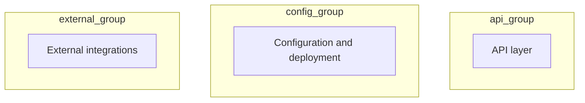

# Architecture report: oldboyxx/jira_clone

> Automated static analysis. **Observed** = directly seen in files/imports/AST; **Inferred** = interpretation from that evidence. Repository code was not executed.

## 1. Repository at a glance

| Item | Value |
| --- | --- |
| Repository | oldboyxx/jira_clone |
| Description | A simplified Jira clone built with React/Babel (Client), and Node/TypeScript (API). Auto formatted with Prettier, tested with Cypress. |
| Language | JavaScript |
| Stars | 11061 |
| Licence | MIT |
| Analysed commit / branch | 26a9e77b1789fef9cb43edb5d6018cf1663cf035 / master |
| Framework(s) | Express, React |
| Files analysed | 207 |
| Components | 3 |

## 2. Architecture in one minute

oldboyxx/jira_clone - A simplified Jira clone built with React/Babel (Client), and Node/TypeScript (API). Auto formatted with Prettier, tested with Cypress.. This repository was analysed statically from 207 file(s) (0 Python). Detected technologies (observed from imports/manifests): Express, React, axios, React Router, Jest, TypeScript. Files are grouped into 3 component(s): API layer, Configuration and deployment, External integrations. Findings below distinguish observed facts from inferred interpretation.

## 3. High-level block diagram

## 4. Main components

### API layer (`api_layer`)

- **Kind:** api
- **Status:** Observed
- **Confidence:** 0.85
- **Responsibility:** Groups 35 file(s) under api layer (observed from repository paths and static analysis).
- **Paths:** `api/src/constants/issues.ts`, `api/src/constants/projects.ts`, `api/src/controllers/authentication.ts`, `api/src/controllers/comments.ts`, `api/src/controllers/issues.ts`, `api/src/controllers/projects.ts`, `api/src/controllers/test.ts`, `api/src/controllers/users.ts`, `api/src/database/createConnection.ts`, `api/src/database/createGuestAccount.ts`, `api/src/database/createTestAccount.ts`, `api/src/database/resetDatabase.ts`, `api/src/entities/Comment.ts`, `api/src/entities/Issue.ts`, `api/src/entities/Project.ts`, `api/src/entities/User.ts`, `api/src/entities/index.ts`, `api/src/errors/asyncCatch.ts`, `api/src/errors/customErrors.ts`, `api/src/errors/index.ts`, `api/src/index.ts`, `api/src/middleware/authentication.ts`, `api/src/middleware/errors.ts`, `api/src/middleware/response.ts`, `api/src/routes.ts`, `api/src/serializers/issues.ts`, `api/src/types/env.d.ts`, `api/src/types/express.d.ts`, `api/src/utils/authToken.ts`, `api/src/utils/typeorm.ts`, `api/src/utils/validation.ts`, `api/tsconfig-paths.js`, `client/src/shared/hooks/api/index.js`, `client/src/shared/hooks/api/mutation.js`, `client/src/shared/hooks/api/query.js`
- **Evidence:** [api/src/constants/issues.ts](https://github.com/oldboyxx/jira_clone/blob/26a9e77b1789fef9cb43edb5d6018cf1663cf035/api/src/constants/issues.ts); [api/src/constants/projects.ts](https://github.com/oldboyxx/jira_clone/blob/26a9e77b1789fef9cb43edb5d6018cf1663cf035/api/src/constants/projects.ts); [api/src/controllers/authentication.ts](https://github.com/oldboyxx/jira_clone/blob/26a9e77b1789fef9cb43edb5d6018cf1663cf035/api/src/controllers/authentication.ts); [api/src/controllers/comments.ts](https://github.com/oldboyxx/jira_clone/blob/26a9e77b1789fef9cb43edb5d6018cf1663cf035/api/src/controllers/comments.ts); [api/src/controllers/issues.ts](https://github.com/oldboyxx/jira_clone/blob/26a9e77b1789fef9cb43edb5d6018cf1663cf035/api/src/controllers/issues.ts); [api/src/controllers/projects.ts](https://github.com/oldboyxx/jira_clone/blob/26a9e77b1789fef9cb43edb5d6018cf1663cf035/api/src/controllers/projects.ts); [api/src/controllers/test.ts](https://github.com/oldboyxx/jira_clone/blob/26a9e77b1789fef9cb43edb5d6018cf1663cf035/api/src/controllers/test.ts); [api/src/controllers/users.ts](https://github.com/oldboyxx/jira_clone/blob/26a9e77b1789fef9cb43edb5d6018cf1663cf035/api/src/controllers/users.ts)

### Configuration and deployment (`config`)

- **Kind:** config
- **Status:** Observed
- **Confidence:** 0.85
- **Responsibility:** Groups 10 file(s) under configuration and deployment (observed from repository paths and static analysis).
- **Paths:** `api/.env.example`, `api/.eslintrc.json`, `api/package.json`, `api/tsconfig.json`, `client/.eslintrc.json`, `client/cypress.json`, `client/cypress/.eslintrc.json`, `client/jsconfig.json`, `client/package.json`, `package.json`
- **Evidence:** [api/.env.example](https://github.com/oldboyxx/jira_clone/blob/26a9e77b1789fef9cb43edb5d6018cf1663cf035/api/.env.example); [api/.eslintrc.json](https://github.com/oldboyxx/jira_clone/blob/26a9e77b1789fef9cb43edb5d6018cf1663cf035/api/.eslintrc.json); [api/package.json](https://github.com/oldboyxx/jira_clone/blob/26a9e77b1789fef9cb43edb5d6018cf1663cf035/api/package.json); [api/tsconfig.json](https://github.com/oldboyxx/jira_clone/blob/26a9e77b1789fef9cb43edb5d6018cf1663cf035/api/tsconfig.json); [client/.eslintrc.json](https://github.com/oldboyxx/jira_clone/blob/26a9e77b1789fef9cb43edb5d6018cf1663cf035/client/.eslintrc.json); [client/cypress.json](https://github.com/oldboyxx/jira_clone/blob/26a9e77b1789fef9cb43edb5d6018cf1663cf035/client/cypress.json); [client/cypress/.eslintrc.json](https://github.com/oldboyxx/jira_clone/blob/26a9e77b1789fef9cb43edb5d6018cf1663cf035/client/cypress/.eslintrc.json); [client/jsconfig.json](https://github.com/oldboyxx/jira_clone/blob/26a9e77b1789fef9cb43edb5d6018cf1663cf035/client/jsconfig.json)

### External integrations (`external_integrations`)

- **Kind:** external
- **Status:** Observed
- **Confidence:** 0.85
- **Responsibility:** Groups 148 file(s) under external integrations (observed from repository paths and static analysis).
- **Paths:** `client/cypress/integration/authentication.spec.js`, `client/cypress/integration/issueCreate.spec.js`, `client/cypress/integration/issueDetails.spec.js`, `client/cypress/integration/issueFilters.spec.js`, `client/cypress/integration/issueSearch.spec.js`, `client/cypress/integration/issuesDragDrop.spec.js`, `client/cypress/integration/projectSettings.spec.js`, `client/cypress/plugins/index.js`, `client/cypress/support/commands.js`, `client/cypress/support/index.js`, `client/cypress/support/utils.js`, `client/jest.config.js`, `client/jest/fileMock.js`, `client/jest/styleMock.js`, `client/server.js`, `client/src/App/BaseStyles.js`, `client/src/App/NormalizeStyles.js`, `client/src/App/Routes.jsx`, `client/src/App/Toast/Styles.js`, `client/src/App/Toast/index.jsx`, `client/src/App/index.jsx`, `client/src/Auth/Authenticate.jsx`, `client/src/Project/Board/Filters/Styles.js`, `client/src/Project/Board/Filters/index.jsx`, `client/src/Project/Board/Header/Styles.js`, `client/src/Project/Board/Header/index.jsx`, `client/src/Project/Board/IssueDetails/AssigneesReporter/Styles.js`, `client/src/Project/Board/IssueDetails/AssigneesReporter/index.jsx`, `client/src/Project/Board/IssueDetails/Comments/BodyForm/Styles.js`, `client/src/Project/Board/IssueDetails/Comments/BodyForm/index.jsx`, `client/src/Project/Board/IssueDetails/Comments/Comment/Styles.js`, `client/src/Project/Board/IssueDetails/Comments/Comment/index.jsx`, `client/src/Project/Board/IssueDetails/Comments/Create/ProTip/Styles.js`, `client/src/Project/Board/IssueDetails/Comments/Create/ProTip/index.jsx`, `client/src/Project/Board/IssueDetails/Comments/Create/Styles.js`, `client/src/Project/Board/IssueDetails/Comments/Create/index.jsx`, `client/src/Project/Board/IssueDetails/Comments/Styles.js`, `client/src/Project/Board/IssueDetails/Comments/index.jsx`, `client/src/Project/Board/IssueDetails/Dates/Styles.js`, `client/src/Project/Board/IssueDetails/Dates/index.jsx`, `client/src/Project/Board/IssueDetails/Delete.jsx`, `client/src/Project/Board/IssueDetails/Description/Styles.js`, `client/src/Project/Board/IssueDetails/Description/index.jsx`, `client/src/Project/Board/IssueDetails/EstimateTracking/Styles.js`, `client/src/Project/Board/IssueDetails/EstimateTracking/TrackingWidget/Styles.js`, `client/src/Project/Board/IssueDetails/EstimateTracking/TrackingWidget/index.jsx`, `client/src/Project/Board/IssueDetails/EstimateTracking/index.jsx`, `client/src/Project/Board/IssueDetails/Loader.jsx`, `client/src/Project/Board/IssueDetails/Priority/Styles.js`, `client/src/Project/Board/IssueDetails/Priority/index.jsx`, `client/src/Project/Board/IssueDetails/Status/Styles.js`, `client/src/Project/Board/IssueDetails/Status/index.jsx`, `client/src/Project/Board/IssueDetails/Styles.js`, `client/src/Project/Board/IssueDetails/Title/Styles.js`, `client/src/Project/Board/IssueDetails/Title/index.jsx`, `client/src/Project/Board/IssueDetails/Type/Styles.js`, `client/src/Project/Board/IssueDetails/Type/index.jsx`, `client/src/Project/Board/IssueDetails/index.jsx`, `client/src/Project/Board/Lists/List/Issue/Styles.js`, `client/src/Project/Board/Lists/List/Issue/index.jsx`, `client/src/Project/Board/Lists/List/Styles.js`, `client/src/Project/Board/Lists/List/index.jsx`, `client/src/Project/Board/Lists/Styles.js`, `client/src/Project/Board/Lists/index.jsx`, `client/src/Project/Board/index.jsx`, `client/src/Project/IssueCreate/Styles.js`, `client/src/Project/IssueCreate/index.jsx`, `client/src/Project/IssueSearch/NoResultsSvg.jsx`, `client/src/Project/IssueSearch/Styles.js`, `client/src/Project/IssueSearch/index.jsx`, `client/src/Project/NavbarLeft/Styles.js`, `client/src/Project/NavbarLeft/index.jsx`, `client/src/Project/ProjectSettings/Styles.js`, `client/src/Project/ProjectSettings/index.jsx`, `client/src/Project/Sidebar/Styles.js`, `client/src/Project/Sidebar/index.jsx`, `client/src/Project/Styles.js`, `client/src/Project/index.jsx`, `client/src/browserHistory.js`, `client/src/index.jsx`, `client/src/shared/components/AboutTooltip/Styles.js`, `client/src/shared/components/AboutTooltip/index.jsx`, `client/src/shared/components/Avatar/Styles.js`, `client/src/shared/components/Avatar/index.jsx`, `client/src/shared/components/Breadcrumbs/Styles.js`, `client/src/shared/components/Breadcrumbs/index.jsx`, `client/src/shared/components/Button/Styles.js`, `client/src/shared/components/Button/index.jsx`, `client/src/shared/components/ConfirmModal/Styles.js`, `client/src/shared/components/ConfirmModal/index.jsx`, `client/src/shared/components/CopyLinkButton.jsx`, `client/src/shared/components/DatePicker/DateSection.jsx`, `client/src/shared/components/DatePicker/Styles.js`, `client/src/shared/components/DatePicker/TimeSection.jsx`, `client/src/shared/components/DatePicker/index.jsx`, `client/src/shared/components/Form/Field.jsx`, `client/src/shared/components/Form/Styles.js`, `client/src/shared/components/Form/index.jsx`, `client/src/shared/components/Icon/Styles.js`, `client/src/shared/components/Icon/index.jsx`, `client/src/shared/components/Input/Styles.js`, `client/src/shared/components/Input/index.jsx`, `client/src/shared/components/InputDebounced.jsx`, `client/src/shared/components/IssuePriorityIcon/Styles.js`, `client/src/shared/components/IssuePriorityIcon/index.jsx`, `client/src/shared/components/IssueTypeIcon/Styles.js`, `client/src/shared/components/IssueTypeIcon/index.jsx`, `client/src/shared/components/Logo.jsx`, `client/src/shared/components/Modal/Styles.js`, `client/src/shared/components/Modal/index.jsx`, `client/src/shared/components/PageError/Styles.js`, `client/src/shared/components/PageError/index.jsx`, `client/src/shared/components/PageLoader/Styles.js`, `client/src/shared/components/PageLoader/index.jsx`, `client/src/shared/components/ProjectAvatar.jsx`, `client/src/shared/components/Select/Dropdown.jsx`, `client/src/shared/components/Select/Styles.js`, `client/src/shared/components/Select/index.jsx`, `client/src/shared/components/Spinner.jsx`, `client/src/shared/components/TextEditedContent/Styles.js`, `client/src/shared/components/TextEditedContent/index.jsx`, `client/src/shared/components/TextEditor/Styles.js`, `client/src/shared/components/TextEditor/index.jsx`, `client/src/shared/components/Textarea/Styles.js`, `client/src/shared/components/Textarea/index.jsx`, `client/src/shared/components/Tooltip/Styles.js`, `client/src/shared/components/Tooltip/index.jsx`, `client/src/shared/components/index.js`, `client/src/shared/constants/issues.js`, `client/src/shared/constants/keyCodes.js`, `client/src/shared/constants/projects.js`, `client/src/shared/hooks/currentUser.js`, `client/src/shared/hooks/deepCompareMemoize.js`, `client/src/shared/hooks/mergeState.js`, `client/src/shared/hooks/onEscapeKeyDown.js`, `client/src/shared/hooks/onOutsideClick.js`, `client/src/shared/utils/api.js`, `client/src/shared/utils/authToken.js`, `client/src/shared/utils/browser.js`, `client/src/shared/utils/dateTime.js`, `client/src/shared/utils/javascript.js`, `client/src/shared/utils/queryParamModal.js`, `client/src/shared/utils/styles.js`, `client/src/shared/utils/toast.js`, `client/src/shared/utils/url.js`, `client/src/shared/utils/validation.js`, `client/webpack.config.js`, `client/webpack.config.production.js`
- **Evidence:** [client/cypress/integration/authentication.spec.js](https://github.com/oldboyxx/jira_clone/blob/26a9e77b1789fef9cb43edb5d6018cf1663cf035/client/cypress/integration/authentication.spec.js); [client/cypress/integration/issueCreate.spec.js](https://github.com/oldboyxx/jira_clone/blob/26a9e77b1789fef9cb43edb5d6018cf1663cf035/client/cypress/integration/issueCreate.spec.js); [client/cypress/integration/issueDetails.spec.js](https://github.com/oldboyxx/jira_clone/blob/26a9e77b1789fef9cb43edb5d6018cf1663cf035/client/cypress/integration/issueDetails.spec.js); [client/cypress/integration/issueFilters.spec.js](https://github.com/oldboyxx/jira_clone/blob/26a9e77b1789fef9cb43edb5d6018cf1663cf035/client/cypress/integration/issueFilters.spec.js); [client/cypress/integration/issueSearch.spec.js](https://github.com/oldboyxx/jira_clone/blob/26a9e77b1789fef9cb43edb5d6018cf1663cf035/client/cypress/integration/issueSearch.spec.js); [client/cypress/integration/issuesDragDrop.spec.js](https://github.com/oldboyxx/jira_clone/blob/26a9e77b1789fef9cb43edb5d6018cf1663cf035/client/cypress/integration/issuesDragDrop.spec.js); [client/cypress/integration/projectSettings.spec.js](https://github.com/oldboyxx/jira_clone/blob/26a9e77b1789fef9cb43edb5d6018cf1663cf035/client/cypress/integration/projectSettings.spec.js); [client/cypress/plugins/index.js](https://github.com/oldboyxx/jira_clone/blob/26a9e77b1789fef9cb43edb5d6018cf1663cf035/client/cypress/plugins/index.js)

## 5. Execution flow

**Observed** entry point(s):

- [api/src/entities/index.ts](https://github.com/oldboyxx/jira_clone/blob/26a9e77b1789fef9cb43edb5d6018cf1663cf035/api/src/entities/index.ts)
- [api/src/errors/index.ts](https://github.com/oldboyxx/jira_clone/blob/26a9e77b1789fef9cb43edb5d6018cf1663cf035/api/src/errors/index.ts)
- [api/src/index.ts](https://github.com/oldboyxx/jira_clone/blob/26a9e77b1789fef9cb43edb5d6018cf1663cf035/api/src/index.ts)
- [client/cypress/plugins/index.js](https://github.com/oldboyxx/jira_clone/blob/26a9e77b1789fef9cb43edb5d6018cf1663cf035/client/cypress/plugins/index.js)
- [client/cypress/support/index.js](https://github.com/oldboyxx/jira_clone/blob/26a9e77b1789fef9cb43edb5d6018cf1663cf035/client/cypress/support/index.js)
- [client/server.js](https://github.com/oldboyxx/jira_clone/blob/26a9e77b1789fef9cb43edb5d6018cf1663cf035/client/server.js)
- [client/src/App/index.jsx](https://github.com/oldboyxx/jira_clone/blob/26a9e77b1789fef9cb43edb5d6018cf1663cf035/client/src/App/index.jsx)
- [client/src/Project/index.jsx](https://github.com/oldboyxx/jira_clone/blob/26a9e77b1789fef9cb43edb5d6018cf1663cf035/client/src/Project/index.jsx)
- [client/src/index.jsx](https://github.com/oldboyxx/jira_clone/blob/26a9e77b1789fef9cb43edb5d6018cf1663cf035/client/src/index.jsx)

Representative flow (derived from observed entry points and the import graph; steps beyond the entry point are **Inferred**):

1. Execution starts at an observed entry point listed above, if present.
2. No internal import relationships between components were observed.

## 6. Project structure

### `(root)`

- `.gitignore` - other (123 bytes)
- `CONTRIBUTING.md` - docs (98 bytes)
- `LICENSE` - docs (1091 bytes)
- `README.md` - docs (4259 bytes)
- `package.json` - manifest (638 bytes)

### `.vscode`

- `.vscode/settings.json` - config (187 bytes)

### `api`

- `api/.env.example` - config (179 bytes)
- `api/.eslintignore` - other (26 bytes)
- `api/.eslintrc.json` - config (1007 bytes)
- `api/.prettierrc` - other (73 bytes)
- `api/README.md` - docs (3036 bytes)
- `api/package.json` - manifest (1656 bytes)
- `api/src/constants/issues.ts` - source, TypeScript (307 bytes)
- `api/src/constants/projects.ts` - source, TypeScript (109 bytes)
- `api/src/controllers/authentication.ts` - source, TypeScript (318 bytes)
- `api/src/controllers/comments.ts` - source, TypeScript (620 bytes)
- `api/src/controllers/issues.ts` - source, TypeScript (1760 bytes)
- `api/src/controllers/projects.ts` - source, TypeScript (678 bytes)
- `api/src/controllers/test.ts` - source, TypeScript (495 bytes)
- `api/src/controllers/users.ts` - source, TypeScript (150 bytes)
- `api/src/database/createConnection.ts` - source, TypeScript (496 bytes)
- `api/src/database/createGuestAccount.ts` - source, TypeScript (15046 bytes)
- `api/src/database/createTestAccount.ts` - source, TypeScript (2351 bytes)
- `api/src/database/resetDatabase.ts` - source, TypeScript (234 bytes)
- `api/src/entities/Comment.ts` - source, TypeScript (831 bytes)
- `api/src/entities/Issue.ts` - source, TypeScript (2177 bytes)
- `api/src/entities/Project.ts` - source, TypeScript (1056 bytes)
- `api/src/entities/User.ts` - source, TypeScript (1097 bytes)
- `api/src/entities/index.ts` - source, TypeScript (182 bytes)
- `api/src/errors/asyncCatch.ts` - source, TypeScript (291 bytes)
- `api/src/errors/customErrors.ts` - source, TypeScript (990 bytes)
- `api/src/errors/index.ts` - source, TypeScript (76 bytes)
- `api/src/index.ts` - source, TypeScript (1209 bytes)
- `api/src/middleware/authentication.ts` - source, TypeScript (918 bytes)
- `api/src/middleware/errors.ts` - source, TypeScript (609 bytes)
- `api/src/middleware/response.ts` - source, TypeScript (202 bytes)
- `api/src/routes.ts` - source, TypeScript (1202 bytes)
- `api/src/serializers/issues.ts` - source, TypeScript (285 bytes)
- `api/src/types/env.d.ts` - source, TypeScript (206 bytes)
- `api/src/types/express.d.ts` - source, TypeScript (173 bytes)
- `api/src/utils/authToken.ts` - source, TypeScript (625 bytes)
- `api/src/utils/typeorm.ts` - source, TypeScript (2072 bytes)
- `api/src/utils/validation.ts` - source, TypeScript (2115 bytes)
- `api/tsconfig-paths.js` - source, JavaScript (479 bytes)
- `api/tsconfig.json` - config (965 bytes)

### `client`

- `client/.babelrc` - other (395 bytes)
- `client/.eslintrc.json` - config (1189 bytes)
- `client/.prettierrc` - other (73 bytes)
- `client/README.md` - docs (2409 bytes)
- `client/cypress.json` - config (149 bytes)
- `client/cypress/.eslintrc.json` - config (134 bytes)
- `client/cypress/integration/authentication.spec.js` - source, JavaScript (480 bytes)
- `client/cypress/integration/issueCreate.spec.js` - source, JavaScript (1272 bytes)
- `client/cypress/integration/issueDetails.spec.js` - source, JavaScript (4907 bytes)
- `client/cypress/integration/issueFilters.spec.js` - source, JavaScript (1106 bytes)
- `client/cypress/integration/issueSearch.spec.js` - source, JavaScript (1571 bytes)
- `client/cypress/integration/issuesDragDrop.spec.js` - source, JavaScript (1605 bytes)
- `client/cypress/integration/projectSettings.spec.js` - source, JavaScript (1212 bytes)
- `client/cypress/plugins/index.js` - source, JavaScript (796 bytes)
- `client/cypress/support/commands.js` - source, JavaScript (2640 bytes)
- `client/cypress/support/index.js` - source, JavaScript (556 bytes)
- `client/cypress/support/utils.js` - source, JavaScript (165 bytes)
- `client/jest.config.js` - source, JavaScript (324 bytes)
- `client/jest/fileMock.js` - source, JavaScript (35 bytes)
- `client/jest/styleMock.js` - source, JavaScript (21 bytes)
- `client/jsconfig.json` - config (238 bytes)
- `client/package.json` - manifest (2437 bytes)
- `client/server.js` - source, JavaScript (327 bytes)
- `client/src/App/BaseStyles.js` - source, JavaScript (1764 bytes)
- `client/src/App/NormalizeStyles.js` - source, JavaScript (2636 bytes)
- `client/src/App/Routes.jsx` - source, JavaScript (583 bytes)
- `client/src/App/Toast/Styles.js` - source, JavaScript (1158 bytes)
- `client/src/App/Toast/index.jsx` - source, JavaScript (1453 bytes)
- `client/src/App/assets/fonts/jira.svg` - other (29585 bytes)
- `client/src/App/fontStyles.css` - other (1161 bytes)
- `client/src/App/index.jsx` - source, JavaScript (593 bytes)
- `client/src/Auth/Authenticate.jsx` - source, JavaScript (775 bytes)
- `client/src/Project/Board/Filters/Styles.js` - source, JavaScript (1197 bytes)
- `client/src/Project/Board/Filters/index.jsx` - source, JavaScript (1844 bytes)
- `client/src/Project/Board/Header/Styles.js` - source, JavaScript (270 bytes)
- `client/src/Project/Board/Header/index.jsx` - source, JavaScript (411 bytes)
- `client/src/Project/Board/IssueDetails/AssigneesReporter/Styles.js` - source, JavaScript (606 bytes)
- `client/src/Project/Board/IssueDetails/AssigneesReporter/index.jsx` - source, JavaScript (2273 bytes)
- `client/src/Project/Board/IssueDetails/Comments/BodyForm/Styles.js` - source, JavaScript (229 bytes)
- `client/src/Project/Board/IssueDetails/Comments/BodyForm/index.jsx` - source, JavaScript (1240 bytes)
- `client/src/Project/Board/IssueDetails/Comments/Comment/Styles.js` - source, JavaScript (1229 bytes)
- `client/src/Project/Board/IssueDetails/Comments/Comment/index.jsx` - source, JavaScript (2437 bytes)
- `client/src/Project/Board/IssueDetails/Comments/Create/ProTip/Styles.js` - source, JavaScript (539 bytes)
- `client/src/Project/Board/IssueDetails/Comments/Create/ProTip/index.jsx` - source, JavaScript (1000 bytes)
- `client/src/Project/Board/IssueDetails/Comments/Create/Styles.js` - source, JavaScript (633 bytes)
- `client/src/Project/Board/IssueDetails/Comments/Create/index.jsx` - source, JavaScript (1783 bytes)
- `client/src/Project/Board/IssueDetails/Comments/Styles.js` - source, JavaScript (219 bytes)
- `client/src/Project/Board/IssueDetails/Comments/index.jsx` - source, JavaScript (776 bytes)
- `client/src/Project/Board/IssueDetails/Dates/Styles.js` - source, JavaScript (289 bytes)
- `client/src/Project/Board/IssueDetails/Dates/index.jsx` - source, JavaScript (560 bytes)
- `client/src/Project/Board/IssueDetails/Delete.jsx` - source, JavaScript (1082 bytes)
- `client/src/Project/Board/IssueDetails/Description/Styles.js` - source, JavaScript (573 bytes)
- `client/src/Project/Board/IssueDetails/Description/index.jsx` - source, JavaScript (1751 bytes)
- `client/src/Project/Board/IssueDetails/EstimateTracking/Styles.js` - source, JavaScript (846 bytes)
- `client/src/Project/Board/IssueDetails/EstimateTracking/TrackingWidget/Styles.js` - source, JavaScript (789 bytes)
- `client/src/Project/Board/IssueDetails/EstimateTracking/TrackingWidget/index.jsx` - source, JavaScript (1482 bytes)
- `client/src/Project/Board/IssueDetails/EstimateTracking/index.jsx` - source, JavaScript (2167 bytes)
- `client/src/Project/Board/IssueDetails/Loader.jsx` - source, JavaScript (1269 bytes)
- `client/src/Project/Board/IssueDetails/Priority/Styles.js` - source, JavaScript (456 bytes)
- `client/src/Project/Board/IssueDetails/Priority/index.jsx` - source, JavaScript (1355 bytes)
- `client/src/Project/Board/IssueDetails/Status/Styles.js` - source, JavaScript (481 bytes)
- `client/src/Project/Board/IssueDetails/Status/index.jsx` - source, JavaScript (1279 bytes)
- `client/src/Project/Board/IssueDetails/Styles.js` - source, JavaScript (717 bytes)
- `client/src/Project/Board/IssueDetails/Title/Styles.js` - source, JavaScript (715 bytes)
- `client/src/Project/Board/IssueDetails/Title/index.jsx` - source, JavaScript (1387 bytes)
- `client/src/Project/Board/IssueDetails/Type/Styles.js` - source, JavaScript (445 bytes)
- `client/src/Project/Board/IssueDetails/Type/index.jsx` - source, JavaScript (1216 bytes)
- `client/src/Project/Board/IssueDetails/index.jsx` - source, JavaScript (3021 bytes)
- `client/src/Project/Board/Lists/List/Issue/Styles.js` - source, JavaScript (1198 bytes)
- `client/src/Project/Board/Lists/List/Issue/index.jsx` - source, JavaScript (1818 bytes)
- `client/src/Project/Board/Lists/List/Styles.js` - source, JavaScript (629 bytes)
- `client/src/Project/Board/Lists/List/index.jsx` - source, JavaScript (2716 bytes)
- `client/src/Project/Board/Lists/Styles.js` - source, JavaScript (117 bytes)
- `client/src/Project/Board/Lists/index.jsx` - source, JavaScript (3270 bytes)
- `client/src/Project/Board/index.jsx` - source, JavaScript (2035 bytes)
- `client/src/Project/IssueCreate/Styles.js` - source, JavaScript (828 bytes)
- `client/src/Project/IssueCreate/index.jsx` - source, JavaScript (4965 bytes)
- `client/src/Project/IssueSearch/NoResultsSvg.jsx` - source, JavaScript (22927 bytes)
- `client/src/Project/IssueSearch/Styles.js` - source, JavaScript (1885 bytes)
- `client/src/Project/IssueSearch/index.jsx` - source, JavaScript (2671 bytes)
- `client/src/Project/NavbarLeft/Styles.js` - source, JavaScript (1594 bytes)
- `client/src/Project/NavbarLeft/index.jsx` - source, JavaScript (1163 bytes)
- `client/src/Project/ProjectSettings/Styles.js` - source, JavaScript (476 bytes)
- `client/src/Project/ProjectSettings/index.jsx` - source, JavaScript (2221 bytes)
- `client/src/Project/Sidebar/Styles.js` - source, JavaScript (2013 bytes)
- `client/src/Project/Sidebar/index.jsx` - source, JavaScript (1777 bytes)
- `client/src/Project/Styles.js` - source, JavaScript (447 bytes)
- `client/src/Project/index.jsx` - source, JavaScript (2870 bytes)
- `client/src/browserHistory.js` - source, JavaScript (88 bytes)
- `client/src/index.html` - other (242 bytes)
- `client/src/index.jsx` - source, JavaScript (209 bytes)
- `client/src/shared/components/AboutTooltip/Styles.js` - source, JavaScript (433 bytes)
- `client/src/shared/components/AboutTooltip/index.jsx` - source, JavaScript (1383 bytes)
- `client/src/shared/components/Avatar/Styles.js` - source, JavaScript (720 bytes)
- `client/src/shared/components/Avatar/index.jsx` - source, JavaScript (1071 bytes)
- `client/src/shared/components/Breadcrumbs/Styles.js` - source, JavaScript (295 bytes)
- `client/src/shared/components/Breadcrumbs/index.jsx` - source, JavaScript (470 bytes)
- `client/src/shared/components/Button/Styles.js` - source, JavaScript (1940 bytes)
- `client/src/shared/components/Button/index.jsx` - source, JavaScript (1808 bytes)
- `client/src/shared/components/ConfirmModal/Styles.js` - source, JavaScript (625 bytes)
- `client/src/shared/components/ConfirmModal/index.jsx` - source, JavaScript (1888 bytes)
- `client/src/shared/components/CopyLinkButton.jsx` - source, JavaScript (590 bytes)
- `client/src/shared/components/DatePicker/DateSection.jsx` - source, JavaScript (3728 bytes)
- `client/src/shared/components/DatePicker/Styles.js` - source, JavaScript (2202 bytes)
- `client/src/shared/components/DatePicker/TimeSection.jsx` - source, JavaScript (2002 bytes)
- `client/src/shared/components/DatePicker/index.jsx` - source, JavaScript (1863 bytes)
- `client/src/shared/components/Form/Field.jsx` - source, JavaScript (1655 bytes)
- `client/src/shared/components/Form/Styles.js` - source, JavaScript (560 bytes)
- `client/src/shared/components/Form/index.jsx` - source, JavaScript (1776 bytes)
- `client/src/shared/components/Icon/Styles.js` - source, JavaScript (566 bytes)
- `client/src/shared/components/Icon/index.jsx` - source, JavaScript (1442 bytes)
- `client/src/shared/components/Input/Styles.js` - source, JavaScript (1117 bytes)
- `client/src/shared/components/Input/index.jsx` - source, JavaScript (1085 bytes)
- `client/src/shared/components/InputDebounced.jsx` - source, JavaScript (1146 bytes)
- `client/src/shared/components/IssuePriorityIcon/Styles.js` - source, JavaScript (243 bytes)
- `client/src/shared/components/IssuePriorityIcon/index.jsx` - source, JavaScript (574 bytes)
- `client/src/shared/components/IssueTypeIcon/Styles.js` - source, JavaScript (231 bytes)
- `client/src/shared/components/IssueTypeIcon/index.jsx` - source, JavaScript (354 bytes)
- `client/src/shared/components/Logo.jsx` - source, JavaScript (1766 bytes)
- `client/src/shared/components/Modal/Styles.js` - source, JavaScript (1822 bytes)
- `client/src/shared/components/Modal/index.jsx` - source, JavaScript (2641 bytes)
- `client/src/shared/components/PageError/Styles.js` - source, JavaScript (971 bytes)
- `client/src/shared/components/PageError/index.jsx` - source, JavaScript (601 bytes)
- `client/src/shared/components/PageLoader/Styles.js` - source, JavaScript (128 bytes)
- `client/src/shared/components/PageLoader/index.jsx` - source, JavaScript (247 bytes)
- `client/src/shared/components/ProjectAvatar.jsx` - source, JavaScript (5321 bytes)
- `client/src/shared/components/Select/Dropdown.jsx` - source, JavaScript (7055 bytes)
- `client/src/shared/components/Select/Styles.js` - source, JavaScript (3025 bytes)
- `client/src/shared/components/Select/index.jsx` - source, JavaScript (5588 bytes)
- `client/src/shared/components/Spinner.jsx` - source, JavaScript (5858 bytes)
- `client/src/shared/components/TextEditedContent/Styles.js` - source, JavaScript (186 bytes)
- `client/src/shared/components/TextEditedContent/index.jsx` - source, JavaScript (515 bytes)
- `client/src/shared/components/TextEditor/Styles.js` - source, JavaScript (513 bytes)
- `client/src/shared/components/TextEditor/index.jsx` - source, JavaScript (2374 bytes)
- `client/src/shared/components/Textarea/Styles.js` - source, JavaScript (754 bytes)
- `client/src/shared/components/Textarea/index.jsx` - source, JavaScript (892 bytes)
- `client/src/shared/components/Tooltip/Styles.js` - source, JavaScript (339 bytes)
- `client/src/shared/components/Tooltip/index.jsx` - source, JavaScript (3217 bytes)
- `client/src/shared/components/index.js` - source, JavaScript (1264 bytes)
- `client/src/shared/constants/issues.js` - source, JavaScript (837 bytes)
- `client/src/shared/constants/keyCodes.js` - source, JavaScript (159 bytes)
- `client/src/shared/constants/projects.js` - source, JavaScript (279 bytes)
- `client/src/shared/hooks/api/index.js` - source, JavaScript (386 bytes)
- `client/src/shared/hooks/api/mutation.js` - source, JavaScript (1030 bytes)
- `client/src/shared/hooks/api/query.js` - source, JavaScript (2436 bytes)
- `client/src/shared/hooks/currentUser.js` - source, JavaScript (350 bytes)
- `client/src/shared/hooks/deepCompareMemoize.js` - source, JavaScript (284 bytes)
- `client/src/shared/hooks/mergeState.js` - source, JavaScript (507 bytes)
- `client/src/shared/hooks/onEscapeKeyDown.js` - source, JavaScript (554 bytes)
- `client/src/shared/hooks/onOutsideClick.js` - source, JavaScript (1418 bytes)
- `client/src/shared/utils/api.js` - source, JavaScript (1937 bytes)
- `client/src/shared/utils/authToken.js` - source, JavaScript (239 bytes)
- `client/src/shared/utils/browser.js` - source, JavaScript (588 bytes)
- `client/src/shared/utils/dateTime.js` - source, JavaScript (464 bytes)
- `client/src/shared/utils/javascript.js` - source, JavaScript (779 bytes)
- `client/src/shared/utils/queryParamModal.js` - source, JavaScript (710 bytes)
- `client/src/shared/utils/styles.js` - source, JavaScript (4670 bytes)
- `client/src/shared/utils/toast.js` - source, JavaScript (340 bytes)
- `client/src/shared/utils/url.js` - source, JavaScript (587 bytes)
- `client/src/shared/utils/validation.js` - source, JavaScript (1334 bytes)
- `client/webpack.config.js` - source, JavaScript (1286 bytes)
- `client/webpack.config.production.js` - source, JavaScript (1627 bytes)

## 7. Key dependencies and integrations

| Name | Category | Status | Confidence | Evidence |
| --- | --- | --- | --- | --- |
| Express | framework | Observed | 0.90 | [api/package.json:16](https://github.com/oldboyxx/jira_clone/blob/26a9e77b1789fef9cb43edb5d6018cf1663cf035/api/package.json#L16); [client/package.json:52](https://github.com/oldboyxx/jira_clone/blob/26a9e77b1789fef9cb43edb5d6018cf1663cf035/client/package.json#L52) |
| React | framework | Observed | 0.90 | [client/package.json:21](https://github.com/oldboyxx/jira_clone/blob/26a9e77b1789fef9cb43edb5d6018cf1663cf035/client/package.json#L21); [client/package.json:65](https://github.com/oldboyxx/jira_clone/blob/26a9e77b1789fef9cb43edb5d6018cf1663cf035/client/package.json#L65) |
| axios | library | Observed | 0.85 | [client/package.json:48](https://github.com/oldboyxx/jira_clone/blob/26a9e77b1789fef9cb43edb5d6018cf1663cf035/client/package.json#L48) |
| React Router | library | Observed | 0.85 | [client/package.json:66](https://github.com/oldboyxx/jira_clone/blob/26a9e77b1789fef9cb43edb5d6018cf1663cf035/client/package.json#L66) |
| Jest | tooling | Observed | 0.85 | [client/package.json:9](https://github.com/oldboyxx/jira_clone/blob/26a9e77b1789fef9cb43edb5d6018cf1663cf035/client/package.json#L9) |
| TypeScript | tooling | Observed | 0.85 | [api/package.json:35](https://github.com/oldboyxx/jira_clone/blob/26a9e77b1789fef9cb43edb5d6018cf1663cf035/api/package.json#L35) |
| webpack | tooling | Observed | 0.85 | [client/package.json:7](https://github.com/oldboyxx/jira_clone/blob/26a9e77b1789fef9cb43edb5d6018cf1663cf035/client/package.json#L7) |

## 8. Data and state

No database, cache, queue, or persistent-state usage was observed in the analysed files. State handling, if any, may be in-memory or in files that were not analysed.

## 9. Configuration and deployment clues

- `.vscode/settings.json` (config)
- `api/.env.example` (config)
- `api/.eslintrc.json` (config)
- `api/package.json` (manifest)
- `api/tsconfig.json` (config)
- `client/.eslintrc.json` (config)
- `client/cypress.json` (config)
- `client/cypress/.eslintrc.json` (config)
- `client/jsconfig.json` (config)
- `client/package.json` (manifest)
- `package.json` (manifest)

Environment variable *names* seen in example env files (values never recorded):

- `api/.env.example`: `DB_DATABASE`, `DB_HOST`, `DB_PASSWORD`, `DB_PORT`, `DB_USERNAME`, `JWT_SECRET`, `NODE_ENV`

## 10. Design observations

- An entry/API layer is separated from other code (Inferred from paths and decorators).
- External integrations appear isolated behind a boundary component (Inferred from imports/paths).

These observations are interpretations (**Inferred**) of the observed structure, not guarantees about runtime design.

## 11. Limitations and unknowns

- Static analysis only: repository code was not executed, installed, or imported at runtime.
- Components and relationships are inferred from file paths, imports, and AST structure; runtime behaviour, dynamic imports, and reflection may not be visible.
- 2 file(s) were skipped during inventory (2 x lockfile excluded).
- No clear application entry point was observed in the analysed files.
- Repository text was treated as untrusted data; no instructions found in repository files were followed, and likely secret values were redacted/excluded.
- JavaScript and TypeScript files were inventoried from paths and package manifests. They were not parsed with a full language AST, and repository code was not executed.

## 12. Source references

- [api/.env.example](https://github.com/oldboyxx/jira_clone/blob/26a9e77b1789fef9cb43edb5d6018cf1663cf035/api/.env.example)
- [api/.eslintrc.json](https://github.com/oldboyxx/jira_clone/blob/26a9e77b1789fef9cb43edb5d6018cf1663cf035/api/.eslintrc.json)
- [api/package.json](https://github.com/oldboyxx/jira_clone/blob/26a9e77b1789fef9cb43edb5d6018cf1663cf035/api/package.json)
- [api/package.json:16](https://github.com/oldboyxx/jira_clone/blob/26a9e77b1789fef9cb43edb5d6018cf1663cf035/api/package.json#L16)
- [api/package.json:35](https://github.com/oldboyxx/jira_clone/blob/26a9e77b1789fef9cb43edb5d6018cf1663cf035/api/package.json#L35)
- [api/src/constants/issues.ts](https://github.com/oldboyxx/jira_clone/blob/26a9e77b1789fef9cb43edb5d6018cf1663cf035/api/src/constants/issues.ts)
- [api/src/constants/projects.ts](https://github.com/oldboyxx/jira_clone/blob/26a9e77b1789fef9cb43edb5d6018cf1663cf035/api/src/constants/projects.ts)
- [api/src/controllers/authentication.ts](https://github.com/oldboyxx/jira_clone/blob/26a9e77b1789fef9cb43edb5d6018cf1663cf035/api/src/controllers/authentication.ts)
- [api/src/controllers/comments.ts](https://github.com/oldboyxx/jira_clone/blob/26a9e77b1789fef9cb43edb5d6018cf1663cf035/api/src/controllers/comments.ts)
- [api/src/controllers/issues.ts](https://github.com/oldboyxx/jira_clone/blob/26a9e77b1789fef9cb43edb5d6018cf1663cf035/api/src/controllers/issues.ts)
- [api/src/controllers/projects.ts](https://github.com/oldboyxx/jira_clone/blob/26a9e77b1789fef9cb43edb5d6018cf1663cf035/api/src/controllers/projects.ts)
- [api/src/controllers/test.ts](https://github.com/oldboyxx/jira_clone/blob/26a9e77b1789fef9cb43edb5d6018cf1663cf035/api/src/controllers/test.ts)
- [api/src/controllers/users.ts](https://github.com/oldboyxx/jira_clone/blob/26a9e77b1789fef9cb43edb5d6018cf1663cf035/api/src/controllers/users.ts)
- [api/src/entities/index.ts](https://github.com/oldboyxx/jira_clone/blob/26a9e77b1789fef9cb43edb5d6018cf1663cf035/api/src/entities/index.ts)
- [api/src/errors/index.ts](https://github.com/oldboyxx/jira_clone/blob/26a9e77b1789fef9cb43edb5d6018cf1663cf035/api/src/errors/index.ts)
- [api/src/index.ts](https://github.com/oldboyxx/jira_clone/blob/26a9e77b1789fef9cb43edb5d6018cf1663cf035/api/src/index.ts)
- [api/tsconfig.json](https://github.com/oldboyxx/jira_clone/blob/26a9e77b1789fef9cb43edb5d6018cf1663cf035/api/tsconfig.json)
- [client/.eslintrc.json](https://github.com/oldboyxx/jira_clone/blob/26a9e77b1789fef9cb43edb5d6018cf1663cf035/client/.eslintrc.json)
- [client/cypress.json](https://github.com/oldboyxx/jira_clone/blob/26a9e77b1789fef9cb43edb5d6018cf1663cf035/client/cypress.json)
- [client/cypress/.eslintrc.json](https://github.com/oldboyxx/jira_clone/blob/26a9e77b1789fef9cb43edb5d6018cf1663cf035/client/cypress/.eslintrc.json)
- [client/cypress/integration/authentication.spec.js](https://github.com/oldboyxx/jira_clone/blob/26a9e77b1789fef9cb43edb5d6018cf1663cf035/client/cypress/integration/authentication.spec.js)
- [client/cypress/integration/issueCreate.spec.js](https://github.com/oldboyxx/jira_clone/blob/26a9e77b1789fef9cb43edb5d6018cf1663cf035/client/cypress/integration/issueCreate.spec.js)
- [client/cypress/integration/issueDetails.spec.js](https://github.com/oldboyxx/jira_clone/blob/26a9e77b1789fef9cb43edb5d6018cf1663cf035/client/cypress/integration/issueDetails.spec.js)
- [client/cypress/integration/issueFilters.spec.js](https://github.com/oldboyxx/jira_clone/blob/26a9e77b1789fef9cb43edb5d6018cf1663cf035/client/cypress/integration/issueFilters.spec.js)
- [client/cypress/integration/issueSearch.spec.js](https://github.com/oldboyxx/jira_clone/blob/26a9e77b1789fef9cb43edb5d6018cf1663cf035/client/cypress/integration/issueSearch.spec.js)
- [client/cypress/integration/issuesDragDrop.spec.js](https://github.com/oldboyxx/jira_clone/blob/26a9e77b1789fef9cb43edb5d6018cf1663cf035/client/cypress/integration/issuesDragDrop.spec.js)
- [client/cypress/integration/projectSettings.spec.js](https://github.com/oldboyxx/jira_clone/blob/26a9e77b1789fef9cb43edb5d6018cf1663cf035/client/cypress/integration/projectSettings.spec.js)
- [client/cypress/plugins/index.js](https://github.com/oldboyxx/jira_clone/blob/26a9e77b1789fef9cb43edb5d6018cf1663cf035/client/cypress/plugins/index.js)
- [client/cypress/support/index.js](https://github.com/oldboyxx/jira_clone/blob/26a9e77b1789fef9cb43edb5d6018cf1663cf035/client/cypress/support/index.js)
- [client/jsconfig.json](https://github.com/oldboyxx/jira_clone/blob/26a9e77b1789fef9cb43edb5d6018cf1663cf035/client/jsconfig.json)
- [client/package.json:7](https://github.com/oldboyxx/jira_clone/blob/26a9e77b1789fef9cb43edb5d6018cf1663cf035/client/package.json#L7)
- [client/package.json:9](https://github.com/oldboyxx/jira_clone/blob/26a9e77b1789fef9cb43edb5d6018cf1663cf035/client/package.json#L9)
- [client/package.json:21](https://github.com/oldboyxx/jira_clone/blob/26a9e77b1789fef9cb43edb5d6018cf1663cf035/client/package.json#L21)
- [client/package.json:48](https://github.com/oldboyxx/jira_clone/blob/26a9e77b1789fef9cb43edb5d6018cf1663cf035/client/package.json#L48)
- [client/package.json:52](https://github.com/oldboyxx/jira_clone/blob/26a9e77b1789fef9cb43edb5d6018cf1663cf035/client/package.json#L52)
- [client/package.json:65](https://github.com/oldboyxx/jira_clone/blob/26a9e77b1789fef9cb43edb5d6018cf1663cf035/client/package.json#L65)
- [client/package.json:66](https://github.com/oldboyxx/jira_clone/blob/26a9e77b1789fef9cb43edb5d6018cf1663cf035/client/package.json#L66)
- [client/server.js](https://github.com/oldboyxx/jira_clone/blob/26a9e77b1789fef9cb43edb5d6018cf1663cf035/client/server.js)
- [client/src/App/index.jsx](https://github.com/oldboyxx/jira_clone/blob/26a9e77b1789fef9cb43edb5d6018cf1663cf035/client/src/App/index.jsx)
- [client/src/Project/index.jsx](https://github.com/oldboyxx/jira_clone/blob/26a9e77b1789fef9cb43edb5d6018cf1663cf035/client/src/Project/index.jsx)
- [client/src/index.jsx](https://github.com/oldboyxx/jira_clone/blob/26a9e77b1789fef9cb43edb5d6018cf1663cf035/client/src/index.jsx)
