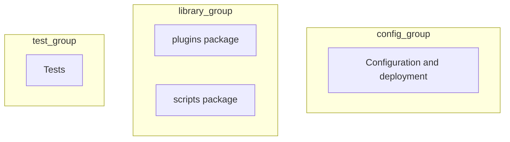

# Architecture report: openai/codex-plugin-cc

> Automated static analysis. **Observed** = directly seen in files/imports/AST; **Inferred** = interpretation from that evidence. Repository code was not executed.

## 1. Repository at a glance

| Item | Value |
| --- | --- |
| Repository | openai/codex-plugin-cc |
| Description | Use Codex from Claude Code to review code or delegate tasks. |
| Language | JavaScript |
| Stars | 35124 |
| Licence | Apache-2.0 |
| Analysed commit / branch | db52e28f4d9ded852ab3942cea316258ae4ef346 / main |
| Framework(s) | None detected |
| Files analysed | 62 |
| Components | 4 |

## 2. Architecture in one minute

openai/codex-plugin-cc - Use Codex from Claude Code to review code or delegate tasks.. This repository was analysed statically from 62 file(s) (0 Python). Detected technologies (observed from imports/manifests): GitHub Actions, TypeScript. Files are grouped into 4 component(s): Configuration and deployment, plugins package, scripts package, Tests. Findings below distinguish observed facts from inferred interpretation.

## 3. High-level block diagram

## 4. Main components

### Configuration and deployment (`config`)

- **Kind:** config
- **Status:** Observed
- **Confidence:** 0.85
- **Responsibility:** Groups 5 file(s) under configuration and deployment (observed from repository paths and static analysis).
- **Paths:** `package.json`, `plugins/codex/.claude-plugin/plugin.json`, `plugins/codex/hooks/hooks.json`, `plugins/codex/schemas/review-output.schema.json`, `tsconfig.app-server.json`
- **Evidence:** [package.json](https://github.com/openai/codex-plugin-cc/blob/db52e28f4d9ded852ab3942cea316258ae4ef346/package.json); [plugins/codex/.claude-plugin/plugin.json](https://github.com/openai/codex-plugin-cc/blob/db52e28f4d9ded852ab3942cea316258ae4ef346/plugins/codex/.claude-plugin/plugin.json); [plugins/codex/hooks/hooks.json](https://github.com/openai/codex-plugin-cc/blob/db52e28f4d9ded852ab3942cea316258ae4ef346/plugins/codex/hooks/hooks.json); [plugins/codex/schemas/review-output.schema.json](https://github.com/openai/codex-plugin-cc/blob/db52e28f4d9ded852ab3942cea316258ae4ef346/plugins/codex/schemas/review-output.schema.json); [tsconfig.app-server.json](https://github.com/openai/codex-plugin-cc/blob/db52e28f4d9ded852ab3942cea316258ae4ef346/tsconfig.app-server.json)

### plugins package (`plugins`)

- **Kind:** library
- **Status:** Observed
- **Confidence:** 0.85
- **Responsibility:** Groups 20 file(s) under plugins package (observed from repository paths and static analysis).
- **Paths:** `plugins/codex/scripts/app-server-broker.mjs`, `plugins/codex/scripts/codex-companion.mjs`, `plugins/codex/scripts/lib/app-server-protocol.d.ts`, `plugins/codex/scripts/lib/app-server.mjs`, `plugins/codex/scripts/lib/args.mjs`, `plugins/codex/scripts/lib/broker-endpoint.mjs`, `plugins/codex/scripts/lib/broker-lifecycle.mjs`, `plugins/codex/scripts/lib/claude-session-transfer.mjs`, `plugins/codex/scripts/lib/codex.mjs`, `plugins/codex/scripts/lib/fs.mjs`, `plugins/codex/scripts/lib/git.mjs`, `plugins/codex/scripts/lib/job-control.mjs`, `plugins/codex/scripts/lib/process.mjs`, `plugins/codex/scripts/lib/prompts.mjs`, `plugins/codex/scripts/lib/render.mjs`, `plugins/codex/scripts/lib/state.mjs`, `plugins/codex/scripts/lib/tracked-jobs.mjs`, `plugins/codex/scripts/lib/workspace.mjs`, `plugins/codex/scripts/session-lifecycle-hook.mjs`, `plugins/codex/scripts/stop-review-gate-hook.mjs`
- **Evidence:** [plugins/codex/scripts/app-server-broker.mjs](https://github.com/openai/codex-plugin-cc/blob/db52e28f4d9ded852ab3942cea316258ae4ef346/plugins/codex/scripts/app-server-broker.mjs); [plugins/codex/scripts/codex-companion.mjs](https://github.com/openai/codex-plugin-cc/blob/db52e28f4d9ded852ab3942cea316258ae4ef346/plugins/codex/scripts/codex-companion.mjs); [plugins/codex/scripts/lib/app-server-protocol.d.ts](https://github.com/openai/codex-plugin-cc/blob/db52e28f4d9ded852ab3942cea316258ae4ef346/plugins/codex/scripts/lib/app-server-protocol.d.ts); [plugins/codex/scripts/lib/app-server.mjs](https://github.com/openai/codex-plugin-cc/blob/db52e28f4d9ded852ab3942cea316258ae4ef346/plugins/codex/scripts/lib/app-server.mjs); [plugins/codex/scripts/lib/args.mjs](https://github.com/openai/codex-plugin-cc/blob/db52e28f4d9ded852ab3942cea316258ae4ef346/plugins/codex/scripts/lib/args.mjs); [plugins/codex/scripts/lib/broker-endpoint.mjs](https://github.com/openai/codex-plugin-cc/blob/db52e28f4d9ded852ab3942cea316258ae4ef346/plugins/codex/scripts/lib/broker-endpoint.mjs); [plugins/codex/scripts/lib/broker-lifecycle.mjs](https://github.com/openai/codex-plugin-cc/blob/db52e28f4d9ded852ab3942cea316258ae4ef346/plugins/codex/scripts/lib/broker-lifecycle.mjs); [plugins/codex/scripts/lib/claude-session-transfer.mjs](https://github.com/openai/codex-plugin-cc/blob/db52e28f4d9ded852ab3942cea316258ae4ef346/plugins/codex/scripts/lib/claude-session-transfer.mjs)

### scripts package (`scripts`)

- **Kind:** library
- **Status:** Observed
- **Confidence:** 0.85
- **Responsibility:** Groups 1 file(s) under scripts package (observed from repository paths and static analysis).
- **Paths:** `scripts/bump-version.mjs`
- **Evidence:** [scripts/bump-version.mjs](https://github.com/openai/codex-plugin-cc/blob/db52e28f4d9ded852ab3942cea316258ae4ef346/scripts/bump-version.mjs)

### Tests (`tests`)

- **Kind:** test
- **Status:** Observed
- **Confidence:** 0.85
- **Responsibility:** Groups 10 file(s) under tests (observed from repository paths and static analysis).
- **Paths:** `tests/broker-endpoint.test.mjs`, `tests/bump-version.test.mjs`, `tests/commands.test.mjs`, `tests/fake-codex-fixture.mjs`, `tests/git.test.mjs`, `tests/helpers.mjs`, `tests/process.test.mjs`, `tests/render.test.mjs`, `tests/runtime.test.mjs`, `tests/state.test.mjs`
- **Evidence:** [tests/broker-endpoint.test.mjs](https://github.com/openai/codex-plugin-cc/blob/db52e28f4d9ded852ab3942cea316258ae4ef346/tests/broker-endpoint.test.mjs); [tests/bump-version.test.mjs](https://github.com/openai/codex-plugin-cc/blob/db52e28f4d9ded852ab3942cea316258ae4ef346/tests/bump-version.test.mjs); [tests/commands.test.mjs](https://github.com/openai/codex-plugin-cc/blob/db52e28f4d9ded852ab3942cea316258ae4ef346/tests/commands.test.mjs); [tests/fake-codex-fixture.mjs](https://github.com/openai/codex-plugin-cc/blob/db52e28f4d9ded852ab3942cea316258ae4ef346/tests/fake-codex-fixture.mjs); [tests/git.test.mjs](https://github.com/openai/codex-plugin-cc/blob/db52e28f4d9ded852ab3942cea316258ae4ef346/tests/git.test.mjs); [tests/helpers.mjs](https://github.com/openai/codex-plugin-cc/blob/db52e28f4d9ded852ab3942cea316258ae4ef346/tests/helpers.mjs); [tests/process.test.mjs](https://github.com/openai/codex-plugin-cc/blob/db52e28f4d9ded852ab3942cea316258ae4ef346/tests/process.test.mjs); [tests/render.test.mjs](https://github.com/openai/codex-plugin-cc/blob/db52e28f4d9ded852ab3942cea316258ae4ef346/tests/render.test.mjs)

## 5. Execution flow

No entry point was observed; the startup flow below is therefore limited.

Representative flow (derived from observed entry points and the import graph; steps beyond the entry point are **Inferred**):

1. Execution starts at an observed entry point listed above, if present.
2. No internal import relationships between components were observed.

## 6. Project structure

### `(root)`

- `.gitignore` - other (2246 bytes)
- `LICENSE` - docs (10944 bytes)
- `NOTICE` - docs (547 bytes)
- `README.md` - docs (10907 bytes)
- `package.json` - manifest (714 bytes)
- `tsconfig.app-server.json` - config (624 bytes)

### `.claude-plugin`

- `.claude-plugin/marketplace.json` - config (454 bytes)

### `.github`

- `.github/workflows/pull-request-ci.yml` - ci, YAML (689 bytes)

### `plugins`

- `plugins/codex/.claude-plugin/plugin.json` - config (165 bytes)
- `plugins/codex/CHANGELOG.md` - docs (77 bytes)
- `plugins/codex/LICENSE` - docs (10944 bytes)
- `plugins/codex/NOTICE` - docs (547 bytes)
- `plugins/codex/agents/codex-rescue.md` - docs (3295 bytes)
- `plugins/codex/commands/adversarial-review.md` - docs (3614 bytes)
- `plugins/codex/commands/cancel.md` - docs (244 bytes)
- `plugins/codex/commands/rescue.md` - docs (3686 bytes)
- `plugins/codex/commands/result.md` - docs (652 bytes)
- `plugins/codex/commands/review.md` - docs (3127 bytes)
- `plugins/codex/commands/setup.md` - docs (1118 bytes)
- `plugins/codex/commands/status.md` - docs (795 bytes)
- `plugins/codex/commands/transfer.md` - docs (413 bytes)
- `plugins/codex/hooks/hooks.json` - config (845 bytes)
- `plugins/codex/prompts/adversarial-review.md` - docs (3438 bytes)
- `plugins/codex/prompts/stop-review-gate.md` - docs (1935 bytes)
- `plugins/codex/schemas/review-output.schema.json` - config (1757 bytes)
- `plugins/codex/scripts/app-server-broker.mjs` - source, JavaScript (7383 bytes)
- `plugins/codex/scripts/codex-companion.mjs` - source, JavaScript (31198 bytes)
- `plugins/codex/scripts/lib/app-server-protocol.d.ts` - source, TypeScript (2535 bytes)
- `plugins/codex/scripts/lib/app-server.mjs` - source, JavaScript (10264 bytes)
- `plugins/codex/scripts/lib/args.mjs` - source, JavaScript (2672 bytes)
- `plugins/codex/scripts/lib/broker-endpoint.mjs` - source, JavaScript (1230 bytes)
- `plugins/codex/scripts/lib/broker-lifecycle.mjs` - source, JavaScript (5750 bytes)
- `plugins/codex/scripts/lib/claude-session-transfer.mjs` - source, JavaScript (1503 bytes)
- `plugins/codex/scripts/lib/codex.mjs` - source, JavaScript (37499 bytes)
- `plugins/codex/scripts/lib/fs.mjs` - source, JavaScript (1021 bytes)
- `plugins/codex/scripts/lib/git.mjs` - source, JavaScript (11800 bytes)
- `plugins/codex/scripts/lib/job-control.mjs` - source, JavaScript (9903 bytes)
- `plugins/codex/scripts/lib/process.mjs` - source, JavaScript (4108 bytes)
- `plugins/codex/scripts/lib/prompts.mjs` - source, JavaScript (440 bytes)
- `plugins/codex/scripts/lib/render.mjs` - source, JavaScript (13833 bytes)
- `plugins/codex/scripts/lib/state.mjs` - source, JavaScript (4859 bytes)
- `plugins/codex/scripts/lib/tracked-jobs.mjs` - source, JavaScript (6041 bytes)
- `plugins/codex/scripts/lib/workspace.mjs` - source, JavaScript (173 bytes)
- `plugins/codex/scripts/session-lifecycle-hook.mjs` - source, JavaScript (3579 bytes)
- `plugins/codex/scripts/stop-review-gate-hook.mjs` - source, JavaScript (5527 bytes)
- `plugins/codex/skills/codex-cli-runtime/SKILL.md` - docs (3097 bytes)
- `plugins/codex/skills/codex-result-handling/SKILL.md` - docs (1731 bytes)
- `plugins/codex/skills/gpt-5-4-prompting/SKILL.md` - docs (3644 bytes)
- `plugins/codex/skills/gpt-5-4-prompting/references/codex-prompt-antipatterns.md` - docs (1490 bytes)
- `plugins/codex/skills/gpt-5-4-prompting/references/codex-prompt-recipes.md` - docs (4175 bytes)
- `plugins/codex/skills/gpt-5-4-prompting/references/prompt-blocks.md` - docs (4160 bytes)

### `scripts`

- `scripts/bump-version.mjs` - source, JavaScript (5911 bytes)

### `tests`

- `tests/broker-endpoint.test.mjs` - test, JavaScript (861 bytes)
- `tests/bump-version.test.mjs` - test, JavaScript (2736 bytes)
- `tests/commands.test.mjs` - test, JavaScript (14055 bytes)
- `tests/fake-codex-fixture.mjs` - test, JavaScript (23309 bytes)
- `tests/git.test.mjs` - test, JavaScript (9001 bytes)
- `tests/helpers.mjs` - test, JavaScript (1060 bytes)
- `tests/process.test.mjs` - test, JavaScript (1410 bytes)
- `tests/render.test.mjs` - test, JavaScript (1753 bytes)
- `tests/runtime.test.mjs` - test, JavaScript (74723 bytes)
- `tests/state.test.mjs` - test, JavaScript (3469 bytes)

## 7. Key dependencies and integrations

| Name | Category | Status | Confidence | Evidence |
| --- | --- | --- | --- | --- |
| GitHub Actions | ci | Observed | 0.85 | [.github/workflows/pull-request-ci.yml](https://github.com/openai/codex-plugin-cc/blob/db52e28f4d9ded852ab3942cea316258ae4ef346/.github/workflows/pull-request-ci.yml) |
| TypeScript | tooling | Observed | 0.85 | [package.json:20](https://github.com/openai/codex-plugin-cc/blob/db52e28f4d9ded852ab3942cea316258ae4ef346/package.json#L20) |

## 8. Data and state

No database, cache, queue, or persistent-state usage was observed in the analysed files. State handling, if any, may be in-memory or in files that were not analysed.

## 9. Configuration and deployment clues

- `.claude-plugin/marketplace.json` (config)
- `.github/workflows/pull-request-ci.yml` (ci)
- `package.json` (manifest)
- `plugins/codex/.claude-plugin/plugin.json` (config)
- `plugins/codex/hooks/hooks.json` (config)
- `plugins/codex/schemas/review-output.schema.json` (config)
- `tsconfig.app-server.json` (config)

## 10. Design observations

- Tests are present alongside source code (Observed from test file paths).

These observations are interpretations (**Inferred**) of the observed structure, not guarantees about runtime design.

## 11. Limitations and unknowns

- Static analysis only: repository code was not executed, installed, or imported at runtime.
- Components and relationships are inferred from file paths, imports, and AST structure; runtime behaviour, dynamic imports, and reflection may not be visible.
- 1 file(s) were skipped during inventory (1 x lockfile excluded).
- No clear application entry point was observed in the analysed files.
- Repository text was treated as untrusted data; no instructions found in repository files were followed, and likely secret values were redacted/excluded.
- JavaScript and TypeScript files were inventoried from paths and package manifests. They were not parsed with a full language AST, and repository code was not executed.

## 12. Source references

- [.github/workflows/pull-request-ci.yml](https://github.com/openai/codex-plugin-cc/blob/db52e28f4d9ded852ab3942cea316258ae4ef346/.github/workflows/pull-request-ci.yml)
- [package.json](https://github.com/openai/codex-plugin-cc/blob/db52e28f4d9ded852ab3942cea316258ae4ef346/package.json)
- [package.json:20](https://github.com/openai/codex-plugin-cc/blob/db52e28f4d9ded852ab3942cea316258ae4ef346/package.json#L20)
- [plugins/codex/.claude-plugin/plugin.json](https://github.com/openai/codex-plugin-cc/blob/db52e28f4d9ded852ab3942cea316258ae4ef346/plugins/codex/.claude-plugin/plugin.json)
- [plugins/codex/hooks/hooks.json](https://github.com/openai/codex-plugin-cc/blob/db52e28f4d9ded852ab3942cea316258ae4ef346/plugins/codex/hooks/hooks.json)
- [plugins/codex/schemas/review-output.schema.json](https://github.com/openai/codex-plugin-cc/blob/db52e28f4d9ded852ab3942cea316258ae4ef346/plugins/codex/schemas/review-output.schema.json)
- [plugins/codex/scripts/app-server-broker.mjs](https://github.com/openai/codex-plugin-cc/blob/db52e28f4d9ded852ab3942cea316258ae4ef346/plugins/codex/scripts/app-server-broker.mjs)
- [plugins/codex/scripts/codex-companion.mjs](https://github.com/openai/codex-plugin-cc/blob/db52e28f4d9ded852ab3942cea316258ae4ef346/plugins/codex/scripts/codex-companion.mjs)
- [plugins/codex/scripts/lib/app-server-protocol.d.ts](https://github.com/openai/codex-plugin-cc/blob/db52e28f4d9ded852ab3942cea316258ae4ef346/plugins/codex/scripts/lib/app-server-protocol.d.ts)
- [plugins/codex/scripts/lib/app-server.mjs](https://github.com/openai/codex-plugin-cc/blob/db52e28f4d9ded852ab3942cea316258ae4ef346/plugins/codex/scripts/lib/app-server.mjs)
- [plugins/codex/scripts/lib/args.mjs](https://github.com/openai/codex-plugin-cc/blob/db52e28f4d9ded852ab3942cea316258ae4ef346/plugins/codex/scripts/lib/args.mjs)
- [plugins/codex/scripts/lib/broker-endpoint.mjs](https://github.com/openai/codex-plugin-cc/blob/db52e28f4d9ded852ab3942cea316258ae4ef346/plugins/codex/scripts/lib/broker-endpoint.mjs)
- [plugins/codex/scripts/lib/broker-lifecycle.mjs](https://github.com/openai/codex-plugin-cc/blob/db52e28f4d9ded852ab3942cea316258ae4ef346/plugins/codex/scripts/lib/broker-lifecycle.mjs)
- [plugins/codex/scripts/lib/claude-session-transfer.mjs](https://github.com/openai/codex-plugin-cc/blob/db52e28f4d9ded852ab3942cea316258ae4ef346/plugins/codex/scripts/lib/claude-session-transfer.mjs)
- [scripts/bump-version.mjs](https://github.com/openai/codex-plugin-cc/blob/db52e28f4d9ded852ab3942cea316258ae4ef346/scripts/bump-version.mjs)
- [tests/broker-endpoint.test.mjs](https://github.com/openai/codex-plugin-cc/blob/db52e28f4d9ded852ab3942cea316258ae4ef346/tests/broker-endpoint.test.mjs)
- [tests/bump-version.test.mjs](https://github.com/openai/codex-plugin-cc/blob/db52e28f4d9ded852ab3942cea316258ae4ef346/tests/bump-version.test.mjs)
- [tests/commands.test.mjs](https://github.com/openai/codex-plugin-cc/blob/db52e28f4d9ded852ab3942cea316258ae4ef346/tests/commands.test.mjs)
- [tests/fake-codex-fixture.mjs](https://github.com/openai/codex-plugin-cc/blob/db52e28f4d9ded852ab3942cea316258ae4ef346/tests/fake-codex-fixture.mjs)
- [tests/git.test.mjs](https://github.com/openai/codex-plugin-cc/blob/db52e28f4d9ded852ab3942cea316258ae4ef346/tests/git.test.mjs)
- [tests/helpers.mjs](https://github.com/openai/codex-plugin-cc/blob/db52e28f4d9ded852ab3942cea316258ae4ef346/tests/helpers.mjs)
- [tests/process.test.mjs](https://github.com/openai/codex-plugin-cc/blob/db52e28f4d9ded852ab3942cea316258ae4ef346/tests/process.test.mjs)
- [tests/render.test.mjs](https://github.com/openai/codex-plugin-cc/blob/db52e28f4d9ded852ab3942cea316258ae4ef346/tests/render.test.mjs)
- [tsconfig.app-server.json](https://github.com/openai/codex-plugin-cc/blob/db52e28f4d9ded852ab3942cea316258ae4ef346/tsconfig.app-server.json)
