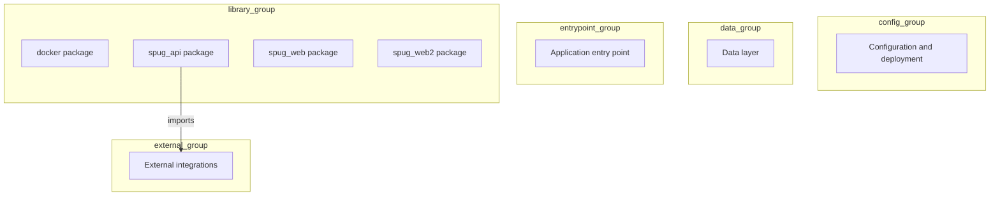

# Architecture report: openspug/spug

> Automated static analysis. **Observed** = directly seen in files/imports/AST; **Inferred** = interpretation from that evidence. Repository code was not executed.

## 1. Repository at a glance

| Item | Value |
| --- | --- |
| Repository | openspug/spug |
| Description | Spug is a lightweight agent-free automatic operation and maintenance platform designed for small and medium-sized enterprises. It integrates host management, host batch execution, host online terminal, file management, application release and deployment, pipelines, online task planning, configurati… |
| Language | JavaScript |
| Stars | 11111 |
| Licence | AGPL-3.0 |
| Analysed commit / branch | 90ecc4c74ca72f8c62a80656f3c088af80b90ef7 / 4.0 |
| Framework(s) | Django, React |
| Files analysed | 484 |
| Components | 8 |

## 2. Architecture in one minute

openspug/spug - Spug is a lightweight agent-free automatic operation and maintenance platform designed for small and medium-sized enterprises. It integrates host management, host batch execution, host online termina…. This repository was analysed statically from 484 file(s) (137 Python). Detected technologies (observed from imports/manifests): GitHub Actions, MySQL, Redis, Django, React, axios. Files are grouped into 8 component(s): Configuration and deployment, Data layer, docker package, Application entry point, External integrations, spug_api package, spug_web package, spug_web2 package. Observed entry point(s): spug_api/manage.py, spug_api/tools/migrate.py. Findings below distinguish observed facts from inferred interpretation.

## 3. High-level block diagram

## 4. Main components

### Configuration and deployment (`config`)

- **Kind:** config
- **Status:** Observed
- **Confidence:** 0.85
- **Responsibility:** Groups 35 file(s) under configuration and deployment (observed from repository paths and static analysis). Observed top-level classes: ConfigView, EnvironmentView, HistoryView, ServiceView. Observed top-level functions: _env_response, _filter_value, _json_response, _kv_response, _parse, _parse_params.
- **Paths:** `Dockerfile`, `docker-compose.yml`, `spug_api/apps/apis/config.py`, `spug_api/apps/config/__init__.py`, `spug_api/apps/config/urls.py`, `spug_api/apps/config/utils.py`, `spug_api/apps/config/views.py`, `spug_api/requirements.txt`, `spug_api/spug/settings.py`, `spug_api/tools/supervisor-spug.ini`, `spug_web/jsconfig.json`, `spug_web/package.json`, `spug_web/public/manifest.json`, `spug_web/src/pages/config/app/Form.js`, `spug_web/src/pages/config/app/Rel.js`, `spug_web/src/pages/config/app/Table.js`, `spug_web/src/pages/config/app/index.js`, `spug_web/src/pages/config/app/store.js`, `spug_web/src/pages/config/environment/Form.js`, `spug_web/src/pages/config/environment/Table.js`, `spug_web/src/pages/config/environment/index.js`, `spug_web/src/pages/config/environment/store.js`, `spug_web/src/pages/config/service/Form.js`, `spug_web/src/pages/config/service/Table.js`, `spug_web/src/pages/config/service/index.js`, `spug_web/src/pages/config/service/store.js`, `spug_web/src/pages/config/setting/DiffConfig.js`, `spug_web/src/pages/config/setting/Form.js`, `spug_web/src/pages/config/setting/JSONView.js`, `spug_web/src/pages/config/setting/Record.js`, `spug_web/src/pages/config/setting/TableView.js`, `spug_web/src/pages/config/setting/TextView.js`, `spug_web/src/pages/config/setting/index.js`, `spug_web/src/pages/config/setting/store.js`, `spug_web2/package.json`
- **Evidence:** [Dockerfile](https://github.com/openspug/spug/blob/90ecc4c74ca72f8c62a80656f3c088af80b90ef7/Dockerfile); [docker-compose.yml](https://github.com/openspug/spug/blob/90ecc4c74ca72f8c62a80656f3c088af80b90ef7/docker-compose.yml); [spug_api/apps/apis/config.py:13](https://github.com/openspug/spug/blob/90ecc4c74ca72f8c62a80656f3c088af80b90ef7/spug_api/apps/apis/config.py#L13); [spug_api/apps/config/__init__.py](https://github.com/openspug/spug/blob/90ecc4c74ca72f8c62a80656f3c088af80b90ef7/spug_api/apps/config/__init__.py); [spug_api/apps/config/urls.py](https://github.com/openspug/spug/blob/90ecc4c74ca72f8c62a80656f3c088af80b90ef7/spug_api/apps/config/urls.py); [spug_api/apps/config/utils.py:10](https://github.com/openspug/spug/blob/90ecc4c74ca72f8c62a80656f3c088af80b90ef7/spug_api/apps/config/utils.py#L10); [spug_api/apps/config/views.py:14](https://github.com/openspug/spug/blob/90ecc4c74ca72f8c62a80656f3c088af80b90ef7/spug_api/apps/config/views.py#L14); [spug_api/requirements.txt](https://github.com/openspug/spug/blob/90ecc4c74ca72f8c62a80656f3c088af80b90ef7/spug_api/requirements.txt)

### Data layer (`data_layer`)

- **Kind:** data
- **Status:** Observed
- **Confidence:** 0.85
- **Responsibility:** Groups 25 file(s) under data layer (observed from repository paths and static analysis). Observed top-level classes: Alarm, App, Config, ConfigHistory, Contact, Credential. Observed top-level functions: _build, dispatch, get_detail, get_requests, load_json.
- **Paths:** `spug_api/apps/account/models.py`, `spug_api/apps/alarm/models.py`, `spug_api/apps/app/models.py`, `spug_api/apps/config/models.py`, `spug_api/apps/credential/models.py`, `spug_api/apps/deploy/models.py`, `spug_api/apps/exec/models.py`, `spug_api/apps/home/models.py`, `spug_api/apps/host/models.py`, `spug_api/apps/monitor/models.py`, `spug_api/apps/notify/models.py`, `spug_api/apps/pipeline/models.py`, `spug_api/apps/repository/__init__.py`, `spug_api/apps/repository/models.py`, `spug_api/apps/repository/urls.py`, `spug_api/apps/repository/utils.py`, `spug_api/apps/repository/views.py`, `spug_api/apps/schedule/models.py`, `spug_api/apps/setting/models.py`, `spug_web/src/pages/deploy/repository/Console.js`, `spug_web/src/pages/deploy/repository/Detail.js`, `spug_web/src/pages/deploy/repository/Form.js`, `spug_web/src/pages/deploy/repository/Table.js`, `spug_web/src/pages/deploy/repository/index.js`, `spug_web/src/pages/deploy/repository/store.js`
- **Evidence:** [spug_api/apps/account/models.py:11](https://github.com/openspug/spug/blob/90ecc4c74ca72f8c62a80656f3c088af80b90ef7/spug_api/apps/account/models.py#L11); [spug_api/apps/alarm/models.py:10](https://github.com/openspug/spug/blob/90ecc4c74ca72f8c62a80656f3c088af80b90ef7/spug_api/apps/alarm/models.py#L10); [spug_api/apps/app/models.py:14](https://github.com/openspug/spug/blob/90ecc4c74ca72f8c62a80656f3c088af80b90ef7/spug_api/apps/app/models.py#L14); [spug_api/apps/config/models.py:9](https://github.com/openspug/spug/blob/90ecc4c74ca72f8c62a80656f3c088af80b90ef7/spug_api/apps/config/models.py#L9); [spug_api/apps/credential/models.py:9](https://github.com/openspug/spug/blob/90ecc4c74ca72f8c62a80656f3c088af80b90ef7/spug_api/apps/credential/models.py#L9); [spug_api/apps/deploy/models.py:14](https://github.com/openspug/spug/blob/90ecc4c74ca72f8c62a80656f3c088af80b90ef7/spug_api/apps/deploy/models.py#L14); [spug_api/apps/exec/models.py:10](https://github.com/openspug/spug/blob/90ecc4c74ca72f8c62a80656f3c088af80b90ef7/spug_api/apps/exec/models.py#L10); [spug_api/apps/home/models.py:9](https://github.com/openspug/spug/blob/90ecc4c74ca72f8c62a80656f3c088af80b90ef7/spug_api/apps/home/models.py#L9)

### docker package (`docker`)

- **Kind:** library
- **Status:** Observed
- **Confidence:** 0.85
- **Responsibility:** Groups 1 file(s) under docker package (observed from repository paths and static analysis).
- **Paths:** `docker/entrypoint.sh`
- **Evidence:** [docker/entrypoint.sh](https://github.com/openspug/spug/blob/90ecc4c74ca72f8c62a80656f3c088af80b90ef7/docker/entrypoint.sh)

### Application entry point (`entrypoint`)

- **Kind:** entrypoint
- **Status:** Observed
- **Confidence:** 0.85
- **Responsibility:** Groups 4 file(s) under application entry point (observed from repository paths and static analysis). Observed top-level classes: Version. Observed top-level functions: main.
- **Paths:** `spug_api/manage.py`, `spug_api/spug/asgi.py`, `spug_api/spug/wsgi.py`, `spug_api/tools/migrate.py`
- **Evidence:** [spug_api/manage.py:10](https://github.com/openspug/spug/blob/90ecc4c74ca72f8c62a80656f3c088af80b90ef7/spug_api/manage.py#L10); [spug_api/spug/asgi.py](https://github.com/openspug/spug/blob/90ecc4c74ca72f8c62a80656f3c088af80b90ef7/spug_api/spug/asgi.py); [spug_api/spug/wsgi.py](https://github.com/openspug/spug/blob/90ecc4c74ca72f8c62a80656f3c088af80b90ef7/spug_api/spug/wsgi.py); [spug_api/tools/migrate.py:19](https://github.com/openspug/spug/blob/90ecc4c74ca72f8c62a80656f3c088af80b90ef7/spug_api/tools/migrate.py#L19)

### External integrations (`external_integrations`)

- **Kind:** external
- **Status:** Inferred
- **Confidence:** 0.70
- **Responsibility:** Groups 0 file(s) under external integrations (observed from repository paths and static analysis).
- **Evidence:** [spug_api/apps/account/management/commands/update.py:7](https://github.com/openspug/spug/blob/90ecc4c74ca72f8c62a80656f3c088af80b90ef7/spug_api/apps/account/management/commands/update.py#L7); [spug_api/apps/exec/executors.py:10](https://github.com/openspug/spug/blob/90ecc4c74ca72f8c62a80656f3c088af80b90ef7/spug_api/apps/exec/executors.py#L10); [spug_api/apps/host/views.py:21](https://github.com/openspug/spug/blob/90ecc4c74ca72f8c62a80656f3c088af80b90ef7/spug_api/apps/host/views.py#L21); [spug_api/apps/monitor/executors.py:7](https://github.com/openspug/spug/blob/90ecc4c74ca72f8c62a80656f3c088af80b90ef7/spug_api/apps/monitor/executors.py#L7); [spug_api/apps/monitor/executors.py:11](https://github.com/openspug/spug/blob/90ecc4c74ca72f8c62a80656f3c088af80b90ef7/spug_api/apps/monitor/executors.py#L11); [spug_api/apps/schedule/executors.py:11](https://github.com/openspug/spug/blob/90ecc4c74ca72f8c62a80656f3c088af80b90ef7/spug_api/apps/schedule/executors.py#L11)

### spug_api package (`spug_api`)

- **Kind:** library
- **Status:** Observed
- **Confidence:** 0.85
- **Responsibility:** Groups 113 file(s) under spug_api package (observed from repository paths and static analysis). Observed top-level classes: AdminView, AlarmView, AppSetting, AppView, Argument, AttrDict. Observed top-level functions: _deploy_ext1_host, _deploy_ext2_host, _dispatch, _dispatch_sync, _do_host_verify, _do_notify.
- **Paths:** `spug_api/apps/account/__init__.py`, `spug_api/apps/account/history.py`, `spug_api/apps/account/management/commands/set.py`, `spug_api/apps/account/management/commands/update.py`, `spug_api/apps/account/management/commands/updatedb.py`, `spug_api/apps/account/management/commands/user.py`, `spug_api/apps/account/urls.py`, `spug_api/apps/account/utils.py`, `spug_api/apps/account/views.py`, `spug_api/apps/alarm/__init__.py`, `spug_api/apps/alarm/urls.py`, `spug_api/apps/alarm/views.py`, `spug_api/apps/apis/__init__.py`, `spug_api/apps/apis/deploy.py`, `spug_api/apps/apis/exec.py`, `spug_api/apps/apis/host.py`, `spug_api/apps/apis/pipeline.py`, `spug_api/apps/apis/urls.py`, `spug_api/apps/apis/utils.py`, `spug_api/apps/app/__init__.py`, `spug_api/apps/app/urls.py`, `spug_api/apps/app/utils.py`, `spug_api/apps/app/views.py`, `spug_api/apps/credential/__init__.py`, `spug_api/apps/credential/urls.py`, `spug_api/apps/credential/views.py`, `spug_api/apps/deploy/__init__.py`, `spug_api/apps/deploy/ext1.py`, `spug_api/apps/deploy/ext2.py`, `spug_api/apps/deploy/helper.py`, `spug_api/apps/deploy/urls.py`, `spug_api/apps/deploy/utils.py`, `spug_api/apps/deploy/views.py`, `spug_api/apps/exec/__init__.py`, `spug_api/apps/exec/executors.py`, `spug_api/apps/exec/management/commands/runworker.py`, `spug_api/apps/exec/transfer.py`, `spug_api/apps/exec/urls.py`, `spug_api/apps/exec/views.py`, `spug_api/apps/file/__init__.py`, `spug_api/apps/file/urls.py`, `spug_api/apps/file/utils.py`, `spug_api/apps/file/views.py`, `spug_api/apps/home/__init__.py`, `spug_api/apps/home/navigation.py`, `spug_api/apps/home/notice.py`, `spug_api/apps/home/urls.py`, `spug_api/apps/home/views.py`, `spug_api/apps/host/__init__.py`, `spug_api/apps/host/add.py`, `spug_api/apps/host/extend.py`, `spug_api/apps/host/group.py`, `spug_api/apps/host/urls.py`, `spug_api/apps/host/utils.py`, `spug_api/apps/host/views.py`, `spug_api/apps/monitor/__init__.py`, `spug_api/apps/monitor/executors.py`, `spug_api/apps/monitor/management/commands/runmonitor.py`, `spug_api/apps/monitor/scheduler.py`, `spug_api/apps/monitor/urls.py`, `spug_api/apps/monitor/utils.py`, `spug_api/apps/monitor/views.py`, `spug_api/apps/notify/__init__.py`, `spug_api/apps/notify/urls.py`, `spug_api/apps/notify/views.py`, `spug_api/apps/pipeline/__init__.py`, `spug_api/apps/pipeline/helper.py`, `spug_api/apps/pipeline/urls.py`, `spug_api/apps/pipeline/utils.py`, `spug_api/apps/pipeline/views.py`, `spug_api/apps/schedule/__init__.py`, `spug_api/apps/schedule/builtin.py`, `spug_api/apps/schedule/executors.py`, `spug_api/apps/schedule/management/commands/runscheduler.py`, `spug_api/apps/schedule/scheduler.py`, `spug_api/apps/schedule/urls.py`, `spug_api/apps/schedule/utils.py`, `spug_api/apps/schedule/views.py`, `spug_api/apps/setting/__init__.py`, `spug_api/apps/setting/urls.py`, `spug_api/apps/setting/user.py`, `spug_api/apps/setting/utils.py`, `spug_api/apps/setting/views.py`, `spug_api/consumer/__init__.py`, `spug_api/consumer/consumers.py`, `spug_api/consumer/routing.py`, `spug_api/consumer/tests.py`, `spug_api/consumer/utils.py`, `spug_api/libs/__init__.py`, `spug_api/libs/channel.py`, `spug_api/libs/decorators.py`, `spug_api/libs/executor.py`, `spug_api/libs/gitlib.py`, `spug_api/libs/helper.py`, `spug_api/libs/ldap.py`, `spug_api/libs/locale.py`, `spug_api/libs/mail.py`, `spug_api/libs/middleware.py`, `spug_api/libs/mixins.py`, `spug_api/libs/parser.py`, `spug_api/libs/push.py`, `spug_api/libs/spug.py`, `spug_api/libs/ssh.py`, `spug_api/libs/utils.py`, `spug_api/libs/validators.py`, `spug_api/libs/webhook.py`, `spug_api/spug/__init__.py`, `spug_api/spug/urls.py`, `spug_api/tools/start-api.sh`, `spug_api/tools/start-monitor.sh`, `spug_api/tools/start-scheduler.sh`, `spug_api/tools/start-worker.sh`, `spug_api/tools/start-ws.sh`
- **Evidence:** [spug_api/apps/account/__init__.py](https://github.com/openspug/spug/blob/90ecc4c74ca72f8c62a80656f3c088af80b90ef7/spug_api/apps/account/__init__.py); [spug_api/apps/account/history.py:9](https://github.com/openspug/spug/blob/90ecc4c74ca72f8c62a80656f3c088af80b90ef7/spug_api/apps/account/history.py#L9); [spug_api/apps/account/management/commands/set.py:8](https://github.com/openspug/spug/blob/90ecc4c74ca72f8c62a80656f3c088af80b90ef7/spug_api/apps/account/management/commands/set.py#L8); [spug_api/apps/account/management/commands/update.py:11](https://github.com/openspug/spug/blob/90ecc4c74ca72f8c62a80656f3c088af80b90ef7/spug_api/apps/account/management/commands/update.py#L11); [spug_api/apps/account/management/commands/updatedb.py:9](https://github.com/openspug/spug/blob/90ecc4c74ca72f8c62a80656f3c088af80b90ef7/spug_api/apps/account/management/commands/updatedb.py#L9); [spug_api/apps/account/management/commands/user.py:9](https://github.com/openspug/spug/blob/90ecc4c74ca72f8c62a80656f3c088af80b90ef7/spug_api/apps/account/management/commands/user.py#L9); [spug_api/apps/account/urls.py](https://github.com/openspug/spug/blob/90ecc4c74ca72f8c62a80656f3c088af80b90ef7/spug_api/apps/account/urls.py); [spug_api/apps/account/utils.py:8](https://github.com/openspug/spug/blob/90ecc4c74ca72f8c62a80656f3c088af80b90ef7/spug_api/apps/account/utils.py#L8)

### spug_web package (`spug_web`)

- **Kind:** library
- **Status:** Observed
- **Confidence:** 0.85
- **Responsibility:** Groups 206 file(s) under spug_web package (observed from repository paths and static analysis).
- **Paths:** `spug_web/config-overrides.js`, `spug_web/src/App.js`, `spug_web/src/components/ACEditor.js`, `spug_web/src/components/Action.js`, `spug_web/src/components/AppSelector.js`, `spug_web/src/components/AuthButton.js`, `spug_web/src/components/AuthCard.js`, `spug_web/src/components/AuthDiv.js`, `spug_web/src/components/AuthFragment.js`, `spug_web/src/components/Breadcrumb.js`, `spug_web/src/components/Container.js`, `spug_web/src/components/LinkButton.js`, `spug_web/src/components/NotFound.js`, `spug_web/src/components/SearchForm.js`, `spug_web/src/components/StatisticsCard.js`, `spug_web/src/components/TableCard.js`, `spug_web/src/components/index.js`, `spug_web/src/gStore.js`, `spug_web/src/index.js`, `spug_web/src/layout/Footer.js`, `spug_web/src/layout/Header.js`, `spug_web/src/layout/Notification.js`, `spug_web/src/layout/Sider.js`, `spug_web/src/layout/index.js`, `spug_web/src/libs/functools.js`, `spug_web/src/libs/history.js`, `spug_web/src/libs/http.js`, `spug_web/src/libs/i18n.js`, `spug_web/src/libs/index.js`, `spug_web/src/libs/router.js`, `spug_web/src/locales/en/alarm.js`, `spug_web/src/locales/en/base.js`, `spug_web/src/locales/en/config.js`, `spug_web/src/locales/en/dashboard.js`, `spug_web/src/locales/en/deploy_app.js`, `spug_web/src/locales/en/deploy_ops.js`, `spug_web/src/locales/en/exec.js`, `spug_web/src/locales/en/host.js`, `spug_web/src/locales/en/index.js`, `spug_web/src/locales/en/layout.js`, `spug_web/src/locales/en/monitor.js`, `spug_web/src/locales/en/pipeline.js`, `spug_web/src/locales/en/schedule.js`, `spug_web/src/locales/en/ssh.js`, `spug_web/src/locales/en/system.js`, `spug_web/src/locales/en/system_setting.js`, `spug_web/src/pages/alarm/alarm/Table.js`, `spug_web/src/pages/alarm/alarm/index.js`, `spug_web/src/pages/alarm/alarm/store.js`, `spug_web/src/pages/alarm/contact/Form.js`, `spug_web/src/pages/alarm/contact/Table.js`, `spug_web/src/pages/alarm/contact/index.js`, `spug_web/src/pages/alarm/contact/store.js`, `spug_web/src/pages/alarm/group/Form.js`, `spug_web/src/pages/alarm/group/Table.js`, `spug_web/src/pages/alarm/group/index.js`, `spug_web/src/pages/alarm/group/store.js`, `spug_web/src/pages/dashboard/AlarmTrend.js`, `spug_web/src/pages/dashboard/RequestTop.js`, `spug_web/src/pages/dashboard/StatisticCard.js`, `spug_web/src/pages/dashboard/index.js`, `spug_web/src/pages/deploy/app/AddSelect.js`, `spug_web/src/pages/deploy/app/AutoDeploy.js`, `spug_web/src/pages/deploy/app/CloneConfirm.js`, `spug_web/src/pages/deploy/app/Ext1Form.js`, `spug_web/src/pages/deploy/app/Ext1Setup1.js`, `spug_web/src/pages/deploy/app/Ext1Setup2.js`, `spug_web/src/pages/deploy/app/Ext1Setup3.js`, `spug_web/src/pages/deploy/app/Ext2Form.js`, `spug_web/src/pages/deploy/app/Ext2Setup1.js`, `spug_web/src/pages/deploy/app/Ext2Setup2.js`, `spug_web/src/pages/deploy/app/Form.js`, `spug_web/src/pages/deploy/app/Repo.js`, `spug_web/src/pages/deploy/app/Table.js`, `spug_web/src/pages/deploy/app/Tips.js`, `spug_web/src/pages/deploy/app/index.js`, `spug_web/src/pages/deploy/app/store.js`, `spug_web/src/pages/deploy/request/Approve.js`, `spug_web/src/pages/deploy/request/BatchDelete.js`, `spug_web/src/pages/deploy/request/Console.js`, `spug_web/src/pages/deploy/request/Ext1Form.js`, `spug_web/src/pages/deploy/request/Ext2Form.js`, `spug_web/src/pages/deploy/request/HostSelector.js`, `spug_web/src/pages/deploy/request/OutView.js`, `spug_web/src/pages/deploy/request/Rollback.js`, `spug_web/src/pages/deploy/request/Table.js`, `spug_web/src/pages/deploy/request/index.js`, `spug_web/src/pages/deploy/request/store.js`, `spug_web/src/pages/exec/task/Output.js`, `spug_web/src/pages/exec/task/Parameter.js`, `spug_web/src/pages/exec/task/TemplateSelector.js`, `spug_web/src/pages/exec/task/index.js`, `spug_web/src/pages/exec/task/store.js`, `spug_web/src/pages/exec/template/Form.js`, `spug_web/src/pages/exec/template/Parameter.js`, `spug_web/src/pages/exec/template/Table.js`, `spug_web/src/pages/exec/template/index.js`, `spug_web/src/pages/exec/template/store.js`, `spug_web/src/pages/exec/transfer/Output.js`, `spug_web/src/pages/exec/transfer/index.js`, `spug_web/src/pages/exec/transfer/store.js`, `spug_web/src/pages/home/Nav.js`, `spug_web/src/pages/home/NavForm.js`, `spug_web/src/pages/home/Notice.js`, `spug_web/src/pages/home/Todo.js`, `spug_web/src/pages/home/index.js`, `spug_web/src/pages/host/BatchSync.js`, `spug_web/src/pages/host/CloudImport.js`, `spug_web/src/pages/host/Detail.js`, `spug_web/src/pages/host/Form.js`, `spug_web/src/pages/host/Group.js`, `spug_web/src/pages/host/IPAddress.js`, `spug_web/src/pages/host/Import.js`, `spug_web/src/pages/host/Selector.js`, `spug_web/src/pages/host/Sync.js`, `spug_web/src/pages/host/Table.js`, `spug_web/src/pages/host/icons/index.js`, `spug_web/src/pages/host/index.js`, `spug_web/src/pages/host/store.js`, `spug_web/src/pages/host/store2.js`, `spug_web/src/pages/login/index.js`, `spug_web/src/pages/monitor/Form.js`, `spug_web/src/pages/monitor/MonitorCard.js`, `spug_web/src/pages/monitor/Step1.js`, `spug_web/src/pages/monitor/Step2.js`, `spug_web/src/pages/monitor/Table.js`, `spug_web/src/pages/monitor/index.js`, `spug_web/src/pages/monitor/store.js`, `spug_web/src/pages/pipeline/Editor.js`, `spug_web/src/pages/pipeline/Form.js`, `spug_web/src/pages/pipeline/Icon.js`, `spug_web/src/pages/pipeline/Node.js`, `spug_web/src/pages/pipeline/NodeConfig.js`, `spug_web/src/pages/pipeline/Record.js`, `spug_web/src/pages/pipeline/Table.js`, `spug_web/src/pages/pipeline/console/Ask.js`, `spug_web/src/pages/pipeline/console/Body.js`, `spug_web/src/pages/pipeline/console/Node.js`, `spug_web/src/pages/pipeline/console/Sider.js`, `spug_web/src/pages/pipeline/console/index.js`, `spug_web/src/pages/pipeline/console/store.js`, `spug_web/src/pages/pipeline/data.js`, `spug_web/src/pages/pipeline/index.js`, `spug_web/src/pages/pipeline/modules/Build.js`, `spug_web/src/pages/pipeline/modules/DataTransfer.js`, `spug_web/src/pages/pipeline/modules/DataUpload.js`, `spug_web/src/pages/pipeline/modules/Parameter.js`, `spug_web/src/pages/pipeline/modules/PushSpug.js`, `spug_web/src/pages/pipeline/modules/PushWebhook.js`, `spug_web/src/pages/pipeline/modules/SSHExec.js`, `spug_web/src/pages/pipeline/modules/index.js`, `spug_web/src/pages/pipeline/store.js`, `spug_web/src/pages/pipeline/utils.js`, `spug_web/src/pages/schedule/Form.js`, `spug_web/src/pages/schedule/Info.js`, `spug_web/src/pages/schedule/Record.js`, `spug_web/src/pages/schedule/Step1.js`, `spug_web/src/pages/schedule/Step2.js`, `spug_web/src/pages/schedule/Step3.js`, `spug_web/src/pages/schedule/Table.js`, `spug_web/src/pages/schedule/index.js`, `spug_web/src/pages/schedule/store.js`, `spug_web/src/pages/ssh/FileManager.js`, `spug_web/src/pages/ssh/Setting.js`, `spug_web/src/pages/ssh/Terminal.js`, `spug_web/src/pages/ssh/index.js`, `spug_web/src/pages/ssh/themes.js`, `spug_web/src/pages/system/account/Form.js`, `spug_web/src/pages/system/account/Table.js`, `spug_web/src/pages/system/account/index.js`, `spug_web/src/pages/system/account/store.js`, `spug_web/src/pages/system/credential/Form.js`, `spug_web/src/pages/system/credential/Table.js`, `spug_web/src/pages/system/credential/index.js`, `spug_web/src/pages/system/credential/store.js`, `spug_web/src/pages/system/login/Table.js`, `spug_web/src/pages/system/login/index.js`, `spug_web/src/pages/system/login/store.js`, `spug_web/src/pages/system/role/DeployPerm.js`, `spug_web/src/pages/system/role/Form.js`, `spug_web/src/pages/system/role/HostPerm.js`, `spug_web/src/pages/system/role/PagePerm.js`, `spug_web/src/pages/system/role/RoleUsers.js`, `spug_web/src/pages/system/role/Table.js`, `spug_web/src/pages/system/role/codes.js`, `spug_web/src/pages/system/role/index.js`, `spug_web/src/pages/system/role/store.js`, `spug_web/src/pages/system/setting/About.js`, `spug_web/src/pages/system/setting/AlarmSetting.js`, `spug_web/src/pages/system/setting/BasicSetting.js`, `spug_web/src/pages/system/setting/KeySetting.js`, `spug_web/src/pages/system/setting/LDAPSetting.js`, `spug_web/src/pages/system/setting/LdapImport.js`, `spug_web/src/pages/system/setting/OpenService.js`, `spug_web/src/pages/system/setting/PushSetting.js`, `spug_web/src/pages/system/setting/SecuritySetting.js`, `spug_web/src/pages/system/setting/index.js`, `spug_web/src/pages/system/setting/store.js`, `spug_web/src/pages/welcome/index/index.js`, `spug_web/src/pages/welcome/info/Basic.js`, `spug_web/src/pages/welcome/info/Reset.js`, `spug_web/src/pages/welcome/info/index.js`, `spug_web/src/pages/welcome/info/store.js`, `spug_web/src/routes.js`, `spug_web/src/serviceWorker.js`, `spug_web/src/setupProxy.js`
- **Evidence:** [spug_web/config-overrides.js](https://github.com/openspug/spug/blob/90ecc4c74ca72f8c62a80656f3c088af80b90ef7/spug_web/config-overrides.js); [spug_web/src/App.js](https://github.com/openspug/spug/blob/90ecc4c74ca72f8c62a80656f3c088af80b90ef7/spug_web/src/App.js); [spug_web/src/components/ACEditor.js](https://github.com/openspug/spug/blob/90ecc4c74ca72f8c62a80656f3c088af80b90ef7/spug_web/src/components/ACEditor.js); [spug_web/src/components/Action.js](https://github.com/openspug/spug/blob/90ecc4c74ca72f8c62a80656f3c088af80b90ef7/spug_web/src/components/Action.js); [spug_web/src/components/AppSelector.js](https://github.com/openspug/spug/blob/90ecc4c74ca72f8c62a80656f3c088af80b90ef7/spug_web/src/components/AppSelector.js); [spug_web/src/components/AuthButton.js](https://github.com/openspug/spug/blob/90ecc4c74ca72f8c62a80656f3c088af80b90ef7/spug_web/src/components/AuthButton.js); [spug_web/src/components/AuthCard.js](https://github.com/openspug/spug/blob/90ecc4c74ca72f8c62a80656f3c088af80b90ef7/spug_web/src/components/AuthCard.js); [spug_web/src/components/AuthDiv.js](https://github.com/openspug/spug/blob/90ecc4c74ca72f8c62a80656f3c088af80b90ef7/spug_web/src/components/AuthDiv.js)

### spug_web2 package (`spug_web2`)

- **Kind:** library
- **Status:** Observed
- **Confidence:** 0.85
- **Responsibility:** Groups 22 file(s) under spug_web2 package (observed from repository paths and static analysis).
- **Paths:** `spug_web2/.eslintrc.cjs`, `spug_web2/src/App.jsx`, `spug_web2/src/components/SModal/index.jsx`, `spug_web2/src/components/STable/Setting.jsx`, `spug_web2/src/components/STable/index.jsx`, `spug_web2/src/components/index.js`, `spug_web2/src/error-page.jsx`, `spug_web2/src/i18n.js`, `spug_web2/src/layout/Header.jsx`, `spug_web2/src/layout/index.jsx`, `spug_web2/src/libs/app.js`, `spug_web2/src/libs/http.js`, `spug_web2/src/libs/index.js`, `spug_web2/src/libs/utils.js`, `spug_web2/src/main.jsx`, `spug_web2/src/pages/home/index.jsx`, `spug_web2/src/pages/host/Form.jsx`, `spug_web2/src/pages/host/Group.jsx`, `spug_web2/src/pages/host/index.jsx`, `spug_web2/src/pages/login/index.jsx`, `spug_web2/src/routes.jsx`, `spug_web2/vite.config.js`
- **Evidence:** [spug_web2/.eslintrc.cjs](https://github.com/openspug/spug/blob/90ecc4c74ca72f8c62a80656f3c088af80b90ef7/spug_web2/.eslintrc.cjs); [spug_web2/src/App.jsx](https://github.com/openspug/spug/blob/90ecc4c74ca72f8c62a80656f3c088af80b90ef7/spug_web2/src/App.jsx); [spug_web2/src/components/SModal/index.jsx](https://github.com/openspug/spug/blob/90ecc4c74ca72f8c62a80656f3c088af80b90ef7/spug_web2/src/components/SModal/index.jsx); [spug_web2/src/components/STable/Setting.jsx](https://github.com/openspug/spug/blob/90ecc4c74ca72f8c62a80656f3c088af80b90ef7/spug_web2/src/components/STable/Setting.jsx); [spug_web2/src/components/STable/index.jsx](https://github.com/openspug/spug/blob/90ecc4c74ca72f8c62a80656f3c088af80b90ef7/spug_web2/src/components/STable/index.jsx); [spug_web2/src/components/index.js](https://github.com/openspug/spug/blob/90ecc4c74ca72f8c62a80656f3c088af80b90ef7/spug_web2/src/components/index.js); [spug_web2/src/error-page.jsx](https://github.com/openspug/spug/blob/90ecc4c74ca72f8c62a80656f3c088af80b90ef7/spug_web2/src/error-page.jsx); [spug_web2/src/i18n.js](https://github.com/openspug/spug/blob/90ecc4c74ca72f8c62a80656f3c088af80b90ef7/spug_web2/src/i18n.js)

## 5. Execution flow

**Observed** entry point(s):

- [spug_api/manage.py:23](https://github.com/openspug/spug/blob/90ecc4c74ca72f8c62a80656f3c088af80b90ef7/spug_api/manage.py#L23)
- [spug_api/tools/migrate.py:36](https://github.com/openspug/spug/blob/90ecc4c74ca72f8c62a80656f3c088af80b90ef7/spug_api/tools/migrate.py#L36)
- [spug_web/src/App.js](https://github.com/openspug/spug/blob/90ecc4c74ca72f8c62a80656f3c088af80b90ef7/spug_web/src/App.js)
- [spug_web/src/components/index.js](https://github.com/openspug/spug/blob/90ecc4c74ca72f8c62a80656f3c088af80b90ef7/spug_web/src/components/index.js)
- [spug_web/src/index.js](https://github.com/openspug/spug/blob/90ecc4c74ca72f8c62a80656f3c088af80b90ef7/spug_web/src/index.js)
- [spug_web/src/layout/index.js](https://github.com/openspug/spug/blob/90ecc4c74ca72f8c62a80656f3c088af80b90ef7/spug_web/src/layout/index.js)
- [spug_web/src/libs/index.js](https://github.com/openspug/spug/blob/90ecc4c74ca72f8c62a80656f3c088af80b90ef7/spug_web/src/libs/index.js)
- [spug_web2/src/App.jsx](https://github.com/openspug/spug/blob/90ecc4c74ca72f8c62a80656f3c088af80b90ef7/spug_web2/src/App.jsx)
- [spug_web2/src/components/index.js](https://github.com/openspug/spug/blob/90ecc4c74ca72f8c62a80656f3c088af80b90ef7/spug_web2/src/components/index.js)
- [spug_web2/src/layout/index.jsx](https://github.com/openspug/spug/blob/90ecc4c74ca72f8c62a80656f3c088af80b90ef7/spug_web2/src/layout/index.jsx)
- [spug_web2/src/libs/app.js](https://github.com/openspug/spug/blob/90ecc4c74ca72f8c62a80656f3c088af80b90ef7/spug_web2/src/libs/app.js)
- [spug_web2/src/libs/index.js](https://github.com/openspug/spug/blob/90ecc4c74ca72f8c62a80656f3c088af80b90ef7/spug_web2/src/libs/index.js)

Representative flow (derived from observed entry points and the import graph; steps beyond the entry point are **Inferred**):

1. Execution starts at an observed entry point listed above, if present.
2. `spug_api` imports `external_integrations` (spug_api package -> External integrations).

## 6. Project structure

### `(root)`

- `.dockerignore` - container (611 bytes)
- `.gitignore` - other (8 bytes)
- `Dockerfile` - container (3883 bytes)
- `LICENSE` - docs (34523 bytes)
- `README-zh_CN.md` - docs (6240 bytes)
- `README.md` - docs (6007 bytes)
- `SECURITY-zh_CN.md` - docs (6678 bytes)
- `SECURITY.md` - docs (7132 bytes)
- `docker-compose.yml` - container (2075 bytes)

### `.github`

- `.github/FUNDING.yml` - config (46 bytes)
- `.github/ISSUE_TEMPLATE/bug-report.md` - docs (570 bytes)
- `.github/workflows/docker-image.yml` - ci, YAML (4200 bytes)
- `.github/workflows/github_to_gitee.yml` - ci, YAML (629 bytes)

### `docker`

- `docker/entrypoint.sh` - source, Shell (6132 bytes)
- `docker/init_spug` - other (446 bytes)

### `docs`

- `docs/FQA.md` - docs (120 bytes)
- `docs/docker/Dockerfile` - container (2342 bytes)
- `docs/docker/docker-compose.yml` - container (1449 bytes)
- `docs/docker/entrypoint.sh` - docs (1086 bytes)
- `docs/docker/init_spug` - docs (151 bytes)
- `docs/docker/nginx.conf` - docs (2349 bytes)
- `docs/docker/redis.conf` - docs (46722 bytes)
- `docs/docker/spug.ini` - config (1253 bytes)
- `docs/docker/ssh_config` - docs (34 bytes)
- `docs/i18n.md` - docs (2842 bytes)
- `docs/install.sh` - docs (8490 bytes)

### `spug_api`

- `spug_api/.gitignore` - other (179 bytes)
- `spug_api/apps/account/__init__.py` - source, Python (150 bytes)
- `spug_api/apps/account/history.py` - source, Python (397 bytes)
- `spug_api/apps/account/management/commands/set.py` - source, Python (1263 bytes)
- `spug_api/apps/account/management/commands/update.py` - source, Python (3727 bytes)
- `spug_api/apps/account/management/commands/updatedb.py` - source, Python (724 bytes)
- `spug_api/apps/account/management/commands/user.py` - source, Python (3144 bytes)
- `spug_api/apps/account/models.py` - source, Python (5493 bytes)
- `spug_api/apps/account/urls.py` - source, Python (490 bytes)
- `spug_api/apps/account/utils.py` - source, Python (922 bytes)
- `spug_api/apps/account/views.py` - source, Python (11802 bytes)
- `spug_api/apps/alarm/__init__.py` - source, Python (150 bytes)
- `spug_api/apps/alarm/models.py` - source, Python (3358 bytes)
- `spug_api/apps/alarm/urls.py` - source, Python (379 bytes)
- `spug_api/apps/alarm/views.py` - source, Python (5016 bytes)
- `spug_api/apps/apis/__init__.py` - source, Python (150 bytes)
- `spug_api/apps/apis/config.py` - source, Python (2279 bytes)
- `spug_api/apps/apis/deploy.py` - source, Python (4846 bytes)
- `spug_api/apps/apis/exec.py` - source, Python (4287 bytes)
- `spug_api/apps/apis/host.py` - source, Python (2877 bytes)
- `spug_api/apps/apis/pipeline.py` - source, Python (4303 bytes)
- `spug_api/apps/apis/urls.py` - source, Python (710 bytes)
- `spug_api/apps/apis/utils.py` - source, Python (1196 bytes)
- `spug_api/apps/app/__init__.py` - source, Python (150 bytes)
- `spug_api/apps/app/models.py` - source, Python (4692 bytes)
- `spug_api/apps/app/urls.py` - source, Python (382 bytes)
- `spug_api/apps/app/utils.py` - source, Python (1415 bytes)
- `spug_api/apps/app/views.py` - source, Python (11105 bytes)
- `spug_api/apps/config/__init__.py` - source, Python (150 bytes)
- `spug_api/apps/config/models.py` - source, Python (2733 bytes)
- `spug_api/apps/config/urls.py` - source, Python (503 bytes)
- `spug_api/apps/config/utils.py` - source, Python (3221 bytes)
- `spug_api/apps/config/views.py` - source, Python (14447 bytes)
- `spug_api/apps/credential/__init__.py` - source, Python (150 bytes)
- `spug_api/apps/credential/models.py` - source, Python (1085 bytes)
- `spug_api/apps/credential/urls.py` - source, Python (324 bytes)
- `spug_api/apps/credential/views.py` - source, Python (2995 bytes)
- `spug_api/apps/deploy/__init__.py` - source, Python (150 bytes)
- `spug_api/apps/deploy/ext1.py` - source, Python (6137 bytes)
- `spug_api/apps/deploy/ext2.py` - source, Python (9251 bytes)
- `spug_api/apps/deploy/helper.py` - source, Python (18178 bytes)
- `spug_api/apps/deploy/models.py` - source, Python (3245 bytes)
- `spug_api/apps/deploy/urls.py` - source, Python (568 bytes)
- `spug_api/apps/deploy/utils.py` - source, Python (3417 bytes)
- `spug_api/apps/deploy/views.py` - source, Python (17225 bytes)
- `spug_api/apps/exec/__init__.py` - source, Python (150 bytes)
- `spug_api/apps/exec/executors.py` - source, Python (3426 bytes)
- `spug_api/apps/exec/management/commands/runworker.py` - source, Python (2852 bytes)
- `spug_api/apps/exec/models.py` - source, Python (2847 bytes)
- `spug_api/apps/exec/transfer.py` - source, Python (7995 bytes)
- `spug_api/apps/exec/urls.py` - source, Python (485 bytes)
- `spug_api/apps/exec/views.py` - source, Python (7131 bytes)
- `spug_api/apps/file/__init__.py` - source, Python (150 bytes)
- `spug_api/apps/file/urls.py` - source, Python (297 bytes)
- `spug_api/apps/file/utils.py` - source, Python (2888 bytes)
- `spug_api/apps/file/views.py` - source, Python (3960 bytes)
- `spug_api/apps/home/__init__.py` - source, Python (150 bytes)
- `spug_api/apps/home/models.py` - source, Python (1276 bytes)
- `spug_api/apps/home/navigation.py` - source, Python (2360 bytes)
- `spug_api/apps/home/notice.py` - source, Python (2540 bytes)
- `spug_api/apps/home/urls.py` - source, Python (526 bytes)
- `spug_api/apps/home/views.py` - source, Python (3369 bytes)
- `spug_api/apps/host/__init__.py` - source, Python (150 bytes)
- `spug_api/apps/host/add.py` - source, Python (3422 bytes)
- `spug_api/apps/host/extend.py` - source, Python (2755 bytes)
- `spug_api/apps/host/group.py` - source, Python (5288 bytes)
- `spug_api/apps/host/models.py` - source, Python (4042 bytes)
- `spug_api/apps/host/urls.py` - source, Python (692 bytes)
- `spug_api/apps/host/utils.py` - source, Python (13563 bytes)
- `spug_api/apps/host/views.py` - source, Python (12624 bytes)
- `spug_api/apps/monitor/__init__.py` - source, Python (150 bytes)
- `spug_api/apps/monitor/executors.py` - source, Python (5608 bytes)
- `spug_api/apps/monitor/management/commands/runmonitor.py` - source, Python (486 bytes)
- `spug_api/apps/monitor/models.py` - source, Python (1981 bytes)
- `spug_api/apps/monitor/scheduler.py` - source, Python (2852 bytes)
- `spug_api/apps/monitor/urls.py` - source, Python (325 bytes)
- `spug_api/apps/monitor/utils.py` - source, Python (1947 bytes)
- `spug_api/apps/monitor/views.py` - source, Python (7983 bytes)
- `spug_api/apps/notify/__init__.py` - source, Python (150 bytes)
- `spug_api/apps/notify/models.py` - source, Python (2088 bytes)
- `spug_api/apps/notify/urls.py` - source, Python (256 bytes)
- `spug_api/apps/notify/views.py` - source, Python (707 bytes)
- `spug_api/apps/pipeline/__init__.py` - source, Python (150 bytes)
- `spug_api/apps/pipeline/helper.py` - source, Python (9615 bytes)
- `spug_api/apps/pipeline/models.py` - source, Python (5592 bytes)
- `spug_api/apps/pipeline/urls.py` - source, Python (492 bytes)
- `spug_api/apps/pipeline/utils.py` - source, Python (18576 bytes)
- `spug_api/apps/pipeline/views.py` - source, Python (10962 bytes)
- `spug_api/apps/repository/__init__.py` - source, Python (150 bytes)
- `spug_api/apps/repository/models.py` - source, Python (2479 bytes)
- `spug_api/apps/repository/urls.py` - source, Python (333 bytes)
- `spug_api/apps/repository/utils.py` - source, Python (5994 bytes)
- `spug_api/apps/repository/views.py` - source, Python (5436 bytes)
- `spug_api/apps/schedule/__init__.py` - source, Python (150 bytes)
- `spug_api/apps/schedule/builtin.py` - source, Python (4541 bytes)
- `spug_api/apps/schedule/executors.py` - source, Python (2475 bytes)
- `spug_api/apps/schedule/management/commands/runscheduler.py` - source, Python (488 bytes)
- `spug_api/apps/schedule/models.py` - source, Python (2702 bytes)
- `spug_api/apps/schedule/scheduler.py` - source, Python (4398 bytes)
- `spug_api/apps/schedule/urls.py` - source, Python (340 bytes)
- `spug_api/apps/schedule/utils.py` - source, Python (2995 bytes)
- `spug_api/apps/schedule/views.py` - source, Python (8169 bytes)
- `spug_api/apps/setting/__init__.py` - source, Python (150 bytes)
- `spug_api/apps/setting/models.py` - source, Python (1378 bytes)
- `spug_api/apps/setting/urls.py` - source, Python (753 bytes)
- `spug_api/apps/setting/user.py` - source, Python (993 bytes)
- `spug_api/apps/setting/utils.py` - source, Python (1472 bytes)
- `spug_api/apps/setting/views.py` - source, Python (9259 bytes)
- `spug_api/consumer/__init__.py` - source, Python (150 bytes)
- `spug_api/consumer/consumers.py` - source, Python (7260 bytes)
- `spug_api/consumer/routing.py` - source, Python (512 bytes)
- `spug_api/consumer/tests.py` - source, Python (12262 bytes)
- `spug_api/consumer/utils.py` - source, Python (5378 bytes)
- `spug_api/libs/__init__.py` - source, Python (286 bytes)
- `spug_api/libs/channel.py` - source, Python (606 bytes)
- `spug_api/libs/decorators.py` - source, Python (725 bytes)
- `spug_api/libs/executor.py` - source, Python (2380 bytes)
- `spug_api/libs/gitlib.py` - source, Python (12957 bytes)
- `spug_api/libs/helper.py` - source, Python (2027 bytes)
- `spug_api/libs/ldap.py` - source, Python (4862 bytes)
- `spug_api/libs/locale.py` - source, Python (32317 bytes)
- `spug_api/libs/mail.py` - source, Python (1123 bytes)
- `spug_api/libs/middleware.py` - source, Python (4195 bytes)
- `spug_api/libs/mixins.py` - source, Python (1235 bytes)
- `spug_api/libs/parser.py` - source, Python (4215 bytes)
- `spug_api/libs/push.py` - source, Python (2064 bytes)
- `spug_api/libs/spug.py` - source, Python (10053 bytes)
- `spug_api/libs/ssh.py` - source, Python (10317 bytes)
- `spug_api/libs/utils.py` - source, Python (5045 bytes)
- `spug_api/libs/validators.py` - source, Python (1601 bytes)
- `spug_api/libs/webhook.py` - source, Python (5243 bytes)
- `spug_api/logs/.gitkeep` - other (0 bytes)
- `spug_api/manage.py` - source, Python (774 bytes)
- `spug_api/repos/.gitkeep` - other (0 bytes)
- `spug_api/requirements.txt` - manifest (467 bytes)
- `spug_api/spug/__init__.py` - source, Python (150 bytes)
- `spug_api/spug/asgi.py` - source, Python (862 bytes)
- `spug_api/spug/settings.py` - source, Python (3846 bytes)
- `spug_api/spug/urls.py` - source, Python (1687 bytes)
- `spug_api/spug/wsgi.py` - source, Python (536 bytes)
- `spug_api/storage/deploy/.gitkeep` - other (0 bytes)
- `spug_api/storage/transfer/.gitkeep` - other (0 bytes)
- `spug_api/tools/migrate.py` - source, Python (1420 bytes)
- `spug_api/tools/start-api.sh` - source, Shell (357 bytes)
- `spug_api/tools/start-monitor.sh` - source, Shell (401 bytes)
- `spug_api/tools/start-scheduler.sh` - source, Shell (404 bytes)
- `spug_api/tools/start-worker.sh` - source, Shell (399 bytes)
- `spug_api/tools/start-ws.sh` - source, Shell (327 bytes)
- `spug_api/tools/supervisor-spug.ini` - config (854 bytes)

### `spug_web`

- `spug_web/.gitignore` - other (318 bytes)
- `spug_web/README.md` - docs (8 bytes)
- `spug_web/config-overrides.js` - source, JavaScript (440 bytes)
- `spug_web/jsconfig.json` - config (82 bytes)
- `spug_web/package.json` - manifest (1354 bytes)
- `spug_web/public/index.html` - other (1700 bytes)
- `spug_web/public/manifest.json` - config (462 bytes)
- `spug_web/public/robots.txt` - docs (25 bytes)
- `spug_web/src/App.js` - source, JavaScript (614 bytes)
- `spug_web/src/components/404.svg` - other (88876 bytes)
- `spug_web/src/components/ACEditor.js` - source, JavaScript (865 bytes)
- `spug_web/src/components/Action.js` - source, JavaScript (1096 bytes)
- `spug_web/src/components/AppSelector.js` - source, JavaScript (3440 bytes)
- `spug_web/src/components/AuthButton.js` - source, JavaScript (483 bytes)
- `spug_web/src/components/AuthCard.js` - source, JavaScript (512 bytes)
- `spug_web/src/components/AuthDiv.js` - source, JavaScript (482 bytes)
- `spug_web/src/components/AuthFragment.js` - source, JavaScript (368 bytes)
- `spug_web/src/components/Breadcrumb.js` - source, JavaScript (961 bytes)
- `spug_web/src/components/Container.js` - source, JavaScript (472 bytes)
- `spug_web/src/components/LinkButton.js` - source, JavaScript (526 bytes)
- `spug_web/src/components/NotFound.js` - source, JavaScript (447 bytes)
- `spug_web/src/components/SearchForm.js` - source, JavaScript (809 bytes)
- `spug_web/src/components/StatisticsCard.js` - source, JavaScript (1040 bytes)
- `spug_web/src/components/TableCard.js` - source, JavaScript (6193 bytes)
- `spug_web/src/components/index.js` - source, JavaScript (889 bytes)
- `spug_web/src/components/index.module.less` - other (4134 bytes)
- `spug_web/src/gStore.js` - source, JavaScript (1174 bytes)
- `spug_web/src/index.js` - source, JavaScript (1143 bytes)
- `spug_web/src/index.less` - other (611 bytes)
- `spug_web/src/layout/Footer.js` - source, JavaScript (1186 bytes)
- `spug_web/src/layout/Header.js` - source, JavaScript (2876 bytes)
- `spug_web/src/layout/Notification.js` - source, JavaScript (4531 bytes)
- `spug_web/src/layout/Sider.js` - source, JavaScript (2099 bytes)
- `spug_web/src/layout/index.js` - source, JavaScript (1660 bytes)
- `spug_web/src/layout/layout.module.less` - other (1993 bytes)
- `spug_web/src/libs/404.svg` - other (88876 bytes)
- `spug_web/src/libs/functools.js` - source, JavaScript (3492 bytes)
- `spug_web/src/libs/history.js` - source, JavaScript (244 bytes)
- `spug_web/src/libs/http.js` - source, JavaScript (1884 bytes)
- `spug_web/src/libs/i18n.js` - source, JavaScript (1666 bytes)
- `spug_web/src/libs/index.js` - source, JavaScript (730 bytes)
- `spug_web/src/libs/libs.module.css` - other (569 bytes)
- `spug_web/src/libs/router.js` - source, JavaScript (1573 bytes)
- `spug_web/src/locales/en/alarm.js` - source, JavaScript (1908 bytes)
- `spug_web/src/locales/en/base.js` - source, JavaScript (4351 bytes)
- `spug_web/src/locales/en/config.js` - source, JavaScript (4190 bytes)
- `spug_web/src/locales/en/dashboard.js` - source, JavaScript (2912 bytes)
- `spug_web/src/locales/en/deploy_app.js` - source, JavaScript (13676 bytes)
- `spug_web/src/locales/en/deploy_ops.js` - source, JavaScript (7336 bytes)
- `spug_web/src/locales/en/exec.js` - source, JavaScript (4721 bytes)
- `spug_web/src/locales/en/host.js` - source, JavaScript (6799 bytes)
- `spug_web/src/locales/en/index.js` - source, JavaScript (1070 bytes)
- `spug_web/src/locales/en/layout.js` - source, JavaScript (3629 bytes)
- `spug_web/src/locales/en/monitor.js` - source, JavaScript (3689 bytes)
- `spug_web/src/locales/en/pipeline.js` - source, JavaScript (13199 bytes)
- `spug_web/src/locales/en/schedule.js` - source, JavaScript (3915 bytes)
- `spug_web/src/locales/en/ssh.js` - source, JavaScript (1498 bytes)
- `spug_web/src/locales/en/system.js` - source, JavaScript (6532 bytes)
- `spug_web/src/locales/en/system_setting.js` - source, JavaScript (9271 bytes)
- `spug_web/src/pages/alarm/alarm/Table.js` - source, JavaScript (2932 bytes)
- `spug_web/src/pages/alarm/alarm/index.js` - source, JavaScript (1235 bytes)
- `spug_web/src/pages/alarm/alarm/store.js` - source, JavaScript (850 bytes)
- `spug_web/src/pages/alarm/contact/Form.js` - source, JavaScript (5582 bytes)
- `spug_web/src/pages/alarm/contact/Table.js` - source, JavaScript (2613 bytes)
- `spug_web/src/pages/alarm/contact/index.js` - source, JavaScript (1077 bytes)
- `spug_web/src/pages/alarm/contact/store.js` - source, JavaScript (896 bytes)
- `spug_web/src/pages/alarm/group/Form.js` - source, JavaScript (1955 bytes)
- `spug_web/src/pages/alarm/group/Table.js` - source, JavaScript (2901 bytes)
- `spug_web/src/pages/alarm/group/index.js` - source, JavaScript (1078 bytes)
- `spug_web/src/pages/alarm/group/store.js` - source, JavaScript (1005 bytes)
- `spug_web/src/pages/config/app/Form.js` - source, JavaScript (1876 bytes)
- `spug_web/src/pages/config/app/Rel.js` - source, JavaScript (3219 bytes)
- `spug_web/src/pages/config/app/Table.js` - source, JavaScript (2827 bytes)
- `spug_web/src/pages/config/app/index.js` - source, JavaScript (1136 bytes)
- `spug_web/src/pages/config/app/store.js` - source, JavaScript (916 bytes)
- `spug_web/src/pages/config/environment/Form.js` - source, JavaScript (1916 bytes)
- `spug_web/src/pages/config/environment/Table.js` - source, JavaScript (2890 bytes)
- `spug_web/src/pages/config/environment/index.js` - source, JavaScript (1076 bytes)
- `spug_web/src/pages/config/environment/store.js` - source, JavaScript (1026 bytes)
- `spug_web/src/pages/config/service/Form.js` - source, JavaScript (1873 bytes)
- `spug_web/src/pages/config/service/Table.js` - source, JavaScript (2604 bytes)
- `spug_web/src/pages/config/service/index.js` - source, JavaScript (1077 bytes)
- `spug_web/src/pages/config/service/store.js` - source, JavaScript (898 bytes)
- `spug_web/src/pages/config/setting/DiffConfig.js` - source, JavaScript (3717 bytes)
- `spug_web/src/pages/config/setting/Form.js` - source, JavaScript (3294 bytes)
- `spug_web/src/pages/config/setting/JSONView.js` - source, JavaScript (1547 bytes)
- `spug_web/src/pages/config/setting/Record.js` - source, JavaScript (2190 bytes)
- `spug_web/src/pages/config/setting/TableView.js` - source, JavaScript (2674 bytes)
- `spug_web/src/pages/config/setting/TextView.js` - source, JavaScript (1341 bytes)
- `spug_web/src/pages/config/setting/index.js` - source, JavaScript (6212 bytes)
- `spug_web/src/pages/config/setting/index.module.less` - other (619 bytes)
- `spug_web/src/pages/config/setting/store.js` - source, JavaScript (1283 bytes)
- `spug_web/src/pages/dashboard/AlarmTrend.js` - source, JavaScript (2320 bytes)
- `spug_web/src/pages/dashboard/RequestTop.js` - source, JavaScript (2585 bytes)
- `spug_web/src/pages/dashboard/StatisticCard.js` - source, JavaScript (1982 bytes)
- `spug_web/src/pages/dashboard/index.js` - source, JavaScript (590 bytes)
- `spug_web/src/pages/dashboard/index.module.css` - other (380 bytes)
- `spug_web/src/pages/deploy/app/AddSelect.js` - source, JavaScript (2637 bytes)
- `spug_web/src/pages/deploy/app/AutoDeploy.js` - source, JavaScript (5221 bytes)
- `spug_web/src/pages/deploy/app/CloneConfirm.js` - source, JavaScript (1985 bytes)
- `spug_web/src/pages/deploy/app/Ext1Form.js` - source, JavaScript (1287 bytes)
- `spug_web/src/pages/deploy/app/Ext1Setup1.js` - source, JavaScript (5548 bytes)
- `spug_web/src/pages/deploy/app/Ext1Setup2.js` - source, JavaScript (3911 bytes)
- `spug_web/src/pages/deploy/app/Ext1Setup3.js` - source, JavaScript (4202 bytes)
- `spug_web/src/pages/deploy/app/Ext2Form.js` - source, JavaScript (1185 bytes)
- `spug_web/src/pages/deploy/app/Ext2Setup1.js` - source, JavaScript (4988 bytes)
- `spug_web/src/pages/deploy/app/Ext2Setup2.js` - source, JavaScript (10531 bytes)
- `spug_web/src/pages/deploy/app/Form.js` - source, JavaScript (1898 bytes)
- `spug_web/src/pages/deploy/app/Repo.js` - source, JavaScript (4071 bytes)
- `spug_web/src/pages/deploy/app/Table.js` - source, JavaScript (6342 bytes)
- `spug_web/src/pages/deploy/app/Tips.js` - source, JavaScript (801 bytes)
- `spug_web/src/pages/deploy/app/index.js` - source, JavaScript (1805 bytes)
- `spug_web/src/pages/deploy/app/index.module.css` - other (1519 bytes)
- `spug_web/src/pages/deploy/app/store.js` - source, JavaScript (2608 bytes)
- `spug_web/src/pages/deploy/repository/Console.js` - source, JavaScript (5144 bytes)
- `spug_web/src/pages/deploy/repository/Detail.js` - source, JavaScript (3260 bytes)
- `spug_web/src/pages/deploy/repository/Form.js` - source, JavaScript (6872 bytes)
- `spug_web/src/pages/deploy/repository/Table.js` - source, JavaScript (3815 bytes)
- `spug_web/src/pages/deploy/repository/index.js` - source, JavaScript (2455 bytes)
- `spug_web/src/pages/deploy/repository/index.module.less` - other (841 bytes)
- `spug_web/src/pages/deploy/repository/store.js` - source, JavaScript (1385 bytes)
- `spug_web/src/pages/deploy/request/Approve.js` - source, JavaScript (1888 bytes)
- `spug_web/src/pages/deploy/request/BatchDelete.js` - source, JavaScript (4317 bytes)
- `spug_web/src/pages/deploy/request/Console.js` - source, JavaScript (9303 bytes)
- `spug_web/src/pages/deploy/request/Ext1Form.js` - source, JavaScript (10561 bytes)
- `spug_web/src/pages/deploy/request/Ext2Form.js` - source, JavaScript (5417 bytes)
- `spug_web/src/pages/deploy/request/HostSelector.js` - source, JavaScript (2751 bytes)
- `spug_web/src/pages/deploy/request/OutView.js` - source, JavaScript (1237 bytes)
- `spug_web/src/pages/deploy/request/Rollback.js` - source, JavaScript (3776 bytes)
- `spug_web/src/pages/deploy/request/Table.js` - source, JavaScript (10656 bytes)
- `spug_web/src/pages/deploy/request/console.module.less` - other (2912 bytes)
- `spug_web/src/pages/deploy/request/index.js` - source, JavaScript (3670 bytes)
- `spug_web/src/pages/deploy/request/index.module.less` - other (534 bytes)
- `spug_web/src/pages/deploy/request/store.js` - source, JavaScript (4178 bytes)
- `spug_web/src/pages/exec/task/Output.js` - source, JavaScript (7865 bytes)
- `spug_web/src/pages/exec/task/Parameter.js` - source, JavaScript (2110 bytes)
- `spug_web/src/pages/exec/task/TemplateSelector.js` - source, JavaScript (2989 bytes)
- `spug_web/src/pages/exec/task/index.js` - source, JavaScript (5588 bytes)
- `spug_web/src/pages/exec/task/index.module.less` - other (4735 bytes)
- `spug_web/src/pages/exec/task/store.js` - source, JavaScript (1855 bytes)
- `spug_web/src/pages/exec/template/Form.js` - source, JavaScript (5640 bytes)
- `spug_web/src/pages/exec/template/Parameter.js` - source, JavaScript (3314 bytes)
- `spug_web/src/pages/exec/template/Table.js` - source, JavaScript (2386 bytes)
- `spug_web/src/pages/exec/template/index.js` - source, JavaScript (1440 bytes)
- `spug_web/src/pages/exec/template/store.js` - source, JavaScript (1214 bytes)
- `spug_web/src/pages/exec/transfer/Output.js` - source, JavaScript (5497 bytes)
- `spug_web/src/pages/exec/transfer/index.js` - source, JavaScript (6952 bytes)
- `spug_web/src/pages/exec/transfer/index.module.less` - other (4477 bytes)
- `spug_web/src/pages/exec/transfer/store.js` - source, JavaScript (1134 bytes)
- `spug_web/src/pages/home/Nav.js` - source, JavaScript (3405 bytes)
- `spug_web/src/pages/home/NavForm.js` - source, JavaScript (4581 bytes)
- `spug_web/src/pages/home/Notice.js` - source, JavaScript (5303 bytes)
- `spug_web/src/pages/home/Todo.js` - source, JavaScript (426 bytes)
- `spug_web/src/pages/home/index.js` - source, JavaScript (807 bytes)
- `spug_web/src/pages/home/index.module.less` - other (2116 bytes)
- `spug_web/src/pages/host/BatchSync.js` - source, JavaScript (2381 bytes)
- `spug_web/src/pages/host/CloudImport.js` - source, JavaScript (5256 bytes)
- `spug_web/src/pages/host/Detail.js` - source, JavaScript (11025 bytes)
- `spug_web/src/pages/host/Form.js` - source, JavaScript (5712 bytes)
- `spug_web/src/pages/host/Group.js` - source, JavaScript (7668 bytes)
- `spug_web/src/pages/host/IPAddress.js` - source, JavaScript (843 bytes)
- `spug_web/src/pages/host/Import.js` - source, JavaScript (4132 bytes)
- `spug_web/src/pages/host/Selector.js` - source, JavaScript (7851 bytes)
- `spug_web/src/pages/host/Sync.js` - source, JavaScript (1697 bytes)
- `spug_web/src/pages/host/Table.js` - source, JavaScript (6655 bytes)
- `spug_web/src/pages/host/icons/index.js` - source, JavaScript (753 bytes)
- `spug_web/src/pages/host/index.js` - source, JavaScript (1838 bytes)
- `spug_web/src/pages/host/index.module.less` - other (1334 bytes)
- `spug_web/src/pages/host/selector.module.less` - other (773 bytes)
- `spug_web/src/pages/host/store.js` - source, JavaScript (4634 bytes)
- `spug_web/src/pages/host/store2.js` - source, JavaScript (2259 bytes)
- `spug_web/src/pages/login/bg.svg` - other (8925 bytes)
- `spug_web/src/pages/login/index.js` - source, JavaScript (7003 bytes)
- `spug_web/src/pages/login/login.module.css` - other (1297 bytes)
- `spug_web/src/pages/monitor/Form.js` - source, JavaScript (1120 bytes)
- `spug_web/src/pages/monitor/MonitorCard.js` - source, JavaScript (4638 bytes)
- `spug_web/src/pages/monitor/Step1.js` - source, JavaScript (7092 bytes)
- `spug_web/src/pages/monitor/Step2.js` - source, JavaScript (5003 bytes)
- `spug_web/src/pages/monitor/Table.js` - source, JavaScript (3897 bytes)
- `spug_web/src/pages/monitor/index.js` - source, JavaScript (785 bytes)
- `spug_web/src/pages/monitor/index.module.less` - other (962 bytes)
- `spug_web/src/pages/monitor/store.js` - source, JavaScript (2954 bytes)
- `spug_web/src/pages/pipeline/Editor.js` - source, JavaScript (5116 bytes)
- `spug_web/src/pages/pipeline/Form.js` - source, JavaScript (1557 bytes)
- `spug_web/src/pages/pipeline/Icon.js` - source, JavaScript (2362 bytes)
- `spug_web/src/pages/pipeline/Node.js` - source, JavaScript (2662 bytes)
- `spug_web/src/pages/pipeline/NodeConfig.js` - source, JavaScript (3589 bytes)
- `spug_web/src/pages/pipeline/Record.js` - source, JavaScript (2580 bytes)
- `spug_web/src/pages/pipeline/Table.js` - source, JavaScript (2950 bytes)
- `spug_web/src/pages/pipeline/assets/icon_push_wx.svg` - other (1684 bytes)
- `spug_web/src/pages/pipeline/console/Ask.js` - source, JavaScript (2621 bytes)
- `spug_web/src/pages/pipeline/console/Body.js` - source, JavaScript (5216 bytes)
- `spug_web/src/pages/pipeline/console/Node.js` - source, JavaScript (1650 bytes)
- `spug_web/src/pages/pipeline/console/Sider.js` - source, JavaScript (803 bytes)
- `spug_web/src/pages/pipeline/console/body.module.less` - other (1045 bytes)
- `spug_web/src/pages/pipeline/console/index.js` - source, JavaScript (983 bytes)
- `spug_web/src/pages/pipeline/console/index.module.less` - other (64 bytes)
- `spug_web/src/pages/pipeline/console/node.module.less` - other (1791 bytes)
- `spug_web/src/pages/pipeline/console/sider.module.less` - other (84 bytes)
- `spug_web/src/pages/pipeline/console/store.js` - source, JavaScript (1052 bytes)
- `spug_web/src/pages/pipeline/data.js` - source, JavaScript (1760 bytes)
- `spug_web/src/pages/pipeline/editor.module.less` - other (829 bytes)
- `spug_web/src/pages/pipeline/index.js` - source, JavaScript (729 bytes)
- `spug_web/src/pages/pipeline/modules/Build.js` - source, JavaScript (6716 bytes)
- `spug_web/src/pages/pipeline/modules/DataTransfer.js` - source, JavaScript (3118 bytes)
- `spug_web/src/pages/pipeline/modules/DataUpload.js` - source, JavaScript (2679 bytes)
- `spug_web/src/pages/pipeline/modules/Parameter.js` - source, JavaScript (10455 bytes)
- `spug_web/src/pages/pipeline/modules/PushSpug.js` - source, JavaScript (5336 bytes)
- `spug_web/src/pages/pipeline/modules/PushWebhook.js` - source, JavaScript (5662 bytes)
- `spug_web/src/pages/pipeline/modules/SSHExec.js` - source, JavaScript (2327 bytes)
- `spug_web/src/pages/pipeline/modules/index.js` - source, JavaScript (1530 bytes)
- `spug_web/src/pages/pipeline/modules/index.module.less` - other (1590 bytes)
- `spug_web/src/pages/pipeline/node.module.less` - other (1685 bytes)
- `spug_web/src/pages/pipeline/nodeConfig.module.less` - other (1646 bytes)
- `spug_web/src/pages/pipeline/store.js` - source, JavaScript (3116 bytes)
- `spug_web/src/pages/pipeline/utils.js` - source, JavaScript (2183 bytes)
- `spug_web/src/pages/schedule/Form.js` - source, JavaScript (1260 bytes)
- `spug_web/src/pages/schedule/Info.js` - source, JavaScript (2666 bytes)
- `spug_web/src/pages/schedule/Record.js` - source, JavaScript (1788 bytes)
- `spug_web/src/pages/schedule/Step1.js` - source, JavaScript (5566 bytes)
- `spug_web/src/pages/schedule/Step2.js` - source, JavaScript (7902 bytes)
- `spug_web/src/pages/schedule/Step3.js` - source, JavaScript (4566 bytes)
- `spug_web/src/pages/schedule/Table.js` - source, JavaScript (5121 bytes)
- `spug_web/src/pages/schedule/index.js` - source, JavaScript (1998 bytes)
- `spug_web/src/pages/schedule/index.module.less` - other (292 bytes)
- `spug_web/src/pages/schedule/store.js` - source, JavaScript (2995 bytes)
- `spug_web/src/pages/ssh/FileManager.js` - source, JavaScript (9245 bytes)
- `spug_web/src/pages/ssh/Setting.js` - source, JavaScript (4060 bytes)
- `spug_web/src/pages/ssh/Terminal.js` - source, JavaScript (3041 bytes)
- `spug_web/src/pages/ssh/index.js` - source, JavaScript (10172 bytes)
- `spug_web/src/pages/ssh/index.module.less` - other (3616 bytes)
- `spug_web/src/pages/ssh/setting.module.less` - other (346 bytes)
- `spug_web/src/pages/ssh/themes.js` - source, JavaScript (2768 bytes)
- `spug_web/src/pages/system/account/Form.js` - source, JavaScript (2976 bytes)
- `spug_web/src/pages/system/account/Table.js` - source, JavaScript (4346 bytes)
- `spug_web/src/pages/system/account/index.js` - source, JavaScript (1077 bytes)
- `spug_web/src/pages/system/account/store.js` - source, JavaScript (1014 bytes)
- `spug_web/src/pages/system/credential/Form.js` - source, JavaScript (2882 bytes)
- `spug_web/src/pages/system/credential/Table.js` - source, JavaScript (2627 bytes)
- `spug_web/src/pages/system/credential/index.js` - source, JavaScript (1457 bytes)
- `spug_web/src/pages/system/credential/store.js` - source, JavaScript (1024 bytes)
- `spug_web/src/pages/system/login/Table.js` - source, JavaScript (2131 bytes)
- `spug_web/src/pages/system/login/index.js` - source, JavaScript (1216 bytes)
- `spug_web/src/pages/system/login/store.js` - source, JavaScript (955 bytes)
- `spug_web/src/pages/system/role/DeployPerm.js` - source, JavaScript (4260 bytes)
- `spug_web/src/pages/system/role/Form.js` - source, JavaScript (1515 bytes)
- `spug_web/src/pages/system/role/HostPerm.js` - source, JavaScript (2611 bytes)
- `spug_web/src/pages/system/role/PagePerm.js` - source, JavaScript (3463 bytes)
- `spug_web/src/pages/system/role/RoleUsers.js` - source, JavaScript (919 bytes)
- `spug_web/src/pages/system/role/Table.js` - source, JavaScript (2818 bytes)
- `spug_web/src/pages/system/role/codes.js` - source, JavaScript (5315 bytes)
- `spug_web/src/pages/system/role/index.js` - source, JavaScript (1326 bytes)
- `spug_web/src/pages/system/role/index.module.css` - other (579 bytes)
- `spug_web/src/pages/system/role/store.js` - source, JavaScript (2037 bytes)
- `spug_web/src/pages/system/setting/About.js` - source, JavaScript (3163 bytes)
- `spug_web/src/pages/system/setting/AlarmSetting.js` - source, JavaScript (3586 bytes)
- `spug_web/src/pages/system/setting/BasicSetting.js` - source, JavaScript (1975 bytes)
- `spug_web/src/pages/system/setting/KeySetting.js` - source, JavaScript (2957 bytes)
- `spug_web/src/pages/system/setting/LDAPSetting.js` - source, JavaScript (4442 bytes)
- `spug_web/src/pages/system/setting/LdapImport.js` - source, JavaScript (3439 bytes)
- `spug_web/src/pages/system/setting/OpenService.js` - source, JavaScript (1551 bytes)
- `spug_web/src/pages/system/setting/PushSetting.js` - source, JavaScript (4249 bytes)
- `spug_web/src/pages/system/setting/SecuritySetting.js` - source, JavaScript (5219 bytes)
- `spug_web/src/pages/system/setting/index.js` - source, JavaScript (2645 bytes)
- `spug_web/src/pages/system/setting/index.module.css` - other (460 bytes)
- `spug_web/src/pages/system/setting/store.js` - source, JavaScript (1197 bytes)
- `spug_web/src/pages/welcome/index/index.js` - source, JavaScript (390 bytes)
- `spug_web/src/pages/welcome/info/Basic.js` - source, JavaScript (2025 bytes)
- `spug_web/src/pages/welcome/info/Reset.js` - source, JavaScript (2224 bytes)
- `spug_web/src/pages/welcome/info/index.js` - source, JavaScript (1303 bytes)
- `spug_web/src/pages/welcome/info/index.module.css` - other (356 bytes)
- `spug_web/src/pages/welcome/info/store.js` - source, JavaScript (399 bytes)
- `spug_web/src/routes.js` - source, JavaScript (5358 bytes)
- `spug_web/src/serviceWorker.js` - source, JavaScript (5110 bytes)
- `spug_web/src/setupProxy.js` - source, JavaScript (1159 bytes)

### `spug_web2`

- `spug_web2/.eslintrc.cjs` - source, JavaScript (593 bytes)
- `spug_web2/.gitignore` - other (253 bytes)
- `spug_web2/README.md` - docs (451 bytes)
- `spug_web2/index.html` - other (361 bytes)
- `spug_web2/package.json` - manifest (946 bytes)
- `spug_web2/public/vite.svg` - other (1497 bytes)
- `spug_web2/src/App.jsx` - source, JavaScript (1425 bytes)
- `spug_web2/src/components/SModal/index.jsx` - source, JavaScript (248 bytes)
- `spug_web2/src/components/SModal/index.module.scss` - other (460 bytes)
- `spug_web2/src/components/STable/Setting.jsx` - source, JavaScript (1623 bytes)
- `spug_web2/src/components/STable/index.jsx` - source, JavaScript (5010 bytes)
- `spug_web2/src/components/STable/index.module.scss` - other (459 bytes)
- `spug_web2/src/components/index.js` - source, JavaScript (95 bytes)
- `spug_web2/src/error-page.jsx` - source, JavaScript (328 bytes)
- `spug_web2/src/i18n.js` - source, JavaScript (712 bytes)
- `spug_web2/src/index.css` - other (411 bytes)
- `spug_web2/src/layout/Header.jsx` - source, JavaScript (1659 bytes)
- `spug_web2/src/layout/index.jsx` - source, JavaScript (1462 bytes)
- `spug_web2/src/layout/index.module.scss` - other (891 bytes)
- `spug_web2/src/libs/app.js` - source, JavaScript (1108 bytes)
- `spug_web2/src/libs/http.js` - source, JavaScript (1522 bytes)
- `spug_web2/src/libs/index.js` - source, JavaScript (186 bytes)
- `spug_web2/src/libs/utils.js` - source, JavaScript (1432 bytes)
- `spug_web2/src/main.jsx` - source, JavaScript (212 bytes)
- `spug_web2/src/pages/home/index.jsx` - source, JavaScript (261 bytes)
- `spug_web2/src/pages/host/Form.jsx` - source, JavaScript (0 bytes)
- `spug_web2/src/pages/host/Group.jsx` - source, JavaScript (4945 bytes)
- `spug_web2/src/pages/host/index.jsx` - source, JavaScript (179 bytes)
- `spug_web2/src/pages/host/index.module.scss` - other (630 bytes)
- `spug_web2/src/pages/login/bg.svg` - other (8925 bytes)
- `spug_web2/src/pages/login/index.jsx` - source, JavaScript (5448 bytes)
- `spug_web2/src/pages/login/login.module.css` - other (1173 bytes)
- `spug_web2/src/routes.jsx` - source, JavaScript (1625 bytes)
- `spug_web2/vite.config.js` - source, JavaScript (458 bytes)

## 7. Key dependencies and integrations

| Name | Category | Status | Confidence | Evidence |
| --- | --- | --- | --- | --- |
| GitHub Actions | ci | Observed | 0.90 | [.github/workflows/docker-image.yml](https://github.com/openspug/spug/blob/90ecc4c74ca72f8c62a80656f3c088af80b90ef7/.github/workflows/docker-image.yml); [.github/workflows/github_to_gitee.yml](https://github.com/openspug/spug/blob/90ecc4c74ca72f8c62a80656f3c088af80b90ef7/.github/workflows/github_to_gitee.yml) |
| MySQL | database | Observed | 0.85 | [docker-compose.yml:18](https://github.com/openspug/spug/blob/90ecc4c74ca72f8c62a80656f3c088af80b90ef7/docker-compose.yml#L18); [docs/docker/docker-compose.yml:9](https://github.com/openspug/spug/blob/90ecc4c74ca72f8c62a80656f3c088af80b90ef7/docs/docker/docker-compose.yml#L9) |
| Redis | database | Observed | 0.85 | [spug_api/requirements.txt:7](https://github.com/openspug/spug/blob/90ecc4c74ca72f8c62a80656f3c088af80b90ef7/spug_api/requirements.txt#L7) |
| Django | framework | Observed | 0.95 | [spug_api/apps/account/management/commands/set.py:4](https://github.com/openspug/spug/blob/90ecc4c74ca72f8c62a80656f3c088af80b90ef7/spug_api/apps/account/management/commands/set.py#L4); [spug_api/apps/account/management/commands/update.py:4](https://github.com/openspug/spug/blob/90ecc4c74ca72f8c62a80656f3c088af80b90ef7/spug_api/apps/account/management/commands/update.py#L4); [spug_api/apps/account/management/commands/update.py:5](https://github.com/openspug/spug/blob/90ecc4c74ca72f8c62a80656f3c088af80b90ef7/spug_api/apps/account/management/commands/update.py#L5); [spug_api/apps/account/management/commands/updatedb.py:4](https://github.com/openspug/spug/blob/90ecc4c74ca72f8c62a80656f3c088af80b90ef7/spug_api/apps/account/management/commands/updatedb.py#L4) |
| React | framework | Observed | 0.90 | [spug_web/package.json:14](https://github.com/openspug/spug/blob/90ecc4c74ca72f8c62a80656f3c088af80b90ef7/spug_web/package.json#L14); [spug_web/package.json:18](https://github.com/openspug/spug/blob/90ecc4c74ca72f8c62a80656f3c088af80b90ef7/spug_web/package.json#L18); [spug_web2/package.json:17](https://github.com/openspug/spug/blob/90ecc4c74ca72f8c62a80656f3c088af80b90ef7/spug_web2/package.json#L17); [spug_web2/package.json:19](https://github.com/openspug/spug/blob/90ecc4c74ca72f8c62a80656f3c088af80b90ef7/spug_web2/package.json#L19) |
| axios | library | Observed | 0.85 | [spug_web/package.json:9](https://github.com/openspug/spug/blob/90ecc4c74ca72f8c62a80656f3c088af80b90ef7/spug_web/package.json#L9) |
| Gunicorn | library | Observed | 0.85 | [spug_api/requirements.txt:6](https://github.com/openspug/spug/blob/90ecc4c74ca72f8c62a80656f3c088af80b90ef7/spug_api/requirements.txt#L6) |
| React Router | library | Observed | 0.90 | [spug_web/package.json:19](https://github.com/openspug/spug/blob/90ecc4c74ca72f8c62a80656f3c088af80b90ef7/spug_web/package.json#L19); [spug_web2/package.json:22](https://github.com/openspug/spug/blob/90ecc4c74ca72f8c62a80656f3c088af80b90ef7/spug_web2/package.json#L22) |
| requests | library | Observed | 0.95 | [spug_api/apps/account/management/commands/update.py:7](https://github.com/openspug/spug/blob/90ecc4c74ca72f8c62a80656f3c088af80b90ef7/spug_api/apps/account/management/commands/update.py#L7); [spug_api/apps/monitor/executors.py:11](https://github.com/openspug/spug/blob/90ecc4c74ca72f8c62a80656f3c088af80b90ef7/spug_api/apps/monitor/executors.py#L11); [spug_api/libs/helper.py:7](https://github.com/openspug/spug/blob/90ecc4c74ca72f8c62a80656f3c088af80b90ef7/spug_api/libs/helper.py#L7); [spug_api/libs/push.py:9](https://github.com/openspug/spug/blob/90ecc4c74ca72f8c62a80656f3c088af80b90ef7/spug_api/libs/push.py#L9) |
| Docker | tooling | Observed | 0.90 | [.github/workflows/docker-image.yml:1](https://github.com/openspug/spug/blob/90ecc4c74ca72f8c62a80656f3c088af80b90ef7/.github/workflows/docker-image.yml#L1); [Dockerfile](https://github.com/openspug/spug/blob/90ecc4c74ca72f8c62a80656f3c088af80b90ef7/Dockerfile); [docs/docker/Dockerfile](https://github.com/openspug/spug/blob/90ecc4c74ca72f8c62a80656f3c088af80b90ef7/docs/docker/Dockerfile) |
| Docker Compose | tooling | Observed | 0.90 | [docker-compose.yml](https://github.com/openspug/spug/blob/90ecc4c74ca72f8c62a80656f3c088af80b90ef7/docker-compose.yml); [docs/docker/docker-compose.yml](https://github.com/openspug/spug/blob/90ecc4c74ca72f8c62a80656f3c088af80b90ef7/docs/docker/docker-compose.yml) |
| unittest | tooling | Observed | 0.90 | [spug_api/consumer/tests.py:11](https://github.com/openspug/spug/blob/90ecc4c74ca72f8c62a80656f3c088af80b90ef7/spug_api/consumer/tests.py#L11) |
| Vite | tooling | Observed | 0.85 | [spug_web2/package.json:7](https://github.com/openspug/spug/blob/90ecc4c74ca72f8c62a80656f3c088af80b90ef7/spug_web2/package.json#L7) |

## 8. Data and state

- **MySQL** (Observed, confidence 0.85) - evidence: [docker-compose.yml:18](https://github.com/openspug/spug/blob/90ecc4c74ca72f8c62a80656f3c088af80b90ef7/docker-compose.yml#L18); [docs/docker/docker-compose.yml:9](https://github.com/openspug/spug/blob/90ecc4c74ca72f8c62a80656f3c088af80b90ef7/docs/docker/docker-compose.yml#L9)
- **Redis** (Observed, confidence 0.85) - evidence: [spug_api/requirements.txt:7](https://github.com/openspug/spug/blob/90ecc4c74ca72f8c62a80656f3c088af80b90ef7/spug_api/requirements.txt#L7)
- Data component `data_layer` (Observed): Groups 25 file(s) under data layer (observed from repository paths and static analysis). Observed top-level classes: Alarm, App, Config, ConfigHistory, Contact, Credential. Observed top-level functions: _build, dispatch, get_detail, get_requests, load_json.

## 9. Configuration and deployment clues

- `.dockerignore` (container)
- `.github/FUNDING.yml` (config)
- `.github/workflows/docker-image.yml` (ci)
- `.github/workflows/github_to_gitee.yml` (ci)
- `Dockerfile` (container)
- `docker-compose.yml` (container)
- `docs/docker/Dockerfile` (container)
- `docs/docker/docker-compose.yml` (container)
- `docs/docker/spug.ini` (config)
- `spug_api/requirements.txt` (manifest)
- `spug_api/tools/supervisor-spug.ini` (config)
- `spug_web/jsconfig.json` (config)
- `spug_web/package.json` (manifest)
- `spug_web/public/manifest.json` (config)
- `spug_web2/package.json` (manifest)

## 10. Design observations

- An entry/API layer is separated from other code (Inferred from paths and decorators).
- Data-related code is grouped separately, suggesting a data-layer boundary (Inferred).
- External integrations appear isolated behind a boundary component (Inferred from imports/paths).

These observations are interpretations (**Inferred**) of the observed structure, not guarantees about runtime design.

## 11. Limitations and unknowns

- Static analysis only: repository code was not executed, installed, or imported at runtime.
- Components and relationships are inferred from file paths, imports, and AST structure; runtime behaviour, dynamic imports, and reflection may not be visible.
- 1 file(s) were skipped during inventory (1 x vendored/generated directory excluded).
- Repository text was treated as untrusted data; no instructions found in repository files were followed, and likely secret values were redacted/excluded.

## 12. Source references

- [.github/workflows/docker-image.yml](https://github.com/openspug/spug/blob/90ecc4c74ca72f8c62a80656f3c088af80b90ef7/.github/workflows/docker-image.yml)
- [.github/workflows/docker-image.yml:1](https://github.com/openspug/spug/blob/90ecc4c74ca72f8c62a80656f3c088af80b90ef7/.github/workflows/docker-image.yml#L1)
- [.github/workflows/github_to_gitee.yml](https://github.com/openspug/spug/blob/90ecc4c74ca72f8c62a80656f3c088af80b90ef7/.github/workflows/github_to_gitee.yml)
- [Dockerfile](https://github.com/openspug/spug/blob/90ecc4c74ca72f8c62a80656f3c088af80b90ef7/Dockerfile)
- [docker-compose.yml](https://github.com/openspug/spug/blob/90ecc4c74ca72f8c62a80656f3c088af80b90ef7/docker-compose.yml)
- [docker-compose.yml:18](https://github.com/openspug/spug/blob/90ecc4c74ca72f8c62a80656f3c088af80b90ef7/docker-compose.yml#L18)
- [docker/entrypoint.sh](https://github.com/openspug/spug/blob/90ecc4c74ca72f8c62a80656f3c088af80b90ef7/docker/entrypoint.sh)
- [docs/docker/Dockerfile](https://github.com/openspug/spug/blob/90ecc4c74ca72f8c62a80656f3c088af80b90ef7/docs/docker/Dockerfile)
- [docs/docker/docker-compose.yml](https://github.com/openspug/spug/blob/90ecc4c74ca72f8c62a80656f3c088af80b90ef7/docs/docker/docker-compose.yml)
- [docs/docker/docker-compose.yml:9](https://github.com/openspug/spug/blob/90ecc4c74ca72f8c62a80656f3c088af80b90ef7/docs/docker/docker-compose.yml#L9)
- [spug_api/apps/account/__init__.py](https://github.com/openspug/spug/blob/90ecc4c74ca72f8c62a80656f3c088af80b90ef7/spug_api/apps/account/__init__.py)
- [spug_api/apps/account/history.py:9](https://github.com/openspug/spug/blob/90ecc4c74ca72f8c62a80656f3c088af80b90ef7/spug_api/apps/account/history.py#L9)
- [spug_api/apps/account/management/commands/set.py:4](https://github.com/openspug/spug/blob/90ecc4c74ca72f8c62a80656f3c088af80b90ef7/spug_api/apps/account/management/commands/set.py#L4)
- [spug_api/apps/account/management/commands/set.py:8](https://github.com/openspug/spug/blob/90ecc4c74ca72f8c62a80656f3c088af80b90ef7/spug_api/apps/account/management/commands/set.py#L8)
- [spug_api/apps/account/management/commands/update.py:4](https://github.com/openspug/spug/blob/90ecc4c74ca72f8c62a80656f3c088af80b90ef7/spug_api/apps/account/management/commands/update.py#L4)
- [spug_api/apps/account/management/commands/update.py:5](https://github.com/openspug/spug/blob/90ecc4c74ca72f8c62a80656f3c088af80b90ef7/spug_api/apps/account/management/commands/update.py#L5)
- [spug_api/apps/account/management/commands/update.py:7](https://github.com/openspug/spug/blob/90ecc4c74ca72f8c62a80656f3c088af80b90ef7/spug_api/apps/account/management/commands/update.py#L7)
- [spug_api/apps/account/management/commands/update.py:11](https://github.com/openspug/spug/blob/90ecc4c74ca72f8c62a80656f3c088af80b90ef7/spug_api/apps/account/management/commands/update.py#L11)
- [spug_api/apps/account/management/commands/updatedb.py:4](https://github.com/openspug/spug/blob/90ecc4c74ca72f8c62a80656f3c088af80b90ef7/spug_api/apps/account/management/commands/updatedb.py#L4)
- [spug_api/apps/account/management/commands/updatedb.py:5](https://github.com/openspug/spug/blob/90ecc4c74ca72f8c62a80656f3c088af80b90ef7/spug_api/apps/account/management/commands/updatedb.py#L5)
- [spug_api/apps/account/management/commands/updatedb.py:6](https://github.com/openspug/spug/blob/90ecc4c74ca72f8c62a80656f3c088af80b90ef7/spug_api/apps/account/management/commands/updatedb.py#L6)
- [spug_api/apps/account/management/commands/updatedb.py:9](https://github.com/openspug/spug/blob/90ecc4c74ca72f8c62a80656f3c088af80b90ef7/spug_api/apps/account/management/commands/updatedb.py#L9)
- [spug_api/apps/account/management/commands/user.py:4](https://github.com/openspug/spug/blob/90ecc4c74ca72f8c62a80656f3c088af80b90ef7/spug_api/apps/account/management/commands/user.py#L4)
- [spug_api/apps/account/management/commands/user.py:5](https://github.com/openspug/spug/blob/90ecc4c74ca72f8c62a80656f3c088af80b90ef7/spug_api/apps/account/management/commands/user.py#L5)
- [spug_api/apps/account/management/commands/user.py:9](https://github.com/openspug/spug/blob/90ecc4c74ca72f8c62a80656f3c088af80b90ef7/spug_api/apps/account/management/commands/user.py#L9)
- [spug_api/apps/account/models.py:11](https://github.com/openspug/spug/blob/90ecc4c74ca72f8c62a80656f3c088af80b90ef7/spug_api/apps/account/models.py#L11)
- [spug_api/apps/account/urls.py](https://github.com/openspug/spug/blob/90ecc4c74ca72f8c62a80656f3c088af80b90ef7/spug_api/apps/account/urls.py)
- [spug_api/apps/account/utils.py:8](https://github.com/openspug/spug/blob/90ecc4c74ca72f8c62a80656f3c088af80b90ef7/spug_api/apps/account/utils.py#L8)
- [spug_api/apps/alarm/models.py:10](https://github.com/openspug/spug/blob/90ecc4c74ca72f8c62a80656f3c088af80b90ef7/spug_api/apps/alarm/models.py#L10)
- [spug_api/apps/apis/config.py:13](https://github.com/openspug/spug/blob/90ecc4c74ca72f8c62a80656f3c088af80b90ef7/spug_api/apps/apis/config.py#L13)
- [spug_api/apps/app/models.py:14](https://github.com/openspug/spug/blob/90ecc4c74ca72f8c62a80656f3c088af80b90ef7/spug_api/apps/app/models.py#L14)
- [spug_api/apps/config/__init__.py](https://github.com/openspug/spug/blob/90ecc4c74ca72f8c62a80656f3c088af80b90ef7/spug_api/apps/config/__init__.py)
- [spug_api/apps/config/models.py:9](https://github.com/openspug/spug/blob/90ecc4c74ca72f8c62a80656f3c088af80b90ef7/spug_api/apps/config/models.py#L9)
- [spug_api/apps/config/urls.py](https://github.com/openspug/spug/blob/90ecc4c74ca72f8c62a80656f3c088af80b90ef7/spug_api/apps/config/urls.py)
- [spug_api/apps/config/utils.py:10](https://github.com/openspug/spug/blob/90ecc4c74ca72f8c62a80656f3c088af80b90ef7/spug_api/apps/config/utils.py#L10)
- [spug_api/apps/config/views.py:14](https://github.com/openspug/spug/blob/90ecc4c74ca72f8c62a80656f3c088af80b90ef7/spug_api/apps/config/views.py#L14)
- [spug_api/apps/credential/models.py:9](https://github.com/openspug/spug/blob/90ecc4c74ca72f8c62a80656f3c088af80b90ef7/spug_api/apps/credential/models.py#L9)
- [spug_api/apps/deploy/models.py:14](https://github.com/openspug/spug/blob/90ecc4c74ca72f8c62a80656f3c088af80b90ef7/spug_api/apps/deploy/models.py#L14)
- [spug_api/apps/exec/executors.py:10](https://github.com/openspug/spug/blob/90ecc4c74ca72f8c62a80656f3c088af80b90ef7/spug_api/apps/exec/executors.py#L10)
- [spug_api/apps/exec/models.py:10](https://github.com/openspug/spug/blob/90ecc4c74ca72f8c62a80656f3c088af80b90ef7/spug_api/apps/exec/models.py#L10)
- [spug_api/apps/home/models.py:9](https://github.com/openspug/spug/blob/90ecc4c74ca72f8c62a80656f3c088af80b90ef7/spug_api/apps/home/models.py#L9)
- [spug_api/apps/host/views.py:21](https://github.com/openspug/spug/blob/90ecc4c74ca72f8c62a80656f3c088af80b90ef7/spug_api/apps/host/views.py#L21)
- [spug_api/apps/monitor/executors.py:7](https://github.com/openspug/spug/blob/90ecc4c74ca72f8c62a80656f3c088af80b90ef7/spug_api/apps/monitor/executors.py#L7)
- [spug_api/apps/monitor/executors.py:11](https://github.com/openspug/spug/blob/90ecc4c74ca72f8c62a80656f3c088af80b90ef7/spug_api/apps/monitor/executors.py#L11)
- [spug_api/apps/schedule/executors.py:11](https://github.com/openspug/spug/blob/90ecc4c74ca72f8c62a80656f3c088af80b90ef7/spug_api/apps/schedule/executors.py#L11)
- [spug_api/consumer/tests.py:11](https://github.com/openspug/spug/blob/90ecc4c74ca72f8c62a80656f3c088af80b90ef7/spug_api/consumer/tests.py#L11)
- [spug_api/libs/helper.py:7](https://github.com/openspug/spug/blob/90ecc4c74ca72f8c62a80656f3c088af80b90ef7/spug_api/libs/helper.py#L7)
- [spug_api/libs/push.py:9](https://github.com/openspug/spug/blob/90ecc4c74ca72f8c62a80656f3c088af80b90ef7/spug_api/libs/push.py#L9)
- [spug_api/libs/spug.py:11](https://github.com/openspug/spug/blob/90ecc4c74ca72f8c62a80656f3c088af80b90ef7/spug_api/libs/spug.py#L11)
- [spug_api/libs/webhook.py:15](https://github.com/openspug/spug/blob/90ecc4c74ca72f8c62a80656f3c088af80b90ef7/spug_api/libs/webhook.py#L15)
- [spug_api/manage.py:10](https://github.com/openspug/spug/blob/90ecc4c74ca72f8c62a80656f3c088af80b90ef7/spug_api/manage.py#L10)
- [spug_api/manage.py:23](https://github.com/openspug/spug/blob/90ecc4c74ca72f8c62a80656f3c088af80b90ef7/spug_api/manage.py#L23)
- [spug_api/requirements.txt](https://github.com/openspug/spug/blob/90ecc4c74ca72f8c62a80656f3c088af80b90ef7/spug_api/requirements.txt)
- [spug_api/requirements.txt:6](https://github.com/openspug/spug/blob/90ecc4c74ca72f8c62a80656f3c088af80b90ef7/spug_api/requirements.txt#L6)
- [spug_api/requirements.txt:7](https://github.com/openspug/spug/blob/90ecc4c74ca72f8c62a80656f3c088af80b90ef7/spug_api/requirements.txt#L7)
- [spug_api/requirements.txt:12](https://github.com/openspug/spug/blob/90ecc4c74ca72f8c62a80656f3c088af80b90ef7/spug_api/requirements.txt#L12)
- [spug_api/spug/asgi.py](https://github.com/openspug/spug/blob/90ecc4c74ca72f8c62a80656f3c088af80b90ef7/spug_api/spug/asgi.py)
- [spug_api/spug/wsgi.py](https://github.com/openspug/spug/blob/90ecc4c74ca72f8c62a80656f3c088af80b90ef7/spug_api/spug/wsgi.py)
- [spug_api/tools/migrate.py:19](https://github.com/openspug/spug/blob/90ecc4c74ca72f8c62a80656f3c088af80b90ef7/spug_api/tools/migrate.py#L19)
- [spug_api/tools/migrate.py:36](https://github.com/openspug/spug/blob/90ecc4c74ca72f8c62a80656f3c088af80b90ef7/spug_api/tools/migrate.py#L36)
- [spug_web/config-overrides.js](https://github.com/openspug/spug/blob/90ecc4c74ca72f8c62a80656f3c088af80b90ef7/spug_web/config-overrides.js)
- [spug_web/package.json:9](https://github.com/openspug/spug/blob/90ecc4c74ca72f8c62a80656f3c088af80b90ef7/spug_web/package.json#L9)
- [spug_web/package.json:14](https://github.com/openspug/spug/blob/90ecc4c74ca72f8c62a80656f3c088af80b90ef7/spug_web/package.json#L14)
- [spug_web/package.json:18](https://github.com/openspug/spug/blob/90ecc4c74ca72f8c62a80656f3c088af80b90ef7/spug_web/package.json#L18)
- [spug_web/package.json:19](https://github.com/openspug/spug/blob/90ecc4c74ca72f8c62a80656f3c088af80b90ef7/spug_web/package.json#L19)
- [spug_web/src/App.js](https://github.com/openspug/spug/blob/90ecc4c74ca72f8c62a80656f3c088af80b90ef7/spug_web/src/App.js)
- [spug_web/src/components/ACEditor.js](https://github.com/openspug/spug/blob/90ecc4c74ca72f8c62a80656f3c088af80b90ef7/spug_web/src/components/ACEditor.js)
- [spug_web/src/components/Action.js](https://github.com/openspug/spug/blob/90ecc4c74ca72f8c62a80656f3c088af80b90ef7/spug_web/src/components/Action.js)
- [spug_web/src/components/AppSelector.js](https://github.com/openspug/spug/blob/90ecc4c74ca72f8c62a80656f3c088af80b90ef7/spug_web/src/components/AppSelector.js)
- [spug_web/src/components/AuthButton.js](https://github.com/openspug/spug/blob/90ecc4c74ca72f8c62a80656f3c088af80b90ef7/spug_web/src/components/AuthButton.js)
- [spug_web/src/components/AuthCard.js](https://github.com/openspug/spug/blob/90ecc4c74ca72f8c62a80656f3c088af80b90ef7/spug_web/src/components/AuthCard.js)
- [spug_web/src/components/AuthDiv.js](https://github.com/openspug/spug/blob/90ecc4c74ca72f8c62a80656f3c088af80b90ef7/spug_web/src/components/AuthDiv.js)
- [spug_web/src/components/index.js](https://github.com/openspug/spug/blob/90ecc4c74ca72f8c62a80656f3c088af80b90ef7/spug_web/src/components/index.js)
- [spug_web/src/index.js](https://github.com/openspug/spug/blob/90ecc4c74ca72f8c62a80656f3c088af80b90ef7/spug_web/src/index.js)
- [spug_web/src/layout/index.js](https://github.com/openspug/spug/blob/90ecc4c74ca72f8c62a80656f3c088af80b90ef7/spug_web/src/layout/index.js)
- [spug_web/src/libs/index.js](https://github.com/openspug/spug/blob/90ecc4c74ca72f8c62a80656f3c088af80b90ef7/spug_web/src/libs/index.js)
- [spug_web2/.eslintrc.cjs](https://github.com/openspug/spug/blob/90ecc4c74ca72f8c62a80656f3c088af80b90ef7/spug_web2/.eslintrc.cjs)
- [spug_web2/package.json:7](https://github.com/openspug/spug/blob/90ecc4c74ca72f8c62a80656f3c088af80b90ef7/spug_web2/package.json#L7)
- [spug_web2/package.json:17](https://github.com/openspug/spug/blob/90ecc4c74ca72f8c62a80656f3c088af80b90ef7/spug_web2/package.json#L17)
- [spug_web2/package.json:19](https://github.com/openspug/spug/blob/90ecc4c74ca72f8c62a80656f3c088af80b90ef7/spug_web2/package.json#L19)
- [spug_web2/package.json:22](https://github.com/openspug/spug/blob/90ecc4c74ca72f8c62a80656f3c088af80b90ef7/spug_web2/package.json#L22)
- [spug_web2/src/App.jsx](https://github.com/openspug/spug/blob/90ecc4c74ca72f8c62a80656f3c088af80b90ef7/spug_web2/src/App.jsx)
- [spug_web2/src/components/SModal/index.jsx](https://github.com/openspug/spug/blob/90ecc4c74ca72f8c62a80656f3c088af80b90ef7/spug_web2/src/components/SModal/index.jsx)
- [spug_web2/src/components/STable/Setting.jsx](https://github.com/openspug/spug/blob/90ecc4c74ca72f8c62a80656f3c088af80b90ef7/spug_web2/src/components/STable/Setting.jsx)
- [spug_web2/src/components/STable/index.jsx](https://github.com/openspug/spug/blob/90ecc4c74ca72f8c62a80656f3c088af80b90ef7/spug_web2/src/components/STable/index.jsx)
- [spug_web2/src/components/index.js](https://github.com/openspug/spug/blob/90ecc4c74ca72f8c62a80656f3c088af80b90ef7/spug_web2/src/components/index.js)
- [spug_web2/src/error-page.jsx](https://github.com/openspug/spug/blob/90ecc4c74ca72f8c62a80656f3c088af80b90ef7/spug_web2/src/error-page.jsx)
- [spug_web2/src/i18n.js](https://github.com/openspug/spug/blob/90ecc4c74ca72f8c62a80656f3c088af80b90ef7/spug_web2/src/i18n.js)
- [spug_web2/src/layout/index.jsx](https://github.com/openspug/spug/blob/90ecc4c74ca72f8c62a80656f3c088af80b90ef7/spug_web2/src/layout/index.jsx)
- [spug_web2/src/libs/app.js](https://github.com/openspug/spug/blob/90ecc4c74ca72f8c62a80656f3c088af80b90ef7/spug_web2/src/libs/app.js)
- [spug_web2/src/libs/index.js](https://github.com/openspug/spug/blob/90ecc4c74ca72f8c62a80656f3c088af80b90ef7/spug_web2/src/libs/index.js)
