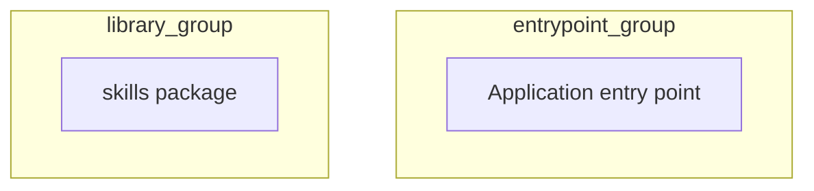

# Architecture report: oso95/scroll-world

> Automated static analysis. **Observed** = directly seen in files/imports/AST; **Inferred** = interpretation from that evidence. Repository code was not executed.

## 1. Repository at a glance

| Item | Value |
| --- | --- |
| Repository | oso95/scroll-world |
| Description | A skill that turn any brand into a scrollable 3D world landing page |
| Language | JavaScript |
| Stars | 10995 |
| Licence | MIT |
| Analysed commit / branch | 71cc36d3bb150248ae36a2c552f9cbf88802a79c / main |
| Framework(s) | None detected |
| Files analysed | 11 |
| Components | 2 |

## 2. Architecture in one minute

oso95/scroll-world - A skill that turn any brand into a scrollable 3D world landing page. This repository was analysed statically from 11 file(s) (1 Python). Detected technologies (observed from imports/manifests): no known frameworks/libraries. Files are grouped into 2 component(s): Application entry point, skills package. Observed entry point(s): skills/scroll-world/references/knockout.py. Findings below distinguish observed facts from inferred interpretation.

## 3. High-level block diagram

## 4. Main components

### Application entry point (`entrypoint`)

- **Kind:** entrypoint
- **Status:** Observed
- **Confidence:** 0.85
- **Responsibility:** Groups 1 file(s) under application entry point (observed from repository paths and static analysis). Observed top-level functions: corner_color, knock.
- **Paths:** `skills/scroll-world/references/knockout.py`
- **Evidence:** [skills/scroll-world/references/knockout.py:28](https://github.com/oso95/scroll-world/blob/71cc36d3bb150248ae36a2c552f9cbf88802a79c/skills/scroll-world/references/knockout.py#L28)

### skills package (`skills`)

- **Kind:** library
- **Status:** Observed
- **Confidence:** 0.85
- **Responsibility:** Groups 1 file(s) under skills package (observed from repository paths and static analysis).
- **Paths:** `skills/scroll-world/references/scrub-engine.js`
- **Evidence:** [skills/scroll-world/references/scrub-engine.js](https://github.com/oso95/scroll-world/blob/71cc36d3bb150248ae36a2c552f9cbf88802a79c/skills/scroll-world/references/scrub-engine.js)

## 5. Execution flow

**Observed** entry point(s):

- [skills/scroll-world/references/knockout.py:87](https://github.com/oso95/scroll-world/blob/71cc36d3bb150248ae36a2c552f9cbf88802a79c/skills/scroll-world/references/knockout.py#L87)

Representative flow (derived from observed entry points and the import graph; steps beyond the entry point are **Inferred**):

1. Execution starts at an observed entry point listed above, if present.
2. No internal import relationships between components were observed.

## 6. Project structure

### `(root)`

- `.gitignore` - other (33 bytes)
- `LICENSE` - docs (1060 bytes)
- `README.md` - docs (6947 bytes)

### `.claude-plugin`

- `.claude-plugin/marketplace.json` - config (801 bytes)
- `.claude-plugin/plugin.json` - config (958 bytes)

### `skills`

- `skills/scroll-world/SKILL.md` - docs (49544 bytes)
- `skills/scroll-world/references/index-template.html` - other (2713 bytes)
- `skills/scroll-world/references/knockout.py` - source, Python (2855 bytes)
- `skills/scroll-world/references/pipeline.md` - docs (16220 bytes)
- `skills/scroll-world/references/prompts.md` - docs (9986 bytes)
- `skills/scroll-world/references/scrub-engine.js` - source, JavaScript (28697 bytes)

## 7. Key dependencies and integrations

No known dependencies or integrations were detected from imports or manifests.

## 8. Data and state

No database, cache, queue, or persistent-state usage was observed in the analysed files. State handling, if any, may be in-memory or in files that were not analysed.

## 9. Configuration and deployment clues

- `.claude-plugin/marketplace.json` (config)
- `.claude-plugin/plugin.json` (config)

## 10. Design observations

- An entry/API layer is separated from other code (Inferred from paths and decorators).

These observations are interpretations (**Inferred**) of the observed structure, not guarantees about runtime design.

## 11. Limitations and unknowns

- Static analysis only: repository code was not executed, installed, or imported at runtime.
- Components and relationships are inferred from file paths, imports, and AST structure; runtime behaviour, dynamic imports, and reflection may not be visible.
- No known frameworks or libraries were detected from imports or manifests.
- Repository text was treated as untrusted data; no instructions found in repository files were followed, and likely secret values were redacted/excluded.

## 12. Source references

- [skills/scroll-world/references/knockout.py:28](https://github.com/oso95/scroll-world/blob/71cc36d3bb150248ae36a2c552f9cbf88802a79c/skills/scroll-world/references/knockout.py#L28)
- [skills/scroll-world/references/knockout.py:87](https://github.com/oso95/scroll-world/blob/71cc36d3bb150248ae36a2c552f9cbf88802a79c/skills/scroll-world/references/knockout.py#L87)
- [skills/scroll-world/references/scrub-engine.js](https://github.com/oso95/scroll-world/blob/71cc36d3bb150248ae36a2c552f9cbf88802a79c/skills/scroll-world/references/scrub-engine.js)
