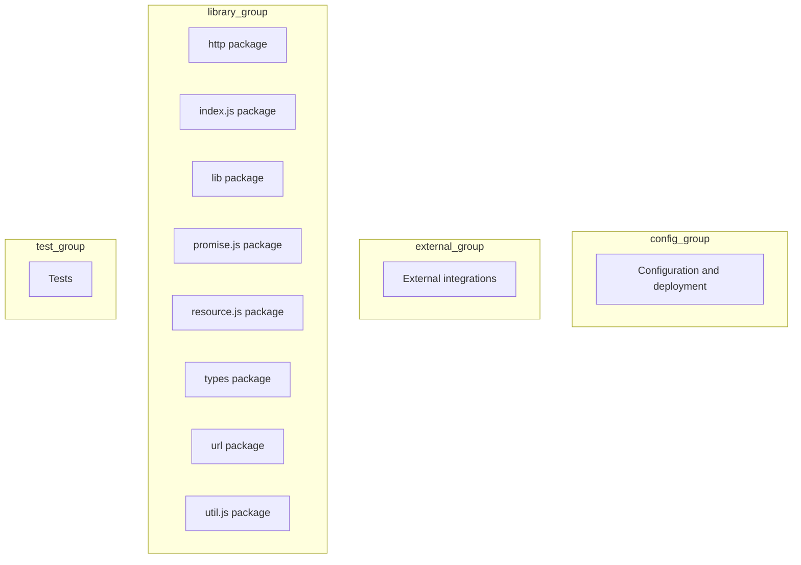

# Architecture report: pagekit/vue-resource

> Automated static analysis. **Observed** = directly seen in files/imports/AST; **Inferred** = interpretation from that evidence. Repository code was not executed.

## 1. Repository at a glance

| Item | Value |
| --- | --- |
| Repository | pagekit/vue-resource |
| Description | The HTTP client for Vue.js |
| Language | JavaScript |
| Stars | 9965 |
| Licence | MIT |
| Analysed commit / branch | 1b2d0c94e0b5b4efbbbb136987401423b84e8cba / develop |
| Framework(s) | Vue |
| Files analysed | 58 |
| Components | 11 |

## 2. Architecture in one minute

pagekit/vue-resource - The HTTP client for Vue.js. This repository was analysed statically from 58 file(s) (0 Python). Detected technologies (observed from imports/manifests): Vue, Jest, webpack. Files are grouped into 11 component(s): Configuration and deployment, External integrations, http package, index.js package, lib package, promise.js package, resource.js package, Tests. Findings below distinguish observed facts from inferred interpretation.

## 3. High-level block diagram

## 4. Main components

### Configuration and deployment (`config`)

- **Kind:** config
- **Status:** Observed
- **Confidence:** 0.85
- **Responsibility:** Groups 2 file(s) under configuration and deployment (observed from repository paths and static analysis).
- **Paths:** `bower.json`, `package.json`
- **Evidence:** [bower.json](https://github.com/pagekit/vue-resource/blob/1b2d0c94e0b5b4efbbbb136987401423b84e8cba/bower.json); [package.json](https://github.com/pagekit/vue-resource/blob/1b2d0c94e0b5b4efbbbb136987401423b84e8cba/package.json)

### External integrations (`external_integrations`)

- **Kind:** external
- **Status:** Observed
- **Confidence:** 0.85
- **Responsibility:** Groups 5 file(s) under external integrations (observed from repository paths and static analysis).
- **Paths:** `src/http/client/index.js`, `src/http/client/jsonp.js`, `src/http/client/node.js`, `src/http/client/xdr.js`, `src/http/client/xhr.js`
- **Evidence:** [src/http/client/index.js](https://github.com/pagekit/vue-resource/blob/1b2d0c94e0b5b4efbbbb136987401423b84e8cba/src/http/client/index.js); [src/http/client/jsonp.js](https://github.com/pagekit/vue-resource/blob/1b2d0c94e0b5b4efbbbb136987401423b84e8cba/src/http/client/jsonp.js); [src/http/client/node.js](https://github.com/pagekit/vue-resource/blob/1b2d0c94e0b5b4efbbbb136987401423b84e8cba/src/http/client/node.js); [src/http/client/xdr.js](https://github.com/pagekit/vue-resource/blob/1b2d0c94e0b5b4efbbbb136987401423b84e8cba/src/http/client/xdr.js); [src/http/client/xhr.js](https://github.com/pagekit/vue-resource/blob/1b2d0c94e0b5b4efbbbb136987401423b84e8cba/src/http/client/xhr.js)

### http package (`http`)

- **Kind:** library
- **Status:** Observed
- **Confidence:** 0.85
- **Responsibility:** Groups 11 file(s) under http package (observed from repository paths and static analysis).
- **Paths:** `src/http/headers.js`, `src/http/index.js`, `src/http/interceptor/before.js`, `src/http/interceptor/cors.js`, `src/http/interceptor/form.js`, `src/http/interceptor/header.js`, `src/http/interceptor/json.js`, `src/http/interceptor/jsonp.js`, `src/http/interceptor/method.js`, `src/http/request.js`, `src/http/response.js`
- **Evidence:** [src/http/headers.js](https://github.com/pagekit/vue-resource/blob/1b2d0c94e0b5b4efbbbb136987401423b84e8cba/src/http/headers.js); [src/http/index.js](https://github.com/pagekit/vue-resource/blob/1b2d0c94e0b5b4efbbbb136987401423b84e8cba/src/http/index.js); [src/http/interceptor/before.js](https://github.com/pagekit/vue-resource/blob/1b2d0c94e0b5b4efbbbb136987401423b84e8cba/src/http/interceptor/before.js); [src/http/interceptor/cors.js](https://github.com/pagekit/vue-resource/blob/1b2d0c94e0b5b4efbbbb136987401423b84e8cba/src/http/interceptor/cors.js); [src/http/interceptor/form.js](https://github.com/pagekit/vue-resource/blob/1b2d0c94e0b5b4efbbbb136987401423b84e8cba/src/http/interceptor/form.js); [src/http/interceptor/header.js](https://github.com/pagekit/vue-resource/blob/1b2d0c94e0b5b4efbbbb136987401423b84e8cba/src/http/interceptor/header.js); [src/http/interceptor/json.js](https://github.com/pagekit/vue-resource/blob/1b2d0c94e0b5b4efbbbb136987401423b84e8cba/src/http/interceptor/json.js); [src/http/interceptor/jsonp.js](https://github.com/pagekit/vue-resource/blob/1b2d0c94e0b5b4efbbbb136987401423b84e8cba/src/http/interceptor/jsonp.js)

### index.js package (`index_js`)

- **Kind:** library
- **Status:** Observed
- **Confidence:** 0.85
- **Responsibility:** Groups 1 file(s) under index.js package (observed from repository paths and static analysis).
- **Paths:** `src/index.js`
- **Evidence:** [src/index.js](https://github.com/pagekit/vue-resource/blob/1b2d0c94e0b5b4efbbbb136987401423b84e8cba/src/index.js)

### lib package (`lib`)

- **Kind:** library
- **Status:** Observed
- **Confidence:** 0.85
- **Responsibility:** Groups 2 file(s) under lib package (observed from repository paths and static analysis).
- **Paths:** `src/lib/promise.js`, `src/lib/url-template.js`
- **Evidence:** [src/lib/promise.js](https://github.com/pagekit/vue-resource/blob/1b2d0c94e0b5b4efbbbb136987401423b84e8cba/src/lib/promise.js); [src/lib/url-template.js](https://github.com/pagekit/vue-resource/blob/1b2d0c94e0b5b4efbbbb136987401423b84e8cba/src/lib/url-template.js)

### promise.js package (`promise_js`)

- **Kind:** library
- **Status:** Observed
- **Confidence:** 0.85
- **Responsibility:** Groups 1 file(s) under promise.js package (observed from repository paths and static analysis).
- **Paths:** `src/promise.js`
- **Evidence:** [src/promise.js](https://github.com/pagekit/vue-resource/blob/1b2d0c94e0b5b4efbbbb136987401423b84e8cba/src/promise.js)

### resource.js package (`resource_js`)

- **Kind:** library
- **Status:** Observed
- **Confidence:** 0.85
- **Responsibility:** Groups 1 file(s) under resource.js package (observed from repository paths and static analysis).
- **Paths:** `src/resource.js`
- **Evidence:** [src/resource.js](https://github.com/pagekit/vue-resource/blob/1b2d0c94e0b5b4efbbbb136987401423b84e8cba/src/resource.js)

### Tests (`tests`)

- **Kind:** test
- **Status:** Observed
- **Confidence:** 0.85
- **Responsibility:** Groups 12 file(s) under tests (observed from repository paths and static analysis).
- **Paths:** `test/data/invalid.json`, `test/data/text.txt`, `test/data/valid.json`, `test/http.js`, `test/http.test.js`, `test/index.html`, `test/index.js`, `test/karma.conf.js`, `test/promise.js`, `test/resource.js`, `test/url.js`, `test/webpack.config.js`
- **Evidence:** [test/data/invalid.json](https://github.com/pagekit/vue-resource/blob/1b2d0c94e0b5b4efbbbb136987401423b84e8cba/test/data/invalid.json); [test/data/text.txt](https://github.com/pagekit/vue-resource/blob/1b2d0c94e0b5b4efbbbb136987401423b84e8cba/test/data/text.txt); [test/data/valid.json](https://github.com/pagekit/vue-resource/blob/1b2d0c94e0b5b4efbbbb136987401423b84e8cba/test/data/valid.json); [test/http.js](https://github.com/pagekit/vue-resource/blob/1b2d0c94e0b5b4efbbbb136987401423b84e8cba/test/http.js); [test/http.test.js](https://github.com/pagekit/vue-resource/blob/1b2d0c94e0b5b4efbbbb136987401423b84e8cba/test/http.test.js); [test/index.html](https://github.com/pagekit/vue-resource/blob/1b2d0c94e0b5b4efbbbb136987401423b84e8cba/test/index.html); [test/index.js](https://github.com/pagekit/vue-resource/blob/1b2d0c94e0b5b4efbbbb136987401423b84e8cba/test/index.js); [test/karma.conf.js](https://github.com/pagekit/vue-resource/blob/1b2d0c94e0b5b4efbbbb136987401423b84e8cba/test/karma.conf.js)

### types package (`types`)

- **Kind:** library
- **Status:** Observed
- **Confidence:** 0.85
- **Responsibility:** Groups 3 file(s) under types package (observed from repository paths and static analysis).
- **Paths:** `types/index.d.ts`, `types/vue.d.ts`, `types/vue_resource.ts`
- **Evidence:** [types/index.d.ts](https://github.com/pagekit/vue-resource/blob/1b2d0c94e0b5b4efbbbb136987401423b84e8cba/types/index.d.ts); [types/vue.d.ts](https://github.com/pagekit/vue-resource/blob/1b2d0c94e0b5b4efbbbb136987401423b84e8cba/types/vue.d.ts); [types/vue_resource.ts](https://github.com/pagekit/vue-resource/blob/1b2d0c94e0b5b4efbbbb136987401423b84e8cba/types/vue_resource.ts)

### url package (`url`)

- **Kind:** library
- **Status:** Observed
- **Confidence:** 0.85
- **Responsibility:** Groups 4 file(s) under url package (observed from repository paths and static analysis).
- **Paths:** `src/url/index.js`, `src/url/query.js`, `src/url/root.js`, `src/url/template.js`
- **Evidence:** [src/url/index.js](https://github.com/pagekit/vue-resource/blob/1b2d0c94e0b5b4efbbbb136987401423b84e8cba/src/url/index.js); [src/url/query.js](https://github.com/pagekit/vue-resource/blob/1b2d0c94e0b5b4efbbbb136987401423b84e8cba/src/url/query.js); [src/url/root.js](https://github.com/pagekit/vue-resource/blob/1b2d0c94e0b5b4efbbbb136987401423b84e8cba/src/url/root.js); [src/url/template.js](https://github.com/pagekit/vue-resource/blob/1b2d0c94e0b5b4efbbbb136987401423b84e8cba/src/url/template.js)

### util.js package (`util_js`)

- **Kind:** library
- **Status:** Observed
- **Confidence:** 0.85
- **Responsibility:** Groups 1 file(s) under util.js package (observed from repository paths and static analysis).
- **Paths:** `src/util.js`
- **Evidence:** [src/util.js](https://github.com/pagekit/vue-resource/blob/1b2d0c94e0b5b4efbbbb136987401423b84e8cba/src/util.js)

## 5. Execution flow

**Observed** entry point(s):

- [src/http/client/index.js](https://github.com/pagekit/vue-resource/blob/1b2d0c94e0b5b4efbbbb136987401423b84e8cba/src/http/client/index.js)
- [src/http/index.js](https://github.com/pagekit/vue-resource/blob/1b2d0c94e0b5b4efbbbb136987401423b84e8cba/src/http/index.js)
- [src/index.js](https://github.com/pagekit/vue-resource/blob/1b2d0c94e0b5b4efbbbb136987401423b84e8cba/src/index.js)
- [src/url/index.js](https://github.com/pagekit/vue-resource/blob/1b2d0c94e0b5b4efbbbb136987401423b84e8cba/src/url/index.js)

Representative flow (derived from observed entry points and the import graph; steps beyond the entry point are **Inferred**):

1. Execution starts at an observed entry point listed above, if present.
2. No internal import relationships between components were observed.

## 6. Project structure

### `(root)`

- `.babelrc.js` - source, JavaScript (128 bytes)
- `.eslintignore` - other (26 bytes)
- `.eslintrc.js` - source, JavaScript (1360 bytes)
- `.gitignore` - other (38 bytes)
- `.npmignore` - other (21 bytes)
- `LICENSE` - docs (1080 bytes)
- `README.md` - docs (2459 bytes)
- `bower.json` - config (348 bytes)
- `package.json` - manifest (1889 bytes)

### `.circleci`

- `.circleci/config.yml` - ci, YAML (864 bytes)

### `.github`

- `.github/ISSUE_TEMPLATE.md` - docs (680 bytes)

### `docs`

- `docs/README.md` - docs (173 bytes)
- `docs/api.md` - docs (1161 bytes)
- `docs/config.md` - docs (1518 bytes)
- `docs/http.md` - docs (5591 bytes)
- `docs/recipes.md` - docs (1180 bytes)
- `docs/resource.md` - docs (1941 bytes)

### `src`

- `src/http/client/index.js` - source, JavaScript (1620 bytes)
- `src/http/client/jsonp.js` - source, JavaScript (1363 bytes)
- `src/http/client/node.js` - source, JavaScript (915 bytes)
- `src/http/client/xdr.js` - source, JavaScript (909 bytes)
- `src/http/client/xhr.js` - source, JavaScript (2354 bytes)
- `src/http/headers.js` - source, JavaScript (1466 bytes)
- `src/http/index.js` - source, JavaScript (2031 bytes)
- `src/http/interceptor/before.js` - source, JavaScript (200 bytes)
- `src/http/interceptor/cors.js` - source, JavaScript (659 bytes)
- `src/http/interceptor/form.js` - source, JavaScript (445 bytes)
- `src/http/interceptor/header.js` - source, JavaScript (458 bytes)
- `src/http/interceptor/json.js` - source, JavaScript (1014 bytes)
- `src/http/interceptor/jsonp.js` - source, JavaScript (196 bytes)
- `src/http/interceptor/method.js` - source, JavaScript (275 bytes)
- `src/http/request.js` - source, JavaScript (719 bytes)
- `src/http/response.js` - source, JavaScript (1400 bytes)
- `src/index.js` - source, JavaScript (1082 bytes)
- `src/lib/promise.js` - source, JavaScript (4440 bytes)
- `src/lib/url-template.js` - source, JavaScript (4770 bytes)
- `src/promise.js` - source, JavaScript (1745 bytes)
- `src/resource.js` - source, JavaScript (1467 bytes)
- `src/url/index.js` - source, JavaScript (2699 bytes)
- `src/url/query.js` - source, JavaScript (501 bytes)
- `src/url/root.js` - source, JavaScript (295 bytes)
- `src/url/template.js` - source, JavaScript (304 bytes)
- `src/util.js` - source, JavaScript (3779 bytes)

### `test`

- `test/data/invalid.json` - test (7 bytes)
- `test/data/text.txt` - test (4 bytes)
- `test/data/valid.json` - test (14 bytes)
- `test/http.js` - test, JavaScript (4505 bytes)
- `test/http.test.js` - test, JavaScript (894 bytes)
- `test/index.html` - test (615 bytes)
- `test/index.js` - test, JavaScript (169 bytes)
- `test/karma.conf.js` - test, JavaScript (422 bytes)
- `test/promise.js` - test, JavaScript (2682 bytes)
- `test/resource.js` - test, JavaScript (1042 bytes)
- `test/url.js` - test, JavaScript (758 bytes)
- `test/webpack.config.js` - test, JavaScript (352 bytes)

### `types`

- `types/index.d.ts` - source, TypeScript (73 bytes)
- `types/vue.d.ts` - source, TypeScript (666 bytes)
- `types/vue_resource.ts` - source, TypeScript (2376 bytes)

## 7. Key dependencies and integrations

| Name | Category | Status | Confidence | Evidence |
| --- | --- | --- | --- | --- |
| Vue | framework | Observed | 0.85 | [package.json:2](https://github.com/pagekit/vue-resource/blob/1b2d0c94e0b5b4efbbbb136987401423b84e8cba/package.json#L2) |
| Jest | tooling | Observed | 0.85 | [package.json:27](https://github.com/pagekit/vue-resource/blob/1b2d0c94e0b5b4efbbbb136987401423b84e8cba/package.json#L27) |
| webpack | tooling | Observed | 0.85 | [package.json:31](https://github.com/pagekit/vue-resource/blob/1b2d0c94e0b5b4efbbbb136987401423b84e8cba/package.json#L31) |

## 8. Data and state

No database, cache, queue, or persistent-state usage was observed in the analysed files. State handling, if any, may be in-memory or in files that were not analysed.

## 9. Configuration and deployment clues

- `.circleci/config.yml` (ci)
- `bower.json` (config)
- `package.json` (manifest)

## 10. Design observations

- Tests are present alongside source code (Observed from test file paths).
- External integrations appear isolated behind a boundary component (Inferred from imports/paths).

These observations are interpretations (**Inferred**) of the observed structure, not guarantees about runtime design.

## 11. Limitations and unknowns

- Static analysis only: repository code was not executed, installed, or imported at runtime.
- Components and relationships are inferred from file paths, imports, and AST structure; runtime behaviour, dynamic imports, and reflection may not be visible.
- 6 file(s) were skipped during inventory (6 x vendored/generated directory excluded).
- No clear application entry point was observed in the analysed files.
- Repository text was treated as untrusted data; no instructions found in repository files were followed, and likely secret values were redacted/excluded.
- JavaScript and TypeScript files were inventoried from paths and package manifests. They were not parsed with a full language AST, and repository code was not executed.
- The GitHub repository was marked archived at selection time.

## 12. Source references

- [bower.json](https://github.com/pagekit/vue-resource/blob/1b2d0c94e0b5b4efbbbb136987401423b84e8cba/bower.json)
- [package.json](https://github.com/pagekit/vue-resource/blob/1b2d0c94e0b5b4efbbbb136987401423b84e8cba/package.json)
- [package.json:2](https://github.com/pagekit/vue-resource/blob/1b2d0c94e0b5b4efbbbb136987401423b84e8cba/package.json#L2)
- [package.json:27](https://github.com/pagekit/vue-resource/blob/1b2d0c94e0b5b4efbbbb136987401423b84e8cba/package.json#L27)
- [package.json:31](https://github.com/pagekit/vue-resource/blob/1b2d0c94e0b5b4efbbbb136987401423b84e8cba/package.json#L31)
- [src/http/client/index.js](https://github.com/pagekit/vue-resource/blob/1b2d0c94e0b5b4efbbbb136987401423b84e8cba/src/http/client/index.js)
- [src/http/client/jsonp.js](https://github.com/pagekit/vue-resource/blob/1b2d0c94e0b5b4efbbbb136987401423b84e8cba/src/http/client/jsonp.js)
- [src/http/client/node.js](https://github.com/pagekit/vue-resource/blob/1b2d0c94e0b5b4efbbbb136987401423b84e8cba/src/http/client/node.js)
- [src/http/client/xdr.js](https://github.com/pagekit/vue-resource/blob/1b2d0c94e0b5b4efbbbb136987401423b84e8cba/src/http/client/xdr.js)
- [src/http/client/xhr.js](https://github.com/pagekit/vue-resource/blob/1b2d0c94e0b5b4efbbbb136987401423b84e8cba/src/http/client/xhr.js)
- [src/http/headers.js](https://github.com/pagekit/vue-resource/blob/1b2d0c94e0b5b4efbbbb136987401423b84e8cba/src/http/headers.js)
- [src/http/index.js](https://github.com/pagekit/vue-resource/blob/1b2d0c94e0b5b4efbbbb136987401423b84e8cba/src/http/index.js)
- [src/http/interceptor/before.js](https://github.com/pagekit/vue-resource/blob/1b2d0c94e0b5b4efbbbb136987401423b84e8cba/src/http/interceptor/before.js)
- [src/http/interceptor/cors.js](https://github.com/pagekit/vue-resource/blob/1b2d0c94e0b5b4efbbbb136987401423b84e8cba/src/http/interceptor/cors.js)
- [src/http/interceptor/form.js](https://github.com/pagekit/vue-resource/blob/1b2d0c94e0b5b4efbbbb136987401423b84e8cba/src/http/interceptor/form.js)
- [src/http/interceptor/header.js](https://github.com/pagekit/vue-resource/blob/1b2d0c94e0b5b4efbbbb136987401423b84e8cba/src/http/interceptor/header.js)
- [src/http/interceptor/json.js](https://github.com/pagekit/vue-resource/blob/1b2d0c94e0b5b4efbbbb136987401423b84e8cba/src/http/interceptor/json.js)
- [src/http/interceptor/jsonp.js](https://github.com/pagekit/vue-resource/blob/1b2d0c94e0b5b4efbbbb136987401423b84e8cba/src/http/interceptor/jsonp.js)
- [src/index.js](https://github.com/pagekit/vue-resource/blob/1b2d0c94e0b5b4efbbbb136987401423b84e8cba/src/index.js)
- [src/lib/promise.js](https://github.com/pagekit/vue-resource/blob/1b2d0c94e0b5b4efbbbb136987401423b84e8cba/src/lib/promise.js)
- [src/lib/url-template.js](https://github.com/pagekit/vue-resource/blob/1b2d0c94e0b5b4efbbbb136987401423b84e8cba/src/lib/url-template.js)
- [src/promise.js](https://github.com/pagekit/vue-resource/blob/1b2d0c94e0b5b4efbbbb136987401423b84e8cba/src/promise.js)
- [src/resource.js](https://github.com/pagekit/vue-resource/blob/1b2d0c94e0b5b4efbbbb136987401423b84e8cba/src/resource.js)
- [src/url/index.js](https://github.com/pagekit/vue-resource/blob/1b2d0c94e0b5b4efbbbb136987401423b84e8cba/src/url/index.js)
- [src/url/query.js](https://github.com/pagekit/vue-resource/blob/1b2d0c94e0b5b4efbbbb136987401423b84e8cba/src/url/query.js)
- [src/url/root.js](https://github.com/pagekit/vue-resource/blob/1b2d0c94e0b5b4efbbbb136987401423b84e8cba/src/url/root.js)
- [src/url/template.js](https://github.com/pagekit/vue-resource/blob/1b2d0c94e0b5b4efbbbb136987401423b84e8cba/src/url/template.js)
- [src/util.js](https://github.com/pagekit/vue-resource/blob/1b2d0c94e0b5b4efbbbb136987401423b84e8cba/src/util.js)
- [test/data/invalid.json](https://github.com/pagekit/vue-resource/blob/1b2d0c94e0b5b4efbbbb136987401423b84e8cba/test/data/invalid.json)
- [test/data/text.txt](https://github.com/pagekit/vue-resource/blob/1b2d0c94e0b5b4efbbbb136987401423b84e8cba/test/data/text.txt)
- [test/data/valid.json](https://github.com/pagekit/vue-resource/blob/1b2d0c94e0b5b4efbbbb136987401423b84e8cba/test/data/valid.json)
- [test/http.js](https://github.com/pagekit/vue-resource/blob/1b2d0c94e0b5b4efbbbb136987401423b84e8cba/test/http.js)
- [test/http.test.js](https://github.com/pagekit/vue-resource/blob/1b2d0c94e0b5b4efbbbb136987401423b84e8cba/test/http.test.js)
- [test/index.html](https://github.com/pagekit/vue-resource/blob/1b2d0c94e0b5b4efbbbb136987401423b84e8cba/test/index.html)
- [test/index.js](https://github.com/pagekit/vue-resource/blob/1b2d0c94e0b5b4efbbbb136987401423b84e8cba/test/index.js)
- [test/karma.conf.js](https://github.com/pagekit/vue-resource/blob/1b2d0c94e0b5b4efbbbb136987401423b84e8cba/test/karma.conf.js)
- [types/index.d.ts](https://github.com/pagekit/vue-resource/blob/1b2d0c94e0b5b4efbbbb136987401423b84e8cba/types/index.d.ts)
- [types/vue.d.ts](https://github.com/pagekit/vue-resource/blob/1b2d0c94e0b5b4efbbbb136987401423b84e8cba/types/vue.d.ts)
- [types/vue_resource.ts](https://github.com/pagekit/vue-resource/blob/1b2d0c94e0b5b4efbbbb136987401423b84e8cba/types/vue_resource.ts)
