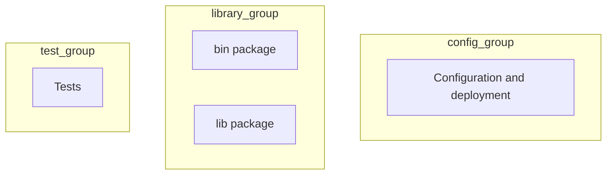

# Architecture report: pahen/madge

> Automated static analysis. **Observed** = directly seen in files/imports/AST; **Inferred** = interpretation from that evidence. Repository code was not executed.

## 1. Repository at a glance

| Item | Value |
| --- | --- |
| Repository | pahen/madge |
| Description | Create graphs from your CommonJS, AMD or ES6 module dependencies |
| Language | JavaScript |
| Stars | 10184 |
| Licence | MIT |
| Analysed commit / branch | 456057b85c2d063dad9c10147d7686ded4fc5ce5 / master |
| Framework(s) | None detected |
| Files analysed | 130 |
| Components | 4 |

## 2. Architecture in one minute

pahen/madge - Create graphs from your CommonJS, AMD or ES6 module dependencies. This repository was analysed statically from 130 file(s) (0 Python). Detected technologies (observed from imports/manifests): GitHub Actions, TypeScript. Files are grouped into 4 component(s): bin package, Configuration and deployment, lib package, Tests. Findings below distinguish observed facts from inferred interpretation.

## 3. High-level block diagram

## 4. Main components

### bin package (`bin`)

- **Kind:** library
- **Status:** Observed
- **Confidence:** 0.85
- **Responsibility:** Groups 1 file(s) under bin package (observed from repository paths and static analysis).
- **Paths:** `bin/cli.js`
- **Evidence:** [bin/cli.js](https://github.com/pahen/madge/blob/456057b85c2d063dad9c10147d7686ded4fc5ce5/bin/cli.js)

### Configuration and deployment (`config`)

- **Kind:** config
- **Status:** Observed
- **Confidence:** 0.85
- **Responsibility:** Groups 1 file(s) under configuration and deployment (observed from repository paths and static analysis).
- **Paths:** `package.json`
- **Evidence:** [package.json](https://github.com/pahen/madge/blob/456057b85c2d063dad9c10147d7686ded4fc5ce5/package.json)

### lib package (`lib`)

- **Kind:** library
- **Status:** Observed
- **Confidence:** 0.85
- **Responsibility:** Groups 6 file(s) under lib package (observed from repository paths and static analysis).
- **Paths:** `lib/api.js`, `lib/cyclic.js`, `lib/graph.js`, `lib/log.js`, `lib/output.js`, `lib/tree.js`
- **Evidence:** [lib/api.js](https://github.com/pahen/madge/blob/456057b85c2d063dad9c10147d7686ded4fc5ce5/lib/api.js); [lib/cyclic.js](https://github.com/pahen/madge/blob/456057b85c2d063dad9c10147d7686ded4fc5ce5/lib/cyclic.js); [lib/graph.js](https://github.com/pahen/madge/blob/456057b85c2d063dad9c10147d7686ded4fc5ce5/lib/graph.js); [lib/log.js](https://github.com/pahen/madge/blob/456057b85c2d063dad9c10147d7686ded4fc5ce5/lib/log.js); [lib/output.js](https://github.com/pahen/madge/blob/456057b85c2d063dad9c10147d7686ded4fc5ce5/lib/output.js); [lib/tree.js](https://github.com/pahen/madge/blob/456057b85c2d063dad9c10147d7686ded4fc5ce5/lib/tree.js)

### Tests (`tests`)

- **Kind:** test
- **Status:** Observed
- **Confidence:** 0.85
- **Responsibility:** Groups 113 file(s) under tests (observed from repository paths and static analysis).
- **Paths:** `test/amd.js`, `test/amd/amdes6.js`, `test/amd/circular/a.js`, `test/amd/circular/b.js`, `test/amd/circular/c.js`, `test/amd/circular/d.js`, `test/amd/circular/e.js`, `test/amd/circular/f.js`, `test/amd/circular/g.js`, `test/amd/circular/h.js`, `test/amd/circular/main.js`, `test/amd/circularAlias/config.js`, `test/amd/circularAlias/dos.js`, `test/amd/circularAlias/x86.js`, `test/amd/circularRelative/a.js`, `test/amd/circularRelative/foo/b.js`, `test/amd/nested/a.js`, `test/amd/nested/b.js`, `test/amd/nested/main.js`, `test/amd/ok/a.js`, `test/amd/ok/d.js`, `test/amd/ok/e.js`, `test/amd/ok/sub/b.js`, `test/amd/ok/sub/c.js`, `test/amd/plugin.js`, `test/amd/requirejs/a.js`, `test/amd/requirejs/config.js`, `test/amd/requirejs/orphans/a.js`, `test/amd/requirejs/orphans/b.js`, `test/amd/requirejs/orphans/c.js`, `test/api.js`, `test/cjs.js`, `test/cjs/a.js`, `test/cjs/b.js`, `test/cjs/both.js`, `test/cjs/c.js`, `test/cjs/chained.js`, `test/cjs/circular/a.js`, `test/cjs/circular/b.js`, `test/cjs/circular/c.js`, `test/cjs/circular/d.js`, `test/cjs/circular/foo.js`, `test/cjs/circular/foo.json`, `test/cjs/core.js`, `test/cjs/error.js`, `test/cjs/missing.js`, `test/cjs/multibase/1/a.js`, `test/cjs/multibase/2/b.js`, `test/cjs/nested.js`, `test/cjs/normal/a.js`, `test/cjs/normal/d.js`, `test/cjs/normal/sub/b.js`, `test/cjs/normal/sub/c.js`, `test/cjs/npm.js`, `test/cjs/strings.js`, `test/cjs/word.js`, `test/es6.js`, `test/es6/absolute.js`, `test/es6/absolute/a.js`, `test/es6/absolute/b.js`, `test/es6/circular/a.js`, `test/es6/circular/b.js`, `test/es6/circular/c.js`, `test/es6/error.js`, `test/es6/re-export/a.js`, `test/es6/re-export/b-default.js`, `test/es6/re-export/b-named.js`, `test/es6/re-export/b-star.js`, `test/es6/re-export/c.js`, `test/es6/webpack/src/sub/abs.js`, `test/es6/webpack/src/sub/index.js`, `test/es6/webpack/src/sub/rel.js`, `test/es6/webpack/webpack.config.js`, `test/es7.js`, `test/es7/async.js`, `test/es7/other.js`, `test/flow.js`, `test/flow/cjs/calc.js`, `test/flow/cjs/geometry.js`, `test/flow/cjs/math.js`, `test/flow/es/calc.js`, `test/flow/es/math.js`, `test/git/.git_tmp/d.js`, `test/git/a.js`, `test/git/b.js`, `test/git/c.js`, `test/jsx.js`, `test/jsx/basic.jsx`, `test/jsx/other.jsx`, `test/output.sh`, `test/typescript.js`, `test/typescript/custom-paths/import.ts`, `test/typescript/custom-paths/subfolder/index.ts`, `test/typescript/custom-paths/subfolder/require.tsx`, `test/typescript/custom-paths/subfolder2/export.ts`, `test/typescript/export-x.tsx`, `test/typescript/export.ts`, `test/typescript/import.ts`, `test/typescript/mixed.ts`, `test/typescript/require-x.tsx`, `test/typescript/require.ts`, `test/typescript/with-config/index.ts`, `test/typescript/with-config/tsconfig.base.json`, `test/typescript/with-config/tsconfig.json`, `test/vue.js`, `test/vue/BasicComponent.vue`, `test/vue/BasicComponentTs.vue`, `test/vue/OneNested.vue`, `test/vue/OneNestedTs.vue`, `test/vue/ThreeNested.vue`, `test/vue/TwoNested.vue`, `test/vue/one.ts`, `test/vue/two.js`
- **Evidence:** [test/amd.js](https://github.com/pahen/madge/blob/456057b85c2d063dad9c10147d7686ded4fc5ce5/test/amd.js); [test/amd/amdes6.js](https://github.com/pahen/madge/blob/456057b85c2d063dad9c10147d7686ded4fc5ce5/test/amd/amdes6.js); [test/amd/circular/a.js](https://github.com/pahen/madge/blob/456057b85c2d063dad9c10147d7686ded4fc5ce5/test/amd/circular/a.js); [test/amd/circular/b.js](https://github.com/pahen/madge/blob/456057b85c2d063dad9c10147d7686ded4fc5ce5/test/amd/circular/b.js); [test/amd/circular/c.js](https://github.com/pahen/madge/blob/456057b85c2d063dad9c10147d7686ded4fc5ce5/test/amd/circular/c.js); [test/amd/circular/d.js](https://github.com/pahen/madge/blob/456057b85c2d063dad9c10147d7686ded4fc5ce5/test/amd/circular/d.js); [test/amd/circular/e.js](https://github.com/pahen/madge/blob/456057b85c2d063dad9c10147d7686ded4fc5ce5/test/amd/circular/e.js); [test/amd/circular/f.js](https://github.com/pahen/madge/blob/456057b85c2d063dad9c10147d7686ded4fc5ce5/test/amd/circular/f.js)

## 5. Execution flow

**Observed** entry point(s):

- [bin/cli.js](https://github.com/pahen/madge/blob/456057b85c2d063dad9c10147d7686ded4fc5ce5/bin/cli.js)

Representative flow (derived from observed entry points and the import graph; steps beyond the entry point are **Inferred**):

1. Execution starts at an observed entry point listed above, if present.
2. No internal import relationships between components were observed.

## 6. Project structure

### `(root)`

- `.editorconfig` - config (239 bytes)
- `.eslintrc` - other (144 bytes)
- `.gitignore` - other (85 bytes)
- `.nvmrc` - other (3 bytes)
- `.release-it.json` - config (176 bytes)
- `CHANGELOG.md` - docs (32682 bytes)
- `LICENSE` - docs (1075 bytes)
- `README.md` - docs (15087 bytes)
- `package.json` - manifest (1941 bytes)

### `.github`

- `.github/workflows/nodejs.yml` - ci, YAML (620 bytes)

### `bin`

- `bin/cli.js` - source, JavaScript (6239 bytes)

### `lib`

- `lib/api.js` - source, JavaScript (4423 bytes)
- `lib/cyclic.js` - source, JavaScript (1435 bytes)
- `lib/graph.js` - source, JavaScript (4328 bytes)
- `lib/log.js` - source, JavaScript (59 bytes)
- `lib/output.js` - source, JavaScript (3317 bytes)
- `lib/tree.js` - source, JavaScript (6218 bytes)

### `test`

- `test/amd.js` - test, JavaScript (2322 bytes)
- `test/amd/amdes6.js` - test, JavaScript (127 bytes)
- `test/amd/circular/a.js` - test, JavaScript (53 bytes)
- `test/amd/circular/b.js` - test, JavaScript (45 bytes)
- `test/amd/circular/c.js` - test, JavaScript (45 bytes)
- `test/amd/circular/d.js` - test, JavaScript (37 bytes)
- `test/amd/circular/e.js` - test, JavaScript (45 bytes)
- `test/amd/circular/f.js` - test, JavaScript (45 bytes)
- `test/amd/circular/g.js` - test, JavaScript (45 bytes)
- `test/amd/circular/h.js` - test, JavaScript (45 bytes)
- `test/amd/circular/main.js` - test, JavaScript (52 bytes)
- `test/amd/circularAlias/config.js` - test, JavaScript (68 bytes)
- `test/amd/circularAlias/dos.js` - test, JavaScript (36 bytes)
- `test/amd/circularAlias/x86.js` - test, JavaScript (38 bytes)
- `test/amd/circularRelative/a.js` - test, JavaScript (55 bytes)
- `test/amd/circularRelative/foo/b.js` - test, JavaScript (56 bytes)
- `test/amd/nested/a.js` - test, JavaScript (43 bytes)
- `test/amd/nested/b.js` - test, JavaScript (42 bytes)
- `test/amd/nested/main.js` - test, JavaScript (93 bytes)
- `test/amd/ok/a.js` - test, JavaScript (49 bytes)
- `test/amd/ok/d.js` - test, JavaScript (0 bytes)
- `test/amd/ok/e.js` - test, JavaScript (49 bytes)
- `test/amd/ok/sub/b.js` - test, JavaScript (49 bytes)
- `test/amd/ok/sub/c.js` - test, JavaScript (45 bytes)
- `test/amd/plugin.js` - test, JavaScript (79 bytes)
- `test/amd/requirejs/a.js` - test, JavaScript (50 bytes)
- `test/amd/requirejs/config.js` - test, JavaScript (391 bytes)
- `test/amd/requirejs/orphans/a.js` - test, JavaScript (53 bytes)
- `test/amd/requirejs/orphans/b.js` - test, JavaScript (42 bytes)
- `test/amd/requirejs/orphans/c.js` - test, JavaScript (42 bytes)
- `test/api.js` - test, JavaScript (8346 bytes)
- `test/cjs.js` - test, JavaScript (1665 bytes)
- `test/cjs/a.js` - test, JavaScript (33 bytes)
- `test/cjs/b.js` - test, JavaScript (15 bytes)
- `test/cjs/both.js` - test, JavaScript (74 bytes)
- `test/cjs/c.js` - test, JavaScript (0 bytes)
- `test/cjs/chained.js` - test, JavaScript (67 bytes)
- `test/cjs/circular/a.js` - test, JavaScript (71 bytes)
- `test/cjs/circular/b.js` - test, JavaScript (23 bytes)
- `test/cjs/circular/c.js` - test, JavaScript (0 bytes)
- `test/cjs/circular/d.js` - test, JavaScript (23 bytes)
- `test/cjs/circular/foo.js` - test, JavaScript (22 bytes)
- `test/cjs/circular/foo.json` - test (2 bytes)
- `test/cjs/core.js` - test, JavaScript (45 bytes)
- `test/cjs/error.js` - test, JavaScript (19 bytes)
- `test/cjs/missing.js` - test, JavaScript (52 bytes)
- `test/cjs/multibase/1/a.js` - test, JavaScript (21 bytes)
- `test/cjs/multibase/2/b.js` - test, JavaScript (21 bytes)
- `test/cjs/nested.js` - test, JavaScript (293 bytes)
- `test/cjs/normal/a.js` - test, JavaScript (50 bytes)
- `test/cjs/normal/d.js` - test, JavaScript (21 bytes)
- `test/cjs/normal/sub/b.js` - test, JavaScript (46 bytes)
- `test/cjs/normal/sub/c.js` - test, JavaScript (47 bytes)
- `test/cjs/npm.js` - test, JavaScript (52 bytes)
- `test/cjs/strings.js` - test, JavaScript (282 bytes)
- `test/cjs/word.js` - test, JavaScript (259 bytes)
- `test/es6.js` - test, JavaScript (1411 bytes)
- `test/es6/absolute.js` - test, JavaScript (29 bytes)
- `test/es6/absolute/a.js` - test, JavaScript (63 bytes)
- `test/es6/absolute/b.js` - test, JavaScript (21 bytes)
- `test/es6/circular/a.js` - test, JavaScript (25 bytes)
- `test/es6/circular/b.js` - test, JavaScript (25 bytes)
- `test/es6/circular/c.js` - test, JavaScript (25 bytes)
- `test/es6/error.js` - test, JavaScript (19 bytes)
- `test/es6/re-export/a.js` - test, JavaScript (68 bytes)
- `test/es6/re-export/b-default.js` - test, JavaScript (29 bytes)
- `test/es6/re-export/b-named.js` - test, JavaScript (28 bytes)
- `test/es6/re-export/b-star.js` - test, JavaScript (20 bytes)
- `test/es6/re-export/c.js` - test, JavaScript (104 bytes)
- `test/es6/webpack/src/sub/abs.js` - test, JavaScript (0 bytes)
- `test/es6/webpack/src/sub/index.js` - test, JavaScript (27 bytes)
- `test/es6/webpack/src/sub/rel.js` - test, JavaScript (29 bytes)
- `test/es6/webpack/webpack.config.js` - test, JavaScript (124 bytes)
- `test/es7.js` - test, JavaScript (357 bytes)
- `test/es7/async.js` - test, JavaScript (55 bytes)
- `test/es7/other.js` - test, JavaScript (0 bytes)
- `test/flow.js` - test, JavaScript (923 bytes)
- `test/flow/cjs/calc.js` - test, JavaScript (135 bytes)
- `test/flow/cjs/geometry.js` - test, JavaScript (41 bytes)
- `test/flow/cjs/math.js` - test, JavaScript (286 bytes)
- `test/flow/es/calc.js` - test, JavaScript (61 bytes)
- `test/flow/es/math.js` - test, JavaScript (468 bytes)
- `test/git/.git_tmp/d.js` - test, JavaScript (0 bytes)
- `test/git/a.js` - test, JavaScript (55 bytes)
- `test/git/b.js` - test, JavaScript (15 bytes)
- `test/git/c.js` - test, JavaScript (0 bytes)
- `test/jsx.js` - test, JavaScript (365 bytes)
- `test/jsx/basic.jsx` - test, JavaScript (193 bytes)
- `test/jsx/other.jsx` - test, JavaScript (23 bytes)
- `test/output.sh` - test, Shell (1201 bytes)
- `test/typescript.js` - test, JavaScript (1918 bytes)
- `test/typescript/custom-paths/import.ts` - test, TypeScript (215 bytes)
- `test/typescript/custom-paths/subfolder/index.ts` - test, TypeScript (19 bytes)
- `test/typescript/custom-paths/subfolder/require.tsx` - test, TypeScript (108 bytes)
- `test/typescript/custom-paths/subfolder2/export.ts` - test, TypeScript (100 bytes)
- `test/typescript/export-x.tsx` - test, TypeScript (73 bytes)
- `test/typescript/export.ts` - test, TypeScript (100 bytes)
- `test/typescript/import.ts` - test, TypeScript (185 bytes)
- `test/typescript/mixed.ts` - test, TypeScript (42 bytes)
- `test/typescript/require-x.tsx` - test, TypeScript (166 bytes)
- `test/typescript/require.ts` - test, TypeScript (121 bytes)
- `test/typescript/with-config/index.ts` - test, TypeScript (0 bytes)
- `test/typescript/with-config/tsconfig.base.json` - test (88 bytes)
- `test/typescript/with-config/tsconfig.json` - test (126 bytes)
- `test/vue.js` - test, JavaScript (1026 bytes)
- `test/vue/BasicComponent.vue` - test, Vue (161 bytes)
- `test/vue/BasicComponentTs.vue` - test, Vue (173 bytes)
- `test/vue/OneNested.vue` - test, Vue (207 bytes)
- `test/vue/OneNestedTs.vue` - test, Vue (217 bytes)
- `test/vue/ThreeNested.vue` - test, Vue (42 bytes)
- `test/vue/TwoNested.vue` - test, Vue (42 bytes)
- `test/vue/one.ts` - test, TypeScript (14 bytes)
- `test/vue/two.js` - test, JavaScript (14 bytes)

## 7. Key dependencies and integrations

| Name | Category | Status | Confidence | Evidence |
| --- | --- | --- | --- | --- |
| GitHub Actions | ci | Observed | 0.85 | [.github/workflows/nodejs.yml](https://github.com/pahen/madge/blob/456057b85c2d063dad9c10147d7686ded4fc5ce5/.github/workflows/nodejs.yml) |
| TypeScript | tooling | Observed | 0.90 | [package.json:61](https://github.com/pahen/madge/blob/456057b85c2d063dad9c10147d7686ded4fc5ce5/package.json#L61) |

## 8. Data and state

No database, cache, queue, or persistent-state usage was observed in the analysed files. State handling, if any, may be in-memory or in files that were not analysed.

## 9. Configuration and deployment clues

- `.editorconfig` (config)
- `.github/workflows/nodejs.yml` (ci)
- `.release-it.json` (config)
- `package.json` (manifest)

## 10. Design observations

- Tests are present alongside source code (Observed from test file paths).

These observations are interpretations (**Inferred**) of the observed structure, not guarantees about runtime design.

## 11. Limitations and unknowns

- Static analysis only: repository code was not executed, installed, or imported at runtime.
- Components and relationships are inferred from file paths, imports, and AST structure; runtime behaviour, dynamic imports, and reflection may not be visible.
- 11 file(s) were skipped during inventory (11 x vendored/generated directory excluded).
- No clear application entry point was observed in the analysed files.
- Repository text was treated as untrusted data; no instructions found in repository files were followed, and likely secret values were redacted/excluded.
- JavaScript and TypeScript files were inventoried from paths and package manifests. They were not parsed with a full language AST, and repository code was not executed.

## 12. Source references

- [.github/workflows/nodejs.yml](https://github.com/pahen/madge/blob/456057b85c2d063dad9c10147d7686ded4fc5ce5/.github/workflows/nodejs.yml)
- [bin/cli.js](https://github.com/pahen/madge/blob/456057b85c2d063dad9c10147d7686ded4fc5ce5/bin/cli.js)
- [lib/api.js](https://github.com/pahen/madge/blob/456057b85c2d063dad9c10147d7686ded4fc5ce5/lib/api.js)
- [lib/cyclic.js](https://github.com/pahen/madge/blob/456057b85c2d063dad9c10147d7686ded4fc5ce5/lib/cyclic.js)
- [lib/graph.js](https://github.com/pahen/madge/blob/456057b85c2d063dad9c10147d7686ded4fc5ce5/lib/graph.js)
- [lib/log.js](https://github.com/pahen/madge/blob/456057b85c2d063dad9c10147d7686ded4fc5ce5/lib/log.js)
- [lib/output.js](https://github.com/pahen/madge/blob/456057b85c2d063dad9c10147d7686ded4fc5ce5/lib/output.js)
- [lib/tree.js](https://github.com/pahen/madge/blob/456057b85c2d063dad9c10147d7686ded4fc5ce5/lib/tree.js)
- [package.json](https://github.com/pahen/madge/blob/456057b85c2d063dad9c10147d7686ded4fc5ce5/package.json)
- [package.json:61](https://github.com/pahen/madge/blob/456057b85c2d063dad9c10147d7686ded4fc5ce5/package.json#L61)
- [test/amd.js](https://github.com/pahen/madge/blob/456057b85c2d063dad9c10147d7686ded4fc5ce5/test/amd.js)
- [test/amd/amdes6.js](https://github.com/pahen/madge/blob/456057b85c2d063dad9c10147d7686ded4fc5ce5/test/amd/amdes6.js)
- [test/amd/circular/a.js](https://github.com/pahen/madge/blob/456057b85c2d063dad9c10147d7686ded4fc5ce5/test/amd/circular/a.js)
- [test/amd/circular/b.js](https://github.com/pahen/madge/blob/456057b85c2d063dad9c10147d7686ded4fc5ce5/test/amd/circular/b.js)
- [test/amd/circular/c.js](https://github.com/pahen/madge/blob/456057b85c2d063dad9c10147d7686ded4fc5ce5/test/amd/circular/c.js)
- [test/amd/circular/d.js](https://github.com/pahen/madge/blob/456057b85c2d063dad9c10147d7686ded4fc5ce5/test/amd/circular/d.js)
- [test/amd/circular/e.js](https://github.com/pahen/madge/blob/456057b85c2d063dad9c10147d7686ded4fc5ce5/test/amd/circular/e.js)
- [test/amd/circular/f.js](https://github.com/pahen/madge/blob/456057b85c2d063dad9c10147d7686ded4fc5ce5/test/amd/circular/f.js)
