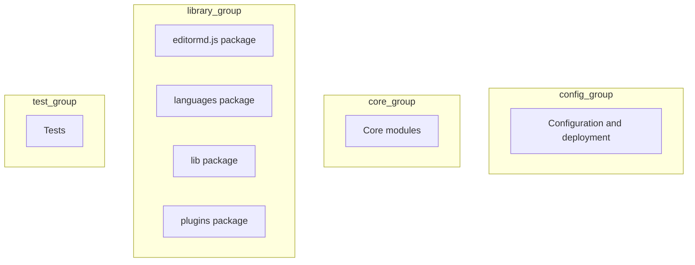

# Architecture report: pandao/editor.md

> Automated static analysis. **Observed** = directly seen in files/imports/AST; **Inferred** = interpretation from that evidence. Repository code was not executed.

## 1. Repository at a glance

| Item | Value |
| --- | --- |
| Repository | pandao/editor.md |
| Description | The open source embeddable online markdown editor (component). |
| Language | JavaScript |
| Stars | 14311 |
| Licence | MIT |
| Analysed commit / branch | 63786e671e2c1a1fd2be25b54a8910cd3bbc7c0a / master |
| Framework(s) | None detected |
| Files analysed | 447 |
| Components | 7 |

## 2. Architecture in one minute

pandao/editor.md - The open source embeddable online markdown editor (component).. This repository was analysed statically from 447 file(s) (0 Python). Detected technologies (observed from imports/manifests): Docker. Files are grouped into 7 component(s): Configuration and deployment, Core modules, editormd.js package, languages package, lib package, plugins package, Tests. Findings below distinguish observed facts from inferred interpretation.

## 3. High-level block diagram

## 4. Main components

### Configuration and deployment (`config`)

- **Kind:** config
- **Status:** Observed
- **Confidence:** 0.85
- **Responsibility:** Groups 7 file(s) under configuration and deployment (observed from repository paths and static analysis).
- **Paths:** `bower.json`, `lib/codemirror/bower.json`, `lib/codemirror/mode/dockerfile/dockerfile.js`, `lib/codemirror/package.json`, `package.json`, `plugins/emoji-dialog/emoji.json`, `plugins/html-entities-dialog/html-entities.json`
- **Evidence:** [bower.json](https://github.com/pandao/editor.md/blob/63786e671e2c1a1fd2be25b54a8910cd3bbc7c0a/bower.json); [lib/codemirror/bower.json](https://github.com/pandao/editor.md/blob/63786e671e2c1a1fd2be25b54a8910cd3bbc7c0a/lib/codemirror/bower.json); [lib/codemirror/mode/dockerfile/dockerfile.js](https://github.com/pandao/editor.md/blob/63786e671e2c1a1fd2be25b54a8910cd3bbc7c0a/lib/codemirror/mode/dockerfile/dockerfile.js); [lib/codemirror/package.json](https://github.com/pandao/editor.md/blob/63786e671e2c1a1fd2be25b54a8910cd3bbc7c0a/lib/codemirror/package.json); [package.json](https://github.com/pandao/editor.md/blob/63786e671e2c1a1fd2be25b54a8910cd3bbc7c0a/package.json); [plugins/emoji-dialog/emoji.json](https://github.com/pandao/editor.md/blob/63786e671e2c1a1fd2be25b54a8910cd3bbc7c0a/plugins/emoji-dialog/emoji.json); [plugins/html-entities-dialog/html-entities.json](https://github.com/pandao/editor.md/blob/63786e671e2c1a1fd2be25b54a8910cd3bbc7c0a/plugins/html-entities-dialog/html-entities.json)

### Core modules (`core`)

- **Kind:** core
- **Status:** Observed
- **Confidence:** 0.85
- **Responsibility:** Groups 3 file(s) under core modules (observed from repository paths and static analysis).
- **Paths:** `Gulpfile.js`, `editormd.amd.js`, `editormd.js`
- **Evidence:** [Gulpfile.js](https://github.com/pandao/editor.md/blob/63786e671e2c1a1fd2be25b54a8910cd3bbc7c0a/Gulpfile.js); [editormd.amd.js](https://github.com/pandao/editor.md/blob/63786e671e2c1a1fd2be25b54a8910cd3bbc7c0a/editormd.amd.js); [editormd.js](https://github.com/pandao/editor.md/blob/63786e671e2c1a1fd2be25b54a8910cd3bbc7c0a/editormd.js)

### editormd.js package (`editormd_js`)

- **Kind:** library
- **Status:** Observed
- **Confidence:** 0.85
- **Responsibility:** Groups 1 file(s) under editormd.js package (observed from repository paths and static analysis).
- **Paths:** `src/editormd.js`
- **Evidence:** [src/editormd.js](https://github.com/pandao/editor.md/blob/63786e671e2c1a1fd2be25b54a8910cd3bbc7c0a/src/editormd.js)

### languages package (`languages`)

- **Kind:** library
- **Status:** Observed
- **Confidence:** 0.85
- **Responsibility:** Groups 2 file(s) under languages package (observed from repository paths and static analysis).
- **Paths:** `languages/en.js`, `languages/zh-tw.js`
- **Evidence:** [languages/en.js](https://github.com/pandao/editor.md/blob/63786e671e2c1a1fd2be25b54a8910cd3bbc7c0a/languages/en.js); [languages/zh-tw.js](https://github.com/pandao/editor.md/blob/63786e671e2c1a1fd2be25b54a8910cd3bbc7c0a/languages/zh-tw.js)

### lib package (`lib`)

- **Kind:** library
- **Status:** Observed
- **Confidence:** 0.85
- **Responsibility:** Groups 164 file(s) under lib package (observed from repository paths and static analysis).
- **Paths:** `lib/codemirror/addon/comment/comment.js`, `lib/codemirror/addon/comment/continuecomment.js`, `lib/codemirror/addon/dialog/dialog.js`, `lib/codemirror/addon/display/fullscreen.js`, `lib/codemirror/addon/display/panel.js`, `lib/codemirror/addon/display/placeholder.js`, `lib/codemirror/addon/display/rulers.js`, `lib/codemirror/addon/edit/closebrackets.js`, `lib/codemirror/addon/edit/closetag.js`, `lib/codemirror/addon/edit/continuelist.js`, `lib/codemirror/addon/edit/matchbrackets.js`, `lib/codemirror/addon/edit/matchtags.js`, `lib/codemirror/addon/edit/trailingspace.js`, `lib/codemirror/addon/fold/brace-fold.js`, `lib/codemirror/addon/fold/comment-fold.js`, `lib/codemirror/addon/fold/foldcode.js`, `lib/codemirror/addon/fold/foldgutter.js`, `lib/codemirror/addon/fold/indent-fold.js`, `lib/codemirror/addon/fold/markdown-fold.js`, `lib/codemirror/addon/fold/xml-fold.js`, `lib/codemirror/addon/hint/anyword-hint.js`, `lib/codemirror/addon/hint/css-hint.js`, `lib/codemirror/addon/hint/html-hint.js`, `lib/codemirror/addon/hint/javascript-hint.js`, `lib/codemirror/addon/hint/show-hint.js`, `lib/codemirror/addon/hint/sql-hint.js`, `lib/codemirror/addon/hint/xml-hint.js`, `lib/codemirror/addon/lint/coffeescript-lint.js`, `lib/codemirror/addon/lint/css-lint.js`, `lib/codemirror/addon/lint/javascript-lint.js`, `lib/codemirror/addon/lint/json-lint.js`, `lib/codemirror/addon/lint/lint.js`, `lib/codemirror/addon/lint/yaml-lint.js`, `lib/codemirror/addon/merge/merge.js`, `lib/codemirror/addon/mode/loadmode.js`, `lib/codemirror/addon/mode/multiplex.js`, `lib/codemirror/addon/mode/multiplex_test.js`, `lib/codemirror/addon/mode/overlay.js`, `lib/codemirror/addon/mode/simple.js`, `lib/codemirror/addon/runmode/colorize.js`, `lib/codemirror/addon/runmode/runmode-standalone.js`, `lib/codemirror/addon/runmode/runmode.js`, `lib/codemirror/addon/runmode/runmode.node.js`, `lib/codemirror/addon/scroll/annotatescrollbar.js`, `lib/codemirror/addon/scroll/scrollpastend.js`, `lib/codemirror/addon/scroll/simplescrollbars.js`, `lib/codemirror/addon/search/match-highlighter.js`, `lib/codemirror/addon/search/matchesonscrollbar.js`, `lib/codemirror/addon/search/search.js`, `lib/codemirror/addon/search/searchcursor.js`, `lib/codemirror/addon/selection/active-line.js`, `lib/codemirror/addon/selection/mark-selection.js`, `lib/codemirror/addon/selection/selection-pointer.js`, `lib/codemirror/addon/tern/tern.js`, `lib/codemirror/addon/tern/worker.js`, `lib/codemirror/addon/wrap/hardwrap.js`, `lib/codemirror/mode/apl/apl.js`, `lib/codemirror/mode/asterisk/asterisk.js`, `lib/codemirror/mode/clike/clike.js`, `lib/codemirror/mode/clojure/clojure.js`, `lib/codemirror/mode/cobol/cobol.js`, `lib/codemirror/mode/coffeescript/coffeescript.js`, `lib/codemirror/mode/commonlisp/commonlisp.js`, `lib/codemirror/mode/css/css.js`, `lib/codemirror/mode/css/less_test.js`, `lib/codemirror/mode/css/scss_test.js`, `lib/codemirror/mode/css/test.js`, `lib/codemirror/mode/cypher/cypher.js`, `lib/codemirror/mode/d/d.js`, `lib/codemirror/mode/dart/dart.js`, `lib/codemirror/mode/diff/diff.js`, `lib/codemirror/mode/django/django.js`, `lib/codemirror/mode/dtd/dtd.js`, `lib/codemirror/mode/dylan/dylan.js`, `lib/codemirror/mode/ebnf/ebnf.js`, `lib/codemirror/mode/ecl/ecl.js`, `lib/codemirror/mode/eiffel/eiffel.js`, `lib/codemirror/mode/erlang/erlang.js`, `lib/codemirror/mode/forth/forth.js`, `lib/codemirror/mode/fortran/fortran.js`, `lib/codemirror/mode/gas/gas.js`, `lib/codemirror/mode/gfm/gfm.js`, `lib/codemirror/mode/gfm/test.js`, `lib/codemirror/mode/gherkin/gherkin.js`, `lib/codemirror/mode/go/go.js`, `lib/codemirror/mode/groovy/groovy.js`, `lib/codemirror/mode/haml/haml.js`, `lib/codemirror/mode/haml/test.js`, `lib/codemirror/mode/haskell/haskell.js`, `lib/codemirror/mode/haxe/haxe.js`, `lib/codemirror/mode/htmlembedded/htmlembedded.js`, `lib/codemirror/mode/htmlmixed/htmlmixed.js`, `lib/codemirror/mode/http/http.js`, `lib/codemirror/mode/idl/idl.js`, `lib/codemirror/mode/jade/jade.js`, `lib/codemirror/mode/javascript/javascript.js`, `lib/codemirror/mode/javascript/test.js`, `lib/codemirror/mode/jinja2/jinja2.js`, `lib/codemirror/mode/julia/julia.js`, `lib/codemirror/mode/kotlin/kotlin.js`, `lib/codemirror/mode/livescript/livescript.js`, `lib/codemirror/mode/lua/lua.js`, `lib/codemirror/mode/markdown/markdown.js`, `lib/codemirror/mode/markdown/test.js`, `lib/codemirror/mode/meta.js`, `lib/codemirror/mode/mirc/mirc.js`, `lib/codemirror/mode/mllike/mllike.js`, `lib/codemirror/mode/modelica/modelica.js`, `lib/codemirror/mode/nginx/nginx.js`, `lib/codemirror/mode/ntriples/ntriples.js`, `lib/codemirror/mode/octave/octave.js`, `lib/codemirror/mode/pascal/pascal.js`, `lib/codemirror/mode/pegjs/pegjs.js`, `lib/codemirror/mode/perl/perl.js`, `lib/codemirror/mode/php/php.js`, `lib/codemirror/mode/php/test.js`, `lib/codemirror/mode/pig/pig.js`, `lib/codemirror/mode/properties/properties.js`, `lib/codemirror/mode/puppet/puppet.js`, `lib/codemirror/mode/python/python.js`, `lib/codemirror/mode/q/q.js`, `lib/codemirror/mode/r/r.js`, `lib/codemirror/mode/rpm/rpm.js`, `lib/codemirror/mode/rst/rst.js`, `lib/codemirror/mode/ruby/ruby.js`, `lib/codemirror/mode/ruby/test.js`, `lib/codemirror/mode/rust/rust.js`, `lib/codemirror/mode/sass/sass.js`, `lib/codemirror/mode/scheme/scheme.js`, `lib/codemirror/mode/shell/shell.js`, `lib/codemirror/mode/shell/test.js`, `lib/codemirror/mode/sieve/sieve.js`, `lib/codemirror/mode/slim/slim.js`, `lib/codemirror/mode/slim/test.js`, `lib/codemirror/mode/smalltalk/smalltalk.js`, `lib/codemirror/mode/smarty/smarty.js`, `lib/codemirror/mode/smartymixed/smartymixed.js`, `lib/codemirror/mode/solr/solr.js`, `lib/codemirror/mode/soy/soy.js`, `lib/codemirror/mode/sparql/sparql.js`, `lib/codemirror/mode/spreadsheet/spreadsheet.js`, `lib/codemirror/mode/sql/sql.js`, `lib/codemirror/mode/stex/stex.js`, `lib/codemirror/mode/stex/test.js`, `lib/codemirror/mode/stylus/stylus.js`, `lib/codemirror/mode/tcl/tcl.js`, `lib/codemirror/mode/textile/test.js`, `lib/codemirror/mode/textile/textile.js`, `lib/codemirror/mode/tiddlywiki/tiddlywiki.js`, `lib/codemirror/mode/tiki/tiki.js`, `lib/codemirror/mode/toml/toml.js`, `lib/codemirror/mode/tornado/tornado.js`, `lib/codemirror/mode/turtle/turtle.js`, `lib/codemirror/mode/vb/vb.js`, `lib/codemirror/mode/vbscript/vbscript.js`, `lib/codemirror/mode/velocity/velocity.js`, `lib/codemirror/mode/verilog/test.js`, `lib/codemirror/mode/verilog/verilog.js`, `lib/codemirror/mode/xml/test.js`, `lib/codemirror/mode/xml/xml.js`, `lib/codemirror/mode/xquery/test.js`, `lib/codemirror/mode/xquery/xquery.js`, `lib/codemirror/mode/yaml/yaml.js`, `lib/codemirror/mode/z80/z80.js`
- **Evidence:** [lib/codemirror/addon/comment/comment.js](https://github.com/pandao/editor.md/blob/63786e671e2c1a1fd2be25b54a8910cd3bbc7c0a/lib/codemirror/addon/comment/comment.js); [lib/codemirror/addon/comment/continuecomment.js](https://github.com/pandao/editor.md/blob/63786e671e2c1a1fd2be25b54a8910cd3bbc7c0a/lib/codemirror/addon/comment/continuecomment.js); [lib/codemirror/addon/dialog/dialog.js](https://github.com/pandao/editor.md/blob/63786e671e2c1a1fd2be25b54a8910cd3bbc7c0a/lib/codemirror/addon/dialog/dialog.js); [lib/codemirror/addon/display/fullscreen.js](https://github.com/pandao/editor.md/blob/63786e671e2c1a1fd2be25b54a8910cd3bbc7c0a/lib/codemirror/addon/display/fullscreen.js); [lib/codemirror/addon/display/panel.js](https://github.com/pandao/editor.md/blob/63786e671e2c1a1fd2be25b54a8910cd3bbc7c0a/lib/codemirror/addon/display/panel.js); [lib/codemirror/addon/display/placeholder.js](https://github.com/pandao/editor.md/blob/63786e671e2c1a1fd2be25b54a8910cd3bbc7c0a/lib/codemirror/addon/display/placeholder.js); [lib/codemirror/addon/display/rulers.js](https://github.com/pandao/editor.md/blob/63786e671e2c1a1fd2be25b54a8910cd3bbc7c0a/lib/codemirror/addon/display/rulers.js); [lib/codemirror/addon/edit/closebrackets.js](https://github.com/pandao/editor.md/blob/63786e671e2c1a1fd2be25b54a8910cd3bbc7c0a/lib/codemirror/addon/edit/closebrackets.js)

### plugins package (`plugins`)

- **Kind:** library
- **Status:** Observed
- **Confidence:** 0.85
- **Responsibility:** Groups 12 file(s) under plugins package (observed from repository paths and static analysis).
- **Paths:** `plugins/code-block-dialog/code-block-dialog.js`, `plugins/emoji-dialog/emoji-dialog.js`, `plugins/goto-line-dialog/goto-line-dialog.js`, `plugins/help-dialog/help-dialog.js`, `plugins/html-entities-dialog/html-entities-dialog.js`, `plugins/image-dialog/image-dialog.js`, `plugins/link-dialog/link-dialog.js`, `plugins/plugin-template.js`, `plugins/preformatted-text-dialog/preformatted-text-dialog.js`, `plugins/reference-link-dialog/reference-link-dialog.js`, `plugins/table-dialog/table-dialog.js`, `plugins/test-plugin/test-plugin.js`
- **Evidence:** [plugins/code-block-dialog/code-block-dialog.js](https://github.com/pandao/editor.md/blob/63786e671e2c1a1fd2be25b54a8910cd3bbc7c0a/plugins/code-block-dialog/code-block-dialog.js); [plugins/emoji-dialog/emoji-dialog.js](https://github.com/pandao/editor.md/blob/63786e671e2c1a1fd2be25b54a8910cd3bbc7c0a/plugins/emoji-dialog/emoji-dialog.js); [plugins/goto-line-dialog/goto-line-dialog.js](https://github.com/pandao/editor.md/blob/63786e671e2c1a1fd2be25b54a8910cd3bbc7c0a/plugins/goto-line-dialog/goto-line-dialog.js); [plugins/help-dialog/help-dialog.js](https://github.com/pandao/editor.md/blob/63786e671e2c1a1fd2be25b54a8910cd3bbc7c0a/plugins/help-dialog/help-dialog.js); [plugins/html-entities-dialog/html-entities-dialog.js](https://github.com/pandao/editor.md/blob/63786e671e2c1a1fd2be25b54a8910cd3bbc7c0a/plugins/html-entities-dialog/html-entities-dialog.js); [plugins/image-dialog/image-dialog.js](https://github.com/pandao/editor.md/blob/63786e671e2c1a1fd2be25b54a8910cd3bbc7c0a/plugins/image-dialog/image-dialog.js); [plugins/link-dialog/link-dialog.js](https://github.com/pandao/editor.md/blob/63786e671e2c1a1fd2be25b54a8910cd3bbc7c0a/plugins/link-dialog/link-dialog.js); [plugins/plugin-template.js](https://github.com/pandao/editor.md/blob/63786e671e2c1a1fd2be25b54a8910cd3bbc7c0a/plugins/plugin-template.js)

### Tests (`tests`)

- **Kind:** test
- **Status:** Observed
- **Confidence:** 0.85
- **Responsibility:** Groups 11 file(s) under tests (observed from repository paths and static analysis).
- **Paths:** `tests/bootstrap-test.html`, `tests/codemirror-searchbox-test.html`, `tests/codemirror-test.html`, `tests/js/searchbox.js`, `tests/katex-tests.html`, `tests/marked-@at-test.html`, `tests/marked-emoji-test.html`, `tests/marked-heading-link-test.html`, `tests/marked-todo-list-test.html`, `tests/qunit/qunit-1.16.0.css`, `tests/qunit/qunit-1.16.0.js`
- **Evidence:** [tests/bootstrap-test.html](https://github.com/pandao/editor.md/blob/63786e671e2c1a1fd2be25b54a8910cd3bbc7c0a/tests/bootstrap-test.html); [tests/codemirror-searchbox-test.html](https://github.com/pandao/editor.md/blob/63786e671e2c1a1fd2be25b54a8910cd3bbc7c0a/tests/codemirror-searchbox-test.html); [tests/codemirror-test.html](https://github.com/pandao/editor.md/blob/63786e671e2c1a1fd2be25b54a8910cd3bbc7c0a/tests/codemirror-test.html); [tests/js/searchbox.js](https://github.com/pandao/editor.md/blob/63786e671e2c1a1fd2be25b54a8910cd3bbc7c0a/tests/js/searchbox.js); [tests/katex-tests.html](https://github.com/pandao/editor.md/blob/63786e671e2c1a1fd2be25b54a8910cd3bbc7c0a/tests/katex-tests.html); [tests/marked-@at-test.html](https://github.com/pandao/editor.md/blob/63786e671e2c1a1fd2be25b54a8910cd3bbc7c0a/tests/marked-%40at-test.html); [tests/marked-emoji-test.html](https://github.com/pandao/editor.md/blob/63786e671e2c1a1fd2be25b54a8910cd3bbc7c0a/tests/marked-emoji-test.html); [tests/marked-heading-link-test.html](https://github.com/pandao/editor.md/blob/63786e671e2c1a1fd2be25b54a8910cd3bbc7c0a/tests/marked-heading-link-test.html)

## 5. Execution flow

No entry point was observed; the startup flow below is therefore limited.

Representative flow (derived from observed entry points and the import graph; steps beyond the entry point are **Inferred**):

1. Execution starts at an observed entry point listed above, if present.
2. No internal import relationships between components were observed.

## 6. Project structure

### `(root)`

- `.gitignore` - other (131 bytes)
- `.jshintrc` - other (335 bytes)
- `BUGS.md` - docs (521 bytes)
- `CHANGE.md` - docs (26930 bytes)
- `Gulpfile.js` - source, JavaScript (13050 bytes)
- `LICENSE` - docs (1074 bytes)
- `README.md` - docs (13972 bytes)
- `bower.json` - config (425 bytes)
- `editormd.amd.js` - source, JavaScript (166325 bytes)
- `editormd.js` - source, JavaScript (163283 bytes)
- `package.json` - manifest (981 bytes)

### `css`

- `css/editormd.css` - other (82623 bytes)
- `css/editormd.logo.css` - other (2165 bytes)
- `css/editormd.preview.css` - other (60230 bytes)

### `docs`

- `docs/editormd.js.html` - docs (156560 bytes)
- `docs/fonts/OpenSans-Bold-webfont.svg` - docs (118259 bytes)
- `docs/fonts/OpenSans-BoldItalic-webfont.svg` - docs (121112 bytes)
- `docs/fonts/OpenSans-Italic-webfont.svg` - docs (122495 bytes)
- `docs/fonts/OpenSans-Light-webfont.svg` - docs (117270 bytes)
- `docs/fonts/OpenSans-LightItalic-webfont.svg` - docs (122968 bytes)
- `docs/fonts/OpenSans-Regular-webfont.svg` - docs (119399 bytes)
- `docs/index.html` - docs (960 bytes)
- `docs/scripts/linenumber.js` - docs (674 bytes)
- `docs/scripts/prettify/Apache-License-2.0.txt` - docs (11358 bytes)
- `docs/scripts/prettify/lang-css.js` - docs (861 bytes)
- `docs/scripts/prettify/prettify.js` - docs (13632 bytes)
- `docs/styles/jsdoc-default.css` - docs (6033 bytes)
- `docs/styles/prettify-jsdoc.css` - docs (1535 bytes)
- `docs/styles/prettify-tomorrow.css` - docs (2026 bytes)

### `examples`

- `examples/@links.html` - other (4951 bytes)
- `examples/auto-height.html` - other (1850 bytes)
- `examples/change-mode.html` - other (16209 bytes)
- `examples/code-fold.html` - other (1670 bytes)
- `examples/css/style.css` - other (1948 bytes)
- `examples/custom-keyboard-shortcuts.html` - other (4420 bytes)
- `examples/custom-toolbar.html` - other (8641 bytes)
- `examples/define-plugin.html` - other (4292 bytes)
- `examples/delay-renderer-preview.html` - other (2266 bytes)
- `examples/dynamic-create-editormd.html` - other (1827 bytes)
- `examples/emoji.html` - other (6694 bytes)
- `examples/extends.html` - other (4372 bytes)
- `examples/external-use.html` - other (4673 bytes)
- `examples/flowchart.html` - other (1463 bytes)
- `examples/form-get-value.html` - other (3534 bytes)
- `examples/full.html` - other (10049 bytes)
- `examples/goto-line.html` - other (3431 bytes)
- `examples/html-preview-markdown-to-html-custom-toc-container.html` - other (6641 bytes)
- `examples/html-preview-markdown-to-html.html` - other (5490 bytes)
- `examples/html-tags-decode.html` - other (4830 bytes)
- `examples/image-cross-domain-upload.html` - other (4447 bytes)
- `examples/image-upload.html` - other (2968 bytes)
- `examples/index.html` - other (13182 bytes)
- `examples/js/sea.js` - source, JavaScript (6064 bytes)
- `examples/js/seajs-main.js` - source, JavaScript (2395 bytes)
- `examples/katex.html` - other (4637 bytes)
- `examples/manually-load-modules.html` - other (4810 bytes)
- `examples/multi-editormd.html` - other (2119 bytes)
- `examples/multi-languages.html` - other (3596 bytes)
- `examples/on-off.html` - other (3879 bytes)
- `examples/onchange.html` - other (1687 bytes)
- `examples/onfullscreen.html` - other (1982 bytes)
- `examples/onload.html` - other (1836 bytes)
- `examples/onpreviewing-onpreviewed.html` - other (1956 bytes)
- `examples/onresize.html` - other (1842 bytes)
- `examples/onscroll-onpreviewscroll.html` - other (2216 bytes)
- `examples/onwatch-onunwatch.html` - other (1742 bytes)
- `examples/page-break.html` - other (2417 bytes)
- `examples/php/cross-domain-upload.php` - source, PHP (1934 bytes)
- `examples/php/editormd.uploader.class.php` - source, PHP (11923 bytes)
- `examples/php/post.php` - source, PHP (475 bytes)
- `examples/php/upload.php` - source, PHP (1589 bytes)
- `examples/php/upload_callback.html` - other (1085 bytes)
- `examples/readonly.html` - other (2134 bytes)
- `examples/resettings.html` - other (6332 bytes)
- `examples/search-replace.html` - other (1868 bytes)
- `examples/sequence-diagram.html` - other (1691 bytes)
- `examples/set-get-replace-selection.html` - other (3850 bytes)
- `examples/simple.html` - other (2060 bytes)
- `examples/sync-scrolling.html` - other (2154 bytes)
- `examples/task-lists.html` - other (2355 bytes)
- `examples/test.md` - docs (9149 bytes)
- `examples/themes.html` - other (6559 bytes)
- `examples/toc.html` - other (11883 bytes)
- `examples/toolbar-auto-fixed.html` - other (3749 bytes)
- `examples/use-requirejs.html` - other (8241 bytes)
- `examples/use-seajs.html` - other (8705 bytes)
- `examples/use-zepto.html` - other (5505 bytes)

### `fonts`

- `fonts/editormd-logo.svg` - other (1044 bytes)

### `languages`

- `languages/en.js` - source, JavaScript (5445 bytes)
- `languages/zh-tw.js` - source, JavaScript (5620 bytes)

### `lib`

- `lib/codemirror/AUTHORS` - other (5730 bytes)
- `lib/codemirror/LICENSE` - docs (1094 bytes)
- `lib/codemirror/README.md` - docs (784 bytes)
- `lib/codemirror/addon/comment/comment.js` - source, JavaScript (8008 bytes)
- `lib/codemirror/addon/comment/continuecomment.js` - source, JavaScript (3399 bytes)
- `lib/codemirror/addon/dialog/dialog.css` - other (502 bytes)
- `lib/codemirror/addon/dialog/dialog.js` - source, JavaScript (4875 bytes)
- `lib/codemirror/addon/display/fullscreen.css` - other (116 bytes)
- `lib/codemirror/addon/display/fullscreen.js` - source, JavaScript (1494 bytes)
- `lib/codemirror/addon/display/panel.js` - source, JavaScript (3102 bytes)
- `lib/codemirror/addon/display/placeholder.js` - source, JavaScript (1971 bytes)
- `lib/codemirror/addon/display/rulers.js` - source, JavaScript (2134 bytes)
- `lib/codemirror/addon/edit/closebrackets.js` - source, JavaScript (6462 bytes)
- `lib/codemirror/addon/edit/closetag.js` - source, JavaScript (7590 bytes)
- `lib/codemirror/addon/edit/continuelist.js` - source, JavaScript (1752 bytes)
- `lib/codemirror/addon/edit/matchbrackets.js` - source, JavaScript (5254 bytes)
- `lib/codemirror/addon/edit/matchtags.js` - source, JavaScript (2355 bytes)
- `lib/codemirror/addon/edit/trailingspace.js` - source, JavaScript (1003 bytes)
- `lib/codemirror/addon/fold/brace-fold.js` - source, JavaScript (3904 bytes)
- `lib/codemirror/addon/fold/comment-fold.js` - source, JavaScript (1999 bytes)
- `lib/codemirror/addon/fold/foldcode.js` - source, JavaScript (4693 bytes)
- `lib/codemirror/addon/fold/foldgutter.css` - other (435 bytes)
- `lib/codemirror/addon/fold/foldgutter.js` - source, JavaScript (4550 bytes)
- `lib/codemirror/addon/fold/indent-fold.js` - source, JavaScript (1627 bytes)
- `lib/codemirror/addon/fold/markdown-fold.js` - source, JavaScript (1605 bytes)
- `lib/codemirror/addon/fold/xml-fold.js` - source, JavaScript (6570 bytes)
- `lib/codemirror/addon/hint/anyword-hint.js` - source, JavaScript (1653 bytes)
- `lib/codemirror/addon/hint/css-hint.js` - source, JavaScript (1951 bytes)
- `lib/codemirror/addon/hint/html-hint.js` - source, JavaScript (11341 bytes)
- `lib/codemirror/addon/hint/javascript-hint.js` - source, JavaScript (6163 bytes)
- `lib/codemirror/addon/hint/show-hint.css` - other (662 bytes)
- `lib/codemirror/addon/hint/show-hint.js` - source, JavaScript (14402 bytes)
- `lib/codemirror/addon/hint/sql-hint.js` - source, JavaScript (7307 bytes)
- `lib/codemirror/addon/hint/xml-hint.js` - source, JavaScript (4735 bytes)
- `lib/codemirror/addon/lint/coffeescript-lint.js` - source, JavaScript (1270 bytes)
- `lib/codemirror/addon/lint/css-lint.js` - source, JavaScript (1146 bytes)
- `lib/codemirror/addon/lint/javascript-lint.js` - source, JavaScript (4452 bytes)
- `lib/codemirror/addon/lint/json-lint.js` - source, JavaScript (954 bytes)
- `lib/codemirror/addon/lint/lint.css` - other (3012 bytes)
- `lib/codemirror/addon/lint/lint.js` - source, JavaScript (7115 bytes)
- `lib/codemirror/addon/lint/yaml-lint.js` - source, JavaScript (848 bytes)
- `lib/codemirror/addon/merge/merge.css` - other (3235 bytes)
- `lib/codemirror/addon/merge/merge.js` - source, JavaScript (27266 bytes)
- `lib/codemirror/addon/mode/loadmode.js` - source, JavaScript (2277 bytes)
- `lib/codemirror/addon/mode/multiplex.js` - source, JavaScript (4197 bytes)
- `lib/codemirror/addon/mode/multiplex_test.js` - source, JavaScript (810 bytes)
- `lib/codemirror/addon/mode/overlay.js` - source, JavaScript (3021 bytes)
- `lib/codemirror/addon/mode/simple.js` - source, JavaScript (7898 bytes)
- `lib/codemirror/addon/runmode/colorize.js` - source, JavaScript (1303 bytes)
- `lib/codemirror/addon/runmode/runmode-standalone.js` - source, JavaScript (5302 bytes)
- `lib/codemirror/addon/runmode/runmode.js` - source, JavaScript (2501 bytes)
- `lib/codemirror/addon/runmode/runmode.node.js` - source, JavaScript (4289 bytes)
- `lib/codemirror/addon/scroll/annotatescrollbar.js` - source, JavaScript (3707 bytes)
- `lib/codemirror/addon/scroll/scrollpastend.js` - source, JavaScript (1492 bytes)
- `lib/codemirror/addon/scroll/simplescrollbars.css` - other (1347 bytes)
- `lib/codemirror/addon/scroll/simplescrollbars.js` - source, JavaScript (5240 bytes)
- `lib/codemirror/addon/search/match-highlighter.js` - source, JavaScript (4943 bytes)
- `lib/codemirror/addon/search/matchesonscrollbar.css` - other (188 bytes)
- `lib/codemirror/addon/search/matchesonscrollbar.js` - source, JavaScript (3704 bytes)
- `lib/codemirror/addon/search/search.js` - source, JavaScript (7128 bytes)
- `lib/codemirror/addon/search/searchcursor.js` - source, JavaScript (7720 bytes)
- `lib/codemirror/addon/selection/active-line.js` - source, JavaScript (2442 bytes)
- `lib/codemirror/addon/selection/mark-selection.js` - source, JavaScript (3781 bytes)
- `lib/codemirror/addon/selection/selection-pointer.js` - source, JavaScript (3292 bytes)
- `lib/codemirror/addon/tern/tern.css` - other (1852 bytes)
- `lib/codemirror/addon/tern/tern.js` - source, JavaScript (24217 bytes)
- `lib/codemirror/addon/tern/worker.js` - source, JavaScript (1207 bytes)
- `lib/codemirror/addon/wrap/hardwrap.js` - source, JavaScript (5260 bytes)
- `lib/codemirror/bower.json` - config (256 bytes)
- `lib/codemirror/lib/codemirror.css` - other (8082 bytes)
- `lib/codemirror/mode/apl/apl.js` - source, JavaScript (4773 bytes)
- `lib/codemirror/mode/apl/index.html` - other (2179 bytes)
- `lib/codemirror/mode/asterisk/asterisk.js` - source, JavaScript (7476 bytes)
- `lib/codemirror/mode/asterisk/index.html` - other (4591 bytes)
- `lib/codemirror/mode/clike/clike.js` - source, JavaScript (19051 bytes)
- `lib/codemirror/mode/clike/index.html` - other (6662 bytes)
- `lib/codemirror/mode/clike/scala.html` - other (28518 bytes)
- `lib/codemirror/mode/clojure/clojure.js` - source, JavaScript (14815 bytes)
- `lib/codemirror/mode/clojure/index.html` - other (2495 bytes)
- `lib/codemirror/mode/cobol/cobol.js` - source, JavaScript (10288 bytes)
- `lib/codemirror/mode/cobol/index.html` - other (8084 bytes)
- `lib/codemirror/mode/coffeescript/coffeescript.js` - source, JavaScript (10188 bytes)
- `lib/codemirror/mode/coffeescript/index.html` - other (22402 bytes)
- `lib/codemirror/mode/commonlisp/commonlisp.js` - source, JavaScript (4446 bytes)
- `lib/codemirror/mode/commonlisp/index.html` - other (6691 bytes)
- `lib/codemirror/mode/css/css.js` - source, JavaScript (34298 bytes)
- `lib/codemirror/mode/css/index.html` - other (1912 bytes)
- `lib/codemirror/mode/css/less.html` - other (4065 bytes)
- `lib/codemirror/mode/css/less_test.js` - source, JavaScript (1791 bytes)
- `lib/codemirror/mode/css/scss.html` - other (2741 bytes)
- `lib/codemirror/mode/css/scss_test.js` - source, JavaScript (3125 bytes)
- `lib/codemirror/mode/css/test.js` - source, JavaScript (6524 bytes)
- `lib/codemirror/mode/cypher/cypher.js` - source, JavaScript (6204 bytes)
- `lib/codemirror/mode/cypher/index.html` - other (1908 bytes)
- `lib/codemirror/mode/d/d.js` - source, JavaScript (7566 bytes)
- `lib/codemirror/mode/d/index.html` - other (6332 bytes)
- `lib/codemirror/mode/dart/dart.js` - source, JavaScript (1820 bytes)
- `lib/codemirror/mode/dart/index.html` - other (1627 bytes)
- `lib/codemirror/mode/diff/diff.js` - source, JavaScript (1138 bytes)
- `lib/codemirror/mode/diff/index.html` - other (4409 bytes)
- `lib/codemirror/mode/django/django.js` - source, JavaScript (2316 bytes)
- `lib/codemirror/mode/django/index.html` - other (1806 bytes)
- `lib/codemirror/mode/dockerfile/dockerfile.js` - container (2171 bytes)
- `lib/codemirror/mode/dockerfile/index.html` - other (2267 bytes)
- `lib/codemirror/mode/dtd/dtd.js` - source, JavaScript (4808 bytes)
- `lib/codemirror/mode/dtd/index.html` - other (3337 bytes)
- `lib/codemirror/mode/dylan/dylan.js` - source, JavaScript (8778 bytes)
- `lib/codemirror/mode/dylan/index.html` - other (13032 bytes)
- `lib/codemirror/mode/ebnf/ebnf.js` - source, JavaScript (6075 bytes)
- `lib/codemirror/mode/ebnf/index.html` - other (2450 bytes)
- `lib/codemirror/mode/ecl/ecl.js` - source, JavaScript (8889 bytes)
- `lib/codemirror/mode/ecl/index.html` - other (1409 bytes)
- `lib/codemirror/mode/eiffel/eiffel.js` - source, JavaScript (3779 bytes)
- `lib/codemirror/mode/eiffel/index.html` - other (13198 bytes)
- `lib/codemirror/mode/erlang/erlang.js` - source, JavaScript (19043 bytes)
- `lib/codemirror/mode/erlang/index.html` - other (2168 bytes)
- `lib/codemirror/mode/forth/forth.js` - source, JavaScript (5230 bytes)
- `lib/codemirror/mode/forth/index.html` - other (1783 bytes)
- `lib/codemirror/mode/fortran/fortran.js` - source, JavaScript (8686 bytes)
- `lib/codemirror/mode/fortran/index.html` - other (2492 bytes)
- `lib/codemirror/mode/gas/gas.js` - source, JavaScript (8886 bytes)
- `lib/codemirror/mode/gas/index.html` - other (1840 bytes)
- `lib/codemirror/mode/gfm/gfm.js` - source, JavaScript (3875 bytes)
- `lib/codemirror/mode/gfm/index.html` - other (2582 bytes)
- `lib/codemirror/mode/gfm/test.js` - source, JavaScript (6922 bytes)
- `lib/codemirror/mode/gherkin/gherkin.js` - source, JavaScript (13257 bytes)
- `lib/codemirror/mode/gherkin/index.html` - other (1566 bytes)
- `lib/codemirror/mode/go/go.js` - source, JavaScript (5922 bytes)
- `lib/codemirror/mode/go/index.html` - other (2174 bytes)
- `lib/codemirror/mode/groovy/groovy.js` - source, JavaScript (7625 bytes)
- `lib/codemirror/mode/groovy/index.html` - other (2177 bytes)
- `lib/codemirror/mode/haml/haml.js` - source, JavaScript (5275 bytes)
- `lib/codemirror/mode/haml/index.html` - other (2071 bytes)
- `lib/codemirror/mode/haml/test.js` - source, JavaScript (3010 bytes)
- `lib/codemirror/mode/haskell/haskell.js` - source, JavaScript (8101 bytes)
- `lib/codemirror/mode/haskell/index.html` - other (2194 bytes)
- `lib/codemirror/mode/haxe/haxe.js` - source, JavaScript (17064 bytes)
- `lib/codemirror/mode/haxe/index.html` - other (2577 bytes)
- `lib/codemirror/mode/htmlembedded/htmlembedded.js` - source, JavaScript (3116 bytes)
- `lib/codemirror/mode/htmlembedded/index.html` - other (1979 bytes)
- `lib/codemirror/mode/htmlmixed/htmlmixed.js` - source, JavaScript (5008 bytes)
- `lib/codemirror/mode/htmlmixed/index.html` - other (3066 bytes)
- `lib/codemirror/mode/http/http.js` - source, JavaScript (2795 bytes)
- `lib/codemirror/mode/http/index.html` - other (1393 bytes)
- `lib/codemirror/mode/idl/idl.js` - source, JavaScript (14889 bytes)
- `lib/codemirror/mode/idl/index.html` - other (1633 bytes)
- `lib/codemirror/mode/index.html` - other (6444 bytes)
- `lib/codemirror/mode/jade/index.html` - other (2471 bytes)
- `lib/codemirror/mode/jade/jade.js` - source, JavaScript (15936 bytes)
- `lib/codemirror/mode/javascript/index.html` - other (4193 bytes)
- `lib/codemirror/mode/javascript/javascript.js` - source, JavaScript (26331 bytes)
- `lib/codemirror/mode/javascript/json-ld.html` - other (2150 bytes)
- `lib/codemirror/mode/javascript/test.js` - source, JavaScript (7449 bytes)
- `lib/codemirror/mode/javascript/typescript.html` - other (1547 bytes)
- `lib/codemirror/mode/jinja2/index.html` - other (1755 bytes)
- `lib/codemirror/mode/jinja2/jinja2.js` - source, JavaScript (4284 bytes)
- `lib/codemirror/mode/julia/index.html` - other (2375 bytes)
- `lib/codemirror/mode/julia/julia.js` - source, JavaScript (8215 bytes)
- `lib/codemirror/mode/kotlin/index.html` - other (2686 bytes)
- `lib/codemirror/mode/kotlin/kotlin.js` - source, JavaScript (8410 bytes)
- `lib/codemirror/mode/livescript/index.html` - other (9843 bytes)
- `lib/codemirror/mode/livescript/livescript.js` - source, JavaScript (7644 bytes)
- `lib/codemirror/mode/lua/index.html` - other (2073 bytes)
- `lib/codemirror/mode/lua/lua.js` - source, JavaScript (5950 bytes)
- `lib/codemirror/mode/markdown/index.html` - other (10778 bytes)
- `lib/codemirror/mode/markdown/markdown.js` - source, JavaScript (23434 bytes)
- `lib/codemirror/mode/markdown/test.js` - source, JavaScript (20871 bytes)
- `lib/codemirror/mode/meta.js` - source, JavaScript (11831 bytes)
- `lib/codemirror/mode/mirc/index.html` - other (5798 bytes)
- `lib/codemirror/mode/mirc/mirc.js` - source, JavaScript (10082 bytes)
- `lib/codemirror/mode/mllike/index.html` - other (4436 bytes)
- `lib/codemirror/mode/mllike/mllike.js` - source, JavaScript (4991 bytes)
- `lib/codemirror/mode/modelica/index.html` - other (2007 bytes)
- `lib/codemirror/mode/modelica/modelica.js` - source, JavaScript (6930 bytes)
- `lib/codemirror/mode/nginx/index.html` - other (5230 bytes)
- `lib/codemirror/mode/nginx/nginx.js` - source, JavaScript (10169 bytes)
- `lib/codemirror/mode/ntriples/index.html` - other (1357 bytes)
- `lib/codemirror/mode/ntriples/ntriples.js` - source, JavaScript (6643 bytes)
- `lib/codemirror/mode/octave/index.html` - other (1806 bytes)
- `lib/codemirror/mode/octave/octave.js` - source, JavaScript (4463 bytes)
- `lib/codemirror/mode/pascal/index.html` - other (1440 bytes)
- `lib/codemirror/mode/pascal/pascal.js` - source, JavaScript (3055 bytes)
- `lib/codemirror/mode/pegjs/index.html` - other (1890 bytes)
- `lib/codemirror/mode/pegjs/pegjs.js` - source, JavaScript (3562 bytes)
- `lib/codemirror/mode/perl/index.html` - other (1542 bytes)
- `lib/codemirror/mode/perl/perl.js` - source, JavaScript (56134 bytes)
- `lib/codemirror/mode/php/index.html` - other (2000 bytes)
- `lib/codemirror/mode/php/php.js` - source, JavaScript (17661 bytes)
- `lib/codemirror/mode/php/test.js` - source, JavaScript (6637 bytes)
- `lib/codemirror/mode/pig/index.html` - other (1481 bytes)
- `lib/codemirror/mode/pig/pig.js` - source, JavaScript (6112 bytes)
- `lib/codemirror/mode/properties/index.html` - other (1555 bytes)
- `lib/codemirror/mode/properties/properties.js` - source, JavaScript (2195 bytes)
- `lib/codemirror/mode/puppet/index.html` - other (3260 bytes)
- `lib/codemirror/mode/puppet/puppet.js` - source, JavaScript (7574 bytes)
- `lib/codemirror/mode/python/index.html` - other (5950 bytes)
- `lib/codemirror/mode/python/python.js` - source, JavaScript (12869 bytes)
- `lib/codemirror/mode/q/index.html` - other (8961 bytes)
- `lib/codemirror/mode/q/q.js` - source, JavaScript (6617 bytes)
- `lib/codemirror/mode/r/index.html` - other (2574 bytes)
- `lib/codemirror/mode/r/r.js` - source, JavaScript (5622 bytes)
- `lib/codemirror/mode/rpm/changes/index.html` - other (2180 bytes)
- `lib/codemirror/mode/rpm/index.html` - other (4623 bytes)
- `lib/codemirror/mode/rpm/rpm.js` - source, JavaScript (3817 bytes)
- `lib/codemirror/mode/rst/index.html` - other (17769 bytes)
- `lib/codemirror/mode/rst/rst.js` - source, JavaScript (17547 bytes)
- `lib/codemirror/mode/ruby/index.html` - other (5749 bytes)
- `lib/codemirror/mode/ruby/ruby.js` - source, JavaScript (10445 bytes)
- `lib/codemirror/mode/ruby/test.js` - source, JavaScript (470 bytes)
- `lib/codemirror/mode/rust/index.html` - other (1374 bytes)
- `lib/codemirror/mode/rust/rust.js` - source, JavaScript (16044 bytes)
- `lib/codemirror/mode/sass/index.html` - other (1571 bytes)
- `lib/codemirror/mode/sass/sass.js` - source, JavaScript (10058 bytes)
- `lib/codemirror/mode/scheme/index.html` - other (2554 bytes)
- `lib/codemirror/mode/scheme/scheme.js` - source, JavaScript (13393 bytes)
- `lib/codemirror/mode/shell/index.html` - other (1745 bytes)
- `lib/codemirror/mode/shell/shell.js` - source, JavaScript (3792 bytes)
- `lib/codemirror/mode/shell/test.js` - source, JavaScript (1772 bytes)
- `lib/codemirror/mode/sieve/index.html` - other (2335 bytes)
- `lib/codemirror/mode/sieve/sieve.js` - source, JavaScript (4285 bytes)
- `lib/codemirror/mode/slim/index.html` - other (2920 bytes)
- `lib/codemirror/mode/slim/slim.js` - source, JavaScript (18008 bytes)
- `lib/codemirror/mode/slim/test.js` - source, JavaScript (3130 bytes)
- `lib/codemirror/mode/smalltalk/index.html` - other (1904 bytes)
- `lib/codemirror/mode/smalltalk/smalltalk.js` - source, JavaScript (4543 bytes)
- `lib/codemirror/mode/smarty/index.html` - other (3687 bytes)
- `lib/codemirror/mode/smarty/smarty.js` - source, JavaScript (6419 bytes)
- `lib/codemirror/mode/smartymixed/index.html` - other (3212 bytes)
- `lib/codemirror/mode/smartymixed/smartymixed.js` - source, JavaScript (6638 bytes)
- `lib/codemirror/mode/solr/index.html` - other (1365 bytes)
- `lib/codemirror/mode/solr/solr.js` - source, JavaScript (2678 bytes)
- `lib/codemirror/mode/soy/index.html` - other (1939 bytes)
- `lib/codemirror/mode/soy/soy.js` - source, JavaScript (7555 bytes)
- `lib/codemirror/mode/sparql/index.html` - other (1773 bytes)
- `lib/codemirror/mode/sparql/sparql.js` - source, JavaScript (6169 bytes)
- `lib/codemirror/mode/spreadsheet/index.html` - other (1392 bytes)
- `lib/codemirror/mode/spreadsheet/spreadsheet.js` - source, JavaScript (3084 bytes)
- `lib/codemirror/mode/sql/index.html` - other (2851 bytes)
- `lib/codemirror/mode/sql/sql.js` - source, JavaScript (26290 bytes)
- `lib/codemirror/mode/stex/index.html` - other (4132 bytes)
- `lib/codemirror/mode/stex/stex.js` - source, JavaScript (6932 bytes)
- `lib/codemirror/mode/stex/test.js` - source, JavaScript (3106 bytes)
- `lib/codemirror/mode/stylus/index.html` - other (2373 bytes)
- `lib/codemirror/mode/stylus/stylus.js` - source, JavaScript (23928 bytes)
- `lib/codemirror/mode/tcl/index.html` - other (6297 bytes)
- `lib/codemirror/mode/tcl/tcl.js` - source, JavaScript (5006 bytes)
- `lib/codemirror/mode/textile/index.html` - other (4347 bytes)
- `lib/codemirror/mode/textile/test.js` - source, JavaScript (9437 bytes)
- `lib/codemirror/mode/textile/textile.js` - source, JavaScript (13842 bytes)
- `lib/codemirror/mode/tiddlywiki/index.html` - other (4579 bytes)
- `lib/codemirror/mode/tiddlywiki/tiddlywiki.css` - other (220 bytes)
- `lib/codemirror/mode/tiddlywiki/tiddlywiki.js` - source, JavaScript (10195 bytes)
- `lib/codemirror/mode/tiki/index.html` - other (1745 bytes)
- `lib/codemirror/mode/tiki/tiki.css` - other (440 bytes)
- `lib/codemirror/mode/tiki/tiki.js` - source, JavaScript (8655 bytes)
- `lib/codemirror/mode/toml/index.html` - other (1840 bytes)
- `lib/codemirror/mode/toml/toml.js` - source, JavaScript (2897 bytes)
- `lib/codemirror/mode/tornado/index.html` - other (1803 bytes)
- `lib/codemirror/mode/tornado/tornado.js` - source, JavaScript (2496 bytes)
- `lib/codemirror/mode/turtle/index.html` - other (1470 bytes)
- `lib/codemirror/mode/turtle/turtle.js` - source, JavaScript (4849 bytes)
- `lib/codemirror/mode/vb/index.html` - other (3268 bytes)
- `lib/codemirror/mode/vb/vb.js` - source, JavaScript (8494 bytes)
- `lib/codemirror/mode/vbscript/index.html` - other (1517 bytes)
- `lib/codemirror/mode/vbscript/vbscript.js` - source, JavaScript (13793 bytes)
- `lib/codemirror/mode/velocity/index.html` - other (3245 bytes)
- `lib/codemirror/mode/velocity/velocity.js` - source, JavaScript (7079 bytes)
- `lib/codemirror/mode/verilog/index.html` - other (2618 bytes)
- `lib/codemirror/mode/verilog/test.js` - source, JavaScript (6776 bytes)
- `lib/codemirror/mode/verilog/verilog.js` - source, JavaScript (19177 bytes)
- `lib/codemirror/mode/xml/index.html` - other (1950 bytes)
- `lib/codemirror/mode/xml/test.js` - source, JavaScript (1758 bytes)
- `lib/codemirror/mode/xml/xml.js` - source, JavaScript (12375 bytes)
- `lib/codemirror/mode/xquery/index.html` - other (8609 bytes)
- `lib/codemirror/mode/xquery/test.js` - source, JavaScript (5108 bytes)
- `lib/codemirror/mode/xquery/xquery.js` - source, JavaScript (15128 bytes)
- `lib/codemirror/mode/yaml/index.html` - other (2098 bytes)
- `lib/codemirror/mode/yaml/yaml.js` - source, JavaScript (3649 bytes)
- `lib/codemirror/mode/z80/index.html` - other (1397 bytes)
- `lib/codemirror/mode/z80/z80.js` - source, JavaScript (2880 bytes)
- `lib/codemirror/package.json` - manifest (887 bytes)
- `lib/codemirror/theme/3024-day.css` - other (1747 bytes)
- `lib/codemirror/theme/3024-night.css` - other (1824 bytes)
- `lib/codemirror/theme/ambiance-mobile.css` - other (103 bytes)
- `lib/codemirror/theme/ambiance.css` - other (26239 bytes)
- `lib/codemirror/theme/base16-dark.css` - other (1861 bytes)
- `lib/codemirror/theme/base16-light.css` - other (1859 bytes)
- `lib/codemirror/theme/blackboard.css` - other (1708 bytes)
- `lib/codemirror/theme/cobalt.css` - other (1501 bytes)
- `lib/codemirror/theme/colorforth.css` - other (1675 bytes)
- `lib/codemirror/theme/eclipse.css` - other (1128 bytes)
- `lib/codemirror/theme/elegant.css` - other (768 bytes)
- `lib/codemirror/theme/erlang-dark.css` - other (2033 bytes)
- `lib/codemirror/theme/lesser-dark.css` - other (2356 bytes)
- `lib/codemirror/theme/mbo.css` - other (1878 bytes)
- `lib/codemirror/theme/mdn-like.css` - other (4938 bytes)
- `lib/codemirror/theme/midnight.css` - other (1901 bytes)
- `lib/codemirror/theme/monokai.css` - other (1524 bytes)
- `lib/codemirror/theme/neat.css` - other (693 bytes)
- `lib/codemirror/theme/neo.css` - other (932 bytes)
- `lib/codemirror/theme/night.css` - other (1571 bytes)
- `lib/codemirror/theme/paraiso-dark.css` - other (1818 bytes)
- `lib/codemirror/theme/paraiso-light.css` - other (1814 bytes)
- `lib/codemirror/theme/pastel-on-dark.css` - other (2239 bytes)
- `lib/codemirror/theme/rubyblue.css` - other (1565 bytes)
- `lib/codemirror/theme/solarized.css` - other (4828 bytes)
- `lib/codemirror/theme/the-matrix.css` - other (1646 bytes)
- `lib/codemirror/theme/tomorrow-night-bright.css` - other (1763 bytes)
- `lib/codemirror/theme/tomorrow-night-eighties.css` - other (2135 bytes)
- `lib/codemirror/theme/twilight.css` - other (1925 bytes)
- `lib/codemirror/theme/vibrant-ink.css` - other (1884 bytes)
- `lib/codemirror/theme/xq-dark.css` - other (2764 bytes)
- `lib/codemirror/theme/xq-light.css` - other (2202 bytes)
- `lib/codemirror/theme/zenburn.css` - other (1995 bytes)

### `plugins`

- `plugins/code-block-dialog/code-block-dialog.js` - source, JavaScript (8276 bytes)
- `plugins/emoji-dialog/emoji-dialog.js` - source, JavaScript (10838 bytes)
- `plugins/emoji-dialog/emoji.json` - config (32523 bytes)
- `plugins/goto-line-dialog/goto-line-dialog.js` - source, JavaScript (4061 bytes)
- `plugins/help-dialog/help-dialog.js` - source, JavaScript (2749 bytes)
- `plugins/help-dialog/help.md` - docs (8357 bytes)
- `plugins/html-entities-dialog/html-entities-dialog.js` - source, JavaScript (4577 bytes)
- `plugins/html-entities-dialog/html-entities.json` - config (16136 bytes)
- `plugins/image-dialog/image-dialog.js` - source, JavaScript (9125 bytes)
- `plugins/link-dialog/link-dialog.js` - source, JavaScript (4626 bytes)
- `plugins/plugin-template.js` - source, JavaScript (2582 bytes)
- `plugins/preformatted-text-dialog/preformatted-text-dialog.js` - source, JavaScript (5619 bytes)
- `plugins/reference-link-dialog/reference-link-dialog.js` - source, JavaScript (5718 bytes)
- `plugins/table-dialog/table-dialog.js` - source, JavaScript (6151 bytes)
- `plugins/test-plugin/test-plugin.js` - source, JavaScript (1512 bytes)

### `scss`

- `scss/editormd.codemirror.scss` - other (2564 bytes)
- `scss/editormd.dialog.scss` - other (3671 bytes)
- `scss/editormd.form.scss` - other (2507 bytes)
- `scss/editormd.grid.scss` - other (784 bytes)
- `scss/editormd.logo.scss` - other (1796 bytes)
- `scss/editormd.menu.scss` - other (2464 bytes)
- `scss/editormd.preview.scss` - other (7326 bytes)
- `scss/editormd.preview.themes.scss` - other (2881 bytes)
- `scss/editormd.scss` - other (2933 bytes)
- `scss/editormd.tab.scss` - other (997 bytes)
- `scss/editormd.themes.scss` - other (544 bytes)
- `scss/font-awesome.scss` - other (28747 bytes)
- `scss/github-markdown.scss` - other (13609 bytes)
- `scss/lib/prefixes.scss` - other (24721 bytes)
- `scss/lib/variables.scss` - other (226 bytes)
- `scss/prettify.scss` - other (1588 bytes)

### `src`

- `src/editormd.js` - source, JavaScript (163401 bytes)

### `tests`

- `tests/bootstrap-test.html` - test (2663 bytes)
- `tests/codemirror-searchbox-test.html` - test (4057 bytes)
- `tests/codemirror-test.html` - test (3401 bytes)
- `tests/js/searchbox.js` - test, JavaScript (25326 bytes)
- `tests/katex-tests.html` - test (7969 bytes)
- `tests/marked-@at-test.html` - test (8423 bytes)
- `tests/marked-emoji-test.html` - test (10166 bytes)
- `tests/marked-heading-link-test.html` - test (7534 bytes)
- `tests/marked-todo-list-test.html` - test (2529 bytes)
- `tests/qunit/qunit-1.16.0.css` - test (4827 bytes)
- `tests/qunit/qunit-1.16.0.js` - test, JavaScript (70597 bytes)

## 7. Key dependencies and integrations

| Name | Category | Status | Confidence | Evidence |
| --- | --- | --- | --- | --- |
| Docker | tooling | Observed | 0.85 | [lib/codemirror/mode/dockerfile/dockerfile.js](https://github.com/pandao/editor.md/blob/63786e671e2c1a1fd2be25b54a8910cd3bbc7c0a/lib/codemirror/mode/dockerfile/dockerfile.js) |

## 8. Data and state

No database, cache, queue, or persistent-state usage was observed in the analysed files. State handling, if any, may be in-memory or in files that were not analysed.

## 9. Configuration and deployment clues

- `bower.json` (config)
- `lib/codemirror/bower.json` (config)
- `lib/codemirror/mode/dockerfile/dockerfile.js` (container)
- `lib/codemirror/package.json` (manifest)
- `package.json` (manifest)
- `plugins/emoji-dialog/emoji.json` (config)
- `plugins/html-entities-dialog/html-entities.json` (config)

## 10. Design observations

- Tests are present alongside source code (Observed from test file paths).

These observations are interpretations (**Inferred**) of the observed structure, not guarantees about runtime design.

## 11. Limitations and unknowns

- Static analysis only: repository code was not executed, installed, or imported at runtime.
- Components and relationships are inferred from file paths, imports, and AST structure; runtime behaviour, dynamic imports, and reflection may not be visible.
- 6 file(s) were skipped during inventory (6 x generated/minified file excluded).
- No clear application entry point was observed in the analysed files.
- Repository text was treated as untrusted data; no instructions found in repository files were followed, and likely secret values were redacted/excluded.
- JavaScript and TypeScript files were inventoried from paths and package manifests. They were not parsed with a full language AST, and repository code was not executed.

## 12. Source references

- [Gulpfile.js](https://github.com/pandao/editor.md/blob/63786e671e2c1a1fd2be25b54a8910cd3bbc7c0a/Gulpfile.js)
- [bower.json](https://github.com/pandao/editor.md/blob/63786e671e2c1a1fd2be25b54a8910cd3bbc7c0a/bower.json)
- [editormd.amd.js](https://github.com/pandao/editor.md/blob/63786e671e2c1a1fd2be25b54a8910cd3bbc7c0a/editormd.amd.js)
- [editormd.js](https://github.com/pandao/editor.md/blob/63786e671e2c1a1fd2be25b54a8910cd3bbc7c0a/editormd.js)
- [languages/en.js](https://github.com/pandao/editor.md/blob/63786e671e2c1a1fd2be25b54a8910cd3bbc7c0a/languages/en.js)
- [languages/zh-tw.js](https://github.com/pandao/editor.md/blob/63786e671e2c1a1fd2be25b54a8910cd3bbc7c0a/languages/zh-tw.js)
- [lib/codemirror/addon/comment/comment.js](https://github.com/pandao/editor.md/blob/63786e671e2c1a1fd2be25b54a8910cd3bbc7c0a/lib/codemirror/addon/comment/comment.js)
- [lib/codemirror/addon/comment/continuecomment.js](https://github.com/pandao/editor.md/blob/63786e671e2c1a1fd2be25b54a8910cd3bbc7c0a/lib/codemirror/addon/comment/continuecomment.js)
- [lib/codemirror/addon/dialog/dialog.js](https://github.com/pandao/editor.md/blob/63786e671e2c1a1fd2be25b54a8910cd3bbc7c0a/lib/codemirror/addon/dialog/dialog.js)
- [lib/codemirror/addon/display/fullscreen.js](https://github.com/pandao/editor.md/blob/63786e671e2c1a1fd2be25b54a8910cd3bbc7c0a/lib/codemirror/addon/display/fullscreen.js)
- [lib/codemirror/addon/display/panel.js](https://github.com/pandao/editor.md/blob/63786e671e2c1a1fd2be25b54a8910cd3bbc7c0a/lib/codemirror/addon/display/panel.js)
- [lib/codemirror/addon/display/placeholder.js](https://github.com/pandao/editor.md/blob/63786e671e2c1a1fd2be25b54a8910cd3bbc7c0a/lib/codemirror/addon/display/placeholder.js)
- [lib/codemirror/addon/display/rulers.js](https://github.com/pandao/editor.md/blob/63786e671e2c1a1fd2be25b54a8910cd3bbc7c0a/lib/codemirror/addon/display/rulers.js)
- [lib/codemirror/addon/edit/closebrackets.js](https://github.com/pandao/editor.md/blob/63786e671e2c1a1fd2be25b54a8910cd3bbc7c0a/lib/codemirror/addon/edit/closebrackets.js)
- [lib/codemirror/bower.json](https://github.com/pandao/editor.md/blob/63786e671e2c1a1fd2be25b54a8910cd3bbc7c0a/lib/codemirror/bower.json)
- [lib/codemirror/mode/dockerfile/dockerfile.js](https://github.com/pandao/editor.md/blob/63786e671e2c1a1fd2be25b54a8910cd3bbc7c0a/lib/codemirror/mode/dockerfile/dockerfile.js)
- [lib/codemirror/package.json](https://github.com/pandao/editor.md/blob/63786e671e2c1a1fd2be25b54a8910cd3bbc7c0a/lib/codemirror/package.json)
- [package.json](https://github.com/pandao/editor.md/blob/63786e671e2c1a1fd2be25b54a8910cd3bbc7c0a/package.json)
- [plugins/code-block-dialog/code-block-dialog.js](https://github.com/pandao/editor.md/blob/63786e671e2c1a1fd2be25b54a8910cd3bbc7c0a/plugins/code-block-dialog/code-block-dialog.js)
- [plugins/emoji-dialog/emoji-dialog.js](https://github.com/pandao/editor.md/blob/63786e671e2c1a1fd2be25b54a8910cd3bbc7c0a/plugins/emoji-dialog/emoji-dialog.js)
- [plugins/emoji-dialog/emoji.json](https://github.com/pandao/editor.md/blob/63786e671e2c1a1fd2be25b54a8910cd3bbc7c0a/plugins/emoji-dialog/emoji.json)
- [plugins/goto-line-dialog/goto-line-dialog.js](https://github.com/pandao/editor.md/blob/63786e671e2c1a1fd2be25b54a8910cd3bbc7c0a/plugins/goto-line-dialog/goto-line-dialog.js)
- [plugins/help-dialog/help-dialog.js](https://github.com/pandao/editor.md/blob/63786e671e2c1a1fd2be25b54a8910cd3bbc7c0a/plugins/help-dialog/help-dialog.js)
- [plugins/html-entities-dialog/html-entities-dialog.js](https://github.com/pandao/editor.md/blob/63786e671e2c1a1fd2be25b54a8910cd3bbc7c0a/plugins/html-entities-dialog/html-entities-dialog.js)
- [plugins/html-entities-dialog/html-entities.json](https://github.com/pandao/editor.md/blob/63786e671e2c1a1fd2be25b54a8910cd3bbc7c0a/plugins/html-entities-dialog/html-entities.json)
- [plugins/image-dialog/image-dialog.js](https://github.com/pandao/editor.md/blob/63786e671e2c1a1fd2be25b54a8910cd3bbc7c0a/plugins/image-dialog/image-dialog.js)
- [plugins/link-dialog/link-dialog.js](https://github.com/pandao/editor.md/blob/63786e671e2c1a1fd2be25b54a8910cd3bbc7c0a/plugins/link-dialog/link-dialog.js)
- [plugins/plugin-template.js](https://github.com/pandao/editor.md/blob/63786e671e2c1a1fd2be25b54a8910cd3bbc7c0a/plugins/plugin-template.js)
- [src/editormd.js](https://github.com/pandao/editor.md/blob/63786e671e2c1a1fd2be25b54a8910cd3bbc7c0a/src/editormd.js)
- [tests/bootstrap-test.html](https://github.com/pandao/editor.md/blob/63786e671e2c1a1fd2be25b54a8910cd3bbc7c0a/tests/bootstrap-test.html)
- [tests/codemirror-searchbox-test.html](https://github.com/pandao/editor.md/blob/63786e671e2c1a1fd2be25b54a8910cd3bbc7c0a/tests/codemirror-searchbox-test.html)
- [tests/codemirror-test.html](https://github.com/pandao/editor.md/blob/63786e671e2c1a1fd2be25b54a8910cd3bbc7c0a/tests/codemirror-test.html)
- [tests/js/searchbox.js](https://github.com/pandao/editor.md/blob/63786e671e2c1a1fd2be25b54a8910cd3bbc7c0a/tests/js/searchbox.js)
- [tests/katex-tests.html](https://github.com/pandao/editor.md/blob/63786e671e2c1a1fd2be25b54a8910cd3bbc7c0a/tests/katex-tests.html)
- [tests/marked-@at-test.html](https://github.com/pandao/editor.md/blob/63786e671e2c1a1fd2be25b54a8910cd3bbc7c0a/tests/marked-%40at-test.html)
- [tests/marked-emoji-test.html](https://github.com/pandao/editor.md/blob/63786e671e2c1a1fd2be25b54a8910cd3bbc7c0a/tests/marked-emoji-test.html)
- [tests/marked-heading-link-test.html](https://github.com/pandao/editor.md/blob/63786e671e2c1a1fd2be25b54a8910cd3bbc7c0a/tests/marked-heading-link-test.html)
