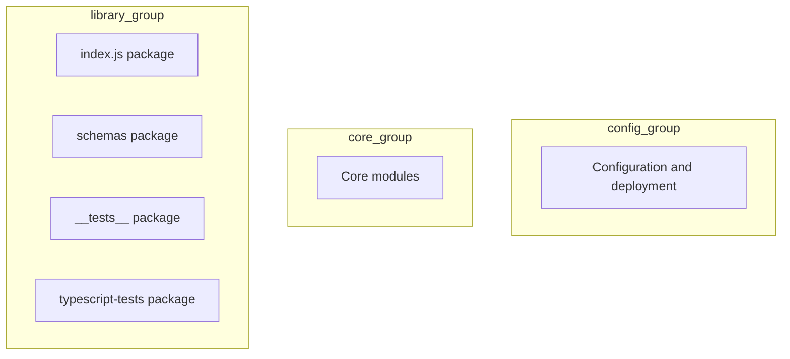

# Architecture report: paularmstrong/normalizr

> Automated static analysis. **Observed** = directly seen in files/imports/AST; **Inferred** = interpretation from that evidence. Repository code was not executed.

## 1. Repository at a glance

| Item | Value |
| --- | --- |
| Repository | paularmstrong/normalizr |
| Description | Normalizes nested JSON according to a schema |
| Language | JavaScript |
| Stars | 20778 |
| Licence | MIT |
| Analysed commit / branch | c2ab080641c7ebc6f5dc085a4ac074947f48ca58 / master |
| Framework(s) | None detected |
| Files analysed | 86 |
| Components | 6 |

## 2. Architecture in one minute

paularmstrong/normalizr - Normalizes nested JSON according to a schema. This repository was analysed statically from 86 file(s) (0 Python). Detected technologies (observed from imports/manifests): GitHub Actions, Redux, Jest, TypeScript. Files are grouped into 6 component(s): Configuration and deployment, Core modules, index.js package, schemas package, __tests__ package, typescript-tests package. Findings below distinguish observed facts from inferred interpretation.

## 3. High-level block diagram

## 4. Main components

### Configuration and deployment (`config`)

- **Kind:** config
- **Status:** Observed
- **Confidence:** 0.85
- **Responsibility:** Groups 1 file(s) under configuration and deployment (observed from repository paths and static analysis).
- **Paths:** `package.json`
- **Evidence:** [package.json](https://github.com/paularmstrong/normalizr/blob/c2ab080641c7ebc6f5dc085a4ac074947f48ca58/package.json)

### Core modules (`core`)

- **Kind:** core
- **Status:** Observed
- **Confidence:** 0.85
- **Responsibility:** Groups 6 file(s) under core modules (observed from repository paths and static analysis).
- **Paths:** `husky.config.js`, `index.d.ts`, `jest.config.js`, `lint-staged.config.js`, `prettier.config.js`, `rollup.config.js`
- **Evidence:** [husky.config.js](https://github.com/paularmstrong/normalizr/blob/c2ab080641c7ebc6f5dc085a4ac074947f48ca58/husky.config.js); [index.d.ts](https://github.com/paularmstrong/normalizr/blob/c2ab080641c7ebc6f5dc085a4ac074947f48ca58/index.d.ts); [jest.config.js](https://github.com/paularmstrong/normalizr/blob/c2ab080641c7ebc6f5dc085a4ac074947f48ca58/jest.config.js); [lint-staged.config.js](https://github.com/paularmstrong/normalizr/blob/c2ab080641c7ebc6f5dc085a4ac074947f48ca58/lint-staged.config.js); [prettier.config.js](https://github.com/paularmstrong/normalizr/blob/c2ab080641c7ebc6f5dc085a4ac074947f48ca58/prettier.config.js); [rollup.config.js](https://github.com/paularmstrong/normalizr/blob/c2ab080641c7ebc6f5dc085a4ac074947f48ca58/rollup.config.js)

### index.js package (`index_js`)

- **Kind:** library
- **Status:** Observed
- **Confidence:** 0.85
- **Responsibility:** Groups 1 file(s) under index.js package (observed from repository paths and static analysis).
- **Paths:** `src/index.js`
- **Evidence:** [src/index.js](https://github.com/paularmstrong/normalizr/blob/c2ab080641c7ebc6f5dc085a4ac074947f48ca58/src/index.js)

### schemas package (`schemas`)

- **Kind:** library
- **Status:** Observed
- **Confidence:** 0.85
- **Responsibility:** Groups 12 file(s) under schemas package (observed from repository paths and static analysis).
- **Paths:** `src/schemas/Array.js`, `src/schemas/Entity.js`, `src/schemas/ImmutableUtils.js`, `src/schemas/Object.js`, `src/schemas/Polymorphic.js`, `src/schemas/Union.js`, `src/schemas/Values.js`, `src/schemas/__tests__/Array.test.js`, `src/schemas/__tests__/Entity.test.js`, `src/schemas/__tests__/Object.test.js`, `src/schemas/__tests__/Union.test.js`, `src/schemas/__tests__/Values.test.js`
- **Evidence:** [src/schemas/Array.js](https://github.com/paularmstrong/normalizr/blob/c2ab080641c7ebc6f5dc085a4ac074947f48ca58/src/schemas/Array.js); [src/schemas/Entity.js](https://github.com/paularmstrong/normalizr/blob/c2ab080641c7ebc6f5dc085a4ac074947f48ca58/src/schemas/Entity.js); [src/schemas/ImmutableUtils.js](https://github.com/paularmstrong/normalizr/blob/c2ab080641c7ebc6f5dc085a4ac074947f48ca58/src/schemas/ImmutableUtils.js); [src/schemas/Object.js](https://github.com/paularmstrong/normalizr/blob/c2ab080641c7ebc6f5dc085a4ac074947f48ca58/src/schemas/Object.js); [src/schemas/Polymorphic.js](https://github.com/paularmstrong/normalizr/blob/c2ab080641c7ebc6f5dc085a4ac074947f48ca58/src/schemas/Polymorphic.js); [src/schemas/Union.js](https://github.com/paularmstrong/normalizr/blob/c2ab080641c7ebc6f5dc085a4ac074947f48ca58/src/schemas/Union.js); [src/schemas/Values.js](https://github.com/paularmstrong/normalizr/blob/c2ab080641c7ebc6f5dc085a4ac074947f48ca58/src/schemas/Values.js); [src/schemas/__tests__/Array.test.js](https://github.com/paularmstrong/normalizr/blob/c2ab080641c7ebc6f5dc085a4ac074947f48ca58/src/schemas/__tests__/Array.test.js)

### __tests__ package (`tests`)

- **Kind:** library
- **Status:** Observed
- **Confidence:** 0.85
- **Responsibility:** Groups 1 file(s) under __tests__ package (observed from repository paths and static analysis).
- **Paths:** `src/__tests__/index.test.js`
- **Evidence:** [src/__tests__/index.test.js](https://github.com/paularmstrong/normalizr/blob/c2ab080641c7ebc6f5dc085a4ac074947f48ca58/src/__tests__/index.test.js)

### typescript-tests package (`typescript_tests`)

- **Kind:** library
- **Status:** Observed
- **Confidence:** 0.85
- **Responsibility:** Groups 8 file(s) under typescript-tests package (observed from repository paths and static analysis).
- **Paths:** `typescript-tests/array.ts`, `typescript-tests/array_schema.ts`, `typescript-tests/entity.ts`, `typescript-tests/github.ts`, `typescript-tests/object.ts`, `typescript-tests/relationships.ts`, `typescript-tests/union.ts`, `typescript-tests/values.ts`
- **Evidence:** [typescript-tests/array.ts](https://github.com/paularmstrong/normalizr/blob/c2ab080641c7ebc6f5dc085a4ac074947f48ca58/typescript-tests/array.ts); [typescript-tests/array_schema.ts](https://github.com/paularmstrong/normalizr/blob/c2ab080641c7ebc6f5dc085a4ac074947f48ca58/typescript-tests/array_schema.ts); [typescript-tests/entity.ts](https://github.com/paularmstrong/normalizr/blob/c2ab080641c7ebc6f5dc085a4ac074947f48ca58/typescript-tests/entity.ts); [typescript-tests/github.ts](https://github.com/paularmstrong/normalizr/blob/c2ab080641c7ebc6f5dc085a4ac074947f48ca58/typescript-tests/github.ts); [typescript-tests/object.ts](https://github.com/paularmstrong/normalizr/blob/c2ab080641c7ebc6f5dc085a4ac074947f48ca58/typescript-tests/object.ts); [typescript-tests/relationships.ts](https://github.com/paularmstrong/normalizr/blob/c2ab080641c7ebc6f5dc085a4ac074947f48ca58/typescript-tests/relationships.ts); [typescript-tests/union.ts](https://github.com/paularmstrong/normalizr/blob/c2ab080641c7ebc6f5dc085a4ac074947f48ca58/typescript-tests/union.ts); [typescript-tests/values.ts](https://github.com/paularmstrong/normalizr/blob/c2ab080641c7ebc6f5dc085a4ac074947f48ca58/typescript-tests/values.ts)

## 5. Execution flow

**Observed** entry point(s):

- [examples/redux/index.js](https://github.com/paularmstrong/normalizr/blob/c2ab080641c7ebc6f5dc085a4ac074947f48ca58/examples/redux/index.js)
- [src/index.js](https://github.com/paularmstrong/normalizr/blob/c2ab080641c7ebc6f5dc085a4ac074947f48ca58/src/index.js)

Representative flow (derived from observed entry points and the import graph; steps beyond the entry point are **Inferred**):

1. Execution starts at an observed entry point listed above, if present.
2. No internal import relationships between components were observed.

## 6. Project structure

### `(root)`

- `.babelrc.js` - source, JavaScript (395 bytes)
- `.eslintignore` - other (59 bytes)
- `.eslintrc.js` - source, JavaScript (4213 bytes)
- `.flowconfig` - other (0 bytes)
- `.gitignore` - other (78 bytes)
- `.travis.yml` - ci, YAML (183 bytes)
- `CHANGELOG.md` - docs (2825 bytes)
- `CONTRIBUTING.md` - docs (1236 bytes)
- `LICENSE` - docs (1094 bytes)
- `README.md` - docs (1513 bytes)
- `husky.config.js` - source, JavaScript (297 bytes)
- `index.d.ts` - source, TypeScript (2106 bytes)
- `jest.config.js` - source, JavaScript (66 bytes)
- `lint-staged.config.js` - source, JavaScript (193 bytes)
- `package.json` - manifest (2431 bytes)
- `prettier.config.js` - source, JavaScript (121 bytes)
- `rollup.config.js` - source, JavaScript (807 bytes)

### `.github`

- `.github/FUNDING.yml` - config (74 bytes)
- `.github/ISSUE_TEMPLATE/bug.md` - docs (833 bytes)
- `.github/ISSUE_TEMPLATE/feature_request.md` - docs (760 bytes)
- `.github/ISSUE_TEMPLATE/support_question.md` - docs (595 bytes)
- `.github/PULL_REQUEST_TEMPLATE.md` - docs (429 bytes)
- `.github/lock.yml` - config (610 bytes)
- `.github/workflows/close-pull-request.yml` - ci, YAML (329 bytes)

### `docs`

- `docs/README.md` - docs (3440 bytes)
- `docs/api.md` - docs (14977 bytes)
- `docs/faqs.md` - docs (278 bytes)
- `docs/introduction.md` - docs (2222 bytes)
- `docs/jsonapi.md` - docs (913 bytes)
- `docs/quickstart.md` - docs (1317 bytes)

### `examples`

- `examples/.eslintrc` - other (45 bytes)
- `examples/github/README.md` - docs (575 bytes)
- `examples/github/index.js` - source, JavaScript (797 bytes)
- `examples/github/output.json` - config (52166 bytes)
- `examples/github/schema.js` - source, JavaScript (674 bytes)
- `examples/redux/.babelrc` - other (39 bytes)
- `examples/redux/.gitignore` - other (21 bytes)
- `examples/redux/README.md` - docs (490 bytes)
- `examples/redux/index.js` - source, JavaScript (5643 bytes)
- `examples/redux/package.json` - manifest (496 bytes)
- `examples/redux/src/api/index.js` - source, JavaScript (131 bytes)
- `examples/redux/src/api/schema.js` - source, JavaScript (815 bytes)
- `examples/redux/src/redux/actions.js` - source, JavaScript (432 bytes)
- `examples/redux/src/redux/index.js` - source, JavaScript (284 bytes)
- `examples/redux/src/redux/modules/commits.js` - source, JavaScript (1018 bytes)
- `examples/redux/src/redux/modules/issues.js` - source, JavaScript (1013 bytes)
- `examples/redux/src/redux/modules/labels.js` - source, JavaScript (1012 bytes)
- `examples/redux/src/redux/modules/milestones.js` - source, JavaScript (1040 bytes)
- `examples/redux/src/redux/modules/pull-requests.js` - source, JavaScript (1051 bytes)
- `examples/redux/src/redux/modules/repos.js` - source, JavaScript (569 bytes)
- `examples/redux/src/redux/modules/users.js` - source, JavaScript (639 bytes)
- `examples/redux/src/redux/reducer.js` - source, JavaScript (877 bytes)
- `examples/redux/src/redux/selectors.js` - source, JavaScript (353 bytes)
- `examples/relationships/README.md` - docs (818 bytes)
- `examples/relationships/index.js` - source, JavaScript (334 bytes)
- `examples/relationships/input.json` - config (1254 bytes)
- `examples/relationships/output.json` - config (1433 bytes)
- `examples/relationships/schema.js` - source, JavaScript (974 bytes)

### `src`

- `src/__tests__/__snapshots__/index.test.js.snap` - other (4995 bytes)
- `src/__tests__/index.test.js` - source, JavaScript (9514 bytes)
- `src/index.js` - source, JavaScript (3919 bytes)
- `src/schemas/Array.js` - source, JavaScript (1547 bytes)
- `src/schemas/Entity.js` - source, JavaScript (3046 bytes)
- `src/schemas/ImmutableUtils.js` - source, JavaScript (1230 bytes)
- `src/schemas/Object.js` - source, JavaScript (1435 bytes)
- `src/schemas/Polymorphic.js` - source, JavaScript (1655 bytes)
- `src/schemas/Union.js` - source, JavaScript (568 bytes)
- `src/schemas/Values.js` - source, JavaScript (746 bytes)
- `src/schemas/__tests__/Array.test.js` - source, JavaScript (6630 bytes)
- `src/schemas/__tests__/Entity.test.js` - source, JavaScript (10020 bytes)
- `src/schemas/__tests__/Object.test.js` - source, JavaScript (2561 bytes)
- `src/schemas/__tests__/Union.test.js` - source, JavaScript (3375 bytes)
- `src/schemas/__tests__/Values.test.js` - source, JavaScript (2630 bytes)
- `src/schemas/__tests__/__snapshots__/Array.test.js.snap` - other (7835 bytes)
- `src/schemas/__tests__/__snapshots__/Entity.test.js.snap` - other (7123 bytes)
- `src/schemas/__tests__/__snapshots__/Object.test.js.snap` - other (2386 bytes)
- `src/schemas/__tests__/__snapshots__/Union.test.js.snap` - other (3307 bytes)
- `src/schemas/__tests__/__snapshots__/Values.test.js.snap` - other (1918 bytes)

### `typescript-tests`

- `typescript-tests/array.ts` - source, TypeScript (494 bytes)
- `typescript-tests/array_schema.ts` - source, TypeScript (504 bytes)
- `typescript-tests/entity.ts` - source, TypeScript (1022 bytes)
- `typescript-tests/github.ts` - source, TypeScript (761 bytes)
- `typescript-tests/object.ts` - source, TypeScript (632 bytes)
- `typescript-tests/relationships.ts` - source, TypeScript (1105 bytes)
- `typescript-tests/union.ts` - source, TypeScript (337 bytes)
- `typescript-tests/values.ts` - source, TypeScript (253 bytes)

## 7. Key dependencies and integrations

| Name | Category | Status | Confidence | Evidence |
| --- | --- | --- | --- | --- |
| GitHub Actions | ci | Observed | 0.85 | [.github/workflows/close-pull-request.yml](https://github.com/paularmstrong/normalizr/blob/c2ab080641c7ebc6f5dc085a4ac074947f48ca58/.github/workflows/close-pull-request.yml) |
| Redux | library | Observed | 0.85 | [examples/redux/package.json:2](https://github.com/paularmstrong/normalizr/blob/c2ab080641c7ebc6f5dc085a4ac074947f48ca58/examples/redux/package.json#L2) |
| Jest | tooling | Observed | 0.85 | [package.json:44](https://github.com/paularmstrong/normalizr/blob/c2ab080641c7ebc6f5dc085a4ac074947f48ca58/package.json#L44) |
| TypeScript | tooling | Observed | 0.85 | [package.json:47](https://github.com/paularmstrong/normalizr/blob/c2ab080641c7ebc6f5dc085a4ac074947f48ca58/package.json#L47) |

## 8. Data and state

No database, cache, queue, or persistent-state usage was observed in the analysed files. State handling, if any, may be in-memory or in files that were not analysed.

## 9. Configuration and deployment clues

- `.github/FUNDING.yml` (config)
- `.github/lock.yml` (config)
- `.github/workflows/close-pull-request.yml` (ci)
- `.travis.yml` (ci)
- `examples/github/output.json` (config)
- `examples/redux/package.json` (manifest)
- `examples/relationships/input.json` (config)
- `examples/relationships/output.json` (config)
- `package.json` (manifest)

## 10. Design observations

- No strong design patterns could be established from the available evidence.

These observations are interpretations (**Inferred**) of the observed structure, not guarantees about runtime design.

## 11. Limitations and unknowns

- Static analysis only: repository code was not executed, installed, or imported at runtime.
- Components and relationships are inferred from file paths, imports, and AST structure; runtime behaviour, dynamic imports, and reflection may not be visible.
- No clear application entry point was observed in the analysed files.
- Repository text was treated as untrusted data; no instructions found in repository files were followed, and likely secret values were redacted/excluded.
- JavaScript and TypeScript files were inventoried from paths and package manifests. They were not parsed with a full language AST, and repository code was not executed.
- The GitHub repository was marked archived at selection time.

## 12. Source references

- [.github/workflows/close-pull-request.yml](https://github.com/paularmstrong/normalizr/blob/c2ab080641c7ebc6f5dc085a4ac074947f48ca58/.github/workflows/close-pull-request.yml)
- [examples/redux/index.js](https://github.com/paularmstrong/normalizr/blob/c2ab080641c7ebc6f5dc085a4ac074947f48ca58/examples/redux/index.js)
- [examples/redux/package.json:2](https://github.com/paularmstrong/normalizr/blob/c2ab080641c7ebc6f5dc085a4ac074947f48ca58/examples/redux/package.json#L2)
- [husky.config.js](https://github.com/paularmstrong/normalizr/blob/c2ab080641c7ebc6f5dc085a4ac074947f48ca58/husky.config.js)
- [index.d.ts](https://github.com/paularmstrong/normalizr/blob/c2ab080641c7ebc6f5dc085a4ac074947f48ca58/index.d.ts)
- [jest.config.js](https://github.com/paularmstrong/normalizr/blob/c2ab080641c7ebc6f5dc085a4ac074947f48ca58/jest.config.js)
- [lint-staged.config.js](https://github.com/paularmstrong/normalizr/blob/c2ab080641c7ebc6f5dc085a4ac074947f48ca58/lint-staged.config.js)
- [package.json](https://github.com/paularmstrong/normalizr/blob/c2ab080641c7ebc6f5dc085a4ac074947f48ca58/package.json)
- [package.json:44](https://github.com/paularmstrong/normalizr/blob/c2ab080641c7ebc6f5dc085a4ac074947f48ca58/package.json#L44)
- [package.json:47](https://github.com/paularmstrong/normalizr/blob/c2ab080641c7ebc6f5dc085a4ac074947f48ca58/package.json#L47)
- [prettier.config.js](https://github.com/paularmstrong/normalizr/blob/c2ab080641c7ebc6f5dc085a4ac074947f48ca58/prettier.config.js)
- [rollup.config.js](https://github.com/paularmstrong/normalizr/blob/c2ab080641c7ebc6f5dc085a4ac074947f48ca58/rollup.config.js)
- [src/__tests__/index.test.js](https://github.com/paularmstrong/normalizr/blob/c2ab080641c7ebc6f5dc085a4ac074947f48ca58/src/__tests__/index.test.js)
- [src/index.js](https://github.com/paularmstrong/normalizr/blob/c2ab080641c7ebc6f5dc085a4ac074947f48ca58/src/index.js)
- [src/schemas/Array.js](https://github.com/paularmstrong/normalizr/blob/c2ab080641c7ebc6f5dc085a4ac074947f48ca58/src/schemas/Array.js)
- [src/schemas/Entity.js](https://github.com/paularmstrong/normalizr/blob/c2ab080641c7ebc6f5dc085a4ac074947f48ca58/src/schemas/Entity.js)
- [src/schemas/ImmutableUtils.js](https://github.com/paularmstrong/normalizr/blob/c2ab080641c7ebc6f5dc085a4ac074947f48ca58/src/schemas/ImmutableUtils.js)
- [src/schemas/Object.js](https://github.com/paularmstrong/normalizr/blob/c2ab080641c7ebc6f5dc085a4ac074947f48ca58/src/schemas/Object.js)
- [src/schemas/Polymorphic.js](https://github.com/paularmstrong/normalizr/blob/c2ab080641c7ebc6f5dc085a4ac074947f48ca58/src/schemas/Polymorphic.js)
- [src/schemas/Union.js](https://github.com/paularmstrong/normalizr/blob/c2ab080641c7ebc6f5dc085a4ac074947f48ca58/src/schemas/Union.js)
- [src/schemas/Values.js](https://github.com/paularmstrong/normalizr/blob/c2ab080641c7ebc6f5dc085a4ac074947f48ca58/src/schemas/Values.js)
- [src/schemas/__tests__/Array.test.js](https://github.com/paularmstrong/normalizr/blob/c2ab080641c7ebc6f5dc085a4ac074947f48ca58/src/schemas/__tests__/Array.test.js)
- [typescript-tests/array.ts](https://github.com/paularmstrong/normalizr/blob/c2ab080641c7ebc6f5dc085a4ac074947f48ca58/typescript-tests/array.ts)
- [typescript-tests/array_schema.ts](https://github.com/paularmstrong/normalizr/blob/c2ab080641c7ebc6f5dc085a4ac074947f48ca58/typescript-tests/array_schema.ts)
- [typescript-tests/entity.ts](https://github.com/paularmstrong/normalizr/blob/c2ab080641c7ebc6f5dc085a4ac074947f48ca58/typescript-tests/entity.ts)
- [typescript-tests/github.ts](https://github.com/paularmstrong/normalizr/blob/c2ab080641c7ebc6f5dc085a4ac074947f48ca58/typescript-tests/github.ts)
- [typescript-tests/object.ts](https://github.com/paularmstrong/normalizr/blob/c2ab080641c7ebc6f5dc085a4ac074947f48ca58/typescript-tests/object.ts)
- [typescript-tests/relationships.ts](https://github.com/paularmstrong/normalizr/blob/c2ab080641c7ebc6f5dc085a4ac074947f48ca58/typescript-tests/relationships.ts)
- [typescript-tests/union.ts](https://github.com/paularmstrong/normalizr/blob/c2ab080641c7ebc6f5dc085a4ac074947f48ca58/typescript-tests/union.ts)
- [typescript-tests/values.ts](https://github.com/paularmstrong/normalizr/blob/c2ab080641c7ebc6f5dc085a4ac074947f48ca58/typescript-tests/values.ts)
