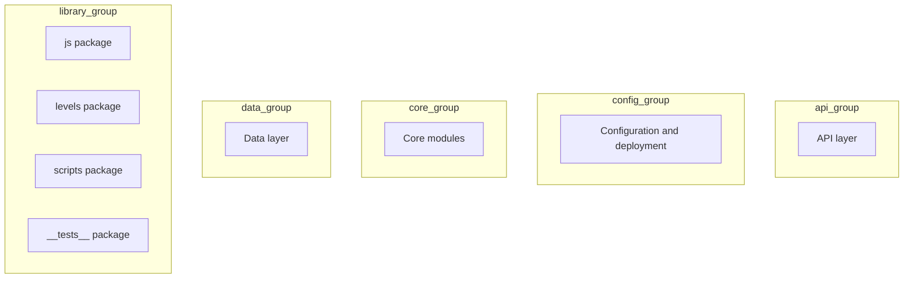

# Architecture report: pcottle/learnGitBranching

> Automated static analysis. **Observed** = directly seen in files/imports/AST; **Inferred** = interpretation from that evidence. Repository code was not executed.

## 1. Repository at a glance

| Item | Value |
| --- | --- |
| Repository | pcottle/learnGitBranching |
| Description | An interactive git visualization and tutorial. Aspiring students of git can use this app to educate and challenge themselves towards mastery of git! |
| Language | JavaScript |
| Stars | 34224 |
| Licence | MIT |
| Analysed commit / branch | 6b9db44494ad62922c73936c5cef14b57492ae94 / main |
| Framework(s) | React |
| Files analysed | 195 |
| Components | 8 |

## 2. Architecture in one minute

pcottle/learnGitBranching - An interactive git visualization and tutorial. Aspiring students of git can use this app to educate and challenge themselves towards mastery of git!. This repository was analysed statically from 195 file(s) (0 Python). Detected technologies (observed from imports/manifests): GitHub Actions, React, Docker, Vite. Files are grouped into 8 component(s): API layer, Configuration and deployment, Core modules, Data layer, js package, levels package, scripts package, __tests__ package. Findings below distinguish observed facts from inferred interpretation.

## 3. High-level block diagram

## 4. Main components

### API layer (`api_layer`)

- **Kind:** api
- **Status:** Observed
- **Confidence:** 0.85
- **Responsibility:** Groups 8 file(s) under api layer (observed from repository paths and static analysis).
- **Paths:** `src/js/views/builderViews.js`, `src/js/views/certificateView.js`, `src/js/views/commandViews.js`, `src/js/views/gitDemonstrationView.js`, `src/js/views/index.js`, `src/js/views/levelDropdownView.js`, `src/js/views/multiView.js`, `src/js/views/rebaseView.js`
- **Evidence:** [src/js/views/builderViews.js](https://github.com/pcottle/learnGitBranching/blob/6b9db44494ad62922c73936c5cef14b57492ae94/src/js/views/builderViews.js); [src/js/views/certificateView.js](https://github.com/pcottle/learnGitBranching/blob/6b9db44494ad62922c73936c5cef14b57492ae94/src/js/views/certificateView.js); [src/js/views/commandViews.js](https://github.com/pcottle/learnGitBranching/blob/6b9db44494ad62922c73936c5cef14b57492ae94/src/js/views/commandViews.js); [src/js/views/gitDemonstrationView.js](https://github.com/pcottle/learnGitBranching/blob/6b9db44494ad62922c73936c5cef14b57492ae94/src/js/views/gitDemonstrationView.js); [src/js/views/index.js](https://github.com/pcottle/learnGitBranching/blob/6b9db44494ad62922c73936c5cef14b57492ae94/src/js/views/index.js); [src/js/views/levelDropdownView.js](https://github.com/pcottle/learnGitBranching/blob/6b9db44494ad62922c73936c5cef14b57492ae94/src/js/views/levelDropdownView.js); [src/js/views/multiView.js](https://github.com/pcottle/learnGitBranching/blob/6b9db44494ad62922c73936c5cef14b57492ae94/src/js/views/multiView.js); [src/js/views/rebaseView.js](https://github.com/pcottle/learnGitBranching/blob/6b9db44494ad62922c73936c5cef14b57492ae94/src/js/views/rebaseView.js)

### Configuration and deployment (`config`)

- **Kind:** config
- **Status:** Observed
- **Confidence:** 0.85
- **Responsibility:** Groups 4 file(s) under configuration and deployment (observed from repository paths and static analysis).
- **Paths:** `Dockerfile`, `netlify.toml`, `package.json`, `spec/support/jasmine.json`
- **Evidence:** [Dockerfile](https://github.com/pcottle/learnGitBranching/blob/6b9db44494ad62922c73936c5cef14b57492ae94/Dockerfile); [netlify.toml](https://github.com/pcottle/learnGitBranching/blob/6b9db44494ad62922c73936c5cef14b57492ae94/netlify.toml); [package.json](https://github.com/pcottle/learnGitBranching/blob/6b9db44494ad62922c73936c5cef14b57492ae94/package.json); [spec/support/jasmine.json](https://github.com/pcottle/learnGitBranching/blob/6b9db44494ad62922c73936c5cef14b57492ae94/spec/support/jasmine.json)

### Core modules (`core`)

- **Kind:** core
- **Status:** Observed
- **Confidence:** 0.85
- **Responsibility:** Groups 2 file(s) under core modules (observed from repository paths and static analysis).
- **Paths:** `eslint.config.js`, `vite.config.mjs`
- **Evidence:** [eslint.config.js](https://github.com/pcottle/learnGitBranching/blob/6b9db44494ad62922c73936c5cef14b57492ae94/eslint.config.js); [vite.config.mjs](https://github.com/pcottle/learnGitBranching/blob/6b9db44494ad62922c73936c5cef14b57492ae94/vite.config.mjs)

### Data layer (`data_layer`)

- **Kind:** data
- **Status:** Observed
- **Confidence:** 0.85
- **Responsibility:** Groups 2 file(s) under data layer (observed from repository paths and static analysis).
- **Paths:** `src/js/models/collections.js`, `src/js/models/commandModel.js`
- **Evidence:** [src/js/models/collections.js](https://github.com/pcottle/learnGitBranching/blob/6b9db44494ad62922c73936c5cef14b57492ae94/src/js/models/collections.js); [src/js/models/commandModel.js](https://github.com/pcottle/learnGitBranching/blob/6b9db44494ad62922c73936c5cef14b57492ae94/src/js/models/commandModel.js)

### js package (`js`)

- **Kind:** library
- **Status:** Observed
- **Confidence:** 0.85
- **Responsibility:** Groups 76 file(s) under js package (observed from repository paths and static analysis).
- **Paths:** `src/js/actions/CommandLineActions.js`, `src/js/actions/GlobalStateActions.js`, `src/js/actions/LevelActions.js`, `src/js/actions/LocaleActions.js`, `src/js/app/index.js`, `src/js/commands/index.js`, `src/js/commands/optionParser.js`, `src/js/constants/AppConstants.js`, `src/js/dialogs/confirmShowSolution.js`, `src/js/dialogs/levelBuilder.js`, `src/js/dialogs/nextLevel.js`, `src/js/dialogs/sandbox.js`, `src/js/dispatcher/AppDispatcher.js`, `src/js/git/commands.js`, `src/js/git/gitShim.js`, `src/js/git/headless.js`, `src/js/git/index.js`, `src/js/graph/index.js`, `src/js/graph/treeCompare.js`, `src/js/intl/checkStrings.js`, `src/js/intl/index.js`, `src/js/intl/localeLoader.js`, `src/js/level/builder.js`, `src/js/level/disabledMap.js`, `src/js/level/index.js`, `src/js/level/levelModule.js`, `src/js/level/levelRegexMap.js`, `src/js/level/parseWaterfall.js`, `src/js/level/undoBookkeeping.js`, `src/js/log/index.js`, `src/js/mercurial/commands.js`, `src/js/react_views/CommandHistoryView.jsx`, `src/js/react_views/CommandView.jsx`, `src/js/react_views/CommandsHelperBarView.jsx`, `src/js/react_views/HelperBarView.jsx`, `src/js/react_views/IntlHelperBarView.jsx`, `src/js/react_views/LevelToolbarView.jsx`, `src/js/react_views/MainHelperBarView.jsx`, `src/js/sandbox/commands.js`, `src/js/sandbox/index.js`, `src/js/stores/CommandLineStore.js`, `src/js/stores/GlobalStateStore.js`, `src/js/stores/LevelStore.js`, `src/js/stores/LocaleStore.js`, `src/js/util/appLoading.js`, `src/js/util/certificate.js`, `src/js/util/commandLine.js`, `src/js/util/constants.js`, `src/js/util/debounce.js`, `src/js/util/debug.js`, `src/js/util/errors.js`, `src/js/util/escapeString.js`, `src/js/util/eventBaton.js`, `src/js/util/eventEmitter.js`, `src/js/util/index.js`, `src/js/util/keyMirror.js`, `src/js/util/keyboard.js`, `src/js/util/mock.js`, `src/js/util/promise.js`, `src/js/util/reactUtil.js`, `src/js/util/readDirDeep.js`, `src/js/util/setupJQueryGlobals.js`, `src/js/util/sharing.js`, `src/js/util/throttle.js`, `src/js/util/zoomLevel.js`, `src/js/visuals/animation/animationFactory.js`, `src/js/visuals/animation/index.js`, `src/js/visuals/index.js`, `src/js/visuals/tree.js`, `src/js/visuals/visBase.js`, `src/js/visuals/visBranch.js`, `src/js/visuals/visEdge.js`, `src/js/visuals/visNode.js`, `src/js/visuals/visStagingArea.js`, `src/js/visuals/visTag.js`, `src/js/visuals/visualization.js`
- **Evidence:** [src/js/actions/CommandLineActions.js](https://github.com/pcottle/learnGitBranching/blob/6b9db44494ad62922c73936c5cef14b57492ae94/src/js/actions/CommandLineActions.js); [src/js/actions/GlobalStateActions.js](https://github.com/pcottle/learnGitBranching/blob/6b9db44494ad62922c73936c5cef14b57492ae94/src/js/actions/GlobalStateActions.js); [src/js/actions/LevelActions.js](https://github.com/pcottle/learnGitBranching/blob/6b9db44494ad62922c73936c5cef14b57492ae94/src/js/actions/LevelActions.js); [src/js/actions/LocaleActions.js](https://github.com/pcottle/learnGitBranching/blob/6b9db44494ad62922c73936c5cef14b57492ae94/src/js/actions/LocaleActions.js); [src/js/app/index.js](https://github.com/pcottle/learnGitBranching/blob/6b9db44494ad62922c73936c5cef14b57492ae94/src/js/app/index.js); [src/js/commands/index.js](https://github.com/pcottle/learnGitBranching/blob/6b9db44494ad62922c73936c5cef14b57492ae94/src/js/commands/index.js); [src/js/commands/optionParser.js](https://github.com/pcottle/learnGitBranching/blob/6b9db44494ad62922c73936c5cef14b57492ae94/src/js/commands/optionParser.js); [src/js/constants/AppConstants.js](https://github.com/pcottle/learnGitBranching/blob/6b9db44494ad62922c73936c5cef14b57492ae94/src/js/constants/AppConstants.js)

### levels package (`levels`)

- **Kind:** library
- **Status:** Observed
- **Confidence:** 0.85
- **Responsibility:** Groups 36 file(s) under levels package (observed from repository paths and static analysis).
- **Paths:** `src/levels/advanced/multipleParents.js`, `src/levels/index.js`, `src/levels/intro/branching.js`, `src/levels/intro/commits.js`, `src/levels/intro/merging.js`, `src/levels/intro/rebasing.js`, `src/levels/mixed/describe.js`, `src/levels/mixed/grabbingOneCommit.js`, `src/levels/mixed/jugglingCommits.js`, `src/levels/mixed/jugglingCommits2.js`, `src/levels/mixed/tags.js`, `src/levels/rampup/cherryPick.js`, `src/levels/rampup/detachedHead.js`, `src/levels/rampup/interactiveRebase.js`, `src/levels/rampup/relativeRefs.js`, `src/levels/rampup/relativeRefs2.js`, `src/levels/rampup/reversingChanges.js`, `src/levels/rebase/manyRebases.js`, `src/levels/rebase/selectiveRebase.js`, `src/levels/remote/clone.js`, `src/levels/remote/fakeTeamwork.js`, `src/levels/remote/fetch.js`, `src/levels/remote/fetchArgs.js`, `src/levels/remote/lockedMain.js`, `src/levels/remote/mergeManyFeatures.js`, `src/levels/remote/pull.js`, `src/levels/remote/pullArgs.js`, `src/levels/remote/push.js`, `src/levels/remote/pushArgs.js`, `src/levels/remote/pushArgs2.js`, `src/levels/remote/pushManyFeatures.js`, `src/levels/remote/remoteBranches.js`, `src/levels/remote/sourceNothing.js`, `src/levels/sequenceInfo.js`, `src/levels/workingDir/restore.js`, `src/levels/workingDir/staging.js`
- **Evidence:** [src/levels/advanced/multipleParents.js](https://github.com/pcottle/learnGitBranching/blob/6b9db44494ad62922c73936c5cef14b57492ae94/src/levels/advanced/multipleParents.js); [src/levels/index.js](https://github.com/pcottle/learnGitBranching/blob/6b9db44494ad62922c73936c5cef14b57492ae94/src/levels/index.js); [src/levels/intro/branching.js](https://github.com/pcottle/learnGitBranching/blob/6b9db44494ad62922c73936c5cef14b57492ae94/src/levels/intro/branching.js); [src/levels/intro/commits.js](https://github.com/pcottle/learnGitBranching/blob/6b9db44494ad62922c73936c5cef14b57492ae94/src/levels/intro/commits.js); [src/levels/intro/merging.js](https://github.com/pcottle/learnGitBranching/blob/6b9db44494ad62922c73936c5cef14b57492ae94/src/levels/intro/merging.js); [src/levels/intro/rebasing.js](https://github.com/pcottle/learnGitBranching/blob/6b9db44494ad62922c73936c5cef14b57492ae94/src/levels/intro/rebasing.js); [src/levels/mixed/describe.js](https://github.com/pcottle/learnGitBranching/blob/6b9db44494ad62922c73936c5cef14b57492ae94/src/levels/mixed/describe.js); [src/levels/mixed/grabbingOneCommit.js](https://github.com/pcottle/learnGitBranching/blob/6b9db44494ad62922c73936c5cef14b57492ae94/src/levels/mixed/grabbingOneCommit.js)

### scripts package (`scripts`)

- **Kind:** library
- **Status:** Observed
- **Confidence:** 0.85
- **Responsibility:** Groups 9 file(s) under scripts package (observed from repository paths and static analysis).
- **Paths:** `scripts/check-package-manager.js`, `scripts/extract-translation-template.js`, `scripts/generate.js`, `scripts/generateIntlStrings.js`, `scripts/generateLevelDocs.js`, `scripts/generateLevelManifest.js`, `scripts/postbuild.js`, `scripts/translate.js`, `scripts/validate-locale.js`
- **Evidence:** [scripts/check-package-manager.js](https://github.com/pcottle/learnGitBranching/blob/6b9db44494ad62922c73936c5cef14b57492ae94/scripts/check-package-manager.js); [scripts/extract-translation-template.js](https://github.com/pcottle/learnGitBranching/blob/6b9db44494ad62922c73936c5cef14b57492ae94/scripts/extract-translation-template.js); [scripts/generate.js](https://github.com/pcottle/learnGitBranching/blob/6b9db44494ad62922c73936c5cef14b57492ae94/scripts/generate.js); [scripts/generateIntlStrings.js](https://github.com/pcottle/learnGitBranching/blob/6b9db44494ad62922c73936c5cef14b57492ae94/scripts/generateIntlStrings.js); [scripts/generateLevelDocs.js](https://github.com/pcottle/learnGitBranching/blob/6b9db44494ad62922c73936c5cef14b57492ae94/scripts/generateLevelDocs.js); [scripts/generateLevelManifest.js](https://github.com/pcottle/learnGitBranching/blob/6b9db44494ad62922c73936c5cef14b57492ae94/scripts/generateLevelManifest.js); [scripts/postbuild.js](https://github.com/pcottle/learnGitBranching/blob/6b9db44494ad62922c73936c5cef14b57492ae94/scripts/postbuild.js); [scripts/translate.js](https://github.com/pcottle/learnGitBranching/blob/6b9db44494ad62922c73936c5cef14b57492ae94/scripts/translate.js)

### __tests__ package (`tests`)

- **Kind:** library
- **Status:** Observed
- **Confidence:** 0.85
- **Responsibility:** Groups 33 file(s) under __tests__ package (observed from repository paths and static analysis).
- **Paths:** `__tests__/CommandLineStore.spec.js`, `__tests__/GlobalStateStore.spec.js`, `__tests__/LevelStore.spec.js`, `__tests__/LocaleStore.spec.js`, `__tests__/animation.spec.js`, `__tests__/appInit.spec.js`, `__tests__/base.js`, `__tests__/certificate.spec.js`, `__tests__/cloneSemantics.spec.js`, `__tests__/collections.spec.js`, `__tests__/commandLine.spec.js`, `__tests__/commandModel.spec.js`, `__tests__/commandParsing.spec.js`, `__tests__/create.js`, `__tests__/errors.spec.js`, `__tests__/eventEmitter.spec.js`, `__tests__/generatedArtifacts.spec.js`, `__tests__/git.spec.js`, `__tests__/intl.spec.js`, `__tests__/levelUndoBookkeeping.spec.js`, `__tests__/levels.spec.js`, `__tests__/mercurial.spec.js`, `__tests__/optionParser.spec.js`, `__tests__/remote.spec.js`, `__tests__/sandboxCommands.spec.js`, `__tests__/simpleRemote.spec.js`, `__tests__/staging.spec.js`, `__tests__/styles.spec.js`, `__tests__/treeCompare.spec.js`, `__tests__/undoParentOrder.spec.js`, `__tests__/vcs.spec.js`, `__tests__/visStagingArea.spec.js`, `__tests__/visuals.spec.js`
- **Evidence:** [__tests__/CommandLineStore.spec.js](https://github.com/pcottle/learnGitBranching/blob/6b9db44494ad62922c73936c5cef14b57492ae94/__tests__/CommandLineStore.spec.js); [__tests__/GlobalStateStore.spec.js](https://github.com/pcottle/learnGitBranching/blob/6b9db44494ad62922c73936c5cef14b57492ae94/__tests__/GlobalStateStore.spec.js); [__tests__/LevelStore.spec.js](https://github.com/pcottle/learnGitBranching/blob/6b9db44494ad62922c73936c5cef14b57492ae94/__tests__/LevelStore.spec.js); [__tests__/LocaleStore.spec.js](https://github.com/pcottle/learnGitBranching/blob/6b9db44494ad62922c73936c5cef14b57492ae94/__tests__/LocaleStore.spec.js); [__tests__/animation.spec.js](https://github.com/pcottle/learnGitBranching/blob/6b9db44494ad62922c73936c5cef14b57492ae94/__tests__/animation.spec.js); [__tests__/appInit.spec.js](https://github.com/pcottle/learnGitBranching/blob/6b9db44494ad62922c73936c5cef14b57492ae94/__tests__/appInit.spec.js); [__tests__/base.js](https://github.com/pcottle/learnGitBranching/blob/6b9db44494ad62922c73936c5cef14b57492ae94/__tests__/base.js); [__tests__/certificate.spec.js](https://github.com/pcottle/learnGitBranching/blob/6b9db44494ad62922c73936c5cef14b57492ae94/__tests__/certificate.spec.js)

## 5. Execution flow

**Observed** entry point(s):

- [src/js/app/index.js](https://github.com/pcottle/learnGitBranching/blob/6b9db44494ad62922c73936c5cef14b57492ae94/src/js/app/index.js)
- [src/js/commands/index.js](https://github.com/pcottle/learnGitBranching/blob/6b9db44494ad62922c73936c5cef14b57492ae94/src/js/commands/index.js)
- [src/js/git/index.js](https://github.com/pcottle/learnGitBranching/blob/6b9db44494ad62922c73936c5cef14b57492ae94/src/js/git/index.js)
- [src/js/graph/index.js](https://github.com/pcottle/learnGitBranching/blob/6b9db44494ad62922c73936c5cef14b57492ae94/src/js/graph/index.js)
- [src/js/intl/index.js](https://github.com/pcottle/learnGitBranching/blob/6b9db44494ad62922c73936c5cef14b57492ae94/src/js/intl/index.js)
- [src/js/level/index.js](https://github.com/pcottle/learnGitBranching/blob/6b9db44494ad62922c73936c5cef14b57492ae94/src/js/level/index.js)
- [src/js/log/index.js](https://github.com/pcottle/learnGitBranching/blob/6b9db44494ad62922c73936c5cef14b57492ae94/src/js/log/index.js)
- [src/js/sandbox/index.js](https://github.com/pcottle/learnGitBranching/blob/6b9db44494ad62922c73936c5cef14b57492ae94/src/js/sandbox/index.js)
- [src/js/util/index.js](https://github.com/pcottle/learnGitBranching/blob/6b9db44494ad62922c73936c5cef14b57492ae94/src/js/util/index.js)
- [src/js/views/index.js](https://github.com/pcottle/learnGitBranching/blob/6b9db44494ad62922c73936c5cef14b57492ae94/src/js/views/index.js)
- [src/js/visuals/index.js](https://github.com/pcottle/learnGitBranching/blob/6b9db44494ad62922c73936c5cef14b57492ae94/src/js/visuals/index.js)
- [src/levels/index.js](https://github.com/pcottle/learnGitBranching/blob/6b9db44494ad62922c73936c5cef14b57492ae94/src/levels/index.js)

Representative flow (derived from observed entry points and the import graph; steps beyond the entry point are **Inferred**):

1. Execution starts at an observed entry point listed above, if present.
2. No internal import relationships between components were observed.

## 6. Project structure

### `(root)`

- `.dockerignore` - container (120 bytes)
- `.editorconfig` - config (83 bytes)
- `.gitignore` - other (924 bytes)
- `.gitpod.yml` - config (285 bytes)
- `.nvmrc` - other (3 bytes)
- `CLAUDE.md` - docs (8910 bytes)
- `CNAME` - other (25 bytes)
- `CONTRIBUTING.md` - docs (996 bytes)
- `Dockerfile` - container (456 bytes)
- `LICENSE.md` - docs (1077 bytes)
- `Makefile` - other (1181 bytes)
- `README.md` - docs (11748 bytes)
- `TRANSLATING.md` - docs (5717 bytes)
- `eslint.config.js` - source, JavaScript (2928 bytes)
- `index.html` - other (24629 bytes)
- `netlify.toml` - config (96 bytes)
- `package.json` - manifest (1625 bytes)
- `vite.config.mjs` - source, JavaScript (4980 bytes)

### `.github`

- `.github/FUNDING.yml` - config (64 bytes)
- `.github/dependabot.yml` - config (337 bytes)
- `.github/settings.yml` - config (237 bytes)
- `.github/workflows/build-docker.yml` - ci, YAML (2243 bytes)
- `.github/workflows/pages.yml` - ci, YAML (1073 bytes)

### `__tests__`

- `__tests__/CommandLineStore.spec.js` - source, JavaScript (1489 bytes)
- `__tests__/GlobalStateStore.spec.js` - source, JavaScript (840 bytes)
- `__tests__/LevelStore.spec.js` - source, JavaScript (6632 bytes)
- `__tests__/LocaleStore.spec.js` - source, JavaScript (3792 bytes)
- `__tests__/animation.spec.js` - source, JavaScript (784 bytes)
- `__tests__/appInit.spec.js` - source, JavaScript (4039 bytes)
- `__tests__/base.js` - source, JavaScript (2617 bytes)
- `__tests__/certificate.spec.js` - source, JavaScript (1797 bytes)
- `__tests__/cloneSemantics.spec.js` - source, JavaScript (14349 bytes)
- `__tests__/collections.spec.js` - source, JavaScript (3043 bytes)
- `__tests__/commandLine.spec.js` - source, JavaScript (4547 bytes)
- `__tests__/commandModel.spec.js` - source, JavaScript (5822 bytes)
- `__tests__/commandParsing.spec.js` - source, JavaScript (10140 bytes)
- `__tests__/create.js` - source, JavaScript (1332 bytes)
- `__tests__/errors.spec.js` - source, JavaScript (3007 bytes)
- `__tests__/eventEmitter.spec.js` - source, JavaScript (16241 bytes)
- `__tests__/generatedArtifacts.spec.js` - source, JavaScript (3810 bytes)
- `__tests__/git.spec.js` - source, JavaScript (46173 bytes)
- `__tests__/intl.spec.js` - source, JavaScript (3865 bytes)
- `__tests__/levelUndoBookkeeping.spec.js` - source, JavaScript (3936 bytes)
- `__tests__/levels.spec.js` - source, JavaScript (970 bytes)
- `__tests__/mercurial.spec.js` - source, JavaScript (5556 bytes)
- `__tests__/optionParser.spec.js` - source, JavaScript (7061 bytes)
- `__tests__/remote.spec.js` - source, JavaScript (72424 bytes)
- `__tests__/sandboxCommands.spec.js` - source, JavaScript (4988 bytes)
- `__tests__/simpleRemote.spec.js` - source, JavaScript (752 bytes)
- `__tests__/staging.spec.js` - source, JavaScript (8165 bytes)
- `__tests__/styles.spec.js` - source, JavaScript (524 bytes)
- `__tests__/treeCompare.spec.js` - source, JavaScript (30624 bytes)
- `__tests__/undoParentOrder.spec.js` - source, JavaScript (2460 bytes)
- `__tests__/vcs.spec.js` - source, JavaScript (1228 bytes)
- `__tests__/visStagingArea.spec.js` - source, JavaScript (7987 bytes)
- `__tests__/visuals.spec.js` - source, JavaScript (6282 bytes)

### `assets`

- `assets/font/fontawesome-webfont.svg` - other (130151 bytes)

### `generatedDocs`

- `generatedDocs/github-markdown.css` - other (30320 bytes)
- `generatedDocs/levels.html` - other (106411 bytes)

### `scripts`

- `scripts/check-package-manager.js` - source, JavaScript (172 bytes)
- `scripts/extract-translation-template.js` - source, JavaScript (4138 bytes)
- `scripts/generate.js` - source, JavaScript (197 bytes)
- `scripts/generateIntlStrings.js` - source, JavaScript (2070 bytes)
- `scripts/generateLevelDocs.js` - source, JavaScript (2461 bytes)
- `scripts/generateLevelManifest.js` - source, JavaScript (2243 bytes)
- `scripts/postbuild.js` - source, JavaScript (677 bytes)
- `scripts/translate.js` - source, JavaScript (12228 bytes)
- `scripts/validate-locale.js` - source, JavaScript (4771 bytes)

### `spec`

- `spec/support/jasmine.json` - config (153 bytes)

### `src`

- `src/js/actions/CommandLineActions.js` - source, JavaScript (388 bytes)
- `src/js/actions/GlobalStateActions.js` - source, JavaScript (842 bytes)
- `src/js/actions/LevelActions.js` - source, JavaScript (725 bytes)
- `src/js/actions/LocaleActions.js` - source, JavaScript (713 bytes)
- `src/js/app/index.js` - source, JavaScript (13999 bytes)
- `src/js/commands/index.js` - source, JavaScript (5744 bytes)
- `src/js/commands/optionParser.js` - source, JavaScript (6409 bytes)
- `src/js/constants/AppConstants.js` - source, JavaScript (877 bytes)
- `src/js/dialogs/confirmShowSolution.js` - source, JavaScript (5918 bytes)
- `src/js/dialogs/levelBuilder.js` - source, JavaScript (25237 bytes)
- `src/js/dialogs/nextLevel.js` - source, JavaScript (7404 bytes)
- `src/js/dialogs/sandbox.js` - source, JavaScript (51401 bytes)
- `src/js/dispatcher/AppDispatcher.js` - source, JavaScript (516 bytes)
- `src/js/git/commands.js` - source, JavaScript (35321 bytes)
- `src/js/git/gitShim.js` - source, JavaScript (2824 bytes)
- `src/js/git/headless.js` - source, JavaScript (4394 bytes)
- `src/js/git/index.js` - source, JavaScript (109558 bytes)
- `src/js/graph/index.js` - source, JavaScript (4687 bytes)
- `src/js/graph/treeCompare.js` - source, JavaScript (15564 bytes)
- `src/js/intl/checkStrings.js` - source, JavaScript (1926 bytes)
- `src/js/intl/index.js` - source, JavaScript (5295 bytes)
- `src/js/intl/localeLoader.js` - source, JavaScript (582 bytes)
- `src/js/level/builder.js` - source, JavaScript (11017 bytes)
- `src/js/level/disabledMap.js` - source, JavaScript (1155 bytes)
- `src/js/level/index.js` - source, JavaScript (21484 bytes)
- `src/js/level/levelModule.js` - source, JavaScript (991 bytes)
- `src/js/level/levelRegexMap.js` - source, JavaScript (521 bytes)
- `src/js/level/parseWaterfall.js` - source, JavaScript (3419 bytes)
- `src/js/level/undoBookkeeping.js` - source, JavaScript (2016 bytes)
- `src/js/log/index.js` - source, JavaScript (829 bytes)
- `src/js/mercurial/commands.js` - source, JavaScript (5798 bytes)
- `src/js/models/collections.js` - source, JavaScript (6686 bytes)
- `src/js/models/commandModel.js` - source, JavaScript (9150 bytes)
- `src/js/react_views/CommandHistoryView.jsx` - source, JavaScript (2638 bytes)
- `src/js/react_views/CommandView.jsx` - source, JavaScript (3216 bytes)
- `src/js/react_views/CommandsHelperBarView.jsx` - source, JavaScript (2100 bytes)
- `src/js/react_views/HelperBarView.jsx` - source, JavaScript (1831 bytes)
- `src/js/react_views/IntlHelperBarView.jsx` - source, JavaScript (5725 bytes)
- `src/js/react_views/LevelToolbarView.jsx` - source, JavaScript (2292 bytes)
- `src/js/react_views/MainHelperBarView.jsx` - source, JavaScript (1834 bytes)
- `src/js/sandbox/commands.js` - source, JavaScript (14468 bytes)
- `src/js/sandbox/index.js` - source, JavaScript (19396 bytes)
- `src/js/stores/CommandLineStore.js` - source, JavaScript (1789 bytes)
- `src/js/stores/GlobalStateStore.js` - source, JavaScript (1763 bytes)
- `src/js/stores/LevelStore.js` - source, JavaScript (11342 bytes)
- `src/js/stores/LocaleStore.js` - source, JavaScript (4654 bytes)
- `src/js/util/appLoading.js` - source, JavaScript (770 bytes)
- `src/js/util/certificate.js` - source, JavaScript (20346 bytes)
- `src/js/util/commandLine.js` - source, JavaScript (4165 bytes)
- `src/js/util/constants.js` - source, JavaScript (965 bytes)
- `src/js/util/debounce.js` - source, JavaScript (422 bytes)
- `src/js/util/debug.js` - source, JavaScript (2611 bytes)
- `src/js/util/errors.js` - source, JavaScript (1412 bytes)
- `src/js/util/escapeString.js` - source, JavaScript (251 bytes)
- `src/js/util/eventBaton.js` - source, JavaScript (3312 bytes)
- `src/js/util/eventEmitter.js` - source, JavaScript (3688 bytes)
- `src/js/util/index.js` - source, JavaScript (1510 bytes)
- `src/js/util/keyMirror.js` - source, JavaScript (345 bytes)
- `src/js/util/keyboard.js` - source, JavaScript (1676 bytes)
- `src/js/util/mock.js` - source, JavaScript (176 bytes)
- `src/js/util/promise.js` - source, JavaScript (422 bytes)
- `src/js/util/reactUtil.js` - source, JavaScript (105 bytes)
- `src/js/util/readDirDeep.js` - source, JavaScript (528 bytes)
- `src/js/util/setupJQueryGlobals.js` - source, JavaScript (492 bytes)
- `src/js/util/sharing.js` - source, JavaScript (7416 bytes)
- `src/js/util/throttle.js` - source, JavaScript (258 bytes)
- `src/js/util/zoomLevel.js` - source, JavaScript (638 bytes)
- `src/js/views/builderViews.js` - source, JavaScript (10633 bytes)
- `src/js/views/certificateView.js` - source, JavaScript (7606 bytes)
- `src/js/views/commandViews.js` - source, JavaScript (15994 bytes)
- `src/js/views/gitDemonstrationView.js` - source, JavaScript (8276 bytes)
- `src/js/views/index.js` - source, JavaScript (19994 bytes)
- `src/js/views/levelDropdownView.js` - source, JavaScript (13163 bytes)
- `src/js/views/multiView.js` - source, JavaScript (4917 bytes)
- `src/js/views/rebaseView.js` - source, JavaScript (5883 bytes)
- `src/js/visuals/animation/animationFactory.js` - source, JavaScript (4925 bytes)
- `src/js/visuals/animation/index.js` - source, JavaScript (5476 bytes)
- `src/js/visuals/index.js` - source, JavaScript (28794 bytes)
- `src/js/visuals/tree.js` - source, JavaScript (1530 bytes)
- `src/js/visuals/visBase.js` - source, JavaScript (3308 bytes)
- `src/js/visuals/visBranch.js` - source, JavaScript (17376 bytes)
- `src/js/visuals/visEdge.js` - source, JavaScript (5889 bytes)
- `src/js/visuals/visNode.js` - source, JavaScript (15337 bytes)
- `src/js/visuals/visStagingArea.js` - source, JavaScript (12827 bytes)
- `src/js/visuals/visTag.js` - source, JavaScript (10230 bytes)
- `src/js/visuals/visualization.js` - source, JavaScript (10335 bytes)
- `src/levels/advanced/multipleParents.js` - source, JavaScript (128513 bytes)
- `src/levels/index.js` - source, JavaScript (1981 bytes)
- `src/levels/intro/branching.js` - source, JavaScript (115261 bytes)
- `src/levels/intro/commits.js` - source, JavaScript (86401 bytes)
- `src/levels/intro/merging.js` - source, JavaScript (131313 bytes)
- `src/levels/intro/rebasing.js` - source, JavaScript (101754 bytes)
- `src/levels/mixed/describe.js` - source, JavaScript (88486 bytes)
- `src/levels/mixed/grabbingOneCommit.js` - source, JavaScript (65105 bytes)
- `src/levels/mixed/jugglingCommits.js` - source, JavaScript (78587 bytes)
- `src/levels/mixed/jugglingCommits2.js` - source, JavaScript (70359 bytes)
- `src/levels/mixed/tags.js` - source, JavaScript (89332 bytes)
- `src/levels/rampup/cherryPick.js` - source, JavaScript (94631 bytes)
- `src/levels/rampup/detachedHead.js` - source, JavaScript (97474 bytes)
- `src/levels/rampup/interactiveRebase.js` - source, JavaScript (118146 bytes)
- `src/levels/rampup/relativeRefs.js` - source, JavaScript (111139 bytes)
- `src/levels/rampup/relativeRefs2.js` - source, JavaScript (88648 bytes)
- `src/levels/rampup/reversingChanges.js` - source, JavaScript (102797 bytes)
- `src/levels/rebase/manyRebases.js` - source, JavaScript (43903 bytes)
- `src/levels/rebase/selectiveRebase.js` - source, JavaScript (37441 bytes)
- `src/levels/remote/clone.js` - source, JavaScript (123486 bytes)
- `src/levels/remote/fakeTeamwork.js` - source, JavaScript (82416 bytes)
- `src/levels/remote/fetch.js` - source, JavaScript (137724 bytes)
- `src/levels/remote/fetchArgs.js` - source, JavaScript (193503 bytes)
- `src/levels/remote/lockedMain.js` - source, JavaScript (64009 bytes)
- `src/levels/remote/mergeManyFeatures.js` - source, JavaScript (73606 bytes)
- `src/levels/remote/pull.js` - source, JavaScript (100678 bytes)
- `src/levels/remote/pullArgs.js` - source, JavaScript (108641 bytes)
- `src/levels/remote/push.js` - source, JavaScript (79452 bytes)
- `src/levels/remote/pushArgs.js` - source, JavaScript (118678 bytes)
- `src/levels/remote/pushArgs2.js` - source, JavaScript (103832 bytes)
- `src/levels/remote/pushManyFeatures.js` - source, JavaScript (83188 bytes)
- `src/levels/remote/remoteBranches.js` - source, JavaScript (117240 bytes)
- `src/levels/remote/sourceNothing.js` - source, JavaScript (66039 bytes)
- `src/levels/sequenceInfo.js` - source, JavaScript (24695 bytes)
- `src/levels/workingDir/restore.js` - source, JavaScript (54964 bytes)
- `src/levels/workingDir/staging.js` - source, JavaScript (69376 bytes)
- `src/style/font-awesome.css` - other (14624 bytes)
- `src/style/index.css` - other (167 bytes)
- `src/style/main.css` - other (39677 bytes)
- `src/style/rainbows.css` - other (2656 bytes)

## 7. Key dependencies and integrations

| Name | Category | Status | Confidence | Evidence |
| --- | --- | --- | --- | --- |
| GitHub Actions | ci | Observed | 0.90 | [.github/workflows/build-docker.yml](https://github.com/pcottle/learnGitBranching/blob/6b9db44494ad62922c73936c5cef14b57492ae94/.github/workflows/build-docker.yml); [.github/workflows/pages.yml](https://github.com/pcottle/learnGitBranching/blob/6b9db44494ad62922c73936c5cef14b57492ae94/.github/workflows/pages.yml) |
| React | framework | Observed | 0.90 | [package.json:48](https://github.com/pcottle/learnGitBranching/blob/6b9db44494ad62922c73936c5cef14b57492ae94/package.json#L48); [package.json:49](https://github.com/pcottle/learnGitBranching/blob/6b9db44494ad62922c73936c5cef14b57492ae94/package.json#L49) |
| Docker | tooling | Observed | 0.90 | [.github/workflows/build-docker.yml:1](https://github.com/pcottle/learnGitBranching/blob/6b9db44494ad62922c73936c5cef14b57492ae94/.github/workflows/build-docker.yml#L1); [Dockerfile](https://github.com/pcottle/learnGitBranching/blob/6b9db44494ad62922c73936c5cef14b57492ae94/Dockerfile) |
| Vite | tooling | Observed | 0.85 | [package.json:18](https://github.com/pcottle/learnGitBranching/blob/6b9db44494ad62922c73936c5cef14b57492ae94/package.json#L18) |

## 8. Data and state

- Data component `data_layer` (Observed): Groups 2 file(s) under data layer (observed from repository paths and static analysis).

## 9. Configuration and deployment clues

- `.dockerignore` (container)
- `.editorconfig` (config)
- `.github/FUNDING.yml` (config)
- `.github/dependabot.yml` (config)
- `.github/settings.yml` (config)
- `.github/workflows/build-docker.yml` (ci)
- `.github/workflows/pages.yml` (ci)
- `.gitpod.yml` (config)
- `Dockerfile` (container)
- `netlify.toml` (config)
- `package.json` (manifest)
- `spec/support/jasmine.json` (config)

## 10. Design observations

- An entry/API layer is separated from other code (Inferred from paths and decorators).
- Data-related code is grouped separately, suggesting a data-layer boundary (Inferred).

These observations are interpretations (**Inferred**) of the observed structure, not guarantees about runtime design.

## 11. Limitations and unknowns

- Static analysis only: repository code was not executed, installed, or imported at runtime.
- Components and relationships are inferred from file paths, imports, and AST structure; runtime behaviour, dynamic imports, and reflection may not be visible.
- 2 file(s) were skipped during inventory (1 x generated/minified file excluded; 1 x lockfile excluded).
- No clear application entry point was observed in the analysed files.
- Repository text was treated as untrusted data; no instructions found in repository files were followed, and likely secret values were redacted/excluded.
- JavaScript and TypeScript files were inventoried from paths and package manifests. They were not parsed with a full language AST, and repository code was not executed.

## 12. Source references

- [.github/workflows/build-docker.yml](https://github.com/pcottle/learnGitBranching/blob/6b9db44494ad62922c73936c5cef14b57492ae94/.github/workflows/build-docker.yml)
- [.github/workflows/build-docker.yml:1](https://github.com/pcottle/learnGitBranching/blob/6b9db44494ad62922c73936c5cef14b57492ae94/.github/workflows/build-docker.yml#L1)
- [.github/workflows/pages.yml](https://github.com/pcottle/learnGitBranching/blob/6b9db44494ad62922c73936c5cef14b57492ae94/.github/workflows/pages.yml)
- [Dockerfile](https://github.com/pcottle/learnGitBranching/blob/6b9db44494ad62922c73936c5cef14b57492ae94/Dockerfile)
- [__tests__/CommandLineStore.spec.js](https://github.com/pcottle/learnGitBranching/blob/6b9db44494ad62922c73936c5cef14b57492ae94/__tests__/CommandLineStore.spec.js)
- [__tests__/GlobalStateStore.spec.js](https://github.com/pcottle/learnGitBranching/blob/6b9db44494ad62922c73936c5cef14b57492ae94/__tests__/GlobalStateStore.spec.js)
- [__tests__/LevelStore.spec.js](https://github.com/pcottle/learnGitBranching/blob/6b9db44494ad62922c73936c5cef14b57492ae94/__tests__/LevelStore.spec.js)
- [__tests__/LocaleStore.spec.js](https://github.com/pcottle/learnGitBranching/blob/6b9db44494ad62922c73936c5cef14b57492ae94/__tests__/LocaleStore.spec.js)
- [__tests__/animation.spec.js](https://github.com/pcottle/learnGitBranching/blob/6b9db44494ad62922c73936c5cef14b57492ae94/__tests__/animation.spec.js)
- [__tests__/appInit.spec.js](https://github.com/pcottle/learnGitBranching/blob/6b9db44494ad62922c73936c5cef14b57492ae94/__tests__/appInit.spec.js)
- [__tests__/base.js](https://github.com/pcottle/learnGitBranching/blob/6b9db44494ad62922c73936c5cef14b57492ae94/__tests__/base.js)
- [__tests__/certificate.spec.js](https://github.com/pcottle/learnGitBranching/blob/6b9db44494ad62922c73936c5cef14b57492ae94/__tests__/certificate.spec.js)
- [eslint.config.js](https://github.com/pcottle/learnGitBranching/blob/6b9db44494ad62922c73936c5cef14b57492ae94/eslint.config.js)
- [netlify.toml](https://github.com/pcottle/learnGitBranching/blob/6b9db44494ad62922c73936c5cef14b57492ae94/netlify.toml)
- [package.json](https://github.com/pcottle/learnGitBranching/blob/6b9db44494ad62922c73936c5cef14b57492ae94/package.json)
- [package.json:18](https://github.com/pcottle/learnGitBranching/blob/6b9db44494ad62922c73936c5cef14b57492ae94/package.json#L18)
- [package.json:48](https://github.com/pcottle/learnGitBranching/blob/6b9db44494ad62922c73936c5cef14b57492ae94/package.json#L48)
- [package.json:49](https://github.com/pcottle/learnGitBranching/blob/6b9db44494ad62922c73936c5cef14b57492ae94/package.json#L49)
- [scripts/check-package-manager.js](https://github.com/pcottle/learnGitBranching/blob/6b9db44494ad62922c73936c5cef14b57492ae94/scripts/check-package-manager.js)
- [scripts/extract-translation-template.js](https://github.com/pcottle/learnGitBranching/blob/6b9db44494ad62922c73936c5cef14b57492ae94/scripts/extract-translation-template.js)
- [scripts/generate.js](https://github.com/pcottle/learnGitBranching/blob/6b9db44494ad62922c73936c5cef14b57492ae94/scripts/generate.js)
- [scripts/generateIntlStrings.js](https://github.com/pcottle/learnGitBranching/blob/6b9db44494ad62922c73936c5cef14b57492ae94/scripts/generateIntlStrings.js)
- [scripts/generateLevelDocs.js](https://github.com/pcottle/learnGitBranching/blob/6b9db44494ad62922c73936c5cef14b57492ae94/scripts/generateLevelDocs.js)
- [scripts/generateLevelManifest.js](https://github.com/pcottle/learnGitBranching/blob/6b9db44494ad62922c73936c5cef14b57492ae94/scripts/generateLevelManifest.js)
- [scripts/postbuild.js](https://github.com/pcottle/learnGitBranching/blob/6b9db44494ad62922c73936c5cef14b57492ae94/scripts/postbuild.js)
- [scripts/translate.js](https://github.com/pcottle/learnGitBranching/blob/6b9db44494ad62922c73936c5cef14b57492ae94/scripts/translate.js)
- [spec/support/jasmine.json](https://github.com/pcottle/learnGitBranching/blob/6b9db44494ad62922c73936c5cef14b57492ae94/spec/support/jasmine.json)
- [src/js/actions/CommandLineActions.js](https://github.com/pcottle/learnGitBranching/blob/6b9db44494ad62922c73936c5cef14b57492ae94/src/js/actions/CommandLineActions.js)
- [src/js/actions/GlobalStateActions.js](https://github.com/pcottle/learnGitBranching/blob/6b9db44494ad62922c73936c5cef14b57492ae94/src/js/actions/GlobalStateActions.js)
- [src/js/actions/LevelActions.js](https://github.com/pcottle/learnGitBranching/blob/6b9db44494ad62922c73936c5cef14b57492ae94/src/js/actions/LevelActions.js)
- [src/js/actions/LocaleActions.js](https://github.com/pcottle/learnGitBranching/blob/6b9db44494ad62922c73936c5cef14b57492ae94/src/js/actions/LocaleActions.js)
- [src/js/app/index.js](https://github.com/pcottle/learnGitBranching/blob/6b9db44494ad62922c73936c5cef14b57492ae94/src/js/app/index.js)
- [src/js/commands/index.js](https://github.com/pcottle/learnGitBranching/blob/6b9db44494ad62922c73936c5cef14b57492ae94/src/js/commands/index.js)
- [src/js/commands/optionParser.js](https://github.com/pcottle/learnGitBranching/blob/6b9db44494ad62922c73936c5cef14b57492ae94/src/js/commands/optionParser.js)
- [src/js/constants/AppConstants.js](https://github.com/pcottle/learnGitBranching/blob/6b9db44494ad62922c73936c5cef14b57492ae94/src/js/constants/AppConstants.js)
- [src/js/git/index.js](https://github.com/pcottle/learnGitBranching/blob/6b9db44494ad62922c73936c5cef14b57492ae94/src/js/git/index.js)
- [src/js/graph/index.js](https://github.com/pcottle/learnGitBranching/blob/6b9db44494ad62922c73936c5cef14b57492ae94/src/js/graph/index.js)
- [src/js/intl/index.js](https://github.com/pcottle/learnGitBranching/blob/6b9db44494ad62922c73936c5cef14b57492ae94/src/js/intl/index.js)
- [src/js/level/index.js](https://github.com/pcottle/learnGitBranching/blob/6b9db44494ad62922c73936c5cef14b57492ae94/src/js/level/index.js)
- [src/js/log/index.js](https://github.com/pcottle/learnGitBranching/blob/6b9db44494ad62922c73936c5cef14b57492ae94/src/js/log/index.js)
- [src/js/models/collections.js](https://github.com/pcottle/learnGitBranching/blob/6b9db44494ad62922c73936c5cef14b57492ae94/src/js/models/collections.js)
- [src/js/models/commandModel.js](https://github.com/pcottle/learnGitBranching/blob/6b9db44494ad62922c73936c5cef14b57492ae94/src/js/models/commandModel.js)
- [src/js/sandbox/index.js](https://github.com/pcottle/learnGitBranching/blob/6b9db44494ad62922c73936c5cef14b57492ae94/src/js/sandbox/index.js)
- [src/js/util/index.js](https://github.com/pcottle/learnGitBranching/blob/6b9db44494ad62922c73936c5cef14b57492ae94/src/js/util/index.js)
- [src/js/views/builderViews.js](https://github.com/pcottle/learnGitBranching/blob/6b9db44494ad62922c73936c5cef14b57492ae94/src/js/views/builderViews.js)
- [src/js/views/certificateView.js](https://github.com/pcottle/learnGitBranching/blob/6b9db44494ad62922c73936c5cef14b57492ae94/src/js/views/certificateView.js)
- [src/js/views/commandViews.js](https://github.com/pcottle/learnGitBranching/blob/6b9db44494ad62922c73936c5cef14b57492ae94/src/js/views/commandViews.js)
- [src/js/views/gitDemonstrationView.js](https://github.com/pcottle/learnGitBranching/blob/6b9db44494ad62922c73936c5cef14b57492ae94/src/js/views/gitDemonstrationView.js)
- [src/js/views/index.js](https://github.com/pcottle/learnGitBranching/blob/6b9db44494ad62922c73936c5cef14b57492ae94/src/js/views/index.js)
- [src/js/views/levelDropdownView.js](https://github.com/pcottle/learnGitBranching/blob/6b9db44494ad62922c73936c5cef14b57492ae94/src/js/views/levelDropdownView.js)
- [src/js/views/multiView.js](https://github.com/pcottle/learnGitBranching/blob/6b9db44494ad62922c73936c5cef14b57492ae94/src/js/views/multiView.js)
- [src/js/views/rebaseView.js](https://github.com/pcottle/learnGitBranching/blob/6b9db44494ad62922c73936c5cef14b57492ae94/src/js/views/rebaseView.js)
- [src/js/visuals/index.js](https://github.com/pcottle/learnGitBranching/blob/6b9db44494ad62922c73936c5cef14b57492ae94/src/js/visuals/index.js)
- [src/levels/advanced/multipleParents.js](https://github.com/pcottle/learnGitBranching/blob/6b9db44494ad62922c73936c5cef14b57492ae94/src/levels/advanced/multipleParents.js)
- [src/levels/index.js](https://github.com/pcottle/learnGitBranching/blob/6b9db44494ad62922c73936c5cef14b57492ae94/src/levels/index.js)
- [src/levels/intro/branching.js](https://github.com/pcottle/learnGitBranching/blob/6b9db44494ad62922c73936c5cef14b57492ae94/src/levels/intro/branching.js)
- [src/levels/intro/commits.js](https://github.com/pcottle/learnGitBranching/blob/6b9db44494ad62922c73936c5cef14b57492ae94/src/levels/intro/commits.js)
- [src/levels/intro/merging.js](https://github.com/pcottle/learnGitBranching/blob/6b9db44494ad62922c73936c5cef14b57492ae94/src/levels/intro/merging.js)
- [src/levels/intro/rebasing.js](https://github.com/pcottle/learnGitBranching/blob/6b9db44494ad62922c73936c5cef14b57492ae94/src/levels/intro/rebasing.js)
- [src/levels/mixed/describe.js](https://github.com/pcottle/learnGitBranching/blob/6b9db44494ad62922c73936c5cef14b57492ae94/src/levels/mixed/describe.js)
- [src/levels/mixed/grabbingOneCommit.js](https://github.com/pcottle/learnGitBranching/blob/6b9db44494ad62922c73936c5cef14b57492ae94/src/levels/mixed/grabbingOneCommit.js)
- [vite.config.mjs](https://github.com/pcottle/learnGitBranching/blob/6b9db44494ad62922c73936c5cef14b57492ae94/vite.config.mjs)
